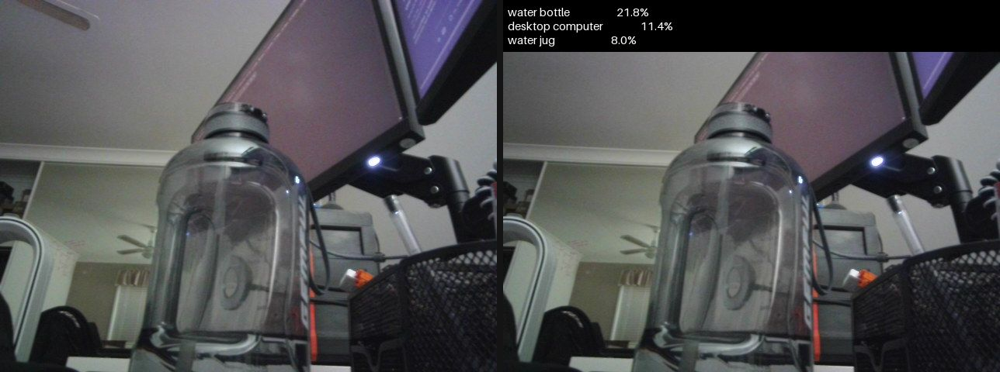

# Image Classification

Everything to know about assigning a label to an image: how classifiers work, the mid-2026 model landscape, evaluation metrics and their pitfalls, and runnable code to benchmark the leading open backbones.

Author

Benedict Thekkel

## 1. What is Image Classification?

Image classification maps a whole image to one label (or a set of labels) drawn from a **fixed, known list of classes**. It is the oldest and most studied task in modern computer vision, and it is the task that produced almost every backbone the rest of vision runs on: the encoder inside a detector, a segmenter, or a VLM was, historically, a classifier with its head cut off.

**Input.** An RGB image, resized and centre-cropped to the resolution the model was trained at (224x224 for most backbones, 384/448 for high-resolution variants), then normalised per channel with the mean/std the checkpoint was trained with. Getting this preprocessing wrong is the single most common cause of “the model is inexplicably bad” - always use the checkpoint’s own `AutoImageProcessor`, never a hand-rolled resize.

**Output.** A vector of `num_classes` logits. `softmax` turns it into a probability distribution; `argmax` gives the prediction and `topk` gives the top-5. Three variants matter:

| Variant | Output | Loss | Example |
|----|----|----|----|
| **Single-label** (multi-class) | exactly one class per image | softmax + cross-entropy | ImageNet-1k: is this a tabby or a golden retriever? |
| **Multi-label** | any number of classes per image | per-class sigmoid + BCE | tagging: “beach”, “sunset”, “two people” all true at once |
| **Fine-grained** | one class from many near-identical ones | softmax, but needs high resolution + local detail | 120 dog breeds, 196 car models, plant species |

The 1000 ImageNet classes are a strange mix (118 of them are dog breeds), so ImageNet accuracy is partly a fine-grained score in disguise.

**Neighbouring tasks** (separate models, often built on the same backbone):

| Task | What it does | Typical tool |
|----|----|----|
| Zero-shot classification | Classify against label names given at inference, no fixed class list, no fine-tuning | CLIP / SigLIP 2 - see `11_Zero_Shot_Image_Classification` |
| Object detection | *Where* is each object (boxes + classes) | see `02_Object_Detection` |
| Image segmentation | Per-pixel labels | see `03_Image_Segmentation` |
| Image feature extraction | The embedding, not the label (retrieval, clustering, linear probes) | see `16_Image_Feature_Extraction` |
| Image captioning | Free-form text instead of a label | see `05_Image_to_Text` |
| Video classification | Label a clip, not a frame | see `09_Video_Classification` |

**Classification vs zero-shot classification** is the fork worth internalising. A classifier has a *closed* label set baked into its head: it is fast, calibratable, and fine-tunable on your data, but it can only ever say one of its `N` classes, and adding class N+1 means retraining the head. A zero-shot model (CLIP/SigLIP) scores the image against *text prompts*, so the label set is whatever you type at inference - at the cost of accuracy, worse calibration, and sensitivity to prompt wording. If your classes are known and stable, train a head. If they change weekly, go zero-shot.

------------------------------------------------------------------------

## 2. Real-World Use Cases

“Image classification” covers deployments with nothing in common but the shape of the output tensor. A 3 MB model triaging conveyor-belt photos in 5 ms and a 300 M-parameter backbone reading pathology slides are the same task on paper only.

| Use case | Domain | Consumes / produces | Dominant constraint |
|----|----|----|----|
| Defect detection on the line | Manufacturing (Landing AI, Cognex) | Fixed-camera part photo -\> pass / defect class | Latency (ms, in-line), tiny defect ratio, near-zero false negatives |
| Diagnostic triage | Healthcare (diabetic retinopathy, dermatology, digital pathology) | Retinal fundus / slide tile -\> disease grade | Sensitivity at a fixed specificity; regulatory approval; calibrated probabilities |
| Content moderation | Trust and safety (Meta, TikTok, Cloudflare CSAM tooling) | Uploaded image -\> policy category | Throughput at billions/day; adversarial evasion; cost per image |
| Photo library organisation | Consumer (Google Photos, Apple Photos) | Personal photo -\> multi-label tags for search | On-device size and battery, privacy (no upload), latency amortised overnight |
| Species and biodiversity ID | Science / consumer (iNaturalist, Merlin Bird ID) | Phone photo -\> species (fine-grained, long-tailed) | Extreme class imbalance, tens of thousands of classes, open-set inputs |
| Retail / checkout-free stores | Retail (Amazon Just Walk Out) | Shelf-camera crop -\> SKU | Fine-grained near-duplicate packaging; cheap retraining when SKUs change |
| Satellite land-use mapping | Geospatial (EuroSAT, Sentinel-2 pipelines) | Multispectral tile -\> land cover class | Domain shift across sensors/seasons; non-RGB channels; batch, not latency |
| Wake-screen / camera scene modes | Mobile SoC | Live viewfinder frame -\> scene class steering the ISP | Sub-10 ms on an NPU, int8, fixed memory budget |

**What the ImageNet number hides.** Top-1 on ImageNet-1k val is a *balanced, closed-set, object-centric, clean-photo* number, and every one of those adjectives breaks in production. Real class distributions are long-tailed (a defect rate of 0.3% means a model that predicts “OK” always scores 99.7% accuracy). Real inputs are **open-set**: the model will be handed images from none of its classes and will confidently pick one anyway, because softmax must sum to 1. Real data **drifts** - a new camera, a new lens, a new lighting rig, a new SKU - and the model degrades silently because nobody is labelling production traffic. And the two headline robustness sets exist precisely because of this: **ImageNet-V2** (a fresh test set collected with the original protocol) drops accuracy by ~10 points for every model, and **ImageNet-A** (natural adversarial examples) still crushes ImageNet-trained CNNs. The failure modes that matter are not “0.5% lower top-1” but confident wrong answers on out-of-distribution inputs, miscalibrated probabilities feeding a downstream threshold, and a minority class the aggregate metric was never sensitive to in the first place.

------------------------------------------------------------------------

## 3. How Modern Image Classification Works

Five eras, and (unusually for deep learning) representatives of all of them are still competitive at some point on the size/accuracy curve:

1.  **The CNN breakthrough (2012-2015).** AlexNet (2012) won ILSVRC with 8 layers, ReLU, dropout and two GPUs, halving the error of hand-crafted features. VGG (2014) showed that depth with 3x3 convs was the whole trick. **ResNet** (2015) added the residual connection, which made 50-150 layer networks trainable at all and is still the single most reused idea in the field - ResNet-50 (25.6M params, 76.1% top-1) remains the default baseline everyone reports against.
2.  **Efficiency-optimised CNNs (2017-2020).** MobileNet (depthwise-separable convs), **EfficientNet** (2019, compound width/depth/resolution scaling via NAS), RegNet. This is the era that produced the models still shipping on phones, and MobileNetV4 (2024) is the current descendant.
3.  **Vision Transformers (2020).** **ViT** cuts the image into 16x16 patches, embeds them as tokens, and runs a plain transformer encoder. Its key finding was a *negative* one: with only ImageNet-1k it **loses** to ResNets, because it has no convolutional inductive bias (locality, translation equivariance) and has to learn it from data. Pretrain it on ImageNet-21k or JFT-300M and it wins. Then **DeiT** (2021) showed that the missing ingredient was mostly the *recipe* - heavy augmentation (RandAugment, mixup, CutMix), long schedules, and a distillation token from a CNN teacher - not the data. **AugReg** (“How to train your ViT”, 2021) hammered the point home: the same `ViT-B/16` architecture goes from ~81% to **85.1%** top-1 purely by changing augmentation and regularisation.
4.  **Hierarchical / hybrid attention (2021-2022).** Plain ViT has quadratic attention and one resolution, which is bad for dense tasks. **Swin** restores the CNN’s pyramid: local windowed attention that shifts between blocks, giving linear cost and multi-scale features - which is why Swin, not ViT, became the detection/segmentation backbone of that period. Then **ConvNeXt** (2022) ran the experiment in reverse: take a ResNet, apply the ViT recipe (patchify stem, depthwise 7x7 convs, LayerNorm, GELU, AdamW, heavy aug) and a pure CNN matches Swin. The conclusion the field settled on: **architecture matters far less than pretraining data and training recipe.**
5.  **Self-supervised backbones + a linear head (2023-2026).** The current default. **MAE** and **BEiT** (masked image modelling), **ConvNeXt V2** (2023, masked autoencoding for CNNs, 83.9% at 28M params), **EVA-02** (2023, MIM distilled from CLIP features - 88.7% top-1 at only 87M params, still one of the best accuracy-per-parameter points in existence), **DINOv2** (2023) and **DINOv3** (2025) (self-distillation with no labels, on billions of curated web images), plus the vision towers of image-text models (**SigLIP 2**, **AIMv2**, Meta’s **Perception Encoder**, and NVIDIA’s **C-RADIOv4** (2026), which distils SigLIP2 + DINOv3 + SAM3 into one encoder). The practical consequence: **you almost never train a classifier from scratch.** Take a frozen SSL backbone, fit a linear layer (or LoRA/full fine-tune) on your labels, and you beat a from-scratch CNN with 100x less labelled data. DINOv2’s own ImageNet linear probe hits 84.5% top-1 *with the backbone frozen*.

At the very top of ImageNet the benchmark is **saturated**: CoCa (91.0%), ViT-g/SoViT-400m (~90.3-90.5%), EVA-02-L (90.1%) - all giant models pretrained on private JFT/LAION-scale data, separated by fractions of a point that do not survive contact with a different test set.

**Trade-off cheat sheet:**

| Family | Params (base size) | ImageNet top-1 | Inductive bias | Data hunger | Best for |
|----|----|----|----|----|----|
| ResNet-50 | 25.6M | 76.1 (80.4 with a modern recipe) | strong (conv) | low | baselines, legacy, CPU |
| EfficientNet / MobileNetV4 | 4-21M | 74-84 | strong | low | edge, mobile NPUs |
| ViT-B/16 | 86M | 81 -\> 85.1 with AugReg | none | very high | anything with big pretraining |
| Swin-T | 28M | 81.4 | medium (windows) | medium | dense-prediction backbones |
| ConvNeXt V2-T | 28.6M | 83.9 | strong (conv) | medium | best CNN accuracy/param |
| EVA-02-B (448px) | 87M | 88.7 | none | very high | max accuracy on one GPU |
| Frozen SSL (DINOv2/v3) + linear | 86M+ | 84.5-85+ | none | n/a (frozen) | few labels, many downstream tasks |

------------------------------------------------------------------------

## 4. Evaluation Metrics

**Top-1 / top-5 accuracy.** The ImageNet convention. Top-1 is the fraction of images whose highest-scoring class is correct; top-5 counts a hit if the true class is anywhere in the five highest scores (a concession to the fact that ImageNet images often contain several objects).

$$\text{top-}k = \frac{1}{N}\sum_{i=1}^{N} \mathbb{1}\left[y_i \in \text{argtop}k\left(f(x_i)\right)\right]$$

**Precision, recall, F1 - and the macro/micro fork.** For class $c$:

$$P_c = \frac{TP_c}{TP_c + FP_c}, \qquad R_c = \frac{TP_c}{TP_c + FN_c}, \qquad F1_c = \frac{2 P_c R_c}{P_c + R_c}$$

- **Micro-F1** pools all TP/FP/FN across classes first. In single-label classification **micro-F1 is exactly equal to top-1 accuracy** - computing both and reporting them as two metrics is a common junior mistake.
- **Macro-F1** averages the per-class $F1_c$ with **equal weight per class**, so a class with 10 samples counts as much as one with 10,000. This is the metric that notices you are failing the rare classes.

**The class-imbalance trap.** If 80% of your test set is one class, a model that predicts only that class scores 80% accuracy (and 80% micro-F1) while being useless. Its macro-F1 collapses towards $1/C$. **Always report macro-F1 (or balanced accuracy, or per-class recall) alongside accuracy on any imbalanced problem** - which, in production, is all of them.

**Calibration (ECE).** Accuracy says nothing about whether the confidence is *meaningful*, and downstream systems threshold on that confidence. Expected Calibration Error bins predictions by confidence and measures the gap to observed accuracy:

$$ECE = \sum_{m=1}^{M} \frac{|B_m|}{N} \left| \text{acc}(B_m) - \text{conf}(B_m) \right|$$

Modern networks are systematically **over-confident** (a 99%-confidence bucket that is right 90% of the time). Temperature scaling - divide the logits by a single scalar $T$ fitted on a validation split - fixes most of it and costs nothing.

**Confusion matrix.** The only thing that tells you *what* the model confuses with *what*. Aggregate metrics hide structure: “84% top-1” can mean uniform mediocrity or perfection everywhere except two classes that are 50/50 with each other.

**Speed metrics.** Images/sec at a stated batch size, latency p50/p99 at batch 1 (what a user feels), params (M) and FLOPs/GMACs. Accuracy per unit latency is the real deployment axis - see the benchmark scatter in section 12.

The toy example below builds a deliberately imbalanced test set and a “lazy” model that has learned the majority class well and the rare ones badly - watch accuracy stay high while macro-F1 falls apart:

------------------------------------------------------------------------

``` python
import numpy as np

rng = np.random.default_rng(0)
n_classes = 10

# Imbalanced test set: class 0 is 80% of the data, classes 1-9 share the rest.
y_true = np.concatenate([np.zeros(400, int), np.repeat(np.arange(1, 10), 11)[:100]])
n = len(y_true)

# A "lazy" model: confident and correct on the majority class, weak on the rare ones,
# and biased towards predicting class 0 everywhere (the usual imbalanced-training failure).
logits = rng.normal(scale=1.0, size=(n, n_classes))
logits[np.arange(n), y_true] += np.where(y_true == 0, 3.0, 0.6)  # signal, strong only for class 0
logits[:, 0] += 1.0  # majority-class prior baked into the head

probs = np.exp(logits - logits.max(1, keepdims=True))
probs /= probs.sum(1, keepdims=True)
order = np.argsort(-probs, axis=1)  # classes sorted by score, best first
y_pred = order[:, 0]


def top_k_accuracy(order, y_true, k):
    "Fraction of samples whose true class is in the top-k scored classes."
    return float((order[:, :k] == y_true[:, None]).any(axis=1).mean())


def f1_scores(y_true, y_pred, n_classes):
    "Per-class F1, plus (macro, micro) averages. Micro-F1 == top-1 accuracy here."
    f1 = np.zeros(n_classes)
    for c in range(n_classes):
        tp = int(((y_pred == c) & (y_true == c)).sum())
        fp = int(((y_pred == c) & (y_true != c)).sum())
        fn = int(((y_pred != c) & (y_true == c)).sum())
        denom = 2 * tp + fp + fn
        f1[c] = 2 * tp / denom if denom else 0.0
    micro = float((y_pred == y_true).mean())  # single-label: micro-F1 collapses to accuracy
    return f1, float(f1.mean()), micro


def expected_calibration_error(probs, y_true, n_bins=10):
    "ECE: average |accuracy - confidence| over equal-width confidence bins."
    conf = probs.max(axis=1)
    correct = (probs.argmax(axis=1) == y_true).astype(float)
    edges = np.linspace(0, 1, n_bins + 1)
    ece = 0.0
    for lo, hi in zip(edges[:-1], edges[1:]):
        m = (conf > lo) & (conf <= hi)
        if m.any():
            ece += m.mean() * abs(correct[m].mean() - conf[m].mean())
    return float(ece)


f1, macro_f1, micro_f1 = f1_scores(y_true, y_pred, n_classes)

print(f"support        : class 0 = {(y_true == 0).sum()}, classes 1-9 = {(y_true != 0).sum()}")
print(f"top-1 accuracy : {top_k_accuracy(order, y_true, 1):.3f}   <- looks respectable")
print(f"top-5 accuracy : {top_k_accuracy(order, y_true, 5):.3f}")
print(f"micro-F1       : {micro_f1:.3f}   <- identical to top-1, by construction")
print(f"macro-F1       : {macro_f1:.3f}   <- the honest number")
print(f"F1 class 0     : {f1[0]:.3f}  |  mean F1 over rare classes: {f1[1:].mean():.3f}")
print(f"ECE (10 bins)  : {expected_calibration_error(probs, y_true):.3f}")
```

    support        : class 0 = 400, classes 1-9 = 99
    top-1 accuracy : 0.820   <- looks respectable
    top-5 accuracy : 0.940
    micro-F1       : 0.820   <- identical to top-1, by construction
    macro-F1       : 0.263   <- the honest number
    F1 class 0     : 0.957  |  mean F1 over rare classes: 0.185
    ECE (10 bins)  : 0.159

## 5. Datasets

| Dataset | Contents | Size | Scope | License | Typical use |
|----|----|----|----|----|----|
| [ImageNet-1k (ILSVRC2012)](https://huggingface.co/datasets/ILSVRC/imagenet-1k) | Object-centric web photos | 1.28M train / 50k val / 1000 classes | General objects (118 dog breeds!) | Research-only terms; **gated on HF** | *The* benchmark; pretraining |
| [ImageNet-21k / -12k](https://huggingface.co/datasets/timm/imagenet-12k-wds) | Full WordNet hierarchy | 14M images / 21,841 classes | General | Research-only; gated | Pretraining before in1k fine-tune |
| [evanarlian/imagenet_1k_resized_256](https://huggingface.co/datasets/evanarlian/imagenet_1k_resized_256) | ImageNet-1k, shortest side resized to 256 | 1.28M train / 50k `val` | Same 1000 classes, same label order | ImageNet terms | **This notebook evaluates here** (ungated mirror) |
| [CIFAR-10 / CIFAR-100](https://huggingface.co/datasets/uoft-cs/cifar10) | 32x32 tiny images | 50k train / 10k test | 10 / 100 classes | MIT-ish, free | Fast sanity checks, ablations, teaching |
| [Food-101](https://huggingface.co/datasets/ethz/food101) | Dishes, noisy training labels | 101k / 101 classes | Fine-grained food | Research use | The standard fine-tuning demo |
| [Oxford-IIIT Pets](https://huggingface.co/datasets/timm/oxford-iiit-pet) | 37 cat/dog breeds | 7.4k | Fine-grained | CC BY-SA 4.0 | Fine-grained transfer, few labels |
| [Imagenette](https://github.com/fastai/imagenette) | 10 *easily separable* ImageNet classes | ~13k | Subset of ImageNet-1k | Same as ImageNet | Prototyping without a 150 GB download |
| [ImageNet-V2](https://huggingface.co/datasets/vaishaal/ImageNetV2) | A *new* test set, original protocol | 10k / 1000 classes | Distribution-shift probe | ImageNet terms | Measures how much you overfit the val set |
| [ImageNet-A](https://huggingface.co/datasets/barkermrl/imagenet-a) | Natural adversarial photos ResNet-50 gets wrong | 7.5k / 200 classes | Hard real images | MIT | Robustness / worst-case |
| [ImageNet-R](https://huggingface.co/datasets/axiong/imagenet-r) | Art, sketches, origami, toys of ImageNet classes | 30k / 200 classes | Rendition shift | MIT | Texture-vs-shape bias, robustness |

**Why the robustness sets matter.** Every model on this page was tuned, directly or by the community’s collective hill-climbing, against the same 50k ImageNet validation images. ImageNet-V2 re-runs the original collection protocol on fresh photos and every model loses ~10 points - proof that some of the last decade of progress is validation-set overfitting. ImageNet-A and -R then ask whether the model learned *objects* or *textures and backgrounds*; the gap between a CNN and a large SSL/CLIP-pretrained ViT is far wider there than on the val set. If you only ever report in-distribution top-1, you have not measured the thing you care about.

**Gating.** `ILSVRC/imagenet-1k` and the timm WDS mirrors require accepting the ImageNet terms on the Hub (and an `HF_TOKEN`). The `evanarlian/imagenet_1k_resized_256` mirror used below is ungated and carries the same 1000 `ClassLabel`s **in the standard index order**, so its labels line up directly with every HF ImageNet classifier’s `id2label`.

------------------------------------------------------------------------

## 6. The Model Landscape (mid-2026)

Papers-with-Code (the historical leaderboard home) was shut down in July 2025; the living, reproducible ranking is now the [timm results table](https://github.com/huggingface/pytorch-image-models/blob/main/results/results-imagenet.csv) - every number below is from it, measured on the same 50k images with the checkpoint’s own preprocessing. The HF hub filter for the task is [models?pipeline_tag=image-classification](https://huggingface.co/models?pipeline_tag=image-classification).

| Model | Params | License | Res | Top-1 / Top-5 | Architecture | Best for |
|----|----|----|----|----|----|----|
| [microsoft/resnet-50](https://huggingface.co/microsoft/resnet-50) | 25.6M | Apache 2.0 | 224 | 76.1 / 92.9 | CNN, residual | the universal baseline |
| [timm/resnet50.a1_in1k](https://huggingface.co/timm/resnet50.a1_in1k) | 25.6M | Apache 2.0 | 224 | 80.4 / 94.6 | same CNN, modern recipe | proof that the recipe, not the architecture, moved 4 points |
| [google/vit-base-patch16-224](https://huggingface.co/google/vit-base-patch16-224) | 86.6M | Apache 2.0 | 224 | ~81 / ~96 | plain ViT (in21k -\> in1k) | the reference transformer |
| [timm/vit_base_patch16_224.augreg2_in21k_ft_in1k](https://huggingface.co/timm/vit_base_patch16_224.augreg2_in21k_ft_in1k) | 86.6M | Apache 2.0 | 224 | 85.1 / 97.5 | same ViT-B/16, AugReg recipe | best plain-ViT-B checkpoint |
| [microsoft/swin-tiny-patch4-window7-224](https://huggingface.co/microsoft/swin-tiny-patch4-window7-224) | 28.3M | Apache 2.0 | 224 | 81.4 / 95.5 | hierarchical windowed attention | dense-prediction backbones |
| [facebook/convnext-tiny-224](https://huggingface.co/facebook/convnext-tiny-224) | 28.6M | Apache 2.0 | 224 | 82.1 / 95.9 | modernised CNN | CNN parity with Swin |
| [facebook/convnextv2-tiny-22k-224](https://huggingface.co/facebook/convnextv2-tiny-22k-224) | 28.6M | Apache 2.0 | 224 | 83.9 / 97.0 | ConvNeXt + FCMAE pretraining | best accuracy/param under 30M |
| [facebook/dinov2-base-imagenet1k-1-layer](https://huggingface.co/facebook/dinov2-base-imagenet1k-1-layer) | 86.6M | Apache 2.0 | 224 | ~84.5 (linear probe) | frozen SSL ViT + 1 linear layer | few labels, one backbone for many tasks |
| [timm/eva02_base_patch14_448.mim_in22k_ft_in22k_in1k](https://huggingface.co/timm/eva02_base_patch14_448.mim_in22k_ft_in22k_in1k) | 87.1M | MIT | 448 | **88.7 / 98.7** | ViT + MIM distilled from CLIP | max accuracy that still fits easily on one 12 GB card |
| [timm/tf_efficientnetv2_s.in21k_ft_in1k](https://huggingface.co/timm/tf_efficientnetv2_s.in21k_ft_in1k) | 21.5M | Apache 2.0 | 384 | 84.3 / 97.3 | NAS-scaled CNN | accuracy on a CPU/edge budget |
| [timm/mobilenetv4_conv_small.e2400_r224_in1k](https://huggingface.co/timm/mobilenetv4_conv_small.e2400_r224_in1k) | 3.8M | Apache 2.0 | 224 | 73.8 / 91.4 | depthwise CNN | phone NPU, int8, sub-10 ms |
| [facebook/dinov3-vitb16-pretrain-lvd1689m](https://huggingface.co/facebook/dinov3-vitb16-pretrain-lvd1689m) | 86M | DINOv3 license (**gated**) | 224+ | ~85 (linear probe) | SSL ViT, 1.7B curated images | strongest frozen features of 2026 |
| timm/eva02_large_patch14_448.mim_m38m_ft_in22k_in1k | 305M | MIT | 448 | 90.1 / 99.1 | ViT-L | near-SOTA; **fits in 12 GB but slow** |
| CoCa / ViT-g / SoViT-400m / InternImage-H | 1B-22B | mostly closed weights | \- | 89.6-91.0 | giant ViTs on JFT/LAION-scale data | leaderboard only; **will not fit on a 12 GB card** |

**Who wins what.** On **pure accuracy per GPU-hour of yours**, EVA-02-B at 448px is the standout: 88.7% top-1 from 87M params, i.e. it beats ConvNeXt V2-T by ~5 points for 3x the parameters but ~5x the compute (448px, patch 14, so ~1024 tokens). On **accuracy per parameter and per millisecond**, ConvNeXt V2-T is the sweet spot and is what most “just make it good and fast” services should use. On **edge** (section 2’s phone/NPU and in-line-inspection rows), MobileNetV4 and EfficientNetV2-S are the only serious options - a 3.8M-param model that runs int8 on an NPU is worth more than 10 points of top-1 you cannot afford. On **few labels** (the medical and biodiversity rows, where labelling is the cost), a frozen DINOv2/DINOv3 backbone plus a linear head is the correct default: no backbone training, one feature extraction pass, and you can swap the head per task. And the top of the table - CoCa, ViT-g - is a research artefact: closed weights, JFT-scale private data, and a fraction of a point apart.

------------------------------------------------------------------------

## 7. Setup

Everything below runs on a 12 GB RTX 3060 (or CPU, slowly), and **every model loads through Hugging Face `transformers`**. Package roles:

- `transformers` (\>=5.13) + `torch` - all five backbones. Note `transformers` also loads **timm** checkpoints natively through `TimmWrapperForImageClassification`, so a `timm/...` id drops into `AutoModelForImageClassification` and the `image-classification` pipeline exactly like a native one; `timm` is the standard general-purpose backbone library, not a vendor package.
- `accelerate` - device placement.
- `datasets` - the ImageNet-1k validation mirror (with labels).
- `pillow` - image loading/display (ECharts cannot draw pixels; PIL does that).
- `pyecharts` - every chart in this notebook.
- `pandas` - the benchmark table.

The `val` split of the eval dataset is ~750 MB and caches into `DL_tasks/datasets/` (gitignored) on first run.

------------------------------------------------------------------------

``` python
# Everything runs through Hugging Face transformers - no vendor packages.
# %pip install -q torch transformers datasets accelerate timm pillow pyecharts pandas
```

``` python
import ctypes
import ctypes.util
import gc
import time
import urllib.request
from pathlib import Path

import torch
from dotenv import find_dotenv, load_dotenv

# Knowledge/.env sets HF_TOKEN - authenticated HF Hub requests get higher rate limits
load_dotenv(find_dotenv(usecwd=True))

device = "cuda:0" if torch.cuda.is_available() else "cpu"
dtype = torch.float16 if device != "cpu" else torch.float32
if device != "cpu":
    print(torch.cuda.get_device_name(0))
print("device:", device)

def vram(tag=""):
    "Report current GPU memory (allocated / reserved). No-op on CPU."
    if torch.cuda.is_available():
        alloc = torch.cuda.memory_allocated() / 1e9
        reserved = torch.cuda.memory_reserved() / 1e9
        print(f"VRAM {tag:20s} {alloc:5.2f} GB allocated / {reserved:5.2f} GB reserved")

def free_memory():
    "Collect garbage, empty the CUDA cache, and return freed CPU RAM to the OS."
    gc.collect()
    if torch.cuda.is_available():
        torch.cuda.empty_cache()
        torch.cuda.ipc_collect()
    # glibc keeps freed CPU allocations in its arenas instead of returning them
    # to the OS, so RSS compounds across model sections (cpu-offloaded weights
    # live in system RAM). malloc_trim(0) hands the freed arenas back. See
    # dl-visualization-and-memory.md - not optional on a 12 GB box.
    try:
        ctypes.CDLL(ctypes.util.find_library("c") or "libc.so.6").malloc_trim(0)
    except Exception:
        pass

# All downloads go to DL_tasks/datasets/ (gitignored)
DATA_DIR = Path("../../datasets")
DATA_DIR.mkdir(exist_ok=True)
HF_CACHE = str(DATA_DIR / "hf_cache")
```

    NVIDIA GeForce RTX 3060
    device: cuda:0

``` python
from datasets import ClassLabel, load_dataset, load_dataset_builder
from PIL import Image

# The canonical COCO cats photo - two cats on a pink sofa with two remotes.
SAMPLE = DATA_DIR / "cats.jpg"
if not SAMPLE.exists():
    urllib.request.urlretrieve("http://images.cocodataset.org/val2017/000000039769.jpg", SAMPLE)
image = Image.open(SAMPLE).convert("RGB")

# ImageNet-1k validation, ungated mirror (shortest side resized to 256px), 50,000
# labelled images. Load ONLY the validation shards: a plain
# load_dataset(..., split="val") downloads every data file in the repo first - the
# 52 train shards (~23 GB) as well - and then splits, which fills a small disk. Using
# the generic "parquet" loader on an hf:// glob fetches just the 2 val shards (~0.9 GB)
# and takes its split set from the data_files keys, so it does not trip the repo's
# declared train/test/val verification (ExpectedMoreSplitsError). The ClassLabel names
# come from the dataset metadata (no image download) and are cast back onto the
# plain-int label column, so `label` lines up with every HF classifier's id2label in
# standard ImageNet index order, no remapping needed.
IMAGENET_LABELS = load_dataset_builder(
    "evanarlian/imagenet_1k_resized_256"
).info.features["label"].names

val = load_dataset(
    "parquet",
    data_files={"val": "hf://datasets/evanarlian/imagenet_1k_resized_256/data/val-*.parquet"},
    split="val",
    cache_dir=HF_CACHE,
).cast_column("label", ClassLabel(names=IMAGENET_LABELS))

EVAL_N = 200  # a smoke-test slice; the full split is 50k images
eval_ds = val.shuffle(seed=0).select(range(EVAL_N))

print(val)
print("class 281 =", IMAGENET_LABELS[281])
print("eval sample labels:", [IMAGENET_LABELS[l].split(",")[0] for l in eval_ds["label"][:5]])
image.resize((image.width // 2, image.height // 2))
```

    Dataset({
        features: ['image', 'label'],
        num_rows: 50000
    })
    class 281 = tabby, tabby cat
    eval sample labels: ['confectionery', 'chambered nautilus', 'golden retriever', 'gondola', 'Airedale']


## 8. ResNet-50: the CNN baseline

The model every paper still reports against: 25.6M params, 76.1% top-1, residual blocks, 2015. It is the honest floor for this task - if a modern approach cannot beat ResNet-50 on your data, the problem is your data, not the architecture. `microsoft/resnet-50` is the original torchvision-recipe weights; `timm/resnet50.a1_in1k` is the *same network* retrained with a 2021 recipe and scores 80.4%, which is the single cheapest 4 points in computer vision.

The `image-classification` pipeline handles resize, centre-crop, normalisation and softmax for you.

------------------------------------------------------------------------

``` python
from transformers import pipeline

clf = pipeline(
    "image-classification",
    model="microsoft/resnet-50",
    device=device,
    dtype=dtype,
    model_kwargs={"cache_dir": HF_CACHE},
)

t0 = time.perf_counter()
preds = clf(image, top_k=5)
print(f"{time.perf_counter() - t0:.2f}s")
for p in preds:
    print(f"{p['score']:6.2%}  {p['label']}")

del clf
free_memory()
vram("after resnet-50")
```

    0.25s
    93.95%  tiger cat
     3.57%  tabby, tabby cat
     0.17%  remote control, remote
     0.15%  Egyptian cat
     0.08%  jinrikisha, ricksha, rickshaw
    VRAM after resnet-50       0.01 GB allocated /  0.02 GB reserved

## 9. ViT-B/16: the transformer baseline

`google/vit-base-patch16-224`: 224x224 image -\> 196 patches of 16x16 -\> a plain 12-layer transformer encoder, classified from the `[CLS]` token. Pretrained on ImageNet-21k, fine-tuned on ImageNet-1k. This is the checkpoint most vision-transformer tutorials use and the ancestor of nearly every modern vision backbone (CLIP, SigLIP, DINOv2 and EVA are all ViTs with different pretraining).

Here we drive it with the processor/model API instead of the pipeline, because that is the shape you need for batching, custom heads, and fine-tuning. Note the raw output is **logits**, not probabilities - `softmax` them before you threshold on anything.

------------------------------------------------------------------------

``` python
from transformers import AutoImageProcessor, AutoModelForImageClassification

vit_id = "google/vit-base-patch16-224"
processor = AutoImageProcessor.from_pretrained(vit_id, cache_dir=HF_CACHE)
model = AutoModelForImageClassification.from_pretrained(vit_id, dtype=dtype, cache_dir=HF_CACHE).to(device).eval()

inputs = processor(images=image, return_tensors="pt").to(device=device, dtype=dtype)
print("pixel_values:", tuple(inputs["pixel_values"].shape))  # (1, 3, 224, 224)

t0 = time.perf_counter()
with torch.inference_mode():
    logits = model(**inputs).logits.float()  # (1, 1000) - raw scores, not probabilities
print(f"{time.perf_counter() - t0:.2f}s")

probs = logits.softmax(-1)[0]
top5 = probs.topk(5)
for score, idx in zip(top5.values.tolist(), top5.indices.tolist()):
    print(f"{score:6.2%}  [{idx:3d}] {model.config.id2label[idx]}")

del model, processor, inputs, logits, probs
free_memory()
vram("after vit-base")
```

    pixel_values: (1, 3, 224, 224)
    0.05s
    93.71%  [285] Egyptian cat
     3.87%  [281] tabby, tabby cat
     1.45%  [282] tiger cat
     0.33%  [287] lynx, catamount
     0.07%  [284] Siamese cat, Siamese
    VRAM after vit-base        0.01 GB allocated /  0.02 GB reserved

## 10. ConvNeXt V2-T: the modernised CNN

ConvNeXt (2022) took a ResNet and applied every ViT design decision - patchify stem, depthwise 7x7 convolutions, inverted bottlenecks, LayerNorm, GELU, AdamW, heavy augmentation - and matched Swin without a single attention layer. **ConvNeXt V2** (2023) then added the missing piece, self-supervised pretraining: a fully-convolutional masked autoencoder (FCMAE) plus a Global Response Normalization layer to stop feature collapse.

`facebook/convnextv2-tiny-22k-224` is the accuracy/param sweet spot of this notebook: **83.9% top-1 from 28.6M params**, beating ViT-B/16’s original checkpoint with a third of the parameters, and it is a plain CNN, so it quantises and runs on edge hardware far more gracefully than a ViT.

------------------------------------------------------------------------

``` python
convnext = pipeline(
    "image-classification",
    model="facebook/convnextv2-tiny-22k-224",
    device=device,
    dtype=dtype,
    model_kwargs={"cache_dir": HF_CACHE},
)

t0 = time.perf_counter()
preds = convnext(image, top_k=5)
print(f"{time.perf_counter() - t0:.2f}s")
for p in preds:
    print(f"{p['score']:6.2%}  {p['label']}")

del convnext
free_memory()
vram("after convnextv2-tiny")
```

    0.53s
    61.79%  tabby, tabby cat
    20.30%  tiger cat
     3.89%  Egyptian cat
     1.46%  remote control, remote
     0.50%  sleeping bag
    VRAM after convnextv2-tiny  0.01 GB allocated /  0.02 GB reserved

## 11. DINOv2 + a linear head: the frozen-backbone default

This is how classification is actually done in 2026 when you have a few thousand labels instead of a million. **DINOv2** (Meta, 2023) is a ViT trained with *no labels at all* - self-distillation on 142M curated images. `facebook/dinov2-base-imagenet1k-1-layer` is that frozen backbone with **one linear layer** fitted on ImageNet: ~84.5% top-1, i.e. a single matrix multiply on frozen features beats a fully fine-tuned ViT-B/16 and every from-scratch CNN below 30M params.

The practical recipe for your own data: run every image through the frozen backbone once, cache the embeddings, then fit a logistic regression / linear layer on them. Training takes seconds on a CPU, needs no augmentation, and cannot overfit the backbone. Fine-tune only if the linear probe is not good enough.

**DINOv3** (2025) is the stronger successor (1.7B images, better dense features), but its checkpoints are **gated** on the Hub - `facebook/dinov3-vitb16-pretrain-lvd1689m` requires accepting Meta’s terms and an `HF_TOKEN`, so this notebook uses DINOv2 to stay runnable out of the box. See `16_Image_Feature_Extraction` for the embedding side of this, and `11_Zero_Shot_Image_Classification` for the no-head-at-all alternative.

------------------------------------------------------------------------

``` python
dinov2_id = "facebook/dinov2-base-imagenet1k-1-layer"
processor = AutoImageProcessor.from_pretrained(dinov2_id, cache_dir=HF_CACHE)
model = AutoModelForImageClassification.from_pretrained(dinov2_id, dtype=dtype, cache_dir=HF_CACHE).to(device).eval()

# The head really is one nn.Linear on top of a frozen ViT-B/14 encoder:
print("classifier head:", model.classifier)

inputs = processor(images=image, return_tensors="pt").to(device=device, dtype=dtype)
t0 = time.perf_counter()
with torch.inference_mode():
    probs = model(**inputs).logits.float().softmax(-1)[0]
print(f"{time.perf_counter() - t0:.2f}s")

top5 = probs.topk(5)
for score, idx in zip(top5.values.tolist(), top5.indices.tolist()):
    print(f"{score:6.2%}  {model.config.id2label[idx]}")

del model, processor, inputs, probs
free_memory()
vram("after dinov2")
```

    classifier head: Linear(in_features=1536, out_features=1000, bias=True)
    0.01s
    44.96%  tabby, tabby cat
    28.36%  tiger cat
    18.60%  Egyptian cat
     1.06%  radiator
     0.95%  remote control, remote
    VRAM after dinov2          0.01 GB allocated /  0.02 GB reserved

## 12. Head-to-head Benchmark

Five backbones, the same 200 ImageNet-1k validation images, the same metric, **one model live at a time**. Each model brings its own `AutoImageProcessor`, so each gets its own correct resize/crop/normalisation - which is the point: comparing backbones under a shared hand-rolled transform is the classic way to accidentally hobble one of them.

`timm/eva02_base_patch14_448...` loads through `transformers` via the `TimmWrapper` integration, so a timm checkpoint needs no special code path. It runs at 448px with patch-14, so ~1024 tokens per image - expect it to be several times slower than the 224px models, and expect it to be several points more accurate.

**Hardware and caveats:** RTX 3060 (12 GB), fp16, batch size 16, 200 images. Two hundred images out of 50,000 gives a standard error of roughly +/-2.5 points on top-1, so this is a **smoke test, not a leaderboard** - treat differences under ~5 points as noise, and use the [timm results table](https://github.com/huggingface/pytorch-image-models/blob/main/results/results-imagenet.csv) for real numbers. The images/sec figure includes preprocessing on the CPU (4 vCPU here), which is itself a bottleneck for the 448px model.

------------------------------------------------------------------------

``` python
BACKBONES = [
    "microsoft/resnet-50",
    "google/vit-base-patch16-224",
    "microsoft/swin-tiny-patch4-window7-224",
    "facebook/convnextv2-tiny-22k-224",
    "timm/eva02_base_patch14_448.mim_in22k_ft_in22k_in1k",  # timm ids load via TimmWrapper
]
BATCH_SIZE = 16


@torch.inference_mode()
def evaluate(model_id, ds, batch_size=BATCH_SIZE):
    "Top-1 / top-5 / images-per-sec for one checkpoint. Frees the model before returning."
    proc = AutoImageProcessor.from_pretrained(model_id, cache_dir=HF_CACHE)
    model = AutoModelForImageClassification.from_pretrained(
        model_id, dtype=dtype, cache_dir=HF_CACHE
    ).to(device).eval()
    params_m = sum(p.numel() for p in model.parameters()) / 1e6

    hits1 = hits5 = 0
    t0 = time.perf_counter()
    for i in range(0, len(ds), batch_size):
        batch = ds[i : i + batch_size]
        images = [im.convert("RGB") for im in batch["image"]]
        labels = torch.tensor(batch["label"])
        inputs = proc(images=images, return_tensors="pt").to(device=device, dtype=dtype)
        logits = model(**inputs).logits.float().cpu()  # move off the GPU before the next batch
        top5 = logits.topk(5, dim=-1).indices
        hits1 += int((top5[:, 0] == labels).sum())
        hits5 += int((top5 == labels[:, None]).any(dim=-1).sum())
        del inputs, logits, images
    elapsed = time.perf_counter() - t0

    del model, proc  # never hold two backbones live at once
    free_memory()
    return {
        "model": model_id.split("/")[-1].split(".")[0],
        "top1": hits1 / len(ds),
        "top5": hits5 / len(ds),
        "img_per_s": len(ds) / elapsed,
        "params_m": params_m,
    }


results = []
for model_id in BACKBONES:
    r = evaluate(model_id, eval_ds)
    results.append(r)
    print(f"{r['model']:32s} top1 {r['top1']:6.1%}  top5 {r['top5']:6.1%}  "
          f"{r['img_per_s']:6.1f} img/s  {r['params_m']:5.1f}M params")

vram("after benchmark")
```

    resnet-50                        top1  76.5%  top5  95.5%   188.9 img/s   25.6M params

    vit-base-patch16-224             top1  79.0%  top5  95.5%   285.5 img/s   86.6M params

    swin-tiny-patch4-window7-224     top1  78.0%  top5  96.0%   325.3 img/s   28.3M params

    convnextv2-tiny-22k-224          top1  80.0%  top5  97.5%   109.2 img/s   28.6M params

    [transformers] Requested torchvision backend is not available. Falling back to pil backend.

    eva02_base_patch14_448           top1  88.5%  top5  98.5%    55.7 img/s   87.1M params
    VRAM after benchmark       0.01 GB allocated /  0.02 GB reserved

``` python
from pyecharts.globals import CurrentConfig

# assets.pyecharts.org serves an expired TLS certificate from most nodes (2026-11-11),
# so charts failed to load. jsDelivr mirrors the same assets, pinned to one commit.
CurrentConfig.ONLINE_HOST = "https://cdn.jsdelivr.net/gh/pyecharts/pyecharts-assets@f2328d558550046fc5449672a6850e848e141590/assets/v6/"

import pandas as pd
from IPython.display import display
from pyecharts import options as opts
from pyecharts.charts import Bar, Scatter

df = pd.DataFrame(results).sort_values("top1", ascending=False).reset_index(drop=True)
df["top1_pct"] = (100 * df["top1"]).round(1)
df["top5_pct"] = (100 * df["top5"]).round(1)
display(df[["model", "top1_pct", "top5_pct", "img_per_s", "params_m"]].round(1))

bar = (
    Bar()
    .add_xaxis(df["model"].tolist())
    .add_yaxis("top-1 (%)", df["top1_pct"].tolist())
    .add_yaxis("top-5 (%)", df["top5_pct"].tolist())
    .set_global_opts(
        title_opts=opts.TitleOpts(
            title="ImageNet-1k accuracy", subtitle=f"{EVAL_N} val images, RTX 3060, fp16"
        ),
        xaxis_opts=opts.AxisOpts(name="backbone", axislabel_opts=opts.LabelOpts(rotate=25)),
        yaxis_opts=opts.AxisOpts(name="accuracy (%)", min_=0, max_=100),
        tooltip_opts=opts.TooltipOpts(trigger="axis"),
        legend_opts=opts.LegendOpts(pos_right="2%"),
    )
)
bar.render_notebook()
```

|     | model                        | top1_pct | top5_pct | img_per_s | params_m |
|-----|------------------------------|----------|----------|-----------|----------|
| 0   | eva02_base_patch14_448       | 88.5     | 98.5     | 55.7      | 87.1     |
| 1   | convnextv2-tiny-22k-224      | 80.0     | 97.5     | 109.2     | 28.6     |
| 2   | vit-base-patch16-224         | 79.0     | 95.5     | 285.5     | 86.6     |
| 3   | swin-tiny-patch4-window7-224 | 78.0     | 96.0     | 325.3     | 28.3     |
| 4   | resnet-50                    | 76.5     | 95.5     | 188.9     | 25.6     |

``` python
# The real deployment axis: accuracy vs throughput, with model size as the bubble.
scatter = Scatter().add_xaxis([round(v, 1) for v in df["img_per_s"].tolist()])
for row in df.itertuples():
    scatter.add_yaxis(
        series_name=row.model,
        y_axis=[[round(row.img_per_s, 1), float(row.top1_pct)]],
        symbol_size=max(12, min(60, float(row.params_m) ** 0.5 * 5)),  # area ~ params
        label_opts=opts.LabelOpts(is_show=False),
    )
scatter.set_global_opts(
    title_opts=opts.TitleOpts(
        title="Accuracy vs speed", subtitle="bubble area ~ parameter count; up and to the right wins"
    ),
    xaxis_opts=opts.AxisOpts(type_="value", name="images / sec", splitline_opts=opts.SplitLineOpts(is_show=True)),
    yaxis_opts=opts.AxisOpts(type_="value", name="top-1 (%)", min_=50, splitline_opts=opts.SplitLineOpts(is_show=True)),
    tooltip_opts=opts.TooltipOpts(formatter="{a}: {c} (img/s, top-1 %)"),
    legend_opts=opts.LegendOpts(pos_top="8%", pos_right="1%", orient="vertical"),
)
scatter.render_notebook()
```

## 13. The Confusion Matrix: where the aggregate number hides the failure

Top-1 tells you *how often*; only a confusion matrix tells you *what for what*. ImageNet’s five domestic-cat classes (`tabby`, `tiger cat`, `Persian cat`, `Siamese cat`, `Egyptian cat`) are a notorious cluster: `tabby` and `tiger cat` are barely distinguishable even for humans, and a large share of every model’s “errors” on them are arguably annotation disagreements rather than model failures.

Below: all 250 validation images of those five classes (50 each), classified by ConvNeXt V2-T, with anything predicted outside the group folded into an `other` column. Read along a row to see what a true class gets called. This is exactly the structure that a single 84% number erases - and the reason a per-class recall breakdown belongs in every model report.

------------------------------------------------------------------------

``` python
from pyecharts.charts import HeatMap

CAT_IDS = [281, 282, 283, 284, 285]  # tabby, tiger cat, Persian cat, Siamese cat, Egyptian cat
CAT_NAMES = [IMAGENET_LABELS[i].split(",")[0] for i in CAT_IDS]

# Filter on the label column only (input_columns) so no image is decoded during the scan.
cats = val.filter(lambda label: label in CAT_IDS, input_columns="label")
print(cats, "\nclasses:", CAT_NAMES)

cm_id = "facebook/convnextv2-tiny-22k-224"
proc = AutoImageProcessor.from_pretrained(cm_id, cache_dir=HF_CACHE)
model = AutoModelForImageClassification.from_pretrained(cm_id, dtype=dtype, cache_dir=HF_CACHE).to(device).eval()

# rows = true class, cols = predicted class (+ an "other" bucket for the other 995 classes)
counts = [[0] * (len(CAT_IDS) + 1) for _ in CAT_IDS]
with torch.inference_mode():
    for i in range(0, len(cats), 16):
        batch = cats[i : i + 16]
        inputs = proc(images=[im.convert("RGB") for im in batch["image"]], return_tensors="pt")
        pred = model(**inputs.to(device=device, dtype=dtype)).logits.float().argmax(-1).cpu().tolist()
        for true_id, pred_id in zip(batch["label"], pred):
            col = CAT_IDS.index(pred_id) if pred_id in CAT_IDS else len(CAT_IDS)
            counts[CAT_IDS.index(true_id)][col] += 1
        del inputs

del model, proc
free_memory()

recall = [row[i] / max(1, sum(row)) for i, row in enumerate(counts)]
for name, row, r in zip(CAT_NAMES, counts, recall):
    print(f"{name:12s} recall {r:5.1%}   {row}")
print(f"macro recall over the 5 cat classes: {sum(recall) / len(recall):.1%}")
```

    Dataset({
        features: ['image', 'label'],
        num_rows: 250
    }) 
    classes: ['tabby', 'tiger cat', 'Persian cat', 'Siamese cat', 'Egyptian cat']

    tabby        recall 60.0%   [30, 4, 1, 0, 13, 2]
    tiger cat    recall 16.0%   [16, 8, 0, 0, 8, 18]
    Persian cat  recall 96.0%   [1, 0, 48, 0, 1, 0]
    Siamese cat  recall 94.0%   [2, 0, 1, 47, 0, 0]
    Egyptian cat recall 76.0%   [3, 1, 0, 3, 38, 5]
    macro recall over the 5 cat classes: 68.4%

``` python
cols = CAT_NAMES + ["other"]
# HeatMap wants [x_index, y_index, value]; y is inverted so row 0 renders at the top.
data = [[x, len(CAT_NAMES) - 1 - y, counts[y][x]] for y in range(len(CAT_NAMES)) for x in range(len(cols))]

heat = (
    HeatMap()
    .add_xaxis(cols)
    .add_yaxis(
        "count",
        list(reversed(CAT_NAMES)),
        data,
        label_opts=opts.LabelOpts(is_show=True, position="inside", color="#111"),
    )
    .set_global_opts(
        title_opts=opts.TitleOpts(
            title="Confusion matrix: ImageNet cat classes",
            subtitle="ConvNeXt V2-T, 250 val images (50 per class). rows = truth, cols = prediction",
        ),
        xaxis_opts=opts.AxisOpts(name="predicted", axislabel_opts=opts.LabelOpts(rotate=25)),
        yaxis_opts=opts.AxisOpts(name="true"),
        visualmap_opts=opts.VisualMapOpts(min_=0, max_=50, orient="vertical", pos_right="2%"),
        tooltip_opts=opts.TooltipOpts(is_show=True),
    )
)
heat.render_notebook()
```

## 14. Live Webcam Demo

Classify the camera stream with a fast model (ConvNeXt V2-Tiny, 28M params). The right pane carries the top-3 predictions burned into the frame, and the status line adds the running end-to-end FPS.

Point it at a few different objects and watch the confidences move. The interesting failure is not a wrong label, it is a **confident** wrong label on a frame that happens to look like something in ImageNet - which is the whole argument for the zero-shot models in `11_Zero_Shot_Image_Classification`.

The view is **live**: the left pane is the raw camera, the right pane is the same frame after the model, and both update in place through a display handle - no `cv2.imshow`, no GUI, so it works over JupyterLab against a headless container. A status line underneath carries the running FPS and the per-frame numbers. It runs for `STREAM_SECONDS` seconds; interrupt the kernel to stop it early.

Two things throttle the frame rate before the model does, both measured on this machine: **auto-exposure** drops the sensor to 15 FPS in a dim room (take exposure off auto to pin 30), and setting `CAP_PROP_BUFFERSIZE` **halves** the delivered rate on the V4L2 backend, so the helper deliberately does not set it.

Needs a real camera at `/dev/video0` - the cell raises rather than substituting stand-in images. The docs builder never runs it (`skip_exec: true`).

------------------------------------------------------------------------

``` python
# opencv-python-headless is a project dependency; the headless build captures from
# V4L2 fine, it only drops the GUI windows.
import io
import time

import cv2
import numpy as np
import torch
from IPython.display import Image as IPyImage
from IPython.display import Pretty, display
from PIL import Image, ImageDraw, ImageFont

CAM = 0              # /dev/video0
WARMUP = 10          # throwaway reads - auto-exposure and white balance need to settle
STREAM_SECONDS = 15  # how long a live demo runs; interrupt the kernel to stop early


def bootstrap(*names, notebook, sections):
    """Make this demo runnable on a cold kernel, without duplicating the notebook.

    The demo builds on the notebook's setup and helper cells. Instead of making you
    run them by hand - or copying them in here and letting the copies drift - this
    reads the notebook file and executes those sections itself, and only when a name
    is actually missing. Run the notebook top to bottom and it does nothing at all.
    It stops as soon as every required name exists, so trailing benchmark cells in a
    section are not run.
    """
    if all(n in globals() for n in names):
        return
    import json
    from pathlib import Path

    from IPython.utils.capture import capture_output

    path = Path(notebook)
    if not path.exists():
        raise NameError(
            f"this demo needs {', '.join(n for n in names if n not in globals())}, and cannot "
            f"find {notebook} to bootstrap from (cwd is {Path.cwd()}, expected the notebook's "
            f"own directory). Run section(s) {'; '.join(sections)} by hand instead."
        )
    print(f"cold start: running {'; '.join(sections)} from {notebook} (output suppressed)")
    heading = None
    for cell in json.loads(path.read_text())["cells"]:
        src = "".join(cell["source"])
        if cell["cell_type"] == "markdown" and src.lstrip().startswith("## "):
            heading = src.lstrip().splitlines()[0][3:].strip()
            continue
        if cell["cell_type"] != "code" or not heading or "def bootstrap(" in src:
            continue
        if not any(heading.startswith(s) for s in sections):
            continue
        code = "".join("" if l.lstrip().startswith(("%", "!")) else l
                       for l in src.splitlines(keepends=True))
        # The setup cells print tables and display sample images. This demo only
        # wants the live stream, so swallow their output - errors still propagate.
        with capture_output():
            exec(compile(code, f"{notebook} [{heading}]", "exec"), globals())
        if all(n in globals() for n in names):
            break
    still = [n for n in names if n not in globals()]
    if still:
        raise NameError(f"bootstrapped {'; '.join(sections)} but {', '.join(still)} "
                        "are still undefined - the notebook layout may have changed.")


def open_camera(index=CAM, width=640, height=480, auto_exposure=True, exposure=150):
    "Open a V4L2 webcam in MJPEG mode, let it settle, and return the capture handle."
    cap = cv2.VideoCapture(index, cv2.CAP_V4L2)
    if not cap.isOpened():
        raise RuntimeError(
            f"/dev/video{index} did not open - no camera attached, "
            "or it is not passed through into this container"
        )
    cap.set(cv2.CAP_PROP_FOURCC, cv2.VideoWriter.fourcc(*"MJPG"))  # MJPEG unlocks the higher modes
    cap.set(cv2.CAP_PROP_FRAME_WIDTH, width)
    cap.set(cv2.CAP_PROP_FRAME_HEIGHT, height)
    # UVC exposure is DEVICE state and persists between processes: if anything left
    # this camera in manual mode, every frame comes back dark and never adapts
    # (measured here: mean 13/255 stuck, vs 109/255 on auto). So ask for the mode
    # explicitly instead of inheriting whatever the last program set.
    #   auto (3): correct brightness, but a dim room throttles the sensor to 15 FPS
    #   manual (1): locked 30 FPS, at whatever `exposure` level suits your lighting
    cap.set(cv2.CAP_PROP_AUTO_EXPOSURE, 3 if auto_exposure else 1)
    if not auto_exposure:
        cap.set(cv2.CAP_PROP_EXPOSURE, exposure)
    # Deliberately no CAP_PROP_BUFFERSIZE: on the V4L2 backend it HALVES the
    # delivered frame rate (measured here: 67 -> 134 ms per read) and does not make
    # frames any fresher.
    for _ in range(WARMUP):
        if not cap.read()[0]:
            cap.release()
            raise RuntimeError(f"/dev/video{index} opened but delivered no frames")
    return cap


def grab(cap):
    "Read one frame off an open camera as an RGB PIL image (OpenCV hands back BGR)."
    ok, frame = cap.read()
    if not ok:
        raise RuntimeError("failed to read a frame")
    return Image.fromarray(cv2.cvtColor(frame, cv2.COLOR_BGR2RGB))


def capture_frame(**kw):
    "Open the camera, grab one settled frame, and release the device."
    cap = open_camera(**kw)
    try:
        return grab(cap)
    finally:
        cap.release()


_FONT = ImageFont.load_default(size=15)


def draw_lines(img, lines, pad=6):
    "Burn a few lines of text into a band across the top of a copy of `img`."
    out = img.convert("RGB").copy()
    d = ImageDraw.Draw(out)
    d.rectangle([0, 0, out.width, 18 * len(lines) + 2 * pad], fill=(0, 0, 0))
    for i, line in enumerate(lines):
        d.text((pad, pad + 18 * i), line, fill=(255, 255, 255), font=_FONT)
    return out


def pair_view(left, right, gap=8):
    "Raw frame and annotated frame side by side on one canvas - the live view."
    right = right.convert("RGB")
    if right.size != left.size:
        right = right.resize(left.size)
    canvas = Image.new("RGB", (left.width * 2 + gap, left.height), (20, 20, 20))
    canvas.paste(left.convert("RGB"), (0, 0))
    canvas.paste(right, (left.width + gap, 0))
    return canvas


def _jpeg(img, quality=80):
    "Encode a PIL image to JPEG bytes - what actually goes over the wire each frame."
    buf = io.BytesIO()
    img.convert("RGB").save(buf, format="JPEG", quality=quality)
    return buf.getvalue()


def live_stream(annotate, seconds=STREAM_SECONDS, width=640, height=480):
    """Stream `raw | annotated` into the notebook output until `seconds` elapse.

    `annotate(rgb)` returns `(annotated_image, info_string)`. The image and the
    status line each own a display handle and update in place, so this needs no GUI
    and no `cv2.imshow` - it works over JupyterLab against a headless container.
    Interrupt the kernel (the stop button) to end early; the camera is still released.
    """
    cap = open_camera(width=width, height=height)
    view = status = None  # created from the FIRST real frame, so no placeholder flashes up
    n, t0 = 0, time.perf_counter()
    try:
        while time.perf_counter() - t0 < seconds:
            rgb = grab(cap)
            annotated, info = annotate(rgb)
            n += 1
            frame = IPyImage(data=_jpeg(pair_view(rgb, annotated)))
            line = Pretty(f"frame {n:4d}   {n / (time.perf_counter() - t0):5.1f} FPS   {info}")
            if view is None:
                view = display(frame, display_id=True)
                status = display(line, display_id=True)
            else:
                view.update(frame)
                status.update(line)
    except KeyboardInterrupt:
        if status is not None:
            status.update(Pretty(f"stopped at frame {n}"))
    finally:
        cap.release()  # always hand the device back
    elapsed = time.perf_counter() - t0
    print(f"{n} frames in {elapsed:.1f}s -> {n / max(elapsed, 1e-9):.1f} FPS end-to-end "
          "(camera + model + JPEG encode)")


def preview(seconds=5, width=640, height=480):
    "Stream the raw camera so you can frame the shot, then return the final frame."
    cap = open_camera(width=width, height=height)
    view = status = None  # created from the FIRST real frame, so no placeholder flashes up
    last, n, t0 = None, 0, time.perf_counter()
    try:
        while time.perf_counter() - t0 < seconds:
            last = grab(cap)
            n += 1
            frame = IPyImage(data=_jpeg(last))
            line = Pretty(f"framing - {seconds - (time.perf_counter() - t0):4.1f}s left, "
                          f"{n} frames (the last one is the one that gets used)")
            if view is None:
                view = display(frame, display_id=True)
                status = display(line, display_id=True)
            else:
                view.update(frame)
                status.update(line)
    except KeyboardInterrupt:
        pass
    finally:
        cap.release()
    if status is not None:
        status.update(Pretty(f"captured the last of {n} frames"))
    return last


from transformers import pipeline

# Everything below builds on the notebook's setup and helper cells.
bootstrap("device", "dtype", "HF_CACHE", "free_memory", "vram",
          notebook="01_Image_Classification.ipynb",
          sections=["7. Setup"])


live = pipeline(
    "image-classification",
    model="facebook/convnextv2-tiny-22k-224",  # 28M params: fast enough for a live stream
    device=device,
    dtype=dtype,
    model_kwargs={"cache_dir": HF_CACHE},
)


def annotate(rgb):
    "One frame -> (frame with the top-3 labels drawn on it, top-1 for the status line)."
    top = live(rgb, top_k=3)
    lines = [f"{p['label'].split(',')[0][:30]:30s} {p['score']:6.1%}" for p in top]
    return draw_lines(rgb, lines), f"{top[0]['label'].split(',')[0]} {top[0]['score']:.0%}"


live_stream(annotate)

del live
free_memory()
vram("final")
```



    frame  225    15.0 FPS   water bottle 22%

    225 frames in 15.0s -> 15.0 FPS end-to-end (camera + model + JPEG encode)
    VRAM final                 0.01 GB allocated /  0.02 GB reserved

## 15. Common Frameworks

Image classification is the oldest task in this folder and it has the most settled ecosystem. There is essentially no research risk left in the modelling layer: `transformers` and `timm` cover every architecture worth using, and the difference between a good result and a bad one is made almost entirely by the data and augmentation frameworks, and by whatever runtime you deploy on. That is why this table is weighted towards data and inference rather than models.

| Framework | Layer | What it gives you | License | Reach for it when |
|----|----|----|----|----|
| [transformers](https://github.com/huggingface/transformers) | modelling | ViT, ConvNeXt, ResNet, DINOv2/v3 behind `AutoModelForImageClassification`, plus `Trainer` and the processor that matches each checkpoint | Apache 2.0 | Default. Fine-tuning with `ignore_mismatched_sizes=True` is a ten-line change |
| [timm](https://github.com/huggingface/pytorch-image-models) | modelling | ~1000 backbones with consistent naming, pretrained weights, and `create_transform` - the entire modern augmentation recipe in one call | Apache 2.0 | You want a backbone `transformers` does not carry, or you want the training recipe that produced the published number |
| [albumentations](https://github.com/albumentations-team/albumentations) | data | Fast augmentation with a large op set, and transforms that stay correct when you later add boxes or masks | MIT | Custom augmentation pipelines. This is where accuracy comes from on small datasets, not from a bigger model |
| [FiftyOne](https://github.com/voxel51/fiftyone) | data | Visual dataset inspection: find the mislabelled images, the near-duplicates, and the classes your model confuses, by looking at them | Apache 2.0 | Always, before training anything. Most “the model is bad” findings turn out to be “the labels are bad” |
| [Label Studio](https://github.com/HumanSignal/label-studio) / [CVAT](https://github.com/cvat-ai/cvat) | data | Annotation with review workflows, and model-assisted pre-labelling | Apache 2.0 / MIT | You are building the dataset. Pre-label with a zero-shot model (`11_Zero_Shot_Image_Classification`) and have humans correct |
| [ONNX Runtime](https://onnxruntime.ai/) + [optimum](https://github.com/huggingface/optimum) | inference runtime | One-command export, int8 quantisation, and 2-5x throughput on the same weights | MIT / Apache 2.0 | Deployment, always. CNNs quantise more gracefully than ViTs - measure both |
| [TensorRT](https://github.com/NVIDIA/TensorRT) / [OpenVINO](https://github.com/openvinotoolkit/openvino) | inference runtime | Kernel fusion and hardware-specific scheduling: the largest server-side and Intel-edge wins available | Apache 2.0 (TensorRT SDK proprietary) | Throughput per dollar is the metric. A ResNet-50 on TensorRT int8 is a different economic object than one in eager PyTorch |
| [Triton Inference Server](https://github.com/triton-inference-server/server) / [BentoML](https://github.com/bentoml/BentoML) | serving | Dynamic batching, model versioning, A/B routing, and a health-checked endpoint | BSD-3 / Apache 2.0 | You are serving classification to a real client. Dynamic batching alone typically doubles throughput at fixed latency |
| [torchmetrics](https://github.com/Lightning-AI/torchmetrics) + [scikit-learn](https://github.com/scikit-learn/scikit-learn) | evaluation | Per-class recall, macro-F1, calibration error, and the confusion matrix of section 13 | Apache 2.0 / BSD-3 | Always. Top-1 on an imbalanced problem is the single most misleading number in this notebook |

**The 2026 default stack** is a DINOv2/v3 or SigLIP backbone from `transformers`, a linear probe to establish the floor, `albumentations` and `timm`’s recipe if you then fine-tune, FiftyOne to look at what went wrong, and ONNX Runtime to ship. This has been stable for two years and is unlikely to move.

The common wrong turn is fine-tuning before probing. A frozen backbone plus logistic regression takes minutes and often lands within a point or two of a full fine-tune - and it gives you the number the fine-tune has to beat. The second is spending on architecture when the labels are noisy: an afternoon in FiftyOne beats a week of hyperparameter search on almost every real dataset.

------------------------------------------------------------------------

## 16. Going Further

- **Fine-tuning.** The standard path: `AutoModelForImageClassification.from_pretrained(ckpt, num_labels=N, ignore_mismatched_sizes=True)` + `Trainer`, with the checkpoint’s own processor for preprocessing. The [HF image-classification task guide](https://huggingface.co/docs/transformers/tasks/image_classification) walks through it on Food-101. Augmentation is where the accuracy is: RandAugment, mixup, CutMix, random-erasing - `timm`’s `create_transform` gives you the whole modern recipe in one call.
- **Linear probe first.** Before fine-tuning anything, extract frozen DINOv2/DINOv3/SigLIP2 features once and fit a linear layer. It takes minutes, needs no GPU for the head, and gives you the number a fine-tune has to beat. Fine-tune only when it does not.
- **Class imbalance.** Class-weighted cross-entropy, focal loss, or (usually better) balanced sampling plus a macro-F1 / per-class-recall report. Never optimise the aggregate accuracy of an imbalanced problem.
- **Calibration and open-set inputs.** Temperature-scale the logits on a held-out split, and add a rejection path (max-softmax or energy-score threshold) so out-of-class inputs get “unknown” rather than a confident wrong label.
- **Multi-label.** Swap softmax + cross-entropy for per-class sigmoid + BCE, and report mAP / per-class AP instead of top-1.
- **Robustness.** Before shipping, evaluate on ImageNet-V2, -A and -R (or your own held-out *new* collection). A model that only ever saw the same val set has been hill-climbed against it.
- **Related notebooks.** `11_Zero_Shot_Image_Classification` (open label sets with CLIP/SigLIP), `16_Image_Feature_Extraction` (the embeddings behind the linear probe), `02_Object_Detection` and `03_Image_Segmentation` (the same backbones with a different head), `09_Video_Classification` (the temporal version).

**References**

- [ResNet: Deep Residual Learning (He et al., 2015)](https://arxiv.org/abs/1512.03385)
- [An Image is Worth 16x16 Words: ViT (Dosovitskiy et al., 2020)](https://arxiv.org/abs/2010.11929)
- [How to train your ViT: AugReg (Steiner et al., 2021)](https://arxiv.org/abs/2106.10270)
- [DeiT: Training data-efficient image transformers (Touvron et al., 2021)](https://arxiv.org/abs/2012.12877)
- [Swin Transformer (Liu et al., 2021)](https://arxiv.org/abs/2103.14030)
- [A ConvNet for the 2020s: ConvNeXt (Liu et al., 2022)](https://arxiv.org/abs/2201.03545)
- [ConvNeXt V2: FCMAE (Woo et al., 2023)](https://arxiv.org/abs/2301.00808)
- [EVA-02 (Fang et al., 2023)](https://arxiv.org/abs/2303.11331)
- [DINOv2 (Oquab et al., 2023)](https://arxiv.org/abs/2304.07193) and [DINOv3 (Simeoni et al., 2025)](https://arxiv.org/abs/2508.10104)
- [timm results table: reproducible ImageNet numbers for every checkpoint](https://github.com/huggingface/pytorch-image-models/blob/main/results/results-imagenet.csv)
- [Do ImageNet Classifiers Generalize to ImageNet? (ImageNet-V2, Recht et al., 2019)](https://arxiv.org/abs/1902.10811)
- [On Calibration of Modern Neural Networks (Guo et al., 2017)](https://arxiv.org/abs/1706.04599)

------------------------------------------------------------------------

Back to top
