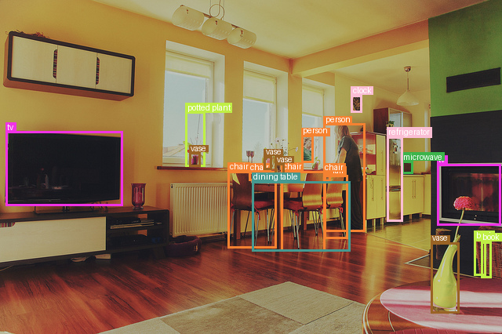
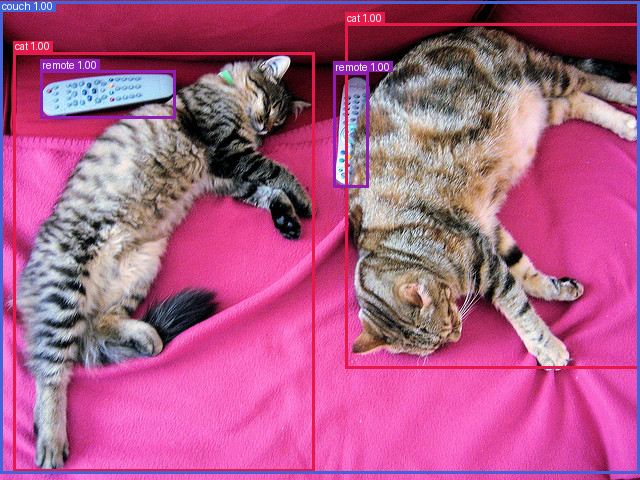
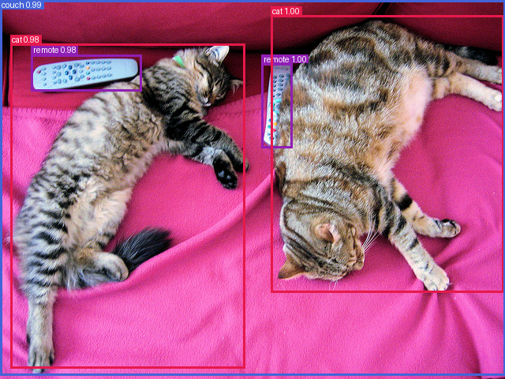
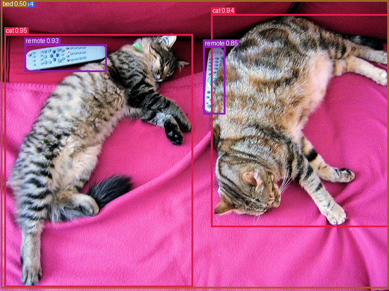
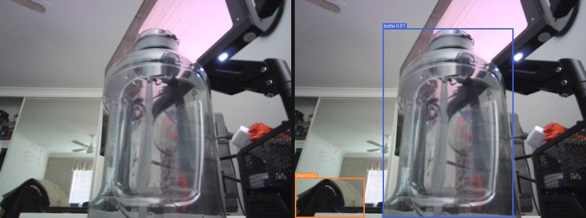

# Object Detection

Everything to know about finding and localising objects in an image: the two-stage / one-stage / set-prediction progression, the mid-2026 model landscape, the COCO mAP protocol, and runnable code to test the leading open models.

Author

Benedict Thekkel

## 1. What is Object Detection?

Object detection maps an image to a **set** of objects, each with a **class** and a **bounding box**. It is the task that sits between classification (“is there a cat?”) and segmentation (“which pixels are cat?”): *what* is here, *how many*, and *where*.

**Input.** A single RGB image, `(H, W, 3)` uint8. Detectors resize to a fixed shorter side (DETR: 800px) or a square (RT-DETR / D-FINE / RF-DETR: 640x640), normalise with ImageNet statistics, and feed a CNN or ViT backbone. Nothing about the pipeline is autoregressive, so a detector is one forward pass per image.

**Output.** A variable-length list of triples `(class_label, confidence, box)`. Boxes come in three conventions and mixing them up is the single most common bug in this task:

| Convention | Format | Used by |
|----|----|----|
| `xyxy` (Pascal VOC) | `(x_min, y_min, x_max, y_max)`, absolute pixels | what `post_process_object_detection` returns |
| `xywh` (COCO) | `(x_min, y_min, width, height)`, absolute pixels | the COCO JSON annotation file |
| `cxcywh` (normalised) | `(cx, cy, w, h)` in `[0, 1]` | what a DETR-family model’s `pred_boxes` head emits |

This notebook is about **closed-vocabulary** detection: the class list is fixed at training time (80 COCO classes here), and the model can never emit anything else.

**Neighbouring tasks:**

| Task | What it does | Typical tool / notebook |
|----|----|----|
| Image classification | One label for the whole image | see `01_Image_Classification` |
| Open-vocabulary detection | Boxes for *arbitrary text* prompts, no retraining | OWLv2, Grounding DINO; see `13_Zero_Shot_Object_Detection` |
| Instance segmentation | Boxes **plus** a pixel mask per object | Mask2Former, RF-DETR-Seg; see `03_Image_Segmentation` |
| Promptable segmentation | Mask from a point/box prompt, class-agnostic | SAM; see `12_Mask_Generation` |
| Keypoint detection | Joint locations inside each box | see `17_Keypoint_Detection` |
| Multi-object tracking | Detection + identity across video frames | ByteTrack, BoT-SORT (a detector plus an association step) |

If your class list is known and fixed and you have (or can label) data, a closed-vocabulary detector is faster, smaller and more accurate than an open-vocabulary one. If the classes change at runtime, go to `13_Zero_Shot_Object_Detection`.

------------------------------------------------------------------------

## 2. Real-World Use Cases

Detection is the workhorse of applied computer vision - almost every production CV system has a detector somewhere in it - and the constraint that decides the model is almost never “highest COCO mAP”.

| Use case | Domain | Consumes / produces | Dominant constraint |
|----|----|----|----|
| Forward-collision and lane-keeping | Automotive (Tesla Autopilot, Mobileye EyeQ) | Multi-camera video -\> boxes for vehicles, pedestrians, cyclists | Hard real-time (\<30 ms) on an embedded SoC; recall on small/far objects; zero-tolerance for missed pedestrians |
| Cashierless retail and shelf audit | Retail (Amazon Just Walk Out, Trax) | Ceiling/shelf cameras -\> product boxes and counts | Hundreds of fine-grained SKU classes; heavy occlusion; cost per store |
| Defect detection on the line | Manufacturing | Line-scan images -\> boxes on scratches, voids, solder bridges | Tiny objects; extreme class imbalance; a false negative ships a bad part |
| Lesion and nodule detection | Healthcare (CT/mammography CAD) | Volumetric or 2-D scans -\> candidate lesion boxes | Recall over precision; regulatory validation; small, low-contrast objects |
| Drone and satellite survey | Aerial / defence / agriculture | Overhead imagery -\> boxes on vehicles, buildings, crop damage | Very small objects in huge images (tiling); domain shift from COCO is total |
| PPE / safety compliance | Industrial safety | CCTV -\> boxes for helmet, vest, person | Runs on cheap edge boxes; 24/7 uptime; privacy (on-prem) |
| Document layout parsing | Document AI (Docling, Textract) | Page images -\> boxes for table, figure, heading | Throughput per page; a detector is the first stage of the OCR pipeline |
| Sports analytics | Media (Hawk-Eye, Second Spectrum) | Broadcast video -\> player/ball boxes, then tracking | Small fast-moving ball; frame-rate-locked latency; identity stability |

**What the COCO number hides.** A model that leads the COCO leaderboard has been tuned on 80 everyday classes photographed by tourists. Nothing about that predicts performance on X-ray, thermal, aerial or microscope imagery, which is exactly why the [RF100-VL benchmark](https://rf100-vl.org/) (100 real-world datasets, 164k images, NeurIPS 2025) exists and why models re-rank badly on it - Grounding DINO scores 49.2 mAP on ODinW-13 but only ~16 mAP on RF100-VL. In production the number that matters is **mAP after fine-tuning on a few hundred of your own labels**, and how quickly the model gets there.

The failure modes that actually hurt are not “1 point of mAP”: **small objects** (COCO AP_small is typically half of AP_large - a distant pedestrian or a 6-pixel defect is where detectors die), **crowded scenes** where NMS deletes a true positive that overlapped a stronger one, **duplicate boxes** when the NMS IoU threshold is mistuned, **domain shift** at dusk / in rain / on a new camera, and a **confidence threshold** picked on a validation set that no longer matches the deployed distribution. Latency is also not a single number: end-to-end you pay decode + resize + normalise + forward + post-process, and on a well-optimised YOLO the *NMS* can be a third of the budget - which is exactly the pressure that produced the NMS-free models below.

------------------------------------------------------------------------

## 3. How Modern Object Detection Works

Six generations, all still alive somewhere:

1.  **Two-stage, region proposals (R-CNN 2013 -\> Fast R-CNN 2015 -\> Faster R-CNN 2015 -\> FPN 2017).** Stage 1 proposes candidate regions (selective search, then a learned Region Proposal Network); stage 2 classifies and refines each proposal with RoIPool/RoIAlign. Accurate, slow, and the source of most of the vocabulary (anchors, IoU assignment, NMS). Mask R-CNN (2017) bolts a mask head on the same design.
2.  **One-stage anchor-based (SSD 2015, YOLOv1-v3 2016-2018, RetinaNet 2017).** Skip the proposal stage: densely predict class + box offset at every anchor on every feature-map cell. Fast, but tens of thousands of anchors are background, so training drowns in easy negatives. **RetinaNet’s focal loss** fixed that by down-weighting easy examples - `FL(p) = -alpha (1-p)^gamma log(p)` - and made one-stage detectors competitive with two-stage ones.
3.  **Anchor-free dense prediction (FCOS 2019, CenterNet 2019, YOLOX 2021).** Drop the hand-tuned anchor boxes entirely and regress the box directly from each location (FCOS: distances to the four sides; CenterNet: a heatmap peak plus width/height). Fewer hyperparameters, same speed, same accuracy. Every modern YOLO is anchor-free.
4.  **Set prediction with transformers (DETR 2020).** The conceptual break. DETR emits a **fixed set of N=100 queries** and matches them to ground truth with the **Hungarian algorithm** (one-to-one bipartite matching on a class + L1 + GIoU cost), so duplicate predictions are penalised *during training* instead of being deleted afterwards. That removes anchors and **NMS** and makes the model end-to-end. Price: 500 epochs to converge, and terrible AP_small (global attention on one low-res feature map).
5.  **Fixing DETR (2021-2023).** **Deformable DETR** (2021) replaces dense attention with sparse deformable attention over multi-scale features - 10x faster convergence and much better small objects; **Conditional DETR** and **DAB-DETR** make the query a spatial prior; **DN-DETR / DINO** (2022) add denoising queries; DINO takes DETR past 60 AP but not in real time.
6.  **Real-time transformers, 2023-2026 - and they finally beat YOLO.** **RT-DETR** (Baidu, 2023) built the first DETR that outruns YOLO on the speed/accuracy Pareto front (R50: 53.1 AP), with an efficient hybrid encoder and IoU-aware query selection; **RT-DETRv2** (2024) adds a bag-of-freebies (R18 48.1, R50 53.4 AP); **D-FINE** (2024) re-poses box regression as **fine-grained distribution refinement** - predict a probability distribution over corner offsets instead of four scalars - hitting 54.0 / 55.8 AP (L/X) at 124 / 78 FPS on a T4, and 57.1 / 59.3 with Objects365 pretraining; **DEIMv2** (2025) swaps in a DINOv3 backbone for 57.8 AP at 50M params, and a 1.5M “Pico” that matches YOLOv10-Nano; **RF-DETR** (Roboflow, ICLR 2026) runs neural architecture search over a DINOv2-backbone DETR and takes the crown - nano at 48.0 AP beats D-FINE-nano by 5.3 AP at the same latency, and the 2XL is the **first real-time detector past 60 AP on COCO**, plus 60.6 mAP on RF100-VL. **RT-DETRv4** (late 2025) continues the Baidu line.

**The key conceptual divide: NMS vs set prediction.**

- **NMS (dense detectors).** The model deliberately fires many overlapping boxes per object; at inference you sort by confidence and greedily delete any box with IoU \> `nms_iou` against a kept one. Two extra knobs (`conf_threshold`, `nms_iou`) that must be tuned per deployment, a genuine latency cost that grows with the number of boxes, and a hard failure mode: in a crowd, NMS **suppresses a true positive** that legitimately overlaps its neighbour.
- **Set prediction (DETR family).** One-to-one Hungarian matching in the loss teaches the model to emit exactly one box per object, so inference is `sigmoid -> top-k -> threshold`. No NMS, no IoU knob, constant post-processing cost, graceful behaviour in crowds. This is why every 2026 real-time SOTA model is NMS-free - and why YOLO26 has now adopted end-to-end NMS-free inference too.

**Trade-off cheat sheet:**

| Generation | Example | COCO AP | Speed | NMS? | Notes |
|----|----|----|----|----|----|
| Two-stage | Faster R-CNN R50-FPN | ~40 | slow | yes | legacy; still a strong fine-tuning baseline |
| One-stage anchor | RetinaNet, SSD | ~36-40 | fast | yes | focal loss; historic |
| Anchor-free dense | FCOS, YOLOX, YOLO26 | 40-56 | fastest | yes/optional | the practical industry default (see licensing below) |
| Set prediction | DETR-R50 | 42.0 | slow | **no** | elegant, slow to train, weak on small objects |
| Deformable set pred. | Deformable DETR | 46.2 | medium | **no** | multi-scale + sparse attention |
| Real-time transformer | RT-DETRv2, D-FINE, DEIMv2, RF-DETR | 48-60+ | fast | **no** | the 2026 Pareto front |

------------------------------------------------------------------------

## 4. Evaluation Metrics

**Intersection over Union (IoU)** is the primitive everything is built on - the overlap between a predicted box $B_p$ and a ground-truth box $B_g$:

$$IoU(B_p, B_g) = \frac{|B_p \cap B_g|}{|B_p \cup B_g|}$$

A prediction is a **true positive** if it has the right class *and* IoU with an unmatched ground-truth box above a threshold; otherwise it is a **false positive**. Unmatched ground-truth boxes are **false negatives**. Note the *unmatched* part: greedy one-to-one assignment in confidence order, so a second box on the same object is a duplicate, not a second TP.

**Average Precision (AP)** summarises the precision/recall curve you get by sweeping the confidence threshold from 1 down to 0:

$$P = \frac{TP}{TP + FP} \qquad R = \frac{TP}{TP + FN} \qquad AP = \int_0^1 p_{interp}(r)\, dr$$

where $p_{interp}(r) = \max_{r' \ge r} p(r')$ (precision is made monotonically non-increasing, so a wiggly curve does not inflate the score).

**The COCO mAP protocol** - the number every paper reports as “AP” or “mAP” - is a specific recipe:

- **101-point interpolation**: sample $p_{interp}$ at recall $0, 0.01, \ldots, 1.00$ and average (a discretisation of the integral above).
- **AP@\[.50:.95\]**: recompute AP at **ten IoU thresholds** from 0.50 to 0.95 in steps of 0.05 and average them. This is the headline number, and it rewards *localisation quality*, not just detection - a box at IoU 0.55 contributes to AP@.50 but not AP@.75.
- **mean over classes**: AP is computed per class, then averaged over the 80 classes (classes with no ground truth are skipped).
- Reported alongside: **AP50** (the lenient Pascal-VOC-style number, typically ~15 points higher), **AP75** (strict), and **AP_small / AP_medium / AP_large** for objects under 32^2 / 32²⁻⁹⁶2 / over 96^2 pixels. Detections are capped at 100 per image.

**Pitfalls.**

- **mAP hides everything that matters.** It is an average over 80 classes and 10 IoU thresholds: a model can lose 20 points on `toaster` and gain them on `person` and score the same. Always look at **AP_small** (usually roughly half of AP_large - and where your real application probably lives) and the **per-class table**.
- **AP integrates over all confidences, so evaluate with a *low* score threshold** (0.001-0.05), keeping the whole ranked list. Thresholding at 0.5 before computing AP silently truncates the recall axis and *understates* your model. The 0.5 you ship with is a *deployment* choice made from the P/R curve, not an evaluation choice.
- **The NMS IoU knob moves the number too.** Too low and you delete real objects in crowds; too high and duplicates survive as false positives. NMS-free models have neither knob - one fewer thing to tune, one fewer thing to get wrong.
- **Label vocabularies differ between checkpoints.** DETR emits the 91-entry COCO id list (with gaps and the name `sofa`); RT-DETR / D-FINE / RF-DETR emit contiguous 80-class ids (name `couch`). Compare by *normalised class name*, never by integer id.

**Speed metrics.** Report **end-to-end latency per image in ms** (preprocess + forward + post-process, after a warm-up pass) and **FPS**, always with the hardware, batch size, input resolution and precision attached. A “1.5 ms” model on an A100 at fp16 with TensorRT is not a 1.5 ms model in your Python loop.

The cell below implements IoU and a single-class AP from scratch on fabricated boxes - the same two functions are reused for the real mAP in the benchmark.

------------------------------------------------------------------------

``` python
import numpy as np


def iou_matrix(a, b):
    "Pairwise IoU between boxes a (N,4) and b (M,4), both xyxy -> (N,M)."
    a, b = np.asarray(a, dtype=np.float64), np.asarray(b, dtype=np.float64)
    if len(a) == 0 or len(b) == 0:
        return np.zeros((len(a), len(b)))
    lt = np.maximum(a[:, None, :2], b[None, :, :2])  # top-left of the intersection
    rb = np.minimum(a[:, None, 2:], b[None, :, 2:])  # bottom-right of the intersection
    inter = np.clip(rb - lt, 0, None).prod(axis=2)
    area_a = (a[:, 2] - a[:, 0]) * (a[:, 3] - a[:, 1])
    area_b = (b[:, 2] - b[:, 0]) * (b[:, 3] - b[:, 1])
    union = area_a[:, None] + area_b[None, :] - inter
    return inter / np.maximum(union, 1e-9)


def ap_101(tp, fp, n_gt):
    "COCO-style 101-point interpolated AP from TP/FP flags sorted by descending score."
    if n_gt == 0 or len(tp) == 0:
        return 0.0
    tp_cum, fp_cum = np.cumsum(tp), np.cumsum(fp)
    recall = tp_cum / n_gt
    precision = tp_cum / np.maximum(tp_cum + fp_cum, 1e-9)
    precision = np.maximum.accumulate(precision[::-1])[::-1]  # monotonically non-increasing
    rec_thrs = np.linspace(0, 1, 101)
    idx = np.searchsorted(recall, rec_thrs, side="left")
    q = np.where(idx < len(precision), precision[np.minimum(idx, len(precision) - 1)], 0.0)
    return float(q.mean())


# Toy example: one class, 3 ground-truth boxes, 4 predictions (xyxy).
gt = np.array([[10, 10, 60, 60], [70, 20, 120, 80], [30, 90, 90, 150]], dtype=float)
pred = np.array([[12, 12, 58, 63], [75, 25, 118, 78], [200, 200, 240, 250], [28, 95, 85, 145]], dtype=float)
scores = np.array([0.90, 0.75, 0.60, 0.40])

ious = iou_matrix(pred, gt)
print("IoU matrix (pred x gt):\n", np.round(ious, 3))

for thr in (0.5, 0.75):
    order = np.argsort(-scores)  # greedy, highest confidence first
    used = np.zeros(len(gt), dtype=bool)
    tp, fp = np.zeros(len(pred)), np.zeros(len(pred))
    for rank, i in enumerate(order):
        best = int(ious[i].argmax())
        if ious[i, best] >= thr and not used[best]:
            tp[rank], used[best] = 1, True
        else:
            fp[rank] = 1
    print(f"IoU>={thr}: TP={int(tp.sum())} FP={int(fp.sum())} FN={int((~used).sum())} "
          f"AP={ap_101(tp, fp, len(gt)):.3f}")

# Box 3 (200,200,240,250) overlaps nothing -> a false positive at every threshold.
# Box 4 localises well enough for IoU 0.5 but not 0.75 -> the strict threshold is what AP@[.50:.95] rewards.
```

    IoU matrix (pred x gt):
     [[0.837 0.    0.   ]
     [0.    0.76  0.   ]
     [0.    0.    0.   ]
     [0.    0.    0.743]]
    IoU>=0.5: TP=3 FP=1 FN=0 AP=0.916
    IoU>=0.75: TP=2 FP=2 FN=1 AP=0.663

## 5. Datasets

| Dataset | Contents | Size | Scope | License | Typical use |
|----|----|----|----|----|----|
| [COCO 2017](https://cocodataset.org/) ([`detection-datasets/coco`](https://huggingface.co/datasets/detection-datasets/coco)) | Everyday scenes, ~7 objects/image, dense small objects | 118k train / 5k val, 860k boxes | 80 classes | Images: Flickr terms; annotations CC-BY-4.0 | **The** benchmark; every AP number above is COCO val2017 |
| [Pascal VOC 2007/2012](http://host.robots.ox.ac.uk/pascal/VOC/) | The original detection benchmark | ~16k images | 20 classes | Custom (research) | Historic; AP50-only protocol; fast sanity checks |
| [Objects365](https://www.objects365.org/) ([`toilaluan/object365`](https://huggingface.co/datasets/toilaluan/object365)) | Large-scale everyday objects | 2M images, 30M boxes | 365 classes | CC-BY (research-oriented) | **Pretraining**: `-obj365` / `-obj2coco` checkpoints gain 3-4 AP on COCO |
| [LVIS](https://www.lvisdataset.org/) ([`Voxel51/LVIS`](https://huggingface.co/datasets/Voxel51/LVIS)) | Same COCO images, long-tail vocabulary, federated annotations | 100k images | 1203 classes | CC-BY-4.0 | The **long-tail** test - rare classes with a handful of instances each |
| [Open Images V7](https://storage.googleapis.com/openimages/web/index.html) | Web images, box + relationship + mask labels | 1.9M images, 16M boxes | 600 classes | CC-BY-4.0 (images vary) | Large-scale pretraining, hierarchical labels |
| [Roboflow 100-VL](https://rf100-vl.org/) | 100 real-world domain datasets (X-ray, aerial, thermal, industrial) | 164k images, 1.36M boxes | 7 domains | Mixed (per-dataset) | **Domain shift / few-shot transfer** - the honest generalisation test |
| [BDD100K](https://bdd-data.berkeley.edu/) / [nuScenes](https://www.nuscenes.org/) | Driving video, day/night/rain | 100k clips / 1k scenes | 10-23 classes | Non-commercial research | Automotive; **gated** - requires registration and accepting terms |
| [VisDrone](https://github.com/VisDrone/VisDrone-Dataset) | Aerial drone footage, extremely small objects | 10k images | 10 classes | Research-only | Small-object stress test |

**Gating.** COCO, VOC, LVIS and Open Images are free to download without an account. Objects365, BDD100K, nuScenes and most medical sets require registration and/or a non-commercial research agreement - check before you build a product on a checkpoint pretrained on them.

**This notebook** evaluates on a **24-image slice of COCO val2017**, streamed from [`detection-datasets/coco`](https://huggingface.co/datasets/detection-datasets/coco) (a parquet mirror with `image`, `width`, `height` and `objects.{bbox, category, area}`; boxes are already **xyxy absolute pixels** and categories are the contiguous 80-class ids, which is exactly what we need). Streaming means we pull a few MB, not the 800 MB val shard - the whole notebook fits comfortably in 12 GB of RAM.

------------------------------------------------------------------------

## 6. The Model Landscape (mid-2026)

The authoritative rankings are [Papers with Code: object detection on COCO](https://paperswithcode.com/sota/object-detection-on-coco) (accuracy at any cost) and [real-time object detection on COCO](https://paperswithcode.com/sota/real-time-object-detection-on-coco) (the Pareto front that matters in practice); for generalisation rather than COCO overfitting, the [RF100-VL leaderboard](https://rf100-vl.org/).

| Model | Params | License | Scope | Architecture | Best for |
|----|----|----|----|----|----|
| **RF-DETR** (nano/small/medium/base/large/2XL) | ~30-34M for nano..large | Apache 2.0 | 80 COCO | DINOv2 ViT backbone + deformable DETR decoder; NAS over **resolution and decoder depth**, not width | **The 2026 SOTA.** nano 48.0 AP; the 2XL is the first real-time detector past **60 AP**; best under domain shift + fine-tuning (60.6 mAP on RF100-VL) |
| **DEIMv2** (Atto…X) | 1.5-50M | Apache 2.0 | 80 COCO | DINOv3 backbone + Spatial Tuning Adapter, DEIM matching | Best accuracy *per parameter*: S = 50.9 AP at 9.7M; X = 57.8 AP at 50M; Pico (1.5M) matches YOLOv10-N |
| **D-FINE** (N/S/M/L/X) | 3.8-62M | Apache 2.0 | 80 COCO | RT-DETR + fine-grained distribution refinement (FDR) + GO-LSD self-distillation | Precise **localisation** (it optimises the box distribution, so it wins at high IoU); great tiny checkpoints |
| **RT-DETRv2 / v4** (R18/R34/R50/R101) | 20-76M | Apache 2.0 | 80 COCO | Hybrid CNN encoder + DETR decoder, IoU-aware query selection | The **reliable production default**: mature, ONNX/TensorRT-friendly, R18 48.1 / R50 53.4 AP |
| **LW-DETR** (tiny…xlarge) | 15-120M | Apache 2.0 | 80 COCO / Obj365 | Plain-ViT encoder + shallow DETR decoder | Latency-first transformer detector; the direct ancestor of RF-DETR |
| **YOLO26 / YOLO11** (n/s/m/l/x) | 2.6-60M | **AGPL-3.0** or paid Enterprise | 80 COCO | Anchor-free CNN, now end-to-end (NMS-free) | The **industry default by ecosystem**, not by accuracy: export, tracking, tooling - but read the license note below |
| **DETR** (R50/R101) | 42-60M | Apache 2.0 | 80 COCO | ResNet + encoder-decoder transformer, Hungarian matching | Teaching the concept; the origin of everything in the right-hand column. 42.0 AP |
| **Deformable / Conditional / DAB-DETR** | 40-44M | Apache 2.0 | 80 COCO | DETR + sparse multi-scale attention / spatial queries | The convergence fixes, still useful as fine-tuning baselines. 46.2 AP (Deformable) |
| **YOLOS** (tiny/small/base) | 6-127M | Apache 2.0 | 80 COCO | **Plain ViT**, no CNN, no anchors, sequence-to-sequence detection | A research statement (“a ViT can detect”), Apache-licensed, transformers-native. Only ~36 AP |
| Grounding DINO / OWLv2 | 170M-1B | Apache 2.0 | **open vocabulary** | Text-conditioned DETR / CLIP-style | Detecting classes you never trained on - see `13_Zero_Shot_Object_Detection` |

**Who wins what.** *Accuracy*: RF-DETR-2XL (\>60 AP), then DEIMv2-X. *Speed at a given accuracy*: the whole RT-DETR / D-FINE / DEIMv2 / RF-DETR real-time-transformer front - RF-DETR-nano dominates D-FINE-nano by 5.3 AP at equal latency. *Size*: DEIMv2-Pico at 1.5M params / 38.5 AP is the best thing that fits on a microcontroller-class device. *Ecosystem*: Ultralytics, by a mile, and it is not close.

Tie this back to section 2: **automotive and safety** want the real-time front (RT-DETRv2 or RF-DETR-small, exported to TensorRT); **manufacturing defects and drone survey** want whatever fine-tunes best from a few hundred labels under domain shift, which is RF-DETR (that is precisely what the RF100-VL numbers measure); **document AI** already ships D-FINE and RT-DETRv2 derivatives (`docling-project/docling-layout-heron` is an RT-DETRv2, `docling-layout-egret` is a D-FINE).

**The YOLO / AGPL trap.** Ultralytics YOLO (v8, v11, YOLO26) is the most-deployed detector in the world and probably the strongest *practical* baseline you can fine-tune in an afternoon. But: it is **AGPL-3.0**, and the AGPL’s network clause means that if you serve YOLO predictions over a network, you must offer the *complete corresponding source of your service* under AGPL - or buy an Enterprise license. Plenty of teams discover this after shipping. It also requires the vendor `ultralytics` package, so **it deliberately appears nowhere in a runnable cell in this notebook** (repo rule: general-purpose libraries only). The good news is that in 2026 you no longer trade accuracy for a clean license: RT-DETRv2, D-FINE, DEIMv2 and RF-DETR are all **Apache 2.0**, all `transformers`-native, and all at or above YOLO on the Pareto front.

**Nothing in this table is too big for a 12 GB card** - detectors are small (the largest row here is ~130M params, ~0.26 GB in fp16). Detection is bounded by *latency and image resolution*, not by VRAM; the 12 GB budget only starts to bite when you train at 640x640 with a large batch.

------------------------------------------------------------------------

## 7. Setup

Everything below runs on a single modest GPU (an RTX 3060, 12 GB) or on CPU, and **every model loads through Hugging Face `transformers`** - no `ultralytics`, `mmdetection` or `detectron2`. Package roles:

- `transformers` (\>=5.13) + `torch` - all five detectors (DETR, YOLOS, RT-DETRv2, D-FINE, RF-DETR)
- `accelerate` - device placement
- `datasets` - the streamed COCO val slice with ground-truth boxes
- `numpy` - our IoU / AP implementation (no `pycocotools` needed for a 24-image smoke test)
- `pillow` - drawing predicted boxes on the image (`ImageDraw`); ECharts is JS and cannot render an image
- `pyecharts` - the benchmark charts
- `pandas` - the benchmark table
- `opencv-python` - webcam capture (section 13, optional)

RF-DETR and D-FINE became `transformers`-native in the 5.x line; earlier releases needed the vendor `rfdetr` / `D-FINE` repos, which this notebook does not depend on.

All downloads (the sample image, the HF dataset and model cache) land in `DL_tasks/datasets/`, which is gitignored.

------------------------------------------------------------------------

``` python
# Every model here is transformers-native - no ultralytics/mmdetection/detectron2.
# %pip install -q torch transformers datasets accelerate pillow numpy pandas pyecharts

# Optional extra for the webcam demo (section 13)
# %pip install -q opencv-python
```

``` python
import ctypes
import ctypes.util
import gc
import time
from pathlib import Path

import torch
from dotenv import find_dotenv, load_dotenv

# Knowledge/.env sets HF_TOKEN - authenticated HF Hub requests get higher rate limits
load_dotenv(find_dotenv(usecwd=True))

device = "cuda:0" if torch.cuda.is_available() else "cpu"
dtype = torch.float16 if device != "cpu" else torch.float32
if device != "cpu":
    print(torch.cuda.get_device_name(0))
print("device:", device)

def vram(tag=""):
    "Report current GPU memory (allocated / reserved). No-op on CPU."
    if torch.cuda.is_available():
        alloc = torch.cuda.memory_allocated() / 1e9
        reserved = torch.cuda.memory_reserved() / 1e9
        print(f"VRAM {tag:20s} {alloc:5.2f} GB allocated / {reserved:5.2f} GB reserved")

def free_memory():
    "Collect garbage, empty the CUDA cache, and return freed CPU RAM to the OS."
    gc.collect()
    if torch.cuda.is_available():
        torch.cuda.empty_cache()
        torch.cuda.ipc_collect()
    # glibc keeps freed CPU allocations in its arenas instead of returning them
    # to the OS, so RSS compounds across model sections (cpu-offloaded weights
    # live in system RAM). malloc_trim(0) hands the freed arenas back. See
    # dl-visualization-and-memory.md - not optional on a 12 GB box.
    try:
        ctypes.CDLL(ctypes.util.find_library("c") or "libc.so.6").malloc_trim(0)
    except Exception:
        pass

# All downloads go to DL_tasks/datasets/ (gitignored)
DATA_DIR = Path("../../datasets")
DATA_DIR.mkdir(exist_ok=True)
HF_CACHE = str(DATA_DIR / "hf_cache")
```

    NVIDIA GeForce RTX 3060
    device: cuda:0

``` python
import urllib.request
from itertools import islice

from datasets import load_dataset
from IPython.display import display
from PIL import Image, ImageDraw

# The canonical COCO sample: two cats on a sofa with two remotes.
SAMPLE = DATA_DIR / "coco_cats.jpg"
if not SAMPLE.exists():
    urllib.request.urlretrieve("http://images.cocodataset.org/val2017/000000039769.jpg", SAMPLE)
image = Image.open(SAMPLE).convert("RGB")

# --- label normalisation -------------------------------------------------
# DETR/YOLOS carry the 91-entry COCO id list ("sofa", "tv"); RT-DETR/D-FINE/RF-DETR
# carry contiguous 80-class ids ("couch"). Compare by normalised NAME, never by id.
ALIASES = {"sofa": "couch", "tvmonitor": "tv", "aeroplane": "airplane",
           "motorbike": "motorcycle", "diningtable": "dining table",
           "pottedplant": "potted plant", "cellphone": "cell phone"}

def norm_label(name):
    "Lower-case a class name and fold the known cross-checkpoint synonyms."
    name = str(name).lower().strip()
    return ALIASES.get(name, name)

# --- the eval slice ------------------------------------------------------
N_EVAL = 24  # a smoke test, not a leaderboard (see section 12)
stream = load_dataset("detection-datasets/coco", split="val", streaming=True, cache_dir=HF_CACHE)
cat_feat = stream.features["objects"]["category"]
COCO80 = (cat_feat.feature if hasattr(cat_feat, "feature") else cat_feat).names

EVAL = []
for row in islice(stream, N_EVAL):  # streaming -> we pull a few MB, not the 800 MB val shard
    objs = row["objects"]
    EVAL.append({
        "image": row["image"].convert("RGB"),
        "boxes": np.asarray(objs["bbox"], dtype=np.float32).reshape(-1, 4),  # xyxy, absolute px
        "labels": [norm_label(COCO80[c]) for c in objs["category"]],
    })
del stream
free_memory()

print(f"{len(EVAL)} eval images, {sum(len(e['labels']) for e in EVAL)} ground-truth boxes")

# --- drawing (PIL, not matplotlib - ECharts is for charts, PIL for images) ---
PALETTE = ["#e6194b", "#3cb44b", "#4363d8", "#f58231", "#911eb4", "#42d4f4",
           "#f032e6", "#bfef45", "#fabed4", "#469990", "#dcbeff", "#9a6324"]

def draw_boxes(img, labels, boxes, scores=None, width=3):
    "Draw labelled boxes (xyxy) on a copy of a PIL image and return it."
    out = img.copy()
    d = ImageDraw.Draw(out)
    for i, (lab, box) in enumerate(zip(labels, boxes)):
        color = PALETTE[sum(map(ord, lab)) % len(PALETTE)]
        x0, y0, x1, y1 = (float(v) for v in box)
        d.rectangle([x0, y0, x1, y1], outline=color, width=width)
        text = lab if scores is None else f"{lab} {float(scores[i]):.2f}"
        tx, ty = x0 + 2, max(0.0, y0 - 12)
        bg = d.textbbox((tx, ty), text)
        d.rectangle([bg[0] - 2, bg[1] - 1, bg[2] + 2, bg[3] + 1], fill=color)
        d.text((tx, ty), text, fill="white")
    return out

# Ground truth of the first eval image - this is what the models are scored against.
display(draw_boxes(EVAL[0]["image"], EVAL[0]["labels"], EVAL[0]["boxes"]))


# --- inference helpers (used by every model section and by the benchmark) ---
@torch.inference_mode()
def predict(model, processor, images, threshold=0.5):
    """Run a transformers detector over PIL images -> [{labels, scores, boxes}, ...].

    Boxes come back xyxy in absolute pixels of the ORIGINAL image (that is what
    target_sizes buys you), and labels are normalised class-name strings, so
    outputs from any two checkpoints in this notebook are directly comparable.
    """
    out = []
    for img in images:
        inputs = processor(images=img, return_tensors="pt").to(device=device, dtype=dtype)
        res = model(**inputs)
        post = processor.post_process_object_detection(
            res, target_sizes=[(img.height, img.width)], threshold=threshold
        )[0]
        out.append({
            "labels": [norm_label(model.config.id2label[i]) for i in post["labels"].tolist()],
            "scores": post["scores"].float().cpu().numpy(),   # off the GPU before we free it
            "boxes": post["boxes"].float().cpu().numpy(),
        })
    return out

def show(pred, img, k=10):
    "Print the top-k detections and display the annotated image."
    order = np.argsort(-pred["scores"])[:k]
    for i in order:
        print(f"  {pred['labels'][i]:<14s} {pred['scores'][i]:.3f}  "
              f"{[round(float(v), 1) for v in pred['boxes'][i]]}")
    display(draw_boxes(img, [pred["labels"][i] for i in order],
                       [pred["boxes"][i] for i in order],
                       [pred["scores"][i] for i in order]))
```

    24 eval images, 159 ground-truth boxes



## 8. DETR (the set-prediction original)

`facebook/detr-resnet-50` (42M params, 42.0 AP) is the 2020 model that removed anchors and NMS: a ResNet-50 backbone, a 6+6-layer transformer encoder-decoder, 100 learned object queries, and a Hungarian-matched loss. It is not competitive on accuracy or speed any more, but it is the ancestor of every model in section 6’s top rows and the clearest thing to read.

Two DETR-specific quirks to know:

- Its classification head is a **softmax over 91 classes + a “no-object” class**, so scores are high-confidence and the sensible display threshold is **0.9**. The focal-loss models below (RT-DETR, D-FINE, RF-DETR) use independent **sigmoids**, so their scores are lower and calibrated differently - 0.3-0.5 is the right display threshold there. Do not copy a threshold across model families.
- It is weak on **small objects** (one low-resolution feature map, global attention), which is exactly what Deformable DETR’s multi-scale sparse attention fixed.

------------------------------------------------------------------------

``` python
from transformers import AutoImageProcessor, AutoModelForObjectDetection

detr_id = "facebook/detr-resnet-50"
detr_proc = AutoImageProcessor.from_pretrained(detr_id, cache_dir=HF_CACHE)
detr = AutoModelForObjectDetection.from_pretrained(
    detr_id, cache_dir=HF_CACHE, dtype=dtype
).to(device).eval()
print(f"{sum(p.numel() for p in detr.parameters()) / 1e6:.1f}M params, "
      f"{detr.config.num_queries} object queries, {len(detr.config.id2label)} class ids")
vram("detr loaded")

predict(detr, detr_proc, [image], threshold=0.9)          # warm-up (CUDA autotune, kernel load)
t0 = time.perf_counter()
pred = predict(detr, detr_proc, [image], threshold=0.9)[0]  # softmax head -> high threshold
print(f"DETR-R50: {(time.perf_counter() - t0) * 1000:.0f} ms, {len(pred['labels'])} detections")
show(pred, image)

del detr, detr_proc, pred
free_memory()
vram("after detr")
```

    [transformers] DetrForObjectDetection LOAD REPORT from: facebook/detr-resnet-50
    Key                                                            | Status     |  | 
    ---------------------------------------------------------------+------------+--+-
    model.backbone.model.layer1.0.downsample.1.num_batches_tracked | UNEXPECTED |  | 
    model.backbone.model.layer4.0.downsample.1.num_batches_tracked | UNEXPECTED |  | 
    model.backbone.model.layer3.0.downsample.1.num_batches_tracked | UNEXPECTED |  | 
    model.backbone.model.layer2.0.downsample.1.num_batches_tracked | UNEXPECTED |  | 

    Notes:
    - UNEXPECTED:   can be ignored when loading from different task/architecture; not ok if you expect identical arch.

    41.5M params, 100 object queries, 91 class ids
    VRAM detr loaded           0.10 GB allocated /  0.11 GB reserved
    DETR-R50: 29 ms, 5 detections
      cat            0.999  [13.2, 52.1, 314.1, 471.1]
      cat            0.999  [345.3, 23.9, 640.0, 368.7]
      remote         0.998  [40.2, 70.8, 175.6, 118.0]
      remote         0.996  [333.1, 72.5, 368.1, 187.6]
      couch          0.996  [0.0, 1.3, 639.7, 473.9]



    VRAM after detr            0.01 GB allocated /  0.03 GB reserved

## 9. YOLOS (a plain ViT that detects)

`hustvl/yolos-small` (31M params, 36.1 AP) is the “You Only Look at One Sequence” model: a **plain ViT** with 100 detection tokens appended to the patch sequence, and nothing else - no CNN backbone, no FPN, no anchors, no NMS. It was a research statement (transfer a vanilla ViT to detection with minimal surgery) rather than a performance play, and its AP shows it.

It is here for two reasons: it is the clean demonstration that detection needs no convolutional inductive bias, and - despite the name - it is **Apache 2.0 and `transformers`-native**, unlike the Ultralytics YOLOs. Like DETR it uses a softmax head, so keep the threshold high.

------------------------------------------------------------------------

``` python
yolos_id = "hustvl/yolos-small"
yolos_proc = AutoImageProcessor.from_pretrained(yolos_id, cache_dir=HF_CACHE)
yolos = AutoModelForObjectDetection.from_pretrained(
    yolos_id, cache_dir=HF_CACHE, dtype=dtype
).to(device).eval()
print(f"{sum(p.numel() for p in yolos.parameters()) / 1e6:.1f}M params (plain ViT, no CNN)")

predict(yolos, yolos_proc, [image], threshold=0.9)  # warm-up
t0 = time.perf_counter()
pred = predict(yolos, yolos_proc, [image], threshold=0.9)[0]
print(f"YOLOS-small: {(time.perf_counter() - t0) * 1000:.0f} ms, {len(pred['labels'])} detections")
show(pred, image)

del yolos, yolos_proc, pred
free_memory()
vram("after yolos")
```

    30.7M params (plain ViT, no CNN)
    YOLOS-small: 63 ms, 5 detections
      remote         0.999  [331.9, 80.6, 370.0, 188.0]
      cat            0.998  [343.4, 19.8, 638.4, 370.8]
      couch          0.987  [0.0, 0.0, 640.0, 475.8]
      cat            0.984  [13.1, 55.7, 310.9, 466.9]
      remote         0.979  [39.5, 69.4, 179.8, 116.0]



    VRAM after yolos           0.01 GB allocated /  0.03 GB reserved

## 10. RT-DETRv2 (the production default)

`PekingU/rtdetr_v2_r18vd` (20M params, 48.1 AP) - Baidu’s real-time DETR, the model that first beat YOLO on the speed/accuracy front while staying NMS-free. A hybrid encoder decouples intra-scale attention from cross-scale fusion (cheap), and IoU-aware query selection seeds the decoder with good proposals (fast convergence). v2 adds selective multi-scale sampling and a **discrete sampling operator** that replaces `grid_sample`, which is the reason it exports cleanly to ONNX/TensorRT - the practical difference between a paper and a deployment.

Pick it when you want a boring, mature, well-exported detector. Larger siblings: `rtdetr_v2_r34vd`, `rtdetr_v2_r50vd` (53.4 AP), `rtdetr_v2_r101vd`. Note the processor resizes to **640x640** - feeding other sizes degrades accuracy.

------------------------------------------------------------------------

``` python
rtdetr_id = "PekingU/rtdetr_v2_r18vd"
rtdetr_proc = AutoImageProcessor.from_pretrained(rtdetr_id, cache_dir=HF_CACHE)
rtdetr = AutoModelForObjectDetection.from_pretrained(
    rtdetr_id, cache_dir=HF_CACHE, dtype=dtype
).to(device).eval()
print(f"{sum(p.numel() for p in rtdetr.parameters()) / 1e6:.1f}M params, "
      f"{rtdetr.config.num_queries} queries, no NMS")

predict(rtdetr, rtdetr_proc, [image], threshold=0.5)  # warm-up
t0 = time.perf_counter()
pred = predict(rtdetr, rtdetr_proc, [image], threshold=0.5)[0]  # sigmoid head -> lower threshold
print(f"RT-DETRv2-R18: {(time.perf_counter() - t0) * 1000:.0f} ms, {len(pred['labels'])} detections")
show(pred, image)

del rtdetr, rtdetr_proc, pred
free_memory()
vram("after rt-detr")
```

    20.2M params, 300 queries, no NMS
    RT-DETRv2-R18: 23 ms, 6 detections
      cat            0.965  [341.2, 25.1, 640.0, 373.0]
      cat            0.960  [12.7, 56.4, 317.8, 471.5]
      remote         0.946  [40.0, 73.1, 175.6, 117.4]
      couch          0.862  [-0.2, 2.9, 640.0, 473.5]
      couch          0.814  [-0.2, 1.8, 640.0, 473.5]
      remote         0.796  [333.8, 76.4, 370.5, 187.5]


    VRAM after rt-detr         0.01 GB allocated /  0.03 GB reserved

## 11. D-FINE (localisation specialist, tiny)

`ustc-community/dfine-small-coco` (10M params, 48.5 AP) beats the 20M RT-DETRv2-R18 with half the parameters. Its idea: stop regressing four scalar coordinates and instead predict a **probability distribution over each box edge’s offset**, refined iteratively across decoder layers (Fine-grained Distribution Refinement), with the sharper deep-layer distributions distilled back into the shallow layers (GO-LSD). Because it optimises *where the edge probably is* rather than a point estimate, it wins disproportionately at **high IoU thresholds** - which is exactly what AP@\[.50:.95\] rewards.

The family runs `dfine-nano-coco` (3.8M) to `dfine-xlarge-coco` (63M, 55.8 AP). Checkpoints suffixed `-obj365` are Objects365-pretrained and `-obj2coco` are Objects365-pretrained then COCO-finetuned (D-FINE-L/X reach 57.1 / 59.3 AP that way) - a free 3 AP if you can spare the download.

------------------------------------------------------------------------

``` python
dfine_id = "ustc-community/dfine-small-coco"
dfine_proc = AutoImageProcessor.from_pretrained(dfine_id, cache_dir=HF_CACHE)
dfine = AutoModelForObjectDetection.from_pretrained(
    dfine_id, cache_dir=HF_CACHE, dtype=dtype
).to(device).eval()
print(f"{sum(p.numel() for p in dfine.parameters()) / 1e6:.1f}M params, "
      f"max_num_bins={dfine.config.max_num_bins} (the corner-offset distribution)")

predict(dfine, dfine_proc, [image], threshold=0.5)  # warm-up
t0 = time.perf_counter()
pred = predict(dfine, dfine_proc, [image], threshold=0.5)[0]
print(f"D-FINE-S: {(time.perf_counter() - t0) * 1000:.0f} ms, {len(pred['labels'])} detections")
show(pred, image)

del dfine, dfine_proc, pred
free_memory()
vram("after d-fine")
```

    10.3M params, max_num_bins=32 (the corner-offset distribution)
    D-FINE-S: 13 ms, 5 detections
      cat            0.962  [13.3, 53.9, 317.0, 472.0]
      remote         0.954  [40.3, 73.0, 176.1, 117.8]
      cat            0.953  [342.5, 23.4, 640.0, 374.5]
      couch          0.854  [0.6, 1.2, 639.5, 474.8]
      remote         0.813  [333.5, 76.7, 371.0, 187.8]


    VRAM after d-fine          0.01 GB allocated /  0.03 GB reserved

## 12. RF-DETR (the mid-2026 state of the art)

`Roboflow/rf-detr-medium` (34M params) - the ICLR 2026 model that currently leads the real-time Pareto front. A **DINOv2-with-registers ViT backbone** (windowed/full attention alternation), a C2f-style multi-scale projector, and a **shallow deformable DETR decoder**, with the whole configuration chosen by **weight-sharing neural architecture search** over the accuracy/latency frontier instead of by hand. Group-DETR training (parallel decoder copies) gives it fast convergence.

The NAS result is worth reading off the configs: nano / medium / large differ by **input resolution (384 / 576 / 704) and decoder depth (2 / 4 / 4)**, not by channel width - which is why the whole family sits at ~30-34M params. Scaling a detector by resolution rather than by width is the opposite of the usual n/s/m/l/x recipe, and it is where the latency wins come from.

Why it matters beyond one more AP point: the DINOv2 backbone is a *self-supervised foundation model*, so RF-DETR **transfers** far better than a COCO-supervised CNN - it is the first real-time detector past 60 mAP on RF100-VL, the benchmark that simulates your actual dataset (X-ray, aerial, industrial) rather than tourist photos. That is what makes it the default when you plan to fine-tune. Family: `rf-detr-nano` (48.0 AP) through `rf-detr-large`, plus `Roboflow/rf-detr-seg-medium` for instance masks (see `03_Image_Segmentation`). Apache 2.0.

------------------------------------------------------------------------

``` python
rfdetr_id = "Roboflow/rf-detr-medium"
rfdetr_proc = AutoImageProcessor.from_pretrained(rfdetr_id, cache_dir=HF_CACHE)
rfdetr = AutoModelForObjectDetection.from_pretrained(
    rfdetr_id, cache_dir=HF_CACHE, dtype=dtype
).to(device).eval()
print(f"{sum(p.numel() for p in rfdetr.parameters()) / 1e6:.1f}M params, "
      f"{rfdetr.config.decoder_layers}-layer decoder, "
      f"{rfdetr.config.backbone_config.image_size}px DINOv2 backbone")

predict(rfdetr, rfdetr_proc, [image], threshold=0.5)  # warm-up
t0 = time.perf_counter()
pred = predict(rfdetr, rfdetr_proc, [image], threshold=0.5)[0]
print(f"RF-DETR-medium: {(time.perf_counter() - t0) * 1000:.0f} ms, {len(pred['labels'])} detections")
show(pred, image)

del rfdetr, rfdetr_proc, pred
free_memory()
vram("after rf-detr")
```

    33.7M params, 4-layer decoder, 576px DINOv2 backbone
    RF-DETR-medium: 15 ms, 6 detections
      cat            0.947  [7.6, 56.0, 317.0, 473.8]
      cat            0.940  [347.5, 23.3, 639.5, 374.5]
      remote         0.931  [40.1, 73.1, 175.1, 118.2]
      remote         0.854  [334.5, 76.8, 370.5, 188.1]
      couch          0.536  [1.6, 0.5, 639.0, 475.2]
      bed            0.504  [1.6, 0.5, 639.0, 475.2]



    VRAM after rf-detr         0.01 GB allocated /  0.03 GB reserved

## 13. Head-to-head Benchmark

All five detectors on the **same 24 COCO val2017 images**, the same ground truth, and the same metric - real **COCO mAP@\[.50:.95\]** (101-point interpolation, per class then averaged) computed with the `iou_matrix` / `ap_101` functions from section 4, plus AP50 and end-to-end latency per image. Models are loaded, measured and **freed one at a time**, so VRAM returns to baseline between rows.

Two protocol details that matter:

- We predict with a **threshold of 0.05**, not the 0.5 used for display. AP integrates over the whole ranked list; thresholding first would truncate the recall axis and understate every model.
- Latency is wall-clock **per image, batch size 1, fp16 on GPU**, measured after a warm-up pass, and it *includes* preprocessing and post-processing. It is not the number the papers quote (those are TensorRT, often on a T4/A100), so read the *ordering*, not the absolute values.

**This is a smoke test, not a leaderboard.** 24 images out of 5000 gives a mAP with several points of noise, and rare classes appear zero or once. Published COCO numbers (DETR 42.0, YOLOS-S 36.1, RT-DETRv2-R18 48.1, D-FINE-S 48.5) are the ground truth; the point here is to see the *shape* of the ranking reproduce on your own hardware, and to see how much latency you pay for it.

------------------------------------------------------------------------

``` python
def coco_map(preds, gts, iou_thrs=np.arange(0.5, 1.0, 0.05)):
    """COCO mAP over a list of per-image predictions and ground truths.

    Averages 101-point AP over the given IoU thresholds, per class, then over the
    classes that actually appear in the ground truth. Matching is greedy in
    confidence order with one-to-one assignment (a second box on a matched object
    is a duplicate = false positive), exactly as pycocotools does it.
    """
    classes = sorted({lab for g in gts for lab in g["labels"]})
    aps = []
    for cls in classes:
        gt_boxes, n_gt = [], 0
        for g in gts:
            keep = [j for j, lab in enumerate(g["labels"]) if lab == cls]
            gt_boxes.append(g["boxes"][keep] if keep else np.zeros((0, 4), dtype=np.float32))
            n_gt += len(keep)
        dets = [(float(p["scores"][j]), i, p["boxes"][j])
                for i, p in enumerate(preds)
                for j, lab in enumerate(p["labels"]) if lab == cls]
        if n_gt == 0:
            continue
        dets.sort(key=lambda d: -d[0])
        per_thr = []
        for thr in iou_thrs:
            used = [np.zeros(len(g), dtype=bool) for g in gt_boxes]
            tp, fp = np.zeros(len(dets)), np.zeros(len(dets))
            for k, (_, img_i, box) in enumerate(dets):
                g = gt_boxes[img_i]
                if len(g) == 0:
                    fp[k] = 1
                    continue
                ious = iou_matrix(box[None, :], g)[0]
                best = int(ious.argmax())
                if ious[best] >= thr and not used[img_i][best]:
                    tp[k], used[img_i][best] = 1, True
                else:
                    fp[k] = 1
            per_thr.append(ap_101(tp, fp, n_gt))
        aps.append(float(np.mean(per_thr)))
    return float(np.mean(aps)) if aps else 0.0


# Sanity check: the ground truth scored against itself must be a perfect 1.0.
perfect = [{"labels": e["labels"], "boxes": e["boxes"],
            "scores": np.ones(len(e["labels"]))} for e in EVAL]
print("mAP of the ground truth against itself:", round(coco_map(perfect, EVAL), 4))
del perfect
```

    mAP of the ground truth against itself: 1.0

``` python
import pandas as pd

MODELS = {
    "DETR-R50": "facebook/detr-resnet-50",
    "YOLOS-small": "hustvl/yolos-small",
    "RT-DETRv2-R18": "PekingU/rtdetr_v2_r18vd",
    "D-FINE-S": "ustc-community/dfine-small-coco",
    "RF-DETR-medium": "Roboflow/rf-detr-medium",
}

results = {}
images = [e["image"] for e in EVAL]

for name, model_id in MODELS.items():
    proc = AutoImageProcessor.from_pretrained(model_id, cache_dir=HF_CACHE)
    model = AutoModelForObjectDetection.from_pretrained(
        model_id, cache_dir=HF_CACHE, dtype=dtype
    ).to(device).eval()
    n_params = sum(p.numel() for p in model.parameters()) / 1e6

    predict(model, proc, images[:1], threshold=0.5)  # warm-up, not timed
    t0 = time.perf_counter()
    preds = predict(model, proc, images, threshold=0.05)  # low threshold: AP wants the full list
    ms = (time.perf_counter() - t0) / len(images) * 1000

    results[name] = {
        "params_M": round(n_params, 1),
        "mAP@[.50:.95]": round(coco_map(preds, EVAL), 4),
        "AP50": round(coco_map(preds, EVAL, iou_thrs=np.array([0.5])), 4),
        "ms_per_image": round(ms, 1),
        "boxes@0.5": int(sum((p["scores"] >= 0.5).sum() for p in preds)),
    }
    print(f"{name:16s} {results[name]}")

    del model, proc, preds  # free before loading the next - never two detectors live at once
    free_memory()

vram("after benchmark")

df = (pd.DataFrame(results).T
      .sort_values("mAP@[.50:.95]", ascending=False)
      .rename_axis("model").reset_index())
df
```

    [transformers] DetrForObjectDetection LOAD REPORT from: facebook/detr-resnet-50
    Key                                                            | Status     |  | 
    ---------------------------------------------------------------+------------+--+-
    model.backbone.model.layer1.0.downsample.1.num_batches_tracked | UNEXPECTED |  | 
    model.backbone.model.layer4.0.downsample.1.num_batches_tracked | UNEXPECTED |  | 
    model.backbone.model.layer3.0.downsample.1.num_batches_tracked | UNEXPECTED |  | 
    model.backbone.model.layer2.0.downsample.1.num_batches_tracked | UNEXPECTED |  | 

    Notes:
    - UNEXPECTED:   can be ignored when loading from different task/architecture; not ok if you expect identical arch.

    DETR-R50         {'params_M': 41.5, 'mAP@[.50:.95]': 0.5222, 'AP50': 0.7098, 'ms_per_image': 31.0, 'boxes@0.5': 279}

    YOLOS-small      {'params_M': 30.7, 'mAP@[.50:.95]': 0.468, 'AP50': 0.5903, 'ms_per_image': 33.2, 'boxes@0.5': 309}

    RT-DETRv2-R18    {'params_M': 20.2, 'mAP@[.50:.95]': 0.6231, 'AP50': 0.757, 'ms_per_image': 13.6, 'boxes@0.5': 147}

    D-FINE-S         {'params_M': 10.3, 'mAP@[.50:.95]': 0.6499, 'AP50': 0.7916, 'ms_per_image': 24.4, 'boxes@0.5': 145}

    RF-DETR-medium   {'params_M': 33.7, 'mAP@[.50:.95]': 0.6639, 'AP50': 0.8165, 'ms_per_image': 23.2, 'boxes@0.5': 112}
    VRAM after benchmark       0.01 GB allocated /  0.03 GB reserved

|     | model          | params_M | mAP@\[.50:.95\] | AP50   | ms_per_image | boxes@0.5 |
|-----|----------------|----------|-----------------|--------|--------------|-----------|
| 0   | RF-DETR-medium | 33.7     | 0.6639          | 0.8165 | 23.2         | 112.0     |
| 1   | D-FINE-S       | 10.3     | 0.6499          | 0.7916 | 24.4         | 145.0     |
| 2   | RT-DETRv2-R18  | 20.2     | 0.6231          | 0.7570 | 13.6         | 147.0     |
| 3   | DETR-R50       | 41.5     | 0.5222          | 0.7098 | 31.0         | 279.0     |
| 4   | YOLOS-small    | 30.7     | 0.4680          | 0.5903 | 33.2         | 309.0     |

``` python
from pyecharts.globals import CurrentConfig

# assets.pyecharts.org serves an expired TLS certificate from most nodes (2026-11-11),
# so charts failed to load. jsDelivr mirrors the same assets, pinned to one commit.
CurrentConfig.ONLINE_HOST = "https://cdn.jsdelivr.net/gh/pyecharts/pyecharts-assets@f2328d558550046fc5449672a6850e848e141590/assets/v6/"

from pyecharts import options as opts
from pyecharts.charts import Bar, Scatter

names = list(df["model"])

bar = (
    Bar()
    .add_xaxis(names)
    .add_yaxis("mAP@[.50:.95]", [round(float(v), 3) for v in df["mAP@[.50:.95]"]])
    .add_yaxis("AP50", [round(float(v), 3) for v in df["AP50"]])
    .set_global_opts(
        title_opts=opts.TitleOpts(
            title="COCO mAP on 24 val2017 images",
            subtitle="Smoke test on an RTX 3060 (fp16, batch 1) - not a leaderboard",
        ),
        xaxis_opts=opts.AxisOpts(name="model", axislabel_opts=opts.LabelOpts(rotate=20)),
        yaxis_opts=opts.AxisOpts(name="AP"),
        tooltip_opts=opts.TooltipOpts(trigger="axis"),
    )
)
bar.render_notebook()
```

``` python
# The chart that actually decides a deployment: accuracy against latency.
scatter = Scatter().add_xaxis([round(float(v), 1) for v in df["ms_per_image"]])
for name, ms, ap in zip(df["model"], df["ms_per_image"], df["mAP@[.50:.95]"]):
    scatter.add_yaxis(
        name,
        [[round(float(ms), 1), round(float(ap), 3)]],
        symbol_size=18,
        label_opts=opts.LabelOpts(is_show=False),
    )
scatter.set_global_opts(
    title_opts=opts.TitleOpts(
        title="Speed / accuracy trade-off",
        subtitle="end-to-end ms per image (preprocess + forward + post-process), up-left is better",
    ),
    xaxis_opts=opts.AxisOpts(type_="value", name="ms per image"),
    yaxis_opts=opts.AxisOpts(type_="value", name="mAP@[.50:.95]"),
    tooltip_opts=opts.TooltipOpts(trigger="item"),
)
scatter.render_notebook()
```

## 14. Real-time Webcam Demo

Detection is the one CV task that is genuinely fun live. This grabs frames from a webcam with OpenCV and runs `rf-detr-nano` (30M params) on each one. On a headless server there is no camera, so the cell reports that and skips cleanly.

For real video work you would add a **tracker** on top (ByteTrack / BoT-SORT associate boxes across frames into identities), export the model to **TensorRT** or **ONNX Runtime**, and batch frames - a Python loop like the one below is not what “real-time” means in production.

------------------------------------------------------------------------

``` python
# opencv-python-headless is a project dependency; the headless build captures from
# V4L2 fine, it only drops the GUI windows.
import io
import time

import cv2
import numpy as np
import torch
from IPython.display import Image as IPyImage
from IPython.display import Pretty, display
from PIL import Image, ImageDraw, ImageFont

CAM = 0              # /dev/video0
WARMUP = 10          # throwaway reads - auto-exposure and white balance need to settle
STREAM_SECONDS = 15  # how long a live demo runs; interrupt the kernel to stop early


def bootstrap(*names, notebook, sections):
    """Make this demo runnable on a cold kernel, without duplicating the notebook.

    The demo builds on the notebook's setup and helper cells. Instead of making you
    run them by hand - or copying them in here and letting the copies drift - this
    reads the notebook file and executes those sections itself, and only when a name
    is actually missing. Run the notebook top to bottom and it does nothing at all.
    It stops as soon as every required name exists, so trailing benchmark cells in a
    section are not run.
    """
    if all(n in globals() for n in names):
        return
    import json
    from pathlib import Path

    from IPython.utils.capture import capture_output

    path = Path(notebook)
    if not path.exists():
        raise NameError(
            f"this demo needs {', '.join(n for n in names if n not in globals())}, and cannot "
            f"find {notebook} to bootstrap from (cwd is {Path.cwd()}, expected the notebook's "
            f"own directory). Run section(s) {'; '.join(sections)} by hand instead."
        )
    print(f"cold start: running {'; '.join(sections)} from {notebook} (output suppressed)")
    heading = None
    for cell in json.loads(path.read_text())["cells"]:
        src = "".join(cell["source"])
        if cell["cell_type"] == "markdown" and src.lstrip().startswith("## "):
            heading = src.lstrip().splitlines()[0][3:].strip()
            continue
        if cell["cell_type"] != "code" or not heading or "def bootstrap(" in src:
            continue
        if not any(heading.startswith(s) for s in sections):
            continue
        code = "".join("" if l.lstrip().startswith(("%", "!")) else l
                       for l in src.splitlines(keepends=True))
        # The setup cells print tables and display sample images. This demo only
        # wants the live stream, so swallow their output - errors still propagate.
        with capture_output():
            exec(compile(code, f"{notebook} [{heading}]", "exec"), globals())
        if all(n in globals() for n in names):
            break
    still = [n for n in names if n not in globals()]
    if still:
        raise NameError(f"bootstrapped {'; '.join(sections)} but {', '.join(still)} "
                        "are still undefined - the notebook layout may have changed.")


def open_camera(index=CAM, width=640, height=480, auto_exposure=True, exposure=150):
    "Open a V4L2 webcam in MJPEG mode, let it settle, and return the capture handle."
    cap = cv2.VideoCapture(index, cv2.CAP_V4L2)
    if not cap.isOpened():
        raise RuntimeError(
            f"/dev/video{index} did not open - no camera attached, "
            "or it is not passed through into this container"
        )
    cap.set(cv2.CAP_PROP_FOURCC, cv2.VideoWriter.fourcc(*"MJPG"))  # MJPEG unlocks the higher modes
    cap.set(cv2.CAP_PROP_FRAME_WIDTH, width)
    cap.set(cv2.CAP_PROP_FRAME_HEIGHT, height)
    # UVC exposure is DEVICE state and persists between processes: if anything left
    # this camera in manual mode, every frame comes back dark and never adapts
    # (measured here: mean 13/255 stuck, vs 109/255 on auto). So ask for the mode
    # explicitly instead of inheriting whatever the last program set.
    #   auto (3): correct brightness, but a dim room throttles the sensor to 15 FPS
    #   manual (1): locked 30 FPS, at whatever `exposure` level suits your lighting
    cap.set(cv2.CAP_PROP_AUTO_EXPOSURE, 3 if auto_exposure else 1)
    if not auto_exposure:
        cap.set(cv2.CAP_PROP_EXPOSURE, exposure)
    # Deliberately no CAP_PROP_BUFFERSIZE: on the V4L2 backend it HALVES the
    # delivered frame rate (measured here: 67 -> 134 ms per read) and does not make
    # frames any fresher.
    for _ in range(WARMUP):
        if not cap.read()[0]:
            cap.release()
            raise RuntimeError(f"/dev/video{index} opened but delivered no frames")
    return cap


def grab(cap):
    "Read one frame off an open camera as an RGB PIL image (OpenCV hands back BGR)."
    ok, frame = cap.read()
    if not ok:
        raise RuntimeError("failed to read a frame")
    return Image.fromarray(cv2.cvtColor(frame, cv2.COLOR_BGR2RGB))


def capture_frame(**kw):
    "Open the camera, grab one settled frame, and release the device."
    cap = open_camera(**kw)
    try:
        return grab(cap)
    finally:
        cap.release()


_FONT = ImageFont.load_default(size=15)


def draw_lines(img, lines, pad=6):
    "Burn a few lines of text into a band across the top of a copy of `img`."
    out = img.convert("RGB").copy()
    d = ImageDraw.Draw(out)
    d.rectangle([0, 0, out.width, 18 * len(lines) + 2 * pad], fill=(0, 0, 0))
    for i, line in enumerate(lines):
        d.text((pad, pad + 18 * i), line, fill=(255, 255, 255), font=_FONT)
    return out


def pair_view(left, right, gap=8):
    "Raw frame and annotated frame side by side on one canvas - the live view."
    right = right.convert("RGB")
    if right.size != left.size:
        right = right.resize(left.size)
    canvas = Image.new("RGB", (left.width * 2 + gap, left.height), (20, 20, 20))
    canvas.paste(left.convert("RGB"), (0, 0))
    canvas.paste(right, (left.width + gap, 0))
    return canvas


def _jpeg(img, quality=80):
    "Encode a PIL image to JPEG bytes - what actually goes over the wire each frame."
    buf = io.BytesIO()
    img.convert("RGB").save(buf, format="JPEG", quality=quality)
    return buf.getvalue()


def live_stream(annotate, seconds=STREAM_SECONDS, width=640, height=480):
    """Stream `raw | annotated` into the notebook output until `seconds` elapse.

    `annotate(rgb)` returns `(annotated_image, info_string)`. The image and the
    status line each own a display handle and update in place, so this needs no GUI
    and no `cv2.imshow` - it works over JupyterLab against a headless container.
    Interrupt the kernel (the stop button) to end early; the camera is still released.
    """
    cap = open_camera(width=width, height=height)
    view = status = None  # created from the FIRST real frame, so no placeholder flashes up
    n, t0 = 0, time.perf_counter()
    try:
        while time.perf_counter() - t0 < seconds:
            rgb = grab(cap)
            annotated, info = annotate(rgb)
            n += 1
            frame = IPyImage(data=_jpeg(pair_view(rgb, annotated)))
            line = Pretty(f"frame {n:4d}   {n / (time.perf_counter() - t0):5.1f} FPS   {info}")
            if view is None:
                view = display(frame, display_id=True)
                status = display(line, display_id=True)
            else:
                view.update(frame)
                status.update(line)
    except KeyboardInterrupt:
        if status is not None:
            status.update(Pretty(f"stopped at frame {n}"))
    finally:
        cap.release()  # always hand the device back
    elapsed = time.perf_counter() - t0
    print(f"{n} frames in {elapsed:.1f}s -> {n / max(elapsed, 1e-9):.1f} FPS end-to-end "
          "(camera + model + JPEG encode)")


def preview(seconds=5, width=640, height=480):
    "Stream the raw camera so you can frame the shot, then return the final frame."
    cap = open_camera(width=width, height=height)
    view = status = None  # created from the FIRST real frame, so no placeholder flashes up
    last, n, t0 = None, 0, time.perf_counter()
    try:
        while time.perf_counter() - t0 < seconds:
            last = grab(cap)
            n += 1
            frame = IPyImage(data=_jpeg(last))
            line = Pretty(f"framing - {seconds - (time.perf_counter() - t0):4.1f}s left, "
                          f"{n} frames (the last one is the one that gets used)")
            if view is None:
                view = display(frame, display_id=True)
                status = display(line, display_id=True)
            else:
                view.update(frame)
                status.update(line)
    except KeyboardInterrupt:
        pass
    finally:
        cap.release()
    if status is not None:
        status.update(Pretty(f"captured the last of {n} frames"))
    return last


from transformers import AutoImageProcessor, AutoModelForObjectDetection

# Everything below builds on the notebook's setup and helper cells.
bootstrap("device", "dtype", "HF_CACHE", "predict", "draw_boxes", "free_memory", "vram",
          notebook="02_Object_Detection.ipynb",
          sections=["4. Evaluation Metrics", "7. Setup"])


THRESH = 0.5

demo_id = "Roboflow/rf-detr-nano"  # smallest of the SOTA family - fastest per frame
demo_proc = AutoImageProcessor.from_pretrained(demo_id, cache_dir=HF_CACHE)
demo = AutoModelForObjectDetection.from_pretrained(
    demo_id, cache_dir=HF_CACHE, dtype=dtype
).to(device).eval()


def annotate(rgb):
    "One frame -> (frame with boxes drawn, how many things the model found)."
    pred = predict(demo, demo_proc, [rgb], threshold=THRESH)[0]
    boxed = draw_boxes(rgb, pred["labels"], pred["boxes"], pred["scores"])
    names = ", ".join(sorted(set(pred["labels"]))[:4]) or "nothing over threshold"
    return boxed, f"{len(pred['labels']):2d} detections   {names}"


live_stream(annotate)

del demo, demo_proc
free_memory()
vram("final")
```



    frame  224    14.9 FPS    2 detections   bottle, chair

    224 frames in 15.0s -> 14.9 FPS end-to-end (camera + model + JPEG encode)
    VRAM final                 0.01 GB allocated /  0.02 GB reserved

## 15. Common Frameworks

Object detection has the most fragmented ecosystem in this folder, and the fragmentation is mostly licensing. The fastest and best-known models - the YOLO line - ship under AGPL-3.0 through a single vendor package, while the transformers-native DETR descendants are Apache 2.0. That choice is made at the start of a project and is expensive to reverse, so it belongs in the table rather than in a footnote.

| Framework | Layer | What it gives you | License | Reach for it when |
|----|----|----|----|----|
| [transformers](https://github.com/huggingface/transformers) | modelling | DETR, RT-DETRv2, D-FINE, RF-DETR and YOLOS behind `AutoModelForObjectDetection`, with COCO-format annotations accepted directly by the processor | Apache 2.0 | Default, and in 2026 genuinely competitive. The license story alone is worth the switch |
| [Ultralytics](https://github.com/ultralytics/ultralytics) (YOLO11 / YOLO26) | modelling | The best-documented training and export experience in detection, and a large community | **AGPL-3.0 (copyleft - it reaches your service unless you buy a commercial license)** | You are prototyping, doing research, or you have bought the license. Read it before it is load-bearing |
| [MMDetection](https://github.com/open-mmlab/mmdetection) / [Detectron2](https://github.com/facebookresearch/detectron2) | modelling | The widest zoo of the CNN era - Faster R-CNN, RTMDet, Cascade R-CNN - with reference training code | Apache 2.0 | You need one exact architecture from a paper, or you are reproducing a published baseline |
| [Roboflow supervision](https://github.com/roboflow/supervision) | data | Box/mask utilities that the model libraries all leave out: NMS, annotation drawing, zone counting, tracker glue | MIT | Always. Every detection project rewrites these badly at least once |
| [FiftyOne](https://github.com/voxel51/fiftyone) + [CVAT](https://github.com/cvat-ai/cvat) / [Label Studio](https://github.com/HumanSignal/label-studio) | data | Annotation, and - more importantly - per-image error analysis: which boxes were missed, which were duplicated, which classes swap | Apache 2.0 / MIT | Always. mAP tells you a model got worse; these tell you why |
| [SAHI](https://github.com/obss/sahi) | data | Sliced inference: tile a large image, detect per tile, merge - the standard fix for small objects | MIT | Objects under ~32 px, aerial or document imagery. Cheaper and more effective than a bigger model |
| [ONNX Runtime](https://onnxruntime.ai/) / [TensorRT](https://github.com/NVIDIA/TensorRT) / [OpenVINO](https://github.com/openvinotoolkit/openvino) | inference runtime | 3-10x on the same weights; `onnx-community/rfdetr_*-ONNX` and `dfine_*-ONNX` are pre-exported | MIT / Apache 2.0 (TensorRT SDK proprietary) | Deployment, always. RT-DETRv2’s discrete sampling operator exists specifically to make this export painless |
| [Triton Inference Server](https://github.com/triton-inference-server/server) / [DeepStream](https://developer.nvidia.com/deepstream-sdk) | serving | Batched serving, and in DeepStream’s case a full decode-to-detect-to-track video pipeline on GPU | BSD-3 / proprietary | Many camera streams at once. Decoding video is often the real bottleneck, not the model |
| [pycocotools](https://github.com/cocodataset/cocoapi) + [torchmetrics](https://github.com/Lightning-AI/torchmetrics) | evaluation | The reference mAP implementation, per-IoU and per-size breakdowns | BSD-2 / Apache 2.0 | Always, and read AP_small separately - the aggregate hides exactly the failure you are most likely to have |

**The 2026 default stack** is `transformers` with RF-DETR or D-FINE, `supervision` for everything around the model, SAHI if the objects are small, and ONNX Runtime or TensorRT to deploy. The Apache-2.0 path is now fast enough that AGPL is a choice rather than a necessity.

The common wrong turn is picking a model on COCO mAP. COCO predicts almost nothing about your domain; transfer from a few hundred of your own boxes does, and an Objects365-pretrained checkpoint transfers noticeably better than a COCO-only one. The second is discovering the Ultralytics license after the model is embedded in a product.

------------------------------------------------------------------------

## 16. Going Further

- **Fine-tuning is the whole game.** COCO mAP predicts almost nothing about your domain; what matters is how well a checkpoint transfers from a few hundred of your own boxes. Start from the official [transformers object-detection examples](https://github.com/huggingface/transformers/tree/main/examples/pytorch/object-detection) (`Trainer` or `Accelerate`) and the [object detection task guide](https://huggingface.co/docs/transformers/tasks/object_detection); pass your COCO-format annotations straight to the image processor (`format="coco_detection"`), and supply `labels` as a list of dicts with `class_labels` + `boxes` (`cxcywh`, normalised). Prefer an **Objects365-pretrained** checkpoint (`ustc-community/dfine-*-obj2coco`) or **RF-DETR** as the starting point - both transfer noticeably better than a COCO-only CNN.
- **Small objects.** If your objects are under ~32 px, the fix is rarely a bigger model: **tile** the image (SAHI-style sliced inference), raise the input resolution, and check that your backbone still has a stride-8 feature map. Read AP_small, not AP.
- **Related notebooks.** `13_Zero_Shot_Object_Detection` (OWLv2 / Grounding DINO - boxes from text prompts, no retraining), `03_Image_Segmentation` (add pixel masks; `Roboflow/rf-detr-seg-medium` is the same model with a mask head), `12_Mask_Generation` (SAM - promptable, class-agnostic masks, often chained *after* a detector), `17_Keypoint_Detection` (pose inside each box), `01_Image_Classification` (the single-label ancestor).

**References**

- [DETR: End-to-End Object Detection with Transformers (Carion et al., 2020)](https://arxiv.org/abs/2005.12872)
- [Deformable DETR (Zhu et al., 2021)](https://arxiv.org/abs/2010.04159) and [Focal Loss / RetinaNet (Lin et al., 2017)](https://arxiv.org/abs/1708.02002)
- [RT-DETR: DETRs Beat YOLOs on Real-time Object Detection (Zhao et al., 2023)](https://arxiv.org/abs/2304.08069) and [RT-DETRv2 (2024)](https://arxiv.org/abs/2407.17140)
- [D-FINE: Redefine Regression as Fine-grained Distribution Refinement (2024)](https://arxiv.org/abs/2410.13842)
- [DEIMv2: Real-Time Object Detection Meets DINOv3 (2025)](https://arxiv.org/abs/2509.20787)
- [RF-DETR: Neural Architecture Search for Real-Time Detection Transformers (ICLR 2026)](https://arxiv.org/abs/2511.09554)
- [Roboflow100-VL: a multi-domain detection benchmark (NeurIPS 2025)](https://rf100-vl.org/) and [Papers with Code: real-time detection on COCO](https://paperswithcode.com/sota/real-time-object-detection-on-coco)
- [COCO detection evaluation protocol](https://cocodataset.org/#detection-eval) and [Ultralytics AGPL-3.0 license](https://www.ultralytics.com/legal/agpl-3-0-software-license)

------------------------------------------------------------------------

Back to top
