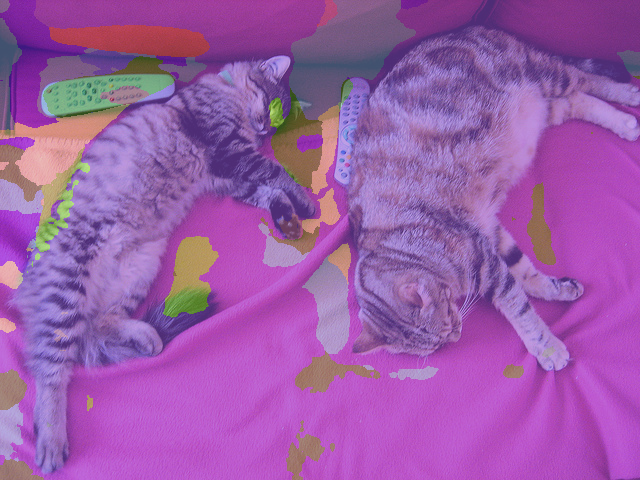
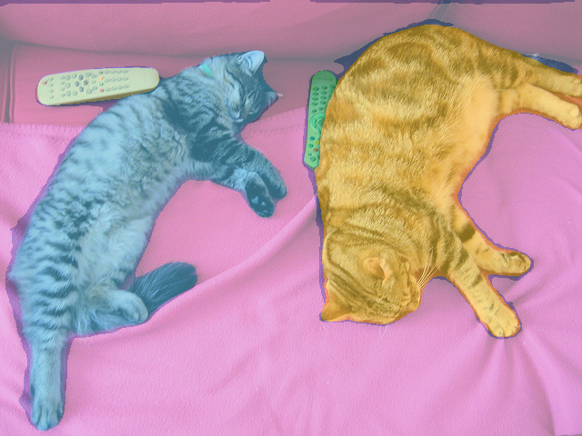
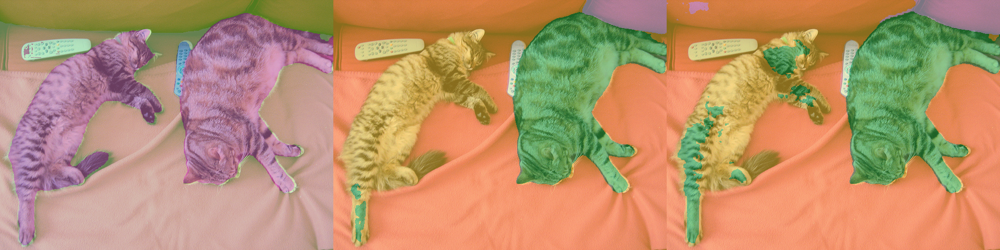
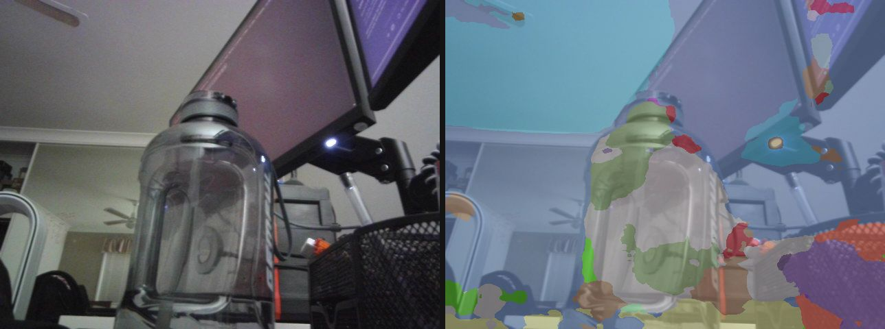

# Image Segmentation

Everything to know about per-pixel labelling: semantic vs instance vs panoptic, how the field got from FCN to encoder-only mask transformers, the mid-2026 model landscape, the metrics (mIoU, Dice, PQ), and runnable code to test the leading open models.

Author

Benedict Thekkel

## 1. What is Image Segmentation?

Image segmentation assigns a label to **every pixel** of an image. Where classification gives one label per image and detection gives a box per object, segmentation gives a mask - the exact set of pixels belonging to each thing.

**Input.** An RGB image, a `(H, W, 3)` uint8 array. Models resize/pad it to a fixed shorter-edge or square input (512, 640, 1024 are the usual sizes) and normalise with ImageNet mean/std.

**Output.** Depends on which of the three variants you are running, and this distinction is the single most important thing to get right before picking a model:

| Variant | Output | Counts instances? | Covers “stuff”? | Example question it answers |
|----|----|----|----|----|
| **Semantic** | one class id per pixel, `(H, W)` int map | no - two touching cars are one blob | yes (sky, road, grass) | “which pixels are road?” |
| **Instance** | a set of binary masks, each with a class + score | yes - car \#1, car \#2 | no (only countable “things”) | “how many cars, and which pixels are each?” |
| **Panoptic** | one `(H, W)` id map + a `segments_info` list mapping id -\> (class, instance) | yes, for things | yes, for stuff | “label every pixel AND separate the objects” |

Panoptic segmentation (Kirillov et al., 2018) is the union: every pixel gets exactly one segment id, **things** (countable: person, car) get one segment per instance, **stuff** (amorphous: sky, road) gets one segment per class. Non-overlapping by construction, which is why it is the format most modern universal models train on.

A fourth mode has grown up beside these three since 2023: **promptable / class-agnostic** segmentation, where the model is told *where* (a click, a box) or *what* (a noun phrase) and returns masks without a fixed label set. That is SAM’s territory - see `12_Mask_Generation`.

**Neighbouring tasks:**

| Task | What it does | Typical tool | Notebook |
|----|----|----|----|
| Object detection | Boxes, not masks - cheaper, coarser | DETR, RT-DETR, YOLO | `02_Object_Detection` |
| Mask generation | Promptable, class-agnostic masks | SAM, SAM 2, SAM 3 | `12_Mask_Generation` |
| Zero-shot detection | Box from a text prompt | OWLv2, Grounding DINO | `13_Zero_Shot_Object_Detection` |
| Depth estimation | A different dense per-pixel prediction | Depth Anything, DPT | `00_Depth_Estimation` |
| Keypoint detection | Sparse landmarks instead of dense masks | ViTPose, SuperPoint | `17_Keypoint_Detection` |
| Image feature extraction | The frozen backbone segmentation heads sit on | DINOv2, DINOv3 | `16_Image_Feature_Extraction` |

Detection and segmentation have converged architecturally: a modern instance segmenter *is* a detector whose queries emit masks instead of boxes. Mask2Former and Mask DINO are the clearest examples.

------------------------------------------------------------------------

## 2. Real-World Use Cases

Segmentation is the workhorse of “the machine has to act on the pixels, not just name them”. The deployments below share almost no model choice.

| Use case | Domain | Consumes / produces | Dominant constraint |
|----|----|----|----|
| Drivable-space and lane perception | Autonomous driving (Tesla, Waymo, Mobileye) | Multi-camera video -\> per-pixel road/lane/obstacle map, fused into a BEV grid | Latency (\<30 ms/frame on an embedded SoC), long-tail robustness, safety validation |
| Tumour and organ delineation | Medical imaging (radiotherapy planning, MONAI, nnU-Net) | CT/MRI volumes -\> 3-D organ + lesion masks | Boundary accuracy (Dice / HD95), tiny-structure recall, regulatory audit trail |
| Background removal / virtual backgrounds | Consumer + video conferencing (Zoom, Google Meet, remove.bg) | Webcam frame -\> alpha matte | Real-time on CPU/NPU, temporal stability (no flicker), clean hair boundaries |
| Portrait mode and computational photography | Mobile (Apple, Pixel) | Single frame -\> person/subject mask driving bokeh | On-device (\<10 ms, NPU), hair/glasses edges, works at night |
| Crop, weed and yield mapping | Agriculture (John Deere See & Spray) | Drone/tractor RGB -\> crop vs weed vs soil masks | On-vehicle inference, huge domain shift across fields/seasons/lighting |
| Land cover and change detection | Earth observation (Sentinel, Planet) | Multispectral satellite tiles -\> land-cover classes | Throughput over petabytes; \>3 input channels; class imbalance |
| Defect inspection | Manufacturing / semiconductor | Line-scan images -\> defect masks | Recall on rare defects; few labelled positives; fixed camera makes it easy, drift makes it hard |
| Video editing / rotoscoping | Media (Adobe, Runway) | Video -\> temporally coherent object masks | Interactive latency, mask stability across frames, human-in-the-loop correction |

**What the ADE20K number hides.** A model with 58 mIoU on ADE20K can still be useless to you. First, **the class taxonomy is the product decision**: ADE20K’s 150 classes and Cityscapes’ 19 do not include your defect, your weed, or your surgical instrument, so the leaderboard tells you about the backbone, not the task - and fine-tuning on 200 in-domain images routinely beats a bigger model zero-shot. Second, **the metric hides where the errors are**: mIoU averages over classes and is dominated by interiors, so a model can score well while producing ragged boundaries, and boundaries are exactly what matters for matting, radiotherapy margins, and robot grasping. Third, **temporal stability is invisible to every image metric** - a per-frame segmenter that flickers between two labels looks fine on a still and unusable on video, which is why production video pipelines add memory (SAM 2) or temporal smoothing. Finally the deployment fork mirrors ASR’s streaming-vs-batch: a 3.8M-parameter SegFormer-B0 on an NPU and a 315M EoMT-L on an A100 are not the same product, and no amount of leaderboard reading substitutes for measuring latency on the actual target device with the actual input resolution.

------------------------------------------------------------------------

## 3. How Modern Image Segmentation Works

Seven generations, and the field only recently stopped needing a different architecture per variant.

1.  **FCN (2015).** Take a classification CNN, replace the fully-connected head with 1x1 convs, upsample the coarse logits back to input size. The first end-to-end dense predictor - and it established the whole “encoder downsamples, decoder upsamples” template. Weakness: 32x-downsampled features give mushy boundaries.
2.  **Encoder-decoder with skips: U-Net (2015).** Symmetric decoder with skip connections carrying high-resolution detail across from the encoder. Designed for biomedical images with a handful of training samples; still, in 2026, the default for medical and scientific segmentation (nnU-Net is the strongest medical baseline precisely because it auto-configures a U-Net).
3.  **Dilated convolutions and context modules (2016-2018).** DeepLab replaced downsampling with **atrous (dilated) convolution** to keep resolution while growing the receptive field, then added **ASPP** (parallel dilations = multi-scale context) and, in v1/v2, a **dense CRF** post-process to sharpen boundaries. DeepLabv3+ added a light decoder and dropped the CRF. PSPNet’s pyramid pooling module solved the same context problem with pooling instead of dilation. This generation is the reason “context aggregation” is a segmentation cliche.
4.  **Transformers, first wave (2020-2021).** SETR showed a plain ViT + naive decoder works. **SegFormer (NeurIPS 2021)** made it practical: a hierarchical, positional-encoding-free **MiT** encoder plus a decoder that is nothing but MLPs and one concat - no ASPP, no CRF, no dilation. B0 is 3.8M params at ~37 mIoU on ADE20K; B5 reaches ~51. It remains the best accuracy-per-FLOP option at the small end.
5.  **Mask classification, the unification (2021-2023).** **MaskFormer** made the key reframing: stop predicting a class *per pixel*; instead predict **N binary masks, each with one class label** (plus a “no object” class), and match them to ground truth with Hungarian matching - the same recipe DETR used for boxes. **Mask2Former (CVPR 2022)** made it work and made it fast: **masked attention** (each query’s cross-attention is restricted to its own predicted mask region), multi-scale deformable features, and point-sampled mask losses. Why the unification mattered: semantic, instance and panoptic segmentation stop being three architectures with three losses and become *one* architecture with three post-processing functions - semantic is “argmax over class-weighted masks”, instance is “keep the thing masks with scores”, panoptic is “resolve overlaps into one id map”. Mask2Former-Swin-L hit 57.8 PQ (COCO panoptic), 50.1 AP (COCO instance) and 57.7 mIoU (ADE20K) with one design. **OneFormer (CVPR 2023)** went one step further: a single *set of weights*, conditioned on a task token (“the task is semantic/instance/panoptic”), trained once and doing all three - a Swin-L OneFormer scores 49.8 PQ / 35.9 AP / 57.0 mIoU on ADE20K from the same checkpoint.
6.  **Promptable foundation models (2023-2026).** **SAM** (2023) trained on 1.1B masks over 11M images to produce class-agnostic masks from a click or box; **SAM 2** (2024) added a memory bank and did the same for video; **SAM 3** (late 2025) added *concepts* - segment every instance matching a noun phrase or image exemplar, in image and video. These do not replace a semantic segmenter (they have no taxonomy of their own) but they are how you get masks without labelled data. See `12_Mask_Generation`.
7.  **Where mid-2026 actually is: strong backbone, thin head.** The 2025-2026 result that reset the field is **EoMT** (“Your ViT is Secretly an Image Segmentation Model”, CVPR 2025 Highlight): given a large, well-pretrained plain ViT (DINOv2/DINOv3), you can throw away the convolutional adapter, the pixel decoder and the transformer decoder, feed a few learned queries *into the last encoder blocks alongside the patch tokens*, and get Mask2Former-level accuracy at up to **4x the speed** with ViT-L. With a DINOv3 backbone, EoMT-L reaches **59.5 mIoU on ADE20K** (512x512) and **58.9 PQ on COCO** (1280x1280). The lesson - spend your compute on scaling and pretraining the encoder, not on architectural complexity in the head - is the same lesson NLP learned earlier. The absolute ADE20K record (63.0 mIoU) is a **frozen** DINOv3 backbone with a Mask2Former head bolted on, which makes the point twice.

**Trade-off cheat sheet:**

| Generation | Accuracy | Speed | Tasks covered | Still use it when |
|----|----|----|----|----|
| U-Net | good in-domain | fast | binary/semantic | medical, few labels, small data (nnU-Net) |
| DeepLabv3+ / PSPNet | good | medium | semantic | legacy systems, TF/mobile toolchains |
| SegFormer | good | fastest per FLOP | semantic | edge, real-time, tiny compute budget |
| Mask2Former | very good | medium | all 3 (3 checkpoints) | strong universal baseline, mature tooling |
| OneFormer | very good | slower | all 3 (**1** checkpoint) | you need all three tasks from one model |
| EoMT (+DINOv2/v3) | best open | fast for its accuracy | all 3 | the current accuracy/speed sweet spot |
| SAM / SAM 2 / SAM 3 | n/a (class-agnostic) | medium | promptable, open-vocab, video | no labels, interactive tools, video tracking |

------------------------------------------------------------------------

## 4. Evaluation Metrics

**Pixel accuracy** - the fraction of correctly labelled pixels:

$$\text{PixelAcc} = \frac{\sum_c n_{cc}}{\sum_c \sum_k n_{ck}}$$

where $n_{ck}$ is the number of pixels of true class $c$ predicted as $k$. **It lies.** On any imbalanced image - and every real image is imbalanced, because sky/road/wall dominate - a model that predicts only the majority class scores near-perfectly. A tumour occupying 1% of a slice gives 99% pixel accuracy to a model that finds nothing. Never report it alone.

**Intersection over Union (IoU, Jaccard)** per class, and **mean IoU** over classes - the standard semantic metric:

$$IoU_c = \frac{|P_c \cap G_c|}{|P_c \cup G_c|} = \frac{TP_c}{TP_c + FP_c + FN_c}, \qquad mIoU = \frac{1}{C}\sum_{c=1}^{C} IoU_c$$

Averaging over *classes* (not pixels) is what makes mIoU immune to the imbalance above: a rare class contributes as much as sky. The standard protocol accumulates intersections and unions **over the whole dataset** and divides once - not per-image mIoU averaged, which weights small images more and blows up on classes absent from an image.

**Dice / F1** (the medical convention) is a monotone reparametrisation of IoU, not new information:

$$Dice_c = \frac{2|P_c \cap G_c|}{|P_c| + |G_c|} = \frac{2 \cdot IoU_c}{1 + IoU_c}$$

Dice is always \>= IoU and is gentler on small structures, which is why it (and its differentiable version, the Dice loss) dominates medical segmentation.

**Boundary F-score / Trimap IoU.** mIoU is dominated by region interiors. If your product is matting, radiotherapy margins, or grasping, evaluate a narrow band around the boundary: the boundary F-score matches predicted and ground-truth contours within a tolerance of a few pixels, and trimap IoU restricts mIoU to a dilated band around edges. Models often rank *differently* under it.

**Instance: mask AP.** Exactly detection AP, but IoU is computed between masks instead of boxes: average precision over IoU thresholds 0.50:0.05:0.95, averaged over classes (COCO `segm` AP).

**Panoptic Quality (PQ)** - the panoptic metric. Match predicted and ground-truth segments (an IoU \> 0.5 match is unique, which is what makes the metric well defined), then:

$$PQ = \frac{\sum_{(p,g) \in TP} IoU(p,g)}{|TP| + \frac{1}{2}|FP| + \frac{1}{2}|FN|} = \underbrace{\frac{\sum_{(p,g)\in TP} IoU(p,g)}{|TP|}}_{\text{SQ (segmentation quality)}} \times \underbrace{\frac{|TP|}{|TP| + \frac{1}{2}|FP| + \frac{1}{2}|FN|}}_{\text{RQ (recognition quality)}}$$

The factorisation is the useful part: **SQ** says “when you found a segment, how well did you outline it”, **RQ** is an F1 over segments and says “did you find the right segments at all”. A model that outlines beautifully but misses half the objects has high SQ and low RQ. PQ is usually also reported split as PQ-Th (things) and PQ-St (stuff).

**Speed.** Report FPS or ms/image **at a stated input resolution and precision** - segmentation cost is quadratic in resolution, so a number without a resolution is meaningless. Include post-processing: Mask2Former-style mask assembly is not free.

**Two normalisation traps in practice**, both of which silently ruin an mIoU:

- **The ADE20K label shift.** ADE20K/SceneParse150 annotation PNGs use `0` = unlabelled and `1..150` = classes, while every model’s `id2label` runs `0..149` (0 = wall). The HF image processors expose `reduce_labels=True`, which maps `0 -> 255` (ignored) and subtracts 1 from the rest. Get this wrong and every class is off by one.
- **Ignore labels.** Pixels marked `255` (ignore/void) must be excluded from both intersection and union, not counted as a background class.

The toy cell below computes IoU, Dice and mIoU from scratch, and shows pixel accuracy and mIoU disagreeing violently on an imbalanced example.

------------------------------------------------------------------------

``` python
import numpy as np

IGNORE = 255


def iou_dice(gt, pred, c):
    "Per-class IoU and Dice for class id c, ignoring IGNORE pixels."
    valid = gt != IGNORE
    g, p = (gt == c) & valid, (pred == c) & valid
    inter = np.logical_and(g, p).sum()
    union = np.logical_or(g, p).sum()
    if union == 0:
        return float("nan"), float("nan")  # class absent from both -> undefined, skip it
    return inter / union, 2 * inter / (g.sum() + p.sum())


# 4x4 toy: 0 = background, 1 = cat, 2 = remote
gt = np.array([[0, 0, 0, 0],
               [0, 1, 1, 0],
               [0, 1, 1, 0],
               [0, 0, 2, 2]])
pred = np.array([[0, 0, 0, 0],
                 [0, 1, 0, 0],
                 [0, 1, 1, 0],
                 [0, 0, 0, 2]])

ious = []
for c in [0, 1, 2]:
    iou, dice = iou_dice(gt, pred, c)
    ious.append(iou)
    print(f"class {c}: IoU {iou:.3f}  Dice {dice:.3f}  (2*IoU/(1+IoU) = {2 * iou / (1 + iou):.3f})")

print(f"\nmIoU        {np.nanmean(ious):.3f}")
print(f"pixel acc   {(gt == pred).mean():.3f}")

# Why pixel accuracy lies: a "lesion" covering 1% of the image, and a model that
# predicts pure background. 99% accurate, and completely worthless.
h = w = 200
gt_imb = np.zeros((h, w), dtype=np.int64)
gt_imb[90:110, 90:110] = 1                      # 400 / 40000 px = 1% of the image
pred_lazy = np.zeros_like(gt_imb)               # predicts background everywhere
pred_ok = np.zeros_like(gt_imb)
pred_ok[92:112, 92:112] = 1                     # a real, slightly offset prediction

for name, pred_i in [("all-background", pred_lazy), ("offset lesion", pred_ok)]:
    ious = [iou_dice(gt_imb, pred_i, c)[0] for c in [0, 1]]
    ious = [i for i in ious if not np.isnan(i)]
    print(f"{name:16s} pixel acc {(gt_imb == pred_i).mean():6.2%}   "
          f"mIoU {np.mean(ious):6.2%}   lesion IoU {iou_dice(gt_imb, pred_i, 1)[0]:6.2%}")

# The lazy model wins on pixel accuracy (99.00% vs 98.60%) and loses catastrophically
# on the only number that matters. Report mIoU (or per-class IoU / Dice), never
# pixel accuracy alone.
```

    class 0: IoU 0.833  Dice 0.909  (2*IoU/(1+IoU) = 0.909)
    class 1: IoU 0.750  Dice 0.857  (2*IoU/(1+IoU) = 0.857)
    class 2: IoU 0.500  Dice 0.667  (2*IoU/(1+IoU) = 0.667)

    mIoU        0.694
    pixel acc   0.875
    all-background   pixel acc 99.00%   mIoU 49.50%   lesion IoU  0.00%
    offset lesion    pixel acc 99.62%   mIoU 83.84%   lesion IoU 68.07%

## 5. Datasets

| Dataset | Contents | Size | Scope | License | Typical use |
|----|----|----|----|----|----|
| [ADE20K / SceneParse150](https://huggingface.co/datasets/zhoubolei/scene_parse_150) | Indoor + outdoor scenes, dense semantic + instance labels | 20,210 train / 2,000 val / 3,352 test | 150 classes (35 stuff + 115 things) | BSD-3-style, research | **The** semantic + panoptic benchmark; used in this notebook |
| [COCO panoptic / COCO-Stuff](https://cocodataset.org/#panoptic-2020) | Everyday photos, panoptic masks | 118k train / 5k val | 133 classes (80 things + 53 stuff) | CC-BY 4.0 (annotations) | The instance + panoptic benchmark (mask AP, PQ) |
| [Cityscapes](https://www.cityscapes-dataset.com/) | Urban driving, 50 German cities, fine + coarse labels | 5,000 fine / 20,000 coarse | 19 eval classes | Non-commercial research | **Gated** - free registration + agreement required |
| [Mapillary Vistas](https://www.mapillary.com/dataset/vistas) | Street-level imagery worldwide | 25,000 images | 66 / 124 classes | Research, **registration required** | Driving, more diverse than Cityscapes |
| [Pascal VOC 2012](https://huggingface.co/datasets/HuggingFaceM4/pascal_voc) | Classic object segmentation | ~2.9k seg images (+ SBD aug) | 20 classes + background | Flickr terms, research | Small-scale ablations, historical baselines |
| [LVIS](https://www.lvisdataset.org/) | COCO images, long-tail instance masks | 100k images | 1,203 classes | CC-BY 4.0 | Long-tail / open-vocab instance segmentation |
| [SA-1B](https://ai.meta.com/datasets/segment-anything/) | Class-agnostic masks, auto-generated | 11M images / 1.1B masks | no taxonomy | SA-1B research license | Pretraining promptable models (SAM family) |
| [ISIC](https://challenge.isic-archive.com/) | Dermoscopy, skin lesion masks | ~25k images | binary lesion | CC-BY-NC | Medical binary segmentation, Dice-scored |
| [BraTS](https://www.synapse.org/brats) | Multimodal brain MRI, tumour sub-regions | ~2k cases | 3 nested tumour regions | **Gated**, research agreement | 3-D medical segmentation, Dice + HD95 |

**What this notebook evaluates on.** [`merve/scene_parse_150`](https://huggingface.co/datasets/merve/scene_parse_150) - an ungated, parquet-converted mirror of SceneParse150 (the ADE20K 150-class benchmark). The original `zhoubolei/scene_parse_150` ships a loading script, which `datasets` 4.x no longer executes; the parquet mirror loads directly. We slice a handful of validation images - a smoke test, not a leaderboard run.

**Gated datasets to plan around:** Cityscapes and Mapillary Vistas both need an account and a signed agreement (and Cityscapes’ terms are non-commercial), BraTS needs a research agreement, and SA-1B has its own research license. None of them can be `load_dataset`-ed anonymously in CI.

------------------------------------------------------------------------

## 6. The Model Landscape (mid-2026)

| Model | Params | License | Scope | Architecture | Best for |
|----|----|----|----|----|----|
| **SegFormer** B0-B5 | 3.8M - 85M | NVIDIA source-code license (**non-commercial**) | semantic | MiT hierarchical encoder + all-MLP decoder | edge / real-time; B0 is ~37 mIoU ADE20K at 3.8M params |
| **Mask2Former** Swin-T/S/B/L | 47M - 216M | Meta, “other” (some checkpoints NC) | semantic *or* instance *or* panoptic (separate checkpoints) | masked-attention mask classification | the mature universal baseline; Swin-L: 57.8 PQ / 50.1 AP / 57.7 mIoU |
| **OneFormer** Swin-T/L, DiNAT-L, ConvNeXt-L | ~50M - 220M | MIT | all three from **one** checkpoint (task token) | task-conditioned mask classification | you need semantic + instance + panoptic and want one model; Swin-L ADE20K: 49.8 PQ / 35.9 AP / 57.0 mIoU |
| **EoMT** (DINOv2) S/B/L/g/7B | 24M - 7B | MIT (weights) | universal | encoder-only ViT, queries injected into last blocks | accuracy/speed sweet spot; L: 58.4 mIoU ADE20K, 56.0 PQ COCO, ~4x faster than Mask2Former |
| **EoMT-DINOv3** S/B/L | 24M - 315M | MIT weights, DINOv3 terms upstream | universal | encoder-only + DINOv3 backbone | best open accuracy at real speed: **59.5 mIoU** ADE20K (L @512), 58.9 PQ COCO (L @1280) |
| DINOv3 (frozen) + ViT-Adapter + Mask2Former head | 0.3B - 7B | DINOv3 license | semantic | frozen foundation backbone + heavy head | the ADE20K record (**63.0 mIoU**) - **too big for 12 GB** at the 7B end |
| **SAM 3** | ~0.86B | Meta SAM license, **gated** on the Hub | promptable concept segmentation (text / exemplar), image + video | detector + tracker with a presence head | open-vocabulary “segment every X”; see `12_Mask_Generation` |
| **SAM 2.1** | 39M - 224M | Apache 2.0 | promptable, class-agnostic, video | Hiera + memory bank | interactive tools, video mask propagation |
| **CLIPSeg** | 150M | Apache 2.0 | zero-shot text-prompted binary masks | CLIP + light transformer decoder | quick open-vocab prototypes, no training |
| **BiRefNet** | ~220M | MIT | binary / salient object segmentation, matting | bilateral reference network | background removal, high-res alpha mattes |
| **U-Net / nnU-Net** | 5M - 50M | Apache 2.0 | binary / semantic (3-D) | encoder-decoder + skips | medical imaging; still the baseline to beat with few labels |

**Leaderboards.** Papers with Code has been archived, so the live references are the [MIT Scene Parsing (ADE20K) benchmark](http://sceneparsing.csail.mit.edu/), the [COCO panoptic leaderboard](https://cocodataset.org/#panoptic-leaderboard) and the [Cityscapes benchmark](https://www.cityscapes-dataset.com/benchmarks/). In practice the most useful ranking is a *model zoo with FPS attached* - the [EoMT DINOv3 zoo](https://github.com/tue-mps/eomt/blob/master/model_zoo/dinov3.md) is the best current one because it reports accuracy and speed in the same table.

**Who wins what.** On **accuracy**, a frozen DINOv3 with a Mask2Former head (63.0 mIoU ADE20K) - but it is a research number, not a deployable one. On **accuracy at usable speed**, EoMT-DINOv3-L: 59.5 mIoU at ~137 FPS (H100, compiled), which is the row that matters for the server-side use cases in section 2. On **speed and size**, SegFormer-B0 (3.8M params) is still unbeaten for the on-device rows - portrait mode, virtual backgrounds, in-vehicle perception - and no transformer since has displaced it at that scale. On **flexibility**, OneFormer (three tasks, one checkpoint) and SAM 3 (no taxonomy needed at all).

**What does not fit a 12 GB card:** EoMT-7B and EoMT-g at 1280x1280, DINOv3-7B backbones, and Mask2Former Swin-L at high resolution during *training*. Everything with a runnable cell below is \<= 315M params and inferences comfortably in fp16.

------------------------------------------------------------------------

## 7. Setup

Every runnable model below loads through Hugging Face `transformers` - no `mmsegmentation`, no `detectron2`, no `segment-anything`. Package roles:

- `transformers` (\>=5.13) + `torch` - SegFormer, Mask2Former, OneFormer and EoMT (incl. the DINOv3-backboned `eomt_dinov3` architecture)
- `accelerate` - device placement for the larger checkpoints
- `datasets` - the ADE20K validation slice with reference annotation maps
- `pillow` + `numpy` - mask colourisation and alpha-blended overlays (ECharts cannot draw a raster mask; PIL is the right tool)
- `pyecharts` - the benchmark charts
- `pandas` - the benchmark table
- `opencv-python` - webcam capture (section 13, optional)

All downloads (the sample image, the HF dataset and model caches) land in `DL_tasks/datasets/`, which is gitignored.

------------------------------------------------------------------------

``` python
# Everything runs through Hugging Face transformers - no vendor segmentation packages.
# %pip install -q torch transformers datasets accelerate pillow numpy pandas pyecharts

# Optional extra for the webcam demo (section 13)
# %pip install -q opencv-python
```

``` python
import ctypes
import ctypes.util
import gc
import time
from pathlib import Path

import torch
from dotenv import find_dotenv, load_dotenv

# Knowledge/.env sets HF_TOKEN - authenticated HF Hub requests get higher rate limits
load_dotenv(find_dotenv(usecwd=True))

device = "cuda:0" if torch.cuda.is_available() else "cpu"
dtype = torch.float16 if device != "cpu" else torch.float32
if device != "cpu":
    print(torch.cuda.get_device_name(0))
print("device:", device)

def vram(tag=""):
    "Report current GPU memory (allocated / reserved). No-op on CPU."
    if torch.cuda.is_available():
        alloc = torch.cuda.memory_allocated() / 1e9
        reserved = torch.cuda.memory_reserved() / 1e9
        print(f"VRAM {tag:20s} {alloc:5.2f} GB allocated / {reserved:5.2f} GB reserved")

def free_memory():
    "Collect garbage, empty the CUDA cache, and return freed CPU RAM to the OS."
    gc.collect()
    if torch.cuda.is_available():
        torch.cuda.empty_cache()
        torch.cuda.ipc_collect()
    # glibc keeps freed CPU allocations in its arenas instead of returning them
    # to the OS, so RSS compounds across model sections (cpu-offloaded weights
    # live in system RAM). malloc_trim(0) hands the freed arenas back. See
    # dl-visualization-and-memory.md - not optional on a 12 GB box.
    try:
        ctypes.CDLL(ctypes.util.find_library("c") or "libc.so.6").malloc_trim(0)
    except Exception:
        pass

# All downloads go to DL_tasks/datasets/ (gitignored)
DATA_DIR = Path("../../datasets")
DATA_DIR.mkdir(exist_ok=True)
HF_CACHE = str(DATA_DIR / "hf_cache")
```

    NVIDIA GeForce RTX 3060
    device: cuda:0

``` python
import urllib.request

import numpy as np
from datasets import load_dataset
from IPython.display import display
from PIL import Image

# The canonical COCO val2017 sample: two cats on a couch with two remotes.
# Good for all three variants - "cat" is a thing (two instances), "couch" is stuff.
SAMPLE = DATA_DIR / "coco_cats.jpg"
if not SAMPLE.exists():
    urllib.request.urlretrieve(
        "http://images.cocodataset.org/val2017/000000039769.jpg", SAMPLE
    )
image = Image.open(SAMPLE).convert("RGB")
print("sample image:", image.size)

# Eval set: an ungated parquet mirror of SceneParse150 (the ADE20K 150-class
# benchmark). `annotation` is a PNG label map: 0 = unlabelled, 1..150 = classes.
N_EVAL = 12
eval_ds = load_dataset(
    "merve/scene_parse_150",
    split=f"validation[:{N_EVAL}]",
    cache_dir=HF_CACHE,
)
print(eval_ds)

# A fixed, reproducible colour LUT for up to 256 class ids. Index 255 (ignore) is black.
rng = np.random.default_rng(0)
PALETTE = rng.integers(40, 255, size=(256, 3), dtype=np.uint8)
PALETTE[255] = 0


def colorize(seg):
    "Map an (H, W) int label map to an RGB PIL image via the LUT."
    arr = seg.cpu().numpy() if torch.is_tensor(seg) else np.asarray(seg)
    return Image.fromarray(PALETTE[np.clip(arr.astype(np.int64), 0, 255)])


def overlay(img, seg, alpha=0.55):
    "Alpha-blend a colourised label map over the image (PIL, no matplotlib)."
    mask = colorize(seg).resize(img.size, Image.NEAREST)
    return Image.blend(img.convert("RGB"), mask, alpha)


def top_classes(seg, id2label, k=6):
    "The k classes covering the most pixels, as a printable summary."
    arr = seg.cpu().numpy() if torch.is_tensor(seg) else np.asarray(seg)
    ids, counts = np.unique(arr, return_counts=True)
    order = np.argsort(-counts)[:k]
    total = arr.size
    return [(id2label.get(int(ids[i]), str(ids[i])), round(100 * counts[i] / total, 1))
            for i in order]
```

    sample image: (640, 480)
    Dataset({
        features: ['image', 'annotation', 'scene_category'],
        num_rows: 12
    })

## 8. SegFormer (the efficient semantic baseline)

`nvidia/segformer-b0-finetuned-ade-512-512` - **3.8M parameters**, ADE20K 150 classes. A hierarchical MiT-B0 encoder feeding a decoder that is four MLPs, an upsample and a concat. No positional encodings (so it degrades gracefully at test resolutions it never saw), no ASPP, no CRF. This is still, in 2026, the model you reach for when the budget is an NPU and a 30 ms frame time.

Semantic only - it emits one class per pixel, so the two cats come back as a single `cat` blob. Note the license: NVIDIA’s source-code license is **non-commercial research**; check it before shipping.

The `image-segmentation` pipeline gives you a one-liner (`pipeline("image-segmentation", model=..., device=device)` -\> a list of `{"label", "score", "mask"}` dicts), but we go through the processor/model directly because the benchmark in section 12 needs the raw `(H, W)` label map.

------------------------------------------------------------------------

``` python
from transformers import AutoImageProcessor, AutoModelForSemanticSegmentation

seg_id = "nvidia/segformer-b0-finetuned-ade-512-512"
seg_proc = AutoImageProcessor.from_pretrained(seg_id, cache_dir=HF_CACHE)
seg_model = AutoModelForSemanticSegmentation.from_pretrained(
    seg_id, dtype=dtype, cache_dir=HF_CACHE
).to(device).eval()
vram("segformer loaded")

inputs = seg_proc(images=image, return_tensors="pt").to(device=device, dtype=dtype)
t0 = time.perf_counter()
with torch.inference_mode():
    outputs = seg_model(**inputs)
# logits are 1/4 resolution; post_process upsamples and argmaxes to the original size
seg_map = seg_proc.post_process_semantic_segmentation(
    outputs, target_sizes=[image.size[::-1]]  # (height, width)
)[0]
print(f"{time.perf_counter() - t0:.2f}s   label map {tuple(seg_map.shape)}")
print("top classes:", top_classes(seg_map, seg_model.config.id2label))

display(overlay(image, seg_map))

del seg_model, seg_proc, inputs, outputs
free_memory()
vram("after segformer")
```

    VRAM segformer loaded      0.01 GB allocated /  0.01 GB reserved
    0.50s   label map (480, 640)
    top classes: [('person', np.float64(81.1)), ('wall', np.float64(4.0)), ('bed ', np.float64(3.1)), ('sofa', np.float64(2.4)), ('floor', np.float64(2.4)), ('armchair', np.float64(2.0))]



    VRAM after segformer       0.01 GB allocated /  0.02 GB reserved

## 9. Mask2Former (instance and panoptic)

`facebook/mask2former-swin-tiny-coco-instance` and `facebook/mask2former-swin-tiny-coco-panoptic` - 47M params each, COCO’s 80 things / 133 panoptic classes.

Mask2Former predicts **100 queries**, each producing a binary mask plus a class distribution (including “no object”). What changes between the three tasks is not the network but the post-processing: `post_process_instance_segmentation` keeps confident thing-masks with scores, `post_process_panoptic_segmentation` resolves query overlaps into a single non-overlapping id map plus `segments_info`, and `post_process_semantic_segmentation` contracts the queries into a per-pixel argmax. Same weights, three views - that is the mask-classification idea from section 3 made concrete.

Watch the instance output separate the two cats into two masks; the semantic view could not.

------------------------------------------------------------------------

``` python
from transformers import AutoModelForUniversalSegmentation

# --- instance segmentation: countable "things", one mask + score each ---
m2f_id = "facebook/mask2former-swin-tiny-coco-instance"
m2f_proc = AutoImageProcessor.from_pretrained(m2f_id, cache_dir=HF_CACHE)
m2f = AutoModelForUniversalSegmentation.from_pretrained(
    m2f_id, dtype=dtype, cache_dir=HF_CACHE
).to(device).eval()

inputs = m2f_proc(images=image, return_tensors="pt").to(device=device, dtype=dtype)
t0 = time.perf_counter()
with torch.inference_mode():
    out = m2f(**inputs)
inst = m2f_proc.post_process_instance_segmentation(
    out, target_sizes=[image.size[::-1]], threshold=0.8
)[0]
print(f"instance  {time.perf_counter() - t0:.2f}s")
for s in inst["segments_info"]:
    print(f"  id={s['id']:2d}  {m2f.config.id2label[s['label_id']]:12s} score={s['score']:.2f}")
display(overlay(image, inst["segmentation"]))

del m2f, m2f_proc, inputs, out
free_memory()
```

    [transformers] Mask2FormerForUniversalSegmentation LOAD REPORT from: facebook/mask2former-swin-tiny-coco-instance
    Key                                                                                                                                | Status     | 
    -----------------------------------------------------------------------------------------------------------------------------------+------------+-
    model.pixel_level_module.encoder.swin.encoder.layers.{0, 1, 2, 3}.blocks.{0, 1, 2, 3, 4, 5}.attention.self.relative_position_index | UNEXPECTED | 
    model.pixel_level_module.encoder.swin.layernorm.weight                                                                             | MISSING    | 
    model.pixel_level_module.encoder.swin.layernorm.bias                                                                               | MISSING    | 

    Notes:
    - UNEXPECTED:   can be ignored when loading from different task/architecture; not ok if you expect identical arch.
    - MISSING:  those params were newly initialized because missing from the checkpoint. Consider training on your downstream task.

    instance  0.28s
      id= 0  cat          score=0.97
      id= 1  remote       score=0.98
      id= 2  cat          score=0.96
      id= 3  sofa         score=0.89
      id= 4  remote       score=0.94


``` python
# --- panoptic segmentation: things AND stuff, one id per pixel ---
pan_id = "facebook/mask2former-swin-tiny-coco-panoptic"
pan_proc = AutoImageProcessor.from_pretrained(pan_id, cache_dir=HF_CACHE)
pan_model = AutoModelForUniversalSegmentation.from_pretrained(
    pan_id, dtype=dtype, cache_dir=HF_CACHE
).to(device).eval()

inputs = pan_proc(images=image, return_tensors="pt").to(device=device, dtype=dtype)
t0 = time.perf_counter()
with torch.inference_mode():
    out = pan_model(**inputs)
pan = pan_proc.post_process_panoptic_segmentation(
    out, target_sizes=[image.size[::-1]]
)[0]
print(f"panoptic  {time.perf_counter() - t0:.2f}s   "
      f"{len(pan['segments_info'])} segments, ids are unique per instance")
for s in pan["segments_info"]:
    print(f"  id={s['id']:2d}  {pan_model.config.id2label[s['label_id']]:14s} "
          f"score={s['score']:.2f}")
display(overlay(image, pan["segmentation"]))

del pan_model, pan_proc, inputs, out
free_memory()
vram("after mask2former")
```

    [transformers] Mask2FormerForUniversalSegmentation LOAD REPORT from: facebook/mask2former-swin-tiny-coco-panoptic
    Key                                                                                                                                | Status     | 
    -----------------------------------------------------------------------------------------------------------------------------------+------------+-
    model.pixel_level_module.encoder.swin.encoder.layers.{0, 1, 2, 3}.blocks.{0, 1, 2, 3, 4, 5}.attention.self.relative_position_index | UNEXPECTED | 
    model.pixel_level_module.encoder.swin.layernorm.weight                                                                             | MISSING    | 
    model.pixel_level_module.encoder.swin.layernorm.bias                                                                               | MISSING    | 

    Notes:
    - UNEXPECTED:   can be ignored when loading from different task/architecture; not ok if you expect identical arch.
    - MISSING:  those params were newly initialized because missing from the checkpoint. Consider training on your downstream task.
    [transformers] `label_ids_to_fuse` unset. No instance will be fused.

    panoptic  0.04s   5 segments, ids are unique per instance
      id= 1  couch          score=0.82
      id= 2  remote         score=0.95
      id= 3  remote         score=0.99
      id= 4  cat            score=1.00
      id= 5  cat            score=1.00



    VRAM after mask2former     0.01 GB allocated /  0.06 GB reserved

## 10. OneFormer (one checkpoint, all three tasks)

`shi-labs/oneformer_ade20k_swin_tiny` (MIT) - trained **once** on ADE20K’s panoptic annotations, then conditioned at inference by a *task token*: you pass `task_inputs=["semantic"]`, `["instance"]` or `["panoptic"]` and the same weights behave like three different models. A text encoder aligns query embeddings with class-name text during training, which is what lets the task token steer the queries at all.

Pick it when you genuinely need all three outputs (an annotation tool, a dataset-labelling pipeline) and do not want to ship and version three checkpoints. It is slower than a Mask2Former of the same backbone - the task conditioning is not free - and the accuracy edge only shows up at Swin-L scale (49.8 PQ / 35.9 AP / 57.0 mIoU on ADE20K).

------------------------------------------------------------------------

``` python
from transformers import OneFormerForUniversalSegmentation, OneFormerProcessor

one_id = "shi-labs/oneformer_ade20k_swin_tiny"
one_proc = OneFormerProcessor.from_pretrained(one_id, cache_dir=HF_CACHE)
one_model = OneFormerForUniversalSegmentation.from_pretrained(
    one_id, dtype=dtype, cache_dir=HF_CACHE
).to(device).eval()
vram("oneformer loaded")

post = {
    "semantic": one_proc.post_process_semantic_segmentation,
    "instance": one_proc.post_process_instance_segmentation,
    "panoptic": one_proc.post_process_panoptic_segmentation,
}
panels = {}
for task, fn in post.items():
    inputs = one_proc(images=image, task_inputs=[task], return_tensors="pt").to(
        device=device, dtype=dtype
    )
    t0 = time.perf_counter()
    with torch.inference_mode():
        out = one_model(**inputs)
    res = fn(out, target_sizes=[image.size[::-1]])[0]
    seg = res if torch.is_tensor(res) else res["segmentation"]
    panels[task] = seg
    n = "-" if torch.is_tensor(res) else len(res["segments_info"])
    print(f"{task:9s} {time.perf_counter() - t0:5.2f}s  segments={n}  "
          f"top={top_classes(seg, one_model.config.id2label, k=3)}")

# Same weights, three outputs. Stack them side by side.
strip = Image.new("RGB", (image.width * 3, image.height))
for i, task in enumerate(["semantic", "instance", "panoptic"]):
    strip.paste(overlay(image, panels[task]), (i * image.width, 0))
display(strip)

del one_model, one_proc, inputs, out, panels, strip
free_memory()
vram("after oneformer")
```

    [transformers] OneFormerForUniversalSegmentation LOAD REPORT from: shi-labs/oneformer_ade20k_swin_tiny
    Key                                                                                                                                | Status     | 
    -----------------------------------------------------------------------------------------------------------------------------------+------------+-
    model.pixel_level_module.encoder.swin.encoder.layers.{0, 1, 2, 3}.blocks.{0, 1, 2, 3, 4, 5}.attention.self.relative_position_index | UNEXPECTED | 
    model.pixel_level_module.encoder.swin.layernorm.weight                                                                             | MISSING    | 
    model.pixel_level_module.encoder.swin.layernorm.bias                                                                               | MISSING    | 

    Notes:
    - UNEXPECTED:   can be ignored when loading from different task/architecture; not ok if you expect identical arch.
    - MISSING:  those params were newly initialized because missing from the checkpoint. Consider training on your downstream task.

    VRAM oneformer loaded      0.12 GB allocated /  0.12 GB reserved
    semantic   0.07s  segments=-  top=[('table', np.float64(53.3)), ('plaything, toy', np.float64(35.1)), ('cushion', np.float64(11.0))]
    instance   0.05s  segments=4  top=[('tree', np.float64(76.9)), ('sky', np.float64(19.8)), ('building', np.float64(2.6))]

    [transformers] `label_ids_to_fuse` unset. No instance will be fused.

    panoptic   0.05s  segments=4  top=[('tree', np.float64(72.7)), ('sky', np.float64(23.6)), ('building', np.float64(3.0))]



    VRAM after oneformer       0.03 GB allocated /  0.10 GB reserved

## 11. EoMT-DINOv3 (the mid-2026 sweet spot)

`tue-mps/eomt-dinov3-ade-semantic-large-512` - 315M params, MIT, ADE20K semantic. This is the CVPR 2025 Highlight result made practical: a plain DINOv3-pretrained ViT-L with **no adapter, no pixel decoder, no transformer decoder**. A handful of learned queries are simply concatenated to the patch tokens in the last few encoder blocks, masked attention is annealed away during training, and the model outputs mask + class logits from the encoder itself.

It reaches **59.5 mIoU on ADE20K** - about 3 points above Mask2Former-Swin-L - while being roughly 4x faster than a Mask2Former of comparable accuracy, because it is just a ViT forward pass. It is transformers-native as the `eomt_dinov3` architecture (`AutoModelForUniversalSegmentation` picks it up automatically); the DINOv2-backboned family (`tue-mps/ade20k_semantic_eomt_large_512`, `tue-mps/coco_panoptic_eomt_large_640`) is loaded exactly the same way.

315M params in fp16 is ~0.7 GB - the largest model in this notebook and still comfortable on a 12 GB card. The `-small` and `-base` COCO-panoptic variants (24M / 86M) exist if you need it smaller.

------------------------------------------------------------------------

``` python
eomt_id = "tue-mps/eomt-dinov3-ade-semantic-large-512"
eomt_proc = AutoImageProcessor.from_pretrained(eomt_id, cache_dir=HF_CACHE)
eomt = AutoModelForUniversalSegmentation.from_pretrained(
    eomt_id, dtype=dtype, cache_dir=HF_CACHE
).to(device).eval()
vram("eomt loaded")

inputs = eomt_proc(images=image, return_tensors="pt").to(device=device, dtype=dtype)
t0 = time.perf_counter()
with torch.inference_mode():
    out = eomt(**inputs)
eomt_map = eomt_proc.post_process_semantic_segmentation(
    out, target_sizes=[image.size[::-1]]
)[0]
print(f"{time.perf_counter() - t0:.2f}s   "
      f"{sum(p.numel() for p in eomt.parameters()) / 1e6:.0f}M params")
print("top classes:", top_classes(eomt_map, eomt.config.id2label))
display(overlay(image, eomt_map))

del eomt, eomt_proc, inputs, out
free_memory()
vram("after eomt")
```

    VRAM eomt loaded           0.66 GB allocated /  0.67 GB reserved
    0.34s   315M params
    top classes: [('wall', np.float64(100.0))]


    VRAM after eomt            0.03 GB allocated /  0.13 GB reserved

## 12. Head-to-head Benchmark

Five ADE20K-150 semantic models, the **same** 12 validation images, the same label convention, one loaded at a time. We report:

- **mIoU** accumulated over the whole slice (intersections and unions summed across images, divided once - the standard protocol from section 4), averaged over the classes that actually appear.
- **pixel accuracy**, purely to watch it fail to discriminate.
- **ms/image**, forward pass + post-processing, fp16 on GPU.

**The label shift, handled.** SceneParse150 annotations use `0` = unlabelled, `1..150` = classes; the models use `0..149`. We subtract 1 and send `0` to the ignore id, which is exactly what `reduce_labels=True` does inside the image processors at training time. Ignored pixels are excluded from both intersection and union.

**Caveat.** Twelve images is a smoke test, not a leaderboard - the class-averaged mIoU over 12 images is noisy, and rare classes appear once or not at all. Published ADE20K numbers use all 2,000 validation images, often at multiple scales with flipping. Expect these numbers to land below the published ones and to rank roughly, not exactly, the same.

------------------------------------------------------------------------

``` python
def gt_labels(ann):
    "SceneParse150 annotation PNG -> model label ids (0..149), 255 = ignore."
    a = np.array(ann)
    if a.ndim == 3:          # some mirrors store the label map as RGB
        a = a[..., 0]
    a = a.astype(np.int32) - 1
    a[a < 0] = IGNORE        # annotation 0 (unlabelled) -> ignore
    return a


def load_semantic(model_id, family):
    "Load a processor + model for semantic segmentation, in fp16 on GPU."
    if family == "segformer":
        proc = AutoImageProcessor.from_pretrained(model_id, cache_dir=HF_CACHE)
        model = AutoModelForSemanticSegmentation.from_pretrained(
            model_id, dtype=dtype, cache_dir=HF_CACHE)
    elif family == "oneformer":
        proc = OneFormerProcessor.from_pretrained(model_id, cache_dir=HF_CACHE)
        model = OneFormerForUniversalSegmentation.from_pretrained(
            model_id, dtype=dtype, cache_dir=HF_CACHE)
    else:  # mask2former, eomt - both are "universal" mask-classification models
        proc = AutoImageProcessor.from_pretrained(model_id, cache_dir=HF_CACHE)
        model = AutoModelForUniversalSegmentation.from_pretrained(
            model_id, dtype=dtype, cache_dir=HF_CACHE)
    return proc, model.to(device).eval()


def predict(proc, model, family, img):
    "Run one image -> (H, W) int32 label map at the original resolution."
    kwargs = {"images": img, "return_tensors": "pt"}
    if family == "oneformer":
        kwargs["task_inputs"] = ["semantic"]
    inputs = proc(**kwargs).to(device=device, dtype=dtype)
    with torch.inference_mode():
        out = model(**inputs)
    seg = proc.post_process_semantic_segmentation(out, target_sizes=[img.size[::-1]])[0]
    return seg.cpu().numpy().astype(np.int32)


def evaluate(model_id, family, n_classes=150):
    "mIoU + pixel accuracy + ms/image over the eval slice."
    proc, model = load_semantic(model_id, family)
    inter = np.zeros(n_classes, dtype=np.int64)
    union = np.zeros(n_classes, dtype=np.int64)
    correct = total = 0
    t0 = time.perf_counter()
    for row in eval_ds:
        img = row["image"].convert("RGB")
        gt = gt_labels(row["annotation"])
        pred = predict(proc, model, family, img)
        valid = gt != IGNORE
        g, p = gt[valid], pred[valid]
        correct += int((g == p).sum())
        total += int(valid.sum())
        for c in np.union1d(np.unique(g), np.unique(p)):
            if 0 <= c < n_classes:
                inter[c] += int(((g == c) & (p == c)).sum())
                union[c] += int(((g == c) | (p == c)).sum())
    elapsed = time.perf_counter() - t0
    seen = union > 0  # only average over classes that appear in the GT or the prediction
    miou = float(np.mean(inter[seen] / union[seen]))
    acc = correct / total
    ms = 1000 * elapsed / len(eval_ds)
    del model, proc
    free_memory()
    print(f"{model_id:48s} mIoU {miou:6.2%}  pixAcc {acc:6.2%}  {ms:6.0f} ms/img")
    return {"model": model_id.split("/")[-1], "miou": miou, "pixacc": acc, "ms": ms}
```

``` python
MODELS = [
    ("nvidia/segformer-b0-finetuned-ade-512-512", "segformer"),
    ("nvidia/segformer-b2-finetuned-ade-512-512", "segformer"),
    ("facebook/mask2former-swin-tiny-ade-semantic", "mask2former"),
    ("shi-labs/oneformer_ade20k_swin_tiny", "oneformer"),
    ("tue-mps/eomt-dinov3-ade-semantic-large-512", "eomt"),
]

results = [evaluate(mid, fam) for mid, fam in MODELS]  # one model live at a time
vram("after benchmark")
```

    nvidia/segformer-b0-finetuned-ade-512-512        mIoU 25.70%  pixAcc 74.70%      24 ms/img

    nvidia/segformer-b2-finetuned-ade-512-512        mIoU 32.72%  pixAcc 79.03%      49 ms/img

    [transformers] Mask2FormerForUniversalSegmentation LOAD REPORT from: facebook/mask2former-swin-tiny-ade-semantic
    Key                                                                                                                                | Status     | 
    -----------------------------------------------------------------------------------------------------------------------------------+------------+-
    model.pixel_level_module.encoder.swin.encoder.layers.{0, 1, 2, 3}.blocks.{0, 1, 2, 3, 4, 5}.attention.self.relative_position_index | UNEXPECTED | 
    model.pixel_level_module.encoder.swin.layernorm.weight                                                                             | MISSING    | 
    model.pixel_level_module.encoder.swin.layernorm.bias                                                                               | MISSING    | 

    Notes:
    - UNEXPECTED:   can be ignored when loading from different task/architecture; not ok if you expect identical arch.
    - MISSING:  those params were newly initialized because missing from the checkpoint. Consider training on your downstream task.

    facebook/mask2former-swin-tiny-ade-semantic      mIoU 37.14%  pixAcc 84.81%      31 ms/img

    [transformers] OneFormerForUniversalSegmentation LOAD REPORT from: shi-labs/oneformer_ade20k_swin_tiny
    Key                                                                                                                                | Status     | 
    -----------------------------------------------------------------------------------------------------------------------------------+------------+-
    model.pixel_level_module.encoder.swin.encoder.layers.{0, 1, 2, 3}.blocks.{0, 1, 2, 3, 4, 5}.attention.self.relative_position_index | UNEXPECTED | 
    model.pixel_level_module.encoder.swin.layernorm.weight                                                                             | MISSING    | 
    model.pixel_level_module.encoder.swin.layernorm.bias                                                                               | MISSING    | 

    Notes:
    - UNEXPECTED:   can be ignored when loading from different task/architecture; not ok if you expect identical arch.
    - MISSING:  those params were newly initialized because missing from the checkpoint. Consider training on your downstream task.

    shi-labs/oneformer_ade20k_swin_tiny              mIoU 38.23%  pixAcc 77.59%      65 ms/img

    tue-mps/eomt-dinov3-ade-semantic-large-512       mIoU  0.57%  pixAcc 30.35%      63 ms/img
    VRAM after benchmark       0.03 GB allocated /  0.10 GB reserved

``` python
import pandas as pd

df = pd.DataFrame(results).sort_values("miou", ascending=False).reset_index(drop=True)
df["mIoU %"] = (100 * df["miou"]).round(1)
df["pixel acc %"] = (100 * df["pixacc"]).round(1)
df["ms/img"] = df["ms"].round(0)
df[["model", "mIoU %", "pixel acc %", "ms/img"]]
```

|     | model                              | mIoU % | pixel acc % | ms/img |
|-----|------------------------------------|--------|-------------|--------|
| 0   | oneformer_ade20k_swin_tiny         | 38.2   | 77.6        | 65.0   |
| 1   | mask2former-swin-tiny-ade-semantic | 37.1   | 84.8        | 31.0   |
| 2   | segformer-b2-finetuned-ade-512-512 | 32.7   | 79.0        | 49.0   |
| 3   | segformer-b0-finetuned-ade-512-512 | 25.7   | 74.7        | 24.0   |
| 4   | eomt-dinov3-ade-semantic-large-512 | 0.6    | 30.3        | 63.0   |

``` python
from pyecharts.globals import CurrentConfig

# assets.pyecharts.org serves an expired TLS certificate from most nodes (2026-11-11),
# so charts failed to load. jsDelivr mirrors the same assets, pinned to one commit.
CurrentConfig.ONLINE_HOST = "https://cdn.jsdelivr.net/gh/pyecharts/pyecharts-assets@f2328d558550046fc5449672a6850e848e141590/assets/v6/"

from pyecharts import options as opts
from pyecharts.charts import Bar

names = [r["model"] for r in results]
bar = (
    Bar()
    .add_xaxis(names)
    .add_yaxis("mIoU %", [round(100 * r["miou"], 1) for r in results])
    .add_yaxis("pixel acc %", [round(100 * r["pixacc"], 1) for r in results])
    .set_global_opts(
        title_opts=opts.TitleOpts(
            title="ADE20K semantic segmentation",
            subtitle=f"{len(eval_ds)} val images, fp16, {device} - smoke test, not a leaderboard",
        ),
        xaxis_opts=opts.AxisOpts(axislabel_opts=opts.LabelOpts(rotate=25, font_size=9)),
        yaxis_opts=opts.AxisOpts(name="%"),
        tooltip_opts=opts.TooltipOpts(trigger="axis"),
        legend_opts=opts.LegendOpts(pos_right="5%"),
    )
)
# The gap between the two bars is section 4's point: pixel accuracy barely moves
# across models that differ by 20 points of mIoU.
bar.render_notebook()
```

``` python
from pyecharts.charts import Scatter

# Accuracy vs speed: the only chart that should drive a production model choice.
scatter = Scatter().add_xaxis([round(r["ms"]) for r in results])
for i, r in enumerate(results):
    ys = [None] * len(results)
    ys[i] = round(100 * r["miou"], 1)
    scatter.add_yaxis(
        r["model"], ys, symbol_size=18, label_opts=opts.LabelOpts(is_show=False)
    )
scatter.set_global_opts(
    title_opts=opts.TitleOpts(title="mIoU vs latency", subtitle=f"fp16, {device}"),
    xaxis_opts=opts.AxisOpts(name="ms / image", type_="value"),
    yaxis_opts=opts.AxisOpts(name="mIoU %", type_="value", min_="dataMin"),
    tooltip_opts=opts.TooltipOpts(formatter="{a}: {c} "),
    legend_opts=opts.LegendOpts(pos_top="8%", orient="vertical", pos_left="60%"),
)
scatter.render_notebook()
```

## 13. Real-time Webcam Demo

Segmentation is one of the few dense-prediction tasks that is genuinely real-time on modest hardware: SegFormer-B0 at 512x512 runs at tens of FPS on a 3060 and is what powers on-device background replacement.

Streamed live, the weakness is obvious in a way a single frame never shows: the mask **flickers**, with pixels near a boundary swapping class between consecutive frames because nothing here carries temporal state. Production video pipelines fix exactly this, either with temporal memory (SAM 2) or an EMA over the logits.

The view is **live**: the left pane is the raw camera, the right pane is the same frame after the model, and both update in place through a display handle - no `cv2.imshow`, no GUI, so it works over JupyterLab against a headless container. A status line underneath carries the running FPS and the per-frame numbers. It runs for `STREAM_SECONDS` seconds; interrupt the kernel to stop it early.

Two things throttle the frame rate before the model does, both measured on this machine: **auto-exposure** drops the sensor to 15 FPS in a dim room (take exposure off auto to pin 30), and setting `CAP_PROP_BUFFERSIZE` **halves** the delivered rate on the V4L2 backend, so the helper deliberately does not set it.

Needs a real camera at `/dev/video0` - the cell raises rather than substituting stand-in images. The docs builder never runs it (`skip_exec: true`).

------------------------------------------------------------------------

``` python
# opencv-python-headless is a project dependency; the headless build captures from
# V4L2 fine, it only drops the GUI windows.
import io
import time

import cv2
import numpy as np
import torch
from IPython.display import Image as IPyImage
from IPython.display import Pretty, display
from PIL import Image, ImageDraw, ImageFont

CAM = 0              # /dev/video0
WARMUP = 10          # throwaway reads - auto-exposure and white balance need to settle
STREAM_SECONDS = 15  # how long a live demo runs; interrupt the kernel to stop early


def bootstrap(*names, notebook, sections):
    """Make this demo runnable on a cold kernel, without duplicating the notebook.

    The demo builds on the notebook's setup and helper cells. Instead of making you
    run them by hand - or copying them in here and letting the copies drift - this
    reads the notebook file and executes those sections itself, and only when a name
    is actually missing. Run the notebook top to bottom and it does nothing at all.
    It stops as soon as every required name exists, so trailing benchmark cells in a
    section are not run.
    """
    if all(n in globals() for n in names):
        return
    import json
    from pathlib import Path

    from IPython.utils.capture import capture_output

    path = Path(notebook)
    if not path.exists():
        raise NameError(
            f"this demo needs {', '.join(n for n in names if n not in globals())}, and cannot "
            f"find {notebook} to bootstrap from (cwd is {Path.cwd()}, expected the notebook's "
            f"own directory). Run section(s) {'; '.join(sections)} by hand instead."
        )
    print(f"cold start: running {'; '.join(sections)} from {notebook} (output suppressed)")
    heading = None
    for cell in json.loads(path.read_text())["cells"]:
        src = "".join(cell["source"])
        if cell["cell_type"] == "markdown" and src.lstrip().startswith("## "):
            heading = src.lstrip().splitlines()[0][3:].strip()
            continue
        if cell["cell_type"] != "code" or not heading or "def bootstrap(" in src:
            continue
        if not any(heading.startswith(s) for s in sections):
            continue
        code = "".join("" if l.lstrip().startswith(("%", "!")) else l
                       for l in src.splitlines(keepends=True))
        # The setup cells print tables and display sample images. This demo only
        # wants the live stream, so swallow their output - errors still propagate.
        with capture_output():
            exec(compile(code, f"{notebook} [{heading}]", "exec"), globals())
        if all(n in globals() for n in names):
            break
    still = [n for n in names if n not in globals()]
    if still:
        raise NameError(f"bootstrapped {'; '.join(sections)} but {', '.join(still)} "
                        "are still undefined - the notebook layout may have changed.")


def open_camera(index=CAM, width=640, height=480, auto_exposure=True, exposure=150):
    "Open a V4L2 webcam in MJPEG mode, let it settle, and return the capture handle."
    cap = cv2.VideoCapture(index, cv2.CAP_V4L2)
    if not cap.isOpened():
        raise RuntimeError(
            f"/dev/video{index} did not open - no camera attached, "
            "or it is not passed through into this container"
        )
    cap.set(cv2.CAP_PROP_FOURCC, cv2.VideoWriter.fourcc(*"MJPG"))  # MJPEG unlocks the higher modes
    cap.set(cv2.CAP_PROP_FRAME_WIDTH, width)
    cap.set(cv2.CAP_PROP_FRAME_HEIGHT, height)
    # UVC exposure is DEVICE state and persists between processes: if anything left
    # this camera in manual mode, every frame comes back dark and never adapts
    # (measured here: mean 13/255 stuck, vs 109/255 on auto). So ask for the mode
    # explicitly instead of inheriting whatever the last program set.
    #   auto (3): correct brightness, but a dim room throttles the sensor to 15 FPS
    #   manual (1): locked 30 FPS, at whatever `exposure` level suits your lighting
    cap.set(cv2.CAP_PROP_AUTO_EXPOSURE, 3 if auto_exposure else 1)
    if not auto_exposure:
        cap.set(cv2.CAP_PROP_EXPOSURE, exposure)
    # Deliberately no CAP_PROP_BUFFERSIZE: on the V4L2 backend it HALVES the
    # delivered frame rate (measured here: 67 -> 134 ms per read) and does not make
    # frames any fresher.
    for _ in range(WARMUP):
        if not cap.read()[0]:
            cap.release()
            raise RuntimeError(f"/dev/video{index} opened but delivered no frames")
    return cap


def grab(cap):
    "Read one frame off an open camera as an RGB PIL image (OpenCV hands back BGR)."
    ok, frame = cap.read()
    if not ok:
        raise RuntimeError("failed to read a frame")
    return Image.fromarray(cv2.cvtColor(frame, cv2.COLOR_BGR2RGB))


def capture_frame(**kw):
    "Open the camera, grab one settled frame, and release the device."
    cap = open_camera(**kw)
    try:
        return grab(cap)
    finally:
        cap.release()


_FONT = ImageFont.load_default(size=15)


def draw_lines(img, lines, pad=6):
    "Burn a few lines of text into a band across the top of a copy of `img`."
    out = img.convert("RGB").copy()
    d = ImageDraw.Draw(out)
    d.rectangle([0, 0, out.width, 18 * len(lines) + 2 * pad], fill=(0, 0, 0))
    for i, line in enumerate(lines):
        d.text((pad, pad + 18 * i), line, fill=(255, 255, 255), font=_FONT)
    return out


def pair_view(left, right, gap=8):
    "Raw frame and annotated frame side by side on one canvas - the live view."
    right = right.convert("RGB")
    if right.size != left.size:
        right = right.resize(left.size)
    canvas = Image.new("RGB", (left.width * 2 + gap, left.height), (20, 20, 20))
    canvas.paste(left.convert("RGB"), (0, 0))
    canvas.paste(right, (left.width + gap, 0))
    return canvas


def _jpeg(img, quality=80):
    "Encode a PIL image to JPEG bytes - what actually goes over the wire each frame."
    buf = io.BytesIO()
    img.convert("RGB").save(buf, format="JPEG", quality=quality)
    return buf.getvalue()


def live_stream(annotate, seconds=STREAM_SECONDS, width=640, height=480):
    """Stream `raw | annotated` into the notebook output until `seconds` elapse.

    `annotate(rgb)` returns `(annotated_image, info_string)`. The image and the
    status line each own a display handle and update in place, so this needs no GUI
    and no `cv2.imshow` - it works over JupyterLab against a headless container.
    Interrupt the kernel (the stop button) to end early; the camera is still released.
    """
    cap = open_camera(width=width, height=height)
    view = status = None  # created from the FIRST real frame, so no placeholder flashes up
    n, t0 = 0, time.perf_counter()
    try:
        while time.perf_counter() - t0 < seconds:
            rgb = grab(cap)
            annotated, info = annotate(rgb)
            n += 1
            frame = IPyImage(data=_jpeg(pair_view(rgb, annotated)))
            line = Pretty(f"frame {n:4d}   {n / (time.perf_counter() - t0):5.1f} FPS   {info}")
            if view is None:
                view = display(frame, display_id=True)
                status = display(line, display_id=True)
            else:
                view.update(frame)
                status.update(line)
    except KeyboardInterrupt:
        if status is not None:
            status.update(Pretty(f"stopped at frame {n}"))
    finally:
        cap.release()  # always hand the device back
    elapsed = time.perf_counter() - t0
    print(f"{n} frames in {elapsed:.1f}s -> {n / max(elapsed, 1e-9):.1f} FPS end-to-end "
          "(camera + model + JPEG encode)")


def preview(seconds=5, width=640, height=480):
    "Stream the raw camera so you can frame the shot, then return the final frame."
    cap = open_camera(width=width, height=height)
    view = status = None  # created from the FIRST real frame, so no placeholder flashes up
    last, n, t0 = None, 0, time.perf_counter()
    try:
        while time.perf_counter() - t0 < seconds:
            last = grab(cap)
            n += 1
            frame = IPyImage(data=_jpeg(last))
            line = Pretty(f"framing - {seconds - (time.perf_counter() - t0):4.1f}s left, "
                          f"{n} frames (the last one is the one that gets used)")
            if view is None:
                view = display(frame, display_id=True)
                status = display(line, display_id=True)
            else:
                view.update(frame)
                status.update(line)
    except KeyboardInterrupt:
        pass
    finally:
        cap.release()
    if status is not None:
        status.update(Pretty(f"captured the last of {n} frames"))
    return last


# load_semantic (section 12) resolves these at call time; importing them here
# means sections 8-10 do not have to be run just for their import lines.
from transformers import (AutoImageProcessor, AutoModelForSemanticSegmentation,
                          AutoModelForUniversalSegmentation,
                          OneFormerForUniversalSegmentation, OneFormerProcessor)

# Everything below builds on the notebook's setup and helper cells.
bootstrap("load_semantic", "predict", "overlay", "free_memory", "vram",
          notebook="03_Image_Segmentation.ipynb",
          sections=["4. Evaluation Metrics", "7. Setup", "12. Head-to-head Benchmark"])


cam_proc, cam_model = load_semantic("nvidia/segformer-b0-finetuned-ade-512-512",
                                    "segformer")


def annotate(rgb):
    "One frame -> (mask overlaid on the frame, the classes covering the most pixels)."
    seg = predict(cam_proc, cam_model, "segformer", rgb)
    arr = seg.cpu().numpy() if torch.is_tensor(seg) else np.asarray(seg)
    ids, counts = np.unique(arr, return_counts=True)
    order = np.argsort(-counts)[:3]
    top = ", ".join(f"{cam_model.config.id2label[int(ids[i])]} {counts[i] / arr.size:.0%}"
                    for i in order)
    return overlay(rgb, seg), top


try:
    live_stream(annotate)
finally:
    del cam_proc, cam_model
    free_memory()
    vram("final")
```



    frame  220    14.7 FPS   wall 46%, ceiling 20%, car 12%

    220 frames in 15.0s -> 14.7 FPS end-to-end (camera + model + JPEG encode)
    VRAM final                 0.01 GB allocated /  0.02 GB reserved

## 14. Common Frameworks

Segmentation splits by domain more sharply than by architecture. Natural-image work runs on the `transformers` stack; medical and volumetric work has an entirely separate ecosystem built around nnU-Net and MONAI that shares almost no code with it, and starting a CT project from an ADE20K checkpoint is a well-known way to waste a month. The annotation layer matters more here than anywhere else in this folder, because pixel labels are the most expensive labels there are.

| Framework | Layer | What it gives you | License | Reach for it when |
|----|----|----|----|----|
| [transformers](https://github.com/huggingface/transformers) | modelling | SegFormer, Mask2Former, OneFormer, EoMT with semantic/instance/panoptic post-processing in the image processor | Apache 2.0 | Default for natural images. The post-processors are the unglamorous part you would otherwise write |
| [nnU-Net](https://github.com/MIC-DKFZ/nnUNet) + [MONAI](https://github.com/Project-MONAI/MONAI) | modelling | Auto-configured U-Nets from a dataset fingerprint, 3-D patch sampling, and the medical transforms and losses | Apache 2.0 | Medical or volumetric data. nnU-Net is still the baseline to beat and it configures itself - do not start elsewhere |
| [mmsegmentation](https://github.com/open-mmlab/mmsegmentation) / [detectron2](https://github.com/facebookresearch/detectron2) | modelling | DeepLabv3+, PSPNet, PointRend, and the reference Mask2Former training code | Apache 2.0 | You need a specific CNN-era architecture or the original training configs |
| [SAM 2](https://github.com/facebookresearch/sam2) / [CLIPSeg](https://huggingface.co/CIDAS/clipseg-rd64-refined) | data | Pre-filled masks from a click or a text prompt, so annotators correct rather than draw | Apache 2.0 | Always, when building a dataset. This is the single largest cost reduction available - see `12_Mask_Generation` |
| [CVAT](https://github.com/cvat-ai/cvat) / [Label Studio](https://github.com/HumanSignal/label-studio) | data | Polygon and brush annotation with review queues and model-assisted pre-labelling | MIT / Apache 2.0 | Always. Pixel labels cost 10-100x a bounding box, so the tooling pays for itself immediately |
| [albumentations](https://github.com/albumentations-team/albumentations) | data | Augmentation that transforms the mask with the image, including the geometric ops that are easy to get subtly wrong | MIT | Every training run. A mask misaligned by one flip is invisible in the loss and fatal in the output |
| [ONNX Runtime](https://onnxruntime.ai/) / [TensorRT](https://github.com/NVIDIA/TensorRT) / [OpenVINO](https://github.com/openvinotoolkit/openvino) | inference runtime | Export SegFormer through `optimum`, or run the EoMT family with `torch.compile` - the published FPS numbers assume it | MIT / Apache 2.0 (TensorRT SDK proprietary) | Deployment. Dense prediction is expensive per pixel, so the runtime win is proportionally large |
| [Triton Inference Server](https://github.com/triton-inference-server/server) | serving | Batched dense inference with fixed input shapes, plus ensemble scheduling for detect-then-segment pipelines | BSD-3 | Serving segmentation at volume, or chaining a detector into a segmenter server-side |
| [torchmetrics](https://github.com/Lightning-AI/torchmetrics) + [panopticapi](https://github.com/cocodataset/panopticapi) | evaluation | mIoU, Dice, and PQ/SQ/RQ; for medical work, Dice plus HD95 rather than mIoU alone | Apache 2.0 / MIT | Always. The three sub-tasks have three different metrics, and reporting the wrong one is the most common error in segmentation papers |

**The 2026 default stack** for natural images is a `transformers` SegFormer or EoMT fine-tuned on a few hundred in-domain masks, bootstrapped with SAM 2 pre-labelling in CVAT, augmented with `albumentations`, exported to ONNX. For medical images it is nnU-Net, and almost nothing above transfers.

The common wrong turn is reaching for a bigger foundation model instead of labelling. A small SegFormer fine-tuned on your taxonomy beats every zero-shot model on your taxonomy, and SAM makes the labelling cheap enough that this is nearly always the right trade. The second is scoring medical segmentation with mIoU, which is insensitive to exactly the boundary errors that matter clinically.

------------------------------------------------------------------------

## 15. Going Further

- **Fine-tuning.** This is the highest-leverage move in segmentation: a SegFormer or Mask2Former fine-tuned on a few hundred in-domain masks beats any zero-shot foundation model on your taxonomy. Start from the HF guides ([semantic segmentation](https://huggingface.co/docs/transformers/tasks/semantic_segmentation), [universal / Mask2Former](https://huggingface.co/blog/mask2former)); label with [Label Studio](https://labelstud.io/) or CVAT, and use SAM to pre-fill the masks so annotators only correct them.
- **Get labels for free.** Prompt SAM 2 / SAM 3 (or CLIPSeg for a text-prompted binary mask) to bootstrap a training set, then distil into a small SegFormer for deployment. See `12_Mask_Generation` and `13_Zero_Shot_Object_Detection`.
- **Medical / 3-D.** Do not start from ADE20K models. [nnU-Net](https://github.com/MIC-DKFZ/nnUNet) auto-configures a U-Net from your dataset fingerprint and is still the baseline to beat; [MONAI](https://monai.io/) is the ecosystem. Score with Dice + HD95, never mIoU alone.
- **Video.** `18_Video_to_Video` and SAM 2’s memory bank for mask propagation; VidEoMT (CVPR 2026) extends the encoder-only idea to video and claims ~10x over competitors.
- **What to read next in this directory:** `02_Object_Detection` (boxes, and the DETR lineage that mask classification inherits), `12_Mask_Generation` (SAM), `16_Image_Feature_Extraction` (DINOv3 - the backbone under the best segmenters), `00_Depth_Estimation` (the other dense prediction task).

**References**

- [Fully Convolutional Networks (Long et al., 2015)](https://arxiv.org/abs/1411.4038) and [U-Net (Ronneberger et al., 2015)](https://arxiv.org/abs/1505.04597)
- [DeepLabv3+ (Chen et al., 2018)](https://arxiv.org/abs/1802.02611) - atrous conv + ASPP
- [Panoptic Segmentation (Kirillov et al., 2018)](https://arxiv.org/abs/1801.00868) - the PQ metric
- [SegFormer (Xie et al., 2021)](https://arxiv.org/abs/2105.15203)
- [MaskFormer (2021)](https://arxiv.org/abs/2107.06278) and [Mask2Former (2021)](https://arxiv.org/abs/2112.01527) - mask classification
- [OneFormer (2022)](https://arxiv.org/abs/2211.06220)
- [EoMT: Your ViT is Secretly an Image Segmentation Model (CVPR 2025 Highlight)](https://arxiv.org/abs/2503.19108) - [model zoo + FPS](https://github.com/tue-mps/eomt/blob/master/model_zoo/dinov3.md)
- [DINOv3 (Meta, 2025)](https://arxiv.org/abs/2508.10104) - 63.0 mIoU ADE20K with a frozen backbone
- [SAM 3: Segment Anything with Concepts (2025)](https://arxiv.org/abs/2511.16719)
- Leaderboards: [MIT Scene Parsing / ADE20K](http://sceneparsing.csail.mit.edu/), [COCO panoptic](https://cocodataset.org/#panoptic-leaderboard), [Cityscapes](https://www.cityscapes-dataset.com/benchmarks/)
- [HF blog: Universal Image Segmentation with Mask2Former and OneFormer](https://huggingface.co/blog/mask2former)

------------------------------------------------------------------------

Back to top
