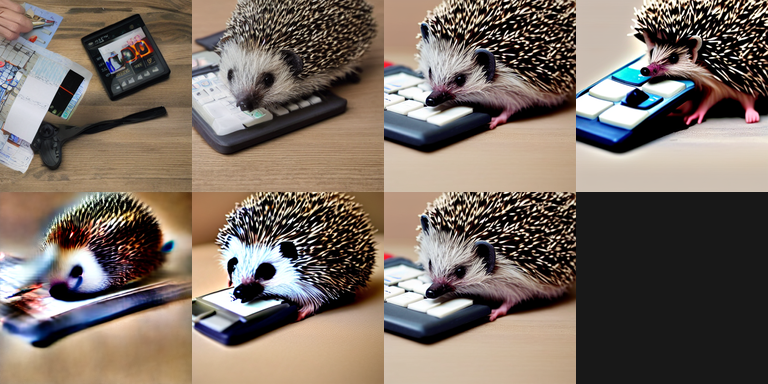
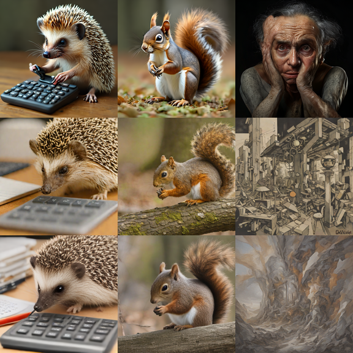

# Text-to-Image

Everything to know about generating images from text: latent diffusion and flow matching, the mid-2026 model landscape, evaluation metrics that actually predict human preference, and runnable code to test the leading open models on a 12 GB card.

Author

Benedict Thekkel

## 1. What is Text-to-Image?

Text-to-image (T2I) maps a natural-language **prompt** to a synthetic **image**. There is no input image and no ground truth output - the model samples from a conditional distribution `p(image | prompt)`, so the same prompt with a different random seed gives a different (equally valid) picture.

**Input.** A prompt string, tokenized and pushed through one or more frozen **text encoders** (CLIP text towers, T5-XXL, or in 2025-2026 a full VLM/LLM such as Qwen2.5-VL or Gemma). The result is a sequence of text embeddings, not a single vector - cross-attention (or joint attention) lets each image patch look at each word. Optional extra inputs:

- **Negative prompt** - a second conditioning string the sampler is pushed *away* from (section 8).
- **Seed** - fixes the initial Gaussian noise, so generation is reproducible.
- **Guidance scale**, **step count**, **scheduler**, **resolution/aspect ratio**.

**Output.** An RGB image, almost always produced by decoding a low-resolution **latent** through a VAE decoder rather than predicting pixels directly (section 3). Typical native resolutions: 512x512 (SD 1.5), 1024x1024 (SDXL, SD 3.5, PixArt-Sigma, SANA), up to 4 MP (FLUX.2).

**Neighbouring tasks** (usually the same backbone, different conditioning):

| Task | What it does | Typical tool | Notebook |
|----|----|----|----|
| Image-to-image / inpainting / editing | Edit an existing image, keep its structure | SDXL img2img, FLUX.2 Kontext, Qwen-Image-Edit | `06_Image_to_Image` |
| Structure-conditioned generation | Generate from a pose/depth/edge map | ControlNet, T2I-Adapter | `06_Image_to_Image` |
| Unconditional generation | Sample images with no prompt at all | DDPM, plain latent diffusion | `08_Unconditional_Image_Generation` |
| Image-to-text (captioning) | The inverse mapping | BLIP-2, Qwen2.5-VL | `05_Image_to_Text` |
| Text-to-video | Same recipe, plus a time axis | Wan, LTX-Video, Mochi | `10_Text_to_Video` |
| Text-to-3D | Same recipe, plus a 3D representation | TRELLIS, SDS-based methods | `14_Text_to_3D` |

Read this notebook first: `06_Image_to_Image` and `10_Text_to_Video` are the *same machine* (VAE + denoiser + text encoder + sampler) with an extra conditioning signal bolted on.

------------------------------------------------------------------------

## 2. Real-World Use Cases

T2I is the most commercially deployed generative-vision task, and the deployments pull the model in opposite directions: a game studio wants one perfect 4K hero asset in five minutes, a marketplace wants ten million passable thumbnails overnight for a tenth of a cent each.

| Use case | Domain | Consumes / produces | Dominant constraint |
|----|----|----|----|
| Marketing and ad creative | Adobe Firefly, Canva Magic Media, Meta Advantage+ | Brief + brand assets -\> on-brand campaign variants | **Indemnified training data** (licensed-only corpora); brand consistency; text rendering inside the image |
| Product and catalogue imagery | E-commerce (Amazon, Shopify Media) | SKU photo + prompt -\> lifestyle shot on a background | Cost per image at millions/day; product must stay *identical* (this is really img2img) |
| Concept art and pre-production | Games, film (Midjourney, Runway) | Art-director prompt -\> mood boards, style frames | Aesthetic ceiling and controllability; latency irrelevant; ownership/licensing matters |
| Stock and editorial illustration | Publishing (Getty Generative, Shutterstock AI) | Editorial brief -\> royalty-free illustration | Legal cleanliness; no celebrity/trademark leakage; provenance metadata (C2PA) |
| In-product image generation | Consumer apps (ChatGPT image, Gemini/Nano Banana, WhatsApp/Meta AI) | Chat turn -\> image, often iteratively edited | Latency (users abandon past ~10 s); safety filtering at scale; multi-turn consistency |
| Synthetic training data | CV/robotics research | Prompt + layout -\> labelled synthetic images | Diversity and label fidelity, not beauty; must not collapse to a mode |
| Architecture, interiors, fashion | Design tools (Vizcom, Spline) | Sketch + material prompt -\> render | Structural fidelity to the sketch (ControlNet), not free-form creativity |
| Personalisation / avatars | Consumer (Lensa-style, Meta AI stickers) | 5-20 selfies + prompt -\> stylised portraits | Identity preservation (LoRA/IP-Adapter); on-device or cheap fine-tuning; heavy abuse surface |

**What the Arena Elo hides.** A leaderboard rank is an *average aesthetic preference on generic prompts*, and almost none of the things that sink a real deployment show up in it. **Prompt adherence collapses on compositional prompts** - counting (“five red apples”), spatial relations (“the cup *behind* the book”), attribute binding (“a red cube and a blue sphere”, where models happily swap the colours) and negation. **Text rendering** was the single biggest differentiator of 2024-2026; a model that cannot spell is unusable for ads regardless of its Elo. **Latency and cost are architectural**: a 50-step 20B MMDiT and a 1-step distilled 0.6B model are both “text-to-image” and differ by ~1000x in cost per image, so the product decides the model, not the leaderboard. **Determinism matters more than people expect** - a marketing pipeline needs the same seed + prompt to give the same asset next quarter, which pins you to a model version forever. And the production failure modes are the ugly ones: anatomy (hands, teeth, limb count), style leakage toward a training-set artist, **memorisation** of near-duplicate training images, NSFW and celebrity-likeness escapes past the safety checker, and demographic collapse (“a CEO” returning the same person 90% of the time). Finally, **the licence is a deployment constraint, not a footnote**: FLUX.1 \[dev\] and FLUX.2 \[dev\] weights are non-commercial, and SDXL-Turbo is research-only, so half the “best open models” cannot legally ship in the product you are building.

------------------------------------------------------------------------

## 3. How Modern Text-to-Image Works

### 3.1 The latent diffusion recipe

Every open model below (and almost every closed one) is the same four-part machine, introduced by **Latent Diffusion / Stable Diffusion (Rombach et al., CVPR 2022)**:

1.  **VAE encoder** - compresses a 1024x1024x3 image into a small latent, e.g. 128x128x4 (SD/SDXL, 8x spatial compression, 48x fewer numbers) or 32x32x32 for SANA’s deep-compression autoencoder. *Diffusion runs in this latent space* - that single trick is what made T2I affordable.
2.  **Text encoder(s)** - frozen. CLIP-L (SD 1.5), CLIP-L + OpenCLIP-G (SDXL), + T5-XXL (SD 3, FLUX.1, PixArt), or a full VLM/LLM (Qwen2.5-VL-7B for Qwen-Image, Gemma-2 for SANA, Mistral-Small for FLUX.2).
3.  **Denoiser** - the only trained-from-scratch part, and where all the parameters live: a **U-Net** (SD 1.5, SDXL) or a **DiT / MMDiT transformer** (SD 3.5, PixArt, FLUX, Qwen-Image, SANA).
4.  **VAE decoder** - latent back to pixels. Also the source of a whole class of artifacts (colour shift, high-frequency mush) that people wrongly blame on the denoiser.

### 3.2 Forward and reverse diffusion

**Forward (training, no learning):** take a clean latent `x_0` and progressively destroy it with Gaussian noise. In closed form, for a noise schedule with cumulative alpha `abar_t`,

$$x_t = \sqrt{\bar{\alpha}_t}\, x_0 + \sqrt{1 - \bar{\alpha}_t}\, \epsilon, \qquad \epsilon \sim \mathcal{N}(0, I)$$

**Training objective:** ask the network to predict the noise (or the velocity, section 3.5) that was added, conditioned on the text embedding `c`:

$$\mathcal{L} = \mathbb{E}_{x_0, \epsilon, t}\left[\; \lVert \epsilon - \epsilon_\theta(x_t, t, c) \rVert^2 \;\right]$$

That is the whole loss. No adversarial game, no likelihood bound in practice - just a regression onto noise, which is why diffusion trains so stably compared to GANs.

**Reverse (sampling):** start from pure noise `x_T ~ N(0, I)` and iteratively subtract the predicted noise, stepping `t` from `T` down to `0`. Each step is one full forward pass of the denoiser - hence **step count is the main speed knob** and the dominant term in cost.

### 3.3 Classifier-free guidance (CFG)

The single most important sampling knob. At each step, run the denoiser **twice** - once conditioned on the prompt, once on the empty (or negative) prompt - and extrapolate away from the unconditional prediction:

$$\hat{\epsilon} = \epsilon_\theta(x_t, t, \varnothing) + w \cdot \big( \epsilon_\theta(x_t, t, c) - \epsilon_\theta(x_t, t, \varnothing) \big)$$

`w` is the **guidance scale**. What it actually trades:

- `w = 1` - no guidance. Faithful to the learned distribution: diverse, but often ignores the prompt.
- `w = 5-8` - the usual band for SD/SDXL. Strong prompt adherence.
- `w > 12` - oversaturated colours, burnt highlights, blown-out contrast, mode collapse toward a single “prompt-y” composition. **Higher guidance is not “more correct” - it is a sharper, less diverse, more artefact-prone sample.**

Note the cost: CFG **doubles** the compute per step, because you evaluate the denoiser twice. Two escapes exist, both used by modern models: **guidance distillation** (train a student to imitate the CFG output in one pass - FLUX.1 \[schnell\]/\[dev\], SANA-Sprint do this, which is why they take a `guidance_scale` argument that is *embedded*, not a real double pass) and **CFG-free / distilled few-step** models where guidance is baked in.

The **negative prompt** is just the unconditional branch with content in it: instead of `varnothing` you pass “blurry, watermark, extra fingers”, so the sampler is actively pushed away from that region. It only exists when real CFG is running - a distilled model at `guidance_scale=0.0` (SDXL-Turbo) **cannot use a negative prompt at all**.

### 3.4 Samplers / schedulers

The reverse process is an ODE/SDE; the sampler is the numerical integrator. The choice changes quality-per-step far more than most people realise, and costs nothing to swap.

| Sampler | Year | Steps for good output | Notes |
|----|----|----|----|
| DDPM (ancestral) | 2020 | 1000 | The original. Stochastic, unusably slow. |
| DDIM | 2021 | 50 | Deterministic, made diffusion practical. Same seed -\> same image. |
| Euler / Euler-a | 2022 | 20-30 | Simple, robust, the k-diffusion default. `-a` is ancestral (adds noise, never fully converges). |
| DPM-Solver++ (2M, Karras sigmas) | 2022-23 | **15-25** | Higher-order multistep ODE solver. Best quality/step for U-Net models - a strict upgrade over DDIM, free. |
| FlowMatchEulerDiscrete | 2024 | 20-30 | The rectified-flow sampler (SD 3, FLUX, SANA). Straight paths, so Euler is enough. |
| LCM / TCD / SCM (consistency) | 2023-25 | **1-4** | Not integrators - distilled *jump* solvers. See 3.6. |

Rule of thumb: on a U-Net model, switch to DPM-Solver++ 2M with Karras sigmas and drop from 50 steps to 20 for free. Beyond ~30 steps, more steps buy essentially nothing.

### 3.5 The 2023-2026 shift: U-Net -\> DiT/MMDiT, DDPM -\> rectified flow

Two independent changes landed at once, and together they are why 2026 models need 20 steps where 2022 models needed 50.

**Architecture.** *DiT* (Peebles and Xie, 2022) replaced the convolutional U-Net with a plain transformer over latent patches - it scales cleanly with parameters and data, which the U-Net did not. *PixArt-alpha/Sigma* (2023-24) proved a 0.6B DiT could match SDXL’s 2.6B U-Net at a fraction of the training cost. *MMDiT* (SD 3, March 2024) went further: instead of the image stream cross-attending into frozen text, **image and text tokens are concatenated into one sequence with separate weights per modality and joint attention**, so text representations are updated by the image and vice versa. That is the change that finally fixed spelling and attribute binding. FLUX.1 (Aug 2024), FLUX.2 (Nov 2025), Qwen-Image (2025) and HiDream all use MMDiT-style double-stream blocks.

**Objective.** *Rectified flow / flow matching* (2022-23, mainstream from SD 3) replaces the curved DDPM noise schedule with a **straight line** between noise and data: `x_t = (1-t) x_0 + t * epsilon`, and the network predicts the constant velocity `v = epsilon - x_0`. Because the true trajectory is (nearly) straight, a first-order Euler step is accurate over a long interval - so fewer steps are needed, and the model **distills to 1-4 steps much more easily** than a DDPM-schedule model. Every 2025-2026 flagship is a rectified-flow model.

### 3.6 Distillation: 1-4 step generation

The last piece. A teacher that takes 50 CFG’d steps (= 100 forward passes) is distilled into a student that takes 1-4:

- **LCM / LCM-LoRA** (Oct 2023) - latent consistency models: learn a map from any point on the trajectory straight to the endpoint. Shipped as a *LoRA* you can bolt onto any SD/SDXL checkpoint, 4-8 steps.
- **SDXL-Turbo / SD-Turbo** (Nov 2023) - **Adversarial Diffusion Distillation** (ADD): consistency distillation *plus* a discriminator to restore the sharpness that pure distillation loses. 1-4 steps, `guidance_scale=0.0`. Research-only licence.
- **SDXL-Lightning** (ByteDance, Feb 2024) - progressive adversarial distillation, 1/2/4/8-step UNets and LoRAs, quality noticeably above Turbo at 4 steps. Apache-2.0-adjacent (OpenRAIL++).
- **FLUX.1 \[schnell\]** (Aug 2024) - latent adversarial diffusion distillation of a 12B rectified-flow MMDiT, 1-4 steps, **Apache 2.0** (the only genuinely permissive model of that class for a long time).
- **SANA-Sprint** (NVIDIA/MIT, Mar 2025) - continuous-time consistency distillation (sCM) + latent adversarial distillation on a linear-attention DiT. **7.59 FID / 0.74 GenEval in one step**, beating FLUX-schnell (7.94 / 0.71) while being ~10x faster; 0.31 s per 1024px image on an RTX 4090.
- **FLUX.2 \[klein\]** (Jan 2026) - 4B (Apache 2.0) and 9B (non-commercial) size-distilled + step-distilled students of FLUX.2, sub-second on consumer GPUs at 4 steps.

The price of distillation is **diversity**: a 1-step student maps each noise sample to essentially one image, so seed-to-seed variety and fine prompt nuance shrink. Distilled models are for throughput and interactivity, not for the best possible single image.

**Cheat sheet:**

| Generation | Denoiser | Objective | Steps | Text encoder | Example |
|----|----|----|----|----|----|
| 2022 | U-Net | DDPM eps-pred | 50 | CLIP-L | SD 1.5 |
| 2023 | U-Net (bigger) | DDPM eps-pred | 30-50 | CLIP-L + CLIP-G | SDXL |
| 2023-24 | DiT | DDPM eps-pred | 20 | T5-XXL | PixArt-Sigma |
| 2024-25 | MMDiT | rectified flow | 20-28 | CLIP x2 + T5 | SD 3.5, FLUX.1 |
| 2025-26 | MMDiT (+ VLM encoder) | rectified flow | 20-50 | Qwen2.5-VL / Mistral | Qwen-Image, FLUX.2 |
| 2024-26 (fast lane) | any of the above, distilled | consistency / adversarial | **1-4** | as above | SDXL-Turbo, schnell, SANA-Sprint, klein |

**Who leads in mid-2026?** MMDiT + rectified flow + a VLM text encoder, scaled to 4-32B, and then *distilled* for serving. Nothing else is competitive at the top, and the interesting engineering question has moved from “which architecture” to “how few steps and how much quantization can I get away with”.

------------------------------------------------------------------------

## 4. Evaluation Metrics

T2I evaluation is genuinely unsolved, and the number people quote is usually the wrong one.

### 4.1 FID (Frechet Inception Distance)

The historical default. Push N real images and N generated images through an Inception-v3 pool3 layer (2048-d), fit a Gaussian to each set, and take the Frechet (2-Wasserstein) distance between them:

$$\mathrm{FID} = \lVert \mu_r - \mu_g \rVert_2^2 + \mathrm{Tr}\!\left( \Sigma_r + \Sigma_g - 2\left( \Sigma_r \Sigma_g \right)^{1/2} \right)$$

Lower is better. The standard protocol is **FID-30k on COCO 2014 validation captions** at 256x256.

**The caveats are severe, and you should treat FID as a smoke alarm, not a judge:**

- It measures **distribution match, not per-image quality**. A model that produces 30k mediocre-but-varied images beats one that produces 30k gorgeous images in a narrower style.
- It is **biased at small N**. FID is not an unbiased estimator; N=1k and N=30k are not comparable, ever. It is also extremely sensitive to the **resizing/JPEG pipeline** (bilinear vs Lanczos, PIL vs TF) - papers have differed by 2 FID points from resizing alone.
- It is anchored to a **2015 ImageNet classifier**, whose features have very little to do with what a human finds beautiful or on-prompt.
- Turning **guidance up** improves human preference and *worsens* FID. That fact alone should end its use as a quality ranking: **FID is a poor guide to what people prefer.**

### 4.2 CLIPScore (prompt adherence)

Cosine similarity between the CLIP image embedding and the CLIP text embedding of the prompt, rescaled:

$$\mathrm{CLIPScore}(I, T) = w \cdot \max\!\left( \cos\!\left( E_I(I),\, E_T(T) \right),\, 0 \right), \qquad w = 2.5$$

Measures *did you draw what I asked*, and says nothing about quality. It saturates fast, is blind to counting and spatial relations, and can be gamed by drawing the words. Typical values with ViT-L/14 land in the 0.25-0.35 raw-cosine band (0.6-0.9 after the 2.5x rescale).

### 4.3 What actually ranks models in 2026

- **Human/model preference scores** trained on real human picks: **PickScore** (Pick-a-Pic), **HPSv2/v3** (Human Preference Score), **ImageReward**. These correlate with human choice far better than FID or CLIPScore and are what fine-tuning (DPO/GRPO on diffusion) optimises against.
- **Compositional benchmarks**: **GenEval** (object-focused: counting, colour, position, attribute binding; the de-facto number in every 2025-26 model card, ~0.7-0.9 for current SOTA) and **T2I-CompBench++** (8k compositional prompts). **GenEval 2** (Dec 2025) exists precisely because the original saturated. **VQAScore** (ask a VLM “does this image show X?”) correlates with humans better than CLIPScore on compositional prompts.
- **Arena Elo** - the real ranking. Blind pairwise human votes: the [Artificial Analysis Text-to-Image Arena](https://artificialanalysis.ai/image/arena) and the [LMArena text-to-image leaderboard](https://lmarena.ai/leaderboard). As of mid-2026 the arena is topped by closed models (GPT Image 2, Reve 2.0, MAI-Image-2.5, Nano Banana 2 / Gemini 3 Flash Image), with the best open-weights entries (Cosmos3-Super-Text2Image, HiDream-O1, Qwen-Image, FLUX.2) roughly 60-120 Elo behind.

**Speed metrics** that matter as much as any of the above: **seconds per image** at a fixed resolution and step count, **steps** (the real cost driver), **peak VRAM**, and **images/second** at batch size 1 (interactive) vs 8 (bulk).

The toy cell below computes FID on fabricated feature arrays (so the shape of the formula is concrete) and a real CLIPScore with `transformers` CLIP on two synthetic images.

------------------------------------------------------------------------

``` python
# Metric toys - no image model needed. FID from the formula, CLIPScore from CLIP.
from pathlib import Path

import numpy as np
import torch
from PIL import Image
from scipy import linalg
from transformers import CLIPModel, CLIPProcessor

# ---- FID on fabricated Inception features -------------------------------------
rng = np.random.default_rng(0)
D, N = 2048, 500  # Inception pool3 is 2048-d; N=500 is far too few for a real FID

real = rng.normal(loc=0.0, scale=1.0, size=(N, D))          # "real" features
gen_close = real + rng.normal(0, 0.30, size=(N, D))         # a good generator
gen_far = rng.normal(loc=0.6, scale=1.4, size=(N, D))       # a bad / mode-shifted one

def fid(feats_a, feats_b, eps=1e-6):
    "Frechet distance between two Gaussians fitted to the feature sets."
    mu_a, mu_b = feats_a.mean(0), feats_b.mean(0)
    sig_a, sig_b = np.cov(feats_a, rowvar=False), np.cov(feats_b, rowvar=False)
    diff = mu_a - mu_b
    # sqrtm of a product of covariances; add eps*I for numerical stability
    covmean = linalg.sqrtm(sig_a.dot(sig_b))  # scipy >= 1.16: disp/errest are deprecated
    if not np.isfinite(covmean).all():
        offset = np.eye(sig_a.shape[0]) * eps
        covmean = linalg.sqrtm((sig_a + offset).dot(sig_b + offset))
    covmean = covmean.real  # numerical noise leaves a tiny imaginary part
    return float(diff.dot(diff) + np.trace(sig_a + sig_b - 2.0 * covmean))

print(f"FID(real, gen_close) = {fid(real, gen_close):8.2f}   <- similar distribution")
print(f"FID(real, gen_far)   = {fid(real, gen_far):8.2f}   <- shifted mean + variance")
print(f"FID(real, real)      = {fid(real, real):8.2f}   <- not exactly 0: N={N} is tiny, FID is biased at small N")

# ---- CLIPScore on two synthetic images ----------------------------------------
# The reference implementation uses ViT-L/14; ViT-B/32 is 30x cheaper and fine for a demo.
_dev = "cuda:0" if torch.cuda.is_available() else "cpu"
_cache = str(Path("../../datasets") / "hf_cache")

clip_id = "openai/clip-vit-base-patch32"
try:
    # Cached-first: skip the Hub HEAD check, which hangs in a retry loop when the
    # Hub is down (504) even though the weights are already on disk.
    clip = CLIPModel.from_pretrained(clip_id, cache_dir=_cache, local_files_only=True)
    clip_proc = CLIPProcessor.from_pretrained(clip_id, cache_dir=_cache, local_files_only=True)
except OSError:  # first run on this machine - actually download
    clip = CLIPModel.from_pretrained(clip_id, cache_dir=_cache)
    clip_proc = CLIPProcessor.from_pretrained(clip_id, cache_dir=_cache)
clip = clip.to(_dev).eval()

def clip_score(images, prompts, w=2.5):
    "CLIPScore = w * max(cos(E_I, E_T), 0), computed pairwise for images[i] vs prompts[i]."
    inputs = clip_proc(text=prompts, images=images, return_tensors="pt", padding=True).to(_dev)
    with torch.inference_mode():
        img_e = clip.get_image_features(pixel_values=inputs["pixel_values"]).pooler_output
        txt_e = clip.get_text_features(input_ids=inputs["input_ids"],
                                       attention_mask=inputs["attention_mask"]).pooler_output
    img_e = img_e / img_e.norm(dim=-1, keepdim=True)
    txt_e = txt_e / txt_e.norm(dim=-1, keepdim=True)
    cos = (img_e * txt_e).sum(-1)  # pairwise, not the full matrix
    return (w * cos.clamp(min=0)).cpu().tolist()

red = Image.new("RGB", (224, 224), (220, 30, 30))
blue = Image.new("RGB", (224, 224), (30, 60, 220))
prompts = ["a solid red square", "a solid blue square"]

print("matched  :", [round(s, 3) for s in clip_score([red, blue], prompts)])
print("swapped  :", [round(s, 3) for s in clip_score([blue, red], prompts)])
# Matched pairs score higher - but note how small the gap is. CLIPScore is a weak,
# saturating signal: it cannot count, cannot do spatial relations, and a 0.02 gap
# between two real models is noise, not a ranking.
```

    FID(real, gen_close) =   161.79   <- similar distribution
    FID(real, gen_far)   =  4462.74   <- shifted mean + variance
    FID(real, real)      =    -0.00   <- not exactly 0: N=500 is tiny, FID is biased at small N

    matched  : [0.72, 0.733]
    swapped  : [0.627, 0.591]

## 5. Datasets

T2I models are trained on web-scale **image + alt-text** pairs. Nobody trains on clean human captions at this scale - the captions are scraped alt-text, then usually **re-captioned by a VLM** (the single biggest data-quality win of 2023-2026: DALL-E 3’s “recaptioning” paper, then everyone).

| Dataset | Contents | Size | Scope | License | Typical use |
|----|----|----|----|----|----|
| [LAION-5B / Re-LAION-5B](https://laion.ai/blog/relaion-5b/) | Web image URLs + alt-text, CLIP-filtered | 5.85B pairs | multilingual (2.3B English) | CC-BY-4.0 (metadata only; images are just URLs) | The training set behind SD 1.x/2.x/XL |
| [LAION-Aesthetics](https://laion.ai/blog/laion-aesthetics/) | LAION subset scored by an aesthetic predictor | 120M / 12M / 600k tiers | as LAION | CC-BY-4.0 | Aesthetic fine-tuning stage |
| [COYO-700M](https://huggingface.co/datasets/kakaobrain/coyo-700m) | Image-text pairs, alt-text + rich metadata | 747M | English | CC-BY-4.0 (metadata) | LAION alternative |
| [DataComp / DataComp-1B](https://huggingface.co/datasets/mlfoundations/datacomp_1b) | Common Crawl pool + a *filtering* benchmark | 12.8B pool, 1.4B filtered | English | CC-BY-4.0 | Data-curation research; trains strong CLIPs |
| [Conceptual Captions 12M](https://huggingface.co/datasets/google-research-datasets/conceptual_12m) | Alt-text cleaned/hypernymised by Google | 12M | English | custom (Google) | Small-scale pretraining, ablations |
| [Segment/JourneyDB](https://huggingface.co/datasets/JourneyDB/JourneyDB) | Midjourney generations + their prompts | 4.4M | English | non-commercial research | Prompt-style / aesthetic distillation |

**The LAION story is a required caveat.** In December 2023 the Stanford Internet Observatory found **~3,200 suspected CSAM links (1,008 externally validated)** inside LAION-5B. LAION pulled the dataset entirely, and in **August 2024 re-released it as Re-LAION-5B** with 2,236 links removed, in partnership with the IWF, C3P and SIO. Every SD 1.5 / SD 2.x / SDXL checkpoint in the wild was trained on the *pre-cleanup* data. That is not a footnote - it is the central fact in the ongoing lawsuits and in why the “indemnified” commercial models (Adobe Firefly, Getty) advertise licensed-only corpora. It is also why you should not casually train on a raw web scrape today.

### Evaluation prompt sets

There is no “test split” - you evaluate on **prompt sets**:

| Prompt set | Size | What it probes |
|----|----|----|
| [COCO 2014 val captions](https://cocodataset.org/) | 30k (FID-30k protocol) | Distribution match against real photos |
| [PartiPrompts (P2)](https://huggingface.co/datasets/nateraw/parti-prompts) | 1,632 | Broad categories x challenge axes (counting, negation, world knowledge) |
| DrawBench (Imagen) | 200 | Adversarial: colours, counts, conflicting attributes, rare words |
| [T2I-CompBench++](https://karine-h.github.io/T2I-CompBench/) | 8,000 | Attribute binding, spatial/3D relations, numeracy, complex composition |
| [GenEval](https://github.com/djghosh13/geneval) | 553 | Object-focused, auto-graded with an object detector; the standard 2025-26 number |

**This notebook** evaluates on a small hand-picked subset of **PartiPrompts** (loaded from the Hub, with an inline fallback) plus a couple of deliberately hard compositional prompts, scored with CLIPScore and wall-clock. That is a smoke test - see the benchmark caveat in section 13.

------------------------------------------------------------------------

## 6. The Model Landscape (mid-2026)

Authoritative rankings: the [Artificial Analysis Text-to-Image Arena](https://artificialanalysis.ai/image/arena) (blind pairwise Elo, open + closed) and the [LMArena text-to-image leaderboard](https://lmarena.ai/leaderboard). GenEval numbers appear in most model cards.

| Model | Params (denoiser) | License | Architecture | Steps | Best for |
|----|----|----|----|----|----|
| **GPT Image 2**, Reve 2.0, MAI-Image-2.5, Nano Banana 2, Midjourney v7, Imagen 4 | closed | API only | \- | \- | Arena top; context only |
| **Cosmos3-Super-Text2Image** (NVIDIA) | large | open weights | MMDiT | many | Current open-weights Arena leader (~1219 Elo) |
| **FLUX.2 \[dev\]** (BFL, Nov 2025) | ~32B | **non-commercial** | MMDiT, rectified flow, Mistral-Small text encoder | 20-50 | Top open quality, 4 MP, multi-reference. **Way past 12 GB.** |
| **FLUX.2 \[klein\] 9B** | 9B | non-commercial | distilled FLUX.2 | 4 | ~29 GB VRAM |
| **FLUX.2 \[klein\] 4B** | 4B | **Apache 2.0** | distilled FLUX.2 | 4 | ~13 GB VRAM: needs offload/quant on a 3060 |
| **FLUX.1 \[schnell\]** (Aug 2024) | 12B | **Apache 2.0** | MMDiT, ADD-distilled | 1-4 | The permissive workhorse. ~24 GB fp16 - **needs 4-bit + offload here.** |
| **FLUX.1 \[dev\]** | 12B | **non-commercial** | MMDiT | 20-50 | Better than schnell; **cannot be shipped commercially.** |
| **Qwen-Image** (Alibaba, 2025) | 20B | Apache 2.0 | MMDiT + Qwen2.5-VL-7B encoder | 20-50 | Best-in-class **text rendering** (EN + CJK). Too big here. |
| **HiDream-I1 / O1** | 17B | MIT / open | MoE MMDiT | 16-50 | Strong open Arena entry |
| **SD 3.5 Large** | 8B | Stability Community (free \< \$1M rev) | MMDiT, rectified flow | 28 | Good quality; ~16+ GB fp16 |
| **SD 3.5 Medium** | 2.5B | Stability Community | MMDiT (improved), rectified flow | 28-40 | **Fits 12 GB** (drop T5). Runnable below. Gated on HF. |
| **SDXL 1.0 (+ refiner)** | 2.6B U-Net | OpenRAIL++-M | U-Net, DDPM | 30-50 | The ecosystem: thousands of LoRAs/ControlNets |
| **SDXL-Turbo** | 2.6B | **research-only** | ADD-distilled U-Net | **1-4** | Real-time demos. Runnable below; not shippable. |
| **SDXL-Lightning** (ByteDance) | 2.6B | OpenRAIL++ | progressive adversarial distillation | 1-8 | Better 4-step SDXL than Turbo, and usable commercially |
| **Playground v2.5** | 2.6B | Playground community | SDXL-like U-Net, EDM schedule | 30-50 | Aesthetics (beat SDXL on human preference in 2024) |
| **PixArt-Sigma** | 0.6B | OpenRAIL++ | pure DiT + T5-XXL | 20 | The efficient-DiT proof point; T5 is the memory hog |
| **SANA 1.5 / SANA-Sprint** (NVIDIA/MIT) | 0.6B / 1.6B | NSCLv2 (non-comm.) / research | linear-attention DiT, deep-compression AE, Gemma-2 encoder | **1-4** | **Speed king that fits anywhere.** Runnable below. |
| **Stable Diffusion 1.5** | 0.86B U-Net | CreativeML OpenRAIL-M | U-Net + CLIP-L | 20-50 | Teaching, LoRA experiments, tiny VRAM |
| **Kandinsky 3.x** | 3B+ | Apache 2.0 | U-Net / DiT hybrid | 25-50 | Non-Anglocentric alternative |

**Who wins what.** - **Quality / prompt adherence:** closed models, then FLUX.2 \[dev\], Qwen-Image, HiDream. None of them fit here. - **Text-in-image:** Qwen-Image, then FLUX.2, then SD 3.5. Anything CLIP-only (SD 1.5, SDXL) cannot spell. - **Speed:** SANA-Sprint (sub-second at 1024px on a 4090; 1-2 steps), then FLUX.2 \[klein\], SDXL-Turbo/Lightning. - **Licence you can actually ship:** FLUX.1 \[schnell\] and FLUX.2 \[klein\] 4B (Apache 2.0), Qwen-Image (Apache 2.0), SDXL/SDXL-Lightning (OpenRAIL++). **Not** FLUX \[dev\], SDXL-Turbo, or SANA’s non-commercial weights.

**The 12 GB reality.** The RTX 3060 in this box has 12 GB, and the box itself has 12 GB of RAM. That rules out fp16 FLUX (24 GB), Qwen-Image (40 GB), HiDream and FLUX.2 \[dev\] outright. It leaves: SD 1.5, SDXL (+ Turbo/Lightning), SD 3.5 Medium (with T5 dropped), PixArt-Sigma (with offload), SANA/SANA-Sprint - all comfortable - and **FLUX.1 \[schnell\] / FLUX.2 \[klein\] 4B only under 4-bit quantization + CPU offload** (section 12). Every runnable cell below uses `torch.float16` (or `bfloat16` where the model demands it), `enable_model_cpu_offload()`, and VAE slicing/tiling.

------------------------------------------------------------------------

## 7. Setup

Package roles:

- `diffusers` - **the** general-purpose HF library for diffusion pipelines. Not a vendor package: it hosts SD, SDXL, SD3, PixArt, SANA, FLUX, Qwen-Image behind one API, exactly as `transformers` does for LLMs.
- `transformers` - the frozen text encoders inside every pipeline (CLIP, T5, Gemma-2, Qwen2.5-VL), and the CLIP we use for CLIPScore.
- `torch`, `accelerate` - execution and `enable_model_cpu_offload()` / `device_map` placement.
- `bitsandbytes` - 4-bit/8-bit weights, the only way FLUX-class models touch this card (section 12).
- `sentencepiece`, `protobuf` - T5/Gemma tokenizers.
- `datasets` - the PartiPrompts eval prompts.
- `scipy` - `sqrtm` for the FID toy; `pyecharts` + `pandas` for the benchmark charts.

Three memory rules apply to **every** cell below and are not optional on this box:

1.  `torch_dtype=torch.float16` (or `bfloat16` for SANA / SD 3.5 - Ampere and later only).
2.  `pipe.enable_model_cpu_offload()` instead of `pipe.to(device)` - it keeps only the *currently executing* submodule on the GPU and parks the text encoder / VAE in RAM. Costs a little latency, saves several GB.
3.  `pipe.vae.enable_slicing()` and `enable_tiling()` - VAE decode of a 1024px image is a surprisingly large activation spike; slicing/tiling flattens it.

And after every model: `del pipe; free_memory(); vram("after X")`. Never hold two pipelines live.

------------------------------------------------------------------------

``` python
# diffusers is the general-purpose HF library for image generation (same ecosystem as
# transformers) - no vendor/per-model packages anywhere in this notebook.
# %pip install -q torch diffusers transformers accelerate datasets safetensors
# %pip install -q sentencepiece protobuf scipy pandas pyecharts

# Only needed for section 12 (4-bit FLUX on a 12 GB card)
# %pip install -q bitsandbytes
```

``` python
import ctypes
import ctypes.util
import gc
import time
from pathlib import Path

import torch
from dotenv import find_dotenv, load_dotenv

# Knowledge/.env sets HF_TOKEN - authenticated HF Hub requests get higher rate limits,
# and SD 3.5 Medium is a *gated* repo (accept its licence on the Hub first).
load_dotenv(find_dotenv(usecwd=True))

device = "cuda:0" if torch.cuda.is_available() else "cpu"
dtype = torch.float16 if device != "cpu" else torch.float32
if device != "cpu":
    print(torch.cuda.get_device_name(0))
    print(f"total VRAM: {torch.cuda.get_device_properties(0).total_memory / 1e9:.1f} GB")
print("device:", device)

def vram(tag=""):
    "Report current GPU memory (allocated / reserved). No-op on CPU."
    if torch.cuda.is_available():
        alloc = torch.cuda.memory_allocated() / 1e9
        reserved = torch.cuda.memory_reserved() / 1e9
        print(f"VRAM {tag:20s} {alloc:5.2f} GB allocated / {reserved:5.2f} GB reserved")

def free_memory():
    "Collect garbage, empty the CUDA cache, and return freed CPU RAM to the OS."
    gc.collect()
    if torch.cuda.is_available():
        torch.cuda.empty_cache()
        torch.cuda.ipc_collect()
    # diffusers cpu-offload parks model weights in system RAM, and glibc does not
    # hand freed memory back to the OS on its own - so RSS compounds across sections
    # and OOMs a 12 GB box. malloc_trim(0) forces the freed arenas back. (glibc only.)
    try:
        ctypes.CDLL(ctypes.util.find_library("c") or "libc.so.6").malloc_trim(0)
    except Exception:
        pass

def offload(pipe):
    "Pick the offload strategy for the VRAM actually free right now, not the card size."
    if device == "cpu":
        return pipe
    import torch.nn as nn
    # bitsandbytes-quantized weights are pinned to the GPU; enable_sequential_cpu_offload
    # first moves the whole pipeline to CPU and STALLS on them (a hang, not a catchable
    # error), so a quantized pipeline must use model-level offload - the recommended path.
    quantized = any(getattr(m, "is_quantized", False)
                    for m in pipe.components.values() if isinstance(m, nn.Module))
    free_gb = torch.cuda.mem_get_info()[0] / 1e9  # global free VRAM - counts other processes
    if free_gb < 8.0 and not quantized:
        # Another process is using the card (or it is small): layer-at-a-time keeps the
        # peak at ~1-2 GB for a real speed cost. Free the other GPU user if you can -
        # check nvidia-smi on the HOST; a container only sees its own processes.
        # Quantized (bitsandbytes) components cannot be dispatched per-layer, so fall
        # back to model-level offload if sequential raises.
        try:
            pipe.enable_sequential_cpu_offload(device=device)
            print(f"offload: sequential ({free_gb:.1f} GB VRAM free - GPU busy, expect slow steps)")
            return pipe
        except Exception as e:
            print(f"offload: sequential unsupported here ({type(e).__name__}) - using model-level")
    # Whole submodule on the GPU at a time - fast, peak ~= largest submodule (~5 GB).
    pipe.enable_model_cpu_offload(device=device)
    print(f"offload: {'quantized -> ' if quantized else ''}model-level ({free_gb:.1f} GB VRAM free)")
    return pipe


# All downloads go to DL_tasks/datasets/ (gitignored)
DATA_DIR = Path("../../datasets")
DATA_DIR.mkdir(exist_ok=True)
HF_CACHE = str(DATA_DIR / "hf_cache")

SEED = 3719  # fix the initial noise so every comparison below is apples-to-apples

def gen(seed=SEED):
    "A fresh torch.Generator on the right device, so runs are reproducible."
    return torch.Generator(device=device).manual_seed(seed)

vram("baseline")
```

    NVIDIA GeForce RTX 3060
    total VRAM: 12.5 GB
    device: cuda:0
    VRAM baseline              0.61 GB allocated /  0.66 GB reserved

``` python
from PIL import Image

# --- eval prompts: a slice of PartiPrompts, with an inline fallback ---------------
FALLBACK_PROMPTS = [
    "a photograph of an astronaut riding a horse on a beach at sunset",
    "a bowl of soup that is also a portal to another dimension",
    "a corgi wearing a red bowtie and a purple party hat",
    "a bright neon sign that reads 'OPEN LATE' above a rainy city street",
    "three blue cubes stacked on top of one red sphere, studio lighting",
    "an oil painting of a fox reading a newspaper in a Victorian library",
]
try:
    from datasets import load_dataset

    pp = load_dataset("nateraw/parti-prompts", split="train", cache_dir=HF_CACHE)
    # Keep it small and hard: challenge categories that actually separate models.
    hard = pp.filter(lambda r: r["Challenge"] in {"Quantity", "Basic", "Imagination"})
    EVAL_PROMPTS = [r["Prompt"] for r in hard.shuffle(seed=SEED).select(range(4))]
    EVAL_PROMPTS += FALLBACK_PROMPTS[3:5]  # a text-rendering and a compositional probe
    print(f"PartiPrompts loaded: {len(pp)} prompts, using {len(EVAL_PROMPTS)}")
except Exception as e:  # offline / gated / schema change - the notebook still runs
    print(f"PartiPrompts unavailable ({type(e).__name__}), using the inline fallback")
    EVAL_PROMPTS = FALLBACK_PROMPTS

PROMPT = EVAL_PROMPTS[0]  # the single prompt used for the per-model demo sections
for i, p in enumerate(EVAL_PROMPTS):
    print(f"  [{i}] {p}")

def image_grid(images, cols=None, cell=256, labels=None):
    "Tile PIL images into a single contact sheet. (ECharts cannot draw images; PIL can.)"
    cols = cols or len(images)
    rows = (len(images) + cols - 1) // cols
    sheet = Image.new("RGB", (cols * cell, rows * cell), (24, 24, 24))
    for i, im in enumerate(images):
        sheet.paste(im.resize((cell, cell), Image.LANCZOS), ((i % cols) * cell, (i // cols) * cell))
    if labels:
        print(" | ".join(str(x) for x in labels))
    return sheet
```

    PartiPrompts loaded: 1632 prompts, using 6
      [0] a hedgehog using a calculator
      [1] a squirrel
      [2] derision
      [3] a triangle with a smiling face
      [4] a bright neon sign that reads 'OPEN LATE' above a rainy city street
      [5] three blue cubes stacked on top of one red sphere, studio lighting

## 8. Stable Diffusion 1.5 (the reference implementation of section 3)

`stable-diffusion-v1-5/stable-diffusion-v1-5` (0.86B U-Net + CLIP-L text encoder + 8x VAE, 512x512, CreativeML OpenRAIL-M). Nobody ships this in 2026 for quality - it cannot spell, its anatomy is bad, and its prompt adherence is weak. It is here because it is the **smallest complete example of the machine in section 3**, it is 4 GB, and the entire LoRA/ControlNet ecosystem still targets it.

Note the `runwayml/stable-diffusion-v1-5` repo was **deleted from the Hub in August 2024**; the community mirror `stable-diffusion-v1-5/stable-diffusion-v1-5` is the live id.

We also swap the default PNDM scheduler for **DPM-Solver++ 2M with Karras sigmas** - a free upgrade that gets a good image in ~20 steps instead of 50.

`safety_checker=None` disables the built-in NSFW classifier. That is fine for a notebook and **not** fine for anything user-facing (section 15).

------------------------------------------------------------------------

``` python
from diffusers import DPMSolverMultistepScheduler, StableDiffusionPipeline

sd15 = StableDiffusionPipeline.from_pretrained(
    "stable-diffusion-v1-5/stable-diffusion-v1-5",
    torch_dtype=dtype,
    safety_checker=None,       # see section 15 before shipping this
    requires_safety_checker=False,
    cache_dir=HF_CACHE,
)
sd15.scheduler = DPMSolverMultistepScheduler.from_config(
    sd15.scheduler.config, algorithm_type="dpmsolver++", use_karras_sigmas=True
)
offload(sd15)  # not .to(device): keeps VRAM flat
sd15.vae.enable_slicing()
sd15.set_progress_bar_config(disable=True)

# The four parts of section 3.1, with their real sizes:
for name in ["text_encoder", "unet", "vae"]:
    n = sum(p.numel() for p in getattr(sd15, name).parameters())
    print(f"  {name:14s} {n / 1e6:7.1f} M params")

t0 = time.perf_counter()
image = sd15(PROMPT, num_inference_steps=25, guidance_scale=7.5, generator=gen()).images[0]
print(f"\n{time.perf_counter() - t0:.1f}s  |  {PROMPT}")
vram("sd15 generate")
image
```

    offload: sequential (5.2 GB VRAM free - GPU busy, expect slow steps)
      text_encoder     123.1 M params
      unet             859.5 M params
      vae               83.7 M params

    9.5s  |  a hedgehog using a calculator
    VRAM sd15 generate         0.61 GB allocated /  0.80 GB reserved


``` python
# (b) What the two big knobs actually do. Same seed everywhere, so every difference
#     you see is the knob, not the noise.
grid, labels = [], []
for g in [1.0, 3.0, 7.5, 15.0]:
    grid.append(sd15(PROMPT, num_inference_steps=25, guidance_scale=g, generator=gen()).images[0])
    labels.append(f"cfg={g}")
for s in [4, 8, 25]:
    grid.append(sd15(PROMPT, num_inference_steps=s, guidance_scale=7.5, generator=gen()).images[0])
    labels.append(f"steps={s}")

# Read the top row left-to-right: cfg=1 ignores half the prompt; cfg=15 is saturated
# and burnt. Bottom row: 4 steps is mush, 8 is close, 25 is converged - past ~30 the
# extra compute buys nothing.
print(labels)
image_grid(grid, cols=4, cell=192)
```

    ['cfg=1.0', 'cfg=3.0', 'cfg=7.5', 'cfg=15.0', 'steps=4', 'steps=8', 'steps=25']



``` python
# (d) Negative prompts. This is literally the unconditional branch of the CFG equation
# in section 3.3 with content in it - so it only works when real CFG is running
# (guidance_scale > 1). A distilled model at guidance_scale=0.0 cannot use it at all.
NEG = "blurry, low quality, jpeg artifacts, watermark, text, deformed hands, extra limbs"

pair = [
    sd15(PROMPT, num_inference_steps=25, guidance_scale=7.5, generator=gen()).images[0],
    sd15(PROMPT, negative_prompt=NEG, num_inference_steps=25, guidance_scale=7.5,
         generator=gen()).images[0],
]
print("left: no negative prompt   |   right: negative prompt")
sheet = image_grid(pair, cols=2, cell=256)

del sd15, grid, pair
free_memory()
vram("after sd15")
sheet
```

    left: no negative prompt   |   right: negative prompt
    VRAM after sd15            0.61 GB allocated /  0.66 GB reserved


## 9. SDXL-Turbo (adversarial distillation, 1-4 steps)

`stabilityai/sdxl-turbo` - SDXL’s 2.6B U-Net distilled with **Adversarial Diffusion Distillation** into a 1-4 step sampler. This is the cell that makes the section-3.6 point concrete: an image in **one** forward pass, ~10-20x faster than the 25-step SD 1.5 above.

Two rules the model imposes:

- **`guidance_scale=0.0`.** It was distilled *without* CFG. Passing a guidance scale \> 0 does not “improve adherence”, it produces garbage - and it means **no negative prompt**.
- **512x512.** Turbo was trained at 512; ask for 1024 and you get duplicated subjects.

Licence: **research-only** (STAI Non-Commercial). Use **SDXL-Lightning** (`ByteDance/SDXL-Lightning`, OpenRAIL++) if you need a commercially usable 4-step SDXL - it is also visibly better at 4 steps.

------------------------------------------------------------------------

``` python
from diffusers import AutoPipelineForText2Image

turbo = AutoPipelineForText2Image.from_pretrained(
    "stabilityai/sdxl-turbo",
    torch_dtype=dtype,
    variant="fp16" if device != "cpu" else None,
    cache_dir=HF_CACHE,
)
offload(turbo)
turbo.vae.enable_slicing()
turbo.set_progress_bar_config(disable=True)

grid, labels = [], []
for steps in [1, 2, 4]:
    t0 = time.perf_counter()
    img = turbo(
        PROMPT,
        num_inference_steps=steps,
        guidance_scale=0.0,   # mandatory: ADD-distilled models are CFG-free
        height=512, width=512,
        generator=gen(),
    ).images[0]
    dt = time.perf_counter() - t0
    grid.append(img)
    labels.append(f"{steps} step ({dt:.2f}s)")
    print(f"  {steps} step(s): {dt:5.2f}s")

print(labels)
sheet = image_grid(grid, cols=3, cell=256)

del turbo, grid
free_memory()
vram("after sdxl-turbo")
sheet
```

    offload: model-level (11.7 GB VRAM free)

    /home/bthek1/Knowledge/.venv/lib/python3.14/site-packages/diffusers/pipelines/stable_diffusion_xl/pipeline_stable_diffusion_xl.py:748: FutureWarning: `upcast_vae` is deprecated and will be removed in version 1.0.0. `upcast_vae` is deprecated. Please use `pipe.vae.to(torch.float32)`. For more details, please refer to: https://github.com/huggingface/diffusers/pull/12619#issue-3606633695.
      deprecate(
    There are modules in AutoencoderKL that should be kept in float32: []. Casting directly with `to()` can lead to inconsistent results; set `torch_dtype` in `from_pretrained()` instead to keep these modules in float32.
    There are modules in AutoencoderKL that should be kept in float32: []. Casting directly with `to()` can lead to inconsistent results; set `torch_dtype` in `from_pretrained()` instead to keep these modules in float32.

      1 step(s):  9.39s

    There are modules in AutoencoderKL that should be kept in float32: []. Casting directly with `to()` can lead to inconsistent results; set `torch_dtype` in `from_pretrained()` instead to keep these modules in float32.
    There are modules in AutoencoderKL that should be kept in float32: []. Casting directly with `to()` can lead to inconsistent results; set `torch_dtype` in `from_pretrained()` instead to keep these modules in float32.

      2 step(s):  2.98s

    There are modules in AutoencoderKL that should be kept in float32: []. Casting directly with `to()` can lead to inconsistent results; set `torch_dtype` in `from_pretrained()` instead to keep these modules in float32.
    There are modules in AutoencoderKL that should be kept in float32: []. Casting directly with `to()` can lead to inconsistent results; set `torch_dtype` in `from_pretrained()` instead to keep these modules in float32.

      4 step(s):  2.03s
    ['1 step (9.39s)', '2 step (2.98s)', '4 step (2.03s)']
    VRAM after sdxl-turbo      0.61 GB allocated /  0.66 GB reserved


## 10. SD 3.5 Medium (MMDiT + rectified flow)

`stabilityai/stable-diffusion-3.5-medium` - 2.5B MMDiT, rectified flow, three text encoders (CLIP-L + OpenCLIP-G + T5-XXL). This is the first *modern* architecture in the notebook: joint text-image attention (section 3.5), which is why it can render short text strings that SD 1.5 and SDXL cannot.

**Memory.** The 2.5B transformer is not the problem - **T5-XXL is 4.7B params (~9.4 GB in fp16)** and would blow the card on its own. Diffusers lets you pass `text_encoder_3=None, tokenizer_3=None` and fall back to the two CLIP towers: the model still works, prompt adherence on long prompts drops a little, and peak VRAM lands around 6 GB. That is the trade you want on a 3060. (Alternative: keep T5 but load it in 8-bit with `bitsandbytes`.)

**Gated.** The repo requires accepting the Stability Community Licence on the Hub; `HF_TOKEN` from `.env` is what authenticates it. The cell degrades gracefully if you have not.

------------------------------------------------------------------------

``` python
from diffusers import StableDiffusion3Pipeline

sd35 = None
try:
    sd35 = StableDiffusion3Pipeline.from_pretrained(
        "stabilityai/stable-diffusion-3.5-medium",
        text_encoder_3=None,     # drop T5-XXL: 4.7B params we cannot afford here
        tokenizer_3=None,
        torch_dtype=dtype,
        cache_dir=HF_CACHE,
    )
    offload(sd35)
    sd35.vae.enable_slicing()
    sd35.vae.enable_tiling()
    sd35.set_progress_bar_config(disable=True)

    n = sum(p.numel() for p in sd35.transformer.parameters())
    print(f"MMDiT transformer: {n / 1e9:.2f} B params")

    t0 = time.perf_counter()
    img = sd35(
        PROMPT,
        negative_prompt="",
        num_inference_steps=28,   # the rectified-flow default; 20 is usually fine
        guidance_scale=4.5,       # flow models like a *lower* CFG than SD 1.5
        height=1024, width=1024,
        generator=gen(),
    ).images[0]
    print(f"{time.perf_counter() - t0:.1f}s")
    vram("sd35 generate")
except Exception as e:
    # 401/403 = you have not accepted the licence on the Hub for this gated repo.
    print(f"SD 3.5 Medium unavailable: {type(e).__name__}: {e}")
    img = None

del sd35
free_memory()
vram("after sd35")
img
```

    SD 3.5 Medium unavailable: GatedRepoError: 403 Client Error. (Request ID: Root=1-6a58a859-251736ae07f0b3f76c004240;091898dc-db17-4981-85f5-ddd0b87e5679)

    Cannot access gated repo for url https://huggingface.co/stabilityai/stable-diffusion-3.5-medium/resolve/main/model_index.json.
    Access to model stabilityai/stable-diffusion-3.5-medium is restricted and you are not in the authorized list. Visit https://huggingface.co/stabilityai/stable-diffusion-3.5-medium to ask for access.
    VRAM after sd35            0.61 GB allocated /  0.66 GB reserved

## 11. SANA-Sprint 0.6B (the speed/size Pareto frontier)

`Efficient-Large-Model/Sana_Sprint_0.6B_1024px_diffusers` (NVIDIA + MIT HAN Lab). Three ideas stacked:

1.  **Linear-attention DiT** - attention cost linear in the number of tokens, not quadratic, so 1024px (and 4K) is cheap.
2.  **Deep-compression autoencoder (DC-AE, 32x)** - 4x fewer latent tokens than SD’s 8x VAE before the transformer even starts.
3.  **Hybrid distillation** (continuous-time consistency + latent adversarial) down to **1-2 steps**.

Result: **7.59 FID / 0.74 GenEval in one step**, better than FLUX.1 \[schnell\] (7.94 / 0.71) at ~10x the speed and ~20x fewer parameters. It is the best answer on this box - 0.6B denoiser + a Gemma-2 text encoder, comfortably inside 12 GB at full 1024px.

Two quirks: it wants **bfloat16** (Ampere or later; the 3060 qualifies) rather than fp16, and its scheduler is SCM, so `num_inference_steps` of 1 or 2 is the *intended* operating point, not a compromise.

Licence caveat: SANA weights are NVIDIA non-commercial. Great for research, not shippable.

------------------------------------------------------------------------

``` python
from diffusers import SanaSprintPipeline

# SANA needs bf16 (text encoder + VAE must not be fp16). bf16 needs Ampere+ (RTX 3060: yes).
sana_dtype = torch.bfloat16 if (device != "cpu" and torch.cuda.is_bf16_supported()) else torch.float32

sana = SanaSprintPipeline.from_pretrained(
    "Efficient-Large-Model/Sana_Sprint_0.6B_1024px_diffusers",
    torch_dtype=sana_dtype,
    cache_dir=HF_CACHE,
)
offload(sana)
sana.vae.enable_tiling()
sana.set_progress_bar_config(disable=True)

n = sum(p.numel() for p in sana.transformer.parameters())
print(f"linear-DiT transformer: {n / 1e6:.0f} M params  (dtype {sana_dtype})")

grid, labels = [], []
for steps in [1, 2, 4]:
    t0 = time.perf_counter()
    img = sana(
        PROMPT,
        num_inference_steps=steps,
        # SCM quirk: the default intermediate_timesteps=1.3 is only valid at exactly
        # 2 steps - any other step count must pass None or check_inputs raises.
        intermediate_timesteps=1.3 if steps == 2 else None,
        guidance_scale=4.5,   # *embedded* guidance (distilled), not a double CFG pass
        height=1024, width=1024,
        generator=gen(),
    ).images[0]
    dt = time.perf_counter() - t0
    grid.append(img)
    labels.append(f"{steps} step ({dt:.2f}s)")
    print(f"  {steps} step(s) @1024px: {dt:5.2f}s")

print(labels)
sheet = image_grid(grid, cols=3, cell=256)

del sana, grid
free_memory()
vram("after sana-sprint")
sheet
```

    offload: model-level (11.7 GB VRAM free)
    linear-DiT transformer: 594 M params  (dtype torch.bfloat16)
      1 step(s) @1024px: 11.81s
      2 step(s) @1024px:  4.26s
      4 step(s) @1024px:  4.08s
    ['1 step (11.81s)', '2 step (4.26s)', '4 step (4.08s)']
    VRAM after sana-sprint     0.61 GB allocated /  0.66 GB reserved


## 12. FLUX-class models on a 12 GB card (4-bit + offload)

FLUX.1 \[schnell\] is a **12B** MMDiT: ~24 GB in fp16, i.e. **double this card**. FLUX.2 \[klein\] 4B is ~13 GB in bf16 - still over. Neither fits naively, and pretending otherwise is how you OOM the whole container (not just the kernel).

Two things make them run here, and you need both:

1.  **4-bit weights** via `bitsandbytes` (NF4). The transformer drops from ~24 GB to ~6-7 GB; the T5 text encoder gets the same treatment. Expect a small, usually invisible quality loss - and note 4-bit *inference* is not faster, just smaller (dequantization costs time).
2.  **`enable_model_cpu_offload()`**, which keeps only the executing submodule resident. Reported peak with FLUX 4-bit + offload is ~8.5 GB VRAM.

This is genuinely slow on a 3060 (expect tens of seconds even at 4 steps), and it will page through the 12 GB of system RAM while loading. It is left **off by default** - flip `RUN_FLUX = True` if you want it, and close everything else first.

If you need FLUX-class quality routinely, the honest answers are: rent a 24 GB+ GPU, use the API, or use SANA-Sprint / FLUX.2 \[klein\] 4B and accept the trade.

**Licence, loudly:** FLUX.1 \[schnell\] and FLUX.2 \[klein\] **4B** are **Apache 2.0** (commercial use fine). FLUX.1 \[dev\], FLUX.2 \[dev\] and FLUX.2 \[klein\] **9B** are under the BFL **Non-Commercial** licence - outputs from them cannot be used in a commercial product. This trips up more teams than any technical issue in this notebook.

------------------------------------------------------------------------

``` python
RUN_FLUX = False  # set True only if you have ~10 GB free VRAM and some patience

if RUN_FLUX and device != "cpu":
    from diffusers import BitsAndBytesConfig as DiffusersBnB
    from diffusers import FluxPipeline, FluxTransformer2DModel
    from transformers import BitsAndBytesConfig as TransformersBnB
    from transformers import T5EncoderModel

    flux_id = "black-forest-labs/FLUX.1-schnell"  # Apache 2.0, 12B, ADD-distilled, 1-4 steps
    nf4 = dict(load_in_4bit=True, bnb_4bit_quant_type="nf4", bnb_4bit_compute_dtype=torch.bfloat16)

    text_encoder_2 = T5EncoderModel.from_pretrained(
        flux_id, subfolder="text_encoder_2", cache_dir=HF_CACHE,
        quantization_config=TransformersBnB(**nf4), torch_dtype=torch.bfloat16,
    )
    transformer = FluxTransformer2DModel.from_pretrained(
        flux_id, subfolder="transformer", cache_dir=HF_CACHE,
        quantization_config=DiffusersBnB(**nf4), torch_dtype=torch.bfloat16,
    )
    flux = FluxPipeline.from_pretrained(
        flux_id, text_encoder_2=text_encoder_2, transformer=transformer,
        torch_dtype=torch.bfloat16, cache_dir=HF_CACHE,
    )
    offload(flux)  # NOT .to(device) - it will not fit
    flux.vae.enable_slicing()
    flux.vae.enable_tiling()

    t0 = time.perf_counter()
    img = flux(
        PROMPT,
        num_inference_steps=4,   # schnell is distilled for 1-4
        guidance_scale=0.0,      # guidance-distilled: embedded, not a double pass
        max_sequence_length=256,
        height=1024, width=1024,
        generator=gen(),
    ).images[0]
    print(f"FLUX.1-schnell (4-bit, 4 steps): {time.perf_counter() - t0:.1f}s")
    vram("flux 4-bit")

    del flux, transformer, text_encoder_2
    free_memory()
    vram("after flux")
    display(img)
else:
    print("RUN_FLUX is False - skipping. FLUX.1-schnell needs 4-bit + CPU offload on a 12 GB card;")
    print("FLUX.2 [klein] 4B (Apache 2.0, ~13 GB bf16) is the same story via Flux2KleinPipeline.")
```

    RUN_FLUX is False - skipping. FLUX.1-schnell needs 4-bit + CPU offload on a 12 GB card;
    FLUX.2 [klein] 4B (Apache 2.0, ~13 GB bf16) is the same story via Flux2KleinPipeline.

## 13. Head-to-head Benchmark

Same 6 prompts, same seed, same 1024px-or-native resolution, one pipeline live at a time. We record **seconds per image** and **CLIPScore** (the `clip_score` helper from section 4).

Read the caveats before reading the numbers:

- **6 prompts is a smoke test, not a leaderboard.** A real evaluation is FID-30k on COCO plus GenEval plus a preference model (HPSv2/PickScore) plus, ultimately, humans. See the [Artificial Analysis Arena](https://artificialanalysis.ai/image/arena).
- **CLIPScore saturates.** A 0.02 gap between two models here is noise. What it *will* catch is a model that ignored the prompt entirely.
- **The step counts are not equal**, deliberately - a 1-step distilled model and a 25-step base model is exactly the comparison you make in production. The scatter (quality vs latency) is the honest chart; the bar chart alone is misleading.
- Hardware: **RTX 3060, 12 GB**, `enable_model_cpu_offload()` on every pipeline (which adds a second or two of transfer per image - so these latencies are *pessimistic* relative to a card that fits the model natively).

------------------------------------------------------------------------

``` python
from diffusers import AutoPipelineForText2Image

# (name, loader, call-kwargs). Each entry is loaded, measured, and freed before the next.
BENCH = [
    ("SD 1.5 (25 steps)", lambda: StableDiffusionPipeline.from_pretrained(
        "stable-diffusion-v1-5/stable-diffusion-v1-5", torch_dtype=dtype,
        safety_checker=None, requires_safety_checker=False, cache_dir=HF_CACHE),
     dict(num_inference_steps=25, guidance_scale=7.5, height=512, width=512), dtype),
    ("SDXL-Turbo (1 step)", lambda: AutoPipelineForText2Image.from_pretrained(
        "stabilityai/sdxl-turbo", torch_dtype=dtype,
        variant="fp16" if device != "cpu" else None, cache_dir=HF_CACHE),
     dict(num_inference_steps=1, guidance_scale=0.0, height=512, width=512), dtype),
    ("SDXL-Turbo (4 steps)", lambda: AutoPipelineForText2Image.from_pretrained(
        "stabilityai/sdxl-turbo", torch_dtype=dtype,
        variant="fp16" if device != "cpu" else None, cache_dir=HF_CACHE),
     dict(num_inference_steps=4, guidance_scale=0.0, height=512, width=512), dtype),
    ("SANA-Sprint (2 steps)", lambda: SanaSprintPipeline.from_pretrained(
        "Efficient-Large-Model/Sana_Sprint_0.6B_1024px_diffusers",
        torch_dtype=sana_dtype, cache_dir=HF_CACHE),
     dict(num_inference_steps=2, guidance_scale=4.5, height=1024, width=1024), sana_dtype),
]

results, gallery = {}, {}
for name, loader, kwargs, _dt in BENCH:
    try:
        pipe = loader()
        offload(pipe)
        pipe.vae.enable_slicing()
        pipe.set_progress_bar_config(disable=True)

        imgs, t0 = [], time.perf_counter()
        for p in EVAL_PROMPTS:
            imgs.append(pipe(p, generator=gen(), **kwargs).images[0])
        secs = (time.perf_counter() - t0) / len(EVAL_PROMPTS)

        scores = clip_score(imgs, EVAL_PROMPTS)
        results[name] = (sum(scores) / len(scores), secs)
        gallery[name] = imgs[:3]  # keep 3 thumbnails, drop the rest to save RAM
        print(f"{name:24s} CLIPScore {results[name][0]:.3f}   {secs:5.2f} s/image")
    except Exception as e:
        print(f"{name:24s} SKIPPED: {type(e).__name__}: {e}")
    finally:
        pipe = None
        free_memory()          # free BEFORE loading the next one - non-negotiable at 12 GB
        vram(f"after {name}")
```

    SD 1.5 (25 steps)        SKIPPED: NameError: name 'StableDiffusionPipeline' is not defined
    VRAM after SD 1.5 (25 steps)  0.61 GB allocated /  0.66 GB reserved

    offload: model-level (11.7 GB VRAM free)

    There are modules in AutoencoderKL that should be kept in float32: []. Casting directly with `to()` can lead to inconsistent results; set `torch_dtype` in `from_pretrained()` instead to keep these modules in float32.
    There are modules in AutoencoderKL that should be kept in float32: []. Casting directly with `to()` can lead to inconsistent results; set `torch_dtype` in `from_pretrained()` instead to keep these modules in float32.
    There are modules in AutoencoderKL that should be kept in float32: []. Casting directly with `to()` can lead to inconsistent results; set `torch_dtype` in `from_pretrained()` instead to keep these modules in float32.
    There are modules in AutoencoderKL that should be kept in float32: []. Casting directly with `to()` can lead to inconsistent results; set `torch_dtype` in `from_pretrained()` instead to keep these modules in float32.
    There are modules in AutoencoderKL that should be kept in float32: []. Casting directly with `to()` can lead to inconsistent results; set `torch_dtype` in `from_pretrained()` instead to keep these modules in float32.
    There are modules in AutoencoderKL that should be kept in float32: []. Casting directly with `to()` can lead to inconsistent results; set `torch_dtype` in `from_pretrained()` instead to keep these modules in float32.
    There are modules in AutoencoderKL that should be kept in float32: []. Casting directly with `to()` can lead to inconsistent results; set `torch_dtype` in `from_pretrained()` instead to keep these modules in float32.
    There are modules in AutoencoderKL that should be kept in float32: []. Casting directly with `to()` can lead to inconsistent results; set `torch_dtype` in `from_pretrained()` instead to keep these modules in float32.
    There are modules in AutoencoderKL that should be kept in float32: []. Casting directly with `to()` can lead to inconsistent results; set `torch_dtype` in `from_pretrained()` instead to keep these modules in float32.
    There are modules in AutoencoderKL that should be kept in float32: []. Casting directly with `to()` can lead to inconsistent results; set `torch_dtype` in `from_pretrained()` instead to keep these modules in float32.
    There are modules in AutoencoderKL that should be kept in float32: []. Casting directly with `to()` can lead to inconsistent results; set `torch_dtype` in `from_pretrained()` instead to keep these modules in float32.
    There are modules in AutoencoderKL that should be kept in float32: []. Casting directly with `to()` can lead to inconsistent results; set `torch_dtype` in `from_pretrained()` instead to keep these modules in float32.

    SDXL-Turbo (1 step)      CLIPScore 0.798    3.29 s/image
    VRAM after SDXL-Turbo (1 step)  0.61 GB allocated /  0.66 GB reserved

    offload: model-level (11.7 GB VRAM free)

    There are modules in AutoencoderKL that should be kept in float32: []. Casting directly with `to()` can lead to inconsistent results; set `torch_dtype` in `from_pretrained()` instead to keep these modules in float32.
    There are modules in AutoencoderKL that should be kept in float32: []. Casting directly with `to()` can lead to inconsistent results; set `torch_dtype` in `from_pretrained()` instead to keep these modules in float32.
    There are modules in AutoencoderKL that should be kept in float32: []. Casting directly with `to()` can lead to inconsistent results; set `torch_dtype` in `from_pretrained()` instead to keep these modules in float32.
    There are modules in AutoencoderKL that should be kept in float32: []. Casting directly with `to()` can lead to inconsistent results; set `torch_dtype` in `from_pretrained()` instead to keep these modules in float32.
    There are modules in AutoencoderKL that should be kept in float32: []. Casting directly with `to()` can lead to inconsistent results; set `torch_dtype` in `from_pretrained()` instead to keep these modules in float32.
    There are modules in AutoencoderKL that should be kept in float32: []. Casting directly with `to()` can lead to inconsistent results; set `torch_dtype` in `from_pretrained()` instead to keep these modules in float32.
    There are modules in AutoencoderKL that should be kept in float32: []. Casting directly with `to()` can lead to inconsistent results; set `torch_dtype` in `from_pretrained()` instead to keep these modules in float32.
    There are modules in AutoencoderKL that should be kept in float32: []. Casting directly with `to()` can lead to inconsistent results; set `torch_dtype` in `from_pretrained()` instead to keep these modules in float32.
    There are modules in AutoencoderKL that should be kept in float32: []. Casting directly with `to()` can lead to inconsistent results; set `torch_dtype` in `from_pretrained()` instead to keep these modules in float32.
    There are modules in AutoencoderKL that should be kept in float32: []. Casting directly with `to()` can lead to inconsistent results; set `torch_dtype` in `from_pretrained()` instead to keep these modules in float32.
    There are modules in AutoencoderKL that should be kept in float32: []. Casting directly with `to()` can lead to inconsistent results; set `torch_dtype` in `from_pretrained()` instead to keep these modules in float32.
    There are modules in AutoencoderKL that should be kept in float32: []. Casting directly with `to()` can lead to inconsistent results; set `torch_dtype` in `from_pretrained()` instead to keep these modules in float32.

    SDXL-Turbo (4 steps)     CLIPScore 0.805    2.62 s/image
    VRAM after SDXL-Turbo (4 steps)  0.61 GB allocated /  0.66 GB reserved

    offload: model-level (11.7 GB VRAM free)
    SANA-Sprint (2 steps)    CLIPScore 0.822    4.25 s/image
    VRAM after SANA-Sprint (2 steps)  0.61 GB allocated /  0.66 GB reserved

``` python
import pandas as pd

df = (
    pd.DataFrame(
        [(k, s, sec) for k, (s, sec) in results.items()],
        columns=["model", "clip_score", "sec_per_image"],
    )
    .assign(images_per_min=lambda d: (60.0 / d.sec_per_image).round(1))
    .sort_values("clip_score", ascending=False)
    .reset_index(drop=True)
)
print(df.to_string(index=False))

# A contact sheet: same prompt (column), different model (row).
rows = []
for name in df["model"]:
    rows.extend(gallery.get(name, []))
image_grid(rows, cols=3, cell=192, labels=list(df["model"]))
```

                    model  clip_score  sec_per_image  images_per_min
    SANA-Sprint (2 steps)    0.822407       4.250467            14.1
     SDXL-Turbo (4 steps)    0.804704       2.618358            22.9
      SDXL-Turbo (1 step)    0.798054       3.285534            18.3
    SANA-Sprint (2 steps) | SDXL-Turbo (4 steps) | SDXL-Turbo (1 step)



``` python
from pyecharts.globals import CurrentConfig

# assets.pyecharts.org serves an expired TLS certificate from most nodes (2026-11-11),
# so charts failed to load. jsDelivr mirrors the same assets, pinned to one commit.
CurrentConfig.ONLINE_HOST = "https://cdn.jsdelivr.net/gh/pyecharts/pyecharts-assets@f2328d558550046fc5449672a6850e848e141590/assets/v6/"

from pyecharts import options as opts
from pyecharts.charts import Bar

bar = (
    Bar()
    .add_xaxis(list(df["model"]))
    .add_yaxis("CLIPScore", [round(float(x), 3) for x in df["clip_score"]])
    .set_global_opts(
        title_opts=opts.TitleOpts(
            title="Prompt adherence (CLIPScore, ViT-B/32)",
            subtitle=f"{len(EVAL_PROMPTS)} PartiPrompts-style prompts, seed {SEED}, RTX 3060 - smoke test, not a leaderboard",
        ),
        xaxis_opts=opts.AxisOpts(name="model", axislabel_opts=opts.LabelOpts(rotate=20)),
        yaxis_opts=opts.AxisOpts(name="CLIPScore", min_=0.5),
        tooltip_opts=opts.TooltipOpts(trigger="axis"),
    )
)
bar.render_notebook()
```

``` python
from pyecharts.charts import Scatter

# The chart that actually matters: quality against latency. Up and to the LEFT wins.
scatter = Scatter()
scatter.add_xaxis([round(float(s), 2) for s in df["sec_per_image"]])
for _, r in df.iterrows():
    scatter.add_yaxis(
        r["model"],
        [[round(float(r["sec_per_image"]), 2), round(float(r["clip_score"]), 3)]],
        symbol_size=18,
        label_opts=opts.LabelOpts(is_show=False),
    )
scatter.set_global_opts(
    title_opts=opts.TitleOpts(
        title="Quality vs latency",
        subtitle="up and to the left is better; distilled models trade diversity for the left half",
    ),
    xaxis_opts=opts.AxisOpts(type_="value", name="seconds / image"),
    yaxis_opts=opts.AxisOpts(type_="value", name="CLIPScore", min_=0.5),
    tooltip_opts=opts.TooltipOpts(trigger="item"),
    legend_opts=opts.LegendOpts(pos_top="8%"),
)

# Final cleanup: the CLIP scorer from section 4 is the last model still resident.
del clip, clip_proc
free_memory()
vram("final")

scatter.render_notebook()
```

    VRAM final                 0.01 GB allocated /  0.02 GB reserved

## 14. Common Frameworks

Text-to-image is the one task in this folder with a genuine consumer ecosystem attached, and it shows: the tooling is split between a Python library that researchers and backend engineers use (`diffusers`) and node-graph applications that artists use (ComfyUI). They run the same weights. Knowing both matters, because the community ships quantised checkpoints, LoRAs and new conditioning tricks to ComfyUI first and to `diffusers` weeks later.

| Framework | Layer | What it gives you | License | Reach for it when |
|----|----|----|----|----|
| [diffusers](https://github.com/huggingface/diffusers) | modelling | Every pipeline in this notebook, plus schedulers, quantisation config, and the offloading that made FLUX fit in section 12 | Apache 2.0 | Default. It is the general-purpose library for this task the way `transformers` is for text |
| [peft](https://github.com/huggingface/peft) + [kohya_ss](https://github.com/bmaltais/kohya_ss) / [OneTrainer](https://github.com/Nerogar/OneTrainer) | modelling | LoRA, DreamBooth and textual inversion - `peft` as the library, the other two as the training UIs the community actually uses | Apache 2.0 / AGPL-3.0 (OneTrainer) | Personalisation. A style LoRA is 10-100 MB and trains in minutes on this box |
| [ControlNet](https://github.com/lllyasviel/ControlNet) + [IP-Adapter](https://github.com/tencent-ailab/IP-Adapter) | modelling | Structural control from depth/pose/canny, and reference-image conditioning with no training at all | Apache 2.0 | Text alone is not a precise enough interface, which is most production work - see `06_Image_to_Image` |
| [bitsandbytes](https://github.com/bitsandbytes-foundation/bitsandbytes) + [GGUF](https://github.com/ggml-org/ggml) quants | data | 4-bit and 8-bit weights, and the community quant format that puts a 12B model on a 12 GB card | MIT | Always on consumer hardware. Note that `load_in_4bit` quantises **after** downloading full weights - it saves VRAM, not bandwidth |
| `torch.compile` + [xformers](https://github.com/facebookresearch/xformers) / [stable-fast](https://github.com/chengzeyi/stable-fast) / [TensorRT](https://github.com/NVIDIA/TensorRT) | inference runtime | 20-40% from compilation alone, more from a compiled engine - on unchanged weights and unchanged output | BSD-3 / MIT / Apache 2.0 (TensorRT SDK proprietary) | Generation cost is the business model. Cheaper than every alternative, including a smaller model |
| [BentoML](https://github.com/bentoml/BentoML) / [Ray Serve](https://github.com/ray-project/ray) | serving | Queue-backed async jobs with progress callbacks, which is the correct shape when a request takes 10-60 s | Apache 2.0 | Serving generation to users. A synchronous request handler will time out and hold a GPU hostage while it does |
| [invisible-watermark](https://github.com/ShieldMnt/invisible-watermark) + [C2PA](https://github.com/contentauth/c2pa-rs) | serving | Provenance: an imperceptible watermark and a signed manifest saying what generated the image | MIT / Apache 2.0 | Before shipping, not after. Increasingly a legal requirement rather than a courtesy |
| [ComfyUI](https://github.com/comfyanonymous/ComfyUI) | orchestration | A node graph over the same weights, an API mode for serving, and first access to community quants and adapters | GPL-3.0 | Iterating on look, or handing controls to someone who does not write Python. Also the de-facto serving layer for image workflows |
| [torchmetrics](https://github.com/Lightning-AI/torchmetrics) (FID, CLIPScore) + [HPSv2](https://github.com/tgxs002/HPSv2) / PickScore | evaluation | Distribution distance, prompt adherence, and a learned human-preference proxy | Apache 2.0 / MIT | Comparing checkpoints or LoRAs. FID alone is nearly useless at these sample sizes; preference scores correlate far better with what people pick |

**The 2026 default stack** is `diffusers` for anything programmatic, ComfyUI for anything exploratory, a LoRA rather than a fine-tune, `torch.compile` before any model change, and a preference score rather than FID to decide. Quantisation is not optional on a 12 GB card.

The common wrong turn is choosing a model by benchmark rather than by step count. A model that needs 50 steps at 3 s each is a different product from one that needs 4, and the distilled models (SDXL-Turbo, SANA-Sprint) are usually good enough for anything interactive. The second is shipping without provenance or an output classifier - the safety checker disabled in section 7 is weak, and every open checkpoint can be prompted past it.

------------------------------------------------------------------------

## 15. Going Further

**Fine-tuning and personalisation** (all supported by `diffusers` + `peft`, all runnable on 12 GB for SD 1.5 / SDXL / SANA):

- **LoRA** - low-rank adapters on the denoiser’s attention layers. The default. 10-100 MB per style, minutes to train, composable at inference. [diffusers LoRA training](https://huggingface.co/docs/diffusers/training/lora).
- **DreamBooth** - fine-tune the whole denoiser on 3-20 images of one subject with a rare-token identifier. Best identity fidelity, worst overfitting/language-drift; almost always done *as* a LoRA now. [Guide](https://huggingface.co/docs/diffusers/training/dreambooth).
- **Textual inversion** - learn a single new *embedding* (a few KB), freeze everything else. Weakest but cheapest; good for a style token.
- **Preference tuning** - Diffusion-DPO / GRPO against a reward model (PickScore, HPSv2, ImageReward). This, not more data, is what moved the 2025-26 models up the Arena.
- **FLUX.2 \[klein\] LoRA** fine-tunes in [under an hour](https://huggingface.co/blog/black-forest-labs/flux-2-klein-lora).

**Control and conditioning** (see `06_Image_to_Image`): **ControlNet** (condition on depth/pose/canny/segmentation - the standard way to get structural control), **T2I-Adapter** (lighter, same idea), **IP-Adapter** (condition on a *reference image* for style or identity, no training), and inpainting/outpainting pipelines. In 2026 the frontier models fold this in natively - FLUX.2’s multi-reference support and Qwen-Image-Edit do editing and reference-conditioning in the base model, no adapter required.

**Safety, provenance, and licensing - do not skip this before shipping:**

- The **safety checker** (`StableDiffusionSafetyChecker`) we disabled above is a weak CLIP-based NSFW classifier; production systems layer prompt filtering, output classification, and human review. Assume any open checkpoint can be prompted past it.
- **Watermarking and provenance**: `invisible-watermark` (what SDXL ships with) and, increasingly, **C2PA Content Credentials** (signed manifests, adopted by Adobe, OpenAI, Google, and required by the EU AI Act’s transparency obligations for synthetic media). Sign your outputs.
- **Licensing is the real minefield.** The *weights* licence (Apache 2.0 vs BFL Non-Commercial vs OpenRAIL vs Stability Community) governs commercial use; the *training data* provenance (Re-LAION, and the pre-2024 checkpoints trained on uncleaned LAION) governs your legal exposure; and the *output* copyright status varies by jurisdiction. FLUX.1 \[dev\] and SDXL-Turbo are the two most common accidental violations - both are non-commercial, and both are all over tutorials that do not say so.

**Related notebooks:** `06_Image_to_Image` (img2img, inpainting, ControlNet, IP-Adapter), `08_Unconditional_Image_Generation` (diffusion without the text encoder), `10_Text_to_Video` (this exact recipe plus a time axis), `14_Text_to_3D`, `05_Image_to_Text` (the inverse, and the source of the VLM re-captioning that trained these models).

**References**

- [High-Resolution Image Synthesis with Latent Diffusion Models (Rombach et al., 2022)](https://arxiv.org/abs/2112.10752)
- [Classifier-Free Diffusion Guidance (Ho and Salimans, 2022)](https://arxiv.org/abs/2207.12598)
- [Scalable Diffusion Models with Transformers - DiT (Peebles and Xie, 2022)](https://arxiv.org/abs/2212.09748)
- [Scaling Rectified Flow Transformers - SD3 / MMDiT (Esser et al., 2024)](https://arxiv.org/abs/2403.03206)
- [Adversarial Diffusion Distillation - SDXL-Turbo (Sauer et al., 2023)](https://arxiv.org/abs/2311.17042)
- [SANA-Sprint: One-Step Diffusion with Continuous-Time Consistency Distillation (2025)](https://huggingface.co/papers/2503.09641)
- [DPM-Solver++ (Lu et al., 2022)](https://arxiv.org/abs/2211.01095)
- [GenEval: An Object-Focused Framework for Evaluating Text-to-Image Alignment](https://github.com/djghosh13/geneval)
- [Artificial Analysis Text-to-Image Arena (Elo leaderboard)](https://artificialanalysis.ai/image/arena) and the [HF Space](https://huggingface.co/spaces/ArtificialAnalysis/Text-to-Image-Leaderboard)
- [Releasing Re-LAION-5B (LAION, Aug 2024)](https://laion.ai/blog/relaion-5b/) and the [Stanford Internet Observatory CSAM report (Dec 2023)](https://purl.stanford.edu/kh752sm9123)
- [diffusers quantization guide (bitsandbytes)](https://huggingface.co/docs/diffusers/en/quantization/bitsandbytes)
- [Diffusers welcomes FLUX.2](https://huggingface.co/blog/flux-2)

------------------------------------------------------------------------

Back to top
