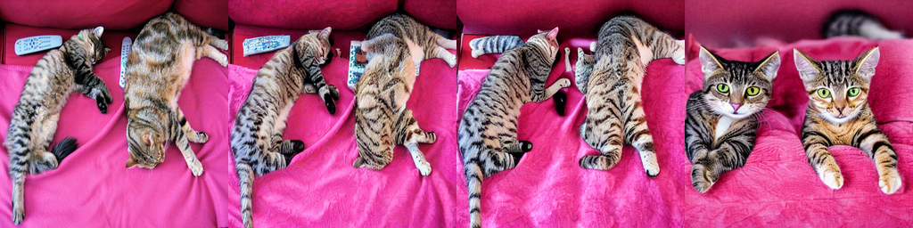
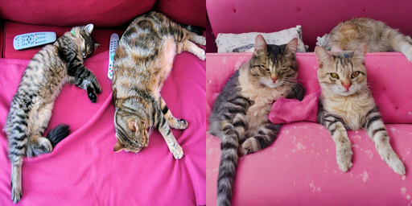
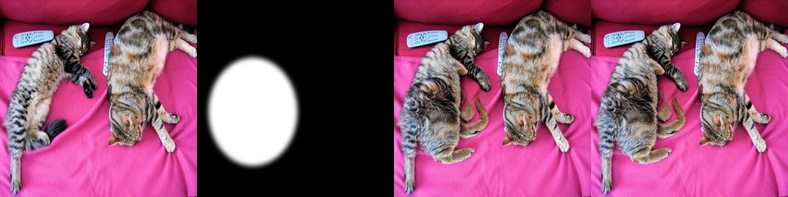
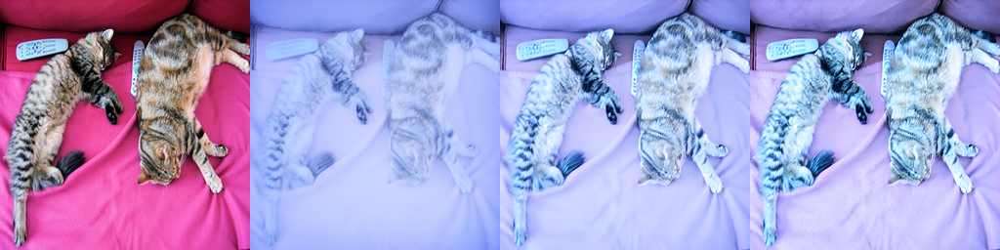
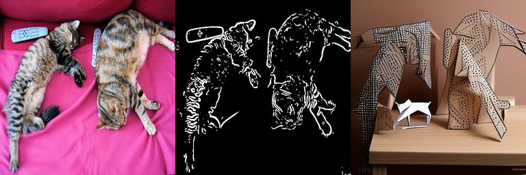
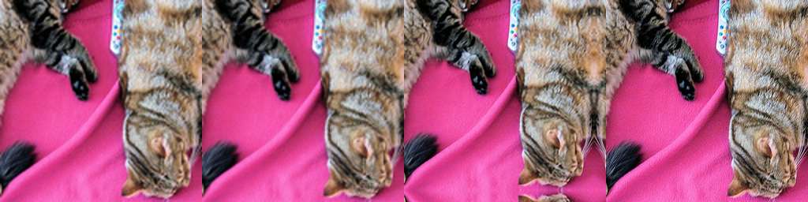
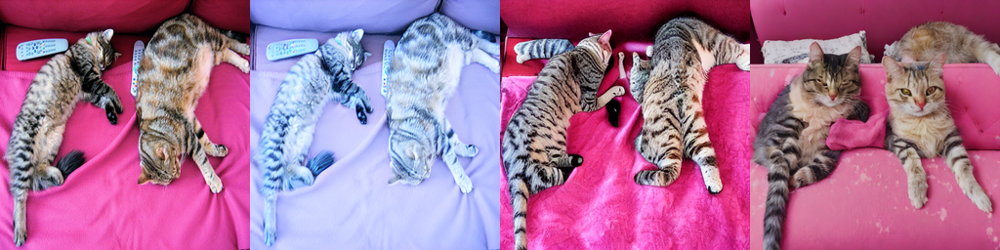
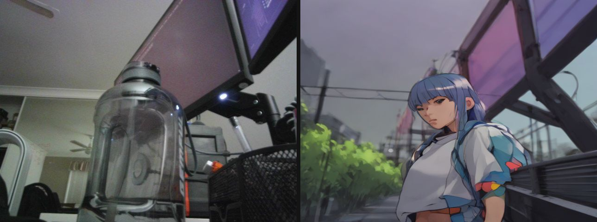

# Image-to-Image

Everything to know about image-to-image: the sub-tasks it hides (img2img, inpainting, instruction editing, ControlNet, super-resolution), how conditioning actually works, the mid-2026 model landscape, why there is no single metric, and runnable code to test the leading open models on a 12 GB card.

Author

Benedict Thekkel

## 1. What is Image-to-Image?

Image-to-image is not one task. It is the Hugging Face pipeline tag for **any model whose input contains an image and whose output is an image**, and the members of that family share an interface, not a mechanism. A super-resolution CNN and an instruction-following 20B diffusion transformer both “do image-to-image” and have nothing else in common. Treat this notebook as an umbrella: pick the sub-task first, then the model.

**Input.** A source image (`PIL.Image`, RGB), plus whatever the sub-task conditions on: a text prompt, an edit instruction, a binary mask, a structural map (edges/depth/pose), a reference image, or nothing at all.

**Output.** A new image, usually at the same resolution as the source (super-resolution being the obvious exception).

**The sub-tasks under the umbrella:**

| Sub-task | Extra conditioning | What it changes | Typical model |
|----|----|----|----|
| img2img / style transfer | text prompt + `strength` | global appearance, loosely anchored to the source layout | SD 1.5 / SDXL / SDXL-Turbo img2img |
| Inpainting | binary mask + prompt | only the masked region | SD inpainting checkpoints, FLUX Fill |
| Outpainting | mask covering new canvas | extends the image beyond its border | same inpainting checkpoints on a padded canvas |
| Instruction editing | natural-language *instruction* | whatever the instruction says, rest preserved | InstructPix2Pix, Qwen-Image-Edit, FLUX.1 Kontext |
| Structural conditioning | edge / depth / pose / scribble map | keeps geometry, regenerates content | ControlNet, T2I-Adapter |
| Subject / style transfer (no finetune) | reference image | imports identity or style from a reference | IP-Adapter |
| Super-resolution / restoration | (degraded image only) | upscales, denoises, deblurs, removes JPEG artifacts | Swin2SR, Real-ESRGAN, SUPIR, OSEDiff |
| Colourisation | (grayscale image only) | adds plausible colour | DDColor, colourisation ControlNets |
| Depth / normal / segmentation maps | none | produces a dense map, not a picture | see `00_Depth_Estimation`, `03_Image_Segmentation` |

That last row is the one people forget: **depth estimation is technically image-to-image** (Depth Anything’s HF pipeline tag literally is `image-to-image` on some cards), and dense-map predictors are exactly what supplies ControlNet’s conditioning. The tasks feed each other.

**Neighbouring notebooks:** `04_Text_to_Image` (the base generative model everything here conditions), `05_Image_to_Text` (the inverse), `12_Mask_Generation` (SAM produces the masks you inpaint with), `16_Image_Feature_Extraction` (CLIP/DINO embeddings, which is how we score edits in section 4), `18_Video_to_Video` (the same conditioning problem, plus temporal consistency).

------------------------------------------------------------------------

## 2. Real-World Use Cases

| Use case | Domain | Consumes / produces | Dominant constraint |
|----|----|----|----|
| Object removal / generative fill | Consumer photo apps (Google Photos “Magic Eraser”, Adobe Photoshop Generative Fill, Samsung Object Eraser) | Photo + brushed mask -\> photo with the tourist gone | Seamless boundaries; on-device or sub-second server latency; no hallucinated garbage |
| Product photography at scale | E-commerce (Amazon, Shopify, Etsy ad tooling) | Packshot + background prompt -\> lifestyle shot | **Product must be pixel-identical** - a hallucinated logo is a legal problem, not an aesthetic one |
| Concept art and iteration | Games, film, advertising | Sketch/blockout + ControlNet -\> rendered frame | Controllability over fidelity; artists need the *composition* they drew, not a nicer one |
| Photo restoration and upscaling | Archives, print, streaming (Topaz, Remini, NVIDIA/AMD upscalers) | Low-res, noisy, JPEG-crushed scan -\> clean high-res | No invented detail on faces and text; throughput per image; deterministic output |
| Virtual try-on and staging | Fashion, real estate (IDM-VTON-style pipelines, Zillow-style staging) | Person photo + garment reference -\> composited render | Identity and garment fidelity; masking accuracy; latency in an interactive loop |
| Medical image translation | Healthcare research (MRI-\>CT synthesis, stain normalisation) | Modality A -\> modality B | **Structural faithfulness above all** - a generative model that invents a lesion is a catastrophe; hence CycleGAN/UNet still beat diffusion here in practice |
| Satellite / aerial enhancement | Defence, agriculture, mapping | Cloudy or low-res tile -\> cleaned tile | Geometric accuracy; auditability; no fabricated features |
| Content moderation and de-identification | Platforms, dashcam / streetview | Frame + face/plate detections -\> blurred or synthesised replacement | Recall of the mask (a missed face is a breach); batch cost |

**What the benchmark number hides.** Editing leaderboards score one instruction on one image and average. Production does none of that. The failure that kills a product is almost never “the edit was mediocre” - it is **collateral damage**: you asked for a new background and the model quietly redrew the face, shifted the logo, changed the shade of the brand colour, or subtly deformed the hands. Diffusion editors round-trip the whole image through a VAE, so even the *unedited* pixels come back re-encoded and slightly different; if your pipeline must guarantee the untouched region is bit-identical, you have to composite the source back in outside the mask yourself. Then there is **cost**: a 20B editor is 40 GB of weights and seconds per image, so the shipped system is usually a small distilled model with a big one behind a “make it better” button. And **domain shift** is brutal: models trained on synthetic edit triplets of web photos degrade sharply on documents, screenshots, X-rays, and CAD renders - exactly the images enterprises want edited.

------------------------------------------------------------------------

## 3. How Modern Image-to-Image Works

This notebook assumes the diffusion fundamentals from `04_Text_to_Image` (latent diffusion, the U-Net/DiT denoiser, the VAE, classifier-free guidance, samplers). What follows is only the **conditioning** story: how you get a source image into a model that was trained to denoise from noise.

**Timeline:**

1.  **Paired supervised CNNs (2016-2020).** pix2pix (conditional GAN, needs aligned pairs), CycleGAN (unpaired, cycle-consistency loss), SRCNN/ESRGAN for super-resolution. Still the right answer when you have aligned pairs and need a deterministic, structure-preserving map (medical modality translation, stain normalisation).
2.  **SDEdit / img2img (2021-2022).** The trick that started everything: **do not start from pure noise - start from the source**. Encode the image to a latent, add noise up to an intermediate timestep, and denoise from there with a text prompt. Zero training required. It works because a partially noised image still carries the low-frequency layout while the high-frequency identity has been destroyed.
3.  **Inpainting checkpoints (2022).** Retrain the U-Net with **9 input channels** (4 noisy latent + 1 downsampled mask + 4 masked-image latent) on random masks, so the model *sees* the hole and the context instead of being blended into it.
4.  **ControlNet / T2I-Adapter (Feb 2023).** Add a *structural* conditioning stream (edges, depth, pose, scribble) without touching the base model. This is what made diffusion usable by professionals.
5.  **InstructPix2Pix (Jan 2023).** Reformulate editing as instruction following. Generate ~450k synthetic (source, instruction, target) triplets with GPT-3 + Prompt2Prompt, then fine-tune SD with the source latent concatenated to the input. No mask, no per-image prompt engineering.
6.  **IP-Adapter (Aug 2023).** ~22M params of decoupled cross-attention that inject a CLIP image embedding as an “image prompt” - subject and style transfer with no fine-tuning.
7.  **Unified DiT editors (2024-2026).** The current line. FLUX.1 Kontext (12B, Jun 2025), Step1X-Edit (~19B, Apr 2025, which introduced GEdit-Bench), Qwen-Image-Edit / -2509 / **-2511** (20B MMDiT, Dec 2025), FLUX.2 \[dev\] (32B + a Mistral-3 24B VLM, Nov 2025), and the closed frontier: Gemini 2.5 Flash Image (“nano-banana”), **Nano Banana Pro / Gemini 3 Pro Image** (Nov 2025), GPT-Image-1. These treat the source image as **extra tokens in the transformer sequence** rather than a channel-concat, which is why they can take several reference images and follow multi-step instructions.

### The `strength` parameter (the most misunderstood knob in img2img)

img2img does **not** run all your denoising steps. It runs

$$t_{\text{start}} = \lfloor \text{num\_inference\_steps} \times \text{strength} \rfloor$$

of them, skipping the earlier (noisier) ones entirely. The source latent is noised to exactly that timestep and denoising resumes from there. So `strength` simultaneously controls:

- **how much of the source survives** - at 0.0 you get the source back untouched, at 1.0 the source is fully destroyed and you are doing plain text-to-image;
- **how long the call takes** - `strength=0.3` with 50 steps runs 15 steps, not 50.

Practical bands: 0.2-0.35 = colour/lighting grade, 0.4-0.6 = restyle with the composition intact (the useful zone), 0.7-0.9 = “inspired by”, 1.0 = new image. With SDXL-Turbo (1-4 steps total) you must keep `num_inference_steps * strength >= 1` or the pipeline runs zero steps and hands you back the input.

### Why naive inpainting seams

The tempting approach - run img2img, then paste the generated pixels into the hole - fails for three compounding reasons: the model never saw the mask, so it had no reason to make the fill agree with the context; the VAE is 8x downsampling, so a pixel-space mask edge lands *between* latent cells and bleeds; and the region outside the mask has been re-encoded, so it no longer matches the original even where you did not ask for a change. The fixes, in increasing order of quality:

- **Latent blending.** At every denoising step, overwrite the outside-mask latents with the *correctly noised* source latents for that timestep. This is what `StableDiffusionInpaintPipeline` does when handed an ordinary (non-inpaint) checkpoint. Cheap, and it keeps the context stable, but the model is still guessing about the hole.
- **Inpainting checkpoints** (`stable-diffusion-v1-5/stable-diffusion-inpainting`, FLUX Fill). The 9-channel U-Net above. Trained on random masks, so filling a hole is the *training objective*, not an inference hack. Much better boundary agreement.
- **Feather the mask, and inpaint at full resolution in a crop.** `padding_mask_crop=32` in diffusers crops to the masked region, inpaints at native resolution, and composites back - which fixes the “my 4K photo got downsampled to 512 and the fill is mush” problem.
- **Composite back in pixel space.** After the fact, `Image.composite(generated, source, mask)` so the untouched region is byte-identical to the original. Do this whenever the source is a real photograph you must not alter.

### ControlNet and the zero-convolution

ControlNet does not fine-tune the base model at all. It **clones the encoder** (the U-Net’s down-blocks + mid-block), leaves the original frozen, and wires the clone’s outputs into the frozen decoder’s skip connections through 1x1 convolutions whose **weights and biases are initialised to exactly zero**.

$$\mathbf{y}_c = \mathcal{F}(\mathbf{x};\Theta) + \mathcal{Z}\big(\mathcal{F}(\mathbf{x} + \mathcal{Z}(\mathbf{c};\Theta_{z1});\Theta_c);\Theta_{z2}\big), \qquad \mathcal{Z}(\cdot;\{0,0\}) = 0$$

At training step zero every zero-conv outputs 0, so $\mathbf{y}_c = \mathcal{F}(\mathbf{x};\Theta)$: the network is **bit-identical to the base model**, and no random noise is injected into a 900M-parameter pretrained model by an untrained adapter. The gradient with respect to the zero-conv *weights* is still non-zero (it is proportional to the incoming activations, which are not zero), so the layer learns to open up gradually. That is the whole trick, and it is why ControlNet trains to convergence on ~50k pairs on a single GPU without catastrophic forgetting, and why any SD 1.5 checkpoint can pick up any SD 1.5 ControlNet at inference time. **T2I-Adapter** does the same job with a much smaller (77M) feed-forward adapter that is added once rather than per-block: cheaper and faster, slightly weaker adherence.

### How instruction editors differ

An instruction editor takes the source image as an **extra conditioning stream** and is trained on **edit triplets** (source, instruction, target), so it learns “change only what was asked” as an objective rather than inheriting it from a hack.

- **InstructPix2Pix** concatenates the VAE latent of the source to the noisy latent (8 input channels; the new weights are zero-initialised) and uses **two** guidance scales: `guidance_scale` for text adherence and `image_guidance_scale` for source fidelity. If your edit is being ignored, raise text guidance / lower `image_guidance_scale`; if the image is being destroyed, do the reverse. That two-knob search *is* the fidelity/adherence trade-off made explicit.
- **Kontext / Qwen-Image-Edit / FLUX.2** tokenise the source (VAE tokens, plus VLM tokens in Qwen-Image-Edit’s dual-encoding and FLUX.2’s Mistral-3 encoder) and append them to the DiT’s token sequence - in-context conditioning. That is why they handle multiple reference images, text rendering inside the image, and chained instructions, and why they are 12-32B parameters.

**Cheat sheet:**

| Approach | Training needed | Preserves source | Control | Cost |
|----|----|----|----|----|
| img2img (SDEdit) | none | via `strength`, loosely | prompt only | cheapest |
| Inpainting checkpoint | pretrained | exactly, outside mask | mask + prompt | cheap |
| ControlNet | +0.36B adapter (once) | structure only, not appearance | edges/depth/pose | +~45% per step |
| T2I-Adapter | +77M adapter (once) | structure only | same, weaker | +~5% |
| IP-Adapter | +22M adapter (once) | subject/style from a *reference* | image prompt | negligible |
| InstructPix2Pix | full fine-tune on triplets | decent, tunable | free-text instruction | cheap (SD 1.5 sized) |
| DiT editor (Kontext/Qwen) | full pretrain, 12-32B | best | free-text, multi-image | does not fit a 12 GB card unquantised |

------------------------------------------------------------------------

## 4. Evaluation Metrics

**There is no single metric for image-to-image, and anyone who quotes you one number is measuring the wrong thing.** The metric depends entirely on which sub-task you are in, and for editing you need *at least two* numbers that pull against each other.

### Reference-based (restoration, super-resolution: a ground-truth target exists)

**PSNR** - peak signal-to-noise ratio, in dB, over the pixel MSE:

$$\text{PSNR} = 10 \cdot \log_{10}\!\left(\frac{\text{MAX}^2}{\text{MSE}}\right), \qquad \text{MSE} = \frac{1}{mn}\sum_{i,j}\big(I(i,j) - K(i,j)\big)^2$$

**SSIM** - structural similarity, computed per local window and averaged:

$$\text{SSIM}(x,y) = \frac{(2\mu_x\mu_y + C_1)(2\sigma_{xy} + C_2)}{(\mu_x^2 + \mu_y^2 + C_1)(\sigma_x^2 + \sigma_y^2 + C_2)}$$

with $C_1 = (0.01L)^2$, $C_2 = (0.03L)^2$ and $L$ the dynamic range.

**The pitfall that defines the field: PSNR and SSIM reward blur.** Both are minimised by predicting the conditional *mean* of the plausible outputs, and the mean of many sharp textures is a smooth one. A model that hedges beats a model that commits, so a GAN or diffusion upscaler that produces genuinely convincing texture will often score *worse* on PSNR than a boring L2-trained CNN that a human would reject instantly. This is the **perception-distortion trade-off**, and it is a proven bound, not a tuning failure.

**LPIPS** - the standard fix. Feed both images through a pretrained network (AlexNet/VGG), compare normalised deep activations per layer, learn the channel weights against human 2AFC judgements. Lower is better; it correlates with human preference far better than PSNR. **DISTS** goes further by mixing structure and *texture statistics*, so it stops punishing a resynthesised-but-perceptually-identical texture.

### Distribution-based (no per-image reference)

**FID** compares Inception feature distributions between two image *sets* as a Frechet distance; **KID** is the unbiased kernel version and is the honest choice below ~10k images, where FID’s bias is large. Both measure realism of a *set*, never of one image.

### Editing (the hard case: there is no ground truth, and two things must be true at once)

**CLIP directional similarity** asks whether the edit moved the image *in the direction the instruction asked*. Take a caption of the source $c_{src}$ and of the intended result $c_{tgt}$:

$$\text{CLIP}_{\text{dir}} = \cos\big(E_{img}(x_{edit}) - E_{img}(x_{src}),\;\; E_{txt}(c_{tgt}) - E_{txt}(c_{src})\big)$$

It is direction-aware, which plain CLIP score is not: a model that ignores the source entirely and generates a fresh picture of the target caption gets a high *CLIP score* and a poor *directional* score.

**Source preservation** is the counterweight: CLIP or **DINO** image-image cosine similarity between source and edit (DINOv2/DINOv3 embeddings are the better choice for *subject identity* because they are self-supervised on visual structure rather than on captions), or a masked L1/LPIPS over the region that should not have changed.

**The fundamental tension.** These two metrics are trivially gameable *in opposite directions*:

- return the input unchanged -\> perfect preservation, zero adherence;
- ignore the input and generate the target caption from scratch -\> high adherence, zero preservation.

So **neither number means anything alone**. Report both, and plot them against each other - the 2-D scatter in section 14 is not decoration, it is the only honest summary of an editing model. In 2026 the serious benchmarks all encode this: **MagicBrush** (10k human-annotated triplets, multi-turn), the **Emu Edit test set**, **GEdit-Bench** (from Step1X-Edit; real user instructions, VLM-judged on instruction-following + consistency + quality, now **GEditBench v2** with 23 tasks and an open PVC-Judge), and **ImgEdit-Bench** (NeurIPS 2025 D&B; scores instruction adherence, editing quality, and detail preservation separately). The judge is increasingly a VLM (GPT-5-class or the open PVC-Judge), because no closed-form metric captures “did it change *only* what I asked”.

### Speed

Per-image latency at a fixed resolution and step count, and the step count itself - a 4-step SDXL-Turbo edit and a 50-step SD 1.5 edit are not comparable at “seconds per image” without that context. Report VRAM peak too: it decides whether the model ships.

The cell below computes PSNR and SSIM from scratch in numpy (no `skimage` needed) and sketches CLIP directional similarity on fabricated embeddings so the formula is unambiguous.

------------------------------------------------------------------------

``` python
import numpy as np
from scipy.ndimage import uniform_filter

rng = np.random.default_rng(0)

def psnr(a, b, max_val=1.0):
    "Peak signal-to-noise ratio (dB) between two float images in [0, 1]."
    mse = float(np.mean((a.astype(np.float64) - b.astype(np.float64)) ** 2))
    return float("inf") if mse == 0 else 10.0 * np.log10(max_val ** 2 / mse)

def ssim(a, b, max_val=1.0, win=7):
    "Mean SSIM over a uniform sliding window (grayscale float images in [0, 1])."
    C1, C2 = (0.01 * max_val) ** 2, (0.03 * max_val) ** 2
    a, b = a.astype(np.float64), b.astype(np.float64)
    mu_a, mu_b = uniform_filter(a, win), uniform_filter(b, win)
    # E[x^2] - E[x]^2, with the unbiased (N/(N-1)) correction skimage also applies
    n = win ** 2
    cov_norm = n / (n - 1)
    var_a = cov_norm * (uniform_filter(a * a, win) - mu_a ** 2)
    var_b = cov_norm * (uniform_filter(b * b, win) - mu_b ** 2)
    cov_ab = cov_norm * (uniform_filter(a * b, win) - mu_a * mu_b)
    num = (2 * mu_a * mu_b + C1) * (2 * cov_ab + C2)
    den = (mu_a ** 2 + mu_b ** 2 + C1) * (var_a + var_b + C2)
    pad = (win - 1) // 2  # drop the border where the window hangs off the image
    return float(np.mean((num / den)[pad:-pad, pad:-pad]))

# A fabricated "clean" image: a smooth gradient plus a textured patch.
yy, xx = np.mgrid[0:128, 0:128] / 127.0
clean = 0.5 + 0.4 * np.sin(6 * np.pi * xx) * np.cos(4 * np.pi * yy)
clean[40:90, 40:90] += 0.25 * rng.standard_normal((50, 50))  # fine texture
clean = np.clip(clean, 0, 1)

print(f"{'degradation':22s} {'PSNR (dB)':>10s} {'SSIM':>8s}")
for sigma in [0.0, 0.02, 0.05, 0.10, 0.20]:
    noisy = np.clip(clean + sigma * rng.standard_normal(clean.shape), 0, 1)
    print(f"{'noise sigma=' + str(sigma):22s} {psnr(clean, noisy):10.2f} {ssim(clean, noisy):8.4f}")

# The perception-distortion trap: blurring destroys the texture a human would want
# back, yet it scores BETTER than moderate noise on both metrics.
blurred = uniform_filter(clean, 5)
print(f"{'5x5 box blur':22s} {psnr(clean, blurred):10.2f} {ssim(clean, blurred):8.4f}")
print("-> blur beats noise on PSNR/SSIM while looking much worse. This is why LPIPS/DISTS exist.")

# ---------------------------------------------------------------------------
# CLIP directional similarity, on fabricated 8-d embeddings so the algebra is visible.
# In section 14 the same function runs on real CLIP embeddings.
def cos(u, v):
    return float(np.dot(u, v) / (np.linalg.norm(u) * np.linalg.norm(v) + 1e-8))

def clip_directional(e_img_src, e_img_edit, e_txt_src, e_txt_tgt):
    "cos( image-space edit direction , text-space edit direction ). Higher = the edit went the way it was asked."
    return cos(e_img_edit - e_img_src, e_txt_tgt - e_txt_src)

e_img_src = rng.standard_normal(8)                    # source image embedding
e_txt_src = rng.standard_normal(8)                    # "a photo of two cats on a couch"
delta_txt = rng.standard_normal(8)                    # the "...in the snow" direction
e_txt_tgt = e_txt_src + delta_txt

candidates = {
    "did nothing (returns source)":     e_img_src.copy(),
    "moved as instructed":              e_img_src + 0.9 * delta_txt,
    "regenerated from scratch":         e_txt_tgt + 0.6 * rng.standard_normal(8),
    "edited the wrong thing":           e_img_src - 0.9 * delta_txt,
}
for name, e_img_edit in candidates.items():
    d = clip_directional(e_img_src, e_img_edit, e_txt_src, e_txt_tgt)
    preserve = cos(e_img_src, e_img_edit)  # source preservation (image-image cosine)
    print(f"{name:32s} CLIP_dir {d:+.3f}   preservation {preserve:+.3f}")

# "did nothing" is undefined/degenerate on direction (zero vector) but perfect on
# preservation; "regenerated from scratch" can score well on direction and badly on
# preservation. Only the PAIR of numbers is informative.
```

    degradation             PSNR (dB)     SSIM
    noise sigma=0.0               inf   1.0000
    noise sigma=0.02            34.00   0.9598
    noise sigma=0.05            26.00   0.8078
    noise sigma=0.1             20.20   0.5666
    noise sigma=0.2             14.61   0.3107
    5x5 box blur                21.03   0.8411
    -> blur beats noise on PSNR/SSIM while looking much worse. This is why LPIPS/DISTS exist.
    did nothing (returns source)     CLIP_dir +0.000   preservation +1.000
    moved as instructed              CLIP_dir +1.000   preservation +0.532
    regenerated from scratch         CLIP_dir +0.793   preservation -0.022
    edited the wrong thing           CLIP_dir -1.000   preservation +0.880

## 5. Datasets

Editing has no equivalent of ImageNet: the supervision is *triplets* (source, instruction, target), and aligned triplets barely exist in nature, so the field runs on synthetic ones.

| Dataset | Contents | Size | Scope | License | Typical use |
|----|----|----|----|----|----|
| [timbrooks/instructpix2pix-clip-filtered](https://huggingface.co/datasets/timbrooks/instructpix2pix-clip-filtered) | Synthetic edit triplets: GPT-3 wrote the instructions, Prompt2Prompt + SD generated the before/after pair, CLIP filtered the junk | ~313k (of ~450k generated) | English instructions, web-photo domain | CC-BY-4.0 (see card) | Train instruction editors. Note the “sources” are themselves generated - so a model trained on it is weaker on real photos |
| [osunlp/MagicBrush](https://huggingface.co/datasets/osunlp/MagicBrush) | **Human-annotated** triplets via DALL-E 2 in the loop; single- and multi-turn, mask-provided and mask-free | ~10k triplets | English, COCO images | CC-BY-4.0 | The standard *fine-tuning + eval* set; fixes InstructPix2Pix’s synthetic-source bias |
| [facebook/emu_edit_test_set](https://huggingface.co/datasets/facebook/emu_edit_test_set) | Meta’s Emu Edit benchmark: 7 edit categories (local, global, style, background, text, remove, add) | ~3.6k test examples | English | CC-BY-NC (research) | Eval only; the categories matter as much as the average |
| [UCSC-VLAA/HQ-Edit](https://huggingface.co/datasets/UCSC-VLAA/HQ-Edit) | High-resolution GPT-4V + DALL-E 3 generated triplets with detailed instructions | ~197k | English | CC-BY-4.0 | Train; higher visual quality than InstructPix2Pix, still synthetic |
| [ImgEdit](https://github.com/PKU-YuanGroup/ImgEdit) (NeurIPS 2025 D&B) | 1.2M curated edit pairs + ImgEdit-Bench (single- and multi-turn) | 1.2M | English | see repo | Current train + eval standard for open editors |
| [eugenesiow/Div2k](https://huggingface.co/datasets/eugenesiow/Div2k) | DIV2K: 2K-resolution photos with bicubic/unknown LR pairs | 800 train / 100 val | photographic | research | The SR training set |
| [eugenesiow/Set5](https://huggingface.co/datasets/eugenesiow/Set5), [Set14](https://huggingface.co/datasets/eugenesiow/Set14), [Urban100](https://huggingface.co/datasets/eugenesiow/Urban100) | Classical SR eval sets (Urban100 = building facades, brutal on aliasing) | 5 / 14 / 100 images | photographic | research | PSNR/SSIM tables in every SR paper |
| [Places2](http://places2.csail.mit.edu/) | Scene photos; the standard **inpainting** benchmark with published mask sets | 10M+ | scenes | research (non-commercial) | Inpainting train + eval |
| [COCO val2017](https://cocodataset.org/) | Everyday photos with captions | 5k val | photographic | CC-BY-4.0 | Source images for edit benchmarks; the sample below is a COCO image |

**This notebook evaluates on a single COCO image with hand-written instructions.** That is a smoke test, not a benchmark - it exists so the code runs in minutes on a 12 GB card. For a real number, run MagicBrush or GEdit-Bench with a VLM judge. Nothing here is gated; Emu Edit is non-commercial, and DIV2K/Places2 carry research-only terms.

------------------------------------------------------------------------

## 6. The Model Landscape (mid-2026)

The gap between “the best editor” and “the best editor that fits on this card” is now enormous. Everything at the frontier is a 12-32B DiT.

| Model | Params | License | Sub-task | Architecture | Best for |
|----|----|----|----|----|----|
| [SD 1.5 img2img](https://huggingface.co/stable-diffusion-v1-5/stable-diffusion-v1-5) | 0.86B U-Net (+CLIP, VAE) | CreativeML OpenRAIL-M | img2img, style | latent diffusion U-Net | The baseline, and the only ecosystem with a ControlNet/LoRA/IP-Adapter for everything |
| [SD 1.5 inpainting](https://huggingface.co/stable-diffusion-v1-5/stable-diffusion-inpainting) | 0.86B | CreativeML OpenRAIL-M | inpaint / outpaint | 9-channel U-Net | Cheap mask-conditioned fill |
| [SDXL-Turbo](https://huggingface.co/stabilityai/sdxl-turbo) | 2.6B U-Net | Stability non-commercial (research) | img2img | ADD-distilled SDXL | **Interactive** restyling: 1-2 steps, sub-second |
| [InstructPix2Pix](https://huggingface.co/timbrooks/instruct-pix2pix) | 0.86B | MIT | instruction editing | SD 1.5 + source-latent concat | The only instruction editor that comfortably fits 12 GB. Dated but honest |
| [ControlNet v1.1](https://huggingface.co/lllyasviel/control_v11p_sd15_canny) (canny/depth/pose/scribble/…) | +0.36B per adapter | Apache-2.0 (SD base is OpenRAIL) | structural conditioning | frozen U-Net + trainable encoder copy + zero-convs | Keeping *your* composition |
| [T2I-Adapter](https://huggingface.co/TencentARC/t2i-adapter-canny-sdxl-1.0) | +77M | Apache-2.0 | structural conditioning | lightweight feed-forward adapter | Same job, ~5% overhead instead of ~45% |
| [IP-Adapter](https://huggingface.co/h94/IP-Adapter) | +22M | Apache-2.0 | subject / style transfer | decoupled cross-attention on a CLIP image embed | “Make it look like *this* reference”, no finetune |
| [FLUX.1 Kontext \[dev\]](https://huggingface.co/black-forest-labs/FLUX.1-Kontext-dev) | 12B | FLUX.1 non-commercial | instruction editing | flow-matching DiT, source as context tokens | Best *open* editor that a 24 GB card can run; **~24 GB bf16 - needs 4-bit here** |
| [Qwen-Image-Edit-2511](https://huggingface.co/Qwen/Qwen-Image-Edit-2511) | 20B MMDiT | Apache-2.0 | instruction editing | Qwen2.5-VL (semantic) + VAE (appearance) dual encoding | Open SOTA: bilingual **text editing inside the image**, identity consistency. ~40 GB bf16, ~20 GB fp8 - **does not fit** |
| [Step1X-Edit](https://huggingface.co/stepfun-ai/Step1X-Edit) | ~19B | Apache-2.0 | instruction editing | VLM + DiT; introduced GEdit-Bench | Fully-open editor with a permissive licence. **Does not fit** |
| [FLUX.2 \[dev\]](https://huggingface.co/black-forest-labs/FLUX.2-dev) | 32B DiT + Mistral-3 24B VLM | FLUX non-commercial | editing + multi-reference | flow matching, up to 10 references, 4 MP | Nov 2025 frontier open weights. **Does not fit** (4-bit + remote text encoder on a 4090 is the published minimum) |
| Nano Banana Pro / **Gemini 3 Pro Image** | closed | API | instruction editing | closed | The frontier (Nov 2025): text rendering, multi-subject identity, real-world grounding. API-only, watermarked |
| GPT-Image-1 / Seedream / SeedEdit | closed | API | instruction editing | closed | Commercial alternatives |
| [Swin2SR](https://huggingface.co/caidas/swin2SR-classical-sr-x2-64) | 12M | Apache-2.0 | super-resolution | SwinV2 transformer | **transformers-native** SR, x2/x4, tiny. Runs anywhere |
| Real-ESRGAN | 16M | BSD-3 | super-resolution | ESRGAN + synthetic degradations | The production default for anime/photo upscaling (vendor runtime) |
| SUPIR / SeeSR / OSEDiff / StableSR | 1-2.5B+ | mixed | real-world SR | diffusion prior | Hallucinates *plausible* detail; OSEDiff is one-step (~39x faster than SeeSR) |

**Leaderboards:** [ImgEdit-Bench](https://github.com/PKU-YuanGroup/ImgEdit) and [GEditBench v2](https://github.com/ZhangqiJiang07/GEditBench_v2) for editing (both VLM-judged), [LMArena’s image-edit arena](https://lmarena.ai/) for human preference, and the NTIRE challenges for super-resolution.

**Who wins what.** On raw edit quality: Nano Banana Pro (closed), then Qwen-Image-Edit-2511 and FLUX.2 among open weights. On *licence*: Qwen-Image-Edit and Step1X-Edit are Apache-2.0; the FLUX line is not commercially free. On *speed*: SDXL-Turbo does img2img in one step - nothing else is close, and for the “interactive restyle” use case in section 2 that beats quality. On *fitting a 12 GB card*: only the SD 1.5 / SDXL family, InstructPix2Pix, the adapters, and the SR models - which is exactly the set this notebook makes runnable.

### What this box cannot run (and the honest reason)

The three models that actually matter for editing in mid-2026 - **FLUX.1 Kontext \[dev\]** (12B), **Qwen-Image-Edit-2511** (20B), **FLUX.2 \[dev\]** (32B + a 24B VLM text encoder) - do not fit in 12 GB unquantised, and this notebook will not pretend otherwise. Their `diffusers` APIs are one-liners (`FluxKontextPipeline`, `QwenImageEditPlusPipeline`), so the code is not the problem; the weights are.

The route on this box is 4-bit quantisation plus **sequential** CPU offload, which streams one transformer block at a time through the GPU. Expect **tens of seconds to minutes per image** - the bottleneck becomes PCIe, not the card. Left non-runnable deliberately:

``` python
# NOT RUN HERE - needs bitsandbytes and ~10-20 minutes for the first image.
# from diffusers import FluxKontextPipeline, BitsAndBytesConfig, FluxTransformer2DModel
# quant = BitsAndBytesConfig(load_in_4bit=True, bnb_4bit_compute_dtype=torch.bfloat16)
# tr = FluxTransformer2DModel.from_pretrained(
#     "black-forest-labs/FLUX.1-Kontext-dev", subfolder="transformer",
#     quantization_config=quant, torch_dtype=torch.bfloat16)
# pipe = FluxKontextPipeline.from_pretrained(
#     "black-forest-labs/FLUX.1-Kontext-dev", transformer=tr, torch_dtype=torch.bfloat16)
# pipe.enable_sequential_cpu_offload()          # slowest offload mode, smallest footprint
# pipe(image=source, prompt="make it a snowy winter scene", guidance_scale=2.5).images[0]
```

The realistic options for these models on a 12 GB card are: a hosted API (Replicate/fal/Together), an 8-bit GGUF via ComfyUI, or a bigger GPU. The head-to-head in section 14 therefore compares the three editors that *do* fit, and you should read their scores as “what you can run locally today”, not “the state of the art”.

------------------------------------------------------------------------

## 7. Setup

Package roles:

- `diffusers` + `torch` + `accelerate` - the img2img / inpaint / InstructPix2Pix / ControlNet pipelines and `enable_model_cpu_offload()`
- `transformers` - Swin2SR (`AutoModelForImageToImage`) and CLIP (the editing metrics)
- `Pillow` + `numpy` + `scipy` - masks, edge maps, and the metric code above
- `pandas` + `pyecharts` - the benchmark table and charts
- `opencv-python` (**optional**) - `cv2.Canny` gives cleaner edge maps than the Sobel fallback below; the notebook runs either way

`diffusers` is the general-purpose Hugging Face library for diffusion models, the same ecosystem as `transformers` - it is the correct dependency here, not a per-model vendor package.

Every pipeline below is loaded in fp16 with `enable_model_cpu_offload()`, which keeps only the module currently executing on the GPU (U-Net, then VAE, then text encoder) and parks the rest in RAM. On a 12 GB card that is the difference between “comfortable” and “OOM at the VAE decode”. Do **not** also call `.to("cuda")` on an offloaded pipeline - accelerate owns the placement.

------------------------------------------------------------------------

``` python
# diffusers is the general-purpose HF library for diffusion; transformers covers Swin2SR + CLIP.
# %pip install -q torch diffusers transformers accelerate safetensors pillow scipy pandas pyecharts

# Optional: cleaner Canny edges for the ControlNet section, and the webcam demo.
# %pip install -q opencv-python
```

``` python
import ctypes
import ctypes.util
import gc
import time
from pathlib import Path

import torch
from dotenv import find_dotenv, load_dotenv

# Knowledge/.env sets HF_TOKEN - authenticated HF Hub requests get higher rate limits
load_dotenv(find_dotenv(usecwd=True))

device = "cuda:0" if torch.cuda.is_available() else "cpu"
dtype = torch.float16 if device != "cpu" else torch.float32
if device != "cpu":
    print(torch.cuda.get_device_name(0))
print("device:", device)

def vram(tag=""):
    "Report current GPU memory (allocated / reserved). No-op on CPU."
    if torch.cuda.is_available():
        alloc = torch.cuda.memory_allocated() / 1e9
        reserved = torch.cuda.memory_reserved() / 1e9
        print(f"VRAM {tag:20s} {alloc:5.2f} GB allocated / {reserved:5.2f} GB reserved")

def free_memory():
    "Collect garbage, empty the CUDA cache, and return freed CPU RAM to the OS."
    gc.collect()
    if torch.cuda.is_available():
        torch.cuda.empty_cache()
        torch.cuda.ipc_collect()
    # glibc keeps freed CPU allocations in its arenas instead of returning them
    # to the OS, so RSS compounds across model sections (cpu-offloaded weights
    # live in system RAM). malloc_trim(0) hands the freed arenas back. See
    # dl-visualization-and-memory.md - not optional on a 12 GB box.
    try:
        ctypes.CDLL(ctypes.util.find_library("c") or "libc.so.6").malloc_trim(0)
    except Exception:
        pass

def place(pipe):
    "Put a diffusers pipeline on the device via adaptive offload (12 GB-safe), or on CPU."
    if device == "cpu":
        return pipe.to("cpu")
    offload(pipe)   # accelerate owns placement - do NOT also call .to(device)
    pipe.enable_vae_slicing()         # decode the VAE in slices: a few hundred MB less peak
    pipe.set_progress_bar_config(disable=True)
    return pipe

def offload(pipe):
    "Pick the offload strategy for the VRAM actually free right now, not the card size."
    if device == "cpu":
        return pipe
    import torch.nn as nn
    # bitsandbytes-quantized weights are pinned to the GPU; enable_sequential_cpu_offload
    # first moves the whole pipeline to CPU and STALLS on them (a hang, not a catchable
    # error), so a quantized pipeline must use model-level offload - the recommended path.
    quantized = any(getattr(m, "is_quantized", False)
                    for m in pipe.components.values() if isinstance(m, nn.Module))
    free_gb = torch.cuda.mem_get_info()[0] / 1e9  # global free VRAM - counts other processes
    if free_gb < 8.0 and not quantized:
        # Another process is using the card (or it is small): layer-at-a-time keeps the
        # peak at ~1-2 GB for a real speed cost. Free the other GPU user if you can -
        # check nvidia-smi on the HOST; a container only sees its own processes.
        # Quantized (bitsandbytes) components cannot be dispatched per-layer, so fall
        # back to model-level offload if sequential raises.
        try:
            pipe.enable_sequential_cpu_offload(device=device)
            print(f"offload: sequential ({free_gb:.1f} GB VRAM free - GPU busy, expect slow steps)")
            return pipe
        except Exception as e:
            print(f"offload: sequential unsupported here ({type(e).__name__}) - using model-level")
    # Whole submodule on the GPU at a time - fast, peak ~= largest submodule (~5 GB).
    pipe.enable_model_cpu_offload(device=device)
    print(f"offload: {'quantized -> ' if quantized else ''}model-level ({free_gb:.1f} GB VRAM free)")
    return pipe


# All downloads go to DL_tasks/datasets/ (gitignored)
DATA_DIR = Path("../../datasets")
DATA_DIR.mkdir(exist_ok=True)
HF_CACHE = str(DATA_DIR / "hf_cache")
```

    NVIDIA GeForce RTX 3060
    device: cuda:0

``` python
import urllib.request

import numpy as np
from IPython.display import display
from PIL import Image, ImageDraw, ImageFilter

# The COCO cats image - the de-facto sample across these notebooks.
SAMPLE = DATA_DIR / "coco_cats.jpg"
if not SAMPLE.exists():
    urllib.request.urlretrieve(
        "http://images.cocodataset.org/val2017/000000039769.jpg", SAMPLE
    )

# SD 1.5 works at 512x512; keep everything there so latencies are comparable.
source = Image.open(SAMPLE).convert("RGB").resize((512, 512), Image.LANCZOS)

# The edit we will ask every model for, expressed three ways (this distinction matters):
INSTRUCTION = "make it a snowy winter scene"                       # for instruction editors
CAPTION_SRC = "a photo of two cats lying on a pink couch"          # for CLIP directional sim
CAPTION_TGT = "a photo of two cats lying on a pink couch in a snowy winter scene"
# img2img/ControlNet are NOT instruction models: they want a DESCRIPTION of the desired
# result, not a command. Handing them "make it snowy" produces literal nonsense.

def show(*images, size=256, labels=None):
    "Display PIL images side by side (ECharts cannot draw images; PIL is the right tool)."
    ims = [im.convert("RGB").resize((size, size), Image.LANCZOS) for im in images]
    strip = Image.new("RGB", (size * len(ims), size), "white")
    for i, im in enumerate(ims):
        strip.paste(im, (i * size, 0))
    if labels:
        print(" | ".join(f"{i + 1}. {lab}" for i, lab in enumerate(labels)))
    display(strip)
    return strip

# A mask over the left-hand cat: white = repaint, black = keep. Feathered, because a hard
# 1-pixel mask edge is the classic source of an inpainting seam.
mask = Image.new("L", source.size, 0)
ImageDraw.Draw(mask).ellipse([30, 150, 260, 430], fill=255)
mask = mask.filter(ImageFilter.GaussianBlur(6))

show(source, mask, labels=["source (512x512)", "inpaint mask (white = repaint)"])
```

    1. source (512x512) | 2. inpaint mask (white = repaint)


## 8. SD 1.5 img2img and the `strength` knob

The SDEdit baseline: encode, noise, denoise with a prompt. `stable-diffusion-v1-5/stable-diffusion-v1-5` is the live repo id - the original `runwayml/stable-diffusion-v1-5` was **deleted by Runway in August 2024**, so any tutorial still using it fails at load. The community mirror under the `stable-diffusion-v1-5` org (and `sd-legacy`) is the same weights.

The cell below sweeps `strength` on the same seed so you can see the single most important behaviour in this notebook: the source dissolving as `strength` climbs, and the call getting *slower* at the same time (because steps executed = `int(num_inference_steps * strength)`).

------------------------------------------------------------------------

``` python
from diffusers import StableDiffusionImg2ImgPipeline

pipe = StableDiffusionImg2ImgPipeline.from_pretrained(
    "stable-diffusion-v1-5/stable-diffusion-v1-5",
    torch_dtype=dtype,
    safety_checker=None,            # the checker returns black images on false positives
    requires_safety_checker=False,
    cache_dir=HF_CACHE,
)
place(pipe)
vram("sd15 img2img loaded")

outs, labels = [source], ["source"]
for strength in [0.3, 0.5, 0.75]:
    g = torch.Generator("cpu").manual_seed(0)   # same seed -> the only variable is strength
    t0 = time.perf_counter()
    img = pipe(
        prompt=CAPTION_TGT,                     # a DESCRIPTION, not an instruction
        image=source,
        strength=strength,
        guidance_scale=7.5,
        num_inference_steps=40,                 # actual steps run = int(40 * strength)
        generator=g,
    ).images[0]
    dt = time.perf_counter() - t0
    print(f"strength={strength:.2f}  steps_run={int(40 * strength):2d}  {dt:5.1f}s")
    outs.append(img)
    labels.append(f"strength={strength}")

show(*outs, labels=labels)

del pipe
free_memory()
vram("after sd15 img2img")
```

    offload: model-level (12.4 GB VRAM free)
    VRAM sd15 img2img loaded   0.00 GB allocated /  0.00 GB reserved

    /home/bthek1/Knowledge/.venv/lib/python3.14/site-packages/diffusers/pipelines/pipeline_utils.py:2273: FutureWarning: `enable_vae_slicing` is deprecated and will be removed in version 0.40.0. Calling `enable_vae_slicing()` on a `StableDiffusionImg2ImgPipeline` is deprecated and this method will be removed in a future version. Please use `pipe.vae.enable_slicing()`.
      deprecate(

    strength=0.30  steps_run=12    3.1s
    strength=0.50  steps_run=20    3.3s
    strength=0.75  steps_run=30    4.5s
    1. source | 2. strength=0.3 | 3. strength=0.5 | 4. strength=0.75



    VRAM after sd15 img2img    0.01 GB allocated /  0.02 GB reserved

## 9. SDXL-Turbo img2img (the interactive case)

Adversarial Diffusion Distillation collapses the sampler to **one step**. For img2img that makes the constraint explicit: the pipeline runs `int(num_inference_steps * strength)` steps, so with `num_inference_steps=2, strength=0.5` you get exactly **1** step - and if that product drops below 1 the pipeline runs zero steps and silently hands you back your input. `guidance_scale=0.0` because Turbo was distilled without classifier-free guidance (passing a guidance scale makes it worse *and* twice as slow).

This is the model behind “restyle as you drag the slider” UIs. Licence is Stability’s non-commercial research licence - fine for a notebook, check it before shipping.

------------------------------------------------------------------------

``` python
from diffusers import AutoPipelineForImage2Image

pipe = AutoPipelineForImage2Image.from_pretrained(
    "stabilityai/sdxl-turbo",
    torch_dtype=dtype,
    variant="fp16" if device != "cpu" else None,
    cache_dir=HF_CACHE,
)
place(pipe)
vram("sdxl-turbo loaded")

# SDXL wants 512x512+ ; Turbo was trained at 512. num_inference_steps * strength >= 1.
g = torch.Generator("cpu").manual_seed(0)
t0 = time.perf_counter()
turbo_out = pipe(
    prompt=CAPTION_TGT,
    image=source,
    strength=0.6,
    num_inference_steps=2,     # 2 * 0.6 -> 1 actual denoising step
    guidance_scale=0.0,        # ADD-distilled: CFG is not just unnecessary, it hurts
    generator=g,
).images[0]
print(f"sdxl-turbo: {time.perf_counter() - t0:.2f}s for 1 denoising step")

show(source, turbo_out, labels=["source", "sdxl-turbo, 1 step"])

del pipe
free_memory()
vram("after sdxl-turbo")
```

    [transformers] `Siglip2ImageProcessorFast` is deprecated. The `Fast` suffix for image processors has been removed; use `Siglip2ImageProcessor` instead.
    /home/bthek1/Knowledge/.venv/lib/python3.14/site-packages/huggingface_hub/utils/_validators.py:205: UserWarning: The `local_dir_use_symlinks` argument is deprecated and ignored in `hf_hub_download`. Downloading to a local directory does not use symlinks anymore.
      warnings.warn(

    offload: model-level (12.3 GB VRAM free)
    VRAM sdxl-turbo loaded     0.01 GB allocated /  0.02 GB reserved

    /home/bthek1/Knowledge/.venv/lib/python3.14/site-packages/diffusers/pipelines/pipeline_utils.py:2273: FutureWarning: `enable_vae_slicing` is deprecated and will be removed in version 0.40.0. Calling `enable_vae_slicing()` on a `StableDiffusionXLImg2ImgPipeline` is deprecated and this method will be removed in a future version. Please use `pipe.vae.enable_slicing()`.
      deprecate(
    There are modules in AutoencoderKL that should be kept in float32: []. Casting directly with `to()` can lead to inconsistent results; set `torch_dtype` in `from_pretrained()` instead to keep these modules in float32.
    There are modules in AutoencoderKL that should be kept in float32: []. Casting directly with `to()` can lead to inconsistent results; set `torch_dtype` in `from_pretrained()` instead to keep these modules in float32.
    /home/bthek1/Knowledge/.venv/lib/python3.14/site-packages/diffusers/pipelines/stable_diffusion_xl/pipeline_stable_diffusion_xl_img2img.py:896: FutureWarning: `upcast_vae` is deprecated and will be removed in version 1.0.0. `upcast_vae` is deprecated. Please use `pipe.vae.to(torch.float32)`. For more details, please refer to: https://github.com/huggingface/diffusers/pull/12619#issue-3606633695.
      deprecate(
    There are modules in AutoencoderKL that should be kept in float32: []. Casting directly with `to()` can lead to inconsistent results; set `torch_dtype` in `from_pretrained()` instead to keep these modules in float32.
    There are modules in AutoencoderKL that should be kept in float32: []. Casting directly with `to()` can lead to inconsistent results; set `torch_dtype` in `from_pretrained()` instead to keep these modules in float32.

    sdxl-turbo: 13.48s for 1 denoising step
    1. source | 2. sdxl-turbo, 1 step



    VRAM after sdxl-turbo      0.01 GB allocated /  0.02 GB reserved

## 10. Inpainting with a mask-conditioned checkpoint

`stable-diffusion-v1-5/stable-diffusion-inpainting` is the 9-channel U-Net described in section 3: noisy latent (4) + downsampled mask (1) + masked-image latent (4). Because the mask is an *input*, the model composes the fill against the visible context instead of being blended into it after the fact.

Two production details in the cell:

- **`padding_mask_crop=32`** crops to the mask (plus padding), inpaints at native resolution, and composites back - the fix for “my 4K photo got squashed to 512”.
- **`Image.composite`** at the end forces the outside-mask pixels back to the byte-identical original, undoing the VAE round-trip. If your source is a real photograph in a real product, do this.

Outpainting is the same call: paste the source onto a larger canvas, mask everything that is new, and run.

------------------------------------------------------------------------

``` python
from diffusers import StableDiffusionInpaintPipeline

pipe = StableDiffusionInpaintPipeline.from_pretrained(
    "stable-diffusion-v1-5/stable-diffusion-inpainting",
    torch_dtype=dtype,
    safety_checker=None,
    requires_safety_checker=False,
    cache_dir=HF_CACHE,
)
place(pipe)
vram("sd15 inpaint loaded")

g = torch.Generator("cpu").manual_seed(0)
t0 = time.perf_counter()
filled = pipe(
    prompt="a golden retriever puppy curled up asleep, photo",
    image=source,
    mask_image=mask,
    num_inference_steps=30,
    guidance_scale=7.5,
    strength=1.0,               # inpainting: fully regenerate INSIDE the mask
    padding_mask_crop=32,       # inpaint the masked crop at full res, then composite back
    generator=g,
).images[0]
print(f"inpaint: {time.perf_counter() - t0:.1f}s")

# Force the untouched region back to the original pixels (kills the VAE round-trip drift).
hard_mask = mask.point(lambda p: 255 if p > 127 else 0)
composited = Image.composite(filled, source, hard_mask)

show(source, mask, filled, composited,
     labels=["source", "mask", "inpainted", "composited back outside mask"])

# Outpainting, same pipeline:
#   canvas = Image.new("RGB", (768, 512), "white"); canvas.paste(source, (128, 0))
#   omask  = Image.new("L", (768, 512), 255); ImageDraw.Draw(omask).rectangle([128, 0, 639, 511], fill=0)
#   pipe(prompt="a wide shot of a living room", image=canvas, mask_image=omask, ...)

del pipe
free_memory()
vram("after inpaint")
```

    An error occurred while trying to fetch /home/bthek1/Knowledge/DL/DL_tasks/datasets/hf_cache/models--stable-diffusion-v1-5--stable-diffusion-inpainting/snapshots/8a4288a76071f7280aedbdb3253bdb9e9d5d84bb/unet: Error no file named diffusion_pytorch_model.safetensors found in directory /home/bthek1/Knowledge/DL/DL_tasks/datasets/hf_cache/models--stable-diffusion-v1-5--stable-diffusion-inpainting/snapshots/8a4288a76071f7280aedbdb3253bdb9e9d5d84bb/unet.
    Defaulting to unsafe serialization. Pass `allow_pickle=False` to raise an error instead.

    An error occurred while trying to fetch /home/bthek1/Knowledge/DL/DL_tasks/datasets/hf_cache/models--stable-diffusion-v1-5--stable-diffusion-inpainting/snapshots/8a4288a76071f7280aedbdb3253bdb9e9d5d84bb/vae: Error no file named diffusion_pytorch_model.safetensors found in directory /home/bthek1/Knowledge/DL/DL_tasks/datasets/hf_cache/models--stable-diffusion-v1-5--stable-diffusion-inpainting/snapshots/8a4288a76071f7280aedbdb3253bdb9e9d5d84bb/vae.
    Defaulting to unsafe serialization. Pass `allow_pickle=False` to raise an error instead.

    offload: model-level (12.3 GB VRAM free)
    VRAM sd15 inpaint loaded   0.01 GB allocated /  0.02 GB reserved

    /home/bthek1/Knowledge/.venv/lib/python3.14/site-packages/diffusers/pipelines/pipeline_utils.py:2273: FutureWarning: `enable_vae_slicing` is deprecated and will be removed in version 0.40.0. Calling `enable_vae_slicing()` on a `StableDiffusionInpaintPipeline` is deprecated and this method will be removed in a future version. Please use `pipe.vae.enable_slicing()`.
      deprecate(

    inpaint: 4.4s
    1. source | 2. mask | 3. inpainted | 4. composited back outside mask



    VRAM after inpaint         0.01 GB allocated /  0.02 GB reserved

## 11. InstructPix2Pix (instruction editing that fits)

`timbrooks/instruct-pix2pix` (MIT, SD 1.5-sized) is the only instruction editor in this notebook that runs unquantised on a 12 GB card. It is 2023 technology and Qwen-Image-Edit-2511 embarrasses it - but it demonstrates the mechanism cleanly, and the two-guidance-scale API *is* the fidelity/adherence trade-off exposed as a dial:

- **`guidance_scale`** (text, ~7.5): how hard to follow the instruction. Too low and nothing happens.
- **`image_guidance_scale`** (~1.5): how hard to stay faithful to the source. Raise it and the edit gets timid; drop it to 1.0 and the model starts regenerating the picture.

No mask, no target caption - just a command. Note it takes the **instruction**, not the description we fed img2img.

------------------------------------------------------------------------

``` python
from diffusers import StableDiffusionInstructPix2PixPipeline

pipe = StableDiffusionInstructPix2PixPipeline.from_pretrained(
    "timbrooks/instruct-pix2pix",
    torch_dtype=dtype,
    safety_checker=None,
    requires_safety_checker=False,
    cache_dir=HF_CACHE,
)
place(pipe)
vram("instruct-pix2pix loaded")

outs, labels = [source], ["source"]
for img_gs in [1.0, 1.5, 2.0]:   # sweep source-fidelity at fixed text guidance
    g = torch.Generator("cpu").manual_seed(0)
    t0 = time.perf_counter()
    img = pipe(
        prompt=INSTRUCTION,           # an INSTRUCTION, not a description
        image=source,
        num_inference_steps=20,
        guidance_scale=7.5,           # instruction adherence
        image_guidance_scale=img_gs,  # source fidelity
        generator=g,
    ).images[0]
    print(f"image_guidance_scale={img_gs:.1f}  {time.perf_counter() - t0:.1f}s")
    outs.append(img)
    labels.append(f"img_gs={img_gs}")

show(*outs, labels=labels)
print("Low image_guidance_scale -> bolder edit, more collateral damage. High -> timid but safe.")

del pipe
free_memory()
vram("after instruct-pix2pix")
```

    offload: model-level (12.3 GB VRAM free)
    VRAM instruct-pix2pix loaded  0.01 GB allocated /  0.02 GB reserved

    /home/bthek1/Knowledge/.venv/lib/python3.14/site-packages/diffusers/pipelines/pipeline_utils.py:2273: FutureWarning: `enable_vae_slicing` is deprecated and will be removed in version 0.40.0. Calling `enable_vae_slicing()` on a `StableDiffusionInstructPix2PixPipeline` is deprecated and this method will be removed in a future version. Please use `pipe.vae.enable_slicing()`.
      deprecate(

    image_guidance_scale=1.0  4.3s
    image_guidance_scale=1.5  3.8s
    image_guidance_scale=2.0  3.9s
    1. source | 2. img_gs=1.0 | 3. img_gs=1.5 | 4. img_gs=2.0



    Low image_guidance_scale -> bolder edit, more collateral damage. High -> timid but safe.
    VRAM after instruct-pix2pix  0.01 GB allocated /  0.02 GB reserved

## 12. ControlNet: keeping the composition, replacing everything else

The zero-convolution adapter from section 3. We extract a **Canny edge map** from the source and hand it to `lllyasviel/sd-controlnet-canny` (v1.0; `lllyasviel/control_v11p_sd15_canny` is the v1.1 upgrade and the better default for new work) driving a frozen SD 1.5. The output shares the source’s *geometry* and nothing else - which is precisely what the concept-art use case in section 2 wants.

`cv2.Canny` is the canonical edge detector, but `opencv-python` may not be installed here, so the cell falls back to a Sobel-magnitude threshold via `scipy.ndimage`. The fallback edges are thicker (no non-maximum suppression), which mostly costs some fine detail - the ControlNet still tracks them. `controlnet_conditioning_scale` (0.0-1.0+) trades adherence to the edges against freedom for the prompt.

Swap the checkpoint for `-depth`, `-openpose`, `-scribble`, `-seg` and the API is identical; the conditioning maps come from the models in `00_Depth_Estimation`, `17_Keypoint_Detection` and `03_Image_Segmentation`.

------------------------------------------------------------------------

``` python
from diffusers import ControlNetModel, StableDiffusionControlNetPipeline, UniPCMultistepScheduler

def edge_map(pil_img, low=100, high=200):
    "Canny edges via OpenCV if present, else a Sobel-magnitude threshold (scipy)."
    arr = np.array(pil_img.convert("RGB"))
    try:
        import cv2
        edges = cv2.Canny(arr, low, high)
    except ImportError:
        from scipy.ndimage import gaussian_filter, sobel
        gray = gaussian_filter(np.array(pil_img.convert("L"), dtype=np.float32), 1.4)
        mag = np.hypot(sobel(gray, axis=0), sobel(gray, axis=1))
        edges = (mag > np.percentile(mag, 92)).astype(np.uint8) * 255  # ~8% of pixels are edges
    return Image.fromarray(np.stack([edges] * 3, axis=-1))   # ControlNet wants 3 channels

canny = edge_map(source)

controlnet = ControlNetModel.from_pretrained(
    "lllyasviel/sd-controlnet-canny", torch_dtype=dtype, cache_dir=HF_CACHE
)
pipe = StableDiffusionControlNetPipeline.from_pretrained(
    "stable-diffusion-v1-5/stable-diffusion-v1-5",
    controlnet=controlnet,
    torch_dtype=dtype,
    safety_checker=None,
    requires_safety_checker=False,
    cache_dir=HF_CACHE,
)
# UniPC gets usable samples in ~20 steps instead of 50.
pipe.scheduler = UniPCMultistepScheduler.from_config(pipe.scheduler.config)
place(pipe)
vram("controlnet loaded")

g = torch.Generator("cpu").manual_seed(0)
t0 = time.perf_counter()
cn_out = pipe(
    prompt="two origami cats on a wooden bench, paper craft, studio lighting",
    negative_prompt="blurry, lowres, deformed",
    image=canny,                          # the CONDITIONING map, not the source photo
    num_inference_steps=20,
    controlnet_conditioning_scale=1.0,    # lower -> looser adherence to the edges
    generator=g,
).images[0]
print(f"controlnet: {time.perf_counter() - t0:.1f}s")

show(source, canny, cn_out, labels=["source", "canny edges", "controlnet output"])

del pipe, controlnet
free_memory()
vram("after controlnet")
```

    offload: model-level (12.3 GB VRAM free)
    VRAM controlnet loaded     0.01 GB allocated /  0.02 GB reserved

    /home/bthek1/Knowledge/.venv/lib/python3.14/site-packages/diffusers/pipelines/pipeline_utils.py:2273: FutureWarning: `enable_vae_slicing` is deprecated and will be removed in version 0.40.0. Calling `enable_vae_slicing()` on a `StableDiffusionControlNetPipeline` is deprecated and this method will be removed in a future version. Please use `pipe.vae.enable_slicing()`.
      deprecate(

    controlnet: 4.5s
    1. source | 2. canny edges | 3. controlnet output



    VRAM after controlnet      0.01 GB allocated /  0.02 GB reserved

## 13. Super-resolution with Swin2SR (transformers-native)

A different sub-task entirely: no prompt, no diffusion, a **deterministic** 12M-parameter SwinV2 transformer that maps a low-res image to a 2x one (`caidas/swin2SR-classical-sr-x2-64`, Apache-2.0, loaded through `transformers`’ `AutoModelForImageToImage`). It is the right tool when you must not invent detail - and the wrong one when you *want* invented detail, which is what SUPIR/SeeSR/OSEDiff’s diffusion priors are for.

We downscale the source 4x to fabricate a low-res input, upscale it 2x, and score PSNR/SSIM against a bicubic baseline at the same size. Watch the trap from section 4 play out: the metrics are close, and the *perceptual* gap is much larger than the dB gap suggests.

Run it in fp32 (12M params - the memory is free, and Swin window attention is happier in fp32), on a crop, because self-attention over a full 512x512 image is quadratic and needlessly slow on 4 cores.

------------------------------------------------------------------------

``` python
from transformers import AutoImageProcessor, AutoModelForImageToImage

hr = source.crop((128, 128, 384, 384))                       # 256x256 ground truth
lr = hr.resize((128, 128), Image.BICUBIC)                    # the degraded input (2x down)
bicubic = lr.resize((256, 256), Image.BICUBIC)               # the baseline to beat

sr_id = "caidas/swin2SR-classical-sr-x2-64"
processor = AutoImageProcessor.from_pretrained(sr_id, cache_dir=HF_CACHE)
sr_model = AutoModelForImageToImage.from_pretrained(sr_id, cache_dir=HF_CACHE).to(device).eval()

inputs = processor(lr, return_tensors="pt").to(device)
t0 = time.perf_counter()
with torch.inference_mode():
    out = sr_model(**inputs).reconstruction         # (1, 3, H*2, W*2), float in [0, 1]
print(f"swin2sr: {time.perf_counter() - t0:.2f}s  {tuple(inputs['pixel_values'].shape[-2:])} -> {tuple(out.shape[-2:])}")

arr = out.squeeze(0).float().clamp(0, 1).cpu().numpy().transpose(1, 2, 0)
sr = Image.fromarray((arr * 255).round().astype(np.uint8)).resize(hr.size, Image.BICUBIC)

# Score both against the ground truth, on the luma channel (the SR convention).
def luma(im):
    return np.asarray(im.convert("L"), dtype=np.float64) / 255.0

for name, im in [("bicubic x2", bicubic), ("swin2sr x2", sr)]:
    print(f"{name:12s} PSNR {psnr(luma(hr), luma(im)):5.2f} dB   SSIM {ssim(luma(hr), luma(im)):.4f}")

show(lr, bicubic, sr, hr, labels=["low-res input", "bicubic", "swin2sr", "ground truth"])

del sr_model, processor, inputs, out
free_memory()
vram("after swin2sr")
```

    swin2sr: 0.50s  (136, 136) -> (272, 272)
    bicubic x2   PSNR 26.35 dB   SSIM 0.8075
    swin2sr x2   PSNR 14.87 dB   SSIM 0.2151
    1. low-res input | 2. bicubic | 3. swin2sr | 4. ground truth



    VRAM after swin2sr         0.01 GB allocated /  0.02 GB reserved

## 14. Head-to-head Benchmark

Same source image, same intended edit, three editors that fit on the card, loaded and freed **one at a time**:

| Model | How the edit is expressed |
|----|----|
| `instruct-pix2pix` | the **instruction** (“make it a snowy winter scene”) |
| `sd15 img2img` (strength 0.5) | the **target caption** (img2img cannot follow commands) |
| `sdxl-turbo img2img` (1 step) | the **target caption** |

Two metrics, because - per section 4 - **either one alone is meaningless**:

- **Instruction adherence** = CLIP directional similarity between the image-space edit vector and the text-space caption vector. Higher = the edit went where it was asked.
- **Source preservation** = CLIP image-image cosine between source and edit. Higher = less collateral damage.

The 2-D scatter of those two axes is the honest summary: the top-right corner is a good editor, the bottom-right is a model that did nothing, and the top-left is a model that threw your photo away and generated a new one. Plus a wall-clock bar.

Hardware: RTX 3060 12 GB (fp16, model CPU offload), 512x512, **n = 1 image**. That is a smoke test, not a leaderboard - a real number needs MagicBrush or GEdit-Bench with a VLM judge over thousands of examples, and the ranking below can flip on a different image.

------------------------------------------------------------------------

``` python
# Pass 1: generate the edits, freeing each pipeline before loading the next.
edits, timings = {}, {}

pipe = StableDiffusionInstructPix2PixPipeline.from_pretrained(
    "timbrooks/instruct-pix2pix", torch_dtype=dtype, safety_checker=None,
    requires_safety_checker=False, cache_dir=HF_CACHE)
place(pipe)
t0 = time.perf_counter()
edits["instruct-pix2pix"] = pipe(
    prompt=INSTRUCTION, image=source, num_inference_steps=20,
    guidance_scale=7.5, image_guidance_scale=1.5,
    generator=torch.Generator("cpu").manual_seed(0)).images[0]
timings["instruct-pix2pix"] = time.perf_counter() - t0
del pipe; free_memory(); vram("after ip2p")

pipe = StableDiffusionImg2ImgPipeline.from_pretrained(
    "stable-diffusion-v1-5/stable-diffusion-v1-5", torch_dtype=dtype, safety_checker=None,
    requires_safety_checker=False, cache_dir=HF_CACHE)
place(pipe)
t0 = time.perf_counter()
edits["sd15-img2img-s0.5"] = pipe(
    prompt=CAPTION_TGT, image=source, strength=0.5, num_inference_steps=40,
    guidance_scale=7.5, generator=torch.Generator("cpu").manual_seed(0)).images[0]
timings["sd15-img2img-s0.5"] = time.perf_counter() - t0
del pipe; free_memory(); vram("after sd15")

pipe = AutoPipelineForImage2Image.from_pretrained(
    "stabilityai/sdxl-turbo", torch_dtype=dtype,
    variant="fp16" if device != "cpu" else None, cache_dir=HF_CACHE)
place(pipe)
t0 = time.perf_counter()
edits["sdxl-turbo-1step"] = pipe(
    prompt=CAPTION_TGT, image=source, strength=0.6, num_inference_steps=2,
    guidance_scale=0.0, generator=torch.Generator("cpu").manual_seed(0)).images[0]
timings["sdxl-turbo-1step"] = time.perf_counter() - t0
del pipe; free_memory(); vram("after turbo")

show(source, *edits.values(), labels=["source", *edits.keys()])
```

    offload: model-level (12.3 GB VRAM free)
    VRAM after ip2p            0.01 GB allocated /  0.02 GB reserved

    offload: model-level (12.3 GB VRAM free)
    VRAM after sd15            0.01 GB allocated /  0.02 GB reserved

    offload: model-level (12.3 GB VRAM free)

    There are modules in AutoencoderKL that should be kept in float32: []. Casting directly with `to()` can lead to inconsistent results; set `torch_dtype` in `from_pretrained()` instead to keep these modules in float32.
    There are modules in AutoencoderKL that should be kept in float32: []. Casting directly with `to()` can lead to inconsistent results; set `torch_dtype` in `from_pretrained()` instead to keep these modules in float32.
    There are modules in AutoencoderKL that should be kept in float32: []. Casting directly with `to()` can lead to inconsistent results; set `torch_dtype` in `from_pretrained()` instead to keep these modules in float32.
    There are modules in AutoencoderKL that should be kept in float32: []. Casting directly with `to()` can lead to inconsistent results; set `torch_dtype` in `from_pretrained()` instead to keep these modules in float32.

    VRAM after turbo           0.01 GB allocated /  0.02 GB reserved
    1. source | 2. instruct-pix2pix | 3. sd15-img2img-s0.5 | 4. sdxl-turbo-1step




``` python
# Pass 2: score the (small) PIL outputs with CLIP. The pipelines are already gone,
# so only one model is live at a time - CLIP ViT-B/32 is ~150M params, trivial here.
from transformers import CLIPModel, CLIPProcessor

clip_id = "openai/clip-vit-base-patch32"
clip = CLIPModel.from_pretrained(clip_id, cache_dir=HF_CACHE).to(device).eval()
clip_proc = CLIPProcessor.from_pretrained(clip_id, cache_dir=HF_CACHE)

@torch.inference_mode()
def img_embed(pil):
    x = clip_proc(images=pil, return_tensors="pt").to(device)
    return clip.get_image_features(**x).pooler_output[0].float().cpu().numpy()

@torch.inference_mode()
def txt_embed(text):
    x = clip_proc(text=[text], return_tensors="pt", padding=True, truncation=True).to(device)
    return clip.get_text_features(**x).pooler_output[0].float().cpu().numpy()

e_src = img_embed(source)
t_src, t_tgt = txt_embed(CAPTION_SRC), txt_embed(CAPTION_TGT)

rows = []
for name, img in edits.items():
    e_edit = img_embed(img)
    rows.append({
        "model": name,
        "adherence": round(clip_directional(e_src, e_edit, t_src, t_tgt), 4),  # sec-4 helper
        "preservation": round(cos(e_src, e_edit), 4),
        "seconds": round(timings[name], 2),
    })

# A no-op "editor" as the control: it pins the bottom-right corner of the scatter.
rows.append({"model": "identity (no edit)", "adherence": 0.0,
             "preservation": 1.0, "seconds": 0.0})

del clip, clip_proc
free_memory()
vram("after clip")

import pandas as pd
df = pd.DataFrame(rows).sort_values("adherence", ascending=False).reset_index(drop=True)
df
```

    VRAM after clip            0.01 GB allocated /  0.02 GB reserved

|     | model              | adherence | preservation | seconds |
|-----|--------------------|-----------|--------------|---------|
| 0   | instruct-pix2pix   | 0.0722    | 0.9490       | 4.20    |
| 1   | sd15-img2img-s0.5  | 0.0338    | 0.8846       | 3.30    |
| 2   | sdxl-turbo-1step   | 0.0058    | 0.8414       | 6.87    |
| 3   | identity (no edit) | 0.0000    | 1.0000       | 0.00    |

``` python
from pyecharts.globals import CurrentConfig

# assets.pyecharts.org serves an expired TLS certificate from most nodes (2026-11-11),
# so charts failed to load. jsDelivr mirrors the same assets, pinned to one commit.
CurrentConfig.ONLINE_HOST = "https://cdn.jsdelivr.net/gh/pyecharts/pyecharts-assets@f2328d558550046fc5449672a6850e848e141590/assets/v6/"

from pyecharts import options as opts
from pyecharts.charts import Scatter

# The trade-off plot: x = source preservation, y = instruction adherence.
# top-right = good edit | bottom-right = did nothing | top-left = regenerated the image
xs = [float(r["preservation"]) for r in rows]
scatter = Scatter()
scatter.add_xaxis(xaxis_data=[round(x, 4) for x in xs])
for i, r in enumerate(rows):
    ys = [None] * len(rows)
    ys[i] = round(float(r["adherence"]), 4)
    scatter.add_yaxis(
        series_name=r["model"],
        y_axis=ys,
        symbol_size=18,
        label_opts=opts.LabelOpts(is_show=False),
    )
scatter.set_global_opts(
    title_opts=opts.TitleOpts(
        title="Editing trade-off: adherence vs preservation",
        subtitle="n=1 image, RTX 3060, CLIP ViT-B/32. Neither axis means anything alone.",
    ),
    xaxis_opts=opts.AxisOpts(type_="value", name="source preservation (CLIP img-img cos)",
                             min_=0.5, max_=1.02, splitline_opts=opts.SplitLineOpts(is_show=True)),
    yaxis_opts=opts.AxisOpts(type_="value", name="instruction adherence (CLIP directional)",
                             splitline_opts=opts.SplitLineOpts(is_show=True)),
    tooltip_opts=opts.TooltipOpts(trigger="item", formatter="{a}: ({c})"),
    legend_opts=opts.LegendOpts(pos_top="8%"),
)
scatter.render_notebook()
```

``` python
from pyecharts.charts import Bar

bar = (
    Bar()
    .add_xaxis([r["model"] for r in rows if r["seconds"] > 0])
    .add_yaxis("seconds / image", [r["seconds"] for r in rows if r["seconds"] > 0])
    .set_global_opts(
        title_opts=opts.TitleOpts(title="Latency (512x512, fp16, model CPU offload)"),
        xaxis_opts=opts.AxisOpts(name="model", axislabel_opts=opts.LabelOpts(rotate=20)),
        yaxis_opts=opts.AxisOpts(name="seconds"),
        tooltip_opts=opts.TooltipOpts(trigger="axis"),
    )
)
bar.render_notebook()
```

## 15. Interactive Demo: restyle the webcam live

SDXL-Turbo at two steps is fast enough to sit inside an interactive loop - grab a frame, restyle it, show it, repeat. This is the “drag the slider” product from section 2, running against the actual camera: raw on the left, restyled on the right, updating as fast as the GPU can turn them around.

Expect roughly one frame a second, not 15. Watch what happens between frames: the same prompt and the same seed still give a **different** painting each time, because the input frame moved slightly. That instability is the entire subject of `18_Video_to_Video`.

The view is **live**: the left pane is the raw camera, the right pane is the same frame after the model, and both update in place through a display handle - no `cv2.imshow`, no GUI, so it works over JupyterLab against a headless container. A status line underneath carries the running FPS and the per-frame numbers. It runs for `STREAM_SECONDS` seconds; interrupt the kernel to stop it early.

Two things throttle the frame rate before the model does, both measured on this machine: **auto-exposure** drops the sensor to 15 FPS in a dim room (take exposure off auto to pin 30), and setting `CAP_PROP_BUFFERSIZE` **halves** the delivered rate on the V4L2 backend, so the helper deliberately does not set it.

Needs a real camera at `/dev/video0` - the cell raises rather than substituting stand-in images. The docs builder never runs it (`skip_exec: true`).

------------------------------------------------------------------------

``` python
# opencv-python-headless is a project dependency; the headless build captures from
# V4L2 fine, it only drops the GUI windows.
import io
import time

import cv2
import numpy as np
import torch
from IPython.display import Image as IPyImage
from IPython.display import Pretty, display
from PIL import Image, ImageDraw, ImageFont

CAM = 0              # /dev/video0
WARMUP = 10          # throwaway reads - auto-exposure and white balance need to settle
STREAM_SECONDS = 15  # how long a live demo runs; interrupt the kernel to stop early


def bootstrap(*names, notebook, sections):
    """Make this demo runnable on a cold kernel, without duplicating the notebook.

    The demo builds on the notebook's setup and helper cells. Instead of making you
    run them by hand - or copying them in here and letting the copies drift - this
    reads the notebook file and executes those sections itself, and only when a name
    is actually missing. Run the notebook top to bottom and it does nothing at all.
    It stops as soon as every required name exists, so trailing benchmark cells in a
    section are not run.
    """
    if all(n in globals() for n in names):
        return
    import json
    from pathlib import Path

    from IPython.utils.capture import capture_output

    path = Path(notebook)
    if not path.exists():
        raise NameError(
            f"this demo needs {', '.join(n for n in names if n not in globals())}, and cannot "
            f"find {notebook} to bootstrap from (cwd is {Path.cwd()}, expected the notebook's "
            f"own directory). Run section(s) {'; '.join(sections)} by hand instead."
        )
    print(f"cold start: running {'; '.join(sections)} from {notebook} (output suppressed)")
    heading = None
    for cell in json.loads(path.read_text())["cells"]:
        src = "".join(cell["source"])
        if cell["cell_type"] == "markdown" and src.lstrip().startswith("## "):
            heading = src.lstrip().splitlines()[0][3:].strip()
            continue
        if cell["cell_type"] != "code" or not heading or "def bootstrap(" in src:
            continue
        if not any(heading.startswith(s) for s in sections):
            continue
        code = "".join("" if l.lstrip().startswith(("%", "!")) else l
                       for l in src.splitlines(keepends=True))
        # The setup cells print tables and display sample images. This demo only
        # wants the live stream, so swallow their output - errors still propagate.
        with capture_output():
            exec(compile(code, f"{notebook} [{heading}]", "exec"), globals())
        if all(n in globals() for n in names):
            break
    still = [n for n in names if n not in globals()]
    if still:
        raise NameError(f"bootstrapped {'; '.join(sections)} but {', '.join(still)} "
                        "are still undefined - the notebook layout may have changed.")


def open_camera(index=CAM, width=640, height=480, auto_exposure=True, exposure=150):
    "Open a V4L2 webcam in MJPEG mode, let it settle, and return the capture handle."
    cap = cv2.VideoCapture(index, cv2.CAP_V4L2)
    if not cap.isOpened():
        raise RuntimeError(
            f"/dev/video{index} did not open - no camera attached, "
            "or it is not passed through into this container"
        )
    cap.set(cv2.CAP_PROP_FOURCC, cv2.VideoWriter.fourcc(*"MJPG"))  # MJPEG unlocks the higher modes
    cap.set(cv2.CAP_PROP_FRAME_WIDTH, width)
    cap.set(cv2.CAP_PROP_FRAME_HEIGHT, height)
    # UVC exposure is DEVICE state and persists between processes: if anything left
    # this camera in manual mode, every frame comes back dark and never adapts
    # (measured here: mean 13/255 stuck, vs 109/255 on auto). So ask for the mode
    # explicitly instead of inheriting whatever the last program set.
    #   auto (3): correct brightness, but a dim room throttles the sensor to 15 FPS
    #   manual (1): locked 30 FPS, at whatever `exposure` level suits your lighting
    cap.set(cv2.CAP_PROP_AUTO_EXPOSURE, 3 if auto_exposure else 1)
    if not auto_exposure:
        cap.set(cv2.CAP_PROP_EXPOSURE, exposure)
    # Deliberately no CAP_PROP_BUFFERSIZE: on the V4L2 backend it HALVES the
    # delivered frame rate (measured here: 67 -> 134 ms per read) and does not make
    # frames any fresher.
    for _ in range(WARMUP):
        if not cap.read()[0]:
            cap.release()
            raise RuntimeError(f"/dev/video{index} opened but delivered no frames")
    return cap


def grab(cap):
    "Read one frame off an open camera as an RGB PIL image (OpenCV hands back BGR)."
    ok, frame = cap.read()
    if not ok:
        raise RuntimeError("failed to read a frame")
    return Image.fromarray(cv2.cvtColor(frame, cv2.COLOR_BGR2RGB))


def capture_frame(**kw):
    "Open the camera, grab one settled frame, and release the device."
    cap = open_camera(**kw)
    try:
        return grab(cap)
    finally:
        cap.release()


_FONT = ImageFont.load_default(size=15)


def draw_lines(img, lines, pad=6):
    "Burn a few lines of text into a band across the top of a copy of `img`."
    out = img.convert("RGB").copy()
    d = ImageDraw.Draw(out)
    d.rectangle([0, 0, out.width, 18 * len(lines) + 2 * pad], fill=(0, 0, 0))
    for i, line in enumerate(lines):
        d.text((pad, pad + 18 * i), line, fill=(255, 255, 255), font=_FONT)
    return out


def pair_view(left, right, gap=8):
    "Raw frame and annotated frame side by side on one canvas - the live view."
    right = right.convert("RGB")
    if right.size != left.size:
        right = right.resize(left.size)
    canvas = Image.new("RGB", (left.width * 2 + gap, left.height), (20, 20, 20))
    canvas.paste(left.convert("RGB"), (0, 0))
    canvas.paste(right, (left.width + gap, 0))
    return canvas


def _jpeg(img, quality=80):
    "Encode a PIL image to JPEG bytes - what actually goes over the wire each frame."
    buf = io.BytesIO()
    img.convert("RGB").save(buf, format="JPEG", quality=quality)
    return buf.getvalue()


def live_stream(annotate, seconds=STREAM_SECONDS, width=640, height=480):
    """Stream `raw | annotated` into the notebook output until `seconds` elapse.

    `annotate(rgb)` returns `(annotated_image, info_string)`. The image and the
    status line each own a display handle and update in place, so this needs no GUI
    and no `cv2.imshow` - it works over JupyterLab against a headless container.
    Interrupt the kernel (the stop button) to end early; the camera is still released.
    """
    cap = open_camera(width=width, height=height)
    view = status = None  # created from the FIRST real frame, so no placeholder flashes up
    n, t0 = 0, time.perf_counter()
    try:
        while time.perf_counter() - t0 < seconds:
            rgb = grab(cap)
            annotated, info = annotate(rgb)
            n += 1
            frame = IPyImage(data=_jpeg(pair_view(rgb, annotated)))
            line = Pretty(f"frame {n:4d}   {n / (time.perf_counter() - t0):5.1f} FPS   {info}")
            if view is None:
                view = display(frame, display_id=True)
                status = display(line, display_id=True)
            else:
                view.update(frame)
                status.update(line)
    except KeyboardInterrupt:
        if status is not None:
            status.update(Pretty(f"stopped at frame {n}"))
    finally:
        cap.release()  # always hand the device back
    elapsed = time.perf_counter() - t0
    print(f"{n} frames in {elapsed:.1f}s -> {n / max(elapsed, 1e-9):.1f} FPS end-to-end "
          "(camera + model + JPEG encode)")


def preview(seconds=5, width=640, height=480):
    "Stream the raw camera so you can frame the shot, then return the final frame."
    cap = open_camera(width=width, height=height)
    view = status = None  # created from the FIRST real frame, so no placeholder flashes up
    last, n, t0 = None, 0, time.perf_counter()
    try:
        while time.perf_counter() - t0 < seconds:
            last = grab(cap)
            n += 1
            frame = IPyImage(data=_jpeg(last))
            line = Pretty(f"framing - {seconds - (time.perf_counter() - t0):4.1f}s left, "
                          f"{n} frames (the last one is the one that gets used)")
            if view is None:
                view = display(frame, display_id=True)
                status = display(line, display_id=True)
            else:
                view.update(frame)
                status.update(line)
    except KeyboardInterrupt:
        pass
    finally:
        cap.release()
    if status is not None:
        status.update(Pretty(f"captured the last of {n} frames"))
    return last


from diffusers import AutoPipelineForImage2Image

# Everything below builds on the notebook's setup and helper cells.
bootstrap("device", "dtype", "HF_CACHE", "place", "free_memory", "vram",
          notebook="06_Image_to_Image.ipynb",
          sections=["7. Setup"])


pipe = AutoPipelineForImage2Image.from_pretrained(
    "stabilityai/sdxl-turbo", torch_dtype=dtype,
    variant="fp16" if device != "cpu" else None, cache_dir=HF_CACHE)
place(pipe)

PROMPT = "colourful anime style"


def annotate(rgb):
    "One frame -> (the restyled frame, how long the restyle took)."
    t0 = time.perf_counter()
    styled = pipe(
        prompt=PROMPT,
        image=rgb.resize((512, 512)), strength=0.6, num_inference_steps=2,
        guidance_scale=0.0, generator=torch.Generator("cpu").manual_seed(0),
    ).images[0]
    return styled, f"restyle {time.perf_counter() - t0:.2f}s   \"{PROMPT[:40]}\""


live_stream(annotate)

del pipe
free_memory()
vram("final")
```

    offload: model-level (11.8 GB VRAM free)

    There are modules in AutoencoderKL that should be kept in float32: []. Casting directly with `to()` can lead to inconsistent results; set `torch_dtype` in `from_pretrained()` instead to keep these modules in float32.
    There are modules in AutoencoderKL that should be kept in float32: []. Casting directly with `to()` can lead to inconsistent results; set `torch_dtype` in `from_pretrained()` instead to keep these modules in float32.
    There are modules in AutoencoderKL that should be kept in float32: []. Casting directly with `to()` can lead to inconsistent results; set `torch_dtype` in `from_pretrained()` instead to keep these modules in float32.
    There are modules in AutoencoderKL that should be kept in float32: []. Casting directly with `to()` can lead to inconsistent results; set `torch_dtype` in `from_pretrained()` instead to keep these modules in float32.



    frame    5     0.3 FPS   restyle 2.05s   "colourful anime style"

    There are modules in AutoencoderKL that should be kept in float32: []. Casting directly with `to()` can lead to inconsistent results; set `torch_dtype` in `from_pretrained()` instead to keep these modules in float32.
    There are modules in AutoencoderKL that should be kept in float32: []. Casting directly with `to()` can lead to inconsistent results; set `torch_dtype` in `from_pretrained()` instead to keep these modules in float32.
    There are modules in AutoencoderKL that should be kept in float32: []. Casting directly with `to()` can lead to inconsistent results; set `torch_dtype` in `from_pretrained()` instead to keep these modules in float32.
    There are modules in AutoencoderKL that should be kept in float32: []. Casting directly with `to()` can lead to inconsistent results; set `torch_dtype` in `from_pretrained()` instead to keep these modules in float32.
    There are modules in AutoencoderKL that should be kept in float32: []. Casting directly with `to()` can lead to inconsistent results; set `torch_dtype` in `from_pretrained()` instead to keep these modules in float32.
    There are modules in AutoencoderKL that should be kept in float32: []. Casting directly with `to()` can lead to inconsistent results; set `torch_dtype` in `from_pretrained()` instead to keep these modules in float32.
    There are modules in AutoencoderKL that should be kept in float32: []. Casting directly with `to()` can lead to inconsistent results; set `torch_dtype` in `from_pretrained()` instead to keep these modules in float32.
    There are modules in AutoencoderKL that should be kept in float32: []. Casting directly with `to()` can lead to inconsistent results; set `torch_dtype` in `from_pretrained()` instead to keep these modules in float32.
    There are modules in AutoencoderKL that should be kept in float32: []. Casting directly with `to()` can lead to inconsistent results; set `torch_dtype` in `from_pretrained()` instead to keep these modules in float32.
    There are modules in AutoencoderKL that should be kept in float32: []. Casting directly with `to()` can lead to inconsistent results; set `torch_dtype` in `from_pretrained()` instead to keep these modules in float32.
    There are modules in AutoencoderKL that should be kept in float32: []. Casting directly with `to()` can lead to inconsistent results; set `torch_dtype` in `from_pretrained()` instead to keep these modules in float32.
    There are modules in AutoencoderKL that should be kept in float32: []. Casting directly with `to()` can lead to inconsistent results; set `torch_dtype` in `from_pretrained()` instead to keep these modules in float32.
    There are modules in AutoencoderKL that should be kept in float32: []. Casting directly with `to()` can lead to inconsistent results; set `torch_dtype` in `from_pretrained()` instead to keep these modules in float32.
    There are modules in AutoencoderKL that should be kept in float32: []. Casting directly with `to()` can lead to inconsistent results; set `torch_dtype` in `from_pretrained()` instead to keep these modules in float32.
    There are modules in AutoencoderKL that should be kept in float32: []. Casting directly with `to()` can lead to inconsistent results; set `torch_dtype` in `from_pretrained()` instead to keep these modules in float32.
    There are modules in AutoencoderKL that should be kept in float32: []. Casting directly with `to()` can lead to inconsistent results; set `torch_dtype` in `from_pretrained()` instead to keep these modules in float32.

    5 frames in 15.8s -> 0.3 FPS end-to-end (camera + model + JPEG encode)
    VRAM final                 0.01 GB allocated /  0.02 GB reserved

## 16. Common Frameworks

Image-to-image is the task where the *pipeline* matters more than the model. Almost nothing above is one call: a real edit is a mask from a segmenter, a conditioning map from a depth or pose model, a base generator, and an upscaler. That makes the graph tooling and the conditioning producers as important as `diffusers` itself, and it is why ComfyUI has a stronger claim here than in any other notebook in this folder.

| Framework | Layer | What it gives you | License | Reach for it when |
|----|----|----|----|----|
| [diffusers](https://github.com/huggingface/diffusers) | modelling | Every pipeline used above - img2img, inpainting, InstructPix2Pix, ControlNet - plus the training scripts for ControlNet and IP2P | Apache 2.0 | Default. The `strength` and guidance semantics of section 8 are library behaviour, not model behaviour |
| [ControlNet](https://github.com/lllyasviel/ControlNet) + [IP-Adapter](https://github.com/tencent-ailab/IP-Adapter) + [T2I-Adapter](https://github.com/TencentARC/T2I-Adapter) | modelling | Structure from depth/pose/canny, subject or style from a reference image, at 22M-360M params and stackable | Apache 2.0 | Almost always. Prompt-only editing does not hold composition, and these are the fix |
| [peft](https://github.com/huggingface/peft) + [kohya_ss](https://github.com/bmaltais/kohya_ss) | modelling | LoRA on an editor - a few hundred triplets teach one specific edit better than any amount of prompt engineering | Apache 2.0 | You have a repeated, specific transform: a brand style, a product mockup, a retouching convention |
| [SAM 2](https://github.com/facebookresearch/sam2) + a grounded detector | data | The masks that inpainting actually runs on: click or name the object, get a pixel-accurate region | Apache 2.0 | Every production inpainting flow. Hand-drawn ellipses are a demo - see `12_Mask_Generation` |
| Conditioning producers: [Depth Anything](https://github.com/DepthAnything/Depth-Anything-V2), [ViTPose](https://huggingface.co/docs/transformers/model_doc/vitpose), [kornia](https://github.com/kornia/kornia) | data | Depth maps, pose skeletons and edge maps - the inputs a ControlNet expects | Apache 2.0 | Whenever you use ControlNet. See `00_Depth_Estimation` and `17_Keypoint_Detection` |
| `torch.compile` + [stable-fast](https://github.com/chengzeyi/stable-fast) / [TensorRT](https://github.com/NVIDIA/TensorRT), LCM/Turbo distillations | inference runtime | Compilation for a fixed 20-40%, and step distillation for the order-of-magnitude | BSD-3 / MIT / Apache 2.0 (TensorRT SDK proprietary) | Interactive editing. Below ~200 ms the interaction changes character entirely - section 15 depends on this |
| Vendor upscalers: [Real-ESRGAN](https://github.com/xinntao/Real-ESRGAN) / [SUPIR](https://github.com/Fanghua-Yu/SUPIR) | inference runtime | Restoration-grade super-resolution, well past what Swin2SR does, at the cost of a separate repo | BSD-3 / MIT (check the SUPIR weights) | The output is going in front of a client. Swin2SR is transformers-native and fine; these are better |
| [ComfyUI](https://github.com/comfyanonymous/ComfyUI) | orchestration | The graph: mask, condition, generate, upscale, composite - with caching between runs and an API mode for serving | GPL-3.0 | Any multi-stage edit. Writing this glue by hand is how image pipelines rot |
| [torchmetrics](https://github.com/Lightning-AI/torchmetrics) (LPIPS, SSIM) + CLIP directional similarity | evaluation | Distance from the source *and* agreement with the instruction - editing needs both, and they trade off | Apache 2.0 | Comparing editors. A model that changes nothing scores perfectly on preservation alone |

**The 2026 default stack** is `diffusers` plus ControlNet and IP-Adapter, SAM for masks, ComfyUI for the graph once there is more than one stage, and a distilled base model if a human is waiting. Fine-tuning enters only when the same edit repeats.

The common wrong turn is trying to get structural control out of a prompt. The `strength` knob from section 8 trades preservation against change along one axis, and past a point there is no setting that keeps the composition and changes the style - that is what ControlNet exists for. The second is reporting only one side of the trade: preservation and instruction-following must be measured together or the numbers are meaningless.

------------------------------------------------------------------------

## 17. Going Further

- **Fine-tuning an editor.** The diffusers [InstructPix2Pix training script](https://github.com/huggingface/diffusers/tree/main/examples/instruct_pix2pix) fine-tunes on your own triplets; MagicBrush is the standard set for making a synthetic-trained editor work on real photos. For the DiT editors, LoRA on FLUX.1 Kontext or Qwen-Image-Edit is the practical path (Qwen-Image-Edit-2511 ships with integrated LoRA support) - a few hundred triplets teach a specific edit (a brand style, a product transform) far better than prompt engineering.
- **Training a ControlNet.** [`train_controlnet.py`](https://github.com/huggingface/diffusers/tree/main/examples/controlnet) - ~50k conditioning/image pairs and a single GPU is genuinely enough, thanks to the zero-convs. Build the conditioning maps with the models from `00_Depth_Estimation` / `17_Keypoint_Detection`.
- **Better masks.** Hand-drawn ellipses are a demo. In production the mask comes from SAM/SAM 2 (`12_Mask_Generation`) or from a grounded detector (`13_Zero_Shot_Object_Detection`) - “click the cat, remove the cat” is a two-model pipeline.
- **IP-Adapter for subject/style** without any training: `pipe.load_ip_adapter("h94/IP-Adapter", subfolder="models", weight_name="ip-adapter_sd15.bin")`, then `pipe(..., ip_adapter_image=reference)`. 22M params, works with every pipeline above (including inpainting and ControlNet, stacked).
- **Related notebooks.** `04_Text_to_Image` (the base models), `12_Mask_Generation` (masks), `00_Depth_Estimation` (ControlNet conditioning), `16_Image_Feature_Extraction` (the CLIP/DINO embeddings behind the metrics), `07_Image_to_Video` and `18_Video_to_Video` (the same conditioning problem in time).

**References**

- [SDEdit: Guided Image Synthesis and Editing with Stochastic Differential Equations](https://arxiv.org/abs/2108.01073) - the img2img/`strength` mechanism
- [Adding Conditional Control to Text-to-Image Diffusion Models (ControlNet, Zhang et al. 2023)](https://arxiv.org/abs/2302.05543) - the zero-convolution
- [InstructPix2Pix: Learning to Follow Image Editing Instructions](https://arxiv.org/abs/2211.09800)
- [IP-Adapter](https://arxiv.org/abs/2308.06721) and [T2I-Adapter](https://arxiv.org/abs/2302.08453)
- [FLUX.1 Kontext](https://bfl.ai/announcements/flux-1-kontext) and [FLUX.2](https://bfl.ai/blog/flux-2)
- [Qwen-Image-Edit-2511 model card](https://huggingface.co/Qwen/Qwen-Image-Edit-2511) and [Qwen-Image technical report](https://arxiv.org/abs/2508.02324)
- [Step1X-Edit (introduced GEdit-Bench)](https://arxiv.org/abs/2504.17761) and [GEditBench v2](https://github.com/ZhangqiJiang07/GEditBench_v2)
- [ImgEdit: A Unified Image Editing Dataset and Benchmark (NeurIPS 2025)](https://huggingface.co/papers/2505.20275)
- [MagicBrush (NeurIPS 2023)](https://arxiv.org/abs/2306.10012)
- [LPIPS: The Unreasonable Effectiveness of Deep Features](https://arxiv.org/abs/1801.03924) and [DISTS](https://arxiv.org/abs/2004.07728)
- [The Perception-Distortion Tradeoff (Blau & Michaeli, 2018)](https://arxiv.org/abs/1711.06077) - why PSNR rewards blur
- [Swin2SR](https://arxiv.org/abs/2209.11345), [OSEDiff (one-step diffusion SR)](https://arxiv.org/abs/2406.08177)
- [diffusers: evaluating diffusion models](https://huggingface.co/docs/diffusers/conceptual/evaluation) - the CLIP directional similarity recipe
- [Nano Banana Pro / Gemini 3 Pro Image](https://blog.google/innovation-and-ai/products/nano-banana-pro/)

------------------------------------------------------------------------

Back to top
