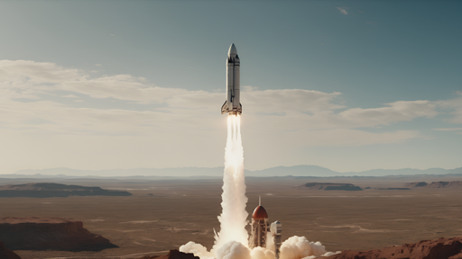
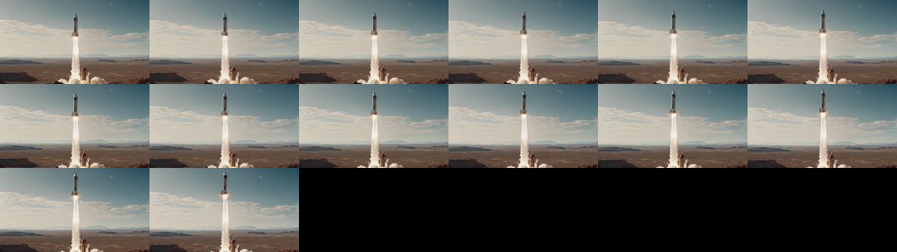

# Image-to-Video

Animating a still image: how image-conditioned video diffusion works, the mid-2026 model landscape, why video evaluation is still unsolved, and runnable code for the handful of open models that actually fit on a 12 GB card.

Author

Benedict Thekkel

## 1. What is Image-to-Video?

Image-to-Video (I2V) takes a **single still image** and produces a **short video clip whose first frame is (approximately) that image**. The model has to invent everything the photo does not contain: how the subject moves, how the camera moves, how light and occlusion evolve over time - while keeping the identity, layout and style of the source frame stable for every frame it emits.

**Input.** One RGB image (the conditioning / start frame), plus - on every model released after ~2024 - a **text prompt describing the motion**. Optional extras: an end frame, a target frame count, a frame rate, a motion-strength scalar, a camera trajectory.

**Output.** A tensor of shape `(T, H, W, 3)`, i.e. a list of PIL frames, typically **T = 14 to 121** frames at 8-24 fps. That is **1 to 5 seconds**. Nothing open generates a minute-long shot in one pass; long videos are stitched from chunks, each conditioned on the tail of the last.

The task splits into sub-tasks that people casually lump together but that need different models:

| Sub-task | What you give it | What it does | Typical model |
|----|----|----|----|
| Image animation | image only | bring a still to life, motion is the model’s guess | Stable Video Diffusion (no text input at all) |
| Image + text conditioned generation | image + motion prompt | the dominant modern interface: you direct the motion in words | Wan 2.2 I2V, LTX-Video, CogVideoX-I2V |
| Keyframing / interpolation | first + last frame | generate the in-between (FLF2V) | Wan 2.1 FLF2V, LTX `LTXConditionPipeline`, FramePack |
| Camera-motion control | image + camera trajectory | orbit / dolly / pan on command | SVD `motion_bucket_id` (crude), MotionCtrl, CameraCtrl, Wan camera LoRAs |
| Character / portrait animation | portrait + driving video or audio | reenact a face or body | LivePortrait, AnimateAnyone, Wan 2.2 Animate |

**Neighbouring tasks:**

| Task | What it does | See |
|----|----|----|
| Text-to-video | no image; the model invents the scene too | `10_Text_to_Video` |
| Video-to-video | restyle / edit an existing clip | `18_Video_to_Video` |
| Text-to-image | the 2-D generative ancestor; every video model is built on one | `04_Text_to_Image` |
| Image-to-image | single-frame editing, no time axis | `06_Image_to_Image` |
| Image-to-3D | the *other* way to make a still move (render an orbit) | `15_Image_to_3D` |
| Video classification | the discriminative counterpart on video | `09_Video_Classification` |

If you have not read `04_Text_to_Image`, read it first: latent diffusion, the VAE, classifier-free guidance and flow matching are assumed here, and everything below is that machinery with a time axis bolted on.

------------------------------------------------------------------------

## 2. Real-World Use Cases

| Use case | Domain | Consumes / produces | Dominant constraint |
|----|----|----|----|
| Ad and social creative | Marketing (Meta Advantage+, Canva, Adobe Firefly Video) | Product photo + brand prompt -\> 3-8 s looping clip | Brand-safe identity: the product must not morph. Cost per clip at volume |
| Photo animation in consumer apps | Consumer (Google Photos “Photo to video”, Kling, Pika, Luma) | User’s own photo -\> 5 s clip | Latency and unit cost on a free tier; must not deform faces |
| Pre-visualisation and storyboards | Film, VFX (Runway Gen-4, Luma Dream Machine) | Concept art frame -\> moving shot | Director control (camera, shot length), *not* raw quality |
| Game and virtual-world assets | Games | Sprite/scene still -\> animated loop | Loopability, style consistency, on-prem generation |
| E-commerce product video | Retail | Catalogue still -\> turntable / lifestyle clip | Physical plausibility (a shoe must not grow a lace); throughput |
| Talking-head and avatar video | Corporate L&D, dubbing (HeyGen, Synthesia) | Portrait + audio -\> lip-synced speaker | Lip-sync accuracy, identity lock, real-time-ish latency |
| Historical / archival animation | Media, genealogy (MyHeritage Deep Nostalgia) | Old photo -\> subtle head motion | Restraint: minimal motion, zero hallucinated detail |
| World models and robot policy rollout | Robotics / AV research (NVIDIA Cosmos) | Camera frame + action -\> predicted future frames | Physical accuracy over aesthetics; conditioning on actions |

**What the leaderboard number hides.** Almost none of the above is bottlenecked by “video quality” in the VBench sense. It is bottlenecked by **control** and **cost**.

*Control:* a marketing team does not want a beautiful 5-second clip, it wants *this product* to sit still while *this* light sweeps across it. Every open I2V model will happily mutate the logo on the box in frame 30. The industry answer is not a better base model, it is conditioning: keyframes, camera trajectories, LoRAs, ControlNets, and re-rolling until a shot survives review. Expect a **double-digit reject rate** and price the compute accordingly.

*Cost:* generation is **minutes of GPU time per clip**, not milliseconds. There is no streaming I2V: the model denoises the whole clip jointly, so latency scales with clip length and nothing appears until it is done. (Autoregressive / next-frame-prediction models like FramePack and SkyReels-V2 are the exception, and they trade quality for it.)

*Failure modes that actually matter:* **identity drift** (the face is someone else by frame 20), **temporal flicker** (texture boils), **the static-video cop-out** (the model, punished for inconsistency, learns to barely move - and scores brilliantly on consistency metrics), **physics violations** (objects pass through each other, water flows uphill, a cut fruit reassembles), and **text destruction** (any writing in the source image dissolves into glyph soup). Also legal: several of the best open weights are non-commercial or carry regional carve-outs, and training-set provenance is undisclosed for all of them.

------------------------------------------------------------------------

## 3. How Modern Image-to-Video Works

The whole field is one problem in a trench coat: **temporal consistency**. A per-frame image model applied 25 times gives you 25 unrelated pictures. Everything below is an answer to “how do we make frame t+1 know about frame t” - and the answers got progressively more expensive.

**1. Inflated 2-D UNets with temporal layers (2022-2023).** Take a pretrained Stable Diffusion UNet, freeze the spatial weights, and insert **temporal attention / 1-D convolutions across the frame axis** after each spatial block. Video Diffusion Models, Align-Your-Latents, and **AnimateDiff** (2023) work this way - AnimateDiff’s “motion module” is a plug-in trained on video that any SD 1.5 checkpoint can borrow, which is why it is still the cheapest way to get motion out of a stylised model. **Stable Video Diffusion** (Nov 2023) is the industrial version: the same inflation, trained properly on a curated video corpus (LVD), conditioned on a CLIP *image* embedding plus the VAE-encoded start frame concatenated to the noisy latent. *Trade-off:* cheap and fast, but the spatial backbone never learned time. Motion is small, drifts, and the clip is short (14-25 frames). Because the latent VAE compresses **space only** (8x8), the latent sequence is as long as the video, so memory grows linearly with frames.

**2. 3-D causal VAEs (2024).** Compress **time as well as space**. CogVideoX’s 3-D causal VAE does 4x8x8 (TxHxW); Wan 2.2’s does 4x16x16 for a 64x total compression. This is the single most important memory lever in the field: it is what lets a 49-frame clip cost the DiT the same as ~13 latent frames. “Causal” matters because it lets the first frame be encoded independently, which is exactly what you need to inject an I2V conditioning image without leaking the future. *Trade-off:* the VAE is now a big model in its own right, and decoding is a memory spike - hence `vae.enable_tiling()` / `enable_slicing()` in every snippet below.

**3. Spatio-temporal DiT with 3-D full attention + flow matching (2024-2026, current).** Drop the UNet. Patchify the video latent into a **flat sequence of T x H x W tokens** and run a transformer with **full attention over all of them** (no factorised space-then-time attention: joint 3-D attention is what fixed large-motion coherence). Train with **flow matching / rectified flow** rather than DDPM noise prediction. This is Sora, CogVideoX (an “expert” DiT with modality-specific AdaLN), Wan 2.x, HunyuanVideo, LTX-Video, Veo. *Trade-off:* **attention is quadratic in T x H x W.** A 5 s 720p clip is tens of thousands of tokens, so cost explodes with resolution *and* length. This is the entire reason a 3060 cannot run the good models. The 2026 counter-attacks are all attention-sparsification (HunyuanVideo-1.5’s selective/sliding tile attention), higher VAE compression (Wan 2.2’s 64x), step distillation (LTX distilled variants run in 4-8 steps), and MoE (Wan 2.2 A14B: 27B total, 14B active, split into a high-noise “layout” expert and a low-noise “detail” expert).

**How the image actually conditions the model (the I2V-specific bit).** Two mechanisms, usually together: - **Latent concatenation.** VAE-encode the source image, tile/pad it along the time axis, and concatenate it channel-wise to the noisy latent (SVD, CogVideoX-I2V, Wan I2V). The UNet/DiT sees “here is frame 0, in latent space” at every denoising step. Some models add a binary mask channel marking which frames are given. - **Semantic image embedding.** Encode the image with CLIP/SigLIP and feed it through cross-attention where the text embedding would go (SVD replaces the text encoder with a CLIP image encoder entirely - which is why **SVD takes no prompt**, and why you cannot tell it what to do). Keyframing (FLF2V) is the same trick with a condition pinned at frame 0 *and* at frame T-1.

**Cheat sheet:**

| Generation | Time modelling | Params (open) | Frames | Speed | Motion quality | Fits 12 GB? |
|----|----|----|----|----|----|----|
| Inflated SD UNet + motion module (AnimateDiff) | temporal attention on a frozen 2-D backbone | ~1.3B total | 16 | seconds | small, loopy | yes, easily |
| Image-conditioned UNet (SVD / SVD-XT) | temporal layers, CLIP-image conditioning, no text | 1.5B | 14 / 25 | minutes | decent camera motion, no direction | yes (fp16 + offload) |
| DiT + 3-D VAE (CogVideoX-5b-I2V) | 3-D full attention, 4x8x8 VAE | 5B (+4.7B T5) | 49 | many minutes | good | only with 4-bit + offload |
| Fast DiT (LTX-Video 2B) | 3-D attention, 1:192 VAE, flow matching | 2B (+4.7B T5) | 121+ | ~1 min | fair; the speed/quality trade is explicit | yes (4-bit) |
| Frontier DiT (Wan 2.2 I2V-A14B, HunyuanVideo, LTX-2) | 3-D full attention, MoE, distillation | 8-27B | 81-121 | many minutes on a 24-80 GB card | best open | **no** |

Who leads right now (mid-2026): **Wan 2.2 I2V-A14B** for open-weights quality, **LTX-2 / LTX-2.3** for open-weights speed-and-audio, **HunyuanVideo-1.5** for quality-per-parameter. All three need more than 12 GB. On this box the realistic ceiling is LTX-Video 2B and CogVideoX-5b-I2V in 4-bit.

------------------------------------------------------------------------

## 4. Evaluation Metrics

Video generation evaluation is **not solved**. There is no WER, no mAP. The honest summary: the numbers are weakly correlated with what a human calls a good clip, and every one of them is gameable.

**Frechet Video Distance (FVD)** - the FID of video. Embed real and generated clips with a pretrained action-recognition network (I3D on Kinetics-400) and compare the two Gaussians fitted to the features:

$$FVD = \lVert \mu_r - \mu_g \rVert_2^2 + \mathrm{Tr}\!\left(\Sigma_r + \Sigma_g - 2(\Sigma_r \Sigma_g)^{1/2}\right)$$

*Caveats, and they are severe:* FVD is sensitive to sample count, clip length, resolution, the exact I3D checkpoint and the resize/crop pipeline, so **numbers are not comparable across papers**. It is dominated by per-frame appearance (a model that produces beautiful still frames with terrible motion scores well), and it says nothing about whether the video obeys the conditioning image or the prompt.

**VBench / VBench-2.0** - the de facto standard multi-dimensional benchmark. VBench scores 16 dimensions including *subject consistency*, *background consistency*, *temporal flickering*, *motion smoothness*, *dynamic degree*, *aesthetic quality*, *imaging quality*, and an I2V suite that adds **I2V subject/background consistency** (does the output still look like the source image?) and **camera motion control**. VBench-2.0 (2025) goes after “intrinsic faithfulness” with 18 dimensions across Human Fidelity, Controllability, Creativity, **Physics** and Commonsense - mechanics, thermotics, multi-view consistency, motion order.

**The perverse incentive you must internalise:** *a completely static video scores near-perfect on subject consistency, background consistency, temporal flickering and motion smoothness, and 0 on dynamic degree.* Any consistency metric read on its own rewards a model for doing nothing. VBench exists as a *vector* for exactly this reason, and a single-number “VBench score” that averages the dimensions is close to meaningless. Read consistency **against** dynamic degree, always.

**Practical proxies you can compute yourself (used below):** - **Temporal consistency**: mean cosine similarity between CLIP (or DINO) embeddings of adjacent frames. $$C = \frac{1}{T-1}\sum_{t=1}^{T-1} \frac{f(x_t)\cdot f(x_{t+1})}{\lVert f(x_t)\rVert\,\lVert f(x_{t+1})\rVert}$$ - **Dynamic degree** (the counterweight): mean absolute pixel change between adjacent frames, or the mean magnitude of RAFT optical flow. - **Warping error**: estimate optical flow $t \to t+1$, warp frame $t$ forward, and measure L1 against the real frame $t+1$. Penalises flicker without penalising honest motion - the best cheap proxy there is. - **I2V fidelity**: CLIP/DINO similarity between the **source image** and the generated first frame. If this is low, the model ignored your image. - **CLIPSIM**: CLIP text-image similarity averaged over frames, for prompt adherence.

**Human preference is still the gold standard.** The [Artificial Analysis Video Arena](https://artificialanalysis.ai/video/leaderboard/image-to-video) runs blind pairwise votes and publishes an Elo for image-to-video specifically. It disagrees with VBench often enough to be worth checking.

**Speed metrics that matter more than any of the above on this hardware:** seconds of wall clock per second of generated video, peak VRAM, and frames per generation. Report all three.

The cell below builds two synthetic clips - a moving square and a frozen frame - and shows the blind spot directly.

------------------------------------------------------------------------

``` python
# Self-contained: this runs before the Setup cell, so it defines its own paths/device.
# The `frame_consistency` helper defined here is reused in the benchmark (section 12).
from pathlib import Path

import numpy as np
import torch
from PIL import Image, ImageDraw
from transformers import CLIPModel, CLIPProcessor

_HF_CACHE = str(Path("../../datasets") / "hf_cache")
_CLIP = {}


def _clip():
    "Lazily load CLIP ViT-B/32 (~150M params, ~0.3 GB fp32 - small enough to keep resident)."
    if not _CLIP:
        dev = "cuda:0" if torch.cuda.is_available() else "cpu"
        _CLIP["device"] = dev
        _CLIP["proc"] = CLIPProcessor.from_pretrained(
            "openai/clip-vit-base-patch32", cache_dir=_HF_CACHE
        )
        _CLIP["model"] = (
            CLIPModel.from_pretrained("openai/clip-vit-base-patch32", cache_dir=_HF_CACHE)
            .to(dev)
            .eval()
        )
    return _CLIP


def frame_consistency(frames):
    "Cosine similarity between CLIP embeddings of adjacent frames. Returns an array of length T-1."
    c = _clip()
    with torch.inference_mode():
        inputs = c["proc"](images=list(frames), return_tensors="pt").to(c["device"])
        emb = c["model"].get_image_features(**inputs).pooler_output
        emb = torch.nn.functional.normalize(emb.float(), dim=-1)
        sims = (emb[:-1] * emb[1:]).sum(-1)
    return sims.cpu().numpy()  # off-GPU before anything is freed


def dynamic_degree(frames):
    "Mean absolute pixel change between adjacent frames (0-1). The counterweight to consistency."
    arr = np.stack([np.asarray(f.convert("RGB"), dtype=np.float32) / 255.0 for f in frames])
    return float(np.abs(arr[1:] - arr[:-1]).mean())


def moving_square(n=16, size=224):
    "A white square translating across a black canvas - honest motion."
    out = []
    for t in range(n):
        img = Image.new("RGB", (size, size), "black")
        x = 20 + int(t * (size - 90) / (n - 1))
        ImageDraw.Draw(img).rectangle([x, 90, x + 50, 140], fill="white")
        out.append(img)
    return out


moving = moving_square()
static = [moving[0]] * 16  # the degenerate "video" that games every consistency metric

c_moving, c_static = frame_consistency(moving), frame_consistency(static)
print(f"moving square : consistency {c_moving.mean():.4f}   dynamic degree {dynamic_degree(moving):.4f}")
print(f"static clip   : consistency {c_static.mean():.4f}   dynamic degree {dynamic_degree(static):.4f}")
print("\nThe static clip scores a PERFECT 1.0 on temporal consistency and 0.0 on motion.")
print("Read either number alone and the do-nothing model wins.")
```

    Warning: You are sending unauthenticated requests to the HF Hub. Please set a HF_TOKEN to enable higher rate limits and faster downloads.

    moving square : consistency 0.9951   dynamic degree 0.0182
    static clip   : consistency 1.0000   dynamic degree 0.0000

    The static clip scores a PERFECT 1.0 on temporal consistency and 0.0 on motion.
    Read either number alone and the do-nothing model wins.

``` python
from pyecharts.globals import CurrentConfig

# assets.pyecharts.org serves an expired TLS certificate from most nodes (2026-11-11),
# so charts failed to load. jsDelivr mirrors the same assets, pinned to one commit.
CurrentConfig.ONLINE_HOST = "https://cdn.jsdelivr.net/gh/pyecharts/pyecharts-assets@f2328d558550046fc5449672a6850e848e141590/assets/v6/"

from pyecharts import options as opts
from pyecharts.charts import Line

line = (
    Line()
    .add_xaxis([f"{t}->{t + 1}" for t in range(len(c_moving))])
    .add_yaxis("moving square", [round(float(x), 4) for x in c_moving], is_smooth=True)
    .add_yaxis("static clip", [round(float(x), 4) for x in c_static], is_smooth=True)
    .set_global_opts(
        title_opts=opts.TitleOpts(
            title="Frame-to-frame CLIP consistency",
            subtitle="a video that does nothing is 'perfectly consistent'",
        ),
        xaxis_opts=opts.AxisOpts(name="frame pair"),
        yaxis_opts=opts.AxisOpts(name="cosine similarity", min_=0.6, max_=1.02),
        tooltip_opts=opts.TooltipOpts(trigger="axis"),
    )
)
line.render_notebook()
```

## 5. Datasets

Nobody trains a video model on this box, but knowing the corpora tells you what the models saw - and what they never saw (your product, your logo, your face).

| Dataset | Contents | Size | Scope | License | Typical use |
|----|----|----|----|----|----|
| WebVid-10M | stock-footage clips + alt-text captions | 10M clips | web stock video, watermarked | **taken down** (2024, rights dispute) | historical; every 2023 model trained on it, and its Shutterstock watermark still ghosts through some outputs |
| [Panda-70M](https://huggingface.co/datasets/snap-research/Panda-70M) | YouTube clips, auto-captioned by a multimodal teacher | 70M clips / ~167k hours | open-domain | non-commercial research only | pretraining |
| HD-VILA-100M | high-res YouTube, 15 categories | 100M clips | open-domain, 720p | research | pretraining |
| [InternVid](https://huggingface.co/datasets/OpenGVLab/InternVid) | 7M videos -\> 234M clips, generated captions | 234M clips / ~760k hours | open-domain | Apache-2.0 (annotations) | pretraining, video-text alignment |
| [OpenVid-1M](https://huggingface.co/datasets/nkp37/OpenVid-1M) | curated high-aesthetic clips + captions | 1M clips (433k at 1080p) | open-domain | CC-BY-4.0, research/non-commercial | the practical academic training set |
| [Koala-36M](https://huggingface.co/datasets/Koala-36M/Koala-36M-v1) | fine-grained conditioning, accurate temporal splitting | 36M clips | open-domain | open weights, see card | pretraining with better caption/segmentation quality |
| [UCF-101](https://www.crcv.ucf.edu/data/UCF101.php) / Kinetics-400 | action-recognition video | 13k / 650k clips | 101 / 400 action classes | research | the **FVD** reference distributions |
| [VBench prompt suite](https://github.com/Vchitect/VBench) | prompts + an I2V image suite, per-dimension | ~1.7k prompts | eval only | Apache-2.0 | the standard multi-dimensional eval |
| [MSR-VTT](https://huggingface.co/datasets/AlanRobotics/msr-vtt) | video + 20 captions each | 10k clips | open-domain | research | CLIPSIM / retrieval eval |

**What this notebook uses.** None of them. I2V needs *one image* per generation, not a corpus - so the runnable cells condition on a single well-known sample image (the SVD rocket) and evaluate with the no-reference proxies from section 4. That is the honest scope of a smoke test on a 12 GB card; a real evaluation means running the VBench-I2V suite over hundreds of prompts on a much larger machine.

**Gating.** Panda-70M and HD-VILA are download-a-list-of-YouTube-IDs datasets (link rot is real, and re-hosting is a licensing problem). WebVid is simply gone. This is not incidental: **no open video model publishes a reproducible training set**, so “open weights” here never means “open model”.

------------------------------------------------------------------------

## 6. The Model Landscape (mid-2026)

Leaderboards: [Artificial Analysis Video Arena - Image to Video](https://artificialanalysis.ai/video/leaderboard/image-to-video) (blind human Elo, the one that matters) and the [VBench leaderboard](https://huggingface.co/spaces/Vchitect/VBench_Leaderboard) (per-dimension, open models).

| Model | Params | License | Conditioning | Architecture | Best for | 12 GB? |
|----|----|----|----|----|----|----|
| [SVD / SVD-XT](https://huggingface.co/stabilityai/stable-video-diffusion-img2vid-xt) | 1.5B UNet | SVD Community (commercial needs a Stability license) | **image only** | inflated 2-D UNet + temporal layers | the baseline; camera-ish motion from a photo, no prompt | **yes** |
| [AnimateDiff](https://huggingface.co/guoyww/animatediff-motion-adapter-v1-5-3) + SD 1.5 | ~1.3B (motion module ~450M) | Apache-2.0 | text (+ image via SparseCtrl RGB) | motion module on a frozen SD UNet | fast, stylised, LoRA-friendly loops | **yes** |
| [LTX-Video 2B](https://huggingface.co/Lightricks/LTX-Video) | 2B (+4.7B T5) | LTX-Video Open Weights License | image + text | DiT, flow matching, 1:192 video VAE | speed on consumer hardware | **yes** (4-bit) |
| [LTX-Video 13B (0.9.8)](https://huggingface.co/Lightricks/LTX-Video) | 13B | LTXV Open Weights | image + text | same, scaled + distilled | quality at LTX speed | no |
| [CogVideoX-5b-I2V](https://huggingface.co/THUDM/CogVideoX-5b-I2V) | 5B (+4.7B T5) | CogVideoX License (custom) | image + text | expert DiT + 3-D causal VAE (4x8x8) | 49 frames, 720x480, solid motion | marginal (4-bit + offload, slow) |
| [Wan 2.1 I2V-14B](https://huggingface.co/Wan-AI/Wan2.1-I2V-14B-480P-Diffusers) | 14B (+UMT5) | Apache-2.0 | image + text | DiT + Wan-VAE | the 2025 open workhorse | no |
| [Wan 2.2 I2V-A14B](https://huggingface.co/Wan-AI/Wan2.2-I2V-A14B-Diffusers) | 27B total / 14B active (MoE) | Apache-2.0 | image + text | MoE DiT: high-noise + low-noise experts | **best open-weights I2V quality** | no |
| [Wan 2.2 TI2V-5B](https://huggingface.co/Wan-AI/Wan2.2-TI2V-5B-Diffusers) | 5B | Apache-2.0 | text and/or image (unified) | dense DiT + 64x-compression VAE | 720p@24fps in one model; card says **24 GB** | no |
| [Wan 2.2 Animate-14B](https://huggingface.co/Wan-AI/Wan2.2-Animate-14B-Diffusers) | 14B | Apache-2.0 | image + driving video | character animation / replacement | portrait + body reenactment | no |
| [HunyuanVideo-I2V](https://huggingface.co/tencent/HunyuanVideo-I2V) | 13B | Tencent Community (regional carve-outs: not EU/UK/KR) | image + text | full-attention DiT + 3-D VAE | quality reference | no |
| [HunyuanVideo-1.5](https://huggingface.co/tencent/HunyuanVideo-1.5) | 8.3B | Tencent Community | image + text | DiT with selective/sliding tile attention | best quality-per-param; “consumer GPU” means ~14 GB+ | no |
| [FramePack](https://huggingface.co/lllyasviel/FramePackI2V_HY) | 13B (HunyuanVideo base) | Apache-2.0 (code) | image + text | next-frame prediction, **fixed** context length | long clips (60 s) at low **VRAM** | see below |
| [SkyReels-V2](https://huggingface.co/Skywork) | 1.3B / 14B | open weights, see card | image + text | diffusion forcing, autoregressive | “infinite”-length video | 1.3B yes |
| [Stable Video 4D](https://huggingface.co/stabilityai/sv4d) | ~1.5B | SVD Community | image / video | multi-view + time | novel-view video (4D) | yes |
| [LTX-2 / LTX-2.3](https://huggingface.co/Lightricks/LTX-2) | large | LTX-2 Open Weights | image + text | DiT with **synchronised audio**, up to 4K | frontier open weights (Jan 2026) | no |

**Closed frontier, for calibration.** Google **Veo 3.x** / Gemini Omni Flash and ByteDance **Seedance 2.0** top the Artificial Analysis I2V arena (Elo ~1200 as of mid-2026), with xAI’s grok-imagine, Alibaba’s HappyHorse/Wan 2.7, Kling, PixVerse, Runway Gen-4 and Luma close behind. The best open model sits roughly 200-250 Elo below the top of that board. A cautionary note on building on closed video APIs: **OpenAI discontinued Sora on 2026-03-24** (app off 2026-04-26, API off 2026-09-24) after reportedly burning ~\$1M/day - the flagship of the field in late 2025 no longer exists.

**Who wins what.** Quality: Wan 2.2 I2V-A14B (open) / Veo 3.x, Seedance 2.0 (closed). Speed: LTX-Video, by a wide margin - a 5 s clip in under 30 s on a 4090, 4-8x faster than Wan or Hunyuan. Size: AnimateDiff and SVD are the only things that load without ceremony. Tie this back to section 2: ad creative wants *control* (Wan + LoRAs), consumer photo animation wants *unit cost* (LTX or a distilled model), archival animation wants *restraint* (SVD at a low `motion_bucket_id` is genuinely the right tool).

**The 12 GB reality check, stated bluntly.** Two separate 12 GB budgets, VRAM *and* system RAM, and the second one is the one that ambushes people: - `enable_model_cpu_offload()` does not make a model small - it **moves the weights into system RAM** and streams them to the GPU. Total RAM needed is the sum of *all* pipeline components. HunyuanVideo/FramePack’s 13B transformer is ~26 GB in bf16: it does not fit in this box’s RAM, so the famous “runs in 6 GB of VRAM” claim is irrelevant here. - **The text encoder is usually the problem, not the video model.** LTX-Video’s transformer is 2B (~4 GB bf16) but it ships with **T5-XXL, 4.7B (~9.4 GB bf16)**. CogVideoX-5b is 5B + the same T5. On a 12 GB card the text encoder alone nearly fills the GPU. - The fix that actually works here is **4-bit NF4 quantization (bitsandbytes) of the transformer *and* the text encoder**, plus model CPU offload and VAE tiling/slicing. That takes LTX-2B to ~3.5 GB and CogVideoX-5b-I2V to ~5.5 GB of weights, which is why both appear as runnable cells below. - Anything at or above ~8B params is table-only. Do not try Wan 2.2 A14B here.

------------------------------------------------------------------------

## 7. Setup

`diffusers` is the general-purpose Hugging Face library for generative image/video, and it is the right tool here (it uses `transformers` for the text and image encoders internally). Package roles:

- `diffusers` (\>=0.35) + `torch` + `accelerate` - the video pipelines and CPU offloading
- `transformers` - the T5 / CLIP text and image encoders inside those pipelines, and CLIP for the metric
- `bitsandbytes` - 4-bit NF4 quantization; **mandatory** for LTX and CogVideoX on a 12 GB card
- `imageio` + `imageio-ffmpeg` - `export_to_video` / `export_to_gif`
- `sentencepiece`, `protobuf`, `ftfy` - T5 tokenizer dependencies
- `pyecharts`, `pandas` - the charts and the benchmark table
- `opencv-python` - webcam capture in the optional demo

**Read this before running anything.** These cells are *minutes*, not seconds, and the downloads are large:

| Section | Download | Rough wall clock on an RTX 3060 (12 GB) |
|----|----|----|
| SVD-XT | ~9 GB | **4-8 min** for 14 frames at 1024x576 |
| AnimateDiff + SparseCtrl | ~5 GB | ~1 min for 16 frames at 512x512 |
| LTX-Video 2B | **~28 GB** (fp32 weights on the Hub) | ~2-4 min for 57 frames at 704x480 |
| CogVideoX-5b-I2V | ~20 GB | **10-25 min** for 17 frames at 720x480 |

Those wall clocks are order-of-magnitude expectations, not measured numbers - the point is that a full pass of this notebook is a coffee-break, not an interactive session. Everything lands in `DL_tasks/datasets/` (gitignored); budget ~60 GB of disk.

------------------------------------------------------------------------

``` python
# Generative video runs through diffusers (the general-purpose HF library for
# image/video generation) - it loads its text/image encoders from transformers.
# %pip install -q torch diffusers transformers accelerate bitsandbytes peft
# %pip install -q imageio imageio-ffmpeg sentencepiece protobuf ftfy pyecharts pandas

# Optional extra for the webcam demo (section 14)
# %pip install -q opencv-python
```

``` python
import ctypes
import ctypes.util
import gc
import time
import urllib.request
from pathlib import Path

import torch
from dotenv import find_dotenv, load_dotenv

# Knowledge/.env sets HF_TOKEN - authenticated HF Hub requests get higher rate limits
load_dotenv(find_dotenv(usecwd=True))

device = "cuda:0" if torch.cuda.is_available() else "cpu"
dtype = torch.float16 if device != "cpu" else torch.float32
if device != "cpu":
    print(torch.cuda.get_device_name(0))
print("device:", device)

def vram(tag=""):
    "Report current GPU memory (allocated / reserved). No-op on CPU."
    if torch.cuda.is_available():
        alloc = torch.cuda.memory_allocated() / 1e9
        reserved = torch.cuda.memory_reserved() / 1e9
        print(f"VRAM {tag:20s} {alloc:5.2f} GB allocated / {reserved:5.2f} GB reserved")

def free_memory():
    "Collect garbage, empty the CUDA cache, and return freed CPU RAM to the OS."
    gc.collect()
    if torch.cuda.is_available():
        torch.cuda.empty_cache()
        torch.cuda.ipc_collect()
    # glibc keeps freed CPU allocations in its arenas instead of returning them
    # to the OS, so RSS compounds across model sections (cpu-offloaded weights
    # live in system RAM). malloc_trim(0) hands the freed arenas back. See
    # dl-visualization-and-memory.md - not optional on a 12 GB box.
    try:
        ctypes.CDLL(ctypes.util.find_library("c") or "libc.so.6").malloc_trim(0)
    except Exception:
        pass

def offload(pipe):
    "Pick the offload strategy for the VRAM actually free right now, not the card size."
    if device == "cpu":
        return pipe
    import torch.nn as nn
    # bitsandbytes-quantized weights are pinned to the GPU; enable_sequential_cpu_offload
    # first moves the whole pipeline to CPU and STALLS on them (a hang, not a catchable
    # error), so a quantized pipeline must use model-level offload - the recommended path.
    quantized = any(getattr(m, "is_quantized", False)
                    for m in pipe.components.values() if isinstance(m, nn.Module))
    free_gb = torch.cuda.mem_get_info()[0] / 1e9  # global free VRAM - counts other processes
    if free_gb < 8.0 and not quantized:
        # Another process is using the card (or it is small): layer-at-a-time keeps the
        # peak at ~1-2 GB for a real speed cost. Free the other GPU user if you can -
        # check nvidia-smi on the HOST; a container only sees its own processes.
        # Quantized (bitsandbytes) components cannot be dispatched per-layer, so fall
        # back to model-level offload if sequential raises.
        try:
            pipe.enable_sequential_cpu_offload(device=device)
            print(f"offload: sequential ({free_gb:.1f} GB VRAM free - GPU busy, expect slow steps)")
            return pipe
        except Exception as e:
            print(f"offload: sequential unsupported here ({type(e).__name__}) - using model-level")
    # Whole submodule on the GPU at a time - fast, peak ~= largest submodule (~5 GB).
    pipe.enable_model_cpu_offload(device=device)
    print(f"offload: {'quantized -> ' if quantized else ''}model-level ({free_gb:.1f} GB VRAM free)")
    return pipe


def vae_savers(pipe):
    "Enable whatever VAE memory-savers this pipeline supports (varies by model)."
    vae = getattr(pipe, "vae", None)
    for name in ("enable_slicing", "enable_tiling"):
        fn = getattr(vae, name, None)
        if fn is None:
            continue
        try:
            fn()
        except NotImplementedError:  # e.g. SVD's AutoencoderKLTemporalDecoder
            pass


# All downloads go to DL_tasks/datasets/ (gitignored)
DATA_DIR = Path("../../datasets")
DATA_DIR.mkdir(exist_ok=True)
HF_CACHE = str(DATA_DIR / "hf_cache")

# Download budget. Models over MAX_DOWNLOAD_GB stay OFF by default: a fp32 T5-XXL text
# encoder is 10-19 GB, and 4-bit quantization only shrinks RAM/VRAM, not the download.
# Flip RUN_HEAVY to fetch + run LTX-Video and CogVideoX (needs disk + time).
MAX_DOWNLOAD_GB = 8
RUN_HEAVY = False
```

    NVIDIA GeForce RTX 3060
    device: cuda:0

``` python
from diffusers.utils import export_to_gif, load_image
from IPython.display import Image as IPyImage
from IPython.display import display
from PIL import Image

# The canonical SVD demo image (1024x576) - the single source frame every model below animates.
SOURCE_PATH = DATA_DIR / "svd_rocket.png"
if not SOURCE_PATH.exists():
    urllib.request.urlretrieve(
        "https://huggingface.co/datasets/huggingface/documentation-images/resolve/main/diffusers/svd/rocket.png",
        SOURCE_PATH,
    )
SOURCE = load_image(str(SOURCE_PATH))

# Every text-conditioned model gets the SAME motion prompt, so the comparison is fair.
PROMPT = (
    "A rocket lifts off from the launch pad, thick white exhaust plumes billowing outward, "
    "the rocket rising steadily into a clear blue sky. Static camera, realistic footage."
)
NEGATIVE = "worst quality, inconsistent motion, blurry, jittery, distorted"


def reset_peak():
    "Zero the CUDA peak-memory counter before timing a pipeline."
    if torch.cuda.is_available():
        torch.cuda.reset_peak_memory_stats()


def peak_vram():
    "Peak VRAM (GB) allocated since the last reset_peak(). None on CPU."
    return torch.cuda.max_memory_allocated() / 1e9 if torch.cuda.is_available() else None


def contact_sheet(frames, cols=6, width=192):
    "Tile frames into a single PIL image so a clip is visible in the rendered docs."
    n = len(frames)
    rows = (n + cols - 1) // cols
    w = width
    h = int(width * frames[0].height / frames[0].width)
    sheet = Image.new("RGB", (cols * w, rows * h), "black")
    for i, f in enumerate(frames):
        sheet.paste(f.resize((w, h)), ((i % cols) * w, (i // cols) * h))
    return sheet


def show_clip(frames, name, fps=8):
    "Write a GIF into DATA_DIR, display it, and print the section-4 proxy metrics."
    path = DATA_DIR / f"{name}.gif"
    export_to_gif(frames, str(path), fps=fps)
    display(IPyImage(filename=str(path)))
    display(contact_sheet(frames))
    cons = frame_consistency(frames)
    print(f"{name}: {len(frames)} frames | consistency {cons.mean():.4f} | "
          f"dynamic degree {dynamic_degree(frames):.4f}")
    return cons


print(SOURCE.size)
display(SOURCE.resize((512, 288)))
```

    (1024, 576)



## 8. Stable Video Diffusion (SVD-XT)

The 2023 baseline and still the easiest thing to run: an inflated SD 2.1 UNet (1.5B) with temporal layers, conditioned on a **CLIP image embedding + the VAE-encoded start frame**. Checkpoints: `stabilityai/stable-video-diffusion-img2vid` (14 frames) and `stabilityai/stable-video-diffusion-img2vid-xt` (25 frames).

**Pick it when** you want plausible camera/parallax motion out of a photograph and you do not need to say what should happen. **Its defining limitation is that there is no text input at all** - the CLIP *image* encoder sits where the text encoder would be, so your only steering wheels are the micro-conditioning scalars:

- `motion_bucket_id` (default 127): how much motion. Low (~30-60) for archival photos and product stills; high (180+) for drama and artefacts.
- `noise_aug_strength` (default 0.02): noise added to the conditioning image. Higher = more motion, less resemblance to your image.
- `fps`: baked into the conditioning, not just the export.

Memory recipe: fp16 + `enable_model_cpu_offload()` + `unet.enable_forward_chunking()` + a small `decode_chunk_size` (the VAE decode of all frames at once is the spike; `decode_chunk_size=2` trades a little flicker for several GB). This is the one model here that needs no quantization. Expect **4-8 minutes** at 1024x576 - drop to `576x320` to roughly halve it.

------------------------------------------------------------------------

``` python
from diffusers import StableVideoDiffusionPipeline

svd = StableVideoDiffusionPipeline.from_pretrained(
    "stabilityai/stable-video-diffusion-img2vid-xt",
    torch_dtype=dtype,
    variant="fp16" if device != "cpu" else None,
    cache_dir=HF_CACHE,
)
if device != "cpu":
    offload(svd)      # weights live in RAM, stream to the GPU per submodule
    svd.unet.enable_forward_chunking()  # run the FFN in chunks instead of one huge batch
    vae_savers(svd)  # SVD temporal-decoder VAE supports neither; a no-op there
else:
    svd = svd.to("cpu")

image = SOURCE.resize((1024, 576))  # SVD-XT is trained at this resolution; it degrades off it
reset_peak()

t0 = time.perf_counter()
svd_frames = svd(
    image,                       # note: no prompt argument exists
    num_frames=14,               # 25 is the XT default; 14 halves the time and the VAE spike
    num_inference_steps=20,
    decode_chunk_size=2,         # the single biggest VRAM lever
    motion_bucket_id=127,
    noise_aug_strength=0.02,
    generator=torch.Generator(device="cpu").manual_seed(0),
).frames[0]
svd_secs, svd_peak = time.perf_counter() - t0, peak_vram()
print(f"{svd_secs:.0f}s")

svd_cons = show_clip(svd_frames, "svd_xt", fps=7)

del svd
free_memory()
vram("after SVD-XT")
```

    offload: model-level (11.7 GB VRAM free)

    There are modules in AutoencoderKLTemporalDecoder that should be kept in float32: []. Casting directly with `to()` can lead to inconsistent results; set `torch_dtype` in `from_pretrained()` instead to keep these modules in float32.
    There are modules in AutoencoderKLTemporalDecoder that should be kept in float32: []. Casting directly with `to()` can lead to inconsistent results; set `torch_dtype` in `from_pretrained()` instead to keep these modules in float32.

    There are modules in AutoencoderKLTemporalDecoder that should be kept in float32: []. Casting directly with `to()` can lead to inconsistent results; set `torch_dtype` in `from_pretrained()` instead to keep these modules in float32.

    121s

    <IPython.core.display.Image object>



    svd_xt: 14 frames | consistency 0.9957 | dynamic degree 0.0126
    VRAM after SVD-XT          0.61 GB allocated /  0.68 GB reserved

## 9. AnimateDiff + SparseCtrl (SD 1.5 motion module)

The cheap one, and architecturally the most instructive. AnimateDiff trains a **motion module** - temporal attention blocks inserted into a *frozen* SD 1.5 UNet - so any of the thousands of SD 1.5 community checkpoints instantly becomes a video model. Base AnimateDiff is text-to-video; **SparseCtrl** is the ControlNet that makes it image-conditioned: `guoyww/animatediff-sparsectrl-rgb` accepts your image as the condition for a chosen frame index (`controlnet_frame_indices=[0]` = “start here”).

**Pick it when** you want a stylised 16-frame loop in under a minute, or you need LoRA control over the look. Its weakness is inherited: the spatial backbone is SD 1.5, so it is 512x512, the motion is small and slightly loopy, and it cannot do real camera work. Total weights ~2.5 GB in fp16 - no offload, no quantization, it just fits.

------------------------------------------------------------------------

``` python
from diffusers import AnimateDiffSparseControlNetPipeline, DPMSolverMultistepScheduler
from diffusers.models import AutoencoderKL, MotionAdapter, SparseControlNetModel

base_id = "SG161222/Realistic_Vision_V5.1_noVAE"  # any SD 1.5 checkpoint works here

motion_adapter = MotionAdapter.from_pretrained(
    "guoyww/animatediff-motion-adapter-v1-5-3", torch_dtype=dtype, cache_dir=HF_CACHE
)
controlnet = SparseControlNetModel.from_pretrained(
    "guoyww/animatediff-sparsectrl-rgb", torch_dtype=dtype, cache_dir=HF_CACHE
)
vae = AutoencoderKL.from_pretrained(
    "stabilityai/sd-vae-ft-mse", torch_dtype=dtype, cache_dir=HF_CACHE
)
scheduler = DPMSolverMultistepScheduler.from_pretrained(
    base_id, subfolder="scheduler", beta_schedule="linear",
    algorithm_type="dpmsolver++", use_karras_sigmas=True, cache_dir=HF_CACHE,
)
ad = AnimateDiffSparseControlNetPipeline.from_pretrained(
    base_id, motion_adapter=motion_adapter, controlnet=controlnet, vae=vae,
    scheduler=scheduler, torch_dtype=dtype, cache_dir=HF_CACHE,
)
# Load the LoRA while the pipeline is still on CPU, then offload - loading LoRA
# onto accelerate-hooked (offloaded) modules is fragile, so order matters.
ad.load_lora_weights(
    "guoyww/animatediff-motion-lora-v1-5-3", adapter_name="motion_lora", cache_dir=HF_CACHE
)
offload(ad)      # adaptive: keep only the active submodule resident, not the whole pipeline
vae_savers(ad)   # per-frame VAE decode: the batch decode of all 16 frames is a ~2 GB spike

reset_peak()
t0 = time.perf_counter()
ad_frames = ad(
    prompt=PROMPT,
    negative_prompt=NEGATIVE,
    num_inference_steps=25,
    conditioning_frames=SOURCE.resize((512, 512)),  # SD 1.5 native resolution
    controlnet_frame_indices=[0],                   # pin our image to frame 0
    controlnet_conditioning_scale=1.0,
    generator=torch.Generator(device="cpu").manual_seed(0),
).frames[0]
ad_secs, ad_peak = time.perf_counter() - t0, peak_vram()
print(f"{ad_secs:.0f}s")

ad_cons = show_clip(ad_frames, "animatediff_sparsectrl", fps=8)

del ad, motion_adapter, controlnet, vae, scheduler
free_memory()
vram("after AnimateDiff")
```

    The config attributes {'addition_embed_type': None, 'addition_embed_type_num_heads': 64, 'addition_time_embed_dim': None, 'class_embed_type': None, 'encoder_hid_dim': None, 'encoder_hid_dim_type': None, 'num_class_embeds': None, 'projection_class_embeddings_input_dim': None} were passed to SparseControlNetModel, but are not expected and will be ignored. Please verify your config.json configuration file.

## 10. LTX-Video 2B (the fast DiT)

The first DiT video model designed for consumer hardware, and the one that changes how the task feels: a 2B transformer with flow matching and a **video VAE that compresses 1:192** (the decoder even performs the final denoising step). 121 frames at 704x480 in a couple of minutes on a 3060, versus tens of minutes for anything comparable. `LTXImageToVideoPipeline` takes an image **and** a prompt - the modern interface.

**Constraints from the model card:** resolution divisible by 32, `num_frames` divisible by 8 plus 1 (57, 121, 161…), and prompts want to be *long and cinematic* - LTX responds badly to two-word prompts.

**The memory story, honestly.** The transformer is only 2B, but the pipeline ships **T5-XXL (4.7B)** as its text encoder - the Hub weights are fp32, so the download is ~28 GB and a bf16 load wants ~13 GB of RAM before the GPU is even involved. On this box that is the whole budget. The fix is `PipelineQuantizationConfig` with **bitsandbytes NF4**: quantize the transformer *and* the text encoder to 4-bit, which brings the weights to ~3.5 GB total, quantizes shard-by-shard during load (so RAM never spikes), and still runs at bf16 compute. Add `enable_model_cpu_offload()` and `vae.enable_tiling()` on top.

The larger `Lightricks/LTX-Video-0.9.8-13B-distilled` and the 2026 `Lightricks/LTX-2` (open weights, synchronised audio, 4K) are the same architecture scaled up; both want 24 GB+.

------------------------------------------------------------------------

``` python
ltx_frames = ltx_secs = ltx_peak = ltx_cons = None
if not RUN_HEAVY:
    print("skipped LTX-Video: ~20 GB download (19 GB fp32 T5-XXL) > 8 GB cap; set RUN_HEAVY=True to run")
else:
    from diffusers import LTXImageToVideoPipeline
    from diffusers.quantizers import PipelineQuantizationConfig

    # 4-bit NF4 for BOTH the DiT and T5-XXL. Without this the text encoder alone (9.4 GB bf16)
    # does not leave room for the model on a 12 GB card. bitsandbytes is CUDA-only.
    quant = (
        PipelineQuantizationConfig(
            quant_backend="bitsandbytes_4bit",
            quant_kwargs={
                "load_in_4bit": True,
                "bnb_4bit_quant_type": "nf4",
                "bnb_4bit_compute_dtype": torch.bfloat16,
            },
            components_to_quantize=["transformer", "text_encoder"],
        )
        if device != "cpu"
        else None
    )

    ltx = LTXImageToVideoPipeline.from_pretrained(
        "Lightricks/LTX-Video",  # the diffusers folder of this repo is the 2B transformer
        quantization_config=quant,
        torch_dtype=torch.bfloat16 if device != "cpu" else torch.float32,
        cache_dir=HF_CACHE,
    )
    if device != "cpu":
        offload(ltx)
        vae_savers(ltx)

    reset_peak()
    t0 = time.perf_counter()
    ltx_frames = ltx(
        image=SOURCE,
        prompt=PROMPT,
        negative_prompt=NEGATIVE,
        width=704,          # must be divisible by 32
        height=480,
        num_frames=57,      # must be 8k + 1
        num_inference_steps=30,
        decode_timestep=0.03,     # timestep-aware VAE (0.9.1+)
        decode_noise_scale=0.025,
        guidance_scale=3.0,
        generator=torch.Generator(device="cpu").manual_seed(0),
    ).frames[0]
    ltx_secs, ltx_peak = time.perf_counter() - t0, peak_vram()
    print(f"{ltx_secs:.0f}s for {len(ltx_frames)} frames")

    ltx_cons = show_clip(ltx_frames, "ltx_video_2b", fps=24)

    del ltx
    free_memory()
    vram("after LTX-Video")
```

## 11. CogVideoX-5b-I2V (the 3-D VAE DiT - and the edge of this machine)

CogVideoX is where the modern recipe is easiest to see: a **3-D causal VAE** (4x8x8 compression, so 49 output frames become 13 latent frames) feeding an **expert DiT with 3-D full attention** and modality-specific AdaLN for text vs video tokens. `THUDM/CogVideoX-5b-I2V` conditions by concatenating the VAE-encoded start frame to the noisy latent. Fixed output: 49 frames at 720x480, 8 fps.

**Be clear-eyed about this cell.** 5B transformer + 4.7B T5 = ~20 GB of bf16 weights. Even 4-bit NF4 on both (~5.5 GB) plus model offload, VAE tiling and slicing leaves a 3060 doing full 3-D attention over ~17k tokens per step. Reference times: ~180 s on an A100, ~90 s on an H100 for the full 49 frames at 50 steps. On a 3060 that would be **half an hour or worse**, so the cell below cuts to **17 frames and 20 steps** and will still take roughly **10-25 minutes**. It is included because it is the largest model that runs here at all - not because it is a good idea on a deadline. Set `RUN_COGVIDEOX = False` to skip it.

`num_frames` must satisfy `(num_frames - 1) % 4 == 0` (the temporal compression ratio) and cannot exceed 49.

------------------------------------------------------------------------

``` python
RUN_COGVIDEOX = RUN_HEAVY  # ~21 GB fp32-T5 download; gated by the RUN_HEAVY budget flag

cog_frames, cog_secs, cog_cons, cog_peak = None, None, None, None
if RUN_COGVIDEOX:
    from diffusers import CogVideoXImageToVideoPipeline

    cog_quant = (
        PipelineQuantizationConfig(
            quant_backend="bitsandbytes_4bit",
            quant_kwargs={
                "load_in_4bit": True,
                "bnb_4bit_quant_type": "nf4",
                "bnb_4bit_compute_dtype": torch.bfloat16,
            },
            components_to_quantize=["transformer", "text_encoder"],
        )
        if device != "cpu"
        else None
    )

    cog = CogVideoXImageToVideoPipeline.from_pretrained(
        "THUDM/CogVideoX-5b-I2V",
        quantization_config=cog_quant,
        torch_dtype=torch.bfloat16 if device != "cpu" else torch.float32,
        cache_dir=HF_CACHE,
    )
    if device != "cpu":
        offload(cog)
        vae_savers(cog)   # decoding the latent frames at once is the memory spike

    reset_peak()
    t0 = time.perf_counter()
    cog_frames = cog(
        image=SOURCE.resize((720, 480)),  # CogVideoX-5b-I2V is fixed at 720x480
        prompt=PROMPT,
        num_frames=17,          # (n - 1) % 4 == 0, max 49. 49 would be ~3x this cell's time
        num_inference_steps=20, # 50 is the recommended setting; 20 is a smoke test
        guidance_scale=6.0,
        generator=torch.Generator(device="cpu").manual_seed(0),
    ).frames[0]
    cog_secs, cog_peak = time.perf_counter() - t0, peak_vram()
    print(f"{cog_secs / 60:.1f} min for {len(cog_frames)} frames")

    cog_cons = show_clip(cog_frames, "cogvideox_5b_i2v", fps=8)

    del cog
    free_memory()
    vram("after CogVideoX")
```

## 12. Keyframing, Camera Control, and Portrait Animation

Three control surfaces that turn “animate my photo” into something a professional can direct. None of them get a runnable cell here - each needs either a second multi-GB checkpoint or a vendor runtime - but they are where the real work happens.

**Start + end frame (FLF2V / keyframing).** Pin a condition at frame 0 *and* at frame T-1 and let the model interpolate. This is the single most useful control primitive: it turns generation into in-betweening, and it is how people build multi-shot sequences (the last frame of shot N becomes the first frame of shot N+1). In diffusers:

``` python
# LTX: arbitrary conditions at arbitrary frame indices (0.9.5+ checkpoints)
from diffusers.pipelines.ltx.pipeline_ltx_condition import LTXConditionPipeline, LTXVideoCondition

pipe = LTXConditionPipeline.from_pretrained("Lightricks/LTX-Video-0.9.5", torch_dtype=torch.bfloat16)
video = pipe(
    conditions=[LTXVideoCondition(image=first, frame_index=0),
                LTXVideoCondition(image=last, frame_index=48)],
    prompt=prompt, width=704, height=480, num_frames=49,
).frames[0]

# Wan: a dedicated first-last-frame checkpoint (14B - table only on this box)
# WanImageToVideoPipeline.from_pretrained("Wan-AI/Wan2.1-FLF2V-14B-720P-diffusers")(
#     image=first, last_image=last, prompt=prompt)
```

FramePack (`HunyuanVideoFramepackPipeline`) does the same with **next-frame prediction and a fixed-length context**, which is what lets it generate 60-second clips at constant memory - a genuinely different bet from joint-denoising, and the one to watch.

**Camera motion.** SVD’s `motion_bucket_id` is the crude version: one scalar for “how much movement”, no direction. Real control comes from conditioning the model on a camera trajectory - **MotionCtrl** and **CameraCtrl** train adapters that take extrinsic matrices per frame, and Wan ships camera-motion LoRAs (orbit, dolly, pan, crane). The modern shortcut is simply to *say it in the prompt* (“the camera slowly dollies in”) - frontier models were captioned with camera language and obey it surprisingly well, which is another reason a text input is not optional.

**Character and portrait animation.** A different lineage: instead of inventing motion, **transfer** it from a driving video or an audio track. **LivePortrait** (implicit-keypoint warping, real-time on a CPU-class GPU) and **AnimateAnyone** (reference-net + pose guider) are the classics; both are vendor codebases, not diffusers pipelines. The 2026 diffusers-native option is `Wan-AI/Wan2.2-Animate-14B-Diffusers` (`WanAnimatePipeline`), which does holistic character replacement - and at 14B is well past this machine.

------------------------------------------------------------------------

## 13. Head-to-head Benchmark

Same source image, same prompt, same seed. Reported: wall clock, frames produced, seconds of compute per second of generated video, peak VRAM, and the section-4 proxies (**adjacent-frame CLIP consistency** and **dynamic degree**).

Read the two proxies **together**. A model can win the consistency column by producing a nearly static clip - so a high consistency with a near-zero dynamic degree is a *failure*, not a win. Neither number is a quality score; there is no reference video, so this cannot be FVD.

Hardware: RTX 3060, 12 GB VRAM, 4 vCPU, 12 GB RAM. Sample size: **one image, one prompt, one seed**. This is a smoke test that tells you what *runs* and what it *costs*, not which model is better. For that, run the VBench-I2V suite (hundreds of prompts, multiple seeds) on a machine with a real GPU budget, and then still look at the [human Elo](https://artificialanalysis.ai/video/leaderboard/image-to-video).

------------------------------------------------------------------------

``` python
import pandas as pd

def summarise(name, frames, secs, fps, peak_gb=None):
    "One row of the benchmark: cost + the two proxy metrics."
    cons = frame_consistency(frames)
    return {
        "model": name,
        "frames": len(frames),
        "seconds": round(float(secs), 1),
        "sec_per_video_sec": round(float(secs) / (len(frames) / fps), 1),
        "peak_vram_gb": round(float(peak_gb), 2) if peak_gb else None,
        "consistency": round(float(cons.mean()), 4),
        "dynamic_degree": round(dynamic_degree(frames), 4),
    }

# Each model above already ran once, freed itself, and left its frames + timing behind,
# so the table is assembled from those runs - we never hold two video models live at once.
rows = [
    summarise("SVD-XT (1.5B, image only)", svd_frames, svd_secs, fps=7, peak_gb=svd_peak),
    summarise("AnimateDiff+SparseCtrl (SD1.5)", ad_frames, ad_secs, fps=8, peak_gb=ad_peak),
]
if ltx_frames is not None:
    rows.append(summarise("LTX-Video 2B (nf4)", ltx_frames, ltx_secs, fps=24, peak_gb=ltx_peak))
if cog_frames is not None:
    rows.append(summarise("CogVideoX-5b-I2V (nf4)", cog_frames, cog_secs, fps=8, peak_gb=cog_peak))

df = pd.DataFrame(rows).sort_values("seconds")
vram("after benchmark")
df
```

``` python
from pyecharts.charts import Bar

names = df["model"].tolist()
bar = (
    Bar()
    .add_xaxis(names)
    .add_yaxis("wall clock (s)", [float(x) for x in df["seconds"]])
    .add_yaxis("s per second of video", [float(x) for x in df["sec_per_video_sec"]])
    .set_global_opts(
        title_opts=opts.TitleOpts(
            title="Image-to-Video: generation cost",
            subtitle="RTX 3060 12 GB, one image, one seed - a smoke test, not a leaderboard",
        ),
        xaxis_opts=opts.AxisOpts(name="model", axislabel_opts=opts.LabelOpts(rotate=20, font_size=9)),
        yaxis_opts=opts.AxisOpts(name="seconds"),
        tooltip_opts=opts.TooltipOpts(trigger="axis"),
        legend_opts=opts.LegendOpts(pos_top="8%"),
    )
)
bar.render_notebook()
```

``` python
from pyecharts.charts import Scatter

# The plot that matters: consistency is only meaningful against motion.
# Bottom-right = flickering mess. Top-left = a slideshow. Top-right = an actual video.
scatter = Scatter()
scatter.add_xaxis([round(float(d), 4) for d in df["dynamic_degree"]])
for name, cons, dyn in zip(df["model"], df["consistency"], df["dynamic_degree"]):
    scatter.add_yaxis(
        name,
        [[round(float(dyn), 4), round(float(cons), 4)]],
        symbol_size=18,
        label_opts=opts.LabelOpts(is_show=False),
    )
scatter.set_global_opts(
    title_opts=opts.TitleOpts(
        title="Temporal consistency vs dynamic degree",
        subtitle="a static clip sits at the top-left with consistency 1.0 - and is worthless",
    ),
    xaxis_opts=opts.AxisOpts(name="dynamic degree (motion)", type_="value"),
    yaxis_opts=opts.AxisOpts(name="adjacent-frame CLIP similarity", type_="value", min_=0.8, max_=1.01),
    tooltip_opts=opts.TooltipOpts(trigger="item"),
    legend_opts=opts.LegendOpts(pos_top="8%", type_="scroll"),
)
scatter.render_notebook()
```

## 14. Interactive: Animate Your Own Image

Grab a frame from a webcam (or drop any image at `datasets/my_image.jpg`) and animate it with the fastest pipeline here. Guarded so a headless server falls back to the sample image and keeps going.

Note what this demo makes obvious: the model happily invents motion for a face, and the identity survives about a second. That is the state of the art on 12 GB.

------------------------------------------------------------------------

``` python
# opencv-python-headless is a project dependency; the headless build captures from
# V4L2 fine, it only drops the GUI windows.
import io
import time

import cv2
import numpy as np
import torch
from IPython.display import Image as IPyImage
from IPython.display import Pretty, display
from PIL import Image, ImageDraw, ImageFont

CAM = 0              # /dev/video0
WARMUP = 10          # throwaway reads - auto-exposure and white balance need to settle
STREAM_SECONDS = 15  # how long a live demo runs; interrupt the kernel to stop early


def bootstrap(*names, notebook, sections):
    """Make this demo runnable on a cold kernel, without duplicating the notebook.

    The demo builds on the notebook's setup and helper cells. Instead of making you
    run them by hand - or copying them in here and letting the copies drift - this
    reads the notebook file and executes those sections itself, and only when a name
    is actually missing. Run the notebook top to bottom and it does nothing at all.
    It stops as soon as every required name exists, so trailing benchmark cells in a
    section are not run.
    """
    if all(n in globals() for n in names):
        return
    import json
    from pathlib import Path

    from IPython.utils.capture import capture_output

    path = Path(notebook)
    if not path.exists():
        raise NameError(
            f"this demo needs {', '.join(n for n in names if n not in globals())}, and cannot "
            f"find {notebook} to bootstrap from (cwd is {Path.cwd()}, expected the notebook's "
            f"own directory). Run section(s) {'; '.join(sections)} by hand instead."
        )
    print(f"cold start: running {'; '.join(sections)} from {notebook} (output suppressed)")
    heading = None
    for cell in json.loads(path.read_text())["cells"]:
        src = "".join(cell["source"])
        if cell["cell_type"] == "markdown" and src.lstrip().startswith("## "):
            heading = src.lstrip().splitlines()[0][3:].strip()
            continue
        if cell["cell_type"] != "code" or not heading or "def bootstrap(" in src:
            continue
        if not any(heading.startswith(s) for s in sections):
            continue
        code = "".join("" if l.lstrip().startswith(("%", "!")) else l
                       for l in src.splitlines(keepends=True))
        # The setup cells print tables and display sample images. This demo only
        # wants the live stream, so swallow their output - errors still propagate.
        with capture_output():
            exec(compile(code, f"{notebook} [{heading}]", "exec"), globals())
        if all(n in globals() for n in names):
            break
    still = [n for n in names if n not in globals()]
    if still:
        raise NameError(f"bootstrapped {'; '.join(sections)} but {', '.join(still)} "
                        "are still undefined - the notebook layout may have changed.")


def open_camera(index=CAM, width=640, height=480, auto_exposure=True, exposure=150):
    "Open a V4L2 webcam in MJPEG mode, let it settle, and return the capture handle."
    cap = cv2.VideoCapture(index, cv2.CAP_V4L2)
    if not cap.isOpened():
        raise RuntimeError(
            f"/dev/video{index} did not open - no camera attached, "
            "or it is not passed through into this container"
        )
    cap.set(cv2.CAP_PROP_FOURCC, cv2.VideoWriter.fourcc(*"MJPG"))  # MJPEG unlocks the higher modes
    cap.set(cv2.CAP_PROP_FRAME_WIDTH, width)
    cap.set(cv2.CAP_PROP_FRAME_HEIGHT, height)
    # UVC exposure is DEVICE state and persists between processes: if anything left
    # this camera in manual mode, every frame comes back dark and never adapts
    # (measured here: mean 13/255 stuck, vs 109/255 on auto). So ask for the mode
    # explicitly instead of inheriting whatever the last program set.
    #   auto (3): correct brightness, but a dim room throttles the sensor to 15 FPS
    #   manual (1): locked 30 FPS, at whatever `exposure` level suits your lighting
    cap.set(cv2.CAP_PROP_AUTO_EXPOSURE, 3 if auto_exposure else 1)
    if not auto_exposure:
        cap.set(cv2.CAP_PROP_EXPOSURE, exposure)
    # Deliberately no CAP_PROP_BUFFERSIZE: on the V4L2 backend it HALVES the
    # delivered frame rate (measured here: 67 -> 134 ms per read) and does not make
    # frames any fresher.
    for _ in range(WARMUP):
        if not cap.read()[0]:
            cap.release()
            raise RuntimeError(f"/dev/video{index} opened but delivered no frames")
    return cap


def grab(cap):
    "Read one frame off an open camera as an RGB PIL image (OpenCV hands back BGR)."
    ok, frame = cap.read()
    if not ok:
        raise RuntimeError("failed to read a frame")
    return Image.fromarray(cv2.cvtColor(frame, cv2.COLOR_BGR2RGB))


def capture_frame(**kw):
    "Open the camera, grab one settled frame, and release the device."
    cap = open_camera(**kw)
    try:
        return grab(cap)
    finally:
        cap.release()


_FONT = ImageFont.load_default(size=15)


def draw_lines(img, lines, pad=6):
    "Burn a few lines of text into a band across the top of a copy of `img`."
    out = img.convert("RGB").copy()
    d = ImageDraw.Draw(out)
    d.rectangle([0, 0, out.width, 18 * len(lines) + 2 * pad], fill=(0, 0, 0))
    for i, line in enumerate(lines):
        d.text((pad, pad + 18 * i), line, fill=(255, 255, 255), font=_FONT)
    return out


def pair_view(left, right, gap=8):
    "Raw frame and annotated frame side by side on one canvas - the live view."
    right = right.convert("RGB")
    if right.size != left.size:
        right = right.resize(left.size)
    canvas = Image.new("RGB", (left.width * 2 + gap, left.height), (20, 20, 20))
    canvas.paste(left.convert("RGB"), (0, 0))
    canvas.paste(right, (left.width + gap, 0))
    return canvas


def _jpeg(img, quality=80):
    "Encode a PIL image to JPEG bytes - what actually goes over the wire each frame."
    buf = io.BytesIO()
    img.convert("RGB").save(buf, format="JPEG", quality=quality)
    return buf.getvalue()


def live_stream(annotate, seconds=STREAM_SECONDS, width=640, height=480):
    """Stream `raw | annotated` into the notebook output until `seconds` elapse.

    `annotate(rgb)` returns `(annotated_image, info_string)`. The image and the
    status line each own a display handle and update in place, so this needs no GUI
    and no `cv2.imshow` - it works over JupyterLab against a headless container.
    Interrupt the kernel (the stop button) to end early; the camera is still released.
    """
    cap = open_camera(width=width, height=height)
    view = status = None  # created from the FIRST real frame, so no placeholder flashes up
    n, t0 = 0, time.perf_counter()
    try:
        while time.perf_counter() - t0 < seconds:
            rgb = grab(cap)
            annotated, info = annotate(rgb)
            n += 1
            frame = IPyImage(data=_jpeg(pair_view(rgb, annotated)))
            line = Pretty(f"frame {n:4d}   {n / (time.perf_counter() - t0):5.1f} FPS   {info}")
            if view is None:
                view = display(frame, display_id=True)
                status = display(line, display_id=True)
            else:
                view.update(frame)
                status.update(line)
    except KeyboardInterrupt:
        if status is not None:
            status.update(Pretty(f"stopped at frame {n}"))
    finally:
        cap.release()  # always hand the device back
    elapsed = time.perf_counter() - t0
    print(f"{n} frames in {elapsed:.1f}s -> {n / max(elapsed, 1e-9):.1f} FPS end-to-end "
          "(camera + model + JPEG encode)")


def preview(seconds=5, width=640, height=480):
    "Stream the raw camera so you can frame the shot, then return the final frame."
    cap = open_camera(width=width, height=height)
    view = status = None  # created from the FIRST real frame, so no placeholder flashes up
    last, n, t0 = None, 0, time.perf_counter()
    try:
        while time.perf_counter() - t0 < seconds:
            last = grab(cap)
            n += 1
            frame = IPyImage(data=_jpeg(last))
            line = Pretty(f"framing - {seconds - (time.perf_counter() - t0):4.1f}s left, "
                          f"{n} frames (the last one is the one that gets used)")
            if view is None:
                view = display(frame, display_id=True)
                status = display(line, display_id=True)
            else:
                view.update(frame)
                status.update(line)
    except KeyboardInterrupt:
        pass
    finally:
        cap.release()
    if status is not None:
        status.update(Pretty(f"captured the last of {n} frames"))
    return last


from diffusers import (AnimateDiffSparseControlNetPipeline, MotionAdapter,
                       SparseControlNetModel)

# Everything below builds on the notebook's setup and helper cells.
bootstrap("dtype", "HF_CACHE", "DATA_DIR", "NEGATIVE", "load_image", "offload",
          "show_clip", "vae_savers", "free_memory", "vram",
          notebook="07_Image_to_Video.ipynb",
          sections=["4. Evaluation Metrics", "7. Setup"])


# Section 4 builds this CLIP-metric cache; an empty dict is the same starting
# point, so the demo needs only the Setup section.
_CLIP = globals().get("_CLIP", {})


custom = DATA_DIR / "my_image.jpg"

if custom.exists():
    source = load_image(str(custom))
    print(f"using {custom}")
else:
    # AnimateDiff takes about a minute per clip, so there is no live-stream version of
    # this one. What the camera is good for here is framing: the preview streams live
    # while you get into position, and the last frame it shows is the one that gets
    # animated. Drop a my_image.jpg into DATA_DIR to animate that instead.
    source = preview(seconds=6)

# AnimateDiff + SparseCtrl is the only pipeline here that loads and runs in about a minute.
demo = AnimateDiffSparseControlNetPipeline.from_pretrained(
    "SG161222/Realistic_Vision_V5.1_noVAE",
    motion_adapter=MotionAdapter.from_pretrained(
        "guoyww/animatediff-motion-adapter-v1-5-3", torch_dtype=dtype, cache_dir=HF_CACHE
    ),
    controlnet=SparseControlNetModel.from_pretrained(
        "guoyww/animatediff-sparsectrl-rgb", torch_dtype=dtype, cache_dir=HF_CACHE
    ),
    torch_dtype=dtype,
    cache_dir=HF_CACHE,
)
offload(demo)     # adaptive offload instead of full residency
vae_savers(demo)  # per-frame VAE decode

demo_frames = demo(
    prompt="gentle natural motion, subtle camera drift, cinematic lighting",
    negative_prompt=NEGATIVE,
    num_inference_steps=20,
    conditioning_frames=source.resize((512, 512)),
    controlnet_frame_indices=[0],
    controlnet_conditioning_scale=1.0,
    generator=torch.Generator(device="cpu").manual_seed(0),
).frames[0]
show_clip(demo_frames, "my_animation", fps=8)

# End of notebook: release the demo pipeline and the CLIP metric model.
del demo
_CLIP.clear()
free_memory()
vram("final")
```

## 15. Common Frameworks

Video generation is the most memory-constrained task in this folder, and its ecosystem is organised almost entirely around that fact. `diffusers` is the general-purpose library - there is no `transformers` pipeline for video generation at all - but a large share of the practical tooling exists to make a model fit: quantisation formats, offloading strategies, step distillation, and multi-GPU sequence parallelism. Expect to spend more time on memory than on prompts.

| Framework | Layer | What it gives you | License | Reach for it when |
|----|----|----|----|----|
| [diffusers](https://github.com/huggingface/diffusers) | modelling | SVD, AnimateDiff, LTX-Video, CogVideoX and Wan pipelines, plus `PipelineQuantizationConfig` and the offloading used above | Apache 2.0 | Default, and here it is the *only* general-purpose option |
| [finetrainers](https://github.com/a-r-r-o-w/finetrainers) / [diffusion-pipe](https://github.com/tdrussell/diffusion-pipe) | modelling | LoRA training for CogVideoX, LTX, Wan and Hunyuan on consumer cards - the trainers the community actually uses | Apache 2.0 | Identity or style drift across frames. 20-50 clips is enough for a look LoRA |
| Vendor repos: [Wan](https://github.com/Wan-Video/Wan2.1), [LivePortrait](https://github.com/KwaiVGI/LivePortrait), AnimateAnyone | modelling | Features that reach `diffusers` months later, or never: VACE control, audio conditioning, portrait animation | mixed (check each) | You need character animation or fine-grained control. Portrait animation in particular has no `diffusers` equivalent |
| [bitsandbytes](https://github.com/bitsandbytes-foundation/bitsandbytes) / [torchao](https://github.com/pytorch/ao) / GGUF | data | NF4 and int8 weights, fp8 layerwise casting, and the community quant format - what makes a 5B DiT load at all here | MIT / BSD-3 | Always on 12 GB. Section 11 does not run without it |
| [decord](https://github.com/dmlc/decord) / [PyAV](https://github.com/PyAV-Org/PyAV) / ffmpeg | data | Frame-accurate decode of the conditioning clip, and encoding the result to something a browser plays | Apache 2.0 / BSD-3 / LGPL | Always. Video I/O is a surprisingly large share of both wall clock and bugs |
| Step-distilled checkpoints (LTX `-distilled`, [AnimateLCM](https://huggingface.co/wangfuyun/AnimateLCM), Wan Lightning LoRAs) | inference runtime | 30-50 steps down to 4-8, which is a bigger win than any memory trick | Apache 2.0 (check each) | Always try this first. It changes the economics more than any other single choice |
| [xDiT](https://github.com/xdit-project/xDiT) / ParaAttention + `torch.compile` | inference runtime | Sequence-parallel multi-GPU inference, and 20-25% from compiling the transformer | Apache 2.0 / BSD-3 | You have more than one GPU, or you have squeezed everything else |
| [ComfyUI](https://github.com/comfyanonymous/ComfyUI) | orchestration | The de-facto serving and workflow layer for video: where fp8/GGUF community quants land first, and where chaining T2I into I2V is a graph rather than a script | GPL-3.0 | Almost any real workflow. Production “text-to-video” is usually image-then-animate, and that is a graph |
| [VBench](https://github.com/Vchitect/VBench) | evaluation | A runnable I2V suite: subject consistency, motion smoothness, temporal flicker, image-video alignment | Apache 2.0 | Before believing any comparison, including the one in section 13. Eyeballing four clips is not evaluation |

**The 2026 default stack** is `diffusers` with a distilled LTX or Wan checkpoint, NF4 or fp8 quantisation, group offloading, and ComfyUI for anything with more than one stage. Generate the first frame with a text-to-image model you can steer, then animate it - that is what most production pipelines actually are.

The common wrong turn is picking a model by parameter count. A 1.3B video model can ship a 20+ GB fp32 text encoder, and `load_in_4bit` quantises after the download, so the disk and bandwidth cost is unrelated to the VRAM cost. Check `repo_info(files_metadata=True)` before committing. The second is judging temporal quality from a single clip - flicker and identity drift are intermittent, which is exactly what VBench is for.

------------------------------------------------------------------------

## 16. Going Further

- **Fine-tuning.** LoRA is the practical route: `diffusers` has training scripts for [CogVideoX](https://github.com/huggingface/diffusers/tree/main/examples/cogvideo) and [LTX-Video](https://github.com/huggingface/diffusers/tree/main/examples), and [finetrainers](https://github.com/a-r-r-o-w/finetrainers) / [diffusion-pipe](https://github.com/tdrussell/diffusion-pipe) cover Wan and Hunyuan LoRAs on consumer cards. A subject/style LoRA on 20-50 clips is the standard fix for identity drift; full fine-tuning of a video DiT is a multi-GPU job.
- **Getting more out of 12 GB.** Beyond the NF4 recipe used above: `apply_group_offloading` (block- or leaf-level, with `use_stream=True`) beats `enable_model_cpu_offload` when even one submodule does not fit; `enable_layerwise_casting` stores weights in fp8 and computes in bf16; GGUF and torchao int8 are supported backends in `PipelineQuantizationConfig`; and step-distilled checkpoints (LTX `-distilled`, AnimateLCM, Wan Lightning LoRAs) cut 30-50 steps to 4-8, which is a bigger win than any memory trick.
- **Evaluate properly.** [VBench](https://github.com/Vchitect/VBench) ships an I2V suite and a runnable evaluation harness; use it before you believe any comparison, including the one above.
- **Related notebooks.** `10_Text_to_Video` (the text-conditioned sibling - same models, no image), `18_Video_to_Video` (editing an existing clip), `04_Text_to_Image` (the diffusion fundamentals this notebook assumes), `15_Image_to_3D` (the other way to make a still move).

**References**

- [Stable Video Diffusion (Blattmann et al., 2023)](https://arxiv.org/abs/2311.15127) and the [diffusers SVD guide](https://huggingface.co/docs/diffusers/main/en/api/pipelines/svd)
- [AnimateDiff (Guo et al., 2023)](https://arxiv.org/abs/2307.04725) and [SparseCtrl](https://arxiv.org/abs/2311.16933)
- [CogVideoX (Yang et al., 2024)](https://arxiv.org/abs/2408.06072)
- [LTX-Video (HaCohen et al., 2024)](https://arxiv.org/abs/2501.00103) and the [LTX-Video repo](https://github.com/Lightricks/LTX-Video)
- [Wan: Open and Advanced Large-Scale Video Generative Models](https://arxiv.org/abs/2503.20314) and [Wan2.2 on GitHub](https://github.com/Wan-Video/Wan2.2)
- [FramePack: Packing Input Frame Context in Next-Frame Prediction Models](https://arxiv.org/abs/2504.12626)
- [VBench (CVPR 2024)](https://arxiv.org/abs/2311.17982) and [VBench-2.0](https://arxiv.org/abs/2503.21755)
- [Artificial Analysis Video Arena - Image to Video leaderboard](https://artificialanalysis.ai/video/leaderboard/image-to-video)
- [diffusers: reduce memory usage](https://huggingface.co/docs/diffusers/main/en/optimization/memory) and [pipeline-level quantization](https://huggingface.co/docs/diffusers/main/en/quantization/overview)

------------------------------------------------------------------------

Back to top
