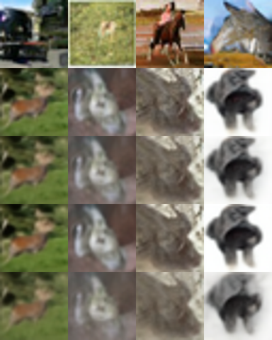
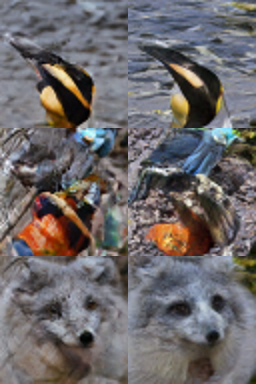
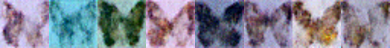

# Unconditional Image Generation

Sampling images from p(x) with no prompt: the generative model families (VAE, GAN, AR/VQ, flow, diffusion, flow matching, consistency), the mid-2026 landscape, FID/KID/precision-recall, and runnable DDPM / DiT / consistency-model code.

Author

Benedict Thekkel

## 1. What is Unconditional Image Generation?

Learn a distribution over images from a training set, then **draw new samples from it**. No text prompt, no input image, no class label - the only input is noise (a random seed).

$$x \sim p_\theta(x), \qquad x = G_\theta(z), \quad z \sim \mathcal{N}(0, I)$$

**Input.** A latent/noise tensor `z` (and a seed). That is all. The same seed always reproduces the same image, which is why “the latent space” is the only handle you have on the output.

**Output.** An image tensor in `[-1, 1]` or `[0, 1]`, converted to RGB.

**Be honest about the framing.** Pure unconditional generation is, in mid-2026, mostly a **research and teaching task rather than a product one**. Text conditioning won, because a prompt is what users actually want (see `04_Text_to_Image`). But this task is still the right place to stand for three reasons:

1.  It is the **cleanest lens on generative modelling itself** - no conditioning signal to hide behind, so a family’s mode coverage and sample fidelity are exposed directly.
2.  It is what you actually deploy in **narrow domains**: medical-imaging augmentation, materials/microscopy data, anomaly-detection baselines (reconstruct-and-compare), texture/sprite generation, synthetic pretraining data.
3.  **Class-conditional ImageNet generation** - the benchmark where DiT, SiT, flow matching, and the distillation results that power modern text-to-image were *actually proven* - lives under this task, not under text-to-image.

**Neighbouring tasks:**

| Task | Difference | Where in this series |
|----|----|----|
| Text-to-image | Same sampler, conditioned on a text embedding via cross-attention | `04_Text_to_Image` |
| Image-to-image / inpainting | Conditioned on a source image (or mask) | `06_Image_to_Image` |
| Image-to-video | Conditioned on a first frame, generates a time axis | `07_Image_to_Video` |
| Representation learning | The encoder half of a VAE/VQ-VAE, used for features not samples | `16_Image_Feature_Extraction` |
| Anomaly detection | Uses `p(x)` (or reconstruction error) to score, not to sample | \- |

Class-conditional generation, `p(x | y)` for a small label set, is the same machinery with a class embedding added - so it lives here too, and it is where the state-of-the-art numbers are reported.

------------------------------------------------------------------------

## 2. Real-World Use Cases

Nobody ships “generate a random image” as a feature. What ships is unconditional (or narrowly class-conditional) sampling **inside a pipeline**, where the point is the distribution, not the picture.

| Use case | Domain | Consumes / produces | Dominant constraint |
|----|----|----|----|
| Synthetic training data for rare pathologies | Medical imaging (chest X-ray, histology, MRI) | Noise -\> synthetic scans that augment a tiny real cohort | Fidelity to clinical distribution; privacy (no memorised patients); regulatory audit trail |
| Anomaly detection by reconstruction | Manufacturing QA (MVTec-style), industrial vision | Learn p(normal); score defects by reconstruction error / likelihood | Must model *only* normal data; low false-positive rate; edge inference |
| Materials and microscopy synthesis | Science (crystal, alloy, cell imaging) | Noise -\> plausible microstructures for simulation | Physical plausibility, not aesthetics; small training sets |
| Face/avatar priors and identity-free assets | Games, stock media, privacy tooling | Noise -\> photoreal faces that belong to nobody (thispersondoesnotexist, StyleGAN) | 1-shot latency, high resolution, editable latent space |
| Sprite / texture / tile generation | Game asset pipelines, procedural art | Noise -\> tileable textures, sprite sheets | Style consistency; sub-second generation; tiny domain dataset |
| Data augmentation and class balancing | Any long-tail classifier (defects, species, fraud imagery) | Class label -\> extra samples for the rare classes | Diversity, not fidelity - a mode-collapsed generator is worse than no augmentation |
| Benchmarking generative research | Research (ImageNet 256/512, CIFAR-10, FFHQ) | Class or nothing -\> 50k samples for an FID number | Reproducibility, NFE budget, honest sampling protocol |
| Watermarking / provenance research | Trust and safety | Noise -\> samples used to test detectors and fingerprints | Coverage of the model’s actual output distribution |

**What the FID number hides.** An FID of 2.1 on ImageNet 256 is computed from **50,000 samples** with a specific Inception backbone, a specific resize, and usually classifier-free guidance tuned *for that metric* - it is not a statement about the image you are looking at. Four production realities it does not capture:

- **Memorisation.** Small-dataset generators (the medical case, exactly the one where it matters most) copy training images. FID rewards copying. You must run a nearest-neighbour check against the training set before shipping anything trained on patient data.
- **Mode collapse vs blur.** FID conflates fidelity and diversity into one scalar, so a sharp generator that covers half the distribution can beat a blurry one that covers all of it. **Precision/recall for generative models is the metric that actually diagnoses this** (section 4).
- **NFE is the deployment cost.** A 1000-step DDPM and a 1-step consistency model can have similar FID and a 1000x difference in latency. The sampler and step count, not the weights, dominate the bill.
- **Domain shift on tiny data.** These models are trained on datasets of thousands, not billions, of images. A generator trained on one scanner’s output produces that scanner’s artefacts, faithfully, forever.

------------------------------------------------------------------------

## 3. How Modern Unconditional Generation Works

This is the one task where you should learn the **families**, not a model list. Each family is a different answer to “how do I turn a tractable noise distribution into an intractable image distribution”.

**1. VAE (2013).** Encoder `q(z|x)`, decoder `p(x|z)`, trained by maximising the ELBO (reconstruction + KL to a Gaussian prior). Gives you an explicit likelihood bound and a genuinely useful latent space - but the Gaussian likelihood term averages over ambiguity, so samples are **blurry**. Almost no one uses a VAE as the final generator any more; nearly everyone uses one as the **tokenizer/compressor** underneath a latent diffusion or AR model. That is the VAE’s real legacy.

**2. GAN (2014 -\> StyleGAN2/3, 2020-2021).** A generator and a discriminator play a minimax game. No likelihood, no ELBO, just “fool the critic” - which produces **sharp** samples in **one forward pass** (NFE = 1). Costs: unstable training, and **mode collapse** (the generator drops parts of the distribution and the metric barely notices). StyleGAN2/3 is still the best-in-class choice for a **narrow domain at high resolution with a tight latency budget** (faces, textures), and its `w` latent space remains the most editable one anybody has built. **R3GAN** (Jan 2025, “The GAN is dead; long live the GAN!”) stripped StyleGAN2’s tricks down to a regularised relativistic loss on a plain ResNet and beat it (FFHQ FID 2.75) - GANs are not dead, they are just no longer where the frontier is.

**3. Autoregressive / VQ (2016 -\> 2024).** PixelCNN factorised `p(x)` over pixels; VQ-VAE and VQGAN made it tractable by autoregressing over a **discrete token grid** from a learned codebook. Exact likelihood over tokens, but slow sequential sampling and a lossy tokenizer ceiling. This family **came back in 2024**: **VAR** (NeurIPS 2024 best paper) replaced raster-scan next-token with coarse-to-fine **next-scale prediction** (ImageNet 256 FID 1.73, ~20x faster than raster AR), and **MAR** (“Autoregressive Image Generation without Vector Quantization”) dropped the codebook entirely by modelling each continuous token with a small diffusion head (MAR-H, 943M, FID 1.55). The AR-vs-diffusion boundary is now blurry by construction.

**4. Normalizing flows (2015-2020, and back in 2025).** Stack invertible maps with tractable Jacobians, get **exact** log-likelihood and exact inversion. Long treated as historical - the invertibility constraint cost too much capacity. Apple’s **TarFlow** (2024) and **STARFlow** (2025, ~3B, latent-space) showed transformer autoregressive flows scale to high-resolution synthesis after all. Still a minority family, but no longer a museum piece.

**5. Diffusion / score-based (DDPM 2020).** Define a fixed forward process that adds Gaussian noise over T steps; train a network to **predict the noise** (equivalently, the score) at a random timestep; sample by reversing it. Training is a plain MSE regression - **stable, no adversarial game, excellent mode coverage** - and quality beat GANs by 2021 (“Diffusion Models Beat GANs”). The cost is NFE: naive DDPM ancestral sampling needs 1000 network evaluations. **DDIM** (2020) made the sampler deterministic and non-Markovian, cutting it to 50 with little loss. **Score SDE** (2021) unified the discrete and continuous views. **Latent diffusion** (2022) moved the process into a VAE latent, which is what made high-res practical. **DiT** (2023) replaced the U-Net with a transformer on latent patches and proved the scaling law (ImageNet 256 FID 2.27) - that architecture is the direct ancestor of every modern text-to-image backbone.

**6. Flow matching / rectified flow (2022-2026, current default).** Train a velocity field to transport noise to data along a **straight** probability path, with a simple regression objective: `v_theta(x_t, t) ~= x_1 - x_0` on linear interpolants. **Diffusion is a special case** - a particular (curved, variance-preserving) probability path - so flow matching subsumes it and generalises it. Straighter paths mean the ODE solver needs fewer steps, and the objective is better-conditioned. **SiT** showed the same DiT backbone trained as a flow beats it; **REPA / REPA-E / LightningDiT** added representation alignment to the tokenizer/backbone and pushed class-conditional ImageNet 256 to roughly FID 1.1-1.3. This is what the 2025-2026 frontier is built on.

**7. Distillation and few-step samplers (2023-2026).** Given a trained diffusion/flow teacher, learn a student that jumps: **consistency models** (2023) map any point on a trajectory to its endpoint, giving 1-2 step sampling; **MeanFlow** (2025) learns average velocity for genuine 1-NFE generation (ImageNet 256 FID 3.43 at NFE=1); **FACM**, **IMM** and W-Flow-style methods pushed 1-step to ~1.3-1.7 FID during 2025-2026. This is where the GAN’s one-shot speed finally came back **without** the adversarial training.

**Family trade-off cheat sheet:**

| Family | Sample quality | Mode coverage | Sampling NFE | Training stability | Exact likelihood | Useful latent |
|----|----|----|----|----|----|----|
| VAE | poor (blurry) | good | 1 | very stable | ELBO (lower bound) | yes - the reason it survives |
| GAN (StyleGAN2/3, R3GAN) | excellent | weak (mode collapse) | **1** | fragile | no | yes (`w` space, editable) |
| AR / VQ (VQGAN, VAR, MAR) | excellent | good | ~10 (VAR) to ~256+ (raster) | stable | yes (over tokens) | discrete tokens |
| Normalizing flow (STARFlow) | good | good | 1-few | stable | **exact** | invertible |
| Diffusion (DDPM/DDIM/LDM/DiT) | excellent | **excellent** | 20-1000 | very stable | ELBO | via the VAE, not the diffusion |
| Flow matching (SiT, LightningDiT) | **best** | excellent | 10-50 | very stable | ODE log-det (computable) | same as above |
| Consistency / distilled (CM, MeanFlow) | very good | inherits teacher | **1-4** | needs a teacher | no | \- |

**Who leads mid-2026:** flow-matching transformers with representation alignment (LightningDiT/REPA-E class) hold the ImageNet 256 record; distilled few-step variants (FACM, MeanFlow, W-Flow) hold the 1-2 NFE record and are close behind on quality; GANs hold the “one narrow domain, one forward pass, 1024px” niche; VAEs hold the tokenizer slot underneath everything else. For **truly unconditional** ImageNet (no labels at all), **RCG** (self-supervised representation-conditioned generation) is the headline result at FID ~2.15 - it works by generating a *representation* first, then an image conditioned on it, which is a quiet admission that unconditional generation is easiest when you invent your own conditioning.

------------------------------------------------------------------------

## 4. Evaluation Metrics

You are comparing two *distributions*, not two images, so every metric here embeds samples with a pretrained network and compares the resulting feature clouds.

**Frechet Inception Distance (FID)** - the standard. Embed N real and N generated images with InceptionV3 (pool3, 2048-d), fit a Gaussian to each, and take the Frechet (2-Wasserstein) distance between them:

$$\mathrm{FID} = \lVert \mu_r - \mu_g \rVert_2^2 + \mathrm{Tr}\!\left(\Sigma_r + \Sigma_g - 2\left(\Sigma_r \Sigma_g\right)^{1/2}\right)$$

Lower is better. SOTA on CIFAR-10 is ~2, on class-conditional ImageNet 256 ~1.1-1.3.

**FID’s caveats are severe, and everyone ignores them:**

- **Sample-count sensitivity.** FID is a *biased* estimator: it falls as N grows. 10k samples and 50k samples give different numbers for the same model, so a comparison is only valid at equal N (the convention is 50k). A 32-sample FID, like the ones people put in notebooks, is nearly meaningless - the 2048x2048 covariance is rank-deficient.
- **The backbone is the metric.** FID measures distance in *InceptionV3’s* feature space, trained on ImageNet classification in 2015. It is blind to things Inception is blind to, and sensitive to things it is sensitive to. Swap in DINOv2 features and model rankings change.
- **Resizing and JPEG artefacts move it.** Bilinear vs bicubic resize to 299x299, PIL vs TF resizing, PNG vs JPEG - each is worth tenths of a point, i.e. more than the gap between competing papers.
- **It conflates fidelity and diversity.** One scalar cannot tell you whether your model makes bad images or too few different images.

**Inception Score (IS).** $\mathrm{IS} = \exp\left(\mathbb{E}_x\, D_{KL}(p(y|x) \,\|\, p(y))\right)$ - high when each sample is confidently one class and the classes are spread out. Deprecated: it never looks at the real data at all, so it cannot detect memorisation, it saturates, and it is meaningless off ImageNet.

**Kernel Inception Distance (KID).** Squared MMD between the two feature sets with a polynomial kernel $k(x,y) = \left(\frac{1}{d} x^\top y + 1\right)^3$. It is **unbiased**, so it is the right choice for small sample counts - which is exactly the regime a notebook lives in.

**Precision and Recall for generative models** (Kynkaanniemi et al., 2019) - the metric that actually diagnoses your model. Estimate each distribution’s support as the union of k-NN balls around its samples, then:

$$\mathrm{Precision} = \frac{1}{N_g}\sum_{x_g} \mathbb{1}\!\left[x_g \in \mathrm{manifold}(X_r)\right], \qquad \mathrm{Recall} = \frac{1}{N_r}\sum_{x_r} \mathbb{1}\!\left[x_r \in \mathrm{manifold}(X_g)\right]$$

**Precision = fidelity** (do my samples look like real data?), **Recall = diversity/coverage** (does my model cover the real data?). A mode-collapsed GAN reads high precision / low recall. A blurry VAE reads low precision / high recall. FID cannot tell those apart; this can. **Density and Coverage** (Naeem et al., 2020) are the robust-to-outliers replacements and are what modern papers report.

**Speed: NFE (number of function evaluations)** - how many times the network runs per image. It, not parameter count, decides latency: DDPM 1000, DDIM 50, DPM-Solver++ 20, distilled 1-4, GAN 1.

The cell below implements FID, KID and precision/recall on fabricated Gaussian feature sets, and sweeps the generated distribution towards the real one so you can watch the metrics move (and watch precision and recall move *differently*).

------------------------------------------------------------------------

``` python
from pyecharts.globals import CurrentConfig

# assets.pyecharts.org serves an expired TLS certificate from most nodes (2026-11-11),
# so charts failed to load. jsDelivr mirrors the same assets, pinned to one commit.
CurrentConfig.ONLINE_HOST = "https://cdn.jsdelivr.net/gh/pyecharts/pyecharts-assets@f2328d558550046fc5449672a6850e848e141590/assets/v6/"

import numpy as np
from scipy import linalg


def fid_from_features(f_real, f_gen):
    "Frechet distance between two feature clouds (the FID formula, any backbone)."
    mu_r, mu_g = f_real.mean(0), f_gen.mean(0)
    sig_r = np.cov(f_real, rowvar=False)
    sig_g = np.cov(f_gen, rowvar=False)
    covmean, _ = linalg.sqrtm(sig_r @ sig_g, disp=False)
    if np.iscomplexobj(covmean):  # numerical noise in sqrtm of a near-singular product
        covmean = covmean.real
    diff = mu_r - mu_g
    return float(diff @ diff + np.trace(sig_r + sig_g - 2 * covmean))


def kid_from_features(f_real, f_gen):
    "Unbiased squared MMD with the cubic polynomial kernel (KID). Better than FID at small N."
    d = f_real.shape[1]
    k = lambda a, b: (a @ b.T / d + 1.0) ** 3
    m, n = len(f_real), len(f_gen)
    kxx, kyy, kxy = k(f_real, f_real), k(f_gen, f_gen), k(f_real, f_gen)
    np.fill_diagonal(kxx, 0)  # unbiased: drop the self-similarity terms
    np.fill_diagonal(kyy, 0)
    return float(kxx.sum() / (m * (m - 1)) + kyy.sum() / (n * (n - 1)) - 2 * kxy.mean())


def precision_recall(f_real, f_gen, k=3):
    "k-NN manifold precision (fidelity) and recall (coverage), Kynkaanniemi et al. 2019."

    def radii(f):  # distance to the k-th nearest neighbour of each sample
        d = np.linalg.norm(f[:, None, :] - f[None, :, :], axis=-1)
        return np.sort(d, axis=1)[:, k]  # column 0 is the point itself

    def in_manifold(query, ref, ref_radii):
        d = np.linalg.norm(query[:, None, :] - ref[None, :, :], axis=-1)
        return (d <= ref_radii[None, :]).any(axis=1).mean()

    return (
        float(in_manifold(f_gen, f_real, radii(f_real))),   # precision
        float(in_manifold(f_real, f_gen, radii(f_gen))),    # recall
    )


rng = np.random.default_rng(0)
D, N = 16, 256
real = rng.normal(size=(N, D))  # the "real" feature cloud

print(f"{'shift':>6} {'FID':>8} {'KID':>9} {'precision':>10} {'recall':>8}")
for shift in [2.0, 1.0, 0.5, 0.25, 0.0]:
    gen = rng.normal(size=(N, D)) * 0.9 + shift  # generated: offset + slightly under-dispersed
    p, r = precision_recall(real, gen)
    print(f"{shift:6.2f} {fid_from_features(real, gen):8.3f} {kid_from_features(real, gen):9.4f} {p:10.3f} {r:8.3f}")

# Now the diagnosis FID cannot make: a mode-collapsed generator (tight cluster, correct
# location) vs a blurry one (correct spread, smeared). Both can score a similar FID.
collapsed = rng.normal(size=(N, D)) * 0.25          # sharp but covers little -> high precision, low recall
blurry = rng.normal(size=(N, D)) * 1.8              # covers everything and more -> low precision, high recall
for name, f in [("mode-collapsed", collapsed), ("blurry/over-dispersed", blurry)]:
    p, r = precision_recall(real, f)
    print(f"{name:22s} FID {fid_from_features(real, f):7.3f}   precision {p:.3f}   recall {r:.3f}")

# ... and chart the sweep: FID collapses towards 0 while precision and recall move apart.
from pyecharts import options as opts
from pyecharts.charts import Line

shifts = [2.0, 1.0, 0.5, 0.25, 0.0]
rng = np.random.default_rng(1)
fids, kids, precs, recs = [], [], [], []
for s in shifts:
    g = rng.normal(size=(N, D)) * 0.9 + s
    fids.append(round(fid_from_features(real, g), 3))
    kids.append(round(kid_from_features(real, g), 4))
    p, r = precision_recall(real, g)
    precs.append(round(p, 3))
    recs.append(round(r, 3))

line = (
    Line()
    .add_xaxis([str(s) for s in shifts])
    .add_yaxis("FID", fids, is_smooth=True)
    .add_yaxis("precision", precs, yaxis_index=1, is_smooth=True)
    .add_yaxis("recall", recs, yaxis_index=1, is_smooth=True)
    .extend_axis(yaxis=opts.AxisOpts(name="precision / recall", min_=0, max_=1))
    .set_global_opts(
        title_opts=opts.TitleOpts(
            title="Toy metrics as the generated distribution approaches the real one",
            subtitle="16-d Gaussian features, N=256. FID -> 0 as the shift closes; precision/recall saturate.",
        ),
        xaxis_opts=opts.AxisOpts(name="mean shift of generated features"),
        yaxis_opts=opts.AxisOpts(name="FID"),
        tooltip_opts=opts.TooltipOpts(trigger="axis"),
    )
)
line.render_notebook()
```

     shift      FID       KID  precision   recall
      2.00   66.842  134.8567      0.000    0.000
      1.00   17.709    7.8365      0.355    0.090
      0.50    5.129    1.0618      0.828    0.461
      0.25    1.831    0.2343      0.879    0.562
      0.00    0.649    0.0008      0.887    0.621
    mode-collapsed         FID   9.173   precision 1.000   recall 0.000
    blurry/over-dispersed  FID  11.966   precision 0.062   recall 1.000

    /tmp/ipykernel_1191346/878326728.py:10: DeprecationWarning: The `disp` argument is deprecated and will be removed in SciPy 1.18.0.
      covmean, _ = linalg.sqrtm(sig_r @ sig_g, disp=False)

## 5. Datasets

Unconditional generation is benchmarked on a handful of fixed datasets, and the *dataset is part of the metric* - “FID 2.1” means nothing without “on what, at what resolution, against which reference statistics”.

| Dataset | Contents | Size | Scope | License | Typical use |
|----|----|----|----|----|----|
| [uoft-cs/cifar10](https://huggingface.co/datasets/uoft-cs/cifar10) | 32x32 natural images, 10 classes | 60k | tiny natural images | MIT-ish (research) | **The** unconditional FID benchmark (SOTA ~2). Used here. |
| [CelebA-HQ](https://huggingface.co/datasets/huggan/CelebA-HQ) | Aligned celebrity faces, 256-1024px | 30k | faces | research-only | Face generation, latent interpolation demos |
| [FFHQ](https://github.com/NVlabs/ffhq-dataset) | Flickr faces, 1024px, diverse | 70k | faces | CC BY-NC-SA 4.0 (non-commercial) | The StyleGAN / R3GAN benchmark |
| [ILSVRC/imagenet-1k](https://huggingface.co/datasets/ILSVRC/imagenet-1k) | Natural images, 1000 classes | 1.28M | general | **gated** (accept terms) | Class-conditional 256/512 - the DiT/SiT/flow-matching benchmark |
| [LSUN](https://www.yf.io/p/lsun) (bedroom, church) | Scene photos | 3M+ per class | single-scene domains | research | Classic single-domain diffusion/GAN benchmark |
| [huggan/smithsonian_butterflies_subset](https://huggingface.co/datasets/huggan/smithsonian_butterflies_subset) | Butterfly specimen photos | 1k | narrow domain | CC0 | Small-domain demos and the diffusers training tutorial. **Used here** for the from-scratch section. |
| [MNIST](https://huggingface.co/datasets/ylecun/mnist) | Handwritten digits, 28x28 | 70k | digits | CC BY-SA 3.0 | Toy VAE/GAN teaching, mode-collapse demos (Stacked MNIST) |
| [lambdalabs/pokemon-blip-captions](https://huggingface.co/datasets/lambdalabs/pokemon-blip-captions) | Pokemon sprites (captioned) | 833 | sprites | CC BY-NC-SA | Small-domain fine-tuning demos |

**This notebook** samples from models pretrained on CIFAR-10, CelebA-HQ and ImageNet, uses a slice of **CIFAR-10 test** as the real reference set for the benchmark’s distribution-distance proxy, and trains its toy from-scratch model on **smithsonian_butterflies_subset** (1k images, CC0, ~100 MB - small enough to fit this machine).

**Gating:** `ILSVRC/imagenet-1k` requires accepting terms on the Hub; FFHQ is non-commercial. The *pretrained* ImageNet models (DiT, consistency models) are freely downloadable regardless - you only need the dataset to compute reference FID statistics or to train.

------------------------------------------------------------------------

## 6. The Model Landscape (mid-2026)

The leaderboards for this task are [Papers-with-Code: Image Generation on ImageNet 256x256](https://paperswithcode.com/sota/image-generation-on-imagenet-256x256) (class-conditional, the main arena) and [Image Generation on CIFAR-10](https://paperswithcode.com/sota/image-generation-on-cifar-10). Note the asymmetry that defines this task in 2026: **the frontier models mostly have no `diffusers` pipeline.** They are research repos with a `sample.py`. The models you can actually load in one line are the 2020-2023 classics - which is fine, because they teach the mechanics, and the mechanics are the point.

| Model | Params | License | Scope | Architecture / family | Best for | Runnable here? |
|----|----|----|----|----|----|----|
| [google/ddpm-cifar10-32](https://huggingface.co/google/ddpm-cifar10-32) | 35.7M | Apache 2.0 | CIFAR-10 32px, unconditional | pixel-space UNet diffusion (DDPM, FID 3.17) | learning the sampler; cheap experiments | **yes** |
| [google/ddpm-celebahq-256](https://huggingface.co/google/ddpm-celebahq-256) | ~114M | Apache 2.0 | faces 256px, unconditional | pixel-space UNet diffusion | high-res faces, latent interpolation | **yes** |
| [anton-l/ddpm-butterflies-128](https://huggingface.co/anton-l/ddpm-butterflies-128) | ~40M | Apache 2.0 | butterflies 128px | UNet diffusion (tutorial checkpoint) | what a 1k-image domain model looks like | **yes** |
| [facebook/DiT-XL-2-256](https://huggingface.co/facebook/DiT-XL-2-256) | 675M | CC BY-NC 4.0 | ImageNet 256, class-conditional | latent diffusion **transformer** (FID 2.27) | the ancestor of every modern T2I backbone | **yes** (~1.4 GB fp16) |
| [openai/diffusers-cd_imagenet64_l2](https://huggingface.co/openai/diffusers-cd_imagenet64_l2) | ~300M | MIT | ImageNet 64, class-conditional | **consistency distillation** (1-4 NFE) | few-step sampling on this box | **yes** |
| StyleGAN2 / StyleGAN3 | 30-60M | NVIDIA source-available | narrow domains, up to 1024px | GAN | 1-NFE high-res faces/textures; editable `w` | no (vendor repo, not diffusers) |
| R3GAN (2025) | ~50M | MIT | FFHQ / CIFAR / ImageNet | modernised GAN (FFHQ FID 2.75) | proof GANs still compete at size | no (research repo) |
| VAR-d30 | 2B | MIT | ImageNet 256, class-cond | next-**scale** autoregressive (FID 1.73) | fast AR sampling (~10 NFE) | no (\>12 GB comfort, research repo) |
| MAR-H | 943M | MIT | ImageNet 256, class-cond | masked AR + per-token diffusion loss (FID 1.55) | AR without a VQ codebook | no (research repo) |
| SiT / REPA / REPA-E / LightningDiT | 675M+ | MIT | ImageNet 256, class-cond | **flow matching** DiT + representation alignment (FID ~1.1-1.3) | current quality frontier | no (research repos) |
| MeanFlow / FACM / IMM (2025-26) | 675M+ | research | ImageNet 256, class-cond | 1-2 NFE flow distillation (FID 1.3-3.4 at NFE 1) | the 1-step frontier | no |
| RCG | ~500M | MIT | ImageNet 256, **truly unconditional** | self-supervised representation-conditioned diffusion (FID 2.15) | unconditional SOTA | no |
| STARFlow | ~3B | Apple (research) | high-res | latent normalizing flow | exact-likelihood synthesis at scale | no (too big here) |

**Who wins what.** *Quality:* flow-matching DiTs with representation alignment (LightningDiT/REPA-E). *Speed:* distilled 1-step models and GANs (NFE 1) - a consistency model gives you ~90% of the quality at 1/50th the latency. *Size:* the 35M DDPM CIFAR UNet does a real job in 140 MB. *Narrow domain at 1024px on a deadline:* still StyleGAN. Tie that back to section 2: the medical-augmentation and anomaly-detection use cases care about **coverage** (so diffusion/flow), the game-asset and avatar cases care about **NFE** (so GAN or distilled), and the research-benchmark case cares about a number that needs 50k samples and a fixed protocol.

**Fits a 12 GB card?** Everything in the “runnable” column, comfortably (the largest, DiT-XL/2, is ~1.4 GB in fp16). VAR-d30 (2B) and STARFlow (3B) are borderline-to-over in fp16 *and* have no `diffusers` pipeline, so they stay in the table.

------------------------------------------------------------------------

## 7. Setup

Package roles:

- `diffusers` + `torch` - all the samplers and pipelines (`DDPMPipeline`, `DiTPipeline`, `ConsistencyModelPipeline`) and the schedulers we swap between. `diffusers` is the general-purpose Hugging Face library for generative image models, the same ecosystem as `transformers` - it is not a vendor package.
- `transformers` - DINOv2, used as the feature backbone for the benchmark’s distribution-distance proxy.
- `datasets` - CIFAR-10 (real reference images) and the butterflies set (from-scratch training).
- `accelerate` - efficient checkpoint loading (`low_cpu_mem_usage`).
- `scipy` - `linalg.sqrtm` for the FID formula.
- `pyecharts` - all charts.
- `ipywidgets` - the optional seed-explorer demo.

All downloads (HF model cache, datasets) land in `DL_tasks/datasets/`, which is gitignored.

------------------------------------------------------------------------

``` python
# Generative image models load through Hugging Face `diffusers` - the general-purpose
# HF library for this family, same ecosystem as transformers. No vendor packages.
# %pip install -q torch diffusers transformers datasets accelerate scipy pyecharts

# Optional extra for the interactive seed demo (section 15)
# %pip install -q ipywidgets
```

``` python
import ctypes
import ctypes.util
import gc
import time
from pathlib import Path

import torch
from dotenv import find_dotenv, load_dotenv

# Knowledge/.env sets HF_TOKEN - authenticated HF Hub requests get higher rate limits
load_dotenv(find_dotenv(usecwd=True))

device = "cuda:0" if torch.cuda.is_available() else "cpu"
dtype = torch.float16 if device != "cpu" else torch.float32
if device != "cpu":
    print(torch.cuda.get_device_name(0))
print("device:", device)

def vram(tag=""):
    "Report current GPU memory (allocated / reserved). No-op on CPU."
    if torch.cuda.is_available():
        alloc = torch.cuda.memory_allocated() / 1e9
        reserved = torch.cuda.memory_reserved() / 1e9
        print(f"VRAM {tag:20s} {alloc:5.2f} GB allocated / {reserved:5.2f} GB reserved")

def free_memory():
    "Collect garbage, empty the CUDA cache, and return freed CPU RAM to the OS."
    gc.collect()
    if torch.cuda.is_available():
        torch.cuda.empty_cache()
        torch.cuda.ipc_collect()
    # glibc keeps freed CPU allocations in its arenas instead of returning them
    # to the OS, so RSS compounds across model sections (cpu-offloaded weights
    # live in system RAM). malloc_trim(0) hands the freed arenas back. See
    # dl-visualization-and-memory.md - not optional on a 12 GB box.
    try:
        ctypes.CDLL(ctypes.util.find_library("c") or "libc.so.6").malloc_trim(0)
    except Exception:
        pass

# All downloads go to DL_tasks/datasets/ (gitignored)
DATA_DIR = Path("../../datasets")
DATA_DIR.mkdir(exist_ok=True)
HF_CACHE = str(DATA_DIR / "hf_cache")
```

    NVIDIA GeForce RTX 3060
    device: cuda:0

``` python
from datasets import load_dataset
from diffusers.utils import make_image_grid

# Real reference images for the benchmark's distribution-distance proxy (section 14).
# A 200-image slice of the CIFAR-10 test split - the same distribution google/ddpm-cifar10-32
# was trained on, so a well-behaved sampler should land close to it in feature space.
cifar_real = load_dataset("uoft-cs/cifar10", split="test[:200]", cache_dir=HF_CACHE)
real_images = [row["img"].convert("RGB") for row in cifar_real]

# The narrow-domain set for the from-scratch training section (1k CC0 images).
butterflies = load_dataset(
    "huggan/smithsonian_butterflies_subset", split="train", cache_dir=HF_CACHE
)

print("real CIFAR-10 reference images:", len(real_images), real_images[0].size)
print("butterflies:", butterflies)

# What the target distributions actually look like (raw image display, not a chart)
make_image_grid([im.resize((96, 96)) for im in real_images[:8]], rows=1, cols=8)
```

    Repo card metadata block was not found. Setting CardData to empty.

    real CIFAR-10 reference images: 200 (32, 32)
    butterflies: Dataset({
        features: ['image_url', 'image_alt', 'id', 'name', 'scientific_name', 'gender', 'taxonomy', 'region', 'locality', 'date', 'usnm_no', 'guid', 'edan_url', 'source', 'stage', 'image', 'image_hash', 'sim_score'],
        num_rows: 1000
    })


## 8. DDPM on CIFAR-10 (the reference implementation)

`google/ddpm-cifar10-32` is the original Ho et al. 2020 checkpoint: a 35.7M-parameter pixel-space U-Net trained on CIFAR-10 at 32x32 (Inception Score 9.46, FID 3.17 - state of the art when published, still respectable). It is the cheapest honest diffusion model in existence and therefore the right one to experiment on.

`DDPMPipeline` runs the **ancestral sampler**: 1000 denoising steps, each one a full U-Net forward pass. That is NFE = 1000, and you will feel it - which is exactly the lesson.

The sampling loop, in five lines of pseudocode:

    x_T ~ N(0, I)
    for t = T .. 1:
        eps = unet(x_t, t)                  # predict the noise that was added
        x_{t-1} = scheduler.step(eps, t, x_t)   # subtract a bit of it, add a bit of fresh noise
    return x_0

------------------------------------------------------------------------

``` python
from diffusers import DDPMPipeline

# fp16 halves VRAM and roughly doubles throughput. If you ever see black/NaN outputs on
# an older card, drop torch_dtype - these U-Nets are small enough to run fp32 anywhere.
ddpm = DDPMPipeline.from_pretrained(
    "google/ddpm-cifar10-32", torch_dtype=dtype, cache_dir=HF_CACHE
).to(device)
print(f"UNet params: {sum(p.numel() for p in ddpm.unet.parameters()) / 1e6:.1f}M")
vram("ddpm-cifar10 loaded")

g = torch.Generator(device=device).manual_seed(0)
t0 = time.perf_counter()
out = ddpm(batch_size=8, num_inference_steps=1000, generator=g)  # NFE = 1000
elapsed = time.perf_counter() - t0
print(f"1000-step DDPM: {elapsed:.1f}s for 8 images ({elapsed / 8:.2f}s/image)")

# Keep `ddpm` alive - sections 9, 14 and 15 reuse the same weights with different schedulers.
make_image_grid([im.resize((96, 96)) for im in out.images], rows=1, cols=8)
```

    UNet params: 35.7M
    VRAM ddpm-cifar10 loaded   0.07 GB allocated /  0.08 GB reserved

    1000-step DDPM: 11.9s for 8 images (1.49s/image)


## 9. The Scheduler Swap: DDPM vs DDIM vs DPM-Solver++

**This is the single most instructive experiment in the notebook.** The weights do not change. The training does not change. Only the *sampler* - the rule for stepping backwards through the noise schedule - changes, and inference gets 20-50x faster for a barely perceptible quality cost.

- **DDPM** (ancestral, stochastic): follows the Markov chain the model was trained on. 1000 steps. Injects fresh noise at every step, so the same seed with a different step count gives a different image.
- **DDIM** (2020): reinterprets the same trained model as a **deterministic, non-Markovian** ODE. You can skip timesteps. 50 steps is the usual sweet spot, 20 is often fine. Being deterministic, it makes the initial noise a genuine *latent code* - which is what makes the interpolation in section 10 possible at all.
- **DPM-Solver++** (2022): a tailored high-order ODE solver for the diffusion ODE. Converges in ~20 steps, sometimes 10.

In `diffusers` the swap is one line, because the scheduler is a separate object from the weights:

``` python
pipe.scheduler = DDIMScheduler.from_config(pipe.scheduler.config)
```

That decoupling is why “which sampler” is a deployment decision, not a training one.

------------------------------------------------------------------------

``` python
from diffusers import DDIMScheduler, DDPMScheduler, DPMSolverMultistepScheduler

base_config = ddpm.scheduler.config  # keep the original DDPM config to restore from

configs = [
    ("DDPM  1000 steps", DDPMScheduler.from_config(base_config), 1000),
    ("DDIM    50 steps", DDIMScheduler.from_config(base_config), 50),
    ("DDIM    20 steps", DDIMScheduler.from_config(base_config), 20),
    ("DPM++   20 steps", DPMSolverMultistepScheduler.from_config(base_config), 20),
    ("DDIM    10 steps", DDIMScheduler.from_config(base_config), 10),
]

panels = []
for name, sched, steps in configs:
    ddpm.scheduler = sched
    g = torch.Generator(device=device).manual_seed(7)  # same seed for every sampler
    t0 = time.perf_counter()
    imgs = ddpm(batch_size=4, num_inference_steps=steps, generator=g).images
    dt = time.perf_counter() - t0
    print(f"{name}   {dt:6.1f}s   {dt / 4:5.2f}s/image   (NFE={steps})")
    panels.extend(im.resize((96, 96)) for im in imgs)

ddpm.scheduler = DDPMScheduler.from_config(base_config)  # restore the default
vram("after scheduler sweep")

# One row per sampler, top to bottom in the order above. Quality degrades gracefully;
# latency does not - that is the whole point.
make_image_grid(panels, rows=len(configs), cols=4)
```

    DDPM  1000 steps      8.1s    2.01s/image   (NFE=1000)

    DDIM    50 steps      0.4s    0.10s/image   (NFE=50)

    DDIM    20 steps      0.2s    0.04s/image   (NFE=20)

    DPM++   20 steps      0.2s    0.04s/image   (NFE=20)

    DDIM    10 steps      0.1s    0.02s/image   (NFE=10)
    VRAM after scheduler sweep  0.08 GB allocated /  0.16 GB reserved



## 10. Higher Resolution and Latent Interpolation (CelebA-HQ 256)

`google/ddpm-celebahq-256` is the same DDPM recipe at 256x256 on 30k aligned faces. Two things to show here:

1.  **A pixel-space diffusion model at 256px is expensive.** The U-Net now runs on 3x256x256 tensors; this is exactly the cost that latent diffusion (2022) was invented to remove by moving the process into a VAE latent 8x smaller per side.
2.  **The initial noise is a latent code.** Under a *deterministic* sampler (DDIM), the map `noise -> image` is a function, so you can interpolate between two noise tensors and get a smooth walk through image space. Interpolate on the **great circle** (spherical linear interpolation, slerp), not the straight line: a straight line between two samples of `N(0, I)` passes through the low-norm centre of the ball, where the model has essentially never seen a sample, and you get washed-out mush in the middle.

To inject our own latents we call the U-Net and scheduler directly instead of using the pipeline’s `__call__` - which also shows you that the “pipeline” is a very thin wrapper.

------------------------------------------------------------------------

``` python
from diffusers import DDIMPipeline

del ddpm  # free the CIFAR model before loading a bigger one - one model live at a time
free_memory()
vram("after freeing cifar ddpm")

face = DDIMPipeline.from_pretrained(
    "google/ddpm-celebahq-256", torch_dtype=dtype, cache_dir=HF_CACHE
).to(device)
vram("celebahq loaded")


@torch.inference_mode()
def sample_from_latents(pipe, latents, num_steps):
    "Run the denoising loop by hand so we can supply our own starting noise."
    pipe.scheduler.set_timesteps(num_steps)
    x = latents * pipe.scheduler.init_noise_sigma
    for t in pipe.scheduler.timesteps:
        eps = pipe.unet(x, t).sample                       # predicted noise
        x = pipe.scheduler.step(eps, t, x).prev_sample     # one step back down the chain
    x = (x / 2 + 0.5).clamp(0, 1).float().cpu()            # [-1,1] -> [0,1], off the GPU
    return pipe.numpy_to_pil(x.permute(0, 2, 3, 1).numpy())


def slerp(a, b, w):
    "Spherical interpolation between two Gaussian latents (stay on the shell of the ball)."
    a_n, b_n = a / a.norm(), b / b.norm()
    omega = torch.acos((a_n * b_n).sum().clamp(-1, 1))
    so = torch.sin(omega)
    if so.abs() < 1e-6:
        return (1 - w) * a + w * b
    return (torch.sin((1 - w) * omega) / so) * a + (torch.sin(w * omega) / so) * b


# Build the latents in fp32 (a 3x256x256 fp16 norm would overflow at 65504) and cast after.
shape = (3, face.unet.config.sample_size, face.unet.config.sample_size)
z0 = torch.randn(shape, generator=torch.Generator("cpu").manual_seed(11)).to(device)
z1 = torch.randn(shape, generator=torch.Generator("cpu").manual_seed(42)).to(device)

weights = [0.0, 0.25, 0.5, 0.75, 1.0]
latents = torch.stack([slerp(z0, z1, w) for w in weights]).to(dtype)

t0 = time.perf_counter()
walk = sample_from_latents(face, latents, num_steps=30)  # DDIM, 30 NFE per image
print(f"{time.perf_counter() - t0:.1f}s for {len(weights)} faces at 256x256 (30 DDIM steps each)")

del face
free_memory()
vram("after celebahq")

# Endpoints are two independent samples; the middle images are neither, but are still faces.
# A model with poor coverage produces artefacts or repeats along this path.
make_image_grid([im.resize((160, 160)) for im in walk], rows=1, cols=len(weights))
```

    VRAM after freeing cifar ddpm  0.01 GB allocated /  0.02 GB reserved

    An error occurred while trying to fetch /home/bthek1/Knowledge/DL/DL_tasks/datasets/hf_cache/models--google--ddpm-celebahq-256/snapshots/cd5c944777ea2668051904ead6cc120739b86c4d: Error no file named diffusion_pytorch_model.safetensors found in directory /home/bthek1/Knowledge/DL/DL_tasks/datasets/hf_cache/models--google--ddpm-celebahq-256/snapshots/cd5c944777ea2668051904ead6cc120739b86c4d.
    Defaulting to unsafe serialization. Pass `allow_pickle=False` to raise an error instead.

    VRAM celebahq loaded       0.24 GB allocated /  0.25 GB reserved
    5.6s for 5 faces at 256x256 (30 DDIM steps each)
    VRAM after celebahq        0.01 GB allocated /  0.05 GB reserved


## 11. DiT-XL/2: Class-Conditional ImageNet (the architecture that won)

`facebook/DiT-XL-2-256` (675M) is the model that showed diffusion **does not need a U-Net**: replace it with a plain transformer operating on latent patches, condition with adaLN-zero, and the FID scales cleanly with compute (ImageNet 256 FID **2.27**, SOTA in 2023). Every serious text-to-image backbone shipped since - SD3, FLUX, and the flow-matching DiTs of 2025-2026 - is a descendant of this design, so the fastest way to understand modern T2I is to look at its class-conditional ancestor with the text encoder removed.

Two differences from sections 8-10, both important:

- **Latent, not pixel.** DiT diffuses in a VAE’s 32x32x4 latent, then decodes. That is what makes 256px affordable.
- **Class-conditional with classifier-free guidance.** `guidance_scale > 1` extrapolates away from the unconditional prediction, trading diversity for fidelity - the exact same knob as the CFG scale in a text-to-image model (see `04_Text_to_Image`), just with a class label instead of a prompt.

License note: DiT’s weights are **CC BY-NC 4.0** (non-commercial). Fine for study, not for a product.

------------------------------------------------------------------------

``` python
from diffusers import DiTPipeline

dit = DiTPipeline.from_pretrained(
    "facebook/DiT-XL-2-256", torch_dtype=dtype, cache_dir=HF_CACHE
).to(device)
dit.scheduler = DPMSolverMultistepScheduler.from_config(dit.scheduler.config)  # 25 NFE is enough
print(f"DiT params: {sum(p.numel() for p in dit.transformer.parameters()) / 1e6:.0f}M")
vram("DiT loaded")

words = ["white shark", "golden retriever", "macaw", "volcano"]
class_ids = dit.get_label_ids(words)  # maps ImageNet-1k label strings -> class indices
print(dict(zip(words, class_ids)))

g = torch.Generator(device=device).manual_seed(33)
t0 = time.perf_counter()
images = dit(
    class_labels=class_ids,
    num_inference_steps=25,
    guidance_scale=4.0,  # CFG: >1 sharpens and pushes towards the class, at the cost of diversity
    generator=g,
).images
print(f"{time.perf_counter() - t0:.1f}s for {len(words)} images at 256x256 (25 steps, CFG 4.0)")

del dit
free_memory()
vram("after DiT")

make_image_grid([im.resize((160, 160)) for im in images], rows=1, cols=len(words))
```

    An error occurred while trying to fetch /home/bthek1/Knowledge/DL/DL_tasks/datasets/hf_cache/models--facebook--DiT-XL-2-256/snapshots/eab87f77abd5aef071a632f08807fbaab0b704d0/vae: Error no file named diffusion_pytorch_model.safetensors found in directory /home/bthek1/Knowledge/DL/DL_tasks/datasets/hf_cache/models--facebook--DiT-XL-2-256/snapshots/eab87f77abd5aef071a632f08807fbaab0b704d0/vae.
    Defaulting to unsafe serialization. Pass `allow_pickle=False` to raise an error instead.
    An error occurred while trying to fetch /home/bthek1/Knowledge/DL/DL_tasks/datasets/hf_cache/models--facebook--DiT-XL-2-256/snapshots/eab87f77abd5aef071a632f08807fbaab0b704d0/transformer: Error no file named diffusion_pytorch_model.safetensors found in directory /home/bthek1/Knowledge/DL/DL_tasks/datasets/hf_cache/models--facebook--DiT-XL-2-256/snapshots/eab87f77abd5aef071a632f08807fbaab0b704d0/transformer.
    Defaulting to unsafe serialization. Pass `allow_pickle=False` to raise an error instead.
    Expected types for id2label: (dict[int, str], <class 'NoneType'>), got typing.Dict[str, str].

    DiT params: 750M
    VRAM DiT loaded            1.71 GB allocated /  1.80 GB reserved
    {'white shark': 2, 'golden retriever': 207, 'macaw': 88, 'volcano': 980}

    2.7s for 4 images at 256x256 (25 steps, CFG 4.0)
    VRAM after DiT             0.01 GB allocated /  0.05 GB reserved


## 12. Consistency Models: One-Step Sampling

A consistency model is trained (or **distilled** from a diffusion teacher) so that *every* point on a noise-to-image trajectory maps to the **same endpoint**. If that holds, you can jump from pure noise to a finished image in a **single** network evaluation - NFE = 1, the same budget as a GAN, without the adversarial training.

`openai/diffusers-cd_imagenet64_l2` is the ImageNet-64 class-conditional distillation of an EDM teacher (Song et al., 2023). Compare its 1-step latency with the 1000-step DDPM of section 8: this is the 2023 result that started the few-step race which MeanFlow, FACM and IMM are still running in 2026.

Multi-step sampling is supported by passing explicit `timesteps` - each extra step buys some fidelity back. 1 -\> 2 steps is usually the biggest single jump in quality per unit of latency you will ever see.

------------------------------------------------------------------------

``` python
from diffusers import ConsistencyModelPipeline

cm = ConsistencyModelPipeline.from_pretrained(
    "openai/diffusers-cd_imagenet64_l2", torch_dtype=dtype, cache_dir=HF_CACHE
).to(device)
vram("consistency model loaded")

samples, labels = [], []
for label in [145, 88, 279]:  # ImageNet-64 classes: king penguin, macaw, arctic fox
    g = torch.Generator(device=device).manual_seed(5)

    t0 = time.perf_counter()
    one = cm(num_inference_steps=1, class_labels=label, generator=g).images[0]  # NFE = 1
    t_one = time.perf_counter() - t0

    g = torch.Generator(device=device).manual_seed(5)
    t0 = time.perf_counter()
    two = cm(timesteps=[22, 0], class_labels=label, generator=g).images[0]      # NFE = 2
    t_two = time.perf_counter() - t0

    print(f"class {label:3d}   1-step {t_one:5.2f}s   2-step {t_two:5.2f}s")
    samples.extend([one.resize((128, 128)), two.resize((128, 128))])

del cm
free_memory()
vram("after consistency model")

# Columns alternate 1-step / 2-step for each class. Both cost a fraction of a 1000-step DDPM.
make_image_grid(samples, rows=3, cols=2)
```

    VRAM consistency model loaded  0.62 GB allocated /  0.63 GB reserved

    Both `num_inference_steps`: 1 and `timesteps`: [22, 0] are supplied; `timesteps` will be used over `num_inference_steps`.

    class 145   1-step  0.09s   2-step  0.07s

    Both `num_inference_steps`: 1 and `timesteps`: [22, 0] are supplied; `timesteps` will be used over `num_inference_steps`.

    class  88   1-step  0.03s   2-step  0.06s

    Both `num_inference_steps`: 1 and `timesteps`: [22, 0] are supplied; `timesteps` will be used over `num_inference_steps`.

    class 279   1-step  0.03s   2-step  0.06s
    VRAM after consistency model  0.01 GB allocated /  0.05 GB reserved



## 13. Training a DDPM From Scratch (toy)

Everything above was inference. The objective underneath is almost embarrassingly simple, and worth writing out once:

$$\mathcal{L} = \mathbb{E}_{x_0,\; \epsilon \sim \mathcal{N}(0,I),\; t \sim \mathcal{U}(1,T)} \left[\; \lVert \epsilon - \epsilon_\theta(x_t, t) \rVert^2 \;\right], \qquad x_t = \sqrt{\bar\alpha_t}\, x_0 + \sqrt{1 - \bar\alpha_t}\, \epsilon$$

Per batch: **sample a random timestep t, add that much noise, ask the network to predict the noise it added, take the MSE.** No adversarial game, no ELBO bookkeeping, no discriminator to balance - which is precisely why diffusion displaced GANs. `scheduler.add_noise` implements the closed-form forward process (you never simulate the chain during training).

**This is explicitly a toy.** A tiny U-Net, 32x32 images, a few hundred optimiser steps on 1000 butterflies. It **will not produce good images** - real training is tens of thousands of steps on this dataset and far more on a real one. The deliverable is the **loss curve** and the mechanics; the samples are a punchline, not a result. It is sized to run in a couple of minutes on a 3060 and to stay well inside 12 GB.

------------------------------------------------------------------------

``` python
import numpy as np
import torch.nn.functional as F
from diffusers import DDPMScheduler, UNet2DModel
from torch.utils.data import DataLoader
from torchvision import transforms

IMG_SIZE, BATCH, TRAIN_STEPS = 32, 16, 400  # toy budget: minutes, not hours

tf = transforms.Compose([
    transforms.Resize((IMG_SIZE, IMG_SIZE)),
    transforms.RandomHorizontalFlip(),
    transforms.ToTensor(),
    transforms.Normalize([0.5], [0.5]),  # -> [-1, 1], the range diffusion models live in
])

def collate(batch):
    return torch.stack([tf(row["image"].convert("RGB")) for row in batch])

# num_workers=0: on a 4-core/12 GB box each worker forks a copy of the parent's RAM
# (models already loaded above) and gets OOM-killed. This dataset is tiny, so
# main-process loading is fast and safe. See dl-visualization-and-memory.md.
loader = DataLoader(butterflies, batch_size=BATCH, shuffle=True, collate_fn=collate, num_workers=0)

# A deliberately small U-Net (~1.5M params). Real checkpoints are 20-100x this.
toy = UNet2DModel(
    sample_size=IMG_SIZE,
    in_channels=3,
    out_channels=3,
    layers_per_block=1,
    block_out_channels=(32, 64, 64),
    down_block_types=("DownBlock2D", "AttnDownBlock2D", "DownBlock2D"),
    up_block_types=("UpBlock2D", "AttnUpBlock2D", "UpBlock2D"),
).to(device)  # train in fp32: 1.5M params is nothing, and fp16 training needs a GradScaler
print(f"toy UNet params: {sum(p.numel() for p in toy.parameters()) / 1e6:.2f}M")

noise_sched = DDPMScheduler(num_train_timesteps=1000)
opt = torch.optim.AdamW(toy.parameters(), lr=2e-4)

losses, step = [], 0
t0 = time.perf_counter()
while step < TRAIN_STEPS:
    for clean in loader:
        clean = clean.to(device)
        noise = torch.randn_like(clean)                                    # epsilon
        t = torch.randint(0, noise_sched.config.num_train_timesteps, (clean.size(0),), device=device)
        noisy = noise_sched.add_noise(clean, noise, t)                     # closed-form forward process

        pred = toy(noisy, t).sample                                        # epsilon_theta(x_t, t)
        loss = F.mse_loss(pred, noise)                                     # THE objective

        loss.backward()
        opt.step()
        opt.zero_grad(set_to_none=True)

        losses.append(loss.item())  # .item() -> a float, so no graph is retained
        step += 1
        if step % 100 == 0:
            print(f"step {step:4d}  loss {np.mean(losses[-100:]):.4f}")
        if step >= TRAIN_STEPS:
            break
print(f"trained {TRAIN_STEPS} steps in {time.perf_counter() - t0:.1f}s")

del clean, noise, noisy, pred, loss, opt, loader  # drop batch tensors and the optimizer state
free_memory()
vram("after toy training")

# What 400 steps buys you: blobs with roughly the right colour statistics and nothing else.
# That is the honest result, and it is why nobody trains these from scratch on a laptop.
toy_pipe = DDPMPipeline(unet=toy.eval(), scheduler=DDPMScheduler(num_train_timesteps=1000))
toy_pipe.to(device)

g = torch.Generator(device=device).manual_seed(0)
toy_samples = toy_pipe(batch_size=8, num_inference_steps=200, generator=g).images

del toy_pipe, toy
free_memory()
vram("after toy sampling")

make_image_grid([im.resize((96, 96)) for im in toy_samples], rows=1, cols=8)
```

    toy UNet params: 1.11M
    step  100  loss 0.3111
    step  200  loss 0.1214
    step  300  loss 0.0936
    step  400  loss 0.0730
    trained 400 steps in 26.5s
    VRAM after toy training    0.03 GB allocated /  0.07 GB reserved

    VRAM after toy sampling    0.02 GB allocated /  0.07 GB reserved



``` python
from pyecharts.charts import Line as EchartsLine

# Smooth the very noisy per-step loss (the timestep t is resampled every batch, so a single
# step's loss says almost nothing). The trend is what matters.
w = 20
smooth = [round(float(np.mean(losses[max(0, i - w):i + 1])), 4) for i in range(len(losses))]

curve = (
    EchartsLine()
    .add_xaxis([str(i) for i in range(len(smooth))])
    .add_yaxis("MSE (20-step moving average)", smooth, is_smooth=True, symbol="none")
    .set_global_opts(
        title_opts=opts.TitleOpts(
            title="Toy DDPM training: epsilon-prediction loss",
            subtitle=f"{TRAIN_STEPS} steps, 1.5M-param UNet, 32px butterflies - a demo, not a model",
        ),
        xaxis_opts=opts.AxisOpts(name="optimizer step"),
        yaxis_opts=opts.AxisOpts(name="MSE loss"),
        tooltip_opts=opts.TooltipOpts(trigger="axis"),
    )
)
curve.render_notebook()
```

## 14. Head-to-head Benchmark: the Sampler/Step-Count Sweep

The honest benchmark for this task is **not** a model bake-off - it is a **sampler sweep on one set of weights**, because that is the axis you actually control at deployment time. Fix `google/ddpm-cifar10-32`, vary the scheduler and step count, and measure:

- **latency**: seconds per image (and NFE, which predicts it almost perfectly);
- **a quality proxy**: KID between the generated samples and 200 real CIFAR-10 test images, in **DINOv2-small** feature space.

**Read the caveats before you read the numbers.**

- This is **not FID**. A real FID needs 10k-50k samples, an InceptionV3 backbone, and a fixed resize protocol. We use 32 samples and a different backbone, so the absolute value is meaningless and only the *ordering across step counts* carries any signal. We use **KID rather than FID** precisely because KID is unbiased and therefore the only one of the two that says anything at all at N=32.
- We do not fake the missing scale. If you want a real number, generate 50k samples with `torchmetrics.image.fid.FrechetInceptionDistance` against the full CIFAR-10 statistics - that is roughly an hour on this card at DDIM-50 and about a week at DDPM-1000. The gap between those two sentences is the entire reason few-step sampling is a research field.
- Hardware: single RTX 3060 (12 GB), 4 vCPU, fp16.

------------------------------------------------------------------------

``` python
from transformers import AutoImageProcessor, AutoModel

# DINOv2-small (22M) as the feature backbone. The standard is InceptionV3; DINOv2 features are
# arguably better for this and are transformers-native, but note that CHANGING THE BACKBONE
# CHANGES THE METRIC - never compare our numbers to a published FID.
feat_id = "facebook/dinov2-small"
processor = AutoImageProcessor.from_pretrained(feat_id, cache_dir=HF_CACHE)
featurizer = AutoModel.from_pretrained(feat_id, cache_dir=HF_CACHE).to(device).eval()


@torch.inference_mode()
def embed(images, batch=32):
    "CLS-token features (384-d) for a list of PIL images."
    feats = []
    for i in range(0, len(images), batch):
        px = processor(images=images[i:i + batch], return_tensors="pt").to(device)
        feats.append(featurizer(**px).last_hidden_state[:, 0].float().cpu().numpy())
    return np.concatenate(feats)


f_real = embed(real_images)  # 200 real CIFAR-10 test images
print("real feature bank:", f_real.shape)
vram("featurizer loaded")
```

    real feature bank: (200, 384)
    VRAM featurizer loaded     0.11 GB allocated /  0.40 GB reserved

``` python
import pandas as pd

N_SAMPLES = 32  # far too few for a real FID - see the caveats above

ddpm = DDPMPipeline.from_pretrained(
    "google/ddpm-cifar10-32", torch_dtype=dtype, cache_dir=HF_CACHE
).to(device)
base_config = ddpm.scheduler.config

sweep = [
    ("DDPM", DDPMScheduler, 1000),
    ("DDIM", DDIMScheduler, 50),
    ("DDIM", DDIMScheduler, 20),
    ("DDIM", DDIMScheduler, 10),
    ("DPM++", DPMSolverMultistepScheduler, 20),
    ("DPM++", DPMSolverMultistepScheduler, 10),
]

rows = []
for sampler, cls, steps in sweep:
    ddpm.scheduler = cls.from_config(base_config)
    g = torch.Generator(device=device).manual_seed(1234)

    t0 = time.perf_counter()
    imgs = ddpm(batch_size=N_SAMPLES, num_inference_steps=steps, generator=g).images
    secs = time.perf_counter() - t0

    kid = kid_from_features(f_real, embed(imgs)) * 1000  # x1000, as KID is usually reported
    rows.append({
        "sampler": f"{sampler} {steps}",
        "nfe": steps,
        "sec_per_image": round(secs / N_SAMPLES, 3),
        "dino_kid_x1000": round(kid, 2),
    })
    print(f"{sampler:6s} {steps:4d} steps   {secs / N_SAMPLES:5.2f}s/img   dino-KID {kid:7.2f}")
    del imgs
    free_memory()

del ddpm, featurizer, processor
free_memory()
vram("after benchmark")

df = pd.DataFrame(rows).sort_values("nfe")
df
```

    DDPM   1000 steps    1.07s/img   dino-KID 1511.15

    DDIM     50 steps    0.05s/img   dino-KID 1923.82

    DDIM     20 steps    0.02s/img   dino-KID 3258.94

    DDIM     10 steps    0.01s/img   dino-KID 7008.76

    DPM++    20 steps    0.02s/img   dino-KID 1991.22

    DPM++    10 steps    0.01s/img   dino-KID 3520.90
    VRAM after benchmark       0.02 GB allocated /  0.07 GB reserved

|     | sampler   | nfe  | sec_per_image | dino_kid_x1000 |
|-----|-----------|------|---------------|----------------|
| 3   | DDIM 10   | 10   | 0.011         | 7008.76        |
| 5   | DPM++ 10  | 10   | 0.011         | 3520.90        |
| 4   | DPM++ 20  | 20   | 0.021         | 1991.22        |
| 2   | DDIM 20   | 20   | 0.021         | 3258.94        |
| 1   | DDIM 50   | 50   | 0.053         | 1923.82        |
| 0   | DDPM 1000 | 1000 | 1.066         | 1511.15        |

``` python
from pyecharts.charts import Bar, Page, Scatter

bar = (
    Bar()
    .add_xaxis(df["sampler"].tolist())
    .add_yaxis("s / image", df["sec_per_image"].tolist())
    .add_yaxis("dino-KID x1000 (lower = closer to real)", df["dino_kid_x1000"].tolist(), yaxis_index=1)
    .extend_axis(yaxis=opts.AxisOpts(name="dino-KID x1000"))
    .set_global_opts(
        title_opts=opts.TitleOpts(
            title="Sampler sweep on google/ddpm-cifar10-32 (RTX 3060, fp16)",
            subtitle=f"{N_SAMPLES} samples vs 200 real CIFAR-10 images - a smoke test, NOT a leaderboard FID",
        ),
        xaxis_opts=opts.AxisOpts(name="sampler / NFE", axislabel_opts=opts.LabelOpts(rotate=30)),
        yaxis_opts=opts.AxisOpts(name="seconds per image"),
        tooltip_opts=opts.TooltipOpts(trigger="axis"),
    )
)

quality_vs_speed = (
    Scatter()
    .add_xaxis(df["sec_per_image"].tolist())
    .add_yaxis(
        "sampler",
        [[q, s] for q, s in zip(df["dino_kid_x1000"].tolist(), df["sampler"].tolist())],
        label_opts=opts.LabelOpts(formatter="{@[1]}", position="right"),
    )
    .set_global_opts(
        title_opts=opts.TitleOpts(
            title="Quality proxy vs latency",
            subtitle="Down-left is better. The knee is the sampler you ship.",
        ),
        xaxis_opts=opts.AxisOpts(name="seconds per image", type_="value"),
        yaxis_opts=opts.AxisOpts(name="dino-KID x1000", type_="value"),
        tooltip_opts=opts.TooltipOpts(formatter="{c}"),
    )
)

Page().add(bar, quality_vs_speed).render_notebook()
```

## 15. Interactive Demo: Seed Explorer

With no prompt, the **seed is the entire user interface**. This widget makes that concrete: move the slider, get a different sample from the same `p(x)`; move the step slider, watch quality trade against latency in real time.

Guarded with try/except so a headless Quarto render or a server without `ipywidgets` skips it cleanly. The pipeline is freed at the end either way.

------------------------------------------------------------------------

``` python
# ipywidgets, diffusers and torch are project dependencies - imported here so this
# demo runs on its own, without section 8 or 9 having to be executed for their
# import lines alone.
import time

import ipywidgets as widgets
import torch
from diffusers import DDIMScheduler, DDPMPipeline
from diffusers.utils import make_image_grid
from IPython.display import display


def bootstrap(*names, notebook, sections):
    """Make this demo runnable on a cold kernel, without duplicating the notebook.

    The demo builds on the notebook's setup and helper cells. Instead of making you
    run them by hand - or copying them in here and letting the copies drift - this
    reads the notebook file and executes those sections itself, and only when a name
    is actually missing. Run the notebook top to bottom and it does nothing at all.
    It stops as soon as every required name exists, so trailing benchmark cells in a
    section are not run.
    """
    if all(n in globals() for n in names):
        return
    import json
    from pathlib import Path

    from IPython.utils.capture import capture_output

    path = Path(notebook)
    if not path.exists():
        raise NameError(
            f"this demo needs {', '.join(n for n in names if n not in globals())}, and cannot "
            f"find {notebook} to bootstrap from (cwd is {Path.cwd()}, expected the notebook's "
            f"own directory). Run section(s) {'; '.join(sections)} by hand instead."
        )
    print(f"cold start: running {'; '.join(sections)} from {notebook} (output suppressed)")
    heading = None
    for cell in json.loads(path.read_text())["cells"]:
        src = "".join(cell["source"])
        if cell["cell_type"] == "markdown" and src.lstrip().startswith("## "):
            heading = src.lstrip().splitlines()[0][3:].strip()
            continue
        if cell["cell_type"] != "code" or not heading or "def bootstrap(" in src:
            continue
        if not any(heading.startswith(s) for s in sections):
            continue
        code = "".join("" if l.lstrip().startswith(("%", "!")) else l
                       for l in src.splitlines(keepends=True))
        # The setup cells print tables and display sample images. This demo only
        # wants the live stream, so swallow their output - errors still propagate.
        with capture_output():
            exec(compile(code, f"{notebook} [{heading}]", "exec"), globals())
        if all(n in globals() for n in names):
            break
    still = [n for n in names if n not in globals()]
    if still:
        raise NameError(f"bootstrapped {'; '.join(sections)} but {', '.join(still)} "
                        "are still undefined - the notebook layout may have changed.")


# Everything below builds on the notebook's setup cell.
bootstrap("device", "dtype", "HF_CACHE", "free_memory", "vram",
          notebook="08_Unconditional_Image_Generation.ipynb",
          sections=["7. Setup"])

explorer = DDPMPipeline.from_pretrained(
    "google/ddpm-cifar10-32", torch_dtype=dtype, cache_dir=HF_CACHE
).to(device)
explorer.scheduler = DDIMScheduler.from_config(explorer.scheduler.config)  # interactive-fast

out_box = widgets.Output()


def draw(seed, steps):
    with out_box:
        out_box.clear_output(wait=True)
        g = torch.Generator(device=device).manual_seed(int(seed))
        t0 = time.perf_counter()
        imgs = explorer(batch_size=4, num_inference_steps=int(steps), generator=g).images
        print(f"seed {seed}, {steps} steps, {time.perf_counter() - t0:.1f}s")
        display(make_image_grid([im.resize((96, 96)) for im in imgs], rows=1, cols=4))


ui = widgets.interactive(
    draw,
    seed=widgets.IntSlider(0, 0, 100, 1, description="seed"),
    steps=widgets.IntSlider(20, 5, 100, 5, description="DDIM steps"),
)
display(ui)

# Run this once you are done playing, to hand the VRAM back.
del explorer
free_memory()
vram("final")
```

    cold start: running 7. Setup from 08_Unconditional_Image_Generation.ipynb (output suppressed)

    VRAM final                 0.01 GB allocated /  0.02 GB reserved

## 16. Common Frameworks

Unconditional generation is the only task in this folder where you are more likely to *train* a model than to download one - nobody ships an unconditional product, so there is no zoo of domain checkpoints waiting for you. That inverts the usual ecosystem: the training and evaluation frameworks matter most, the serving layer barely exists, and the research frontier lives in standalone repos with CUDA extensions rather than in a library.

| Framework | Layer | What it gives you | License | Reach for it when |
|----|----|----|----|----|
| [diffusers](https://github.com/huggingface/diffusers) | modelling | `DDPMPipeline`, `DiTPipeline`, `ConsistencyModelPipeline`, every scheduler in section 9, and the `train_unconditional.py` example that scales section 13 into a real run | Apache 2.0 | Default, and the whole notebook |
| [accelerate](https://github.com/huggingface/accelerate) + EMA | modelling | Mixed precision, gradient accumulation, checkpoint resumption, and multi-GPU without rewriting the loop | Apache 2.0 | Any training run past a toy. EMA weights are not optional - the raw weights sample visibly worse |
| Research repos: [StyleGAN3](https://github.com/NVlabs/stylegan3), [VAR](https://github.com/FoundationVision/VAR), [MAR](https://github.com/LTH14/mar), [REPA-E](https://github.com/End2End-Diffusion/REPA-E) | modelling | The actual frontier numbers - GANs, autoregressive and flow families that have no `diffusers` pipeline | mixed (StyleGAN3 is NVIDIA non-commercial) | You need the published FID. Expect to fight CUDA extensions, and check the license: several are research-only |
| [datasets](https://github.com/huggingface/datasets) + [webdataset](https://github.com/webdataset/webdataset) | data | Streaming and sharded I/O, so the data loader is not the bottleneck and the disk does not fill | Apache 2.0 / BSD-3 | Any training set past a few thousand images. On 4 cores, decode throughput decides your step time |
| [clean-fid](https://github.com/GaParmar/clean-fid) | data | Consistent resizing and cropping - the reason published FIDs are comparable at all | MIT | Always, before comparing to any published number. Resize interpolation alone moves FID by several points |
| [Weights & Biases](https://github.com/wandb/wandb) / [MLflow](https://github.com/mlflow/mlflow) / TensorBoard | evaluation | Sample grids logged per epoch next to the loss curve - which is how you actually see mode collapse happen | MIT / Apache 2.0 | Every training run. The diffusion loss is famously uninformative; the samples are not |
| [torchmetrics](https://github.com/Lightning-AI/torchmetrics) (FID, KID) + precision/recall | evaluation | Distribution distance, plus the fidelity/diversity split that a single scalar cannot express | Apache 2.0 | Always. FID rewards a model that memorises its training set, and precision/recall is what catches it |
| [faiss](https://github.com/facebookresearch/faiss) nearest-neighbour check | evaluation | Memorisation auditing: search each sample against the training set in feature space before you ship | MIT | Any model trained on sensitive or licensed data. Small-dataset diffusion models copy, and FID does not care |

**The 2026 default stack** is `diffusers` plus `accelerate` with EMA, `webdataset` for input, clean-fid and torchmetrics for scoring, and W&B for watching samples rather than loss. If you have a working model and a latency problem, distillation (section 12) beats every other lever.

The common wrong turn is training from scratch when fine-tuning would do. Fine-tuning `google/ddpm-celebahq-256` or a latent UNet on a narrow domain beats a from-scratch run by an enormous margin in both wall clock and final FID, and on this box CIFAR-10 to a competitive FID is a multi-day job. The second is reporting FID alone: it is a single scalar over two distributions, and it cannot distinguish “sharp and repetitive” from “diverse and slightly blurry”.

------------------------------------------------------------------------

## 17. Going Further

- **Train one properly.** The [diffusers unconditional training tutorial](https://huggingface.co/docs/diffusers/tutorials/basic_training) scales the section-13 loop into a real run (`examples/unconditional_image_generation/train_unconditional.py`, with EMA, `accelerate`, and mixed precision). On this box, 64px on a 1k-image domain set for a few hours is realistic; CIFAR-10 to FID ~3 is a multi-day job on one 3060, and ImageNet 256 is not a single-GPU project at all.
- **Fine-tune instead of training.** For a narrow domain, fine-tuning `google/ddpm-celebahq-256` or a latent-diffusion UNet beats training from scratch by an enormous margin on both wall clock and FID. DreamBooth/LoRA techniques (see `04_Text_to_Image`) transfer directly.
- **Fewer steps.** `LCMScheduler`, `DPMSolverSinglestepScheduler`, and the distillation recipes (LCM-LoRA, consistency distillation, adversarial distillation) all target NFE. If you have a working diffusion model and a latency problem, distillation is the highest-leverage thing you can do.
- **Real metrics.** `torchmetrics.image.fid.FrechetInceptionDistance` and `KernelInceptionDistance` are the standard implementations; `clean-fid` fixes the resizing inconsistencies that make published FIDs incomparable. Always report **precision/recall or density/coverage** alongside FID - a single scalar cannot diagnose mode collapse.
- **Check for memorisation** before you ship a model trained on sensitive data: nearest-neighbour search of each sample against the training set in feature space (see `16_Image_Feature_Extraction`). Small-dataset diffusion models copy, and FID rewards it.
- **Related notebooks.** `04_Text_to_Image` (the same samplers, conditioned on text - which is where all of this actually shipped), `06_Image_to_Image`, `07_Image_to_Video`, `16_Image_Feature_Extraction` (the backbones FID is computed in).

**References**

- [DDPM: Denoising Diffusion Probabilistic Models (Ho et al., 2020)](https://arxiv.org/abs/2006.11239)
- [DDIM: Denoising Diffusion Implicit Models (Song et al., 2020)](https://arxiv.org/abs/2010.02502)
- [Score-Based Generative Modeling through SDEs (Song et al., 2021)](https://arxiv.org/abs/2011.13456)
- [High-Resolution Image Synthesis with Latent Diffusion Models (Rombach et al., 2022)](https://arxiv.org/abs/2112.10752)
- [Scalable Diffusion Models with Transformers (DiT) (Peebles & Xie, 2023)](https://arxiv.org/abs/2212.09748)
- [Flow Matching for Generative Modeling (Lipman et al., 2022)](https://arxiv.org/abs/2210.02747)
- [Consistency Models (Song et al., 2023)](https://arxiv.org/abs/2303.01469)
- [Mean Flows for One-step Generative Modeling (2025)](https://arxiv.org/abs/2505.13447)
- [Visual Autoregressive Modeling / VAR (2024)](https://arxiv.org/abs/2404.02905)
- [Autoregressive Image Generation without Vector Quantization / MAR (2024)](https://arxiv.org/abs/2406.11838)
- [The GAN is dead; long live the GAN! / R3GAN (2025)](https://arxiv.org/abs/2501.05441)
- [Return of Unconditional Generation / RCG (2024)](https://arxiv.org/abs/2312.03701)
- [STARFlow: Scaling Latent Normalizing Flows (Apple, 2025)](https://machinelearning.apple.com/research/starflow)
- [Improved Precision and Recall Metric for Generative Models (Kynkaanniemi et al., 2019)](https://arxiv.org/abs/1904.06991)
- [Reliable Fidelity and Diversity Metrics / Density & Coverage (Naeem et al., 2020)](https://arxiv.org/abs/2002.09797)
- [Papers-with-Code: Image Generation on ImageNet 256x256](https://paperswithcode.com/sota/image-generation-on-imagenet-256x256)
- [diffusers: unconditional image generation](https://huggingface.co/docs/diffusers/en/using-diffusers/unconditional_image_generation)

------------------------------------------------------------------------

Back to top
