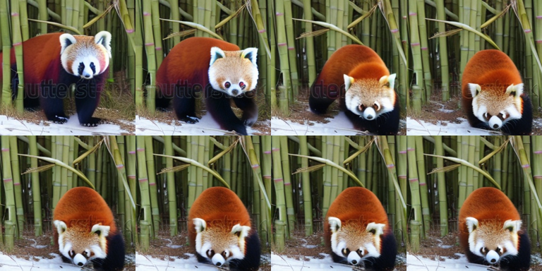
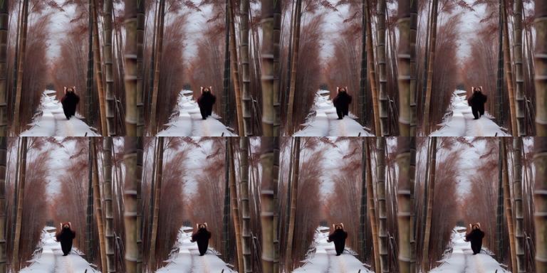

# Text-to-Video

Everything to know about generating video from a text prompt: the 3-D VAE + spatio-temporal DiT architecture that closed the gap with image generation, the mid-2026 model landscape, why VBench numbers lie, and runnable code for the open models that actually fit on a 12 GB card.

Author

Benedict Thekkel

## 1. What is Text-to-Video?

Text-to-video (T2V) maps a natural-language prompt to a **short video clip**: no reference image, no reference video, nothing but the string.

**Input.** A prompt, encoded by a frozen text encoder. Which encoder is a real architectural decision (section 3): the 2023 generation used CLIP’s 77-token text tower (123M params); every 2024+ model uses a **T5-XXL / UMT5-XXL encoder (~4.7B params)** instead, and that single choice is the biggest lever on prompt adherence - and, as you will see in section 7, the single biggest consumer of memory on a small box.

**Output.** A tensor of shape `(T, H, W, 3)` - typically 5 s at 16-24 fps, 480p-720p for open models. Everything downstream (a GIF, an MP4, a contact sheet) is just a view of that tensor. Length is the hard part: open models generate a fixed window (49, 81 or 121 frames) in one shot, and “make it longer” is a separate research problem, not a parameter.

**What it is not.** T2V is unconditioned on pixels, so it must invent the subject, the scene, the camera and the motion simultaneously. That is why the sibling task `07_Image_to_Video` is *easier and more controllable*: an input frame pins down identity, composition, lighting and style for free, leaving the model only the motion to solve. In production, “text-to-video” pipelines are very often text-to-**image**-to-video for exactly that reason.

**Neighbouring tasks:**

| Task | What it does | Notebook / typical tool |
|----|----|----|
| Text-to-image | The static ancestor; diffusion, CFG, samplers, LoRA all come from here | see `04_Text_to_Image` |
| Image-to-video | Animate a given first frame (and optionally a last frame) | see `07_Image_to_Video` |
| Video-to-video | Restyle / edit / upscale an existing clip; ControlNet-style conditioning | see `18_Video_to_Video` |
| Video classification | The discriminative inverse: video in, label out | see `09_Video_Classification` |
| Video captioning | Video in, text out - and the *labeling* engine behind every T2V training set | see `05_Image_to_Text` (image case) |
| Text-to-audio | The missing half of most open video models (see section 15) | see `Audio/01_Text_to_Audio` |

This notebook assumes the diffusion fundamentals from `04_Text_to_Image` - forward/reverse process, classifier-free guidance, samplers, the latent-space trick. They are not re-derived here. What is new in video is **the temporal axis**, and that is what section 3 is about.

------------------------------------------------------------------------

## 2. Real-World Use Cases

| Use case | Domain | Consumes / produces | Dominant constraint |
|----|----|----|----|
| Social-video ad variants | Marketing / adtech (Meta Advantage+, Runway, Pika) | Product brief + brand prompt -\> dozens of 5-10 s cuts | Cost per clip and *throughput*; brand-safe consistency across variants matters more than fidelity |
| Storyboard / previz | Film and TV pre-production | Script beat -\> rough moving shot | Camera controllability and iteration speed; final quality is irrelevant at this stage |
| Stock-footage replacement | Media, e-learning, corporate video | “Drone shot over autumn forest” -\> 4K b-roll | Resolution and licence cleanliness (can the output be sold?) |
| Game and world prototyping | Games (Genie-style world models, Decart) | Prompt -\> playable/streamable frames | *Latency*: an interactive world needs causal, streaming generation at 15+ fps, which rules out bidirectional diffusion entirely |
| Synthetic training data | Robotics / AV | Prompt or scene spec -\> rare-event clips | Physical plausibility; a video that violates dynamics poisons the downstream policy |
| Product and UGC video | E-commerce (Amazon, Shopify, TikTok Symphony) | Product image + prompt -\> demo clip | Identity preservation of the product - which is why these are I2V, not T2V, in practice |
| Accessibility / education | EdTech | Concept description -\> explanatory animation | Factual and diagrammatic correctness; text rendered *in frame* must be legible, and it usually is not |

**What the leaderboard number hides.** The Elo ranking is measured on 5-second, single-shot, cherry-pickable clips - which is roughly the *only* regime in which these models are good. Three realities dominate any actual deployment:

- **Cost is not a rounding error.** A 5 s 720p clip from a 14B DiT is 5-20 GPU-minutes on a consumer card, seconds-to-a-minute on an H100 cluster. Image generation is ~1 s. You cannot design a product as if video were free, and the entire 2025-2026 research wave (distillation, caching, sparse attention) exists to attack this one number.
- **Prompt adherence collapses with prompt complexity.** Two subjects interacting, a specified camera move, a specified sequence of actions (“she picks up the cup, *then* drinks”) - the failure rate rises sharply. Production systems hide this by **rewriting the prompt with an LLM** before it ever reaches the video model (section 15).
- **Failure modes are semantic, not visual.** Modern output is *pretty* and *wrong*: objects pass through each other, a glass un-shatters, a hand grows a sixth finger, an occluded object comes back as a different object, and any text in frame is gibberish. Quality metrics score these clips highly. Humans do not.

And the deployment fork mirrors the ASR streaming/batch fork: **bidirectional diffusion cannot stream by construction** (every frame attends to every other frame, so nothing is emitted until the whole clip is denoised). If your product needs frames *as they are generated* - interactive worlds, live avatars - you need a causal/autoregressive model, which is a different architecture, not a flag.

------------------------------------------------------------------------

## 3. How Modern Text-to-Video Works

Video generation lagged image generation by roughly two years, and the reason is one number: **cost scales with the number of latent tokens, and attention scales with its square.** A 720p image is ~4k latent tokens. A 5-second 720p *video* is, naively, 24x that. Every generation of this architecture is an answer to “how do we not pay 24x quadratically”.

### Generation 1 (2022-2023): inflate a T2I UNet with temporal layers

Take a pretrained Stable Diffusion UNet, freeze most of it, and insert **temporal attention / 1-D temporal convolutions** between the existing spatial blocks. The 2-D VAE still encodes each frame *independently* - there is no temporal compression at all. Examples: **ModelScope T2V** (1.7B, the first widely usable open T2V), **VideoLDM**, **AnimateDiff** (which factors the temporal layers into a *motion adapter* module that plugs into any SD 1.5 checkpoint, so the community’s thousands of LoRAs and finetunes keep working).

- **Pro:** cheap, reuses all the image priors, trains on modest data, still the fastest thing you can run.
- **Con:** short (16 frames), low motion, and **flickery** - because temporal attention is a bolt-on, and the VAE never sees more than one frame at a time. The motion is a slideshow with interpolation, not physics.

### Generation 2 (2024): the 3-D causal VAE

The central insight: **compress time as well as space.** A 3-D causal VAE encodes a `(T, H, W)` clip into `(T/c_t, H/c_s, W/c_s)` latents - causal so the first frame can be encoded alone (which is what lets the same VAE serve image-to-video). CogVideoX (2024) uses `c_t=4, c_s=8`; Wan 2.1 the same; LTX-Video pushes to `c_t=8, c_s=32` (a ~1:192 pixel-to-latent ratio); Wan 2.2’s TI2V-5B goes to `c_t=4, c_s=16`.

This is *the* memory lever, and you can compute it directly. Latent token count after patchifying with patch size `p`:

$$N = \frac{T}{c_t} \cdot \frac{H}{c_s p} \cdot \frac{W}{c_s p}$$

- CogVideoX-2B, 49 frames @ 480x720, `c=(4,8)`, `p=2`: `13 x 30 x 45` = **17,550 tokens**
- Wan 2.1, 81 frames @ 480x832, `c=(4,8)`, `p=2`: `21 x 30 x 52` = **32,760 tokens**
- LTX-Video, 121 frames @ 512x768, `c=(8,32)`, `p=1`: `16 x 16 x 24` = **6,144 tokens**

LTX generates *more frames* than CogVideoX from *one third* the tokens. Since attention is `O(N^2)`, that is a ~8x cheaper attention bill - and it is the whole reason LTX-Video is the “real-time on a consumer GPU” model while CogVideoX is not. The price is paid at the VAE: a 1:192 compression ratio throws away high-frequency detail, so LTX’s decoder has to do the last denoising step itself to claw it back.

### Generation 3 (2024-2025): spatio-temporal DiT + full 3-D attention + flow matching

OpenAI’s Sora (Feb 2024, “Video generation models as world simulators”) reframed the whole thing: **spacetime patches are just tokens**, a video is a sequence of them, and a transformer eats sequences of any length. Drop the UNet, use a **DiT** with **full 3-D self-attention** over all `T x H x W` latent tokens jointly (rather than factorised spatial-then-temporal attention, which is cheaper but demonstrably worse at motion), condition on the T5 text embedding via cross-attention or adaLN, and train with **flow matching / rectified flow** rather than DDPM epsilon-prediction (straighter probability paths, fewer sampling steps, more stable at scale). Meta’s Movie Gen (30B, Oct 2024) and every strong open model since - **HunyuanVideo** (13B), **Wan 2.1/2.2**, **Mochi 1** (10B AsymmDiT) - follow this recipe.

Full 3-D attention over 30k+ tokens *is* the cost story. It is why a 14B video DiT is slower per clip than a 70B LLM is per response.

### Generation 4 (2025-2026): making it affordable

Scaling stopped being the interesting axis; efficiency took over.

- **Few-step distillation.** Distil a 50-step teacher into a 4-8 step student (LCM/DMD-style, LightX2V LoRAs for Wan, the LTX `-distilled` checkpoints). 5-10x wall-clock, and the community treats these as the default now.
- **Causal / autoregressive and *streaming* models.** **CausVid** (2025) and **Self-Forcing** (2025) distil a bidirectional teacher into a causal student that generates frame-blocks left-to-right with a KV cache, closing the train/test gap that made earlier autoregressive video models drift. This is what makes real-time, infinite-length, interactive generation possible - and it is a fundamentally different deployment shape (section 2).
- **Sparse / linear attention.** HunyuanVideo 1.5’s SSTA (selective + sliding tile attention), plus inference-time tricks: TeaCache (skip redundant denoising compute), SageAttention (quantised attention kernels), xDiT (multi-GPU sequence parallelism).
- **MoE video DiTs.** **Wan 2.2 A14B** is the first: two experts, one specialised for the *high-noise* (layout/motion) phase and one for the *low-noise* (detail) phase of denoising, 27B total but only ~14B active per step. Denoising is not a homogeneous task, so different timesteps get different weights.
- **Native audio.** Veo 3 (closed) and LTX-2 (open, Jan 2026) generate synchronised audio *in the same diffusion pass*. This is the clearest current capability gap in open video (section 15).

### Cheat sheet

| Approach | Example | Latent tokens | Motion quality | Speed | Streams? |
|----|----|----|----|----|----|
| Inflated 2-D UNet + temporal layers | AnimateDiff, ModelScope T2V | high (no temporal compression) | weak, flickery | fastest | no |
| 3-D VAE + DiT, moderate compression | CogVideoX, Wan 2.1 | ~20-35k | good | slow | no |
| 3-D VAE + DiT, aggressive compression | LTX-Video | ~6k | good (less fine detail) | fast | no |
| MoE DiT, full 3-D attention | Wan 2.2 A14B | ~35k+ | best open | very slow | no |
| Causal / distilled AR | Self-Forcing, CausVid | n/a (block-wise) | good | real-time | **yes** |

------------------------------------------------------------------------

## 4. Evaluation Metrics

**FVD (Frechet Video Distance)** - the classic. Embed real and generated clips with a pretrained video network (I3D), fit a Gaussian to each set, and take the Frechet distance:

$$\mathrm{FVD} = \lVert \mu_r - \mu_g \rVert_2^2 + \mathrm{Tr}\!\left(\Sigma_r + \Sigma_g - 2(\Sigma_r \Sigma_g)^{1/2}\right)$$

**Its caveats are severe.** It needs hundreds of clips per model; it is dominated by the I3D backbone’s biases (it is sensitive to per-frame appearance and surprisingly *insensitive* to temporal corruption - shuffle the frames and FVD barely moves); it depends on the reference set; and it is not comparable across papers because everyone preprocesses differently. Treat any cross-paper FVD comparison as meaningless.

**CLIPSIM / text-video alignment** - mean CLIP cosine similarity between the prompt embedding and each frame embedding:

$$\mathrm{CLIPSIM} = \frac{1}{T}\sum_{t=1}^{T} \cos\big(E_{\text{text}}(p),\, E_{\text{img}}(x_t)\big)$$

Cheap and useful, but note what it *cannot* see: CLIP is a per-frame image model, so **CLIPSIM is completely blind to motion**. A single still image that matches the prompt scores as well as a perfectly animated clip. We demonstrate exactly this below.

**VBench / VBench-2.0** is the standard the field actually reports. VBench (CVPR 2024) decomposes quality into 16 automated dimensions in two groups:

- *Video quality*: subject consistency, background consistency, temporal flickering, motion smoothness, **dynamic degree**, aesthetic quality, imaging quality
- *Video-condition consistency*: object class, multiple objects, human action, colour, spatial relationship, scene, appearance style, temporal style, overall consistency

**VBench-2.0** (2025) adds “intrinsic faithfulness”: Human Fidelity, Controllability, Creativity, **Physics**, Commonsense, across 18 sub-dimensions (human anatomy, mechanics, thermotics, motion order understanding, multi-view consistency, …) - explicitly targeting the failures listed in section 2.

**The key point about VBench: the dimensions trade off against each other, so a single averaged score is meaningless.** A model that generates a nearly static clip scores *brilliantly* on subject consistency, background consistency, motion smoothness and temporal flickering - there is nothing moving to be inconsistent about - while scoring near zero on **dynamic degree**. Averaging those together rewards the model that does nothing. Always read dynamic degree next to the consistency dimensions; VBench itself warns about this and normalises accordingly.

**What actually ranks models: humans.** The [Artificial Analysis Video Arena](https://artificialanalysis.ai/video/leaderboard/text-to-video) runs blind pairwise votes on the same prompt and reports an Elo. It is the only ranking that correlates with what people will pay for, and it is where the closed frontier (Veo, Sora, Kling, Seedance) is visibly ahead of open weights.

**And what no metric catches well:** physics violations (objects interpenetrating, gravity ignored, the classic glass un-breaking), object permanence across occlusion, in-frame text rendering, and hands / limb counts. These are exactly the things a human notices in the first half-second.

**Speed metrics.** Report **seconds per second-of-video** (wall clock / clip duration) and peak VRAM, not “seconds per clip” - clip lengths differ between models and a per-clip number is not comparable.

Below we implement two of the proxies from scratch with CLIP (from `transformers`), plus a **dynamic-degree proxy**, and run them on two *synthetic* clips - a moving square and a static square - to make the trade-off concrete.

------------------------------------------------------------------------

``` python
import gc

import numpy as np
import torch
from PIL import Image
from transformers import CLIPModel, CLIPProcessor

dev = "cuda:0" if torch.cuda.is_available() else "cpu"
CACHE = "../../datasets/hf_cache"  # same gitignored cache the Setup cell formalises as HF_CACHE

# --- two synthetic 16-frame clips: a red square that MOVES, and one that does not ---
def square_clip(n_frames=16, size=224, move=True):
    "Render a red square on white; `move` sweeps it left-to-right."
    frames = []
    for i in range(n_frames):
        canvas = np.full((size, size, 3), 255, dtype=np.uint8)
        x = int(20 + i * (size - 90) / (n_frames - 1)) if move else 20
        canvas[90:150, x:x + 60] = [220, 30, 30]
        frames.append(Image.fromarray(canvas))
    return frames

moving, static = square_clip(move=True), square_clip(move=False)

# --- the metrics ---
clip_id = "openai/clip-vit-base-patch32"  # 150M - the only "small" model in this notebook
clip_model = CLIPModel.from_pretrained(clip_id, cache_dir=CACHE).to(dev).eval()
clip_proc = CLIPProcessor.from_pretrained(clip_id, cache_dir=CACHE)

@torch.inference_mode()
def clip_frame_embeds(frames):
    "L2-normalised CLIP image embedding per frame -> (T, D)."
    inp = clip_proc(images=frames, return_tensors="pt").to(dev)
    e = clip_model.get_image_features(**inp).pooler_output
    return torch.nn.functional.normalize(e, dim=-1)

@torch.inference_mode()
def clip_text_embed(prompt):
    inp = clip_proc(text=[prompt], return_tensors="pt", padding=True, truncation=True).to(dev)
    e = clip_model.get_text_features(**inp).pooler_output
    return torch.nn.functional.normalize(e, dim=-1)

def text_alignment(frames, prompt):
    "CLIPSIM: mean cosine(prompt, frame) over frames. Returns (mean, per-frame list)."
    per_frame = (clip_frame_embeds(frames) @ clip_text_embed(prompt).T).squeeze(-1)
    return float(per_frame.mean()), [float(x) for x in per_frame.cpu()]

def temporal_consistency(frames):
    "Mean cosine similarity between ADJACENT frame embeddings. Returns (mean, per-pair list)."
    e = clip_frame_embeds(frames)
    pairs = (e[:-1] * e[1:]).sum(-1)
    return float(pairs.mean()), [float(x) for x in pairs.cpu()]

def dynamic_degree(frames):
    "Proxy for VBench's dynamic degree: mean |pixel delta| between adjacent frames, 0-1."
    a = np.stack([np.asarray(f, dtype=np.float32) for f in frames]) / 255.0
    return float(np.abs(a[1:] - a[:-1]).mean())

PROMPT = "a red square moving across a white background"
for name, clip in [("moving square", moving), ("static square", static)]:
    align, _ = text_alignment(clip, PROMPT)
    cons, _ = temporal_consistency(clip)
    print(f"{name:14s} align {align:.4f}   temporal-consistency {cons:.4f}   dynamic {dynamic_degree(clip):.4f}")
```

    Warning: You are sending unauthenticated requests to the HF Hub. Please set a HF_TOKEN to enable higher rate limits and faster downloads.

    moving square  align 0.3188   temporal-consistency 0.9932   dynamic 0.0135
    static square  align 0.3183   temporal-consistency 1.0000   dynamic 0.0000

Read that output carefully - it is the whole argument of this section in three numbers.

The **static** clip wins temporal consistency outright (adjacent frames are *identical*, so cosine similarity is exactly 1.000) and its text-alignment score is essentially the same as the moving clip’s, because CLIP scores each frame in isolation and cannot perceive the word “moving”. Only the **dynamic-degree** proxy separates them. A benchmark that averaged consistency and alignment would declare the still image the better video generator.

The per-frame chart makes the shape of it visible:

``` python
from pyecharts.globals import CurrentConfig

# assets.pyecharts.org serves an expired TLS certificate from most nodes (2026-11-11),
# so charts failed to load. jsDelivr mirrors the same assets, pinned to one commit.
CurrentConfig.ONLINE_HOST = "https://cdn.jsdelivr.net/gh/pyecharts/pyecharts-assets@f2328d558550046fc5449672a6850e848e141590/assets/v6/"

from pyecharts import options as opts
from pyecharts.charts import Line

_, mov_align = text_alignment(moving, PROMPT)
_, sta_align = text_alignment(static, PROMPT)
_, mov_cons = temporal_consistency(moving)
_, sta_cons = temporal_consistency(static)

line = (
    Line()
    .add_xaxis([str(i) for i in range(len(mov_align))])
    .add_yaxis("moving: text alignment", [round(v, 4) for v in mov_align])
    .add_yaxis("static: text alignment", [round(v, 4) for v in sta_align])
    .add_yaxis("moving: adjacent-frame consistency", [round(v, 4) for v in mov_cons] + [None])
    .add_yaxis("static: adjacent-frame consistency", [round(v, 4) for v in sta_cons] + [None])
    .set_series_opts(label_opts=opts.LabelOpts(is_show=False))
    .set_global_opts(
        title_opts=opts.TitleOpts(
            title="CLIP proxies on a moving vs static square",
            subtitle="the static clip is 'perfectly consistent' and equally 'aligned' - and is not a video",
        ),
        xaxis_opts=opts.AxisOpts(name="frame index"),
        yaxis_opts=opts.AxisOpts(name="cosine similarity", min_=0, max_=1.05),
        tooltip_opts=opts.TooltipOpts(trigger="axis"),
        legend_opts=opts.LegendOpts(pos_top="12%"),
    )
)

# Free CLIP before the video models load - section 13 re-creates `clip_model` / `clip_proc`
# and reuses the scoring functions above unchanged.
del clip_model, clip_proc
gc.collect()
if torch.cuda.is_available():
    torch.cuda.empty_cache()

line.render_notebook()
```

## 5. Datasets

Video-text pairs are the bottleneck of the whole field. Nobody has a LAION-5B for video, captions are machine-generated (a captioning VLM labels scraped clips), and the licence position of every large scrape is uncomfortable.

| Dataset | Contents | Size | Scope | License | Typical use |
|----|----|----|----|----|----|
| **WebVid-10M** | Stock-footage clips + alt-text | 10M clips | web stock video | **taken down** | The field’s ImageNet-moment dataset (ModelScope, AnimateDiff, VideoLDM all trained on it), **withdrawn in 2024 after a Shutterstock complaint**. Cited everywhere; do not build on it. |
| [Panda-70M](https://snap-research.github.io/Panda-70M/) | HD YouTube clips, multi-teacher auto-captions | 70M clips / ~167k h | open-domain | research-only (YouTube ToS) | The de facto large pretraining corpus |
| [InternVid](https://huggingface.co/datasets/OpenGVLab/InternVid) | YouTube clips + generated captions | 234M clips / 760k h | open-domain | Apache-2.0 (annotations) | Pretraining + ViCLIP video-text retrieval |
| [OpenVid-1M](https://huggingface.co/datasets/nkp37/OpenVid-1M) | High-quality curated clips, dense captions; OpenVidHD-0.4M is 1080p | 1M clips | open-domain | CC-BY-4.0 | The cleanest openly-licensed T2V training set |
| [Koala-36M](https://koala36m.github.io/) | Fine-grained temporally-consistent captions, quality-filtered | 36M clips | open-domain | research | Training with accurate captions (caption quality \> clip count) |
| [HD-VILA-100M](https://github.com/microsoft/XPretrain) | 100M HD clips w/ ASR transcripts | 100M / 371k h | open-domain | research | Pretraining, video-language |
| [VBench prompt suite](https://github.com/Vchitect/VBench) | ~950 prompts tagged by evaluation dimension | ~1.7k prompts | eval | Apache-2.0 | **The standard eval prompt set - used in this notebook** |
| [UCF-101](https://www.crcv.ucf.edu/data/UCF101.php) / [Kinetics-400](https://huggingface.co/datasets/AlexFierro9/Kinetics400) | Action-recognition video | 13k / 240k clips | actions | research | The reference sets for FVD/IS |
| [MSR-VTT](https://huggingface.co/datasets/AlexZigma/msr-vtt) | 10k clips, 20 captions each | 10k clips | open-domain | research | CLIPSIM / retrieval eval |
| [EvalCrafter](https://github.com/evalcrafter/EvalCrafter) | 700 prompts + 17 objective metrics | 700 prompts | eval | Apache-2.0 | Alternative to VBench |

**This notebook** downloads the **VBench prompt suite** (`all_dimension.txt`) into `DL_tasks/datasets/`, so you can swap in leaderboard prompts at will; the head-to-head in section 13 runs one fixed prompt with one fixed seed through every model, because on this hardware a single clip per model is already 20+ minutes of compute. Nothing here is gated. We deliberately do **not** compute FVD - it needs hundreds of clips per model and is meaningless on the handful a 12 GB card can produce in a session.

------------------------------------------------------------------------

## 6. The Model Landscape (mid-2026)

The authoritative human ranking is the [Artificial Analysis Video Arena](https://artificialanalysis.ai/video/leaderboard/text-to-video) (blind pairwise Elo); the authoritative automatic one is the [VBench leaderboard](https://huggingface.co/spaces/Vchitect/VBench_Leaderboard).

### Open weights

| Model | Params | License | Architecture | Fits 12 GB? | Best for |
|----|----|----|----|----|----|
| **Wan 2.1 T2V 1.3B** | 1.3B (+4.7B UMT5) | Apache-2.0 | 3-D VAE (4x8x8) + DiT, flow matching | **yes** (~8 GB VRAM; quantise the text encoder) | The standout consumer-GPU model. Genuinely good 480p at 1.3B. |
| Wan 2.1 T2V 14B | 14B | Apache-2.0 | same, scaled | no (~35 GB fp16) | The open quality baseline of 2025 |
| **Wan 2.2 T2V A14B** | 27B total / 14B active (MoE) | Apache-2.0 | first MoE video DiT (high-noise + low-noise experts) | no | Best open T2V quality, mid-2026 |
| Wan 2.2 TI2V-5B | 5B | Apache-2.0 | 4x16x16 VAE, unified T2V+I2V | marginal (needs offload + quantisation) | 720p on a 24 GB card in ~9 min |
| HunyuanVideo | 13B | tencent-hunyuan-community | 3-D VAE + DiT, full 3-D attn | no (~26 GB fp16) | Motion realism; huge LoRA ecosystem |
| HunyuanVideo 1.5 | 8.3B | tencent-hunyuan-community | \+ SSTA sparse attention | no (fits 24 GB w/ offload) | Best quality-per-param; physics/fluids |
| **LTX-Video** | 2B | OpenRAIL-M (permissive) | 8x32x32 VAE -\> only ~6k tokens | **yes** (~10 GB) | Speed. Near-real-time on a consumer GPU. |
| LTX-2 / LTX-2.3 | 14B video + 5B audio | open weights | joint audio+video DiT, 4K/50fps | no | The only open model with **native synchronised audio** |
| CogVideoX-2B | 2B (+4.7B T5) | Apache-2.0 | 3-D causal VAE (4x8x8) + expert DiT | marginal (offload + VAE tiling; slow) | The reference implementation of the 3-D-VAE era |
| CogVideoX-5B | 5B | CogVideoX License (non-commercial-ish) | same | no (~19 GB w/ offload) | Better quality, same family |
| Mochi 1 | 10B | Apache-2.0 | AsymmDiT | no | Motion quality at Apache-2.0 |
| Open-Sora 2.0 | 11B | Apache-2.0 | DiT | no | Fully reproducible training recipe |
| **AnimateDiff** | +0.4B motion adapter on SD1.5 | Apache-2.0 | inflated 2-D UNet | **yes** (~6 GB) | Fast, stylised, plugs into any SD1.5 checkpoint/LoRA |
| **ModelScope T2V** | 1.7B | CC-BY-NC-ND 4.0 | inflated 2-D UNet | **yes** (~5 GB) | Historical baseline; crude but instant |

### Closed frontier (context only)

| Model | Notes |
|----|----|
| Google **Veo 3.x** | **Native synchronised audio** (dialogue, SFX, ambience) - a real differentiator no other frontier model matched for months |
| OpenAI **Sora 2** | Strong physics/consistency; note OpenAI announced the Sora app’s discontinuation in 2026 and API sunset later that year |
| **Kling 2.x / 3.0**, ByteDance **Seedance**, **Runway Gen-4.x**, **Pika**, **Luma Ray 3** | The rest of the Elo top ten; all API-only |

**Who wins what.** *Quality*: Wan 2.2 A14B leads open weights, and the closed frontier still leads it. *Speed*: LTX-Video, by an order of magnitude, because of its VAE compression ratio - which is the section-3 argument made concrete. *Size*: Wan 2.1 1.3B is the only model that is simultaneously good, Apache-2.0 and runnable on a 12 GB card. Map that back to section 2: the ad-variant and stock-footage use cases pay for the closed frontier; the interactive/game use case needs a *causal* model no leaderboard row above provides; and anything running on-prem on one consumer GPU is choosing between Wan 1.3B (quality) and LTX-Video (speed).

**Licences to read carefully.** ModelScope T2V is **CC-BY-NC-ND** (non-commercial, no derivatives). CogVideoX-**5B** and the Tencent licences carry restrictions (the Hunyuan licence excludes the EU/UK/South Korea and forbids competitor training). Wan (2.1 and 2.2), CogVideoX-2B, Mochi 1 and Open-Sora are Apache-2.0 - if you need commercial freedom, that is the shortlist.

------------------------------------------------------------------------

## 7. Setup

Everything below runs on a single RTX 3060 (12 GB) or on CPU (impractically slowly - a 5 s clip is tens of minutes to hours on 4 cores). Package roles:

- `diffusers` + `torch` - every video pipeline here. `diffusers` **is** the general-purpose Hugging Face library for generative image/video, the same ecosystem as `transformers`; no vendor packages are used.
- `transformers` - the text encoders inside those pipelines (CLIP, T5-XXL, UMT5-XXL) and the CLIP model behind our proxy metrics.
- `accelerate` - `enable_model_cpu_offload()`, the single most important memory switch in this notebook.
- `bitsandbytes` - 8-bit quantisation of the T5/UMT5 text encoder. **On this box this is not optional** (see below).
- `imageio` / `imageio-ffmpeg` - MP4 export (`export_to_video`). GIF export needs only PIL.
- `pyecharts`, `pandas` - the benchmark charts and table.

### The honest VRAM/RAM budget

Be clear about what does **not** work here. Wan 2.2 A14B (27B), HunyuanVideo (13B), Mochi 1 (10B) and CogVideoX-5B are simply out of reach on 12 GB - not “slow”, *impossible* without aggressive multi-bit quantisation and hours of offload thrashing. They belong in the table above, not in a cell.

Worse, the binding constraint on this machine is often **not** the GPU. Every model from generation 2 onwards carries a **T5-XXL / UMT5-XXL text encoder: ~4.7B params, ~9.5 GB in bf16**. With `enable_model_cpu_offload()` those weights live in *system RAM* - and this box has 12 GB of it, of which ~2 GB is already gone. The transformer is 1.3B; the text encoder is 4.7B. **The text encoder is the model.** So for LTX-Video, Wan and CogVideoX we load the text encoder in **8-bit** (~5 GB), which is the difference between “runs” and “OOMs the container”.

AnimateDiff and ModelScope T2V predate that choice and use CLIP’s 123M text tower - which is exactly why they are the two fast cells in this notebook.

Expected wall clock on the 3060, at the small settings used below: ModelScope ~30-60 s, AnimateDiff ~60-90 s, LTX-Video ~1-2 min, Wan 1.3B ~4-8 min, CogVideoX-2B ~8-15 min. Video generation is slow. That is the honest headline.

------------------------------------------------------------------------

``` python
# diffusers is the general-purpose HF library for generative image/video - same ecosystem as transformers.
# %pip install -q torch diffusers transformers accelerate bitsandbytes imageio imageio-ffmpeg pyecharts pandas

# ftfy is needed by the Wan pipeline's prompt cleaning
# %pip install -q ftfy
```

``` python
import ctypes
import ctypes.util
import gc
import time
from pathlib import Path

import torch
from dotenv import find_dotenv, load_dotenv

# Knowledge/.env sets HF_TOKEN - authenticated HF Hub requests get higher rate limits
load_dotenv(find_dotenv(usecwd=True))

device = "cuda:0" if torch.cuda.is_available() else "cpu"
dtype = torch.float16 if device != "cpu" else torch.float32
if device != "cpu":
    print(torch.cuda.get_device_name(0))
print("device:", device)

def vram(tag=""):
    "Report current GPU memory (allocated / reserved). No-op on CPU."
    if torch.cuda.is_available():
        alloc = torch.cuda.memory_allocated() / 1e9
        reserved = torch.cuda.memory_reserved() / 1e9
        print(f"VRAM {tag:20s} {alloc:5.2f} GB allocated / {reserved:5.2f} GB reserved")

def free_memory():
    "Collect garbage, empty the CUDA cache, and return freed CPU RAM to the OS."
    gc.collect()
    if torch.cuda.is_available():
        torch.cuda.empty_cache()
        torch.cuda.ipc_collect()
    # glibc keeps freed CPU allocations in its arenas instead of returning them
    # to the OS, so RSS compounds across model sections (cpu-offloaded weights
    # live in system RAM). malloc_trim(0) hands the freed arenas back. See
    # dl-visualization-and-memory.md - not optional on a 12 GB box.
    try:
        ctypes.CDLL(ctypes.util.find_library("c") or "libc.so.6").malloc_trim(0)
    except Exception:
        pass

def offload(pipe):
    "Pick the offload strategy for the VRAM actually free right now, not the card size."
    if device == "cpu":
        return pipe
    import torch.nn as nn
    # bitsandbytes-quantized weights are pinned to the GPU; enable_sequential_cpu_offload
    # first moves the whole pipeline to CPU and STALLS on them (a hang, not a catchable
    # error), so a quantized pipeline must use model-level offload - the recommended path.
    quantized = any(getattr(m, "is_quantized", False)
                    for m in pipe.components.values() if isinstance(m, nn.Module))
    free_gb = torch.cuda.mem_get_info()[0] / 1e9  # global free VRAM - counts other processes
    if free_gb < 8.0 and not quantized:
        # Another process is using the card (or it is small): layer-at-a-time keeps the
        # peak at ~1-2 GB for a real speed cost. Free the other GPU user if you can -
        # check nvidia-smi on the HOST; a container only sees its own processes.
        # Quantized (bitsandbytes) components cannot be dispatched per-layer, so fall
        # back to model-level offload if sequential raises.
        try:
            pipe.enable_sequential_cpu_offload(device=device)
            print(f"offload: sequential ({free_gb:.1f} GB VRAM free - GPU busy, expect slow steps)")
            return pipe
        except Exception as e:
            print(f"offload: sequential unsupported here ({type(e).__name__}) - using model-level")
    # Whole submodule on the GPU at a time - fast, peak ~= largest submodule (~5 GB).
    pipe.enable_model_cpu_offload(device=device)
    print(f"offload: {'quantized -> ' if quantized else ''}model-level ({free_gb:.1f} GB VRAM free)")
    return pipe


# All downloads go to DL_tasks/datasets/ (gitignored)
DATA_DIR = Path("../../datasets")
DATA_DIR.mkdir(exist_ok=True)
HF_CACHE = str(DATA_DIR / "hf_cache")

# The DiT models want bfloat16; fp16 is the fallback on pre-Ampere cards.
VDTYPE = torch.bfloat16 if (device != "cpu" and torch.cuda.is_bf16_supported()) else dtype
print("video dtype:", VDTYPE)
```

    NVIDIA GeForce RTX 3060
    device: cuda:0
    video dtype: torch.bfloat16

``` python
import urllib.request

from diffusers.utils import export_to_gif
from IPython.display import Image as IPyImage
from IPython.display import display
from PIL import Image

CLIPS_DIR = DATA_DIR / "t2v_clips"
CLIPS_DIR.mkdir(exist_ok=True)

# --- eval prompts: the VBench suite (the same prompt distribution the leaderboards use) ---
VBENCH_PROMPTS = DATA_DIR / "vbench_all_dimension.txt"
if not VBENCH_PROMPTS.exists():
    try:
        urllib.request.urlretrieve(
            "https://raw.githubusercontent.com/Vchitect/VBench/master/prompts/all_dimension.txt",
            VBENCH_PROMPTS,
        )
    except Exception as e:  # offline -> fall back to the built-in prompts below
        print("could not fetch VBench prompts:", e)

# One prompt is generated by EVERY model below, with the SAME seed - that is the benchmark.
PROMPT = "a red panda walking through a snowy bamboo forest, camera slowly pans right"
NEGATIVE = "blurry, low quality, static, watermark, jpeg artifacts, deformed"
SEED = 0

# Download budget. Models whose download exceeds MAX_DOWNLOAD_GB stay OFF by default:
# a fp32 T5/UMT5 text encoder is 10-23 GB, and 4-bit quantization happens only AFTER
# the full fp32 download. Flip RUN_HEAVY to fetch + run them (needs disk + time).
MAX_DOWNLOAD_GB = 8
RUN_HEAVY = False

if VBENCH_PROMPTS.exists():
    pool = [ln.strip() for ln in VBENCH_PROMPTS.read_text().splitlines() if ln.strip()]
    print(f"{len(pool)} VBench prompts available, e.g.: {pool[0]!r}")

results = {}  # name -> dict(frames, seconds, peak_vram, fps, size)

def _to_pil_frames(frames):
    "Coerce a pipeline's frames (PIL, or HxWx3 numpy in [0,1] or uint8) to list[PIL.Image]."
    import numpy as np
    out = []
    for f in frames:
        if isinstance(f, Image.Image):
            out.append(f)
            continue
        a = np.asarray(f)
        if a.dtype != np.uint8:  # float in [0,1] -> 8-bit
            a = (a.clip(0, 1) * 255).round().astype("uint8")
        out.append(Image.fromarray(a))
    return out


def run_t2v(name, call, fps, keep=8):
    "Time a text-to-video pipeline call, save + show the clip, and record it for section 13."
    if torch.cuda.is_available():
        torch.cuda.reset_peak_memory_stats()
    t0 = time.perf_counter()
    # Some pipelines (ModelScope T2V) return numpy frames, not PIL; normalise here.
    frames = _to_pil_frames(call())
    secs = time.perf_counter() - t0
    peak = torch.cuda.max_memory_allocated() / 1e9 if torch.cuda.is_available() else 0.0

    path = CLIPS_DIR / f"{name}.gif"
    export_to_gif(frames, str(path), fps=fps)
    step = max(1, len(frames) // keep)
    results[name] = {
        "frames": [f.convert("RGB") for f in frames[::step][:keep]],  # subsample; CPU-side, tiny
        "seconds": secs,
        "peak_vram": peak,
        "fps": fps,
        "n_frames": len(frames),
        "size": f"{frames[0].width}x{frames[0].height}",
        "duration": len(frames) / fps,
    }
    print(f"{name}: {secs:.1f}s  {len(frames)} frames @ {fps} fps "
          f"({len(frames) / fps:.1f}s of video)  {results[name]['size']}  peak {peak:.2f} GB")
    display(IPyImage(filename=str(path)))
    return frames

def contact_sheet(frames, cols=4, width=192):
    "Tile frames into a single PIL image - the fastest way to eyeball temporal coherence."
    scale = width / frames[0].width
    h = int(frames[0].height * scale)
    rows = (len(frames) + cols - 1) // cols
    sheet = Image.new("RGB", (cols * width, rows * h), "white")
    for i, f in enumerate(frames):
        sheet.paste(f.convert("RGB").resize((width, h)), ((i % cols) * width, (i // cols) * h))
    return sheet

def text_encoder_4bit(cls, repo, subfolder="text_encoder"):
    "Load a T5/UMT5 text encoder in 4-bit NF4 - roughly half the load-time RAM spike and the resident VRAM of 8-bit; the encoder, not the DiT, is the memory hog on this box."
    kw = dict(subfolder=subfolder, torch_dtype=VDTYPE, cache_dir=HF_CACHE, low_cpu_mem_usage=True)
    if device == "cpu":
        return cls.from_pretrained(repo, **kw)  # bitsandbytes needs CUDA
    from transformers import BitsAndBytesConfig
    quant = BitsAndBytesConfig(
        load_in_4bit=True, bnb_4bit_quant_type="nf4", bnb_4bit_compute_dtype=VDTYPE
    )
    return cls.from_pretrained(repo, quantization_config=quant, **kw)
```

    946 VBench prompts available, e.g.: 'In a still frame, a stop sign'

## 8. ModelScope T2V - the 2023 baseline (1.7B, fast, crude)

`ali-vilab/text-to-video-ms-1.7b` is the original open text-to-video model: an inflated Stable Diffusion UNet with temporal layers, a CLIP text encoder, a 2-D (per-frame) VAE, and 16 frames at 256x256. It is here as the **control**: it shows you exactly what “generation 1” bought you and what it did not.

Expect a recognisable subject, a watermark-ish texture inherited from its WebVid stock-footage training data, visible flicker, and almost no coherent camera motion - in **under a minute**. Note the licence: **CC-BY-NC-ND 4.0**, non-commercial and no derivatives.

Pick it when: you want a smoke test, or a historical reference. Never for production.

------------------------------------------------------------------------

``` python
from diffusers import DiffusionPipeline, DPMSolverMultistepScheduler

ms_pipe = DiffusionPipeline.from_pretrained(
    "ali-vilab/text-to-video-ms-1.7b",
    torch_dtype=dtype,
    variant="fp16" if device != "cpu" else None,
    cache_dir=HF_CACHE,
)
ms_pipe.scheduler = DPMSolverMultistepScheduler.from_config(ms_pipe.scheduler.config)
ms_pipe.enable_vae_slicing()
if device != "cpu":
    offload(ms_pipe)  # keeps only the active submodule on the GPU
else:
    ms_pipe.to(device)

frames = run_t2v(
    "modelscope-t2v-1.7b",
    lambda: ms_pipe(
        prompt=PROMPT,
        negative_prompt=NEGATIVE,
        num_frames=16,
        num_inference_steps=25,
        generator=torch.Generator("cpu").manual_seed(SEED),
    ).frames[0],
    fps=8,
)

display(contact_sheet(frames[::2]))

del ms_pipe, frames
free_memory()
vram("after ModelScope")
```

    The TextToVideoSDPipeline has been deprecated and will not receive bug fixes or feature updates after Diffusers version 0.33.1. 
    /home/bthek1/Knowledge/.venv/lib/python3.14/site-packages/diffusers/pipelines/pipeline_utils.py:2273: FutureWarning: `enable_vae_slicing` is deprecated and will be removed in version 0.40.0. Calling `enable_vae_slicing()` on a `TextToVideoSDPipeline` is deprecated and this method will be removed in a future version. Please use `pipe.vae.enable_slicing()`.
      deprecate(

    offload: model-level (12.3 GB VRAM free)

    modelscope-t2v-1.7b: 19.2s  16 frames @ 8 fps (2.0s of video)  256x256  peak 3.55 GB

    <IPython.core.display.Image object>



    VRAM after ModelScope      0.01 GB allocated /  0.02 GB reserved

## 9. AnimateDiff - motion adapters on Stable Diffusion 1.5

AnimateDiff is the cleverest thing in generation 1: instead of training a video model, train **only the temporal layers** (a ~450M “motion adapter”) and make them plug into *any* SD 1.5 UNet. Every community checkpoint, LoRA and style you have from the image world keeps working, and you get motion for free.

- Motion adapter: `guoyww/animatediff-motion-adapter-v1-5-2`
- Base checkpoint: `SG161222/Realistic_Vision_V5.1_noVAE` (swap for any SD1.5 finetune)

Text encoder is CLIP (123M), so nothing here strains RAM: ~6 GB VRAM, ~60-90 s for 16 frames at 512x512. The trade-off is the generation-1 trade-off: strong per-frame aesthetics (it is SD 1.5, after all), weak *global* motion - the camera rarely goes anywhere and long-range coherence is a slideshow. `wangfuyun/AnimateLCM` is the distilled variant if you want it in 4-8 steps.

Pick it when: you want stylised, fast, LoRA-controllable animation on a small GPU - the single most practical option here.

------------------------------------------------------------------------

``` python
from diffusers import AnimateDiffPipeline, DDIMScheduler, MotionAdapter

adapter = MotionAdapter.from_pretrained(
    "guoyww/animatediff-motion-adapter-v1-5-2", torch_dtype=dtype, cache_dir=HF_CACHE
)
ad_pipe = AnimateDiffPipeline.from_pretrained(
    "SG161222/Realistic_Vision_V5.1_noVAE",
    motion_adapter=adapter,
    torch_dtype=dtype,
    cache_dir=HF_CACHE,
)
ad_pipe.scheduler = DDIMScheduler.from_pretrained(
    "SG161222/Realistic_Vision_V5.1_noVAE",
    subfolder="scheduler",
    cache_dir=HF_CACHE,
    clip_sample=False,
    timestep_spacing="linspace",
    beta_schedule="linear",
    steps_offset=1,
)
ad_pipe.vae.enable_slicing()
if device != "cpu":
    offload(ad_pipe)
else:
    ad_pipe.to(device)

frames = run_t2v(
    "animatediff-sd15",
    lambda: ad_pipe(
        prompt=PROMPT + ", masterpiece, best quality, cinematic lighting",
        negative_prompt=NEGATIVE,
        num_frames=16,
        guidance_scale=7.5,
        num_inference_steps=25,
        generator=torch.Generator("cpu").manual_seed(SEED),
    ).frames[0],
    fps=8,
)

display(contact_sheet(frames[::2]))

del ad_pipe, adapter, frames
free_memory()
vram("after AnimateDiff")
```

    /home/bthek1/Knowledge/.venv/lib/python3.14/site-packages/huggingface_hub/utils/_validators.py:205: UserWarning: The `local_dir_use_symlinks` argument is deprecated and ignored in `hf_hub_download`. Downloading to a local directory does not use symlinks anymore.
      warnings.warn(
    The config attributes {'motion_activation_fn': 'geglu', 'motion_attention_bias': False, 'motion_cross_attention_dim': None} were passed to MotionAdapter, but are not expected and will be ignored. Please verify your config.json configuration file.

    There are modules in UNetMotionModel that should be kept in float32: []. Casting directly with `to()` can lead to inconsistent results; set `torch_dtype` in `from_pretrained()` instead to keep these modules in float32.

    offload: model-level (12.3 GB VRAM free)

    animatediff-sd15: 57.3s  16 frames @ 8 fps (2.0s of video)  512x512  peak 4.85 GB

    <IPython.core.display.Image object>



    VRAM after AnimateDiff     0.01 GB allocated /  0.02 GB reserved

## 10. LTX-Video 2B - the speed play

Lightricks’ `Lightricks/LTX-Video` is the first DiT built *around* the token-count equation from section 3. Its Video-VAE compresses 8x in time and 32x in space (a ~1:192 pixel-to-latent ratio), so 121 frames at 768x512 is only ~6k latent tokens - a third of what CogVideoX needs for *half* as many frames. Quadratic attention then does the rest of the work for you.

The compression is paid for at the decoder: the VAE decoder performs the *final denoising step* itself, because at 1:192 there is genuinely not enough high-frequency information left in the latent. Fine detail is the weak point; motion and speed are the strength.

Here: 512x320, 65 frames, 30 steps - a ~2.7 s clip in roughly a minute or two on a 3060. The T5-XXL text encoder is loaded in 8-bit; without that, its ~9.5 GB of bf16 weights in system RAM would take the container down. The `-distilled` checkpoints (`Lightricks/LTX-Video-0.9.7-distilled`) run in 4-10 steps with `guidance_scale=1.0`. Note that the current flagship, **LTX-2** (14B video + 5B audio, native synchronised sound), is far outside this budget.

Pick it when: throughput matters, or you want the closest thing to interactive iteration on a consumer card.

------------------------------------------------------------------------

``` python
if not RUN_HEAVY:  # ~LTX-Video needs a ~20 GB download (19 GB fp32 T5-XXL) > 8 GB cap
    print("skipped: LTX-Video needs a ~20 GB download (19 GB fp32 T5-XXL) > 8 GB cap. Set RUN_HEAVY=True in the setup cell to run it.")
else:
    from diffusers import LTXPipeline
    from transformers import T5EncoderModel

    ltx_id = "Lightricks/LTX-Video"

    ltx_pipe = LTXPipeline.from_pretrained(
        ltx_id,
        text_encoder=text_encoder_4bit(T5EncoderModel, ltx_id),  # 4.7B -> ~5 GB instead of ~9.5 GB
        torch_dtype=VDTYPE,
        cache_dir=HF_CACHE,
    )
    ltx_pipe.vae.enable_slicing()
    ltx_pipe.vae.enable_tiling()
    if device != "cpu":
        offload(ltx_pipe)
    else:
        ltx_pipe.to(device)

    frames = run_t2v(
        "ltx-video-2b",
        lambda: ltx_pipe(
            prompt=PROMPT + ". The scene is captured in crisp detail with natural lighting.",
            negative_prompt="worst quality, inconsistent motion, blurry, jittery, distorted",
            width=512,
            height=320,
            num_frames=65,  # must be 8k + 1
            num_inference_steps=30,
            generator=torch.Generator("cpu").manual_seed(SEED),
        ).frames[0],
        fps=24,
    )

    display(contact_sheet(frames[::8]))

    del ltx_pipe, frames
    free_memory()
    vram("after LTX-Video")
```

    skipped: LTX-Video needs a ~20 GB download (19 GB fp32 T5-XXL) > 8 GB cap. Set RUN_HEAVY=True in the setup cell to run it.

## 11. Wan 2.1 T2V 1.3B - the one that actually belongs on a consumer card

`Wan-AI/Wan2.1-T2V-1.3B-Diffusers` is the standout of this notebook: Apache-2.0, 1.3B DiT, 3-D causal VAE (4x8x8), flow matching, and it produces genuinely coherent 480p motion at a size no other serious model matches. Alibaba’s own claim is ~8.19 GB of VRAM, which is exactly the point - it was *designed* for this.

Two things to know:

1.  **The 1.3B is the DiT. The text encoder is UMT5-XXL, 4.7B.** That asymmetry is the whole story of this box. In 8-bit it is ~5 GB of RAM; in bf16 it is ~9.5 GB and the container dies. The multilingual UMT5 encoder is also *why* Wan understands long, compositional, Chinese-or-English prompts far better than the CLIP-conditioned models above - the strong text encoder is not incidental, it is most of the prompt-adherence win.
2.  `flow_shift` shifts the flow-matching timestep schedule: **3.0 for 480p**, 5.0+ for 720p. Getting it wrong produces mush.

Settings here: 480x832 is the native aspect, but we run 480x272 with 33 frames to keep this to ~4-8 minutes on a 3060. At the native 81 frames / 480x832 expect **15-30 minutes per clip** on this card. The 14B sibling and Wan 2.2’s MoE A14B are strictly better and strictly out of reach.

Pick it when: you want the best open quality that fits, and Apache-2.0 licensing.

------------------------------------------------------------------------

``` python
if not RUN_HEAVY:  # ~Wan 2.1 needs a ~29 GB download (22.7 GB fp32 UMT5-XXL) > 8 GB cap
    print("skipped: Wan 2.1 needs a ~29 GB download (22.7 GB fp32 UMT5-XXL) > 8 GB cap. Set RUN_HEAVY=True in the setup cell to run it.")
else:
    from diffusers import AutoencoderKLWan, WanPipeline
    from diffusers.schedulers.scheduling_unipc_multistep import UniPCMultistepScheduler
    from transformers import UMT5EncoderModel

    wan_id = "Wan-AI/Wan2.1-T2V-1.3B-Diffusers"

    # VAE stays in fp32 - the Wan docs are explicit that fp16 decoding degrades quality badly.
    wan_vae = AutoencoderKLWan.from_pretrained(
        wan_id, subfolder="vae", torch_dtype=torch.float32, cache_dir=HF_CACHE
    )
    wan_pipe = WanPipeline.from_pretrained(
        wan_id,
        vae=wan_vae,
        text_encoder=text_encoder_4bit(UMT5EncoderModel, wan_id),  # the 4.7B elephant
        torch_dtype=VDTYPE,
        cache_dir=HF_CACHE,
    )
    wan_pipe.scheduler = UniPCMultistepScheduler.from_config(
        wan_pipe.scheduler.config, flow_shift=3.0  # 3.0 for <=480p, 5.0+ for 720p
    )
    if device != "cpu":
        offload(wan_pipe)
    else:
        wan_pipe.to(device)

    frames = run_t2v(
        "wan2.1-t2v-1.3b",
        lambda: wan_pipe(
            prompt=PROMPT,
            negative_prompt=NEGATIVE,
            width=480,
            height=272,
            num_frames=33,  # must be 4k + 1; native is 81
            num_inference_steps=25,  # native is 50 - halved to keep this under ~8 min
            guidance_scale=5.0,
            generator=torch.Generator("cpu").manual_seed(SEED),
        ).frames[0],
        fps=16,
    )

    display(contact_sheet(frames[::4]))

    del wan_pipe, wan_vae, frames
    free_memory()
    vram("after Wan 2.1")
```

    skipped: Wan 2.1 needs a ~29 GB download (22.7 GB fp32 UMT5-XXL) > 8 GB cap. Set RUN_HEAVY=True in the setup cell to run it.

## 12. CogVideoX-2B - marginal, and honest about it

`THUDM/CogVideoX-2b` (Apache-2.0) is the reference implementation of the generation-2 idea: a **3-D causal VAE** (4x8x8) plus an “expert” DiT with adaptive LayerNorm for the text/video modality split, and full 3-D attention. It is worth running once because it is the model the compression argument in section 3 was built on.

**But be clear: it is marginal on a 3060.** The diffusers memory table for this family lists ~19 GB with `enable_model_cpu_offload()` alone, dropping to ~11 GB once `vae.enable_tiling()` is on - and that is *before* you account for the 4.7B T5-XXL encoder sitting in 12 GB of system RAM. We therefore stack every switch we have: 8-bit text encoder, model CPU offload, VAE slicing **and** tiling, 49 frames at 480x720 reduced to 240x360, and 20 steps instead of 50.

Expect **8-15 minutes**, and expect quality below Wan 1.3B at four times the wall clock. That is not a bug in the notebook; it is the two-year gap between CogVideoX (2024) and Wan (2025) showing up as compute. CogVideoX-**5B** is better and does not fit at all here.

Pick it when: you specifically want the CogVideoX family (its LoRA/fine-tuning ecosystem via `finetrainers` is mature). Otherwise, use Wan.

------------------------------------------------------------------------

``` python
if not RUN_HEAVY:  # ~CogVideoX-5b needs a ~21 GB download (fp32 T5-XXL) > 8 GB cap
    print("skipped: CogVideoX-5b needs a ~21 GB download (fp32 T5-XXL) > 8 GB cap. Set RUN_HEAVY=True in the setup cell to run it.")
else:
    from diffusers import CogVideoXPipeline

    cog_id = "THUDM/CogVideoX-2b"

    cog_pipe = CogVideoXPipeline.from_pretrained(
        cog_id,
        text_encoder=text_encoder_4bit(T5EncoderModel, cog_id),
        torch_dtype=dtype,  # the 2b checkpoint is trained in fp16 (the 5b one wants bf16)
        cache_dir=HF_CACHE,
    )
    # Every memory switch we have. Without tiling this OOMs a 12 GB card.
    cog_pipe.vae.enable_slicing()
    cog_pipe.vae.enable_tiling()
    if device != "cpu":
        offload(cog_pipe)
    else:
        cog_pipe.to(device)

    frames = run_t2v(
        "cogvideox-2b",
        lambda: cog_pipe(
            prompt=PROMPT + ". The lighting is soft and the atmosphere is peaceful and cinematic.",
            negative_prompt=NEGATIVE,
            width=320,   # must be divisible by 16
            height=240,
            num_frames=49,  # 4k + 1, matching the VAE's 4x temporal compression
            num_inference_steps=20,  # native is 50
            guidance_scale=6.0,
            generator=torch.Generator("cpu").manual_seed(SEED),
        ).frames[0],
        fps=8,
    )

    display(contact_sheet(frames[::6]))

    del cog_pipe, frames
    free_memory()
    vram("after CogVideoX")
```

    skipped: CogVideoX-5b needs a ~21 GB download (fp32 T5-XXL) > 8 GB cap. Set RUN_HEAVY=True in the setup cell to run it.

## 13. Head-to-head Benchmark

Every model above generated the **same prompt** with the **same seed**, and `run_t2v` recorded the clip, the wall clock and the peak VRAM as it went. Nothing is regenerated here - we reload the 150M CLIP model (now that every video pipeline has been freed, it is the only thing live) and score what is already in `results` with the three proxies from section 4.

The metrics:

- **text alignment** - mean CLIP(prompt, frame). Higher is better. Blind to motion.
- **temporal consistency** - mean CLIP(frame_t, frame_t+1). Higher is better *only if* dynamic degree is not near zero, or you are rewarding a still image.
- **dynamic degree** - mean absolute pixel delta between adjacent frames. Sanity check on the above.
- **s / s-of-video** - wall clock divided by clip duration. This, not seconds-per-clip, is the comparable speed number: the models below produce 2 s to 6 s of video each.

**Read this as a smoke test, not a leaderboard.** One prompt, one seed, one clip per model, at deliberately reduced resolutions and step counts on an RTX 3060 (12 GB) / 4 vCPU / 12 GB RAM box. Real evaluation means the full VBench suite (~950 prompts, 5 seeds) on hardware that does not need `enable_model_cpu_offload()`, and even then the ranking that matters is [human Elo](https://artificialanalysis.ai/video/leaderboard/text-to-video). Each model here also ran at a *different* resolution and frame count because that is what fit - so the speed column compares configurations, not architectures on equal footing.

------------------------------------------------------------------------

``` python
import pandas as pd

# Reload CLIP (freed back in section 4). The scoring functions read these globals.
clip_model = CLIPModel.from_pretrained(clip_id, cache_dir=HF_CACHE).to(dev).eval()
clip_proc = CLIPProcessor.from_pretrained(clip_id, cache_dir=HF_CACHE)

rows = []
for name, r in results.items():
    align, _ = text_alignment(r["frames"], PROMPT)
    cons, _ = temporal_consistency(r["frames"])
    rows.append({
        "model": name,
        "text_align": round(align, 4),
        "temporal_cons": round(cons, 4),
        "dynamic": round(dynamic_degree(r["frames"]), 4),
        "seconds": round(r["seconds"], 1),
        "s_per_s_video": round(r["seconds"] / r["duration"], 1),
        "peak_vram_gb": round(r["peak_vram"], 2),
        "resolution": r["size"],
        "frames": r["n_frames"],
    })

df = pd.DataFrame(rows).sort_values("text_align", ascending=False).reset_index(drop=True)

# CLIP was the last model live - release it now that scoring is done.
del clip_model, clip_proc
free_memory()
vram("final")

df
```

    VRAM final                 0.01 GB allocated /  0.02 GB reserved

|  | model | text_align | temporal_cons | dynamic | seconds | s_per_s_video | peak_vram_gb | resolution | frames |
|----|----|----|----|----|----|----|----|----|----|
| 0 | animatediff-sd15 | 0.3741 | 0.9878 | 0.0281 | 57.3 | 28.7 | 4.85 | 512x512 | 16 |
| 1 | modelscope-t2v-1.7b | 0.3487 | 0.9495 | 0.1084 | 19.2 | 9.6 | 3.55 | 256x256 | 16 |

``` python
from pyecharts import options as opts
from pyecharts.charts import Bar

models = df["model"].tolist()

bar = (
    Bar()
    .add_xaxis(models)
    .add_yaxis("text alignment (CLIPSIM)", df["text_align"].tolist())
    .add_yaxis("temporal consistency", df["temporal_cons"].tolist())
    .add_yaxis("dynamic degree", df["dynamic"].tolist())
    .set_series_opts(label_opts=opts.LabelOpts(is_show=False))
    .set_global_opts(
        title_opts=opts.TitleOpts(
            title="Text-to-video proxies, same prompt + same seed",
            subtitle="RTX 3060 12 GB - 1 prompt, 1 clip per model: a smoke test, not a leaderboard",
        ),
        xaxis_opts=opts.AxisOpts(axislabel_opts=opts.LabelOpts(rotate=20)),
        yaxis_opts=opts.AxisOpts(name="score"),
        tooltip_opts=opts.TooltipOpts(trigger="axis"),
        legend_opts=opts.LegendOpts(pos_top="12%"),
        datazoom_opts=[opts.DataZoomOpts(type_="inside")],
    )
)
bar.render_notebook()
```

``` python
from pyecharts.charts import Scatter

# Quality vs cost: text alignment against seconds of compute per second of video produced.
scatter = Scatter().add_xaxis([float(v) for v in df["s_per_s_video"]])
for _, r in df.iterrows():
    scatter.add_yaxis(
        r["model"],
        [[float(r["s_per_s_video"]), float(r["text_align"])]],
        symbol_size=18,
        label_opts=opts.LabelOpts(is_show=False),
    )
scatter.set_global_opts(
    title_opts=opts.TitleOpts(
        title="Text alignment vs cost",
        subtitle="x = seconds of compute per second of generated video (lower is better)",
    ),
    xaxis_opts=opts.AxisOpts(type_="value", name="s of compute / s of video"),
    yaxis_opts=opts.AxisOpts(type_="value", name="CLIP text alignment", min_="dataMin"),
    tooltip_opts=opts.TooltipOpts(trigger="item"),
    legend_opts=opts.LegendOpts(pos_top="12%"),
)
scatter.render_notebook()
```

## 14. Common Frameworks

Text-to-video shares its ecosystem with image-to-video almost entirely - same library, same quantisation tricks, same trainers - so the interesting difference is what sits *in front* of the model. These models are trained on dense, structured captions written by a VLM, which makes a terse human prompt off-distribution. Every serious system therefore has an LLM rewriting the prompt before the diffusion model ever sees it, and that rewriter is as much a part of the stack as the DiT.

| Framework | Layer | What it gives you | License | Reach for it when |
|----|----|----|----|----|
| [diffusers](https://github.com/huggingface/diffusers) | modelling | ModelScope T2V, AnimateDiff, LTX-Video, Wan and CogVideoX pipelines, plus quantisation and offloading config | Apache 2.0 | Default, and the only general-purpose library for this task - there is no `transformers` video-generation pipeline |
| A prompt rewriter (any LLM via [transformers](https://github.com/huggingface/transformers) or [vLLM](https://github.com/vllm-project/vllm)) | modelling | Terse prompt to subject + action + camera + lighting + style, matching the caption distribution the model was trained on | Apache 2.0 | Always. Wan and CogVideoX both ship a prompt-extension script; this is the highest-leverage change before any hyperparameter |
| [finetrainers](https://github.com/a-r-r-o-w/finetrainers) / [diffusion-pipe](https://github.com/tdrussell/diffusion-pipe) | modelling | Video LoRA training for motion styles, characters and brand looks, on consumer hardware | Apache 2.0 | 20-100 clips of a target style. Be honest about VRAM: a 1.3B LoRA needs 12-16 GB, which is this box’s ceiling |
| [Wan VACE](https://huggingface.co/Wan-AI/Wan2.1-VACE-1.3B-diffusers) / CogVideoX-Fun-Pose | modelling | Unified reference, pose, depth and mask conditioning - control that text cannot express | Apache 2.0 | Text is the wrong interface, which is most of the time. See `18_Video_to_Video` |
| [bitsandbytes](https://github.com/bitsandbytes-foundation/bitsandbytes) / [torchao](https://github.com/pytorch/ao) / GGUF | data | NF4, int8 and fp8 weights - what makes any of these load on 12 GB | MIT / BSD-3 | Always here. The text encoder is often larger than the video model itself |
| ffmpeg + [PyAV](https://github.com/PyAV-Org/PyAV) | data | Encoding the frame stack to something a browser plays, at a bitrate that does not undo the model’s work | LGPL / BSD-3 | Always. Default export settings quietly reintroduce the compression artefacts you just paid a GPU to avoid |
| Step-distilled checkpoints + [xDiT](https://github.com/xdit-project/xDiT) + `torch.compile` | inference runtime | 4-8 steps instead of 30-50, sequence-parallel multi-GPU, and 20-25% from compilation | Apache 2.0 (check each checkpoint) | Always try distillation first. It moves the economics more than any other single choice |
| [ComfyUI](https://github.com/comfyanonymous/ComfyUI) | orchestration | The graph where text-to-image feeds image-to-video, and where community fp8/GGUF quants land first | GPL-3.0 | Any real pipeline. Production “text-to-video” is nearly always generate-a-frame-then-animate |
| [VBench](https://github.com/Vchitect/VBench) | evaluation | Subject consistency, motion smoothness, aesthetic quality and text-video alignment, as a runnable harness | Apache 2.0 | Before believing any comparison. Four cherry-picked clips are not evidence |

**The 2026 default stack** is an LLM prompt rewriter, `diffusers` with a distilled Wan or LTX checkpoint quantised to NF4/fp8, ComfyUI for the graph, and VBench to decide. If you need real control, generate the first frame with a text-to-image model and switch to `07_Image_to_Video`.

The common wrong turn is spending on the model when the prompt is the problem: a rewritten, densely structured prompt routinely beats a larger checkpoint on the same hardware. The second is forgetting that open video is silent. Audio is generated separately and aligned by hand (`Audio/01_Text_to_Audio`) unless you can run one of the joint audio-video models, which do not fit here.

------------------------------------------------------------------------

## 15. Going Further

**Fine-tuning and LoRA.** Video LoRA is real and widely used - motion styles, characters, brand looks. [`finetrainers`](https://github.com/a-r-r-o-w/finetrainers) (CogVideoX, LTX, Wan, Hunyuan) and [diffusion-pipe](https://github.com/tdrussell/diffusion-pipe) are the standard trainers. Be honest about the cost: **a Wan 1.3B LoRA needs ~12-16 GB with gradient checkpointing + 8-bit optimizer** (i.e. right at or past this box’s limit), a 14B LoRA wants 24-48 GB, and full fine-tuning is a multi-node exercise. LTX-2 ships an official LoRA trainer. Datasets are small by LLM standards - 20-100 clips is enough for a style LoRA.

**Prompt engineering, and the trick everyone uses: prompt rewriting.** Video models are trained on *dense, structured* captions produced by a VLM, so a terse human prompt is off-distribution. Every serious system rewrites it first with an LLM into subject + action + camera + lighting + style (Wan and CogVideoX both ship a prompt-extension script; the closed APIs do it silently). This is the single highest-leverage thing you can do before touching a hyperparameter.

**Control beyond text.** For any real degree of control, text alone is the wrong interface: - **Condition on a first frame** (`07_Image_to_Video`) - generate the frame with a T2I model you can steer precisely, then animate. Almost every production “text-to-video” pipeline is really this. - **ControlNet-for-video / pose-driven**: [Wan VACE](https://huggingface.co/Wan-AI/Wan2.1-VACE-1.3B-diffusers) (unified reference/pose/depth/mask conditioning, and 1.3B so it fits), CogVideoX-Fun-Pose, Wan 2.2 Animate. See `18_Video_to_Video`. - **Camera control**: MotionCtrl, CameraCtrl, and native camera-motion LoRAs.

**The audio gap.** Open video is silent. Veo 3 generates dialogue, SFX and ambience *in the same pass*, and it is the most-felt capability difference in practice; **LTX-2 (Jan 2026)** is the first open model to answer it (14B video + 5B audio, joint diffusion). Until you can run that, the pragmatic route is generating audio separately and aligning it - see `Audio/01_Text_to_Audio`.

**Streaming / interactive.** If you need frames as they generate, look at [Self-Forcing](https://self-forcing.github.io/) and CausVid - causal, KV-cached, distilled from a bidirectional teacher. This is where the field is going, and it is the only path to interactive world models.

**References**

- [Sora technical report: Video generation models as world simulators (OpenAI, 2024)](https://openai.com/index/video-generation-models-as-world-simulators/)
- [Wan: Open and Advanced Large-Scale Video Generative Models (2025)](https://arxiv.org/abs/2503.20314) and the [Wan2.2 model card](https://huggingface.co/Wan-AI/Wan2.2-T2V-A14B)
- [CogVideoX: Text-to-Video Diffusion Models with An Expert Transformer](https://arxiv.org/abs/2408.06072)
- [LTX-Video: Realtime Video Latent Diffusion](https://arxiv.org/abs/2501.00103)
- [HunyuanVideo: A Systematic Framework For Large Video Generative Models](https://arxiv.org/abs/2412.03603)
- [AnimateDiff: Animate Your Personalized Text-to-Image Diffusion Models](https://arxiv.org/abs/2307.04725)
- [VBench](https://github.com/Vchitect/VBench) and [VBench-2.0: Advancing Video Generation Benchmark Suite for Intrinsic Faithfulness](https://arxiv.org/abs/2503.21755)
- [VBench leaderboard](https://huggingface.co/spaces/Vchitect/VBench_Leaderboard) \| [Artificial Analysis Video Arena](https://artificialanalysis.ai/video/leaderboard/text-to-video)
- [diffusers video generation pipelines](https://huggingface.co/docs/diffusers/main/en/api/pipelines/wan) and the [reduce-memory guide](https://huggingface.co/docs/diffusers/main/en/optimization/memory)
- [Self-Forcing: Bridging the Train-Test Gap in Autoregressive Video Diffusion](https://arxiv.org/abs/2506.08009)

------------------------------------------------------------------------

Back to top
