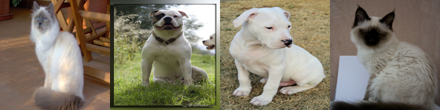
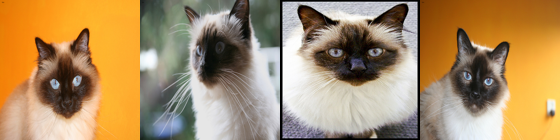

# Image Feature Extraction

Everything to know about image embeddings: what a good visual representation is, the mid-2026 model landscape (DINOv3 vs CLIP/SigLIP vs supervised features), how embeddings are evaluated, and runnable code that builds a real image-retrieval index.

Author

Benedict Thekkel

## 1. What is Image Feature Extraction?

Image feature extraction turns an image into a **fixed-length vector** (an *embedding*, typically 384-1536 floats) whose **geometry is the product**. Nobody consumes the vector for its own sake: the whole point is that *distance in the embedding space tracks semantic similarity*, so nearest neighbours of a query are pictures of the same thing.

**Input.** A single RGB image, resized and normalised by the model’s `AutoImageProcessor` (224x224 or 518x518 is typical). Nothing else - no labels, no text, no prompts.

**Output.** One of two things, and confusing them is the most common mistake in this task:

| Output | Shape | What it is | Used for |
|----|----|----|----|
| **Global embedding** | `[D]` | one vector per image (the CLS token, or a pooled patch mean) | retrieval, dedup, clustering, k-NN, linear probes |
| **Dense / patch embeddings** | `[n_patches, D]` | one vector per 14x14 or 16x16 patch | segmentation, correspondence, depth, tracking, open-vocab detection |

A ViT-B/14 at 224px gives 256 patch tokens + 1 CLS token; DINOv3 adds 4 register tokens on top of that. `last_hidden_state` holds all of them; the global vector is something you *choose* out of that tensor (section 9 - this is the single highest-leverage decision in the notebook).

**Neighbouring tasks** (all of them consume or produce these vectors):

| Task | Relationship to embeddings | Notebook / tool |
|----|----|----|
| Image classification | a classifier’s penultimate layer *is* an embedding - the “supervised features” baseline | `01_Image_Classification` |
| Zero-shot classification | cosine similarity between an image embedding and text embeddings of class names | `11_Zero_Shot_Image_Classification` |
| Keypoint detection / matching | the classical local-feature ancestor (SIFT, ORB): many small descriptors instead of one global vector | `17_Keypoint_Detection` |
| Segmentation, depth | linear heads on top of *dense* patch features | `03_Image_Segmentation`, `00_Depth_Estimation` |
| Text feature extraction | the exact text analogue - same metrics, same FAISS index | `NLP/07_Feature_Extraction`, `NLP/10_Sentence_Similarity` |
| Approximate nearest neighbour search | the infrastructure that makes embeddings usable at scale | FAISS, hnswlib, ScaNN, pgvector |

------------------------------------------------------------------------

## 2. Real-World Use Cases

Embeddings are the least visible and most widely deployed vision task: almost every “find me something like this” button in a product is a cosine similarity over a vector index.

| Use case | Domain | Consumes / produces | Dominant constraint |
|----|----|----|----|
| Visual product search (“shop the look”) | E-commerce (Google Lens, Amazon StyleSnap, Pinterest Lens) | Phone photo -\> top-k catalogue SKUs | Fine-grained similarity (this exact sneaker, not “a shoe”); index recall at billions of items |
| Photo library search by text | Consumer (Apple Photos, Google Photos) | “dog on a beach” -\> your photos | Cross-modal (needs a language-aligned model); must run **on device**, private |
| Near-duplicate detection and copyright / CSAM matching | Content platforms (Meta PDQ, YouTube Content ID) | Uploaded image -\> hash / vector match against a banned set | Robustness to crop, re-encode, watermark; precision (a false positive is a wrongful takedown) |
| Recommendation and cold-start ranking | Media, marketplaces | Item image -\> vector feature for a ranker | Throughput (millions of items/day); embedding **dimension = storage cost** |
| Industrial anomaly detection | Manufacturing (MVTec-style inspection) | Product photo -\> distance to the “normal” patch-feature distribution | Dense patch features, not just a global vector; no defect labels available |
| Medical / satellite retrieval | Healthcare, earth observation | Scan or tile -\> similar historical cases | Severe domain shift from web images; DINOv3 ships a satellite-pretrained variant for exactly this |
| RAG over images / agent memory | LLM applications | Screenshot or document page -\> retrieved context for a VLM | Cross-modal alignment; latency inside an agent loop |
| Clustering and dataset curation | ML infrastructure (LAION, DataComp, LVD-142M itself) | Billions of images -\> dedup + balanced sample | Cost per image; embedding quality *is* dataset quality |

**What the ImageNet linear-probe number hides.** An 87% linear probe on ImageNet tells you almost nothing about whether the model will find *your* duplicate. Three things break in production. (1) **Domain shift**: the model was trained on web photos, and X-rays, satellite tiles, CAD renders and receipts are not web photos - k-NN accuracy can collapse by 30+ points, and the fix is usually a domain-pretrained backbone rather than a better generic one. (2) **The metric space is not calibrated**: cosine 0.83 does not mean “duplicate” - the threshold is dataset-dependent and drifts every time you change the backbone, so every deployed system needs a re-tuned threshold and a re-embedded index (re-embedding a billion-image index is a *migration*, not a config change). (3) **The distance you optimised is not the distance the user means**: CLIP will happily rank a *drawing* of a golden retriever next to a *photo* of one, because that is what its training objective rewards; a dedup system considers that a false positive. Add the boring operational realities - embedding dimension times number of items is a hard RAM budget, and ANN search trades recall for latency at exactly the point where you stop being able to measure it.

------------------------------------------------------------------------

## 3. How Modern Image Feature Extraction Works

**The classical era (1999-2012).** SIFT (1999), SURF, ORB: hand-designed *local* descriptors around detected keypoints, aggregated into a global vector by bag-of-visual-words / VLAD / Fisher vectors. Dead for semantics, still alive for geometry - SfM, SLAM and homography estimation still use local descriptors (see `17_Keypoint_Detection`), because a global embedding cannot tell you *where* the match is.

**Supervised features (2012-2019).** Chop the head off an ImageNet CNN and use the penultimate layer. Cheap, effective, and still the right baseline - but the features are shaped by 1000 classes, so anything outside that taxonomy (textures, defects, document layouts) is represented badly.

**Contrastive self-supervision (2020).** SimCLR and MoCo: two augmented views of an image are positives, every other image in the batch is a negative, InfoNCE pulls and pushes. Works, but needs *lots* of negatives - hence SimCLR’s 4096-image batches and MoCo’s momentum queue - and false negatives (two different photos of the same breed) actively hurt.

**Non-contrastive / self-distillation (2020-2021).** BYOL and SimSiam showed you can drop negatives entirely: a student predicts a momentum-EMA teacher’s output for another view. The obvious failure - collapse to a constant vector - is prevented by architectural asymmetry (predictor head, stop-gradient) rather than by negatives. **DINO (2021)** made this a ViT recipe: EMA teacher, multi-crop, and two anti-collapse tricks that are the whole trick - **centering** (subtract a running mean from the teacher logits, which prevents one dimension dominating) and **sharpening** (a low teacher temperature, which prevents uniform output). The bonus discovery: DINO’s attention maps segment objects with no supervision at all. SwAV (2020) took a third route, contrasting *cluster assignments* instead of features.

**Masked image modelling (2021-2022).** MAE masks 75% of patches and reconstructs pixels; BEiT reconstructs discrete visual tokens. Fast to pretrain and an excellent *fine-tuning* initialisation, but reconstruction optimises for pixel-level detail, not for linear separability - so MAE’s **linear probe and k-NN accuracy are far below DINO’s** even when its fine-tuned accuracy is competitive. Section 12 reproduces this gap. If you are fine-tuning, MIM is fine; if you are embedding, it is not.

**Language supervision (2021-2023).** CLIP put images and text in **one shared space** trained by contrastive image-text matching over 400M pairs; SigLIP (2023) replaced the batch-wide softmax with a pairwise **sigmoid** loss, which removes the all-gather and lets you train well at small batch sizes. This bought the killer feature - **search images with a text string** - at a cost: the objective only needs the image vector to be closer to *its* caption than to other captions, and captions are coarse (“a dog”), so fine-grained purely-visual distinctions get compressed.

**DINOv2 (2023).** The turning point: DINO + iBOT objectives, careful data curation (**LVD-142M**, retrieval-deduplicated from a raw web crawl), and distillation from a ViT-g teacher into ViT-S/B/L. It was the first SSL model whose **frozen, off-the-shelf** features beat weakly-supervised (CLIP-family) features on most benchmarks - especially dense ones. The “registers” follow-up (2023) found that ViTs dump global information into a few high-norm background patch tokens, producing artifact-ridden attention maps, and fixed it by adding dedicated register tokens.

**DINOv3 (Aug 2025).** Scale it: a **7B-param ViT** trained on **LVD-1689M** (~1.7B curated images), then distilled into a ViT-S/S+/B/L/H+ and ConvNeXt family. Its key contribution is **Gram anchoring**: over a long training run, dense patch features degrade (patch-to-patch similarity gets noisy) even while global features keep improving, so DINOv3 adds a loss that keeps the student’s patch **Gram matrix** (the matrix of pairwise patch similarities) close to that of an earlier, cleaner “Gram teacher”. The result is dense features that stay sharp at scale. Caveat: the weights are under a **custom Meta “DINOv3 License” and are gated with manual approval** - not Apache/MIT, so check the terms before shipping it.

**The multimodal-embedding line (2024-2026).** SigLIP 2 (Feb 2025) folds captioning, self-distillation and dense objectives into the SigLIP recipe and is the strongest general-purpose *open* image-text encoder in the base size class; Meta’s **Perception Encoder** (Apr 2025) showed that a well-tuned contrastive model’s *intermediate* layers rival DINOv2-g on spatial tasks and AIMv2 on language tasks - i.e. “the best visual embeddings are not at the output of the network”. Alongside these sit unified text+image embedders built for RAG (jina-clip-v2, nomic-embed-vision, MegaPairs/VLM2Vec-style models) that emit one vector for either modality.

**Cheat sheet:**

| Family | Text-aligned? | Fine-grained visual | Dense/patch features | k-NN probe | Typical use |
|----|----|----|----|----|----|
| Supervised ImageNet ViT/ConvNeXt | no | ok (in-taxonomy) | weak | good | cheap baseline, in-domain classes |
| MAE / BEiT (MIM) | no | weak frozen | ok | **poor** | fine-tuning init, not embedding |
| CLIP / SigLIP / SigLIP 2 | **yes** | moderate | weak-moderate | good | text-to-image search, zero-shot, RAG |
| DINOv2 / DINOv3 (SSL) | **no** | **best** | **best** | **best** | retrieval, dedup, dense heads, anomaly |
| Perception Encoder | yes | strong | strong (mid layers) | strong | when you want both, from one model |

The honest summary in mid-2026: **if you need text queries, you need a CLIP-family model; if you need the sharpest purely-visual geometry, you want DINOv3.** Many production systems run both and concatenate.

------------------------------------------------------------------------

## 4. Evaluation Metrics

Embeddings have no output to score directly, so every metric is a **proxy task** on frozen features. Two of them are standard, they measure different things, and **they disagree** often enough that you should always report both.

**1. k-NN top-1 accuracy.** Embed a labelled train set, embed a test image, take the k nearest neighbours by cosine, majority-vote the label. This measures the **local metric structure** - is my neighbourhood full of my own class? It is the metric that actually predicts retrieval quality, and it needs no training.

**2. Linear-probe accuracy.** Freeze the backbone, train a single linear layer (logistic regression) on the embeddings. This measures **linear separability** - is the class information present along some hyperplane? A model can be linearly separable but metrically ugly (classes separable but far from compact), which is exactly how MIM models score respectably on linear probes while collapsing on k-NN.

**3. Retrieval metrics.** For a query $q$ with a relevant set $R_q$ out of a gallery, ranked by cosine:

$$\mathrm{Recall}@k = \frac{1}{|Q|}\sum_{q \in Q} \mathbb{1}\left[\,\exists\, i \le k : \mathrm{rank}_q(i) \in R_q \right]$$

$$\mathrm{AP}(q) = \frac{1}{|R_q|}\sum_{k=1}^{N} P(k)\cdot \mathrm{rel}_q(k), \qquad \mathrm{mAP} = \frac{1}{|Q|}\sum_{q} \mathrm{AP}(q)$$

Recall@k only asks “did *anything* relevant land in the top k” (the right metric for “show me 5 similar products”); mAP scores the whole ranking (the right metric for the Oxford/Paris landmark benchmarks). MRR (mean reciprocal rank of the first hit) is the middle ground.

**4. Alignment and uniformity** (Wang and Isola, 2020) - a diagnostic, not a score. On the unit sphere, good contrastive features are *aligned* (positive pairs close) and *uniform* (features spread out, not collapsed):

$$L_{\text{align}} = \mathbb{E}_{(x,x^+)} \|f(x) - f(x^+)\|_2^2, \qquad L_{\text{uniform}} = \log \mathbb{E}_{x,y}\, e^{-2\|f(x)-f(y)\|_2^2}$$

Both are lower-is-better. If your fine-tune tanks, this tells you *which way* it broke: alignment up = the model stopped matching positives; uniformity up (toward 0) = representation collapse.

**5. Cost metrics that decide the architecture.** Embedding **dimension** (bytes per image: 768 fp32 = 3 KB, so 100M images = 300 GB of RAM before any index overhead) and **throughput** (images/sec). Matryoshka Representation Learning (MRL) trains the vector so that its first 64/128/256 dims are *themselves* usable embeddings, letting you truncate for a cheap first-pass shortlist and rerank with the full vector.

**The one rule that breaks everything if you skip it: L2-normalise before you compare.** Cosine similarity equals a dot product **only** on unit vectors, and every ANN index that advertises “inner product” search assumes you did this. Embedding norm correlates with things you do not want in your ranking (image contrast, object size), so an unnormalised dot product quietly ranks by brightness.

------------------------------------------------------------------------

``` python
# The metric toolbox. Defined once here on fabricated embeddings, reused for real ones below.
import torch

def l2_normalize(x, eps=1e-12):
    "Project rows onto the unit sphere. Do this before EVERY cosine / dot-product comparison."
    return x / x.norm(dim=-1, keepdim=True).clamp_min(eps)

def cosine_sim(q, g):
    "Cosine similarity matrix [Nq, Ng] between query and gallery embeddings (raw, unnormalised)."
    return l2_normalize(q.float()) @ l2_normalize(g.float()).T

def knn_top1(q, q_lab, g, g_lab, k=5):
    "k-NN classification accuracy: majority vote over the k nearest gallery items."
    sims = cosine_sim(q, g)
    idx = sims.topk(k, dim=1).indices                 # [Nq, k]
    votes = g_lab[idx]                                # [Nq, k]
    n_cls = int(max(g_lab.max(), q_lab.max())) + 1
    counts = torch.zeros(len(q), n_cls)
    counts.scatter_add_(1, votes, torch.ones_like(votes, dtype=torch.float))
    return (counts.argmax(1) == q_lab).float().mean().item()

def recall_at_k(q, q_lab, g, g_lab, k=5):
    "Fraction of queries with at least one same-class item in the top k."
    idx = cosine_sim(q, g).topk(k, dim=1).indices
    return (g_lab[idx] == q_lab[:, None]).any(1).float().mean().item()

def mean_ap(q, q_lab, g, g_lab):
    "Mean average precision over the full ranking (the Oxford/Paris retrieval metric)."
    order = cosine_sim(q, g).argsort(dim=1, descending=True)
    rel = (g_lab[order] == q_lab[:, None]).float()    # [Nq, Ng] relevance in rank order
    cum = rel.cumsum(1)
    prec_at_k = cum / torch.arange(1, rel.shape[1] + 1).float()
    ap = (prec_at_k * rel).sum(1) / rel.sum(1).clamp_min(1)
    return ap.mean().item()

def align_uniform(view_a, view_b, t=2.0):
    "Wang and Isola (2020) alignment (positive-pair distance) and uniformity (log-MMD to a Gaussian kernel)."
    a, b = l2_normalize(view_a.float()), l2_normalize(view_b.float())
    alignment = (a - b).norm(dim=1).pow(2).mean().item()
    sq = torch.pdist(a, p=2).pow(2)
    uniformity = sq.mul(-t).exp().mean().log().item()
    return alignment, uniformity

# --- toy check on fabricated embeddings: 3 classes, 3 gaussian blobs in 8-D -------------
torch.manual_seed(0)
centers = torch.randn(3, 8) * 3
g_lab = torch.arange(3).repeat_interleave(20)          # 60 gallery items
gallery = centers[g_lab] + torch.randn(60, 8) * 0.7
q_lab = torch.arange(3).repeat_interleave(4)           # 12 queries
queries = centers[q_lab] + torch.randn(12, 8) * 0.7

print("k-NN top-1 :", round(knn_top1(queries, q_lab, gallery, g_lab, k=5), 3))
print("Recall@5   :", round(recall_at_k(queries, q_lab, gallery, g_lab, k=5), 3))
print("mAP        :", round(mean_ap(queries, q_lab, gallery, g_lab), 3))

# Cosine == dot product ONLY on unit vectors. Scaling one row by 10 leaves cosine
# untouched but multiplies the raw dot product by 10 - i.e. an unnormalised index
# ranks by vector norm, which is a property of the image, not of its content.
a, b = gallery[0], gallery[1] * 10.0
print("raw dot          :", round(float(a @ b), 3))
print("cosine           :", round(float(cosine_sim(a[None], b[None])[0, 0]), 3))
print("dot after L2 norm:", round(float(l2_normalize(a[None]) @ l2_normalize(b[None]).T), 3))

# Alignment/uniformity: treat a lightly-jittered copy as the positive view.
print("align, uniform   :", [round(v, 3) for v in align_uniform(gallery, gallery + torch.randn(60, 8) * 0.2)])
```

    k-NN top-1 : 1.0
    Recall@5   : 1.0
    mAP        : 1.0
    raw dot          : 642.857
    cosine           : 0.954
    dot after L2 norm: 0.954
    align, uniform   : [0.005, -1.175]

## 5. Datasets

Embedding models are **trained** on huge uncurated (or carefully de-duplicated) web crawls and **evaluated** on small labelled probes. The two sets barely overlap.

| Dataset | Contents | Size | Scope | License | Typical use |
|----|----|----|----|----|----|
| [ILSVRC-2012 / ImageNet-1k](https://huggingface.co/datasets/ILSVRC/imagenet-1k) | Object photos, 1000 classes | 1.28M train / 50k val | Objects | Research-only, **gated** (accept terms) | The linear-probe and k-NN standard |
| [timm/oxford-iiit-pet](https://huggingface.co/datasets/timm/oxford-iiit-pet) | 37 cat/dog **breeds** | 3.7k train / 3.7k test | Fine-grained animals | CC-BY-SA-4.0 | **This notebook’s eval set** - fine-grained, small, ungated |
| [ethz/food101](https://huggingface.co/datasets/ethz/food101) | 101 food classes | 75k / 25k | Fine-grained food | Research use | Standard frozen-feature probe |
| [uoft-cs/cifar10](https://huggingface.co/datasets/uoft-cs/cifar10) | 10 coarse classes, 32x32 | 50k / 10k | Tiny objects | MIT | Fast smoke-test probe |
| [ROxford5k / RParis6k](https://github.com/filipradenovic/revisitop) | Landmark photos with hard distractors | 5k / 6k + 1M distractors | Instance-level retrieval | Research | **The** retrieval mAP benchmark (Easy/Medium/Hard) |
| [Google Landmarks v2](https://github.com/cvdfoundation/google-landmark) | 5M images, 200k landmarks | 5M | Instance retrieval at scale | CC-BY | Large-scale retrieval training/eval |
| [COCO](https://huggingface.co/datasets/detection-datasets/coco) / [Flickr30k](https://huggingface.co/datasets/nlphuji/flickr30k) | Images with 5 captions each | 123k / 31k | Cross-modal | CC-BY / research | Image-text retrieval R@1/5/10 |
| [LAION-2B](https://huggingface.co/datasets/laion/laion2B-en) / [DataComp-1B](https://huggingface.co/datasets/mlfoundations/datacomp_1b) | Web image-text pairs | 2B / 1.4B | Training | CC-BY (metadata only) | CLIP/SigLIP pretraining |
| LVD-142M / LVD-1689M | Curated, deduplicated web images (no text) | 142M / 1.7B | Training | **Not released** | DINOv2 / DINOv3 pretraining |
| [MIEB](https://arxiv.org/abs/2504.10471) / [MMEB](https://huggingface.co/spaces/TIGER-Lab/MMEB-Leaderboard) | Meta-benchmarks: 130 / 36 tasks | \- | Everything above, aggregated | Mixed | The current leaderboards |

We evaluate on **Oxford-IIIT Pet** (`timm/oxford-iiit-pet`): 37 breeds, ungated, parquet-backed, and *fine-grained* - which is exactly the axis where DINOv2/DINOv3 pull away from CLIP. It fits the box: we sub-sample ~320 images. ImageNet-1k is gated (you must accept terms on the Hub) and is far too big to probe on this machine anyway.

------------------------------------------------------------------------

## 6. The Model Landscape (mid-2026)

The authoritative rankings are [**MIEB**](https://arxiv.org/abs/2504.10471) (130 image / image-text tasks, 38 languages, folded into the [MTEB leaderboard](https://huggingface.co/spaces/mteb/leaderboard)) and [**MMEB**](https://huggingface.co/spaces/TIGER-Lab/MMEB-Leaderboard) (36 datasets, instruction-following multimodal embedders). MIEB’s headline finding is worth internalising: **no single model wins all eight task categories** - the model that tops linear probing is not the model that tops interleaved retrieval or document understanding.

| Model | Params | License | Scope | Architecture | Best for |
|----|----|----|----|----|----|
| **DINOv3 ViT-7B/16** | 6.7B | DINOv3 License (gated) | vision only | SSL + Gram anchoring | SOTA dense + global features. **Way past 12 GB** - use a distilled child |
| **DINOv3 ViT-B/16** | 86M, D=768 | DINOv3 License (gated) | vision only | distilled from the 7B | best runnable visual embedder; **needs manual Hub approval** |
| DINOv3 ViT-L/16 | 303M, D=1024 | DINOv3 License (gated) | vision only | distilled | fits 12 GB; the quality/size sweet spot |
| DINOv3 ConvNeXt-B | 89M | DINOv3 License | vision only | ConvNeXt | edge / ONNX / non-ViT stacks |
| DINOv3 ViT-L/16 SAT-493M | 303M | DINOv3 License | satellite | distilled | earth observation (huge domain-shift win) |
| **DINOv2 ViT-B/14** | 86M, D=768 | **Apache 2.0** | vision only | DINO + iBOT | the ungated default; what to reach for first |
| DINOv2 ViT-L/14 + registers | 304M | Apache 2.0 | vision only | \+ register tokens | clean attention maps, dense heads |
| **SigLIP 2 base/16** | 375M total, D=768 | **Apache 2.0** | image + text, multilingual | sigmoid ITC + captioning | best open language-aligned base model |
| **CLIP ViT-B/32** | 151M, D=512 | MIT | image + text | softmax ITC | the ecosystem baseline; fastest text-to-image demo |
| Perception Encoder Core B/16 | ~86M vision | Apache 2.0 | image + text | contrastive, mid-layer features | one model for both language *and* spatial tasks |
| AIMv2-L/14 | 309M | apple-amlr (restricted) | image + text | autoregressive multimodal | strong VLM backbone |
| jina-clip-v2 | 865M | **CC-BY-NC-4.0** (no commercial use) | 89 languages + image | dual encoder, Matryoshka dims | multilingual text+image RAG |
| nomic-embed-vision-v1.5 | 93M, D=768 | Apache 2.0 | image, aligned to nomic-embed-text | ViT aligned post-hoc | one index shared with a text embedder |
| ViT-B/16 (ImageNet-1k supervised) | 86M, D=768 | Apache 2.0 | vision only | supervised | the honest baseline everyone forgets |
| ViT-MAE base | 112M, D=768 | Apache 2.0 | vision only | masked autoencoder | a fine-tuning *init*, **not** an embedder |

**Who wins what.** Accuracy on purely-visual similarity: DINOv3 (then DINOv2). Anything involving text: SigLIP 2 (then Perception Encoder, then CLIP). Speed and storage: CLIP ViT-B/32 - 512-d vectors and 32x32 patches make it ~4x cheaper per image than a /14 or /16 model, which is why it survives in production long after being beaten on accuracy. Tie this back to section 2: a photo-library text search *must* be CLIP-family (there is no other way to type a query); a dedup or defect-inspection system *should* be DINOv3, because it never needs text and cares only about fine-grained visual geometry.

**Licensing is a real constraint here.** DINOv3 is not open source - it is a custom Meta license behind a manually-approved gate. jina-clip-v2 is non-commercial. AIMv2 is under Apple’s restricted ASCL. If you need a permissive licence *and* good visual features, DINOv2 (Apache 2.0) remains the answer, and that is why it is this notebook’s primary model.

------------------------------------------------------------------------

## 7. Setup

Every model loads through Hugging Face `transformers` - no vendor packages. Package roles:

- `transformers` (\>=5.13) + `torch` - all backbones (`AutoModel` + `AutoImageProcessor`, plus the `image-feature-extraction` pipeline)
- `datasets` - the Oxford-IIIT Pet eval split (parquet, no loading script)
- `accelerate` - device placement
- `pillow` - decoding and displaying retrieved images
- `pyecharts` - all charts
- `pandas` - the benchmark table
- `numpy` - PCA via SVD (no scikit-learn needed)

Deliberately **not** used: `faiss`. Exact cosine search over a few hundred vectors is one `matmul`, and writing it out makes the mechanics visible. At scale you swap that matmul for FAISS / hnswlib / ScaNN / pgvector - see section 16.

All downloads (sample image, HF model + dataset cache) land in `DL_tasks/datasets/`, which is gitignored.

------------------------------------------------------------------------

``` python
# Everything runs through Hugging Face transformers - no model-specific packages.
# %pip install -q torch transformers datasets accelerate pillow pyecharts pandas numpy

# DINOv3 is a GATED repo (custom Meta license, manual approval). To run section 13:
#   1. accept the terms at https://huggingface.co/facebook/dinov3-vitb16-pretrain-lvd1689m
#   2. wait for approval, then put HF_TOKEN=hf_... in Knowledge/.env
# Every other model in this notebook is ungated.
```

``` python
import ctypes
import ctypes.util
import gc
import time
import urllib.request
from pathlib import Path

import torch
from dotenv import find_dotenv, load_dotenv

# Knowledge/.env sets HF_TOKEN - authenticated HF Hub requests get higher rate limits
# (and are required for the gated DINOv3 weights in section 13).
load_dotenv(find_dotenv(usecwd=True))

device = "cuda:0" if torch.cuda.is_available() else "cpu"
dtype = torch.float16 if device != "cpu" else torch.float32
if device != "cpu":
    print(torch.cuda.get_device_name(0))
print("device:", device, "| dtype:", dtype)

def vram(tag=""):
    "Report current GPU memory (allocated / reserved). No-op on CPU."
    if torch.cuda.is_available():
        alloc = torch.cuda.memory_allocated() / 1e9
        reserved = torch.cuda.memory_reserved() / 1e9
        print(f"VRAM {tag:20s} {alloc:5.2f} GB allocated / {reserved:5.2f} GB reserved")

def free_memory():
    "Collect garbage, empty the CUDA cache, and return freed CPU RAM to the OS."
    gc.collect()
    if torch.cuda.is_available():
        torch.cuda.empty_cache()
        torch.cuda.ipc_collect()
    # glibc keeps freed CPU allocations in its arenas instead of returning them
    # to the OS, so RSS compounds across model sections (cpu-offloaded weights
    # live in system RAM). malloc_trim(0) hands the freed arenas back. See
    # dl-visualization-and-memory.md - not optional on a 12 GB box.
    try:
        ctypes.CDLL(ctypes.util.find_library("c") or "libc.so.6").malloc_trim(0)
    except Exception:
        pass

# All downloads go to DL_tasks/datasets/ (gitignored)
DATA_DIR = Path("../../datasets")
DATA_DIR.mkdir(exist_ok=True)
HF_CACHE = str(DATA_DIR / "hf_cache")

# The canonical COCO two-cats image - our single-image sanity check
SAMPLE = DATA_DIR / "cats.jpg"
if not SAMPLE.exists():
    urllib.request.urlretrieve(
        "http://images.cocodataset.org/val2017/000000039769.jpg", SAMPLE
    )
```

    NVIDIA GeForce RTX 3060
    device: cuda:0 | dtype: torch.float16

``` python
from datasets import load_dataset
from PIL import Image

# Oxford-IIIT Pet: 37 fine-grained cat/dog breeds, ungated, parquet-backed.
# We take 8 breeds x 40 images = 320 images so the whole notebook stays inside
# a few hundred MB of RAM and a couple of minutes of GPU time.
N_CLASSES, PER_CLASS = 8, 40

pets = load_dataset("timm/oxford-iiit-pet", split="test", cache_dir=HF_CACHE)
CLASS_NAMES = pets.features["label"].names

by_class = {c: [] for c in range(N_CLASSES)}
for i, lab in enumerate(pets["label"]):
    if lab < N_CLASSES and len(by_class[lab]) < PER_CLASS:
        by_class[lab].append(i)
assert all(len(v) == PER_CLASS for v in by_class.values()), "not enough images per class"
keep = [i for c in range(N_CLASSES) for i in by_class[c]]   # grouped by class, in class order
subset = pets.select(keep)

# Materialise 320 small PIL images once (RGB, <=512px) and free the Arrow handles.
IMAGES = [im.convert("RGB") for im in subset["image"]]
LABELS = torch.tensor(subset["label"])
LABEL_NAMES = [CLASS_NAMES[i] for i in range(N_CLASSES)]

# Gallery / query split: 25 per class indexed, 15 per class queried.
is_query = torch.cat([torch.arange(PER_CLASS) >= 25 for _ in range(N_CLASSES)])
G_IDX = (~is_query).nonzero().squeeze(1)   # 200 gallery images
Q_IDX = is_query.nonzero().squeeze(1)      # 120 query images
G_LAB, Q_LAB = LABELS[G_IDX], LABELS[Q_IDX]

print(f"{len(IMAGES)} images | {N_CLASSES} breeds: {', '.join(LABEL_NAMES)}")
print(f"gallery {len(G_IDX)} | queries {len(Q_IDX)}")

del pets, subset
free_memory()

def show_row(images, size=140, captions=None):
    "Paste PIL images side by side into one strip (ECharts cannot draw images; PIL can)."
    thumbs = [im.resize((size, size)) for im in images]
    strip = Image.new("RGB", (size * len(thumbs), size), "white")
    for i, t in enumerate(thumbs):
        strip.paste(t, (i * size, 0))
    if captions:
        print(" | ".join(captions))
    return strip

show_row([IMAGES[i * PER_CLASS] for i in range(N_CLASSES)],
         captions=LABEL_NAMES)
```

    320 images | 8 breeds: abyssinian, american_bulldog, american_pit_bull_terrier, basset_hound, beagle, bengal, birman, bombay
    gallery 200 | queries 120
    abyssinian | american_bulldog | american_pit_bull_terrier | basset_hound | beagle | bengal | birman | bombay


``` python
# The two workhorses used by every section below: a batched embedding driver and
# a torch linear probe (no scikit-learn dependency).
from IPython.display import display

@torch.inference_mode()
def embed_all(encode, images, batch_size=16):
    """Run `encode(list_of_PIL) -> [B, D]` over all images in batches.

    Returns a float32 CPU tensor [N, D] plus images/sec. Everything is moved off
    the GPU immediately so VRAM does not grow with N.
    """
    chunks = []
    t0 = time.perf_counter()
    for i in range(0, len(images), batch_size):
        chunks.append(encode(images[i:i + batch_size]).float().cpu())
    elapsed = time.perf_counter() - t0
    return torch.cat(chunks), len(images) / elapsed

def linear_probe(g, g_lab, q, q_lab, epochs=300, lr=0.05, wd=1e-4):
    "Train a logistic regression on frozen (L2-normalised) features; return test accuracy."
    xtr, xte = l2_normalize(g.float()), l2_normalize(q.float())
    clf = torch.nn.Linear(xtr.shape[1], int(g_lab.max()) + 1)
    opt = torch.optim.AdamW(clf.parameters(), lr=lr, weight_decay=wd)
    for _ in range(epochs):                     # full batch: 200 x 768 is tiny
        opt.zero_grad()
        torch.nn.functional.cross_entropy(clf(xtr), g_lab).backward()
        opt.step()
    with torch.inference_mode():
        return (clf(xte).argmax(1) == q_lab).float().mean().item()

def score(emb, tag):
    "k-NN top-1 + Recall@5 + mAP + linear probe for one embedding matrix."
    g, q = emb[G_IDX], emb[Q_IDX]
    row = dict(
        dim=emb.shape[1],
        knn=knn_top1(q, Q_LAB, g, G_LAB, k=5),
        recall5=recall_at_k(q, Q_LAB, g, G_LAB, k=5),
        map=mean_ap(q, Q_LAB, g, G_LAB),
        probe=linear_probe(g, G_LAB, q, Q_LAB),
    )
    print(f"{tag:26s} d={row['dim']:4d}  kNN {row['knn']:.3f}  R@5 {row['recall5']:.3f}  "
          f"mAP {row['map']:.3f}  probe {row['probe']:.3f}")
    return row
```

## 8. DINOv2 (self-supervised visual features)

`facebook/dinov2-base` - 86M params, ViT-B/14, **Apache 2.0**, ungated. Self-distillation (DINO) plus a masked-patch objective (iBOT) on the curated LVD-142M crawl, distilled from a ViT-g teacher. Pick it when you want the best *purely visual* similarity you can get under a permissive licence and without a Hub approval queue.

It is a plain `AutoModel`, so it returns a `BaseModelOutputWithPooling`:

- `last_hidden_state` -\> `[B, 1 + 256, 768]` at 224px: **CLS token first, then 256 patch tokens** (14x14 patches on a 224px image gives 16x16 = 256 patches).
- `pooler_output` -\> `[B, 768]`. For DINOv2 this is just `layernorm(last_hidden_state[:, 0])`, i.e. **the CLS token** - there is no learned pooling head. (That is *not* true of every ViT - see the warning in section 12.)

The `image-feature-extraction` pipeline wraps this in one line, but it hides the pooling choice, which is exactly the thing you need to control. Use it for a quick look; use `AutoModel` for anything real.

------------------------------------------------------------------------

``` python
from transformers import AutoImageProcessor, AutoModel, pipeline

DINOV2 = "facebook/dinov2-base"
dino_proc = AutoImageProcessor.from_pretrained(DINOV2, cache_dir=HF_CACHE)
dino = AutoModel.from_pretrained(DINOV2, dtype=dtype, cache_dir=HF_CACHE).to(device).eval()
vram("dinov2-base loaded")

# One image, to see the raw token tensor.
with torch.inference_mode():
    inp = dino_proc(images=Image.open(SAMPLE), return_tensors="pt").to(device, dtype)
    out = dino(**inp)
print("last_hidden_state:", tuple(out.last_hidden_state.shape), " (1 CLS + 256 patch tokens)")
print("pooler_output    :", tuple(out.pooler_output.shape))
print("pooler == CLS    :", torch.allclose(out.pooler_output, out.last_hidden_state[:, 0]))

# The four candidate global vectors. n_prefix = number of non-patch tokens at the
# front of the sequence: 1 (CLS) for DINOv2, 5 (CLS + 4 registers) for DINOv3.
def vit_encode(model, proc, n_prefix=1, pooling="cls"):
    def encode(batch):
        inp = proc(images=batch, return_tensors="pt").to(device, dtype)
        h = model(**inp).last_hidden_state
        cls, patches = h[:, 0], h[:, n_prefix:]
        return {
            "cls": cls,
            "patch_mean": patches.mean(1),
            "cls+patch_mean": torch.cat([cls, patches.mean(1)], dim=-1),  # the official DINOv2 probe input
        }[pooling]
    return encode

t0 = time.perf_counter()
DINO_EMB = {p: embed_all(vit_encode(dino, dino_proc, 1, p), IMAGES)[0]
            for p in ["cls", "patch_mean", "cls+patch_mean"]}
print(f"embedded {len(IMAGES)} images x 3 poolings in {time.perf_counter() - t0:.1f}s")
print({k: tuple(v.shape) for k, v in DINO_EMB.items()})

# The one-liner equivalent (pool=True returns pooler_output, i.e. the CLS token):
# pipe = pipeline("image-feature-extraction", model=DINOV2, device=device)
# pipe(str(SAMPLE), pool=True, return_tensors="pt").shape  -> [1, 768]

del dino, dino_proc, out, inp
free_memory()
vram("after dinov2")
```

    VRAM dinov2-base loaded    0.18 GB allocated /  0.19 GB reserved
    last_hidden_state: (1, 257, 768)  (1 CLS + 256 patch tokens)
    pooler_output    : (1, 768)
    pooler == CLS    : True
    embedded 320 images x 3 poolings in 7.5s
    {'cls': (320, 768), 'patch_mean': (320, 768), 'cls+patch_mean': (320, 1536)}
    VRAM after dinov2          0.01 GB allocated /  0.02 GB reserved

## 9. Which Vector Do You Actually Take?

This is the decision that most often separates a retrieval system that works from one that does not, and it is almost never discussed. `last_hidden_state` is `[B, T, D]`; you must collapse `T` into a single vector, and the options are **not** equivalent:

| Choice | What it encodes | Notes |
|----|----|----|
| `pooler_output` | whatever the checkpoint’s pooling head does | **Read the source.** DINOv2: the CLS token. ViT-in1k: a *randomly initialised* dense+tanh head, because the classification checkpoint never trained one (section 12). CLIP/SigLIP: you should call `get_image_features()` instead, which applies the learned **projection into the shared text space**. |
| CLS token | the global summary the training objective optimised | The intended global descriptor for DINO-family models. |
| mean of patch tokens | the average of local content | Often *better* for retrieval and for texture/part-level similarity; much less sensitive to what the object-centric CLS decided was “the subject”. |
| concat(CLS, patch mean) | both | Doubles D (768 -\> 1536). This is what `Dinov2ForImageClassification` actually feeds its linear layer, and what the DINOv2 paper uses for linear evaluation. Best accuracy, 2x the storage. |

Then, whichever you pick: **L2-normalise**. Then cosine == dot product, and an inner-product ANN index gives you cosine search for free.

The cell below builds an index with each pooling choice and scores it. The numbers move by several points on the same frozen model - the pooling choice is worth as much as a model upgrade.

------------------------------------------------------------------------

``` python
from pyecharts.globals import CurrentConfig

# assets.pyecharts.org serves an expired TLS certificate from most nodes (2026-11-11),
# so charts failed to load. jsDelivr mirrors the same assets, pinned to one commit.
CurrentConfig.ONLINE_HOST = "https://cdn.jsdelivr.net/gh/pyecharts/pyecharts-assets@f2328d558550046fc5449672a6850e848e141590/assets/v6/"

from pyecharts import options as opts
from pyecharts.charts import Bar

pool_rows = {p: score(emb, f"dinov2 {p}") for p, emb in DINO_EMB.items()}

# The vectors are unnormalised on purpose: show what skipping L2-norm costs.
_g, _q = DINO_EMB["cls"][G_IDX], DINO_EMB["cls"][Q_IDX]
raw_dot_idx = (_q.float() @ _g.float().T).argmax(1)          # rank by raw dot product
cos_idx = cosine_sim(_q, _g).argmax(1)                       # rank by cosine
print("\nnearest-neighbour top-1 accuracy, dinov2 CLS:")
print("  raw dot product :", round((G_LAB[raw_dot_idx] == Q_LAB).float().mean().item(), 3))
print("  cosine (L2-norm):", round((G_LAB[cos_idx] == Q_LAB).float().mean().item(), 3))
print("  disagreements   :", int((raw_dot_idx != cos_idx).sum()), "/", len(Q_IDX), "queries")

pools = list(pool_rows)
bar = (
    Bar()
    .add_xaxis(pools)
    .add_yaxis("k-NN top-1", [round(pool_rows[p]["knn"], 3) for p in pools])
    .add_yaxis("Recall@5", [round(pool_rows[p]["recall5"], 3) for p in pools])
    .add_yaxis("linear probe", [round(pool_rows[p]["probe"], 3) for p in pools])
    .set_global_opts(
        title_opts=opts.TitleOpts(title="DINOv2-base: the pooling choice is worth points",
                                  subtitle="Oxford-IIIT Pet, 8 breeds, 200 gallery / 120 query"),
        xaxis_opts=opts.AxisOpts(name="pooled vector"),
        yaxis_opts=opts.AxisOpts(name="accuracy", min_=0, max_=1),
        tooltip_opts=opts.TooltipOpts(trigger="axis"),
    )
)
bar.render_notebook()
```

    dinov2 cls                 d= 768  kNN 0.958  R@5 1.000  mAP 0.864  probe 0.975
    dinov2 patch_mean          d= 768  kNN 0.800  R@5 0.975  mAP 0.579  probe 0.917
    dinov2 cls+patch_mean      d=1536  kNN 0.950  R@5 0.983  mAP 0.856  probe 0.967

    nearest-neighbour top-1 accuracy, dinov2 CLS:
      raw dot product : 0.967
      cosine (L2-norm): 0.967
      disagreements   : 10 / 120 queries

``` python
# The retrieval demo: exact cosine search over the 200-image gallery, then look at
# what actually comes back. `sims @ ...` IS the index - at this size, one matmul.
EMB = l2_normalize(DINO_EMB["cls+patch_mean"])   # best pooling from the cell above
gallery_emb, query_emb = EMB[G_IDX], EMB[Q_IDX]

def retrieve(qi, k=5):
    "Top-k gallery neighbours of query image qi (an index into Q_IDX)."
    sims = query_emb[qi] @ gallery_emb.T          # cosine, because both sides are unit-norm
    top = sims.topk(k)
    return top.indices, top.values

for qi in [0, 60, 110]:                            # one query from three different breeds
    idx, vals = retrieve(qi, k=5)
    q_img = IMAGES[Q_IDX[qi]]
    hits = [IMAGES[G_IDX[j]] for j in idx]
    caps = [f"{LABEL_NAMES[G_LAB[j]]} {v:.3f}" for j, v in zip(idx, vals)]
    print(f"\nQUERY: {LABEL_NAMES[Q_LAB[qi]]}   ->   top-5 by cosine")
    display(show_row([q_img] + hits, captions=["QUERY"] + caps))

# At 200 vectors this matmul is free. At 200M vectors you swap it for an ANN index
# (FAISS IndexFlatIP / IVF-PQ, hnswlib, ScaNN, or pgvector) - all of which do inner
# product, i.e. they assume you L2-normalised. The rest of the code is identical.
```

    QUERY: abyssinian   ->   top-5 by cosine
    QUERY | abyssinian 0.671 | abyssinian 0.664 | abyssinian 0.657 | abyssinian 0.655 | abyssinian 0.646


    QUERY: beagle   ->   top-5 by cosine
    QUERY | beagle 0.700 | beagle 0.688 | beagle 0.654 | beagle 0.654 | beagle 0.618


    QUERY: bombay   ->   top-5 by cosine
    QUERY | bombay 0.799 | bombay 0.791 | bombay 0.758 | bombay 0.754 | bombay 0.752


## 10. CLIP (language-aligned embeddings)

`openai/clip-vit-base-patch32` - 151M params, D=**512**, MIT. Two encoders trained so that an image and its caption land at the same point on a shared unit sphere. That single property buys the thing DINOv2 physically cannot do: **type a sentence, get images back**.

The API differs from a plain ViT:

- `model.get_image_features(**image_inputs)` -\> `[B, 512]` (CLS token **through the learned visual projection**)
- `model.get_text_features(**text_inputs)` -\> `[B, 512]` (same space)
- Do **not** use `vision_model(...).pooler_output` for retrieval - that is the pre-projection 768-d vector and it does not live in the text space.

The price: the contrastive caption objective only has to separate an image from *other captions in the batch*, and captions are coarse. So CLIP is excellent at “a dog”, mediocre at “which of these 8 breeds”, and it happily rates a *drawing* of a golden retriever as very similar to a photo of one. Watch its fine-grained k-NN score against DINOv2’s below.

------------------------------------------------------------------------

``` python
from transformers import CLIPModel, CLIPProcessor

CLIP_ID = "openai/clip-vit-base-patch32"
clip_proc = CLIPProcessor.from_pretrained(CLIP_ID, cache_dir=HF_CACHE)
clip = CLIPModel.from_pretrained(CLIP_ID, dtype=dtype, cache_dir=HF_CACHE).to(device).eval()
vram("clip loaded")

def clip_encode(batch):
    inp = clip_proc(images=batch, return_tensors="pt").to(device, dtype)
    return clip.get_image_features(**inp).pooler_output   # [B, 512], projected into the shared space

CLIP_EMB, clip_ips = embed_all(clip_encode, IMAGES)
print(f"{clip_ips:.1f} img/s")
clip_row = score(CLIP_EMB, "clip-vit-base-patch32")

# --- text -> image search: encode a SENTENCE into the SAME 512-d space ------------
queries = [
    "a photo of a fluffy white dog",
    "a close-up photo of a siamese cat",
    "a photo of a small brown puppy on grass",
]
with torch.inference_mode():
    tin = clip_proc(text=queries, return_tensors="pt", padding=True).to(device)
    tfeat = clip.get_text_features(**tin).pooler_output.float().cpu()

sims = l2_normalize(tfeat) @ l2_normalize(CLIP_EMB).T     # [3 texts, 320 images]
for qi, text in enumerate(queries):
    top = sims[qi].topk(4)
    print(f'\n"{text}"')
    display(show_row([IMAGES[j] for j in top.indices],
                     captions=[f"{LABEL_NAMES[LABELS[j]]} {v:.3f}"
                               for j, v in zip(top.indices, top.values)]))

# DINOv2 CANNOT do the cell above. It has no text encoder and no shared space - its
# vectors are not comparable to anything but other DINOv2 vectors. That is the whole
# trade-off from the section-3 table, in one cell.

del clip, clip_proc, tin, tfeat
free_memory()
vram("after clip")
```

    VRAM clip loaded           0.32 GB allocated /  0.33 GB reserved
    203.7 img/s
    clip-vit-base-patch32      d= 512  kNN 0.858  R@5 0.983  mAP 0.570  probe 0.950

    "a photo of a fluffy white dog"
    birman 0.284 | american_bulldog 0.271 | american_pit_bull_terrier 0.266 | birman 0.266



    "a close-up photo of a siamese cat"
    birman 0.337 | birman 0.334 | birman 0.332 | birman 0.331


    "a photo of a small brown puppy on grass"
    beagle 0.312 | beagle 0.309 | american_bulldog 0.303 | american_bulldog 0.299


    VRAM after clip            0.01 GB allocated /  0.02 GB reserved

## 11. SigLIP 2 (the stronger language-aligned option)

`google/siglip2-base-patch16-224` - 375M params (vision + text towers), D=768, **Apache 2.0**. SigLIP swaps CLIP’s batch-wide softmax for a **pairwise sigmoid** loss: every image-text pair is an independent binary decision, so there is no all-gather over the batch and training works at small batch sizes. SigLIP 2 (Feb 2025) adds captioning, self-distillation and dense-prediction objectives on top, and is the best open image-text encoder in this size class. Same API as CLIP (`get_image_features` / `get_text_features`).

**Two things bite people here.**

1.  **The text processor needs `padding="max_length"`.** SigLIP was trained with a fixed 64-token text sequence; `padding=True` (pad-to-longest, the CLIP habit) silently changes the text embedding and produces garbage rankings. This is the single most reported “SigLIP is broken” bug.
2.  **Raw cosine similarities look tiny** (~0.1 for a *correct* match, where CLIP would say ~0.3). That is the sigmoid loss’s learned `logit_scale` and `logit_bias` doing their job - the calibrated probability comes from `logits_per_image`. For **ranking** it does not matter (cosine is monotone in the logit), but do not port a CLIP similarity *threshold* across.

------------------------------------------------------------------------

``` python
from transformers import AutoProcessor

SIGLIP_ID = "google/siglip2-base-patch16-224"
sig_proc = AutoProcessor.from_pretrained(SIGLIP_ID, cache_dir=HF_CACHE)
siglip = AutoModel.from_pretrained(SIGLIP_ID, dtype=dtype, cache_dir=HF_CACHE).to(device).eval()
vram("siglip2 loaded")

def siglip_encode(batch):
    inp = sig_proc(images=batch, return_tensors="pt").to(device, dtype)
    return siglip.get_image_features(**inp).pooler_output # [B, 768]

SIGLIP_EMB, sig_ips = embed_all(siglip_encode, IMAGES)
print(f"{sig_ips:.1f} img/s")
siglip_row = score(SIGLIP_EMB, "siglip2-base-patch16")

with torch.inference_mode():
    tin = sig_proc(
        text=["a photo of a siamese cat", "a photo of a beagle"],
        padding="max_length",                       # REQUIRED - see the note above
        return_tensors="pt",
    ).to(device)
    tfeat = siglip.get_text_features(**tin).pooler_output.float().cpu()

sims = l2_normalize(tfeat) @ l2_normalize(SIGLIP_EMB).T
print("\nraw cosine of the best match:", round(float(sims.max()), 3),
      "  <- small by construction (sigmoid loss), still perfectly rankable")
for qi, text in enumerate(["a photo of a siamese cat", "a photo of a beagle"]):
    top = sims[qi].topk(4)
    print(f'\n"{text}"')
    display(show_row([IMAGES[j] for j in top.indices],
                     captions=[LABEL_NAMES[LABELS[j]] for j in top.indices]))

del siglip, sig_proc, tin, tfeat
free_memory()
vram("after siglip2")
```

    [transformers] Model config: bos_token_id must be `None` or an integer within the vocabulary (between 0 and 31999), got 49406. This may result in unexpected behavior.
    [transformers] Model config: eos_token_id must be `None` or an integer within the vocabulary (between 0 and 31999), got 49407. This may result in unexpected behavior.

    VRAM siglip2 loaded        0.78 GB allocated /  0.79 GB reserved
    150.7 img/s
    siglip2-base-patch16       d= 768  kNN 0.925  R@5 0.983  mAP 0.754  probe 0.967

    raw cosine of the best match: 0.158   <- small by construction (sigmoid loss), still perfectly rankable

    "a photo of a siamese cat"
    birman | birman | birman | birman



    "a photo of a beagle"
    beagle | beagle | beagle | beagle


    VRAM after siglip2         0.01 GB allocated /  0.02 GB reserved

## 12. The baselines everyone forgets: supervised ViT and MAE

Two reference points that make the DINOv2/SigLIP numbers mean something.

**Supervised ImageNet features** (`google/vit-base-patch16-224`, 86M, Apache 2.0). Load the *classification* checkpoint with `AutoModel` and you get the backbone whose penultimate layer fed the 1000-way head. These features are genuinely decent - and biased toward the ImageNet taxonomy, which happens to *contain* several of our dog breeds, so this baseline is flattered by the pets dataset. **Footgun:** `ViTModel` builds a pooler by default, but the classification checkpoint never trained one, so `pooler_output` here is a **randomly initialised** dense+tanh layer. Transformers warns you (`newly initialized: ['pooler...']`) and everyone ignores it. Take `last_hidden_state[:, 0]`.

**MAE** (`facebook/vit-mae-base`, 112M, Apache 2.0). The masked-autoencoder that reconstructs 75% masked pixels. Excellent when *fine-tuned*; poor when *frozen*, because pixel reconstruction never asks for linear separability. **Footgun:** `ViTMAEModel` randomly masks 75% of patches **at inference too** - `config.mask_ratio` defaults to 0.75, so your embeddings are computed from a quarter of the image and change on every call. Pass `mask_ratio=0.0`. Even after fixing that, watch the k-NN score fall off a cliff while the linear probe holds up better: that is the MIM signature, and it is exactly why “good features” needs two metrics.

------------------------------------------------------------------------

``` python
# --- supervised ImageNet-1k ViT ---------------------------------------------------
SUP_ID = "google/vit-base-patch16-224"
sup_proc = AutoImageProcessor.from_pretrained(SUP_ID, cache_dir=HF_CACHE)
sup = AutoModel.from_pretrained(SUP_ID, dtype=dtype, cache_dir=HF_CACHE).to(device).eval()
# NOTE: sup.pooler is randomly initialised (the in1k checkpoint has no pooler).
# Use the CLS token from last_hidden_state, never pooler_output, for this checkpoint.
SUP_EMB, sup_ips = embed_all(vit_encode(sup, sup_proc, 1, "cls"), IMAGES)
sup_row = score(SUP_EMB, "vit-b/16 supervised")
del sup, sup_proc
free_memory()

# --- MAE (masked image modelling) -------------------------------------------------
MAE_ID = "facebook/vit-mae-base"
mae_proc = AutoImageProcessor.from_pretrained(MAE_ID, cache_dir=HF_CACHE)
mae = AutoModel.from_pretrained(
    MAE_ID, dtype=dtype, cache_dir=HF_CACHE,
    mask_ratio=0.0,          # CRITICAL: default 0.75 masks 3/4 of the patches at inference
).to(device).eval()
MAE_EMB, mae_ips = embed_all(vit_encode(mae, mae_proc, 1, "cls"), IMAGES)
mae_row = score(MAE_EMB, "vit-mae-base (frozen)")
del mae, mae_proc
free_memory()
vram("after baselines")

print("\nThe MIM signature: MAE's linear probe stays respectable while its k-NN collapses.")
print("Linear separability (probe) and local metric structure (k-NN) are NOT the same thing,")
print("and retrieval only cares about the second one.")
```

    [transformers] ViTModel LOAD REPORT from: google/vit-base-patch16-224
    Key                 | Status     | 
    --------------------+------------+-
    classifier.weight   | UNEXPECTED | 
    classifier.bias     | UNEXPECTED | 
    pooler.dense.bias   | MISSING    | 
    pooler.dense.weight | MISSING    | 

    Notes:
    - UNEXPECTED:   can be ignored when loading from different task/architecture; not ok if you expect identical arch.
    - MISSING:  those params were newly initialized because missing from the checkpoint. Consider training on your downstream task.

    vit-b/16 supervised        d= 768  kNN 0.933  R@5 0.975  mAP 0.812  probe 0.942

    [transformers] ViTMAEModel LOAD REPORT from: facebook/vit-mae-base
    Key                                                                     | Status     |  | 
    ------------------------------------------------------------------------+------------+--+-
    decoder.decoder_layers.{0, 1, 2, 3, 4, 5, 6, 7}.attention.q_proj.bias   | UNEXPECTED |  | 
    decoder.decoder_layers.{0, 1, 2, 3, 4, 5, 6, 7}.layernorm_after.bias    | UNEXPECTED |  | 
    decoder.decoder_layers.{0, 1, 2, 3, 4, 5, 6, 7}.attention.o_proj.weight | UNEXPECTED |  | 
    decoder.decoder_layers.{0, 1, 2, 3, 4, 5, 6, 7}.mlp.fc2.weight          | UNEXPECTED |  | 
    decoder.decoder_norm.weight                                             | UNEXPECTED |  | 
    decoder.decoder_layers.{0, 1, 2, 3, 4, 5, 6, 7}.mlp.fc1.weight          | UNEXPECTED |  | 
    decoder.decoder_layers.{0, 1, 2, 3, 4, 5, 6, 7}.attention.o_proj.bias   | UNEXPECTED |  | 
    decoder.decoder_layers.{0, 1, 2, 3, 4, 5, 6, 7}.attention.k_proj.weight | UNEXPECTED |  | 
    decoder.decoder_layers.{0, 1, 2, 3, 4, 5, 6, 7}.layernorm_before.bias   | UNEXPECTED |  | 
    decoder.decoder_layers.{0, 1, 2, 3, 4, 5, 6, 7}.mlp.fc1.bias            | UNEXPECTED |  | 
    decoder.decoder_layers.{0, 1, 2, 3, 4, 5, 6, 7}.layernorm_before.weight | UNEXPECTED |  | 
    decoder.decoder_layers.{0, 1, 2, 3, 4, 5, 6, 7}.attention.v_proj.weight | UNEXPECTED |  | 
    decoder.decoder_layers.{0, 1, 2, 3, 4, 5, 6, 7}.mlp.fc2.bias            | UNEXPECTED |  | 
    decoder.decoder_layers.{0, 1, 2, 3, 4, 5, 6, 7}.attention.q_proj.weight | UNEXPECTED |  | 
    decoder.decoder_layers.{0, 1, 2, 3, 4, 5, 6, 7}.layernorm_after.weight  | UNEXPECTED |  | 
    decoder.decoder_layers.{0, 1, 2, 3, 4, 5, 6, 7}.attention.k_proj.bias   | UNEXPECTED |  | 
    decoder.decoder_pred.bias                                               | UNEXPECTED |  | 
    decoder.decoder_layers.{0, 1, 2, 3, 4, 5, 6, 7}.attention.v_proj.bias   | UNEXPECTED |  | 
    decoder.decoder_norm.bias                                               | UNEXPECTED |  | 
    decoder.decoder_pred.weight                                             | UNEXPECTED |  | 
    decoder.decoder_pos_embed                                               | UNEXPECTED |  | 
    decoder.mask_token                                                      | UNEXPECTED |  | 
    decoder.decoder_embed.bias                                              | UNEXPECTED |  | 
    decoder.decoder_embed.weight                                            | UNEXPECTED |  | 

    Notes:
    - UNEXPECTED:   can be ignored when loading from different task/architecture; not ok if you expect identical arch.

    vit-mae-base (frozen)      d= 768  kNN 0.433  R@5 0.775  mAP 0.233  probe 0.733
    VRAM after baselines       0.01 GB allocated /  0.02 GB reserved

    The MIM signature: MAE's linear probe stays respectable while its k-NN collapses.
    Linear separability (probe) and local metric structure (k-NN) are NOT the same thing,
    and retrieval only cares about the second one.

## 13. DINOv3 (the current visual-feature leader)

`facebook/dinov3-vitb16-pretrain-lvd1689m` - 86M params, D=768, distilled from the 7B teacher trained on **LVD-1689M** (~1.7B curated images). The headline idea is **Gram anchoring**: patch-level features quietly rot over a long training run, so DINOv3 regularises the student’s patch-to-patch **Gram matrix** toward an earlier, cleaner teacher. It is the strongest off-the-shelf frozen visual backbone available, and its dense features are in a different class from DINOv2’s.

Two practical differences from DINOv2:

1.  **Sequence layout.** `last_hidden_state` is `[B, 1 + 4 + 196, 768]` at 224px: CLS, then **4 register tokens**, then 196 patch tokens (16x16 patches). Slice patches from index **5**, not 1 - `n_prefix=5` in our helper. Getting this wrong silently mixes register tokens into your patch mean.
2.  **License and gating.** The weights are under a **custom Meta “DINOv3 License”**, not Apache/MIT, and the repo is **gated with manual approval** - you accept the terms on the Hub, wait, then authenticate with `HF_TOKEN`. Read the license before shipping it commercially; that restriction is the single best reason to stay on DINOv2.

The cell is guarded, so it skips cleanly if you have not been granted access.

------------------------------------------------------------------------

``` python
DINOV3_ID = "facebook/dinov3-vitb16-pretrain-lvd1689m"   # gated: accept terms + manual approval
DINOV3_EMB, dinov3_row, dinov3_ips = None, None, None

try:
    d3_proc = AutoImageProcessor.from_pretrained(DINOV3_ID, cache_dir=HF_CACHE)
    d3 = AutoModel.from_pretrained(DINOV3_ID, dtype=dtype, cache_dir=HF_CACHE).to(device).eval()
    vram("dinov3 loaded")

    with torch.inference_mode():
        inp = d3_proc(images=Image.open(SAMPLE), return_tensors="pt").to(device, dtype)
        h = d3(**inp).last_hidden_state
    print("last_hidden_state:", tuple(h.shape), " (1 CLS + 4 registers + 196 patches)")

    # n_prefix=5: skip CLS AND the 4 register tokens when mean-pooling patches.
    DINOV3_EMB, dinov3_ips = embed_all(vit_encode(d3, d3_proc, 5, "cls+patch_mean"), IMAGES)
    dinov3_row = score(DINOV3_EMB, "dinov3-vitb16")
    print(f"{dinov3_ips:.1f} img/s")

    del d3, d3_proc, h, inp
    free_memory()
    vram("after dinov3")
except Exception as e:                 # GatedRepoError / 401 if not approved, or no HF_TOKEN
    print(f"DINOv3 unavailable, skipping: {type(e).__name__}: {e}")
    print("Accept the license at https://huggingface.co/facebook/dinov3-vitb16-pretrain-lvd1689m")
    print("and set HF_TOKEN in Knowledge/.env once approved.")
    free_memory()
```

    DINOv3 unavailable, skipping: OSError: You are trying to access a gated repo.
    Make sure to have access to it at https://huggingface.co/facebook/dinov3-vitb16-pretrain-lvd1689m.
    403 Client Error. (Request ID: Root=1-6a62efa2-0903d77b7fb252e55d529f91;5fa01410-7641-4c07-a74b-8f12035f5e9b)

    Cannot access gated repo for url https://huggingface.co/facebook/dinov3-vitb16-pretrain-lvd1689m/resolve/main/processor_config.json.
    Access to model facebook/dinov3-vitb16-pretrain-lvd1689m is restricted and you are not in the authorized list. Visit https://huggingface.co/facebook/dinov3-vitb16-pretrain-lvd1689m to ask for access.
    Accept the license at https://huggingface.co/facebook/dinov3-vitb16-pretrain-lvd1689m
    and set HF_TOKEN in Knowledge/.env once approved.

## 14. The Shape of the Space

Metrics are summaries; the geometry is the thing. Project the 320 pet embeddings down to 2-D with **PCA** (a plain `torch.pca_lowrank` / SVD - no scikit-learn needed) and colour by breed.

Read the two charts against each other. DINOv2’s blobs are tight and separated even though it has **never seen a breed label** - the SSL objective made “same breed” a nearby-in-space relation for free. CLIP’s blobs overlap: it was trained to separate *captions*, and a caption for two of these images would often be the same word (“a dog”), so it had no reason to pull them apart. That overlap **is** the fine-grained k-NN gap in section 15, drawn.

(PCA is a linear projection and throws away most of the variance - it under-sells every model equally. For a prettier, non-linear view use t-SNE or UMAP; for an honest comparison, use the numbers.)

------------------------------------------------------------------------

``` python
from pyecharts.charts import Page, Scatter

def pca_2d(emb):
    "Project L2-normalised embeddings to 2-D with a truncated SVD (PCA)."
    x = l2_normalize(emb.float())
    x = x - x.mean(0, keepdim=True)
    u, s, v = torch.pca_lowrank(x, q=2)
    return (x @ v[:, :2]).numpy()

def pca_scatter(emb, title):
    xy = pca_2d(emb)
    sc = Scatter().add_xaxis([round(float(v), 3) for v in xy[:, 0]])
    for c in range(N_CLASSES):
        # ECharts shares the x axis across series, so mask out the other classes with None.
        ys = [round(float(xy[i, 1]), 3) if int(LABELS[i]) == c else None for i in range(len(xy))]
        sc.add_yaxis(LABEL_NAMES[c], ys, symbol_size=9,
                     label_opts=opts.LabelOpts(is_show=False))
    return sc.set_global_opts(
        title_opts=opts.TitleOpts(title=title, subtitle="PCA of L2-normalised embeddings, 8 pet breeds"),
        xaxis_opts=opts.AxisOpts(type_="value", name="PC1"),
        yaxis_opts=opts.AxisOpts(type_="value", name="PC2"),
        legend_opts=opts.LegendOpts(pos_top="8%", type_="scroll"),
        tooltip_opts=opts.TooltipOpts(trigger="item"),
    )

Page().add(
    pca_scatter(DINO_EMB["cls+patch_mean"], "DINOv2-base: self-supervised, no labels, tight breed clusters"),
    pca_scatter(CLIP_EMB, "CLIP ViT-B/32: language-aligned, breeds blur together"),
).render_notebook()
```

## 15. Head-to-head Benchmark

Same 320 images, same 200/120 gallery-query split, same metrics, one model live at a time. We add `facebook/dinov2-small` (D=384) to show what halving the dimension costs, and reuse the embeddings already computed above for the rest.

Reported: **k-NN top-1** (local metric structure), **Recall@5** (retrieval), **linear probe** (separability), **embedding dim** (storage: `dim x 4 bytes x n_images`), and **throughput** in images/sec.

**This is a smoke test, not a leaderboard.** 320 images, 8 classes, one fine-grained domain, an RTX 3060 with fp16, batch size 16. Real numbers come from ImageNet linear probes and ROxford/RParis mAP, or from [MIEB](https://arxiv.org/abs/2504.10471). What this *does* legitimately show is the shape of the trade-off: SSL features beat language-aligned features at fine-grained visual similarity, and language-aligned features do the one thing SSL features cannot.

------------------------------------------------------------------------

``` python
import pandas as pd

results = {}

# dinov2-small: same recipe, half the dimension - the cheap-storage option.
small_proc = AutoImageProcessor.from_pretrained("facebook/dinov2-small", cache_dir=HF_CACHE)
small = AutoModel.from_pretrained("facebook/dinov2-small", dtype=dtype,
                                  cache_dir=HF_CACHE).to(device).eval()
SMALL_EMB, small_ips = embed_all(vit_encode(small, small_proc, 1, "cls+patch_mean"), IMAGES)
results["dinov2-small"] = dict(score(SMALL_EMB, "dinov2-small"), ips=small_ips, text=False)
del small, small_proc
free_memory()
vram("after benchmark loads")

# Re-time dinov2-base on the same batch size so throughput is comparable, then reuse
# the embeddings from section 8 (no need to hold two models live).
dino_proc = AutoImageProcessor.from_pretrained(DINOV2, cache_dir=HF_CACHE)
dino = AutoModel.from_pretrained(DINOV2, dtype=dtype, cache_dir=HF_CACHE).to(device).eval()
_, dino_ips = embed_all(vit_encode(dino, dino_proc, 1, "cls+patch_mean"), IMAGES[:64])
del dino, dino_proc
free_memory()

results["dinov2-base"] = dict(pool_rows["cls+patch_mean"], ips=dino_ips, text=False)
results["clip-vit-b/32"] = dict(clip_row, ips=clip_ips, text=True)
results["siglip2-base/16"] = dict(siglip_row, ips=sig_ips, text=True)
results["vit-b/16 supervised"] = dict(sup_row, ips=sup_ips, text=False)
results["vit-mae-base"] = dict(mae_row, ips=mae_ips, text=False)
if dinov3_row is not None:
    results["dinov3-vitb16"] = dict(dinov3_row, ips=dinov3_ips, text=False)

df = pd.DataFrame([{"model": k, **v} for k, v in results.items()])
df["kb_per_1k_imgs"] = df["dim"] * 4 * 1000 / 1024      # fp32 storage for a 1k-image index
df = df.sort_values("knn", ascending=False).set_index("model")
df
```

    dinov2-small               d= 768  kNN 0.933  R@5 0.983  mAP 0.822  probe 0.950
    VRAM after benchmark loads  0.01 GB allocated /  0.02 GB reserved

|  | dim | knn | recall5 | map | probe | ips | text | kb_per_1k_imgs |
|----|----|----|----|----|----|----|----|----|
| model |  |  |  |  |  |  |  |  |
| dinov2-base | 1536 | 0.950000 | 0.983333 | 0.855846 | 0.966667 | 151.765072 | False | 6000.0 |
| dinov2-small | 768 | 0.933333 | 0.983333 | 0.822081 | 0.950000 | 190.229697 | False | 3000.0 |
| vit-b/16 supervised | 768 | 0.933333 | 0.975000 | 0.811712 | 0.941667 | 150.781925 | False | 3000.0 |
| siglip2-base/16 | 768 | 0.925000 | 0.983333 | 0.753871 | 0.966667 | 150.703189 | True | 3000.0 |
| clip-vit-b/32 | 512 | 0.858333 | 0.983333 | 0.570053 | 0.950000 | 203.656141 | True | 2000.0 |
| vit-mae-base | 768 | 0.433333 | 0.775000 | 0.232719 | 0.733333 | 135.967699 | False | 3000.0 |

``` python
models = list(df.index)
bar = (
    Bar()
    .add_xaxis(models)
    .add_yaxis("k-NN top-1", [round(float(df.loc[m, "knn"]), 3) for m in models])
    .add_yaxis("Recall@5", [round(float(df.loc[m, "recall5"]), 3) for m in models])
    .add_yaxis("linear probe", [round(float(df.loc[m, "probe"]), 3) for m in models])
    .set_global_opts(
        title_opts=opts.TitleOpts(title="Frozen-feature quality on Oxford-IIIT Pet (8 breeds)",
                                  subtitle="RTX 3060, fp16, 200 gallery / 120 query - a smoke test, not a leaderboard"),
        xaxis_opts=opts.AxisOpts(name="backbone", axislabel_opts=opts.LabelOpts(rotate=25)),
        yaxis_opts=opts.AxisOpts(name="accuracy", min_=0, max_=1),
        tooltip_opts=opts.TooltipOpts(trigger="axis"),
        legend_opts=opts.LegendOpts(pos_right="2%"),
    )
)

# Accuracy vs throughput, symbol size scaled by embedding dimension (= storage cost).
xs = [round(float(df.loc[m, "ips"]), 1) for m in models]
sc = Scatter().add_xaxis(xs)
for i, m in enumerate(models):
    sc.add_yaxis(
        m,
        [round(float(df.loc[m, "knn"]), 3) if j == i else None for j in range(len(models))],
        symbol_size=max(10, int(float(df.loc[m, "dim"]) / 40)),
        label_opts=opts.LabelOpts(is_show=False),
    )
sc.set_global_opts(
    title_opts=opts.TitleOpts(title="k-NN accuracy vs embedding throughput",
                              subtitle="bubble size = embedding dimension (storage cost per image)"),
    xaxis_opts=opts.AxisOpts(type_="value", name="images / sec"),
    yaxis_opts=opts.AxisOpts(type_="value", name="k-NN top-1"),
    legend_opts=opts.LegendOpts(pos_top="8%", type_="scroll"),
    tooltip_opts=opts.TooltipOpts(trigger="item"),
)

Page().add(bar, sc).render_notebook()
```

## 16. Common Frameworks

Feature extraction is the task whose ecosystem is least about models. Producing the vector is one line; everything expensive happens afterwards, in the index. At a million images the exact matmul of section 15 stops working, storage starts to dominate the bill, and the interesting choices become approximate-nearest-neighbour structures and compression. That is why this table is mostly infrastructure.

| Framework | Layer | What it gives you | License | Reach for it when |
|----|----|----|----|----|
| [transformers](https://github.com/huggingface/transformers) | modelling | DINOv2/v3, CLIP, SigLIP 2, ViT and MAE behind `AutoModel`, with the pooling choices of section 9 left to you | Apache 2.0 | Default. The CLS-vs-mean-patch decision matters more here than the checkpoint does |
| [OpenCLIP](https://github.com/mlfoundations/open_clip) + [timm](https://github.com/huggingface/pytorch-image-models) | modelling | The full CLIP/SigLIP zoo with reproducible training, and every supervised backbone with consistent naming | MIT / Apache 2.0 | You need a checkpoint outside `transformers`, or you are training an encoder on your own pairs |
| [sentence-transformers](https://github.com/UKPLab/sentence-transformers) | modelling | Contrastive fine-tuning with the losses and hard-negative mining already written, for image and multimodal encoders too | Apache 2.0 | Frozen features are not enough. A metric-learning head on your own pairs is the standard next step |
| [faiss](https://github.com/facebookresearch/faiss) | data | Exact `IndexFlatIP` and approximate IVF-PQ / HNSW, plus product quantisation for 8-32x compression | MIT | Past ~1M vectors, or when storage is the constraint. The default choice for a local index |
| [Qdrant](https://github.com/qdrant/qdrant) / [Milvus](https://github.com/milvus-io/milvus) / [LanceDB](https://github.com/lancedb/lancedb) / pgvector | data | A vector database: persistence, metadata filtering, incremental updates and replication | Apache 2.0 / PostgreSQL | The index changes while it is being queried, or you need filters alongside similarity. FAISS does not do updates well |
| [hnswlib](https://github.com/nmslib/hnswlib) / [ScaNN](https://github.com/google-research/google-research/tree/master/scann) | data | Graph and quantisation-based ANN with different recall/latency/memory trade-offs from FAISS’s | Apache 2.0 | You have measured FAISS and want the other end of the trade-off curve |
| [ONNX Runtime](https://onnxruntime.ai/) / [TensorRT](https://github.com/NVIDIA/TensorRT) | inference runtime | 2-5x on a fixed batch shape - and embedding is exactly the fixed-shape, high-volume workload these are best at | MIT / Apache 2.0 (TensorRT SDK proprietary) | Indexing a large corpus, where the encoder runs millions of times and the decoder never runs at all |
| [Triton Inference Server](https://github.com/triton-inference-server/server) / [BentoML](https://github.com/bentoml/BentoML) | serving | An embedding endpoint with dynamic batching, versioned separately from the index | BSD-3 / Apache 2.0 | Serving. Version the encoder explicitly: changing it silently invalidates every vector you have stored |
| [scikit-learn](https://github.com/scikit-learn/scikit-learn) + recall@k / mAP@k | evaluation | The linear probe that tells you whether the features are good, and the retrieval metrics that tell you whether the index is | BSD-3 | Always, and separately. A recall drop can come from the encoder or from the ANN parameters, and they need different fixes |

**The 2026 default stack** is DINOv3 for pure visual similarity, SigLIP 2 when text queries are involved, L2-normalised vectors in FAISS below a million and Qdrant above it, ONNX Runtime for the indexing pass. Matryoshka truncation before product quantisation when storage bites.

The common wrong turn is skipping normalisation. Every index in this table computes inner product, so unnormalised vectors give you dot product, not cosine, and the results are quietly wrong rather than obviously broken. The second is only using the global vector: the patch tokens are where DINOv3 wins, and they give you dense correspondence, anomaly detection and segmentation from the same forward pass.

------------------------------------------------------------------------

## 17. Going Further

- **Scale the index.** The `q @ g.T` matmul is exact and fine to ~1M vectors. Past that: [FAISS](https://github.com/facebookresearch/faiss) (`IndexFlatIP` for exact, `IVF-PQ` / `HNSW` for approximate), [hnswlib](https://github.com/nmslib/hnswlib), [ScaNN](https://github.com/google-research/google-research/tree/master/scann), or a vector DB (pgvector, Qdrant, Milvus, LanceDB). All of them do **inner product** - so L2-normalise first, or you are not doing cosine search.
- **Shrink the vector.** Storage is `dim x 4 bytes x n_images` and it dominates the bill. Options: a smaller checkpoint (`dinov2-small`, D=384), **Matryoshka** embeddings ([MRL](https://arxiv.org/abs/2205.13147); jina-clip-v2 supports truncation to 64 dims), PCA-whitening the index, or product quantisation (FAISS PQ, ~8x-32x compression for a few points of recall).
- **Fine-tune the metric.** Frozen features get you far; a metric-learning head gets you the rest. Use `sentence-transformers`-style contrastive training, ArcFace/CosFace margins (the face-recognition standard), or a triplet loss with hard-negative mining. For instance-level retrieval, add re-ranking with local features ([DELG](https://arxiv.org/abs/2001.05027), or geometric verification with the keypoints from `17_Keypoint_Detection`).
- **Use the dense features.** Everything here used a *global* vector. The patch tokens (`last_hidden_state[:, n_prefix:]`) are where DINOv3 really wins: a linear head on them does segmentation and depth (`03_Image_Segmentation`, `00_Depth_Estimation`), patch-distance to a “normal” bank does industrial anomaly detection, and patch-to-patch cosine gives dense correspondence.
- **Domain shift is the real enemy.** For satellite imagery use `facebook/dinov3-vitl16-pretrain-sat493m`; for medical or document domains, expect to continue-pretrain (DINOv2/v3 recipes are published) rather than to swap in a bigger generic backbone.
- **Related notebooks.** `01_Image_Classification` (the supervised-features baseline), `11_Zero_Shot_Image_Classification` (CLIP embeddings + class-name text embeddings), `17_Keypoint_Detection` (local descriptors, the classical ancestor), and `NLP/07_Feature_Extraction` / `NLP/10_Sentence_Similarity` (the identical machinery for text).

**References**

- [DINOv2: Learning Robust Visual Features without Supervision (Oquab et al., 2023)](https://arxiv.org/abs/2304.07193)
- [DINOv3 (Simeoni et al., 2025)](https://arxiv.org/abs/2508.10104) and the [DINOv3 model collection](https://huggingface.co/collections/facebook/dinov3) (custom license, gated)
- [Emerging Properties in Self-Supervised ViTs - DINO (Caron et al., 2021)](https://arxiv.org/abs/2104.14294)
- [Vision Transformers Need Registers (Darcet et al., 2023)](https://arxiv.org/abs/2309.16588)
- [Masked Autoencoders Are Scalable Vision Learners (He et al., 2021)](https://arxiv.org/abs/2111.06377)
- [CLIP (Radford et al., 2021)](https://arxiv.org/abs/2103.00020) \| [SigLIP (Zhai et al., 2023)](https://arxiv.org/abs/2303.15343) \| [SigLIP 2 (Tschannen et al., 2025)](https://arxiv.org/abs/2502.14786)
- [Perception Encoder: The best visual embeddings are not at the output of the network (Bolya et al., 2025)](https://arxiv.org/abs/2504.13181)
- [Understanding Contrastive Representation Learning through Alignment and Uniformity (Wang and Isola, 2020)](https://arxiv.org/abs/2005.10242)
- [Matryoshka Representation Learning (Kusupati et al., 2022)](https://arxiv.org/abs/2205.13147)
- [MIEB: Massive Image Embedding Benchmark (2025)](https://arxiv.org/abs/2504.10471) \| [MTEB leaderboard](https://huggingface.co/spaces/mteb/leaderboard) \| [MMEB leaderboard](https://huggingface.co/spaces/TIGER-Lab/MMEB-Leaderboard)
- [Revisiting Oxford and Paris: Large-Scale Image Retrieval Benchmarking (Radenovic et al., 2018)](https://arxiv.org/abs/1803.11285)
- [transformers: image-feature-extraction pipeline](https://huggingface.co/docs/transformers/main_classes/pipelines#transformers.ImageFeatureExtractionPipeline)

------------------------------------------------------------------------

Back to top
