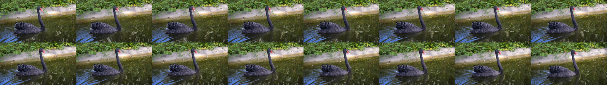
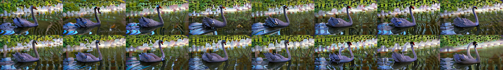
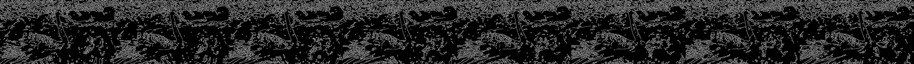
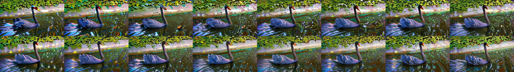
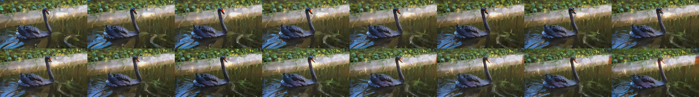
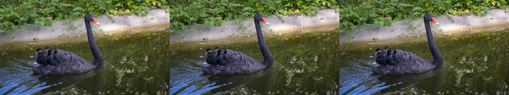
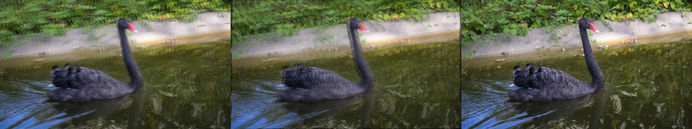

# Video-to-Video

Everything to know about video-in / video-out models: the two halves of the task (generative editing and restoration), why temporal coherence is the whole problem, the mid-2026 model landscape, the two metrics you must always report together, and runnable code that makes per-frame flicker visible and then fixes it.

Author

Benedict Thekkel

## 1. What is Video-to-Video?

Video-to-video (V2V) takes a video in and emits a video out. That is the only thing every V2V system has in common - the umbrella covers two worlds that share almost no engineering.

**Input.** A clip as a tensor of shape `[T, H, W, 3]` (frames x height x width x RGB), usually decoded to a list of PIL images or a `uint8` numpy array. Optional side inputs: a text prompt (what to change), a mask (where to change), a control signal per frame (canny edges, depth, pose), or a reference image (the identity to insert).

**Output.** Another clip, `[T', H', W', 3]`. `T' > T` for frame interpolation, `H',W' > H,W` for super-resolution, `T'=T` for editing/restyling, and an extra alpha channel for matting.

| Family | Sub-task | What it does | Typical model class |
|----|----|----|----|
| Generative | Restyling / prompt-driven editing | “make it a Van Gogh painting”, “turn the swan into a flamingo” | latent diffusion + temporal layers |
| Generative | Character / object swap | Replace a subject, keep the motion | reference-conditioned DiT (VACE, Lucy Edit) |
| Generative | Video inpainting / object removal | Fill a masked region coherently over time | masked V2V |
| Generative | Motion transfer | Drive a new subject with a source pose sequence | pose ControlNet + video model |
| Generative | Video ControlNet | Depth/canny/pose conditioned regeneration | ControlNet-style adapters |
| Restoration | Super-resolution (VSR) | Upscale, deblur, remove compression artifacts | SwinIR/Swin2SR, BasicVSR++, SeedVR2 |
| Restoration | Denoising / deblurring | Clean up sensor noise, motion blur | recurrent CNN / DiT |
| Restoration | Frame interpolation (VFI) | 24 fps -\> 60 fps, slow motion | RIFE, FILM, EMA-VFI |
| Restoration | Colourisation, old-film restoration | Scratch/flicker removal, B&W -\> colour | hybrid restoration stacks |
| Restoration | Matting / background removal | Per-pixel alpha over time | RVM, MatAnyone |

The generative half gets the papers; the **restoration half is commercially much larger** - every phone camera, every streaming CDN, every TV upscaler and every video-conferencing background blur is a video-to-video model in production. A third, quieter branch is **video-to-video translation for simulation**: turning a rendered/segmented game or sim frame sequence into photorealistic footage (NVIDIA’s original GAN `vid2vid`, and today `Cosmos-Transfer` for robotics/AV sim2real), and its mirror image, the 2025-2026 **real-time world/game-frame generators** (Decart’s Oasis, MirageLSD at ~20 fps with ~100 ms latency) that generate the next frame conditioned on the previous frame plus a control signal.

**Neighbouring tasks** (separate notebooks in this directory):

| Task | Relation | Notebook |
|----|----|----|
| Image-to-image | The per-frame analogue - V2V is this plus a time axis | `06_Image_to_Image` |
| Image-to-video | One frame in, a clip out (animation) | `07_Image_to_Video` |
| Text-to-video | No video input at all | `10_Text_to_Video` |
| Video classification | Video in, a label out (not a video) | `09_Video_Classification` |
| Image segmentation / mask generation | Produces the masks that drive masked V2V | `03_Image_Segmentation`, `12_Mask_Generation` |
| Depth estimation | Produces the per-frame control signal for structure-preserving edits | `00_Depth_Estimation` |

Diffusion fundamentals (latents, schedulers, `strength`, guidance) are covered in `06_Image_to_Image` and `10_Text_to_Video` and are not re-derived here.

------------------------------------------------------------------------

## 2. Real-World Use Cases

| Use case | Domain | Consumes / produces | Dominant constraint |
|----|----|----|----|
| TV / monitor upscaling | Consumer hardware (NVIDIA RTX Video Super Resolution, Samsung AI Upscaling) | 480p-1080p stream -\> 4K, live | Hard real-time on a fixed silicon budget; zero flicker is non-negotiable |
| Streaming pre-processing | Media (Netflix, YouTube) | Master file -\> denoised, deblocked, per-title encoded | Cost per hour of footage; must not “invent” detail the director did not shoot |
| Slow motion / fps up-conversion | Phones, sports broadcast, VFX | 30 fps -\> 120/240 fps | Artefacts on fast motion and occlusions; sub-frame latency on device |
| Background removal / virtual background | Video conferencing (Zoom, Meet, Teams) | Webcam feed -\> RGBA matte | CPU-only real-time, no green screen, stable hair/edges |
| Restyling and look development | Advertising, social filters (Runway, Decart Mirage) | Clip + prompt -\> restyled clip | Identity/motion preservation; increasingly *live* (~100 ms/frame) |
| Object removal / continuity fixes | Post-production VFX | Clip + mask -\> clean plate | Pixel-exact stability over hundreds of frames; a human reviews every frame |
| Virtual try-on and product video | E-commerce | Clip + garment reference -\> edited clip | Garment fidelity; cheap enough to run per SKU |
| Sim2real for robotics / AV | Autonomous systems (NVIDIA Cosmos-Transfer) | Rendered sim or segmentation video -\> photorealistic video | Physical plausibility; throughput (millions of training frames) |
| Archive restoration | Broadcasters, film archives | Scanned B&W film -\> colourised, deflickered, 4K | Faithfulness to the original; the model must not hallucinate faces |

**What the benchmark number hides.** A V2V leaderboard score is measured on a 3-second, 480p, centre-framed clip with one moving subject. Production video is 10 minutes long, and the two things that kill a deployment are the ones a short clip cannot expose: **drift** (the style, colour or identity slowly slides over hundreds of frames, because the model only ever attends over a 16-frame window) and **flicker** (high-frequency instability that is barely visible frame-by-frame and unwatchable at 24 fps). Then there is the compute wall: editing is `T` times an image edit, so a 3-second demo that takes 4 minutes on a 3060 becomes 80 minutes for a 60-second ad. Streaming/live V2V is a *different architecture*, not a faster setting - it must be causal (frame `t` may only see frames `<= t`), which rules out every bidirectional temporal-attention model in section 6. And in restoration, the failure that gets a system pulled from production is not a lower PSNR but a **hallucinated detail**: an upscaler that invents a licence plate, a face, or a word of text that was never in the source.

------------------------------------------------------------------------

## 3. How Modern Video-to-Video Works

Everything in V2V orbits one problem: **temporal coherence**.

Run a per-frame image edit over a clip and it flickers, badly. The reason is structural, not a tuning bug. A diffusion model is *not* a continuous function of its input: each frame is denoised from its own noise sample, and the mapping from (latent, noise) to image is extremely sensitive - two visually identical input frames can land in different modes of the output distribution. So the texture of the brushstrokes, the colour of a shirt, the shape of a cloud all resample every 1/24 of a second. The fixes, in increasing order of sophistication:

1.  **(a) Fix the noise / seed across frames (2022).** Use the same `generator` seed, or invert the source frames to a shared noise (DDIM inversion). Cheap, and it helps a little - it removes the *independent-sample* component of the jitter but not the sensitivity to input change. This is the free win, and it is why the naive cell in section 9 fixes the seed and *still* flickers.
2.  **(b) Cross-frame / extended attention (2023).** Replace self-attention in the UNet with attention over the concatenation of the current frame and a shared **anchor** frame (usually frame 0), so every frame is generated “in the style of” the same reference. Training-free. Text2Video-Zero, FateZero, Pix2Video, Tune-A-Video. Big improvement in appearance stability, still weak on fine texture.
3.  **(c) Optical-flow warping and propagation (2023-2024).** Edit a few **keyframes** properly, then *propagate* the edit to the in-between frames by warping along optical flow (Rerender-A-Video, EbSynth-style propagation), or enforce that features which correspond across frames stay equal (TokenFlow, which propagates diffusion *features* along inter-frame correspondences). This is the strongest zero-shot family: coherence is inherited from the source video’s own motion, so it cannot drift. It fails exactly where flow fails - occlusions, fast motion, new content entering the frame.
4.  **(d) Latent / feature blending across frames (2023-2024).** Blend or average latents of neighbouring frames during denoising, or share the KV cache. Cheap smoothing; overdo it and the video goes soft and ghosted.
5.  **(e) Native temporal layers - the current answer (2023-2026).** Put time *inside* the model. AnimateDiff (2023) inserts a trained **motion module** (temporal 1-D attention across the frame axis) into a frozen SD 1.5 UNet - the whole clip is denoised jointly, so coherence is learned, not bolted on. Modern video DiTs (CogVideoX, Wan 2.1/2.2, LTX-Video, HunyuanVideo) go further: full **3-D spatio-temporal attention** over a causal video VAE’s spacetime latents. On top of these sit the 2025-2026 unified editors - **VACE** (one Wan-based model that does reference-to-video, masked V2V, and control-video V2V through a single “video condition unit”) and **Lucy Edit** (prompt-driven editing on Wan2.2-5B) - and the control-video translators (**Cosmos-Transfer2.5**).

**Cheat sheet:**

| Approach | Coherence | Cost | Needs training | Example |
|----|----|----|----|----|
| Per-frame img2img + fixed seed | poor (flickers) | 1x image cost per frame | no | SD 1.5 img2img (section 9) |
| \+ ControlNet (canny/depth) | fair - structure holds, texture flickers | ~1.4x | no | ControlNet img2img (section 10) |
| Cross-frame attention | good on global appearance | ~1.5x | no | Text2Video-Zero, FateZero |
| Flow propagation / feature correspondence | very good; inherits source motion | keyframes + cheap warps | no | TokenFlow, Rerender-A-Video |
| Native temporal layers (motion module) | very good | whole clip denoised jointly | yes (pretrained) | AnimateDiff V2V (section 11) |
| Video DiT with 3-D attention | best | very high (attention is O(T^2 HW)) | yes (pretrained) | Wan-VACE, CogVideoX, Lucy Edit |

The restoration half followed the same arc - per-frame SwinIR -\> recurrent propagation with flow alignment (BasicVSR++) -\> diffusion transformers (SeedVR2, 2025-2026, one-step restoration at arbitrary resolution) - and it hits the same wall: a per-frame restoration model flickers too (section 12 makes that measurable).

------------------------------------------------------------------------

## 4. Evaluation Metrics

**This is a two-metric task, and reporting one number alone is meaningless.** You must always report *what changed* and *how stably it changed*.

**1. Edit / target quality.**

- Restyling (no ground truth): **CLIP text alignment** - cosine similarity between the CLIP embedding of each output frame and of the target prompt, averaged over frames: $$\text{CLIP}_{\text{text}} = \frac{1}{T}\sum_{t=1}^{T} \cos\big(E_I(x_t),\, E_T(p)\big)$$
- Restoration / interpolation (ground truth exists): **PSNR**, **SSIM**, **LPIPS**. $$\text{PSNR} = 10\,\log_{10}\frac{\text{MAX}^2}{\text{MSE}}$$ PSNR rewards blur (a blurry frame has low MSE), so pair it with LPIPS (a learned perceptual distance) which does not.

**2. Temporal consistency.**

- **Frame-to-frame embedding similarity** (CLIP or DINO), the standard “consistency” number in video-editing papers: $$C = \frac{1}{T-1}\sum_{t=1}^{T-1} \cos\big(E_I(x_t),\, E_I(x_{t+1})\big)$$
- **Warping error** - the honest one. Estimate optical flow $F_{t \to t+1}$ on the *source* video, warp output frame $x_t$ into frame $t+1$, and measure the residual inside the valid (non-occluded) region $M$: $$E_{\text{warp}} = \frac{1}{T-1}\sum_{t=1}^{T-1} \frac{\lVert M \odot (x_{t+1} - \mathcal{W}(x_t, F_{t \to t+1}))\rVert_1}{\lVert M \rVert_1}$$ Unlike the cosine metric, this asks the right question: *given how the scene actually moved, is the output what it should be?* Lower is better.
- **VBench / VBench-2.0** decompose quality into 16+ automated dimensions, of which **temporal flickering**, **motion smoothness** and **subject/background consistency** are the V2V-relevant ones. VBench-2.0 (2026) adds intrinsic-faithfulness dimensions (physics, commonsense, controllability).

**The degenerate optima - read this before you trust any consistency number.**

- A model that returns the **input unchanged** scores a *perfect* temporal consistency and warping error, and zero edit fidelity.
- A model that outputs a **single frozen frame** repeated `T` times also scores perfect consistency (and near-perfect motion smoothness), while destroying the video entirely.

So temporal consistency is only interpretable *jointly* with edit fidelity, and any paper reporting a single “consistency” column is hiding the trade-off. In section 14 we plot the two axes against each other and mark both degenerate points explicitly; a good model is the one pushed to the top-right, not the one at the top.

**Speed.** Report **seconds per frame** (and VRAM). Video cost scales linearly with `T` on top of an already heavy per-frame cost, so `s/frame` is the number that tells you whether a 60-second clip is 2 minutes or 2 hours.

**Benchmarks by sub-task:** LOVEU-TGVE and DAVIS-Edit / FiVE for text-guided editing; **Vimeo-90K** (triplet PSNR/SSIM) and **X4K1000FPS** for interpolation; **REDS**, **Vid4** and **UDM10** for video super-resolution; VBench-2.0 for generative video quality.

The cell below implements frame-to-frame consistency (pixel-space), warping error and PSNR on three synthetic clips - a clean moving square, the same clip with per-frame noise (flickery), and a frozen clip - and shows that the three metrics rank them *differently*, which is the whole point.

------------------------------------------------------------------------

``` python
import numpy as np
from IPython.display import display
from PIL import Image

try:
    import cv2  # optical flow (Farneback) + canny; see the install cell in section 7
    HAS_CV2 = True
except ImportError:
    HAS_CV2 = False
    print("opencv not installed: warping error will fall back to a no-flow estimate")

rng = np.random.default_rng(0)
T, H, W = 12, 96, 128


def moving_square_clip(t_frames=T, noise=0.0, frozen=False):
    "Synthetic clip: a white square translating across a grey background."
    frames = []
    for t in range(t_frames):
        f = np.full((H, W, 3), 40, dtype=np.float32)
        x = 8 if frozen else 8 + 6 * t          # frozen clip: the square never moves
        f[36:60, x:x + 24] = 220
        if noise:                                # per-frame i.i.d. noise = flicker
            f = f + rng.normal(0, noise, f.shape)
        frames.append(np.clip(f, 0, 255).astype(np.uint8))
    return frames


def psnr(a, b):
    "Peak signal-to-noise ratio between two uint8 clips (list of HxWx3 arrays)."
    mse = np.mean([(x.astype(np.float32) - y.astype(np.float32)) ** 2 for x, y in zip(a, b)])
    return float("inf") if mse == 0 else 10.0 * np.log10(255.0 ** 2 / mse)


def frame_consistency(frames):
    "Mean cosine similarity between consecutive frames in raw pixel space (1.0 = identical)."
    v = [f.astype(np.float32).ravel() for f in frames]
    sims = [float(np.dot(a, b) / (np.linalg.norm(a) * np.linalg.norm(b) + 1e-8))
            for a, b in zip(v[:-1], v[1:])]
    return float(np.mean(sims))


def warp_error(out_frames, src_frames):
    "Mean L1 residual after warping output frame t into t+1 along the SOURCE optical flow."
    if not HAS_CV2:
        return float("nan")
    # The flow grid is built from the source, but not every model emits the source
    # resolution (AnimateDiff defaults to square), so put the outputs on the source raster.
    sh, sw = src_frames[0].shape[:2]
    if out_frames[0].shape[:2] != (sh, sw):
        out_frames = [cv2.resize(f, (sw, sh), interpolation=cv2.INTER_AREA) for f in out_frames]
    errs = []
    for t in range(len(out_frames) - 1):
        g0 = cv2.cvtColor(src_frames[t], cv2.COLOR_RGB2GRAY)
        g1 = cv2.cvtColor(src_frames[t + 1], cv2.COLOR_RGB2GRAY)
        flow = cv2.calcOpticalFlowFarneback(g0, g1, None, 0.5, 3, 15, 3, 5, 1.2, 0)
        h, w = flow.shape[:2]
        grid = np.stack(np.meshgrid(np.arange(w), np.arange(h)), axis=-1).astype(np.float32)
        m = (grid + flow)  # where each pixel of frame t lands in frame t+1
        mx = np.ascontiguousarray(m[..., 0], dtype=np.float32)
        my = np.ascontiguousarray(m[..., 1], dtype=np.float32)
        warped = cv2.remap(out_frames[t], mx, my, cv2.INTER_LINEAR)
        valid = (m[..., 0] >= 0) & (m[..., 0] < w) & (m[..., 1] >= 0) & (m[..., 1] < h)
        d = np.abs(warped.astype(np.float32) - out_frames[t + 1].astype(np.float32)).mean(-1)
        errs.append(float(d[valid].mean() / 255.0))
    return float(np.mean(errs))


clean = moving_square_clip()
flicker = moving_square_clip(noise=18.0)   # the naive per-frame edit, in caricature
frozen = moving_square_clip(frozen=True)   # the degenerate "perfectly consistent" output

toy = {}
for name, clip in [("clean (ideal)", clean), ("flickery", flicker), ("frozen (degenerate)", frozen)]:
    toy[name] = dict(
        psnr=psnr(clip, clean),                 # fidelity to the ground-truth clip
        consistency=frame_consistency(clip),    # frame-to-frame cosine (higher = smoother)
        warp_err=warp_error(clip, clean),       # residual along the true motion (lower = better)
    )
    r = toy[name]
    print(f"{name:22s} PSNR {r['psnr']:6.2f} dB   consistency {r['consistency']:.4f}   warp_err {r['warp_err']:.4f}")

display(Image.fromarray(np.concatenate([clean[6], flicker[6], frozen[6]], axis=1)))
```

    clean (ideal)          PSNR    inf dB   consistency 0.8999   warp_err 0.0330
    flickery               PSNR  23.12 dB   consistency 0.8290   warp_err 0.1082
    frozen (degenerate)    PSNR  14.32 dB   consistency 1.0000   warp_err 0.0054


``` python
from pyecharts.globals import CurrentConfig

# assets.pyecharts.org serves an expired TLS certificate from most nodes (2026-11-11),
# so charts failed to load. jsDelivr mirrors the same assets, pinned to one commit.
CurrentConfig.ONLINE_HOST = "https://cdn.jsdelivr.net/gh/pyecharts/pyecharts-assets@f2328d558550046fc5449672a6850e848e141590/assets/v6/"

from pyecharts import options as opts
from pyecharts.charts import Bar

names = list(toy)
bar = (
    Bar()
    .add_xaxis(names)
    .add_yaxis("PSNR vs ground truth (dB, higher=better)",
               [round(toy[n]["psnr"], 2) if np.isfinite(toy[n]["psnr"]) else 60.0 for n in names])
    .add_yaxis("frame-to-frame consistency x100 (higher=smoother)",
               [round(100 * toy[n]["consistency"], 2) for n in names])
    .add_yaxis("warping error x100 (lower=better)",
               [round(100 * toy[n]["warp_err"], 2) for n in names])
    .set_global_opts(
        title_opts=opts.TitleOpts(
            title="Three metrics, three different rankings",
            subtitle="The frozen clip wins on consistency and loses on everything that matters",
        ),
        yaxis_opts=opts.AxisOpts(name="score"),
        tooltip_opts=opts.TooltipOpts(trigger="axis"),
        legend_opts=opts.LegendOpts(pos_top="12%"),
    )
)
bar.render_notebook()
```

## 5. Datasets

| Dataset | Contents | Size | Scope | License | Typical use |
|----|----|----|----|----|----|
| [DAVIS 2017](https://davischallenge.org/) ([mp4 mirror](https://huggingface.co/datasets/emirkisa/DAVIS-2017-480p-mp4)) | Short 480p/1080p clips, single salient moving object, per-frame masks | 90 clips, 40-80 frames each | Object-centric, real footage | CC BY-NC 4.0 | The de-facto eval set for video editing and VOS. **Used by this notebook** |
| [DAVIS-Edit](https://huggingface.co/datasets/AlonzoLeeeooo/DAVIS-Edit) | DAVIS clips + edit prompts + reference images (from StableV2V) | ~50 clips x several edits | Shape-consistent editing | see card | Text/image-guided V2V editing eval |
| [LOVEU-TGVE](https://sites.google.com/view/loveucvpr23/track4) | Text-guided video editing benchmark (CVPR23 workshop) | 76 videos x 4 prompts | Style, object, background, multi-edit | research | The standard human-rated editing benchmark |
| [Vimeo-90K](http://toflow.csail.mit.edu/) | Frame triplets (448x256) and septuplets | 73k triplets (3.8k test) | Interpolation, denoising, SR | research use | Frame-interpolation PSNR/SSIM |
| [X4K1000FPS](https://github.com/JihyongOh/XVFI) | 4K, 1000 fps clips | 15 test scenes | Extreme motion | research | Hard-case interpolation |
| [REDS](https://seungjunnah.github.io/Datasets/reds) | Realistic blur + downsampling, 720p | 300 clips x 100 frames | VSR / deblurring | research | The standard VSR training + eval set |
| [Vid4](https://xinntao.github.io/projects/EDVR) / UDM10 | 4 (resp. 10) classic test clips | tiny | VSR | research | Reported alongside REDS in every VSR paper |
| [YouTube-VOS](https://youtube-vos.org/) | 4k+ clips with object masks | ~200k annotated frames | Segmentation / masked editing | CC BY 4.0 | Training masked V2V and matting |
| [VIRESET](https://huggingface.co/datasets/Ada-hehe/VIRESET) | Video instance editing training data with masks | large | Instance-level editing | see card | Training video instance editors |
| [Panda-70M](https://snap-research.github.io/Panda-70M/) / [Pexels](https://www.pexels.com/videos/) | Captioned web video / stock footage | 70M clips / ~100k clips | General pretraining | mixed - check per clip | Training video models |
| [VBench-2.0](https://huggingface.co/spaces/Vchitect/VBench_Leaderboard) | Not data - an evaluation suite + leaderboard | 16+ dimensions | Generative video quality | Apache 2.0 | Reporting temporal flickering / motion smoothness |

**This notebook** evaluates on a single DAVIS clip (`blackswan`, 480p, 50 frames, ungated, ~1.4 MB) downloaded from the mp4 mirror above into `DATA_DIR`. It is the clip every video-editing paper shows, it has real camera and subject motion, and 16 frames of it fit in a 12 GB card. DAVIS is **CC BY-NC 4.0** - fine for research and for this notebook, not for a commercial product. Nothing here is gated.

------------------------------------------------------------------------

## 6. The Model Landscape (mid-2026)

There is no single V2V leaderboard, because the task is not single. The two authorities are [VBench / VBench-2.0](https://huggingface.co/spaces/Vchitect/VBench_Leaderboard) (generative video quality, including temporal flickering and motion smoothness) and, for restoration, the per-dataset PSNR/LPIPS tables on REDS / Vid4 / Vimeo-90K. The Hugging Face [video-to-video task page](https://huggingface.co/tasks/video-to-video) tracks the current open editors.

| Model | Params | License | Scope | Architecture | Best for |
|----|----|----|----|----|----|
| [SD 1.5 img2img](https://huggingface.co/stable-diffusion-v1-5/stable-diffusion-v1-5) | 0.9B | CreativeML OpenRAIL-M | per-frame restyle | UNet latent diffusion | the flickery baseline everyone starts from (**runnable**) |
| [+ ControlNet canny/depth](https://huggingface.co/lllyasviel/control_v11p_sd15_canny) | +0.36B | Apache 2.0 | structure-preserving restyle | ControlNet adapter | keeping geometry while changing texture (**runnable**) |
| [AnimateDiff motion adapter v1.5-2](https://huggingface.co/guoyww/animatediff-motion-adapter-v1-5-2) | 0.45B (on top of SD 1.5) | Apache 2.0 | temporally-aware restyle | temporal 1-D attention in a frozen SD UNet | the best coherence you can get on a 12 GB card (**runnable**) |
| [Swin2SR x2](https://huggingface.co/caidas/swin2SR-classical-sr-x2-64) | 12M | Apache 2.0 | per-frame super-resolution | SwinV2 transformer + upsampler | image SR applied to video; flickers, and that is the lesson (**runnable**) |
| [Text2Video-Zero](https://huggingface.co/docs/diffusers/api/pipelines/text_to_video_zero) | 0.9B (SD 1.5) | OpenRAIL | zero-shot V2V with pose/edge control | cross-frame attention + motion in latents | training-free coherence, no motion module needed |
| [Wan2.1-VACE-1.3B](https://huggingface.co/Wan-AI/Wan2.1-VACE-1.3B-diffusers) | 1.3B | Apache 2.0 | unified editing: reference, mask, control | video DiT + video-condition units | the best open all-in-one editor that *nearly* fits 12 GB (slow: many minutes/clip) |
| [Wan2.1-VACE-14B](https://huggingface.co/Wan-AI/Wan2.1-VACE-14B-diffusers) | 14B | Apache 2.0 | same, much better | video DiT | quality leader for open editing - **needs \>24 GB** |
| [Lucy-Edit-Dev](https://huggingface.co/decart-ai/Lucy-Edit-Dev) | 5B (Wan2.2 base) | non-commercial | prompt-driven editing (clothes, characters, scenes) | video DiT, `LucyEditPipeline` | instruction-style edits with motion preserved - **too big for 12 GB** |
| [CogVideoX-5b](https://huggingface.co/zai-org/CogVideoX-5b) | 5B | CogVideoX license | V2V via `CogVideoXVideoToVideoPipeline` | 3-D full attention DiT | long, prompt-faithful edits - **too big for 12 GB** |
| [Cosmos-Transfer2.5-2B](https://huggingface.co/nvidia/Cosmos-Transfer2.5-2B) | 2.4B | NVIDIA Open Model (commercial OK) | control-video -\> photoreal (sim2real) | video DiT with edge/depth/seg/blur control | robotics and AV simulation - the card states **65 GB VRAM** |
| [SeedVR2-3B / 7B](https://huggingface.co/ByteDance-Seed/SeedVR2-3B) | 3B / 7B | Apache 2.0 | video restoration / SR, any resolution | one-step diffusion transformer (ICLR 2026) | the restoration SOTA - 3B is borderline, 7B **too big for 12 GB** |
| RIFE / FILM / EMA-VFI | 10-30M | MIT / Apache | frame interpolation | flow-based CNN | 24-\>60 fps; weights on the Hub ([Comfy-Org/frame_interpolation](https://huggingface.co/Comfy-Org/frame_interpolation)) but **vendor code**, not transformers-native |
| RVM / MatAnyone | ~4-40M | research | video matting | recurrent CNN / memory network | background removal - **vendor runtime** |
| MirageLSD (Decart) | closed | API | live-stream restyling | causal autoregressive diffusion | real-time V2V (~20 fps, ~100 ms/frame) - **API only** |

**Who wins what.** *Quality*: Wan2.1-VACE-14B and Lucy Edit for generative editing, SeedVR2 for restoration - and none of them run here. *Quality per GB*: AnimateDiff V2V on SD 1.5, which is exactly why it is the temporally-aware model this notebook runs. *Speed*: per-frame img2img is the fastest thing that produces anything, and it is unusable for video because of flicker - the entire point of section 14. *Latency*: only causal models (MirageLSD-style) can stream; every model above with bidirectional temporal attention sees the whole clip at once and therefore cannot.

Tying back to section 2: the TV-upscaler and video-call constraints (hard real-time, fixed silicon) exclude every diffusion row in this table - those products run small causal CNNs. The post-production and advertising constraints (quality, a human in the loop) are exactly where the 5-14B DiTs live.

------------------------------------------------------------------------

## 7. Setup

Every runnable model here loads through Hugging Face `transformers` or `diffusers` - no vendor packages. Package roles:

- `diffusers` (\>=0.36) + `torch` + `accelerate` - SD 1.5 img2img, ControlNet img2img, AnimateDiff V2V; `enable_model_cpu_offload` needs `accelerate`
- `transformers` - Swin2SR (super-resolution) and CLIP (both metrics)
- `opencv-python` - optical flow (warping error), canny edges for ControlNet, the webcam demo
- `imageio` + `imageio-ffmpeg` - decoding the DAVIS mp4 (`diffusers.utils.load_video` uses imageio for video; GIFs go through PIL)
- `pyecharts` - all charts
- `pandas` - the benchmark table

**The 12 GB budget.** A video-to-video pass is an image-to-image pass repeated `T` times, so VRAM and wall-clock both scale with the frame count - and AnimateDiff denoises *all* frames jointly, so the activations scale with `T` too. Everything below is deliberately small: **16 frames at 512x288, fp16, 20-25 steps**, with `enable_model_cpu_offload()` (keeps only the active submodule on the GPU), `vae.enable_slicing()` (decodes the batch one frame at a time) and `vae.enable_tiling()`. With those on, peak VRAM stays around 5-7 GB. Expected wall-clock on an RTX 3060: **~40-60 s** for the 16-frame per-frame SD pass, **~1.5 min** with ControlNet, and **~3-5 min** for AnimateDiff V2V. Raise `N_FRAMES` at your own risk - it is linear.

All downloads (the DAVIS clip, HF weights, output GIFs) land in `DL_tasks/datasets/`, which is gitignored.

------------------------------------------------------------------------

``` python
# Runnable models load through diffusers + transformers only.
# %pip install -q torch diffusers transformers accelerate safetensors
# %pip install -q opencv-python imageio imageio-ffmpeg pyecharts pandas

# Not used here, but the usual companions for real V2V work:
#   controlnet-aux (pose/depth pre-processors), av (PyAV decoding)
```

``` python
import ctypes
import ctypes.util
import gc
import time
import urllib.request
from pathlib import Path

import torch
from dotenv import find_dotenv, load_dotenv

# Knowledge/.env sets HF_TOKEN - authenticated HF Hub requests get higher rate limits
load_dotenv(find_dotenv(usecwd=True))

device = "cuda:0" if torch.cuda.is_available() else "cpu"
dtype = torch.float16 if device != "cpu" else torch.float32
if device != "cpu":
    print(torch.cuda.get_device_name(0))
print("device:", device, "dtype:", dtype)


def vram(tag=""):
    "Report current GPU memory (allocated / reserved). No-op on CPU."
    if torch.cuda.is_available():
        alloc = torch.cuda.memory_allocated() / 1e9
        reserved = torch.cuda.memory_reserved() / 1e9
        print(f"VRAM {tag:20s} {alloc:5.2f} GB allocated / {reserved:5.2f} GB reserved")


def free_memory():
    "Collect garbage, empty the CUDA cache, and return freed CPU RAM to the OS."
    gc.collect()
    if torch.cuda.is_available():
        torch.cuda.empty_cache()
        torch.cuda.ipc_collect()
    # glibc keeps freed CPU allocations in its arenas instead of returning them
    # to the OS, so RSS compounds across model sections (cpu-offloaded weights
    # live in system RAM). malloc_trim(0) hands the freed arenas back. See
    # dl-visualization-and-memory.md - not optional on a 12 GB box.
    try:
        ctypes.CDLL(ctypes.util.find_library("c") or "libc.so.6").malloc_trim(0)
    except Exception:
        pass


def offload(pipe):
    "Pick the offload strategy for the VRAM actually free right now, not the card size."
    if device == "cpu":
        return pipe
    import torch.nn as nn
    # bitsandbytes-quantized weights are pinned to the GPU; enable_sequential_cpu_offload
    # first moves the whole pipeline to CPU and STALLS on them (a hang, not a catchable
    # error), so a quantized pipeline must use model-level offload - the recommended path.
    quantized = any(getattr(m, "is_quantized", False)
                    for m in pipe.components.values() if isinstance(m, nn.Module))
    free_gb = torch.cuda.mem_get_info()[0] / 1e9  # global free VRAM - counts other processes
    if free_gb < 8.0 and not quantized:
        # Another process is using the card (or it is small): layer-at-a-time keeps the
        # peak at ~1-2 GB for a real speed cost. Free the other GPU user if you can -
        # check nvidia-smi on the HOST; a container only sees its own processes.
        # Quantized (bitsandbytes) components cannot be dispatched per-layer, so fall
        # back to model-level offload if sequential raises.
        try:
            pipe.enable_sequential_cpu_offload(device=device)
            print(f"offload: sequential ({free_gb:.1f} GB VRAM free - GPU busy, expect slow steps)")
            return pipe
        except Exception as e:
            print(f"offload: sequential unsupported here ({type(e).__name__}) - using model-level")
    # Whole submodule on the GPU at a time - fast, peak ~= largest submodule (~5 GB).
    pipe.enable_model_cpu_offload(device=device)
    print(f"offload: {'quantized -> ' if quantized else ''}model-level ({free_gb:.1f} GB VRAM free)")
    return pipe


# All downloads go to DL_tasks/datasets/ (gitignored)
DATA_DIR = Path("../../datasets")
DATA_DIR.mkdir(exist_ok=True)
HF_CACHE = str(DATA_DIR / "hf_cache")

# The DAVIS "blackswan" clip (480p, 50 frames, ~1.4 MB) - the standard video-editing test clip
CLIP_PATH = DATA_DIR / "davis_blackswan.mp4"
if not CLIP_PATH.exists():
    urllib.request.urlretrieve(
        "https://huggingface.co/datasets/emirkisa/DAVIS-2017-480p-mp4/resolve/main/blackswan_raw_24fps.mp4",
        CLIP_PATH,
    )
print(CLIP_PATH, f"{CLIP_PATH.stat().st_size / 1e6:.1f} MB")
```

    NVIDIA GeForce RTX 3060
    device: cuda:0 dtype: torch.float16
    ../../datasets/davis_blackswan.mp4 1.4 MB

``` python
from diffusers.utils import load_video

# Keep the clip small: 16 frames at 512x288 (both divisible by 8, as SD's VAE requires).
N_FRAMES, SIZE = 16, (512, 288)
PROMPT = "a swan made of polished bronze, ornate metal sculpture, glowing sunset light"
NEG_PROMPT = "blurry, low quality, distorted, watermark"
SEED = 42

src_frames = load_video(str(CLIP_PATH))          # needs imageio + imageio-ffmpeg for mp4
src_frames = [f.convert("RGB").resize(SIZE) for f in src_frames[:N_FRAMES]]
src_np = [np.array(f) for f in src_frames]       # uint8 arrays, reused by every metric
print(f"{len(src_frames)} frames, {src_frames[0].size}")


def contact_sheet(frames, cols=8, scale=0.5):
    "Tile frames into one static image so the rendered docs show something, not just a GIF."
    w, h = int(frames[0].width * scale), int(frames[0].height * scale)
    rows = (len(frames) + cols - 1) // cols
    sheet = Image.new("RGB", (cols * w, rows * h), "black")
    for i, f in enumerate(frames):
        sheet.paste(f.resize((w, h)), ((i % cols) * w, (i // cols) * h))
    return sheet


# Every model in this notebook gets scored on these same frames, prompt and seed.
RESULTS = {}   # name -> {"frames": [...], "seconds": float}
display(contact_sheet(src_frames))
```

    16 frames, (512, 288)



## 8. The Metrics We Will Actually Use

Both metrics ride on one CLIP model (`openai/clip-vit-base-patch32`, 151M params, ~0.3 GB in fp32) - the same encoder gives us **edit fidelity** (image-vs-prompt cosine) and **temporal consistency** (frame-vs-next-frame cosine). It is small enough to keep resident for the whole notebook alongside a 0.9B SD pipeline; we free it at the very end.

`warp_error` from section 4 is reused unchanged - it needs no model, only the source clip’s optical flow. Note the direction of each metric: **CLIP text alignment up**, **frame-to-frame consistency up**, **warping error down**.

------------------------------------------------------------------------

``` python
from transformers import CLIPModel, CLIPProcessor

clip_id = "openai/clip-vit-base-patch32"
clip_proc = CLIPProcessor.from_pretrained(clip_id, cache_dir=HF_CACHE)
clip_model = CLIPModel.from_pretrained(clip_id, cache_dir=HF_CACHE).to(device).eval()


@torch.inference_mode()
def clip_image_embeds(frames):
    "L2-normalised CLIP image embeddings for a list of PIL frames -> [T, 512] on CPU."
    inputs = clip_proc(images=frames, return_tensors="pt").to(device)
    e = clip_model.get_image_features(**inputs).pooler_output
    return torch.nn.functional.normalize(e, dim=-1).float().cpu()


@torch.inference_mode()
def clip_text_embed(prompt):
    "L2-normalised CLIP text embedding -> [1, 512] on CPU."
    inputs = clip_proc(text=[prompt], return_tensors="pt", padding=True).to(device)
    e = clip_model.get_text_features(**inputs).pooler_output
    return torch.nn.functional.normalize(e, dim=-1).float().cpu()


def score_clip(frames, prompt=PROMPT, src=None):
    "Edit fidelity + temporal consistency + warping error for one output clip."
    img = clip_image_embeds(frames)
    txt = clip_text_embed(prompt)
    per_frame = (img @ txt.T).squeeze(1)                       # CLIP text alignment, per frame
    pairwise = (img[:-1] * img[1:]).sum(-1)                    # frame-to-frame CLIP cosine
    out = np.array([np.array(f) for f in frames])
    return dict(
        fidelity=float(per_frame.mean()),
        consistency=float(pairwise.mean()),
        per_frame_consistency=[float(x) for x in pairwise],
        warp_err=warp_error(list(out), src if src is not None else src_np),
    )


# Sanity check: the source clip is perfectly self-consistent but does not match the target prompt.
base = score_clip(src_frames)
print(f"source clip   fidelity {base['fidelity']:.4f}   consistency {base['consistency']:.4f}   warp_err {base['warp_err']:.4f}")
vram("clip loaded")
```

    source clip   fidelity 0.2416   consistency 0.9872   warp_err 0.0740
    VRAM clip loaded           0.61 GB allocated /  0.73 GB reserved

## 9. Naive Per-Frame img2img - The Flicker Baseline

The obvious way to restyle a video: run `StableDiffusionImg2ImgPipeline` on each frame independently, with the *same prompt, same seed and same strength*. This is what almost everyone tries first, and it is what almost every “AI video filter” from 2022 looked like.

It flickers. The seed is fixed, so the *noise* is identical across frames - but the model is not a continuous function of its input: a one-pixel change in the swan’s wing can flip the output into a different mode. Watch the exported GIF and look at the water texture and the bronze highlights: they resample every frame. Section 14 turns that observation into a number.

`strength=0.5` keeps roughly half the source structure. Push it up and the edit is stronger *and* the flicker gets worse - strength is a fidelity/coherence dial, not a quality dial.

------------------------------------------------------------------------

``` python
from diffusers import StableDiffusionImg2ImgPipeline
from diffusers.utils import export_to_gif

sd = StableDiffusionImg2ImgPipeline.from_pretrained(
    "stable-diffusion-v1-5/stable-diffusion-v1-5",
    torch_dtype=dtype,
    safety_checker=None,           # the checker is another model in VRAM; the clip is a swan
    cache_dir=HF_CACHE,
)
sd.set_progress_bar_config(disable=True)
if device != "cpu":
    offload(sd)  # keep only the active submodule on the GPU
    sd.vae.enable_slicing()
else:
    sd = sd.to(device)

t0 = time.perf_counter()
naive = []
for f in src_frames:
    g = torch.Generator("cpu").manual_seed(SEED)   # SAME noise every frame - and it still flickers
    naive.append(
        sd(prompt=PROMPT, negative_prompt=NEG_PROMPT, image=f,
           strength=0.5, guidance_scale=7.5, num_inference_steps=25, generator=g).images[0]
    )
elapsed = time.perf_counter() - t0
RESULTS["per-frame SD img2img"] = {"frames": naive, "seconds": elapsed}
print(f"{elapsed:.1f}s total, {elapsed / N_FRAMES:.2f}s/frame")

export_to_gif(naive, str(DATA_DIR / "v2v_naive.gif"), fps=8)
display(contact_sheet(naive))
r = score_clip(naive)
print(f"fidelity {r['fidelity']:.4f}   consistency {r['consistency']:.4f}   warp_err {r['warp_err']:.4f}")

del sd
free_memory()
vram("after SD img2img")
```

    You have disabled the safety checker for <class 'diffusers.pipelines.stable_diffusion.pipeline_stable_diffusion_img2img.StableDiffusionImg2ImgPipeline'> by passing `safety_checker=None`. Ensure that you abide to the conditions of the Stable Diffusion license and do not expose unfiltered results in services or applications open to the public. Both the diffusers team and Hugging Face strongly recommend to keep the safety filter enabled in all public facing circumstances, disabling it only for use-cases that involve analyzing network behavior or auditing its results. For more information, please have a look at https://github.com/huggingface/diffusers/pull/254 .

    offload: sequential (4.8 GB VRAM free - GPU busy, expect slow steps)
    64.5s total, 4.03s/frame



    fidelity 0.2839   consistency 0.9006   warp_err 0.1183
    VRAM after SD img2img      0.61 GB allocated /  0.68 GB reserved

## 10. ControlNet img2img - Structure Holds, Texture Still Flickers

Adding a ControlNet gives the UNet a per-frame structural signal (here canny edges; depth from `00_Depth_Estimation` works just as well and is more robust to texture edges). The geometry of the swan and the shoreline now tracks the source exactly, so the *low-frequency* wobble disappears.

But this is still `T` independent image edits. The edges are stable; what fills them is resampled every frame. Expect the warping error to drop versus section 9 and the CLIP consistency to rise a little - and the output to still be visibly unusable as video. **This is the ceiling of per-frame methods**: no amount of spatial conditioning fixes a model that has no notion of time.

Checkpoint: `lllyasviel/control_v11p_sd15_canny` (ControlNet v1.1, Apache 2.0, 361M).

------------------------------------------------------------------------

``` python
from diffusers import ControlNetModel, StableDiffusionControlNetImg2ImgPipeline

controlnet = ControlNetModel.from_pretrained(
    "lllyasviel/control_v11p_sd15_canny", torch_dtype=dtype, cache_dir=HF_CACHE,
)
cn = StableDiffusionControlNetImg2ImgPipeline.from_pretrained(
    "stable-diffusion-v1-5/stable-diffusion-v1-5",
    controlnet=controlnet, torch_dtype=dtype, safety_checker=None, cache_dir=HF_CACHE,
)
cn.set_progress_bar_config(disable=True)
if device != "cpu":
    offload(cn)
    cn.vae.enable_slicing()
else:
    cn = cn.to(device)


def canny(frame, lo=100, hi=200):
    "Per-frame canny edge map as an RGB PIL image (the ControlNet conditioning signal)."
    e = cv2.Canny(np.array(frame), lo, hi)
    return Image.fromarray(np.stack([e] * 3, axis=-1))


if HAS_CV2:
    edges = [canny(f) for f in src_frames]
    display(contact_sheet(edges[:8]))

    t0 = time.perf_counter()
    cn_out = []
    for f, e in zip(src_frames, edges):
        g = torch.Generator("cpu").manual_seed(SEED)
        cn_out.append(
            cn(prompt=PROMPT, negative_prompt=NEG_PROMPT, image=f, control_image=e,
               strength=0.6, guidance_scale=7.5, num_inference_steps=25,
               controlnet_conditioning_scale=0.8, generator=g).images[0]
        )
    elapsed = time.perf_counter() - t0
    RESULTS["per-frame + ControlNet"] = {"frames": cn_out, "seconds": elapsed}
    print(f"{elapsed:.1f}s total, {elapsed / N_FRAMES:.2f}s/frame")

    export_to_gif(cn_out, str(DATA_DIR / "v2v_controlnet.gif"), fps=8)
    display(contact_sheet(cn_out))
    r = score_clip(cn_out)
    print(f"fidelity {r['fidelity']:.4f}   consistency {r['consistency']:.4f}   warp_err {r['warp_err']:.4f}")
else:
    print("opencv not available - skipping the ControlNet section")

del cn, controlnet
free_memory()
vram("after ControlNet")
```

    /home/bthek1/Knowledge/.venv/lib/python3.14/site-packages/huggingface_hub/utils/_validators.py:205: UserWarning: The `local_dir_use_symlinks` argument is deprecated and ignored in `hf_hub_download`. Downloading to a local directory does not use symlinks anymore.
      warnings.warn(

    You have disabled the safety checker for <class 'diffusers.pipelines.controlnet.pipeline_controlnet_img2img.StableDiffusionControlNetImg2ImgPipeline'> by passing `safety_checker=None`. Ensure that you abide to the conditions of the Stable Diffusion license and do not expose unfiltered results in services or applications open to the public. Both the diffusers team and Hugging Face strongly recommend to keep the safety filter enabled in all public facing circumstances, disabling it only for use-cases that involve analyzing network behavior or auditing its results. For more information, please have a look at https://github.com/huggingface/diffusers/pull/254 .

    offload: sequential (4.8 GB VRAM free - GPU busy, expect slow steps)



    104.7s total, 6.54s/frame



    fidelity 0.2887   consistency 0.9443   warp_err 0.1144
    VRAM after ControlNet      0.61 GB allocated /  0.68 GB reserved

## 11. AnimateDiff Video-to-Video - Time Inside the Model

`AnimateDiffVideoToVideoPipeline` is the temporally-aware pass, and the one result in this notebook worth keeping. A **motion adapter** (`guoyww/animatediff-motion-adapter-v1-5-2`, 453M params, Apache 2.0) inserts temporal 1-D attention layers between the spatial blocks of a frozen SD 1.5 UNet. The whole 16-frame clip is denoised **jointly**: at every step, each frame’s features attend to the same frame index in every other frame. Coherence is no longer a post-hoc trick, it is what the motion module was trained to produce.

Two practical notes. The adapter is trained for SD 1.5, so it pairs with any SD 1.5 fine-tune - `SG161222/Realistic_Vision_V5.1_noVAE` is the diffusers-documented choice and looks far better than base SD 1.5. And the scheduler matters: AnimateDiff needs `DDIMScheduler` with `beta_schedule="linear"`, `clip_sample=False`, `timestep_spacing="linspace"`.

Memory: with `enable_model_cpu_offload()` + `vae.enable_slicing()` + `vae.enable_tiling()`, 16 frames at 512x288 in fp16 peak around 6-7 GB. **Expect 3-5 minutes on an RTX 3060** - the UNet now sees 16 frames per step instead of 1. Doubling `N_FRAMES` roughly doubles both time and activation memory.

------------------------------------------------------------------------

``` python
from diffusers import AnimateDiffVideoToVideoPipeline, DDIMScheduler, MotionAdapter

adapter = MotionAdapter.from_pretrained(
    "guoyww/animatediff-motion-adapter-v1-5-2", torch_dtype=dtype, cache_dir=HF_CACHE,
)
ad_base = "SG161222/Realistic_Vision_V5.1_noVAE"   # any SD 1.5 fine-tune works
ad = AnimateDiffVideoToVideoPipeline.from_pretrained(
    ad_base, motion_adapter=adapter, torch_dtype=dtype, cache_dir=HF_CACHE,
)
ad.scheduler = DDIMScheduler.from_pretrained(
    ad_base, subfolder="scheduler", cache_dir=HF_CACHE,
    clip_sample=False, timestep_spacing="linspace", beta_schedule="linear", steps_offset=1,
)
ad.set_progress_bar_config(disable=True)
if device != "cpu":
    offload(ad)
    ad.vae.enable_slicing()   # decode the T frames one at a time instead of as one batch
    ad.vae.enable_tiling()    # and tile each frame spatially
else:
    ad = ad.to(device)

t0 = time.perf_counter()
ad_out = ad(
    video=src_frames,                       # the whole clip goes in at once
    prompt=PROMPT,
    negative_prompt=NEG_PROMPT,
    height=SIZE[1], width=SIZE[0],   # else SD 1.5 defaults to 512x512 and squashes the aspect
    strength=0.5,
    guidance_scale=7.5,
    num_inference_steps=25,
    generator=torch.Generator("cpu").manual_seed(SEED),
).frames[0]
elapsed = time.perf_counter() - t0
RESULTS["AnimateDiff V2V"] = {"frames": ad_out, "seconds": elapsed}
print(f"{elapsed:.1f}s total, {elapsed / N_FRAMES:.2f}s/frame")

export_to_gif(ad_out, str(DATA_DIR / "v2v_animatediff.gif"), fps=8)
display(contact_sheet(ad_out))
r = score_clip(ad_out)
print(f"fidelity {r['fidelity']:.4f}   consistency {r['consistency']:.4f}   warp_err {r['warp_err']:.4f}")

del ad, adapter
free_memory()
vram("after AnimateDiff")
```

    The config attributes {'motion_activation_fn': 'geglu', 'motion_attention_bias': False, 'motion_cross_attention_dim': None} were passed to MotionAdapter, but are not expected and will be ignored. Please verify your config.json configuration file.

    There are modules in UNetMotionModel that should be kept in float32: []. Casting directly with `to()` can lead to inconsistent results; set `torch_dtype` in `from_pretrained()` instead to keep these modules in float32.
    There are modules in AutoencoderKL that should be kept in float32: []. Casting directly with `to()` can lead to inconsistent results; set `torch_dtype` in `from_pretrained()` instead to keep these modules in float32.

    offload: sequential (4.8 GB VRAM free - GPU busy, expect slow steps)

    There are modules in AutoencoderKL that should be kept in float32: []. Casting directly with `to()` can lead to inconsistent results; set `torch_dtype` in `from_pretrained()` instead to keep these modules in float32.

    28.2s total, 1.76s/frame



    fidelity 0.2865   consistency 0.9782   warp_err 0.0648
    VRAM after AnimateDiff     0.61 GB allocated /  0.68 GB reserved

## 12. The Restoration Half: Per-Frame Super-Resolution (Which Also Flickers)

Restoration is the deterministic, commercially larger half of V2V, and it has *exactly the same disease*. `caidas/swin2SR-classical-sr-x2-64` (Swin2SR, 12M params, transformers-native `Swin2SRForImageSuperResolution`) is a strong **image** super-resolver. Apply it frame by frame and you get a video whose fine detail - the water ripples, the feather edges - is re-hallucinated independently in every frame. The PSNR looks fine. The video shimmers.

The experiment: downscale the clip to half resolution (simulating a low-res source), upscale it back x2 with Swin2SR, and compare against **bicubic** upscaling on both axes - PSNR against the true frames (fidelity) *and* frame-to-frame consistency (stability). Bicubic is temporally perfect and blurry; Swin2SR is sharp and less stable. This is the fidelity/consistency trade-off again, in the restoration half.

Real VSR models fix this the same way generative V2V does - by adding time. BasicVSR++ propagates a hidden state bidirectionally along optical flow; SeedVR2 (2026) uses a one-step video diffusion transformer with windowed spatio-temporal attention. Neither is transformers-native, so they stay in the table.

Swin2SR runs in fp32 here (it is 12M params - fp16 buys nothing and can produce artifacts) and is memory-hungry in the *spatial* dimension, so we feed it 256x144 frames.

------------------------------------------------------------------------

``` python
from transformers import AutoImageProcessor, Swin2SRForImageSuperResolution

# Simulate a low-resolution source: half of 512x288
LOW = (SIZE[0] // 2, SIZE[1] // 2)
low_frames = [f.resize(LOW, Image.BICUBIC) for f in src_frames]
bicubic = [f.resize(SIZE, Image.BICUBIC) for f in low_frames]

sr_id = "caidas/swin2SR-classical-sr-x2-64"
sr_proc = AutoImageProcessor.from_pretrained(sr_id, cache_dir=HF_CACHE)
sr_model = Swin2SRForImageSuperResolution.from_pretrained(sr_id, cache_dir=HF_CACHE).to(device).eval()

t0 = time.perf_counter()
sr_frames = []
with torch.inference_mode():
    for f in low_frames:
        inputs = sr_proc(f, return_tensors="pt").to(device)
        rec = sr_model(**inputs).reconstruction            # [1, 3, ~2H, ~2W], float
        arr = rec.squeeze(0).clamp(0, 1).mul(255).round().byte().permute(1, 2, 0).cpu().numpy()
        sr_frames.append(Image.fromarray(arr[: SIZE[1], : SIZE[0]]))  # crop the window padding
        del inputs, rec
elapsed = time.perf_counter() - t0
print(f"Swin2SR x2: {elapsed:.1f}s total, {elapsed / N_FRAMES:.2f}s/frame")

sr_np = [np.array(f) for f in sr_frames]
bic_np = [np.array(f) for f in bicubic]
print(f"{'method':10s} {'PSNR (dB)':>10s} {'consistency':>12s} {'warp_err':>10s}")
for name, arrs in [("bicubic", bic_np), ("swin2sr", sr_np)]:
    print(f"{name:10s} {psnr(arrs, src_np):10.2f} {frame_consistency(arrs):12.4f} "
          f"{warp_error(arrs, src_np):10.4f}")

display(contact_sheet([bicubic[4], sr_frames[4], src_frames[4]], cols=3, scale=1.0))
export_to_gif(sr_frames, str(DATA_DIR / "v2v_swin2sr.gif"), fps=8)

del sr_model, sr_proc
free_memory()
vram("after Swin2SR")
```

    Swin2SR x2: 9.6s total, 0.60s/frame
    method      PSNR (dB)  consistency   warp_err
    bicubic         30.75       0.9810     0.0654
    swin2sr         33.57       0.9741     0.0717



    VRAM after Swin2SR         0.61 GB allocated /  0.68 GB reserved

## 13. Frame Interpolation - An Honest Baseline, Not SOTA

Frame interpolation (VFI) synthesises frames *between* the ones you have: 24 -\> 60 fps, or 8x slow motion. The SOTA models - RIFE (35.6 dB on Vimeo-90K), FILM, EMA-VFI - are small flow-based CNNs, and their weights are on the Hub ([Comfy-Org/frame_interpolation](https://huggingface.co/Comfy-Org/frame_interpolation)) but **there is no transformers- or diffusers-native VFI model**: running RIFE means bringing in vendor code (`ComfyUI-Frame-Interpolation`, the original `Practical-RIFE` repo). Per this notebook’s rules, that stays in prose.

So instead, a **baseline** - and it is labelled a baseline because that is what it is. Drop every second frame, then reconstruct the missing ones two ways:

1.  **Linear blend** - average the two neighbours. Trivially stable, and it *ghosts*: a moving object appears twice, semi-transparent.
2.  **Flow-based warp** - estimate optical flow between the neighbours (Farneback, OpenCV), warp each halfway along the flow, and blend. This is the 2015-era idea that RIFE replaced with a learned flow estimator plus a fusion network; it captures the concept and roughly half the PSNR gain.

Score with PSNR/SSIM-style fidelity against the held-out true frames - here VFI *has* ground truth, so unlike restyling this half of V2V has an honest, non-degenerate metric. Expect flow-warp to beat blending by a couple of dB, and both to lose to RIFE by several more.

------------------------------------------------------------------------

``` python
def interp_blend(a, b):
    "Midpoint by simple averaging - the ghosting baseline."
    return ((a.astype(np.float32) + b.astype(np.float32)) / 2).astype(np.uint8)


def interp_flow(a, b):
    "Midpoint by warping both neighbours halfway along the optical flow between them."
    ga, gb = (cv2.cvtColor(x, cv2.COLOR_RGB2GRAY) for x in (a, b))
    f_ab = cv2.calcOpticalFlowFarneback(ga, gb, None, 0.5, 3, 15, 3, 5, 1.2, 0)
    f_ba = cv2.calcOpticalFlowFarneback(gb, ga, None, 0.5, 3, 15, 3, 5, 1.2, 0)
    h, w = f_ab.shape[:2]
    grid = np.stack(np.meshgrid(np.arange(w), np.arange(h)), axis=-1).astype(np.float32)

    def half_warp(img, flow):
        m = grid + 0.5 * flow           # sample each source halfway along the flow
        mx = np.ascontiguousarray(m[..., 0], dtype=np.float32)
        my = np.ascontiguousarray(m[..., 1], dtype=np.float32)
        return cv2.remap(img, mx, my, cv2.INTER_LINEAR)

    wa, wb = half_warp(a, f_ab), half_warp(b, f_ba)
    return ((wa.astype(np.float32) + wb.astype(np.float32)) / 2).astype(np.uint8)


if HAS_CV2:
    evens = src_np[0::2]                 # what we keep
    truth = src_np[1::2]                 # what we must reconstruct (ground truth)
    pairs = list(zip(evens[:-1], evens[1:]))
    truth = truth[: len(pairs)]

    t0 = time.perf_counter()
    blended = [interp_blend(a, b) for a, b in pairs]
    t_blend = time.perf_counter() - t0

    t0 = time.perf_counter()
    warped = [interp_flow(a, b) for a, b in pairs]
    t_flow = time.perf_counter() - t0

    print(f"{'method':16s} {'PSNR (dB)':>10s} {'s/frame':>9s}")
    print(f"{'linear blend':16s} {psnr(blended, truth):10.2f} {t_blend / len(pairs):9.3f}")
    print(f"{'flow warp':16s} {psnr(warped, truth):10.2f} {t_flow / len(pairs):9.3f}")
    print("(RIFE reaches ~35.6 dB on Vimeo-90K; this is a baseline, not SOTA)")

    display(contact_sheet(
        [Image.fromarray(x) for x in (blended[3], warped[3], truth[3])], cols=3, scale=1.0))
else:
    print("opencv not available - skipping the interpolation baseline")
```

    method            PSNR (dB)   s/frame
    linear blend          22.54     0.001
    flow warp             20.71     0.044
    (RIFE reaches ~35.6 dB on Vimeo-90K; this is a baseline, not SOTA)



## 14. Head-to-head Benchmark

Same clip (16 DAVIS `blackswan` frames at 512x288), same prompt, same seed, same step count - the three restyling passes from sections 9-11, each of which was loaded, run and **freed before the next one loaded** (VRAM never held two pipelines). Scoring happens now, in one pass, with the CLIP encoder that has been resident since section 8.

Two extra rows make the metric honest, and they are the reason this section exists:

- **do nothing** - the source clip, unchanged. Perfect temporal consistency, zero warping error, and it did not do the edit.
- **frozen frame** - frame 0 repeated 16 times. Also perfect consistency. Also, obviously, not a video.

Any model that beats those two on *consistency alone* is not better - it is closer to doing nothing. Read the scatter as a **trade-off frontier**: the useful direction is up **and** right.

Hardware: RTX 3060 12 GB, 4 vCPU. Sample size: **one clip, 16 frames**. This is a smoke test, not a leaderboard - a real evaluation runs LOVEU-TGVE or DAVIS-Edit (dozens of clips x several prompts) and adds human raters, because CLIP alignment is a weak proxy for “did it do what I asked”.

------------------------------------------------------------------------

``` python
import pandas as pd

# The two degenerate baselines, added to the same results dict.
RESULTS["do nothing (source)"] = {"frames": src_frames, "seconds": 0.0}
RESULTS["frozen frame 0"] = {"frames": [src_frames[0]] * N_FRAMES, "seconds": 0.0}

scores = {}
for name, r in RESULTS.items():
    s = score_clip(r["frames"])
    s["s_per_frame"] = r["seconds"] / N_FRAMES
    scores[name] = s
    print(f"{name:24s} fidelity {s['fidelity']:.4f}  consistency {s['consistency']:.4f}  "
          f"warp_err {s['warp_err']:.4f}  {s['s_per_frame']:.2f}s/frame")

df = pd.DataFrame(
    [(k, v["fidelity"], v["consistency"], v["warp_err"], v["s_per_frame"]) for k, v in scores.items()],
    columns=["method", "clip_fidelity", "temporal_consistency", "warp_error", "s_per_frame"],
).sort_values("temporal_consistency", ascending=False)
df
```

    per-frame SD img2img     fidelity 0.2839  consistency 0.9006  warp_err 0.1183  4.03s/frame
    per-frame + ControlNet   fidelity 0.2887  consistency 0.9443  warp_err 0.1144  6.54s/frame
    AnimateDiff V2V          fidelity 0.2865  consistency 0.9782  warp_err 0.0648  1.76s/frame
    do nothing (source)      fidelity 0.2416  consistency 0.9872  warp_err 0.0740  0.00s/frame
    frozen frame 0           fidelity 0.2390  consistency 1.0000  warp_err 0.0573  0.00s/frame

|  | method | clip_fidelity | temporal_consistency | warp_error | s_per_frame |
|----|----|----|----|----|----|
| 4 | frozen frame 0 | 0.239008 | 1.000000 | 0.057251 | 0.000000 |
| 3 | do nothing (source) | 0.241557 | 0.987187 | 0.073981 | 0.000000 |
| 2 | AnimateDiff V2V | 0.286514 | 0.978238 | 0.064760 | 1.759999 |
| 1 | per-frame + ControlNet | 0.288658 | 0.944289 | 0.114427 | 6.544653 |
| 0 | per-frame SD img2img | 0.283910 | 0.900621 | 0.118285 | 4.031413 |

``` python
from pyecharts.charts import Line, Scatter

names = list(scores)
xs = [round(scores[n]["fidelity"], 4) for n in names]

sc = Scatter().add_xaxis(xs)
for i, n in enumerate(names):
    ys = [None] * len(names)
    ys[i] = round(scores[n]["consistency"], 4)
    sc.add_yaxis(n, ys, symbol_size=18, label_opts=opts.LabelOpts(is_show=False))
sc.set_global_opts(
    title_opts=opts.TitleOpts(
        title="The V2V trade-off: edit fidelity vs temporal consistency",
        subtitle="Up-and-right is good. 'do nothing' and 'frozen frame' sit at the top-left: perfectly consistent, no edit.",
    ),
    xaxis_opts=opts.AxisOpts(type_="value", name="CLIP text alignment (higher = stronger edit)",
                             min_="dataMin", max_="dataMax"),
    yaxis_opts=opts.AxisOpts(type_="value", name="frame-to-frame CLIP cosine",
                             min_="dataMin", max_="dataMax"),
    tooltip_opts=opts.TooltipOpts(trigger="item", formatter="{a}: ({c})"),
    legend_opts=opts.LegendOpts(pos_top="12%"),
)
sc.render_notebook()
```

``` python
# The flicker, frame by frame: a jagged line IS the artifact you see in the GIF.
line = Line().add_xaxis([str(i) for i in range(N_FRAMES - 1)])
for n in ["do nothing (source)", "per-frame SD img2img", "per-frame + ControlNet", "AnimateDiff V2V"]:
    if n in scores:
        line.add_yaxis(n, [round(x, 4) for x in scores[n]["per_frame_consistency"]],
                       is_smooth=False, label_opts=opts.LabelOpts(is_show=False))
line.set_global_opts(
    title_opts=opts.TitleOpts(title="Per-frame temporal consistency",
                              subtitle="CLIP cosine between frame t and t+1 - lower and jaggier = more flicker"),
    xaxis_opts=opts.AxisOpts(name="frame pair (t, t+1)"),
    yaxis_opts=opts.AxisOpts(name="cosine", min_="dataMin", max_=1.0),
    tooltip_opts=opts.TooltipOpts(trigger="axis"),
    legend_opts=opts.LegendOpts(pos_top="12%"),
)
line.render_notebook()
```

## 15. Live Webcam Restyling (Guarded)

The honest version of “real-time V2V”: grab a few webcam frames and push them through per-frame img2img at low resolution and few steps. It is **not** real-time (expect ~1 s/frame on a 3060 at 384x256 with 8 LCM-less steps) and it flickers exactly as section 9 predicts - because a causal, frame-by-frame loop cannot use any of the temporal tricks that need the whole clip.

Genuinely live V2V (Decart’s MirageLSD, ~20 fps at ~100 ms/frame) needs a **causal autoregressive** model that conditions frame `t` on its own previous *output*, plus heavy distillation (few-step or one-step diffusion) - a different architecture, not a smaller `num_inference_steps`. The nearest open path is an LCM/Turbo-distilled SD 1.5 with cross-frame attention on the previous output frame.

This cell skips cleanly on a headless server (no camera, no `cv2`), and frees the pipeline afterwards.

------------------------------------------------------------------------

``` python
# opencv-python-headless is a project dependency; the headless build captures from
# V4L2 fine, it only drops the GUI windows.
import io
import time

import cv2
import numpy as np
import torch
from IPython.display import Image as IPyImage
from IPython.display import Pretty, display
from PIL import Image, ImageDraw, ImageFont

CAM = 0              # /dev/video0
WARMUP = 10          # throwaway reads - auto-exposure and white balance need to settle
STREAM_SECONDS = 15  # how long a live demo runs; interrupt the kernel to stop early


def bootstrap(*names, notebook, sections):
    """Make this demo runnable on a cold kernel, without duplicating the notebook.

    The demo builds on the notebook's setup and helper cells. Instead of making you
    run them by hand - or copying them in here and letting the copies drift - this
    reads the notebook file and executes those sections itself, and only when a name
    is actually missing. Run the notebook top to bottom and it does nothing at all.
    It stops as soon as every required name exists, so trailing benchmark cells in a
    section are not run.
    """
    if all(n in globals() for n in names):
        return
    import json
    from pathlib import Path

    from IPython.utils.capture import capture_output

    path = Path(notebook)
    if not path.exists():
        raise NameError(
            f"this demo needs {', '.join(n for n in names if n not in globals())}, and cannot "
            f"find {notebook} to bootstrap from (cwd is {Path.cwd()}, expected the notebook's "
            f"own directory). Run section(s) {'; '.join(sections)} by hand instead."
        )
    print(f"cold start: running {'; '.join(sections)} from {notebook} (output suppressed)")
    heading = None
    for cell in json.loads(path.read_text())["cells"]:
        src = "".join(cell["source"])
        if cell["cell_type"] == "markdown" and src.lstrip().startswith("## "):
            heading = src.lstrip().splitlines()[0][3:].strip()
            continue
        if cell["cell_type"] != "code" or not heading or "def bootstrap(" in src:
            continue
        if not any(heading.startswith(s) for s in sections):
            continue
        code = "".join("" if l.lstrip().startswith(("%", "!")) else l
                       for l in src.splitlines(keepends=True))
        # The setup cells print tables and display sample images. This demo only
        # wants the live stream, so swallow their output - errors still propagate.
        with capture_output():
            exec(compile(code, f"{notebook} [{heading}]", "exec"), globals())
        if all(n in globals() for n in names):
            break
    still = [n for n in names if n not in globals()]
    if still:
        raise NameError(f"bootstrapped {'; '.join(sections)} but {', '.join(still)} "
                        "are still undefined - the notebook layout may have changed.")


def open_camera(index=CAM, width=640, height=480, auto_exposure=True, exposure=150):
    "Open a V4L2 webcam in MJPEG mode, let it settle, and return the capture handle."
    cap = cv2.VideoCapture(index, cv2.CAP_V4L2)
    if not cap.isOpened():
        raise RuntimeError(
            f"/dev/video{index} did not open - no camera attached, "
            "or it is not passed through into this container"
        )
    cap.set(cv2.CAP_PROP_FOURCC, cv2.VideoWriter.fourcc(*"MJPG"))  # MJPEG unlocks the higher modes
    cap.set(cv2.CAP_PROP_FRAME_WIDTH, width)
    cap.set(cv2.CAP_PROP_FRAME_HEIGHT, height)
    # UVC exposure is DEVICE state and persists between processes: if anything left
    # this camera in manual mode, every frame comes back dark and never adapts
    # (measured here: mean 13/255 stuck, vs 109/255 on auto). So ask for the mode
    # explicitly instead of inheriting whatever the last program set.
    #   auto (3): correct brightness, but a dim room throttles the sensor to 15 FPS
    #   manual (1): locked 30 FPS, at whatever `exposure` level suits your lighting
    cap.set(cv2.CAP_PROP_AUTO_EXPOSURE, 3 if auto_exposure else 1)
    if not auto_exposure:
        cap.set(cv2.CAP_PROP_EXPOSURE, exposure)
    # Deliberately no CAP_PROP_BUFFERSIZE: on the V4L2 backend it HALVES the
    # delivered frame rate (measured here: 67 -> 134 ms per read) and does not make
    # frames any fresher.
    for _ in range(WARMUP):
        if not cap.read()[0]:
            cap.release()
            raise RuntimeError(f"/dev/video{index} opened but delivered no frames")
    return cap


def grab(cap):
    "Read one frame off an open camera as an RGB PIL image (OpenCV hands back BGR)."
    ok, frame = cap.read()
    if not ok:
        raise RuntimeError("failed to read a frame")
    return Image.fromarray(cv2.cvtColor(frame, cv2.COLOR_BGR2RGB))


def capture_frame(**kw):
    "Open the camera, grab one settled frame, and release the device."
    cap = open_camera(**kw)
    try:
        return grab(cap)
    finally:
        cap.release()


_FONT = ImageFont.load_default(size=15)


def draw_lines(img, lines, pad=6):
    "Burn a few lines of text into a band across the top of a copy of `img`."
    out = img.convert("RGB").copy()
    d = ImageDraw.Draw(out)
    d.rectangle([0, 0, out.width, 18 * len(lines) + 2 * pad], fill=(0, 0, 0))
    for i, line in enumerate(lines):
        d.text((pad, pad + 18 * i), line, fill=(255, 255, 255), font=_FONT)
    return out


def pair_view(left, right, gap=8):
    "Raw frame and annotated frame side by side on one canvas - the live view."
    right = right.convert("RGB")
    if right.size != left.size:
        right = right.resize(left.size)
    canvas = Image.new("RGB", (left.width * 2 + gap, left.height), (20, 20, 20))
    canvas.paste(left.convert("RGB"), (0, 0))
    canvas.paste(right, (left.width + gap, 0))
    return canvas


def _jpeg(img, quality=80):
    "Encode a PIL image to JPEG bytes - what actually goes over the wire each frame."
    buf = io.BytesIO()
    img.convert("RGB").save(buf, format="JPEG", quality=quality)
    return buf.getvalue()


def live_stream(annotate, seconds=STREAM_SECONDS, width=640, height=480):
    """Stream `raw | annotated` into the notebook output until `seconds` elapse.

    `annotate(rgb)` returns `(annotated_image, info_string)`. The image and the
    status line each own a display handle and update in place, so this needs no GUI
    and no `cv2.imshow` - it works over JupyterLab against a headless container.
    Interrupt the kernel (the stop button) to end early; the camera is still released.
    """
    cap = open_camera(width=width, height=height)
    view = status = None  # created from the FIRST real frame, so no placeholder flashes up
    n, t0 = 0, time.perf_counter()
    try:
        while time.perf_counter() - t0 < seconds:
            rgb = grab(cap)
            annotated, info = annotate(rgb)
            n += 1
            frame = IPyImage(data=_jpeg(pair_view(rgb, annotated)))
            line = Pretty(f"frame {n:4d}   {n / (time.perf_counter() - t0):5.1f} FPS   {info}")
            if view is None:
                view = display(frame, display_id=True)
                status = display(line, display_id=True)
            else:
                view.update(frame)
                status.update(line)
    except KeyboardInterrupt:
        if status is not None:
            status.update(Pretty(f"stopped at frame {n}"))
    finally:
        cap.release()  # always hand the device back
    elapsed = time.perf_counter() - t0
    print(f"{n} frames in {elapsed:.1f}s -> {n / max(elapsed, 1e-9):.1f} FPS end-to-end "
          "(camera + model + JPEG encode)")


def preview(seconds=5, width=640, height=480):
    "Stream the raw camera so you can frame the shot, then return the final frame."
    cap = open_camera(width=width, height=height)
    view = status = None  # created from the FIRST real frame, so no placeholder flashes up
    last, n, t0 = None, 0, time.perf_counter()
    try:
        while time.perf_counter() - t0 < seconds:
            last = grab(cap)
            n += 1
            frame = IPyImage(data=_jpeg(last))
            line = Pretty(f"framing - {seconds - (time.perf_counter() - t0):4.1f}s left, "
                          f"{n} frames (the last one is the one that gets used)")
            if view is None:
                view = display(frame, display_id=True)
                status = display(line, display_id=True)
            else:
                view.update(frame)
                status.update(line)
    except KeyboardInterrupt:
        pass
    finally:
        cap.release()
    if status is not None:
        status.update(Pretty(f"captured the last of {n} frames"))
    return last


from diffusers import StableDiffusionImg2ImgPipeline

# Everything below builds on the notebook's setup and helper cells.
bootstrap("device", "dtype", "HF_CACHE", "SEED", "offload", "contact_sheet", "free_memory", "vram",
          notebook="18_Video_to_Video.ipynb",
          sections=["4. Evaluation Metrics", "7. Setup"])


live = StableDiffusionImg2ImgPipeline.from_pretrained(
    "stable-diffusion-v1-5/stable-diffusion-v1-5",
    torch_dtype=dtype, safety_checker=None, cache_dir=HF_CACHE,
)
live.set_progress_bar_config(disable=True)
offload(live) if device != "cpu" else live.to(device)

styled = []


def annotate(rgb):
    """One frame -> (the restyled frame, per-frame cost).

    Fixed seed every frame, deliberately. Whatever crawling you see in the right
    pane is therefore NOT sampler noise - it is the model re-deciding the whole
    image from a slightly different input. That is the flicker this notebook is
    about, now on live camera input instead of a synthetic clip.
    """
    t0 = time.perf_counter()
    out = live(prompt="a cyberpunk android, neon rim light",
               image=rgb.resize((384, 256)), strength=0.45, num_inference_steps=8,
               guidance_scale=6.0, generator=torch.Generator("cpu").manual_seed(SEED)).images[0]
    styled.append(out)
    return out, f"{time.perf_counter() - t0:.2f}s/frame   seed fixed at {SEED}"


live_stream(annotate)

# The same frames as a contact sheet, so the rendered page shows the drift statically.
if styled:
    display(contact_sheet(styled[:8], cols=8, scale=1.0))

del live
# Release CLIP too, but only if the metric sections were actually run. This demo
# never uses it, so bootstrapping section 8 purely to free it would mean loading
# a whole model in order to delete it.
if "clip_model" in globals():
    del clip_model, clip_proc
free_memory()
vram("final")
```

## 16. Common Frameworks

Video-to-video is where the gap between “in a library” and “state of the art” is widest in this folder. The techniques that actually solve temporal coherence - feature propagation, flow-guided keyframe rendering, one-step restoration - are community repos and project pages, not `diffusers` pipelines. So the practical stack is a small library core surrounded by vendor code, plus the classical video tooling (flow, decode, encode) that every one of these methods leans on.

| Framework | Layer | What it gives you | License | Reach for it when |
|----|----|----|----|----|
| [diffusers](https://github.com/huggingface/diffusers) | modelling | AnimateDiff V2V, ControlNet img2img, Text2Video-Zero’s cross-frame attention, `WanVACEPipeline`, `LucyEditPipeline`, CogVideoX V2V | Apache 2.0 | Default. Sections 9-11 are all one library, which is why the flicker comparison is fair |
| Training-free editors: [TokenFlow](https://diffusion-tokenflow.github.io/), [Rerender-A-Video](https://www.mmlab-ntu.com/project/rerender/) | modelling | Feature propagation along inter-frame correspondences, and flow-guided keyframe propagation - the strongest coherence with no training | community code (check each repo) | Coherence matters and you cannot train. Both run on SD 1.5, so they fit here - as repos, not imports |
| Restoration and interpolation: [SeedVR2](https://huggingface.co/ByteDance-Seed/SeedVR2-3B), BasicVSR++, [RIFE](https://github.com/hzwer/ECCV2022-RIFE) / FILM | modelling | One-step video restoration, the efficient recurrent baseline, and frame interpolation for the other half of this task | Apache 2.0 / MIT (check each) | The job is repair rather than restyle. Weights are on the Hub, runtimes are vendor repos |
| Video matting: [RVM](https://github.com/PeterL1n/RobustVideoMatting), [MatAnyone](https://github.com/pq-yang/MatAnyone) | modelling | Temporally stable alpha mattes, which per-frame segmentation cannot produce | GPL-3.0 / MIT (check each) | Compositing. This is the most common real video-to-video product and it is not a diffusion problem |
| [decord](https://github.com/dmlc/decord) / [PyAV](https://github.com/PyAV-Org/PyAV) + ffmpeg | data | Frame-accurate decode and re-encode at a bitrate that does not undo the model’s work | Apache 2.0 / BSD-3 / LGPL | Always. Encoding settings alone can reintroduce more artefacts than the model removed |
| Optical flow ([RAFT](https://github.com/princeton-vl/RAFT) via torchvision, [OpenCV](https://github.com/opencv/opencv)) | data | Correspondences between frames - the substrate for propagation, warping and every flicker metric | BSD-3 / Apache 2.0 | Any coherence work. Section 8’s warping-error metric is flow, and so is most of the fix |
| [SAM 2](https://github.com/facebookresearch/sam2) | data | Masklet tracking: one mask propagated through the clip, so an edit applies to the object and not the frame | Apache 2.0 | Object-level editing. See `12_Mask_Generation` |
| [bitsandbytes](https://github.com/bitsandbytes-foundation/bitsandbytes) / GGUF + `torch.compile` | inference runtime | NF4/fp8 weights and a compiled transformer - what makes a 1.3B VACE checkpoint technically fit 12 GB | MIT | Always here. “Technically fits” still means minutes per clip; budget accordingly |
| [ComfyUI](https://github.com/comfyanonymous/ComfyUI) | orchestration | The graph these pipelines really are - decode, mask, condition, generate, interpolate, encode - with caching between stages | GPL-3.0 | Any multi-stage video edit, which is all of them |
| [VBench-2.0](https://github.com/Vchitect/VBench) + warping error | evaluation | Temporal consistency, edit fidelity and per-frame quality as a harness rather than a hand-rolled cosine | Apache 2.0 | Always, and report the temporal and fidelity numbers together - a model that changes nothing wins on consistency alone |

**The 2026 default stack** is `diffusers` with AnimateDiff or Wan VACE for restyling, SAM 2 for object-level masks, RAFT for the flow that both the fixes and the metrics need, ComfyUI for the graph, and ffmpeg on both ends. Restoration and matting are separate model families, and mixing them into a diffusion pipeline is usually a mistake.

The common wrong turn is trying to fix flicker with a better image model. Section 9 shows that per-frame editing flickers no matter how good the per-frame result is - the fix has to introduce information *between* frames, whether by attention, flow, or a model with temporal layers. The second is reporting a consistency number alone, which rewards doing nothing.

------------------------------------------------------------------------

## 17. Going Further

- **The techniques worth knowing are not all in a library.** Feature propagation (TokenFlow), flow-guided keyframe rendering (Rerender-A-Video), one-step restoration (SeedVR2) and temporally stable matting (RVM, MatAnyone) are community repos - see the frameworks table above for what each one is for. [Text2Video-Zero](https://huggingface.co/docs/diffusers/api/pipelines/text_to_video_zero) *is* in diffusers and gives you cross-frame attention plus pose/edge-conditioned V2V for free.
- **Sim2real.** [Cosmos-Transfer2.5](https://huggingface.co/nvidia/Cosmos-Transfer2.5-2B) turns segmentation/depth/edge control videos into photorealistic footage for robotics and AV training (65 GB VRAM as shipped).
- **Fine-tuning.** LoRA on a motion adapter (AnimateDiff) or on a video DiT is the practical route; `diffusers` has training scripts for AnimateDiff and CogVideoX LoRAs. A few dozen clips of a target style is enough for a look-dev LoRA.
- **Evaluate properly.** Run [VBench-2.0](https://github.com/Vchitect/VBench) rather than hand-rolled cosines, report edit fidelity and temporal metrics together, and never report a consistency number without its degenerate baselines.
- **Related notebooks.** `06_Image_to_Image` (the per-frame analogue and the diffusion basics), `07_Image_to_Video`, `10_Text_to_Video`, `00_Depth_Estimation` (control signals), `12_Mask_Generation` (masks for inpainting/matting).

**References**

- [AnimateDiff paper](https://arxiv.org/abs/2307.04725) and the [diffusers AnimateDiff docs](https://huggingface.co/docs/diffusers/api/pipelines/animatediff) (`AnimateDiffVideoToVideoPipeline`)
- [TokenFlow: Consistent Diffusion Features for Consistent Video Editing](https://arxiv.org/abs/2307.10373)
- [Rerender A Video](https://arxiv.org/abs/2306.07954), [Text2Video-Zero](https://arxiv.org/abs/2303.13439), [FateZero](https://arxiv.org/abs/2303.09535), [Pix2Video](https://arxiv.org/abs/2303.12688)
- [VACE: All-in-One Video Creation and Editing](https://arxiv.org/abs/2503.07598)
- [SeedVR2: One-Step Video Restoration](https://arxiv.org/abs/2506.05301)
- [VBench-2.0](https://arxiv.org/abs/2503.21755) and the [VBench leaderboard](https://huggingface.co/spaces/Vchitect/VBench_Leaderboard)
- [RIFE: Real-Time Intermediate Flow Estimation](https://arxiv.org/abs/2011.06294)
- [Swin2SR](https://arxiv.org/abs/2209.11345) and the [ControlNet paper](https://arxiv.org/abs/2302.05543)
- [DAVIS challenge](https://davischallenge.org/) - the eval clip used here
- [MirageLSD: live-stream diffusion](https://decart.ai/publications/mirage) - what real-time V2V looks like in 2026
- [Hugging Face video-to-video task page](https://huggingface.co/tasks/video-to-video)

------------------------------------------------------------------------

Back to top
