# Image-Text-to-Image

Everything to know about instruction-guided image editing: why an instruction is not a caption, the two guidance scales that decide every InstructPix2Pix result, how the 2025-26 in-context editors changed the game, and runnable code that edits real photos on a 12 GB card.

Author

Benedict Thekkel

## 1. What is Image-Text-to-Image?

Image-text-to-image is **an image plus a text instruction in, an edited image out**. The distinguishing feature is the *kind* of text:

- **Caption-conditioned img2img** (`Computer_Vision/06_Image_to_Image`): the prompt describes the image you want. “A photo of two cats on a blue couch.” The model renoises your image and denoises toward that description.
- **Instruction editing** (this notebook): the prompt describes the *change*. “Make the couch blue.” The model was trained on (source image, instruction, edited image) triples, so it knows what to leave alone.

That difference sounds cosmetic and is not. With a caption you must re-describe the entire image, and anything you forget to mention drifts. With an instruction you name only the edit, and everything else is supposed to survive. Editing has therefore always had two objectives pulling against each other: **follow the instruction** and **preserve everything else**. Every metric, every guidance scale and every failure mode in this notebook comes from that tension.

**Input.** One RGB image (some models take several: a subject reference plus a scene) and a natural-language instruction. Optionally a mask, for inpainting-style local edits.

**Output.** One image, usually the same size as the input.

| Neighbouring task | Difference | Typical tools |
|----|----|----|
| Image-to-image (`Computer_Vision/06`) | Prompt is a **caption**, not an instruction; also covers super-resolution and style transfer | SD img2img, ControlNet, Swin2SR |
| Text-to-image (`Computer_Vision/04`) | No input image at all | FLUX, SD3.5, Qwen-Image |
| Inpainting | Edit is confined to a user-supplied **mask** | SD-inpaint, FLUX Fill |
| Image-text-to-text (`Multimodal/01`) | Text out, not an image | Qwen3-VL, InternVL3 |
| Any-to-any (`Multimodal/08`) | One model both understands and generates | Janus-Pro, Qwen3-Omni |

**Three families of edit, in increasing difficulty.** *Global* (style, weather, colour grade) is easy - everything changes, so preservation barely matters. *Local attribute* (“make the couch blue”, “give him a hat”) is the core case and where models fail by changing the whole image. *Compositional* (“remove the person on the left and close the gap”, “put this exact product on that table”) is where 2024 models fell over entirely and where the 2025 in-context editors (FLUX Kontext, Qwen-Image-Edit) made their gains.

------------------------------------------------------------------------

## 2. Real-World Use Cases

| Use case | Domain | Consumes / produces | Dominant constraint |
|----|----|----|----|
| Photo editing assistants | Consumer software (Photoshop Generative Fill, Google Magic Editor) | User photo + typed instruction -\> edited photo | **Identity preservation** of faces and products; round-trip latency under a few seconds |
| E-commerce product imagery | Retail, marketplaces | Product shot + “put it on a marble counter” -\> listing image | The product must not change *at all*; brand and colour fidelity |
| Advertising and localisation | Marketing | One master creative + instructions -\> hundreds of variants | Consistency across a set; cost per asset |
| Real-estate and interiors | Property tech | Empty room + “furnish in Scandinavian style” -\> staged photo | Geometry preservation (walls, windows must not move); disclosure rules |
| Film and VFX pre-visualisation | Media | Frame + “make it night, add rain” -\> look development | Temporal consistency once applied across frames; art-director control |
| Fashion and virtual try-on | Retail | Person photo + garment reference -\> composite | Garment identity and drape; body pose preservation |
| Synthetic data augmentation | ML engineering, autonomous driving | Training image + “make it foggy” -\> new training sample | Label validity after the edit; diversity per compute unit |
| Accessibility and restoration | Archives, publishing | Damaged scan + “remove the scratches” -\> restored image | Faithfulness; never invent content that was not there |
| Content moderation and redaction | Legal, compliance | Image + “blur every licence plate” -\> redacted image | Recall (a missed plate is a breach); verifiability |
| Game and asset iteration | Games | Concept art + “same character, angrier” -\> variant | Style consistency across an asset set |

**What the demo reels hide.** Four things.

*Identity is the product.* For consumer photo editing and e-commerce, the metric that matters is “does the face/product still look like itself”, and that is not what a CLIP score measures. Human evaluation and identity-embedding distances (ArcFace, DINO) are what teams actually track.

*Editing at scale is a batching problem, not a quality problem.* A single 20-step SDXL edit at 1 megapixel is a second on a datacentre GPU and 5-10 seconds on this 3060. Multiply by a catalogue of 100k products and the model choice is decided by throughput and by how many retries the failure rate forces.

*Provenance matters legally.* Edited imagery in news, insurance claims and legal evidence needs to be marked. C2PA content credentials and invisible watermarks (Stable Signature, SynthID) are a deployment requirement in several jurisdictions, not a nice-to-have.

*The failure modes are specific and repeatable.* Over-editing (the whole image shifts when you asked for one object), under-editing (nothing happens), instruction inversion (it edits the wrong object), and identity drift. Section 8 shows all four with one knob.

------------------------------------------------------------------------

## 3. How Modern Instruction Editing Works

1.  **Caption-conditioned img2img (SDEdit, 2021).** Add noise to the input image up to a fraction `strength` of the schedule, then denoise with a text prompt. No editing training at all - it is a happy accident of how diffusion works. Cheap, universal, and structurally unable to do local edits: `strength` low means nothing changes, `strength` high means everything does.

2.  **Attention-surgery editing (Prompt-to-Prompt, Null-text inversion, 2022-2023).** Invert the image into the noise that would have produced it, then swap words in the prompt while reusing the cross-attention maps so unmentioned content stays put. Training-free and clever; fragile, slow, and dependent on a good inversion.

3.  **Instruction-tuned editing (InstructPix2Pix, 2023).** The reframing that made editing a supervised task. Brooks et al. generated a synthetic dataset by pairing GPT-3-written instructions with Prompt-to-Prompt image pairs, then fine-tuned Stable Diffusion to take **the source image as extra input channels** and the instruction as the prompt. The result needs **two** classifier-free guidance scales - one for the instruction, one for the image - which is the single most important control in this notebook (section 8).

4.  **Real-edit fine-tunes (MagicBrush, 2023-2024).** InstructPix2Pix’s training data is synthetic, so it is good at style and weather and weak at real object manipulation. MagicBrush collected ~10k **manually annotated** real editing sessions (DALL-E 2 inpainting driven by humans) and fine-tuned IP2P on them, which measurably improves local edits. Emu Edit (Meta, 2023) scaled the idea to 16 tasks with learned task embeddings.

5.  **Mask-free local control and multi-condition (2024).** ControlNet-style conditioning, IP-Adapter for image prompts, and subject-driven methods (DreamBooth, InstantID) for identity. This is when “put *this* product in *that* scene” started working.

6.  **In-context editing with flow-matching DiTs (2025).** The current state of the art, and a genuine architectural change: **FLUX.1 Kontext** (Black Forest Labs, 2025) concatenates the reference image tokens with the target’s in the *same* sequence, so editing and generation are one unified task and character identity survives across many sequential edits. **Qwen-Image-Edit** (2025) feeds the image to *both* a VLM (Qwen2.5-VL, for semantic understanding of the instruction) and a VAE (for appearance), which is why it can do precise Chinese and English text editing inside images. **Step1X-Edit**, **HiDream-E1**, **OmniGen2** and **BAGEL** are the other 2025 entries.

7.  **Unified understanding-and-generation models (2025-2026).** Janus-Pro, Emu3 and the omni models treat editing as one more sequence task (see `Multimodal/08_Any_to_Any`). Quality is not yet at Kontext level; the direction is where the field is heading.

**Mid-2026 state.** The quality frontier (Kontext, Qwen-Image-Edit, Step1X) is 12-20B parameters and 20-40 GB of weights, which does not fit a 12 GB consumer card without heavy quantization. The *runnable* frontier is still the InstructPix2Pix lineage at ~1B, and it is genuinely useful for global edits and simple local ones. Sections 8-11 run the latter honestly and section 12 is explicit about what the former costs.

------------------------------------------------------------------------

## 4. Evaluation Metrics

Editing needs **at least two** numbers, because a model can win either objective by giving up the other: a model that ignores the instruction preserves the image perfectly, and a model that regenerates from scratch follows the instruction perfectly.

**CLIP directional similarity (CLIP-D)** - the standard instruction-following metric. Given a source caption $c_s$, a target caption $c_t$, the source image $x_s$ and the edit $x_t$, compare the *direction* of change in image space with the direction in text space:

$$\mathrm{CLIP\text{-}D} = \cos\!\big(E_i(x_t) - E_i(x_s),\; E_t(c_t) - E_t(c_s)\big)$$

Directions rather than absolute positions is the whole trick: it asks “did the image move the way the words moved”, which is insensitive to how far apart images and text sit in CLIP space. Requires both captions, so it needs a benchmark with them.

**CLIP-T** - plain cosine between the edited image and the target caption. Easier to compute, but rewards a model that threw the original away.

**CLIP-I / DINO-I** - cosine between source and edited image embeddings: the preservation side. High is good, but *too* high means nothing happened, so always read it beside CLIP-D. DINOv2 features are more sensitive to structure than CLIP’s and are the better choice for “is it still the same object”.

**L1 / L2 distance** - pixel-space preservation. Crude, but it catches global colour shifts that embedding metrics forgive.

**Human and VLM judging.** MagicBrush, Emu Edit and ImagenHub all conclude the same thing: automatic metrics correlate weakly with human preference on real edits. The 2025 benchmarks (GEdit-Bench, ImgEdit, EditVal) use a VLM judge scoring instruction compliance and preservation separately. If you are choosing a model for production, judge a sample by hand.

**Cost.** Seconds per edit at your resolution and step count, plus peak VRAM. A 4-step turbo model at 512 px and a 28-step DiT at 1024 px differ by two orders of magnitude.

The cell below implements CLIP-D, CLIP-I and L1 on top of the cached CLIP model, and demonstrates the failure mode each one catches.

------------------------------------------------------------------------

``` python
import numpy as np
import torch
from PIL import Image
from transformers import CLIPModel, CLIPProcessor

# CLIP is the measuring stick for the whole notebook - 150M params, ~1 GB, and it is
# the only model here small enough to keep resident while a diffusion pipeline runs.
_clip_id = "openai/clip-vit-base-patch32"


class EditMetrics:
    "CLIP directional similarity, CLIP image similarity and L1 - the editing triple."

    def __init__(self, device, cache_dir=None):
        self.device = device
        self.model = CLIPModel.from_pretrained(_clip_id, cache_dir=cache_dir).to(device).eval()
        self.proc = CLIPProcessor.from_pretrained(_clip_id, cache_dir=cache_dir)

    def _img(self, image):
        inputs = self.proc(images=image, return_tensors="pt").to(self.device)
        with torch.inference_mode():
            # transformers 5.x returns a BaseModelOutputWithPooling here, not a bare
            # tensor; the projected embedding is pooler_output.
            f = self.model.get_image_features(**inputs).pooler_output
        return torch.nn.functional.normalize(f, dim=-1)

    def _txt(self, text):
        inputs = self.proc(text=[text], return_tensors="pt", padding=True, truncation=True).to(self.device)
        with torch.inference_mode():
            f = self.model.get_text_features(**inputs).pooler_output
        return torch.nn.functional.normalize(f, dim=-1)

    def directional(self, src_img, edit_img, src_caption, tgt_caption):
        "Did the image move the way the words moved? The instruction-following metric."
        d_img = self._img(edit_img) - self._img(src_img)
        d_txt = self._txt(tgt_caption) - self._txt(src_caption)
        return float(torch.nn.functional.cosine_similarity(d_img, d_txt).item())

    def image_similarity(self, src_img, edit_img):
        "How much of the original survived. High is good until it means 'nothing happened'."
        return float(torch.nn.functional.cosine_similarity(self._img(src_img), self._img(edit_img)).item())

    @staticmethod
    def l1(src_img, edit_img):
        "Mean absolute pixel difference in [0, 1]. Catches global colour shifts."
        a = np.asarray(src_img.convert("RGB").resize((256, 256)), dtype=np.float32) / 255
        b = np.asarray(edit_img.convert("RGB").resize((256, 256)), dtype=np.float32) / 255
        return float(np.abs(a - b).mean())


# Why two metrics: three synthetic "edits" of a red square, scored against
# "a red square" -> "a blue square".
src = Image.new("RGB", (256, 256), (200, 40, 40))
candidates = {
    "did nothing (perfect preservation, no edit)": src.copy(),
    "correct edit (red -> blue)": Image.new("RGB", (256, 256), (40, 60, 200)),
    "over-edited (whole image replaced)": Image.new("RGB", (256, 256), (30, 160, 60)),
}
```

``` python
metrics = EditMetrics("cuda:0" if torch.cuda.is_available() else "cpu")
print(f"{'candidate':46s} {'CLIP-D':>8s} {'CLIP-I':>8s} {'L1':>6s}")
for name, img in candidates.items():
    print(f"{name:46s} "
          f"{metrics.directional(src, img, 'a red square', 'a blue square'):8.3f} "
          f"{metrics.image_similarity(src, img):8.3f} "
          f"{metrics.l1(src, img):6.3f}")
print("\nRead them together: 'did nothing' wins CLIP-I outright and scores ~0 on CLIP-D.\n"
      "Neither number alone would have caught it.")
```

    Warning: You are sending unauthenticated requests to the HF Hub. Please set a HF_TOKEN to enable higher rate limits and faster downloads.

    candidate                                        CLIP-D   CLIP-I     L1
    did nothing (perfect preservation, no edit)       0.000    1.000  0.000
    correct edit (red -> blue)                        0.347    0.926  0.444
    over-edited (whole image replaced)                0.180    0.941  0.405

    Read them together: 'did nothing' wins CLIP-I outright and scores ~0 on CLIP-D.
    Neither number alone would have caught it.

## 5. Datasets

| Dataset | Contents | Size | Scope | License | Typical use |
|----|----|----|----|----|----|
| [InstructPix2Pix clip-filtered](https://huggingface.co/datasets/timbrooks/instructpix2pix-clip-filtered) | **Synthetic** (source, instruction, edit) triples from Prompt-to-Prompt | 313k | en | CC-BY-NC | The original instruction-editing training set |
| [MagicBrush](https://huggingface.co/datasets/osunlp/MagicBrush) | **Manually annotated** real editing sessions, incl. multi-turn | 10k triples | en | CC-BY 4.0 | The standard real-edit train + eval set |
| [Emu Edit test set](https://huggingface.co/datasets/facebook/emu_edit_test_set) | 7 edit types with source/target captions | 3.5k | en | CC-BY-NC | Benchmark; **has the caption pairs CLIP-D needs** |
| [EditBench](https://imagen.research.google/editor/) | Mask-guided inpainting eval, attribute-controlled | 240 | en | research | Local edit fidelity |
| [HQ-Edit](https://huggingface.co/datasets/UCSC-VLAA/HQ-Edit) | GPT-4V + DALL-E 3 generated high-quality triples | 197k | en | CC-BY-NC | Higher-fidelity synthetic training data |
| [SEED-Data-Edit](https://huggingface.co/datasets/AILab-CVC/SEED-Data-Edit-Part1-Openimages-Ori) | Multi-turn editing conversations | 3.7M | en | CC-BY-NC | Sequential-edit training |
| [ImgEdit / GEdit-Bench](https://huggingface.co/datasets/sysuyy/ImgEdit) | 2025 benchmarks with VLM-judge protocols | 1.2M / 600 | en, zh | Apache 2.0 | Current evaluation standard |
| [COCO val2017](https://cocodataset.org/) | Everyday photos | 5k | en | CC-BY 4.0 | **This notebook’s source images** |

This notebook edits a handful of **COCO val2017** photos with hand-written instructions and hand-written source/target caption pairs, because CLIP-D needs both captions and a 4-image sample of Emu Edit would not be more honest than 4 hand-picked cases. For a real evaluation, run the **Emu Edit test set** or **GEdit-Bench** with a VLM judge.

------------------------------------------------------------------------

## 6. The Model Landscape (mid-2026)

Leaderboards and eval suites: **[GEdit-Bench](https://huggingface.co/datasets/stepfun-ai/GEdit-Bench)** and **[ImgEdit](https://github.com/PKU-YuanGroup/ImgEdit)** (VLM-judged, current), **[ImagenHub](https://huggingface.co/spaces/ImagenHub/ImagenHub)** (human eval across generation tasks), and the **[Artificial Analysis image arena](https://artificialanalysis.ai/text-to-image/arena)** for head-to-head preference.

| Model | Params | License | Conditioning | Download | Best for |
|----|----|----|----|----|----|
| SD 1.5 img2img | 0.86B | CreativeML OpenRAIL-M | caption + `strength` | ~2.6 GB (fp16) | global restyling; the baseline everything is compared to |
| SDXL-Turbo img2img | 2.6B | SAI non-commercial | caption, 1-4 steps | ~6.5 GB | **interactive** restyling at video-ish rates |
| **[InstructPix2Pix](https://huggingface.co/timbrooks/instruct-pix2pix)** | 0.86B | MIT (code), OpenRAIL (weights) | **instruction** + dual CFG | ~2.6 GB (fp16) | this notebook’s workhorse; global edits, weather, style |
| **[MagicBrush](https://huggingface.co/vinesmsuic/magicbrush-jul7)** | 0.86B | CC-BY 4.0 | instruction + dual CFG | ~5 GB (fp32) | the same model fine-tuned on **real** edits; better local edits |
| ControlNet (canny/depth) | +0.36B | Apache 2.0 | caption + structure map | ~1.4 GB adapter | keep the composition, replace everything else |
| InstructDiffusion / Emu Edit | 1-3B | research | instruction, multi-task | n/a | historical; not openly released as weights (Emu Edit) |
| [Step1X-Edit](https://huggingface.co/stepfun-ai/Step1X-Edit) | 19B | Apache 2.0 | VLM-parsed instruction + DiT | ~52 GB | open SOTA-class editing, if you have the VRAM |
| [FLUX.1 Kontext dev](https://huggingface.co/black-forest-labs/FLUX.1-Kontext-dev) | 12B | FLUX non-commercial | **in-context** image+text tokens | ~24 GB | best character/identity preservation across sequential edits |
| [Qwen-Image-Edit](https://huggingface.co/Qwen/Qwen-Image-Edit) | 20B | Apache 2.0 | dual path: Qwen2.5-VL + VAE | ~40 GB | precise **text editing inside images**, en + zh |
| [HiDream-E1.1](https://huggingface.co/HiDream-ai/HiDream-E1-1) | 17B | MIT | instruction, sparse DiT | ~47 GB | permissive license at frontier quality |
| [OmniGen2](https://huggingface.co/OmniGen2/OmniGen2) | 4B + 3B VLM | Apache 2.0 | unified gen + edit + subject | ~31 GB | one model for generation, editing and subject-driven |
| Janus-Pro / BAGEL | 1-7B / 14B | MIT / Apache 2.0 | unified autoregressive | 4-30 GB | understanding **and** generation; see `Multimodal/08` |

**Who wins what.** On edit quality and identity preservation, FLUX.1 Kontext and Qwen-Image-Edit are the open frontier in 2026, with Step1X-Edit close. On **text inside images** (signs, posters, Chinese characters), Qwen-Image-Edit is in a class of its own. On **speed**, nothing touches a turbo/LCM img2img at 1-4 steps. On **fits-on-your-GPU**, the InstructPix2Pix lineage is still the only comfortable option under 8 GB.

**What fits this 12 GB box.** InstructPix2Pix, MagicBrush, SD 1.5 img2img, SDXL-Turbo and ControlNet all run at 512-768 px with room to spare (sections 8-11). FLUX.1 Kontext technically runs with 4-bit quantization and CPU offload, but the **download** is ~24 GB and a single edit takes minutes here - it is behind `RUN_HEAVY` in section 12. Qwen-Image-Edit (~40 GB) and Step1X-Edit (~52 GB) are out of reach: not because of VRAM alone but because of disk and download time. Note the trap from the repo conventions: `load_in_4bit` quantizes **after** downloading full-precision weights, so quantization never shrinks the download.

------------------------------------------------------------------------

## 7. Setup

Generative image models are **`diffusers`**-native, so this notebook uses `diffusers` pipelines (the same choice as `Computer_Vision/04` and `06`); the measuring stick, CLIP, comes from `transformers`. No vendor packages. Package roles:

- `diffusers` (\>=0.39) + `torch` - InstructPix2Pix, MagicBrush, SD 1.5 img2img, SDXL-Turbo, ControlNet
- `transformers` - CLIP for the metrics
- `accelerate` - device placement and CPU offload
- `pillow` + `opencv-python-headless` - image handling and the canny map for ControlNet
- `pyecharts` + `pandas` - benchmark chart and table

Two habits that keep this notebook inside 12 GB:

- **`variant="fp16"` on every pipeline.** It downloads the fp16 shards instead of fp32 - roughly half the bytes and half the disk. `dtype=torch.float16` alone still downloads fp32 and casts.
- **`pipe.enable_attention_slicing()`** and, for the bigger models, `enable_model_cpu_offload()`. The second one parks weights in system RAM, which is why `free_memory()` calls `malloc_trim(0)`: without it RSS compounds across sections until the container OOMs.

All downloads land in `DL_tasks/datasets/`, which is gitignored.

------------------------------------------------------------------------

``` python
# diffusers for the generative models, transformers for CLIP. No vendor packages.
# %pip install -q torch diffusers transformers accelerate pillow opencv-python-headless pandas pyecharts
```

``` python
import ctypes
import ctypes.util
import gc
import time
import urllib.request
from pathlib import Path

import torch
from dotenv import find_dotenv, load_dotenv

# Knowledge/.env sets HF_TOKEN - authenticated HF Hub requests get higher rate limits
load_dotenv(find_dotenv(usecwd=True))

device = "cuda:0" if torch.cuda.is_available() else "cpu"
dtype = torch.float16 if device != "cpu" else torch.float32
if device != "cpu":
    print(torch.cuda.get_device_name(0))
print("device:", device, "| dtype:", dtype)

# Sections whose *download* is over ~8 GB sit behind this. FLUX.1 Kontext is ~24 GB
# even though it can be squeezed into 12 GB of VRAM: quantization shrinks VRAM,
# never the download.
RUN_HEAVY = False

# Deterministic edits, so re-running a cell gives you the same picture to compare.
SEED = 12345


def generator(seed=SEED):
    "A fresh seeded torch generator on the compute device."
    return torch.Generator(device=device).manual_seed(seed)


def vram(tag=""):
    "Report current GPU memory (allocated / reserved). No-op on CPU."
    if torch.cuda.is_available():
        alloc = torch.cuda.memory_allocated() / 1e9
        reserved = torch.cuda.memory_reserved() / 1e9
        print(f"VRAM {tag:22s} {alloc:5.2f} GB allocated / {reserved:5.2f} GB reserved")


def free_memory():
    "Collect garbage and hand freed VRAM back to the CUDA allocator.\n\n    Call right after `del`-ing a pipeline you are done with: `del pipe; free_memory()`.\n    `del` drops the Python reference; this reclaims the RAM and releases the VRAM.\n    "
    gc.collect()
    if torch.cuda.is_available():
        torch.cuda.empty_cache()
        torch.cuda.ipc_collect()
    # glibc keeps freed CPU allocations in its arenas instead of returning them to the
    # OS, so RSS compounds across sections (enable_model_cpu_offload parks weights in
    # system RAM). malloc_trim(0) hands the freed arenas back. See
    # dl-visualization-and-memory.md - not optional on a 12 GB box.
    try:
        ctypes.CDLL(ctypes.util.find_library("c") or "libc.so.6").malloc_trim(0)
    except Exception:
        pass


# All downloads go to DL_tasks/datasets/ (gitignored)
DATA_DIR = Path("../../datasets")
DATA_DIR.mkdir(exist_ok=True)
HF_CACHE = str(DATA_DIR / "hf_cache")
```

    NVIDIA GeForce RTX 3060
    device: cuda:0 | dtype: torch.float16

``` python
from IPython.display import display
from PIL import Image

SOURCES = {
    "cats": ("http://images.cocodataset.org/val2017/000000039769.jpg", "coco_cats.jpg"),
    "room": ("http://images.cocodataset.org/val2017/000000000139.jpg", "coco_room.jpg"),
    "street": ("http://images.cocodataset.org/val2017/000000000285.jpg", "coco_bear.jpg"),
}

sources = {}
for key, (url, fname) in SOURCES.items():
    path = DATA_DIR / fname
    if not path.exists():
        urllib.request.urlretrieve(url, path)
    # 512 px on the short side is SD 1.5's native scale; editing off-scale costs quality.
    img = Image.open(path).convert("RGB")
    scale = 512 / min(img.size)
    img = img.resize((int(img.width * scale) // 8 * 8, int(img.height * scale) // 8 * 8))
    sources[key] = img
    print(f"{key:7s} {img.size}")

cats, room, street = sources["cats"], sources["room"], sources["street"]


def gallery(images, labels, height=256):
    "Lay several PIL images side by side on one canvas with captions underneath."
    from PIL import ImageDraw, ImageFont
    font = ImageFont.load_default(size=14)
    thumbs = [im.resize((int(height * im.width / im.height), height)) for im in images]
    gap, band = 8, 22
    canvas = Image.new("RGB", (sum(t.width for t in thumbs) + gap * (len(thumbs) - 1),
                               height + band), (20, 20, 20))
    d = ImageDraw.Draw(canvas)
    x = 0
    for t, label in zip(thumbs, labels):
        canvas.paste(t, (x, 0))
        d.text((x + 4, height + 4), label[:44], fill=(235, 235, 235), font=font)
        x += t.width + gap
    return canvas


display(gallery(list(sources.values()), list(sources)))
```

    cats    (680, 512)
    room    (768, 512)
    street  (512, 552)

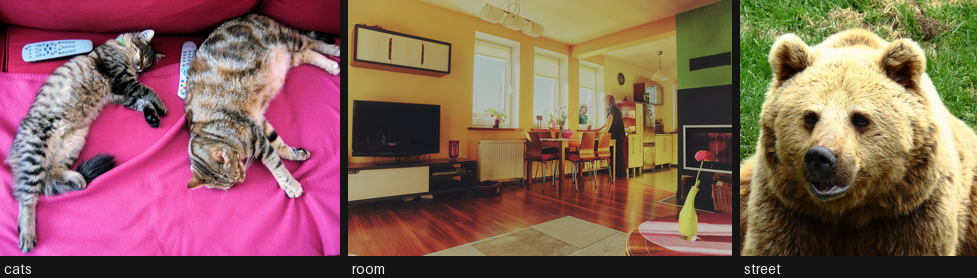

## 8. InstructPix2Pix and the two guidance scales

InstructPix2Pix (Brooks et al., 2023) is a Stable Diffusion 1.5 UNet with the source image concatenated into the **input channels** (the first conv layer was widened from 4 to 8 channels), fine-tuned on 313k synthetic (image, instruction, edited image) triples. Because it is conditioned on two things, it needs **two** classifier-free guidance scales, and getting them wrong accounts for nearly every bad result people post:

$$\tilde{e} = e_\varnothing + s_I\,(e_I - e_\varnothing) + s_T\,(e_{I,T} - e_I)$$

- **`image_guidance_scale`** ($s_I$, default 1.5): how strongly to stay near the source image. Raise it and the edit weakens; lower it and the image drifts.
- **`guidance_scale`** ($s_T$, default 7.5): how strongly to follow the instruction. Raise it and the edit strengthens, up to the point where it takes over the whole frame.

The practical recipe from the paper and from everyone who has used it since: if the edit is too weak, **lower `image_guidance_scale` toward 1.0**; if the image is unrecognisable, **raise it toward 2.0**. Change that knob before you change `guidance_scale`.

Write instructions as commands (“make it winter”), not descriptions (“a snowy street”). The model was trained on commands, and captions systematically under-edit.

------------------------------------------------------------------------

``` python
from diffusers import StableDiffusionInstructPix2PixPipeline

ip2p = StableDiffusionInstructPix2PixPipeline.from_pretrained(
    "timbrooks/instruct-pix2pix", torch_dtype=dtype, variant="fp16",
    safety_checker=None, cache_dir=HF_CACHE,
).to(device)
ip2p.enable_attention_slicing()
vram("ip2p loaded")


def edit_ip2p(pipe, image, instruction, image_guidance=1.5, text_guidance=7.5, steps=20, seed=SEED):
    "One InstructPix2Pix edit. The two guidance scales are the whole control surface."
    return pipe(
        instruction, image=image, num_inference_steps=steps,
        image_guidance_scale=image_guidance, guidance_scale=text_guidance,
        generator=generator(seed),
    ).images[0]


t0 = time.perf_counter()
snow = edit_ip2p(ip2p, street, "make it winter with heavy snow")
print(f"one 512 px edit, 20 steps: {time.perf_counter() - t0:.1f}s")
display(gallery([street, snow], ["source", "make it winter with heavy snow"]))
```

    VRAM ip2p loaded             2.79 GB allocated /  2.84 GB reserved

    one 512 px edit, 20 steps: 5.6s

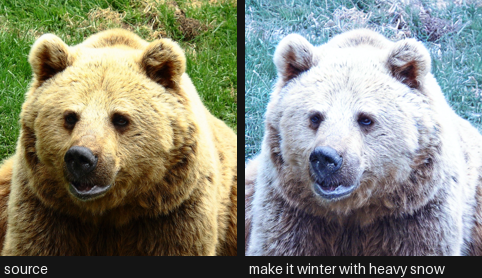

``` python
# The knob that matters. Same instruction, same seed, only image_guidance_scale moves.
INSTRUCTION = "turn the couch into blue velvet"
variants, labels = [cats], ["source"]
for s_i in (1.0, 1.5, 2.0, 2.5):
    t0 = time.perf_counter()
    variants.append(edit_ip2p(ip2p, cats, INSTRUCTION, image_guidance=s_i))
    labels.append(f"image_guidance={s_i}  ({time.perf_counter() - t0:.0f}s)")
display(gallery(variants, labels))
print("Low: strong edit, the rest of the image drifts. High: faithful image, weak or absent edit.\n"
      "This single knob is the over-edit / under-edit dial.")
```

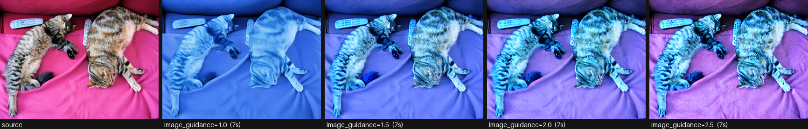

    Low: strong edit, the rest of the image drifts. High: faithful image, weak or absent edit.
    This single knob is the over-edit / under-edit dial.

``` python
# The four canonical failure modes, all reproducible on demand.
probes = [
    (street, "make it winter with heavy snow", 1.5, 7.5, "global edit (works well)"),
    (cats, "turn the couch into blue velvet", 1.5, 7.5, "local attribute (the hard case)"),
    (room, "remove the television", 1.5, 7.5, "removal (usually fails)"),
    (cats, "a photo of two cats on a blue couch", 1.5, 7.5, "caption, not instruction (under-edits)"),
]
outs, names = [], []
for image, instr, s_i, s_t, note in probes:
    outs.append(edit_ip2p(ip2p, image, instr, s_i, s_t))
    names.append(note)
    print(f"{note:34s} <- {instr!r}")
display(gallery(outs, names))

# Score them, so the impression above is a number rather than a vibe.
print(f"\n{'probe':34s} {'CLIP-I':>8s} {'L1':>6s}")
for (image, instr, _, _, note), out in zip(probes, outs):
    print(f"{note:34s} {metrics.image_similarity(image, out):8.3f} {metrics.l1(image, out):6.3f}")
```

    global edit (works well)           <- 'make it winter with heavy snow'

    local attribute (the hard case)    <- 'turn the couch into blue velvet'

    removal (usually fails)            <- 'remove the television'

    caption, not instruction (under-edits) <- 'a photo of two cats on a blue couch'

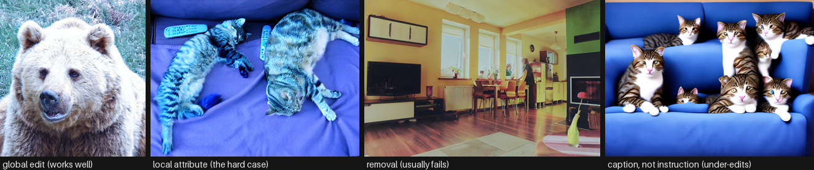

    probe                                CLIP-I     L1
    global edit (works well)              0.967  0.215
    local attribute (the hard case)       0.917  0.263
    removal (usually fails)               0.987  0.049
    caption, not instruction (under-edits)    0.771  0.330

## 9. MagicBrush - the same architecture, better data

MagicBrush (Zhang et al., NeurIPS 2023) is InstructPix2Pix fine-tuned on **10k manually annotated real editing sessions**. Human annotators drove DALL-E 2’s inpainting UI to produce genuine (source, instruction, result) triples, including multi-turn sequences where each edit builds on the last.

The lesson is about data, not architecture. InstructPix2Pix’s training set is synthetic: Prompt-to-Prompt generated *both* images, so the “source” is not a real photograph and the edits are mostly global. That biases it toward style and weather and against manipulating an object in a real photo. Same UNet, real data, and local edits get measurably better - which is exactly what the benchmark in section 13 shows.

Checkpoint: `vinesmsuic/magicbrush-jul7`. It ships `.bin` weights in fp32 only (~5 GB), so pass `use_safetensors=False` and no `variant`.

------------------------------------------------------------------------

``` python
del ip2p
free_memory()
vram("after ip2p")

magic = StableDiffusionInstructPix2PixPipeline.from_pretrained(
    "vinesmsuic/magicbrush-jul7", torch_dtype=dtype, use_safetensors=False,
    safety_checker=None, cache_dir=HF_CACHE,
).to(device)
magic.enable_attention_slicing()
vram("magicbrush loaded")

# The same four probes, same seeds, same guidance. Only the weights changed.
magic_outs = []
for image, instr, s_i, s_t, note in probes:
    magic_outs.append(edit_ip2p(magic, image, instr, s_i, s_t))
display(gallery(magic_outs, [f"magicbrush: {n}" for _, _, _, _, n in probes]))

# Multi-turn editing: MagicBrush was trained on sequences, so feeding its own output
# back in is a supported use rather than a hack. Watch identity drift accumulate.
turn = cats
chain, chain_labels = [cats], ["source"]
for instr in ["make the couch blue", "add a window behind them", "make it night time"]:
    turn = edit_ip2p(magic, turn, instr, image_guidance=1.6)
    chain.append(turn)
    chain_labels.append(instr)
display(gallery(chain, chain_labels))
print("Each turn compounds the previous one's errors - identity drift is the reason\n"
      "in-context models (FLUX Kontext, section 12) were built.")
```

    VRAM after ip2p              0.61 GB allocated /  0.66 GB reserved

    CLIPFeatureExtractor appears to have been deprecated in transformers. Using CLIPImageProcessor instead.
    You have disabled the safety checker for <class 'diffusers.pipelines.stable_diffusion.pipeline_stable_diffusion_instruct_pix2pix.StableDiffusionInstructPix2PixPipeline'> by passing `safety_checker=None`. Ensure that you abide to the conditions of the Stable Diffusion license and do not expose unfiltered results in services or applications open to the public. Both the diffusers team and Hugging Face strongly recommend to keep the safety filter enabled in all public facing circumstances, disabling it only for use-cases that involve analyzing network behavior or auditing its results. For more information, please have a look at https://github.com/huggingface/diffusers/pull/254 .

    VRAM magicbrush loaded       2.79 GB allocated /  2.84 GB reserved

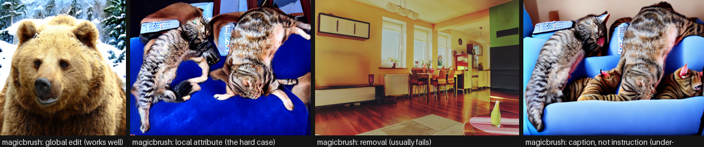

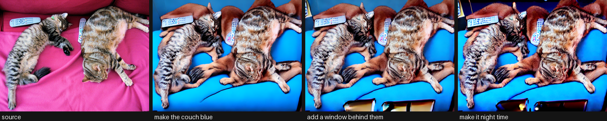

    Each turn compounds the previous one's errors - identity drift is the reason
    in-context models (FLUX Kontext, section 12) were built.

## 10. The caption-conditioned alternative: img2img `strength`

Worth running once, to see exactly what instruction tuning bought. SD 1.5 img2img takes a **caption** and a `strength` in \[0, 1\]: it noises the input up to that fraction of the schedule and denoises toward the caption. There is no notion of “leave the rest alone” anywhere in the process.

The result is a one-dimensional dial between “nothing happened” and “a different picture”, with no setting that does a clean local edit. That is not a bug in the implementation; it is what SDEdit is.

SDXL-Turbo makes the same approach *interactive*: adversarial distillation collapses the schedule to 1-4 steps, so a 512 px edit lands in a fraction of a second, which is what makes live restyling (section 14 of `Computer_Vision/06`) possible at all. Note the turbo constraint: `strength` must be high enough that `num_inference_steps * strength >= 1`, or the pipeline runs zero denoising steps and hands your image straight back.

------------------------------------------------------------------------

``` python
del magic
free_memory()

from diffusers import AutoPipelineForImage2Image

sd = AutoPipelineForImage2Image.from_pretrained(
    "sd-legacy/stable-diffusion-v1-5", torch_dtype=dtype, variant="fp16",
    safety_checker=None, cache_dir=HF_CACHE,
).to(device)
sd.enable_attention_slicing()
vram("sd1.5 img2img")

CAPTION = "a photo of two cats sleeping on a blue velvet couch"
row, labels = [cats], ["source"]
for strength in (0.3, 0.5, 0.7, 0.9):
    out = sd(CAPTION, image=cats, strength=strength, guidance_scale=7.5,
             num_inference_steps=30, generator=generator()).images[0]
    row.append(out)
    labels.append(f"strength={strength}  CLIP-I {metrics.image_similarity(cats, out):.2f}")
display(gallery(row, labels))
print("No value of `strength` gives a clean local edit: low preserves and does nothing,\n"
      "high edits and destroys. That gap is the reason InstructPix2Pix exists.")

del sd
free_memory()
vram("after sd1.5")
```

    [transformers] `Siglip2ImageProcessorFast` is deprecated. The `Fast` suffix for image processors has been removed; use `Siglip2ImageProcessor` instead.
    /home/bthek1/Knowledge/.venv/lib/python3.14/site-packages/huggingface_hub/utils/_validators.py:205: UserWarning: The `local_dir_use_symlinks` argument is deprecated and ignored in `hf_hub_download`. Downloading to a local directory does not use symlinks anymore.
      warnings.warn(

    You have disabled the safety checker for <class 'diffusers.pipelines.stable_diffusion.pipeline_stable_diffusion_img2img.StableDiffusionImg2ImgPipeline'> by passing `safety_checker=None`. Ensure that you abide to the conditions of the Stable Diffusion license and do not expose unfiltered results in services or applications open to the public. Both the diffusers team and Hugging Face strongly recommend to keep the safety filter enabled in all public facing circumstances, disabling it only for use-cases that involve analyzing network behavior or auditing its results. For more information, please have a look at https://github.com/huggingface/diffusers/pull/254 .

    VRAM sd1.5 img2img           2.79 GB allocated /  2.84 GB reserved

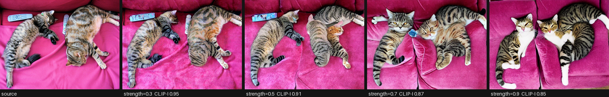

    No value of `strength` gives a clean local edit: low preserves and does nothing,
    high edits and destroys. That gap is the reason InstructPix2Pix exists.
    VRAM after sd1.5             0.61 GB allocated /  0.66 GB reserved

## 11. ControlNet - preserve the structure, replace the content

The third strategy, and the one production art pipelines actually lean on: extract a **structure map** from the source image (canny edges, depth, pose, segmentation), then generate a *new* image conditioned on both the caption and that map. Nothing about the original pixels survives, but the composition does.

Use it when the edit is “same layout, different everything” - restyling an interior, changing a season, re-rendering a sketch. Do not use it when the edit is “change this one object”: the model has no reason to keep the rest identical, and it will not.

`lllyasviel/sd-controlnet-canny` is a 1.4 GB adapter on SD 1.5. The `controlnet_conditioning_scale` is the knob: high means slavish adherence to the edges, low lets the model wander.

------------------------------------------------------------------------

``` python
import cv2
import numpy as np
from diffusers import ControlNetModel, StableDiffusionControlNetPipeline, UniPCMultistepScheduler

controlnet = ControlNetModel.from_pretrained(
    "lllyasviel/sd-controlnet-canny", torch_dtype=dtype, cache_dir=HF_CACHE
)
cn = StableDiffusionControlNetPipeline.from_pretrained(
    "sd-legacy/stable-diffusion-v1-5", controlnet=controlnet, torch_dtype=dtype,
    variant="fp16", safety_checker=None, cache_dir=HF_CACHE,
).to(device)
cn.scheduler = UniPCMultistepScheduler.from_config(cn.scheduler.config)
cn.enable_attention_slicing()
vram("controlnet loaded")

# The structure map: everything the model will be told about the original.
edges = cv2.Canny(np.array(room.convert("RGB")), 100, 200)
edge_img = Image.fromarray(np.stack([edges] * 3, axis=-1))

outs = [room, edge_img]
labels = ["source", "canny edges (all that survives)"]
for prompt in ["a bright scandinavian living room, white walls, natural light",
               "a dimly lit cyberpunk apartment, neon signs, rain outside"]:
    out = cn(prompt, image=edge_img, num_inference_steps=25,
             controlnet_conditioning_scale=1.0, generator=generator()).images[0]
    outs.append(out)
    labels.append(prompt[:40])
display(gallery(outs, labels))

del cn, controlnet
free_memory()
vram("after controlnet")
```

    You have disabled the safety checker for <class 'diffusers.pipelines.controlnet.pipeline_controlnet.StableDiffusionControlNetPipeline'> by passing `safety_checker=None`. Ensure that you abide to the conditions of the Stable Diffusion license and do not expose unfiltered results in services or applications open to the public. Both the diffusers team and Hugging Face strongly recommend to keep the safety filter enabled in all public facing circumstances, disabling it only for use-cases that involve analyzing network behavior or auditing its results. For more information, please have a look at https://github.com/huggingface/diffusers/pull/254 .

    VRAM controlnet loaded       3.51 GB allocated /  3.57 GB reserved

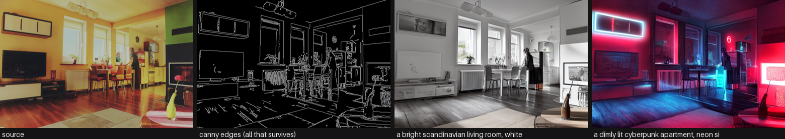

    VRAM after controlnet        0.61 GB allocated /  0.66 GB reserved

## 12. FLUX.1 Kontext - the 2025 in-context editor

The current open frontier, and an honest look at what it costs. FLUX.1 Kontext (Black Forest Labs, 2025) is a 12B rectified-flow transformer that does something the models above cannot: it puts the **reference image’s tokens and the target’s tokens in the same sequence**, so editing and generation are literally the same operation. The consequences that matter in practice:

- **Character and product identity survive multiple sequential edits** - the failure mode section 9 demonstrated is largely solved.
- Local edits stay local without a mask, because the model can attend to the exact source tokens rather than a renoised approximation.
- It accepts both an image and a text prompt as a joint context, so “put the object from this photo into that scene” works.

What it costs on this machine: the `dev` weights are ~24 GB to download (12B transformer in bf16 plus a T5 text encoder), and even with 4-bit quantization plus `enable_model_cpu_offload()` a single 1024 px edit takes minutes on a 3060. That is why the cell is behind `RUN_HEAVY`. **Quantization does not shrink the download** - `bitsandbytes` quantizes after fetching full-precision shards.

The other two members of this generation are further out of reach here: **Qwen-Image-Edit** (20B, ~40 GB, the best open model for editing *text inside* images thanks to its dual Qwen2.5-VL + VAE conditioning) and **Step1X-Edit** (19B, ~52 GB). Both belong in a production write-up; neither belongs in a runnable cell on a 12 GB card.

------------------------------------------------------------------------

``` python
if not RUN_HEAVY:
    print("skipped: FLUX.1-Kontext-dev is a ~24 GB download and minutes per edit here.\n"
          "Set RUN_HEAVY = True in the Setup cell to run it, and expect to wait.\n"
          "The weights are also gated - accept the license on the model page first.")
else:
    from diffusers import FluxKontextPipeline

    kontext = FluxKontextPipeline.from_pretrained(
        "black-forest-labs/FLUX.1-Kontext-dev", torch_dtype=torch.bfloat16, cache_dir=HF_CACHE
    )
    # Sequential offload keeps peak VRAM near a single submodule instead of the whole
    # 12B model. It is slow by design; it is also the only way this runs in 12 GB.
    kontext.enable_model_cpu_offload()
    vram("kontext loaded")

    t0 = time.perf_counter()
    out = kontext(
        image=cats, prompt="turn the couch into blue velvet, keep everything else identical",
        guidance_scale=2.5, num_inference_steps=28, generator=generator(),
    ).images[0]
    print(f"one Kontext edit: {time.perf_counter() - t0:.0f}s")
    display(gallery([cats, out], ["source", "kontext: blue velvet couch"]))
    print("CLIP-I (preservation):", round(metrics.image_similarity(cats, out), 3))

    del kontext
    free_memory()
    vram("after kontext")
```

    skipped: FLUX.1-Kontext-dev is a ~24 GB download and minutes per edit here.
    Set RUN_HEAVY = True in the Setup cell to run it, and expect to wait.
    The weights are also gated - accept the license on the model page first.

## 13. Head-to-head Benchmark

Three editors on the **same four (image, instruction) pairs**, the same seed, the same step count and the same metrics: InstructPix2Pix, MagicBrush, and caption-conditioned SD 1.5 img2img at `strength=0.6` as the control. Each pipeline is loaded, measured and **freed before the next one loads**, so VRAM stays flat.

Reported per model:

- **CLIP-D** - did the image move the way the instruction says (higher is better)
- **CLIP-I** - how much of the source survived (higher is better, but read it next to CLIP-D)
- **L1** - pixel-level change (a sanity check on both)
- **seconds/edit** at 512 px, 20 steps

**Read this as a smoke test, not a leaderboard.** Four hand-written pairs is nowhere near enough for a stable CLIP-D, the caption pairs are mine rather than a benchmark’s, and CLIP-D correlates only loosely with human preference on real edits. A real evaluation runs the Emu Edit test set or GEdit-Bench with a VLM judge. What this *does* show honestly is the preservation/compliance trade-off between the three approaches and their relative cost on this card.

------------------------------------------------------------------------

``` python
# Each case carries the source and target captions CLIP-D needs, plus a caption-style
# prompt so the img2img control gets a fair prompt rather than an instruction.
CASES = [
    {"image": street, "instruction": "make it winter with heavy snow",
     "src_caption": "a photo of a street scene", "tgt_caption": "a photo of a street scene in heavy snow",
     "caption": "a photo of a street scene in heavy snow"},
    {"image": cats, "instruction": "turn the couch into blue velvet",
     "src_caption": "two cats sleeping on a pink couch", "tgt_caption": "two cats sleeping on a blue velvet couch",
     "caption": "two cats sleeping on a blue velvet couch"},
    {"image": room, "instruction": "make it look like a watercolor painting",
     "src_caption": "a photo of a living room", "tgt_caption": "a watercolor painting of a living room",
     "caption": "a watercolor painting of a living room"},
    {"image": room, "instruction": "make it night time with the lamps switched on",
     "src_caption": "a living room during the day", "tgt_caption": "a living room at night with the lamps on",
     "caption": "a living room at night with the lamps on"},
]


def load_instruct(model_id, **kw):
    "An InstructPix2Pix-family editor: takes the instruction verbatim."
    pipe = StableDiffusionInstructPix2PixPipeline.from_pretrained(
        model_id, torch_dtype=dtype, safety_checker=None, cache_dir=HF_CACHE, **kw
    ).to(device)
    pipe.enable_attention_slicing()

    def run(case):
        return pipe(case["instruction"], image=case["image"], num_inference_steps=20,
                    image_guidance_scale=1.5, guidance_scale=7.5,
                    generator=generator()).images[0]

    return run, [pipe]


def load_img2img():
    "The caption-conditioned control: same target, no instruction tuning."
    pipe = AutoPipelineForImage2Image.from_pretrained(
        "sd-legacy/stable-diffusion-v1-5", torch_dtype=dtype, variant="fp16",
        safety_checker=None, cache_dir=HF_CACHE,
    ).to(device)
    pipe.enable_attention_slicing()

    def run(case):
        return pipe(case["caption"], image=case["image"], strength=0.6, guidance_scale=7.5,
                    num_inference_steps=30, generator=generator()).images[0]

    return run, [pipe]


def benchmark(name, loader):
    "Load, edit every case, score, free. One pipeline live at a time."
    run, handles = loader()
    outs, t0 = [], time.perf_counter()
    for case in CASES:
        outs.append(run(case))
    elapsed = time.perf_counter() - t0
    clip_d = [metrics.directional(c["image"], o, c["src_caption"], c["tgt_caption"])
              for c, o in zip(CASES, outs)]
    clip_i = [metrics.image_similarity(c["image"], o) for c, o in zip(CASES, outs)]
    l1 = [metrics.l1(c["image"], o) for c, o in zip(CASES, outs)]
    for h in handles:
        del h
    del run, handles
    free_memory()
    vram(f"after {name}")
    return {"model": name,
            "clip_d": round(float(np.mean(clip_d)), 4),
            "clip_i": round(float(np.mean(clip_i)), 4),
            "l1": round(float(np.mean(l1)), 4),
            "sec_per_edit": round(elapsed / len(CASES), 2),
            "images": outs}


results = [
    benchmark("instruct-pix2pix", lambda: load_instruct("timbrooks/instruct-pix2pix", variant="fp16")),
    benchmark("magicbrush", lambda: load_instruct("vinesmsuic/magicbrush-jul7", use_safetensors=False)),
    benchmark("sd1.5 img2img (caption)", load_img2img),
]
vram("benchmark done")
```

    VRAM after instruct-pix2pix  0.61 GB allocated /  0.66 GB reserved

    CLIPFeatureExtractor appears to have been deprecated in transformers. Using CLIPImageProcessor instead.
    You have disabled the safety checker for <class 'diffusers.pipelines.stable_diffusion.pipeline_stable_diffusion_instruct_pix2pix.StableDiffusionInstructPix2PixPipeline'> by passing `safety_checker=None`. Ensure that you abide to the conditions of the Stable Diffusion license and do not expose unfiltered results in services or applications open to the public. Both the diffusers team and Hugging Face strongly recommend to keep the safety filter enabled in all public facing circumstances, disabling it only for use-cases that involve analyzing network behavior or auditing its results. For more information, please have a look at https://github.com/huggingface/diffusers/pull/254 .

    VRAM after magicbrush        0.61 GB allocated /  0.66 GB reserved

    You have disabled the safety checker for <class 'diffusers.pipelines.stable_diffusion.pipeline_stable_diffusion_img2img.StableDiffusionImg2ImgPipeline'> by passing `safety_checker=None`. Ensure that you abide to the conditions of the Stable Diffusion license and do not expose unfiltered results in services or applications open to the public. Both the diffusers team and Hugging Face strongly recommend to keep the safety filter enabled in all public facing circumstances, disabling it only for use-cases that involve analyzing network behavior or auditing its results. For more information, please have a look at https://github.com/huggingface/diffusers/pull/254 .

    VRAM after sd1.5 img2img (caption)  0.61 GB allocated /  0.66 GB reserved
    VRAM benchmark done          0.61 GB allocated /  0.66 GB reserved

``` python
import pandas as pd

df = pd.DataFrame([{k: v for k, v in r.items() if k != "images"} for r in results])
df = df.sort_values("clip_d", ascending=False)
df
```

|     | model                   | clip_d | clip_i | l1     | sec_per_edit |
|-----|-------------------------|--------|--------|--------|--------------|
| 1   | magicbrush              | 0.1483 | 0.8572 | 0.1800 | 7.34         |
| 0   | instruct-pix2pix        | 0.1360 | 0.9579 | 0.2115 | 6.97         |
| 2   | sd1.5 img2img (caption) | 0.0549 | 0.7606 | 0.1119 | 4.69         |

``` python
from pyecharts.globals import CurrentConfig

# assets.pyecharts.org serves an expired TLS certificate from most nodes (2026-11-11),
# so charts failed to load. jsDelivr mirrors the same assets, pinned to one commit.
CurrentConfig.ONLINE_HOST = "https://cdn.jsdelivr.net/gh/pyecharts/pyecharts-assets@f2328d558550046fc5449672a6850e848e141590/assets/v6/"

from pyecharts import options as opts
from pyecharts.charts import Bar

names = [r["model"] for r in results]
bar = (
    Bar()
    .add_xaxis(names)
    .add_yaxis("CLIP-D x100 (follows the instruction)", [round(r["clip_d"] * 100, 2) for r in results])
    .add_yaxis("CLIP-I x100 (preserves the source)", [round(r["clip_i"] * 100, 2) for r in results])
    .set_global_opts(
        title_opts=opts.TitleOpts(
            title=f"Instruction editing on {len(CASES)} COCO images",
            subtitle="RTX 3060 12 GB, fp16, 512 px, seed fixed - smoke test, not a leaderboard",
        ),
        xaxis_opts=opts.AxisOpts(name="model", axislabel_opts=opts.LabelOpts(rotate=12)),
        yaxis_opts=opts.AxisOpts(name="score x100"),
        tooltip_opts=opts.TooltipOpts(trigger="axis"),
    )
)
bar.render_notebook()
```

``` python
from pyecharts.charts import Scatter

# The whole task on one chart: instruction-following against preservation. The top-right
# corner is the goal; the bottom-right corner is "did nothing"; top-left is "over-edited".
scatter = Scatter()
scatter.add_xaxis([round(r["clip_i"], 3) for r in results])
for r in results:
    scatter.add_yaxis(
        r["model"],
        [[round(r["clip_i"], 3), round(r["clip_d"], 3)]],
        symbol_size=18,
        label_opts=opts.LabelOpts(is_show=False),
    )
scatter.set_global_opts(
    title_opts=opts.TitleOpts(title="Instruction following vs preservation",
                              subtitle="up and to the right is better; bottom-right = did nothing"),
    xaxis_opts=opts.AxisOpts(type_="value", name="CLIP-I (preservation)"),
    yaxis_opts=opts.AxisOpts(type_="value", name="CLIP-D (instruction following)"),
    tooltip_opts=opts.TooltipOpts(trigger="item"),
)
scatter.render_notebook()
```

``` python
# The numbers hide the interesting part: look at the actual edits, case by case.
for i, case in enumerate(CASES):
    print(f"instruction: {case['instruction']}")
    display(gallery([case["image"]] + [r["images"][i] for r in results],
                    ["source"] + [r["model"] for r in results], height=200))
```

    instruction: make it winter with heavy snow

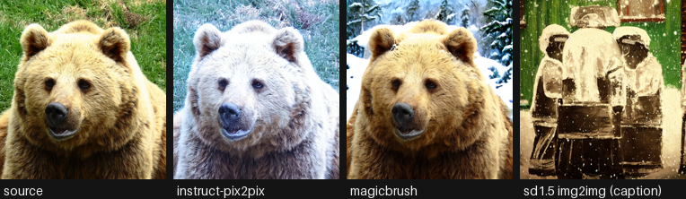

    instruction: turn the couch into blue velvet

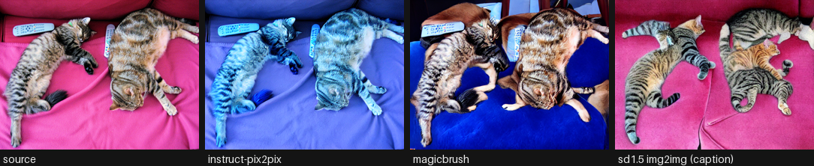

    instruction: make it look like a watercolor painting

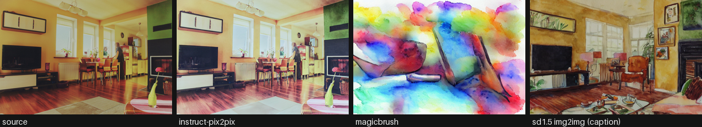

    instruction: make it night time with the lamps switched on

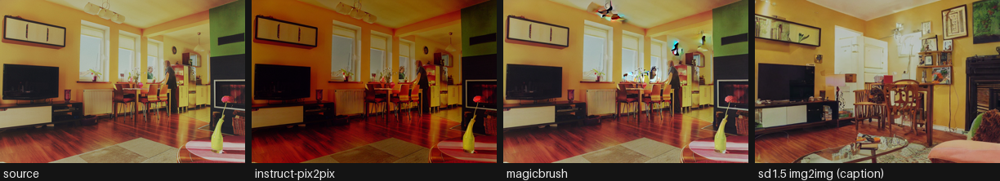

## 14. Live Demo: edit a camera frame

Grabs one frame from the webcam, applies your instruction with InstructPix2Pix, and shows source and edit side by side. A 20-step 512 px edit is a few seconds on this card, so this is a **shutter-button** demo rather than a live stream - which is the honest shape for editing, and the reason the interactive restyling demo in `Computer_Vision/06` uses a 2-step turbo model instead.

This is the cell people run on its own, so it opens with a `require(...)` guard naming what it needs from Setup instead of dying on a bare `NameError`. Capture notes, all measured on the knowledge-lab container: V4L2 backend with MJPEG and a warm-up read (auto-exposure needs frames to settle), never `CAP_PROP_BUFFERSIZE` (it halves the frame rate without making frames fresher), and no `cv2.imshow` because there is no GUI - the preview goes through `IPython.display` handles that update in place.

------------------------------------------------------------------------

``` python
def require(*names):
    "Fail early and clearly if the notebook's setup / helper cells have not been run."
    missing = [n for n in names if n not in globals()]
    if missing:
        raise NameError(
            f"this demo needs {', '.join(missing)} from earlier in the notebook. "
            "Run the setup and helper cells first (Run > Run All Above Selected Cell)."
        )


require("device", "dtype", "HF_CACHE", "free_memory", "vram", "generator", "gallery", "metrics")

import time

# opencv-python-headless is a project dependency; the headless build captures from
# V4L2 fine, it only drops the GUI windows.
import io

import cv2
from IPython.display import Image as IPyImage
from IPython.display import Pretty, display
from PIL import Image

from diffusers import StableDiffusionInstructPix2PixPipeline

CAM = 0             # /dev/video0
WARMUP = 10         # throwaway reads - auto-exposure and white balance need to settle
FRAME_SECONDS = 5   # how long the framing preview runs before the shot is taken
INSTRUCTION = "make it look like a van gogh painting"


def open_camera(index=CAM, width=640, height=480, auto_exposure=True, exposure=150):
    "Open a V4L2 webcam in MJPEG mode, let it settle, and return the capture handle."
    cap = cv2.VideoCapture(index, cv2.CAP_V4L2)
    if not cap.isOpened():
        raise RuntimeError(
            f"/dev/video{index} did not open - no camera attached, "
            "or it is not passed through into this container"
        )
    cap.set(cv2.CAP_PROP_FOURCC, cv2.VideoWriter.fourcc(*"MJPG"))  # MJPEG unlocks the higher modes
    cap.set(cv2.CAP_PROP_FRAME_WIDTH, width)
    cap.set(cv2.CAP_PROP_FRAME_HEIGHT, height)
    # UVC exposure is DEVICE state and persists between processes: if anything left this
    # camera in manual mode every frame comes back dark and never adapts, so ask for the
    # mode explicitly. auto (3) = correct brightness but 15 FPS in a dim room;
    # manual (1) = locked 30 FPS at whatever `exposure` suits the lighting.
    cap.set(cv2.CAP_PROP_AUTO_EXPOSURE, 3 if auto_exposure else 1)
    if not auto_exposure:
        cap.set(cv2.CAP_PROP_EXPOSURE, exposure)
    # Deliberately no CAP_PROP_BUFFERSIZE: on the V4L2 backend it HALVES the delivered
    # frame rate and does not make frames any fresher.
    for _ in range(WARMUP):
        if not cap.read()[0]:
            cap.release()
            raise RuntimeError(f"/dev/video{index} opened but delivered no frames")
    return cap


def grab(cap):
    "Read one frame off an open camera as an RGB PIL image (OpenCV hands back BGR)."
    ok, frame = cap.read()
    if not ok:
        raise RuntimeError("failed to read a frame")
    return Image.fromarray(cv2.cvtColor(frame, cv2.COLOR_BGR2RGB))


def _jpeg(img, quality=80):
    "Encode a PIL image to JPEG bytes - what actually goes over the wire each frame."
    buf = io.BytesIO()
    img.convert("RGB").save(buf, format="JPEG", quality=quality)
    return buf.getvalue()


def preview(seconds=FRAME_SECONDS, width=640, height=480):
    "Stream the raw camera so you can frame the shot, then return the final frame."
    cap = open_camera(width=width, height=height)
    view = status = None  # created from the FIRST real frame, so no placeholder flashes up
    last, n, t0 = None, 0, time.perf_counter()
    try:
        while time.perf_counter() - t0 < seconds:
            last = grab(cap)
            n += 1
            frame = IPyImage(data=_jpeg(last))
            line = Pretty(f"framing - {seconds - (time.perf_counter() - t0):4.1f}s left, "
                          f"{n} frames (the last one is the one that gets edited)")
            if view is None:
                view = display(frame, display_id=True)
                status = display(line, display_id=True)
            else:
                view.update(frame)
                status.update(line)
    except KeyboardInterrupt:
        pass
    finally:
        cap.release()  # always hand the device back
    if status is not None:
        status.update(Pretty(f"captured the last of {n} frames"))
    return last


# Re-runnable: this cell frees the pipeline at the end, so guard the load or a second
# shift-enter raises NameError on `live_pipe`.
if "live_pipe" not in globals():
    live_pipe = StableDiffusionInstructPix2PixPipeline.from_pretrained(
        "timbrooks/instruct-pix2pix", torch_dtype=dtype, variant="fp16",
        safety_checker=None, cache_dir=HF_CACHE,
    ).to(device)
    live_pipe.enable_attention_slicing()
    vram("live pipeline")

shot = preview()
# 512 px on the short side, dimensions rounded to a multiple of 8 for the VAE.
scale = 512 / min(shot.size)
shot = shot.resize((int(shot.width * scale) // 8 * 8, int(shot.height * scale) // 8 * 8))

t0 = time.perf_counter()
edited = live_pipe(INSTRUCTION, image=shot, num_inference_steps=20,
                   image_guidance_scale=1.5, guidance_scale=7.5,
                   generator=generator()).images[0]
print(f"edit took {time.perf_counter() - t0:.1f}s | CLIP-I {metrics.image_similarity(shot, edited):.3f}")
display(gallery([shot, edited], ["camera frame", INSTRUCTION], height=320))

del live_pipe
free_memory()
vram("final")
```

    VRAM live pipeline           2.79 GB allocated /  2.84 GB reserved

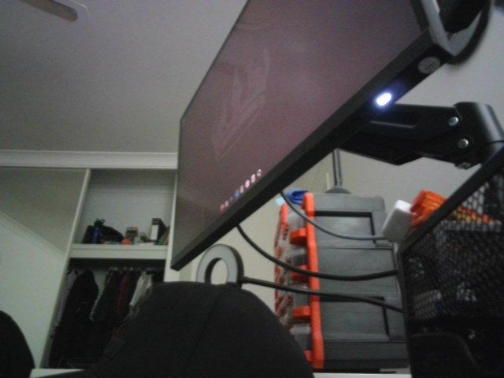

    captured the last of 75 frames

    edit took 6.8s | CLIP-I 0.931

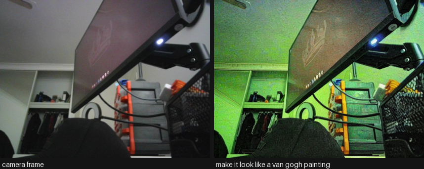

    VRAM final                   0.61 GB allocated /  0.66 GB reserved

## 15. Common Frameworks

Instruction editing shares the whole diffusion ecosystem with text-to-image, so the interesting frameworks are the ones that address what makes editing different: you already have an image you are supposed to preserve. That turns masks, structural conditioning and identity preservation from optional extras into the core of the stack, and it makes evaluation two-sided in a way pure generation never is.

| Framework | Layer | What it gives you | License | Reach for it when |
|----|----|----|----|----|
| [diffusers](https://github.com/huggingface/diffusers) | modelling | InstructPix2Pix, MagicBrush, ControlNet, inpainting and FLUX.1 Kontext pipelines, plus the two guidance scales of section 8 | Apache 2.0 | Default. The image-guidance/text-guidance interaction is library behaviour and worth understanding once |
| [peft](https://github.com/huggingface/peft) + `train_instruct_pix2pix.py` | modelling | LoRA on the UNet at 256-512 px with gradient checkpointing - a domain editor on this card | Apache 2.0 | You have a repeated edit. A few thousand real before/after triples beat any amount of prompt engineering |
| [ControlNet](https://github.com/lllyasviel/ControlNet) + [IP-Adapter](https://github.com/tencent-ailab/IP-Adapter) + [InstantID](https://github.com/instantX-research/InstantID) | modelling | Structure preserved from depth/pose/canny, style from a reference image, and identity preserved far better than an instruction can | Apache 2.0 | Almost always. “Keep the composition, change everything else” is not something an instruction expresses reliably |
| [SAM 2](https://github.com/facebookresearch/sam2) + a grounded detector | data | The mask that makes “remove the person on the left” reliable, because inpainting cannot touch anything outside it | Apache 2.0 | Whenever the region is known. This succeeds where section 8 shows instruction editing fails - see `Computer_Vision/12_Mask_Generation` |
| [bitsandbytes](https://github.com/bitsandbytes-foundation/bitsandbytes) / GGUF quants | data | NF4 and community GGUF weights that put FLUX.1 Kontext and Qwen-Image-Edit on a 12 GB card | MIT | Running the 2025 frontier here. Note the download is unchanged - quantisation happens after the full weights land |
| `torch.compile` + distilled checkpoints | inference runtime | 20-40% from compilation, and an order of magnitude from fewer steps | BSD-3 | Interactive editing, which is most editing. A person waiting changes the acceptable step count |
| [BentoML](https://github.com/bentoml/BentoML) / [Ray Serve](https://github.com/ray-project/ray) | serving | Async job queues with progress, since an edit takes seconds to a minute and the client should not block | Apache 2.0 | Serving editing to users |
| [ComfyUI](https://github.com/comfyanonymous/ComfyUI) / [stable-diffusion.cpp](https://github.com/leejet/stable-diffusion.cpp) | orchestration | The graph - detect, mask, condition, edit, composite - and where community quants of the frontier editors land first | GPL-3.0 / MIT | Any multi-stage edit, and any attempt to run FLUX-class editors on consumer hardware |
| A VLM judge (`Multimodal/01_Image_Text_to_Text`) + [torchmetrics](https://github.com/Lightning-AI/torchmetrics) LPIPS | evaluation | Instruction compliance and preservation scored separately, on a fixed 50-100 pair set from your own domain | Apache 2.0 | Always. A single number cannot express a two-sided trade, and CLIP directional similarity alone is too coarse |

**The 2026 default stack** is `diffusers` with ControlNet and IP-Adapter, SAM for masks whenever the region is knowable, a quantised frontier editor through ComfyUI when quality justifies it, and a VLM judge over a fixed evaluation set to decide. LoRA when the same edit repeats.

The common wrong turn is using instruction editing where masked inpainting belongs. If you know *where* the edit goes, a mask makes the rest of the image untouchable by construction, which is strictly stronger than asking a model to leave it alone. The second is reporting only compliance or only preservation - a model that ignores the instruction scores perfectly on one, and a model that regenerates the image scores perfectly on the other.

------------------------------------------------------------------------

## 16. Going Further

- **Fine-tuning.** The InstructPix2Pix recipe fine-tunes on this card: `diffusers`’ [`train_instruct_pix2pix.py`](https://github.com/huggingface/diffusers/blob/main/examples/instruct_pix2pix/README.md) with a LoRA on the UNet, at 256-512 px with gradient checkpointing. What actually decides the result is the **data**: MagicBrush is the same architecture with better triples. If you want a domain editor (product photography, medical, satellite), collect a few thousand real before/after pairs with instructions and expect that to beat any prompt engineering.
- **Better control without retraining.** IP-Adapter (image prompts), ControlNet unions (depth + pose + canny together), and regional prompting all bolt onto SD 1.5 / SDXL and cost nothing to try. For identity, InstantID and PhotoMaker preserve a face far better than any instruction can.
- **Masked editing when you know where.** If the region is known, inpainting beats instruction editing outright: it cannot touch anything outside the mask. Pair SAM 2 (`Computer_Vision/12_Mask_Generation`) or a grounding detector (`Computer_Vision/13_Zero_Shot_Object_Detection`) with an inpainting checkpoint and you get “remove the person on the left” reliably, which section 8 showed InstructPix2Pix cannot.
- **Evaluation that means something.** Build a fixed set of 50-100 (image, instruction) pairs from your own domain, generate with a fixed seed, and judge with a VLM (`Multimodal/01_Image_Text_to_Text`) on two axes - instruction compliance and preservation - plus a human spot check. That is worth more than any CLIP-D number, including the ones above.
- **Provenance.** If edited images leave your system, attach C2PA content credentials and consider an invisible watermark (`invisible-watermark` ships with SDXL). Several jurisdictions now require disclosure for synthetic media.
- **Related notebooks.** `Computer_Vision/04_Text_to_Image` (generation from scratch), `Computer_Vision/06_Image_to_Image` (img2img, inpainting, ControlNet and super-resolution in depth), `Multimodal/03_Image_Text_to_Video` (the same conditioning, one dimension up), and `Multimodal/08_Any_to_Any` (single models that understand and generate).

------------------------------------------------------------------------

Back to top
