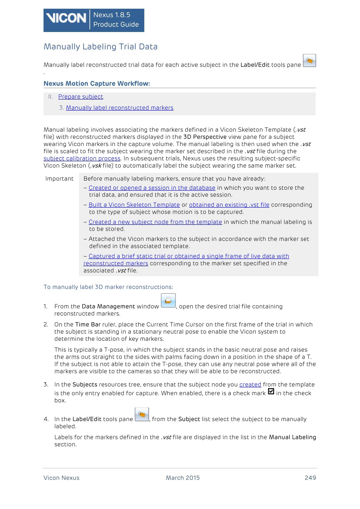
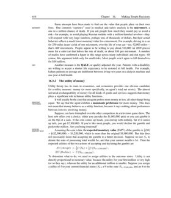
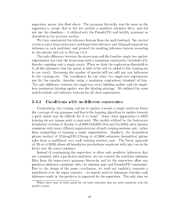
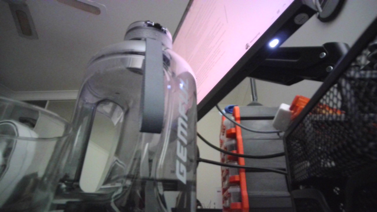
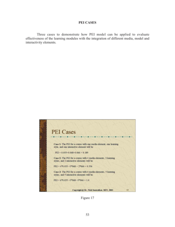

# Visual Document Retrieval

Everything to know about ColPali-style retrieval: why embedding the page image beats parsing it, what late interaction costs in storage, the mid-2026 landscape, and runnable code that puts OCR+BM25, CLIP and two late-interaction models on the same corpus.

Author

Benedict Thekkel

## 1. What is Visual Document Retrieval?

Visual document retrieval is **a text query in, a ranked list of document pages out**, where the pages are matched **as images** rather than as extracted text.

That last clause is the whole idea. The traditional way to make a PDF searchable is a pipeline: OCR the page, detect the layout, reconstruct the reading order, chunk the text, embed the chunks, index them. Five stages, each with its own failure mode, and every stage discards something - a chart becomes a caption, a table becomes a mangled string, a diagram becomes nothing at all.

**ColPali** (Faysse et al., 2024) asked what happens if you delete the pipeline: feed the page image straight into a vision-language model, keep the per-patch embeddings, and match them against the query’s per-token embeddings with **late interaction**. It was both simpler and substantially better, and it created this task category.

**Input.** A text query, and a corpus of page images (rendered PDF pages, scans, screenshots, slides).

**Output.** The top-k pages, scored. What happens next is normally document QA (`Multimodal/05`) on the retrieved pages - visual retrieval is the first half of a multimodal RAG system, not a product on its own.

| Neighbouring task | Difference | Typical tools |
|----|----|----|
| Document QA (`Multimodal/05`) | You already know which page; now answer about it | Donut, LayoutLM, Qwen3-VL |
| Text retrieval / RAG (`NLP/07`, `NLP/10`) | Corpus is text; the parsing problem is assumed solved | BGE, E5, Qwen3-Embedding |
| Image feature extraction (`Computer_Vision/16`) | Image-to-image similarity, no text query | DINOv2, SigLIP |
| Zero-shot classification (`Computer_Vision/11`) | Fixed labels, single-vector match | CLIP, SigLIP |
| Text ranking (`NLP/11`) | Reranks an existing candidate list, usually cross-encoder | BGE-reranker |

**Why not just use CLIP?** CLIP squeezes an entire page into **one** vector, and a page contains dozens of independent facts. A query about a footnote has to compete with everything else on the page for room in that single embedding. Late interaction keeps **one vector per patch** and lets the query’s tokens each find their own best-matching patch - which is why section 10 beats section 9 by a wide margin, and why it costs 100x the storage.

------------------------------------------------------------------------

## 2. Real-World Use Cases

| Use case | Domain | Consumes / produces | Dominant constraint |
|----|----|----|----|
| Enterprise document search | Any large organisation | Question + PDF corpus -\> relevant pages | Index size and refresh cost; permissions; recall on charts and tables |
| Financial research and filings | Finance | “FY24 segment revenue” + 10-Ks -\> the exact page | Tables and figures; auditability of the citation |
| Legal discovery and contract search | Legal | Query + case documents -\> pages with citations | Recall above all; defensibility of the process |
| Technical support and manuals | Manufacturing, consumer electronics | “how do I reset the pump” + manuals -\> the diagram page | Diagrams carry the answer; multilingual manuals |
| Scientific literature search | Research | “results for method X on dataset Y” -\> the figure or table | Formulas and plots that OCR mangles |
| Pharma and regulatory dossiers | Life sciences | Query + submission binder -\> the page | Compliance, versioning, complete recall |
| Slide-deck and knowledge search | Consulting, sales enablement | Query + deck archive -\> the slide | Slides are almost entirely visual; OCR order is meaningless |
| Insurance policy and claim lookup | Insurance | Query + policy PDFs -\> the clause | Long documents; exact clause retrieval |
| Public-records and archive search | Government, journalism | Query + scanned archives -\> the page | Old scans, handwriting, no digital text at all |
| Multimodal RAG for assistants | Any | User question -\> pages -\> grounded answer | End-to-end latency; hallucination control via citation |

**What the leaderboard hides.** Four realities.

*Index size is the deployment blocker.* A single-vector index over a million pages is a few gigabytes. The same corpus with ColPali’s ~1,030 vectors per page is hundreds of gigabytes before compression. Section 10 measures this exactly, and section 14 covers the standard mitigations (binary quantization, pooling, two-stage retrieval).

*Latency is dominated by scoring, not encoding.* Late interaction cannot use a plain dot-product index. Production deployments either use a specialised index (PLAID, MUVERA, Vespa’s tensor support, Qdrant multivectors) or do a cheap first-stage retrieval and re-score the top 100 with MaxSim.

*Retrieval quality caps everything downstream.* A perfect VLM cannot answer from a page it never received. In a multimodal RAG stack, recall@k at the retrieval stage is the ceiling on end-to-end accuracy, which is why this task is worth its own notebook.

*Real corpora are heterogeneous.* Scanned faxes next to born-digital slides next to spreadsheets. The pipeline approach degrades unevenly across those; the visual approach degrades more gracefully because it never assumed a text layer existed.

------------------------------------------------------------------------

## 3. How Modern Visual Document Retrieval Works

1.  **OCR plus lexical search (the 40-year baseline).** Extract text, index with BM25. Exact-term matching is genuinely strong, it needs no GPU, and it explains itself. It also cannot match “revenue growth” to a bar chart with no words, and it inherits every OCR error. Section 8 runs it as the control.

2.  **OCR plus dense text embeddings (2019-2023).** Replace BM25 with a text bi-encoder (DPR, then E5/BGE/GTE). Semantic matching improves, and the parsing pipeline’s losses remain exactly where they were. Hybrid BM25 + dense is still the enterprise default in 2026 for text-heavy corpora.

3.  **Single-vector image-text matching (CLIP, 2021; SigLIP, 2023).** Embed the page image and the query into one shared space. Zero parsing, but one vector per page is a severe bottleneck for a document with dozens of facts, and CLIP’s training data (web photos with alt-text) is nothing like a document page. Section 9 shows how badly this does.

4.  **Late interaction over text (ColBERT, 2020).** The idea being borrowed: keep one vector **per token** for both query and document, and score with **MaxSim** - for each query token, take its best match in the document, then sum:

    $$S(q, d) = \sum_{i \in q} \max_{j \in d} \; E_{q_i} \cdot E_{d_j}$$

    Far more expressive than a single dot product, and still cheap enough to index because the interaction happens at scoring time, not through a cross-encoder.

5.  **ColPali: late interaction over page patches (2024).** Take a document-capable VLM (PaliGemma-3B), project its **per-patch** hidden states to 128 dimensions, and MaxSim them against the query’s per-token embeddings. A page becomes ~1,030 vectors, one per image patch. No OCR, no layout detection, no chunking - and on the ViDoRe benchmark it beat the best pipeline systems by a wide margin, especially on figures, tables and infographics. **ColQwen2** (2024-25) swapped the backbone for Qwen2-VL with dynamic resolution, which handles varied page sizes better.

6.  **Efficiency work (2025-2026).** The storage cost drove a wave of follow-ups: token **pooling** (cluster similar patch vectors, 3x fewer with almost no quality loss), **binary quantization** (32x smaller, ~1-3 point cost), fixed-dimensional encodings (MUVERA) that let you use a normal ANN index, and small models like **ColSmol** (256M/500M) for edge deployment. Native multivector support landed in Qdrant, Vespa, Weaviate and Milvus.

7.  **Where it is going.** Multilingual and multi-domain training sets (ViDoRe v2/v3 exposed how much v1 was saturated), unified embedding models that handle text, images and pages in one space, and hybrid indexes that combine a cheap first stage with MaxSim reranking.

**Mid-2026 state.** Late interaction over page images is the accepted state of the art for document retrieval where the pages are visual. For plain text-heavy corpora, a good text embedder plus BM25 remains competitive at a fraction of the index size - and the honest engineering answer is to route by document type.

------------------------------------------------------------------------

## 4. Evaluation Metrics

Retrieval metrics, applied to pages. In the ViDoRe setting each query has exactly **one** relevant page, which simplifies everything.

**nDCG@k** - the headline metric on ViDoRe. Discounted cumulative gain normalised by the ideal ordering:

$$\mathrm{DCG@}k = \sum_{i=1}^{k} \frac{rel_i}{\log_2(i + 1)}, \qquad \mathrm{nDCG@}k = \frac{\mathrm{DCG@}k}{\mathrm{IDCG@}k}$$

With a single relevant document, this collapses to $1 / \log_2(\text{rank} + 1)$ if the gold page is in the top k, else 0. So rank 1 scores 1.0, rank 2 scores 0.63, rank 5 scores 0.39.

**Recall@k** - is the gold page anywhere in the top k? This is the metric that matters for RAG, because it is the ceiling on what the downstream reader can possibly answer. If your generator gets k=5 pages, recall@5 is your real budget.

**MRR** - mean reciprocal rank, $1/\text{rank}$. Sensitive to the exact position, useful when the user sees one result.

**Index cost.** Report **vectors per page**, **bytes per page** and total index size at your corpus scale. A model that wins nDCG@5 by two points and needs 100x the storage may still be the wrong choice, and this is the number most papers bury.

**Latency**, split into encoding (per page, offline) and query time (encode the query + score the corpus). They scale differently and are budgeted differently.

The cell below implements the three ranking metrics.

------------------------------------------------------------------------

``` python
import math

import numpy as np


def ndcg_at_k(rankings, k=5):
    "nDCG@k with exactly one relevant document per query (the ViDoRe setting).\n\n    `rankings[i]` is the 0-based rank at which query i's gold page appeared, or -1 if it\n    was not retrieved at all. With one relevant doc the ideal DCG is 1.0, so this is just\n    1 / log2(rank + 2) when the gold page made the cut.\n    "
    scores = [1.0 / math.log2(r + 2) if 0 <= r < k else 0.0 for r in rankings]
    return float(np.mean(scores))


def recall_at_k(rankings, k=5):
    "Fraction of queries whose gold page is anywhere in the top k. The RAG ceiling."
    return float(np.mean([1.0 if 0 <= r < k else 0.0 for r in rankings]))


def mrr(rankings):
    "Mean reciprocal rank. Sensitive to the exact position, not just membership."
    return float(np.mean([1.0 / (r + 1) if r >= 0 else 0.0 for r in rankings]))


def ranks_from_scores(score_matrix, golds):
    "Score matrix (queries x pages) + gold page index per query -> 0-based rank of the gold page."
    order = np.argsort(-np.asarray(score_matrix), axis=1)
    return [int(np.where(row == g)[0][0]) for row, g in zip(order, golds)]


demo = [0, 0, 1, 4, 9, -1]   # gold page ranks for six imaginary queries
print(f"ranks           {demo}")
for k in (1, 5, 10):
    print(f"nDCG@{k:<2d} {ndcg_at_k(demo, k):.3f}   recall@{k:<2d} {recall_at_k(demo, k):.3f}")
print(f"MRR      {mrr(demo):.3f}")
print("\nRank 0 scores 1.000, rank 1 scores 0.631, rank 4 scores 0.431: nDCG punishes\n"
      "position hard, while recall@5 only asks whether the page made the cut at all.")
```

    ranks           [0, 0, 1, 4, 9, -1]
    nDCG@1  0.333   recall@1  0.333
    nDCG@5  0.503   recall@5  0.667
    nDCG@10 0.551   recall@10 0.833
    MRR      0.467

    Rank 0 scores 1.000, rank 1 scores 0.631, rank 4 scores 0.431: nDCG punishes
    position hard, while recall@5 only asks whether the page made the cut at all.

## 5. Datasets

| Dataset | Contents | Size | Scope | License | Typical use |
|----|----|----|----|----|----|
| [ViDoRe v1](https://huggingface.co/collections/vidore/vidore-benchmark-667173f98e70a1c0fa4db00d) | 10 page-retrieval tasks: academic, industry, synthetic | ~10k pages | en, fr | MIT / per-source | **The** benchmark ColPali introduced; largely saturated by 2026 |
| [vidore/syntheticDocQA_artificial_intelligence_test](https://huggingface.co/datasets/vidore/syntheticDocQA_artificial_intelligence_test) | AI-domain PDF pages with synthetic queries | 1000 rows | en | MIT | **This notebook’s corpus**; small and ungated |
| [ViDoRe v2](https://huggingface.co/collections/vidore/vidore-benchmark-v2-67ae03e3924e85b36e7f53b0) | Harder, multilingual, multi-document queries | 4 datasets | en, fr, de, es | MIT | The 2025 successor; v1 numbers are no longer discriminative |
| [vidore/docvqa_test_subsampled](https://huggingface.co/datasets/vidore/docvqa_test_subsampled) | DocVQA pages framed as a retrieval task | 500 | en | research | Retrieval over scanned industry documents |
| [ColPali train set](https://huggingface.co/datasets/vidore/colpali_train_set) | 127k query-page pairs, mostly synthetic | 127k | en, fr | MIT | Training and fine-tuning late-interaction retrievers |
| [MMLongBench-Doc](https://huggingface.co/datasets/yubo2333/MMLongBench-Doc) | Long multi-page documents with cross-page questions | 1k QA / 130 docs | en | Apache 2.0 | Long-document retrieval + reasoning |
| [MMDocIR](https://huggingface.co/datasets/MMDocIR/MMDocIR_Train_Dataset) | Page and layout-level retrieval annotations | 73k | en | Apache 2.0 | Fine-grained (sub-page) retrieval |
| [BEIR](https://huggingface.co/datasets/BeIR/beir) | 18 text retrieval tasks | varies | en | varies | The text-only reference point |

This notebook builds a small corpus from **`vidore/syntheticDocQA_artificial_intelligence_test`**: each row carries one page image and one query whose answer is on that page, so the gold label is free. A few dozen pages is a smoke test - retrieval gets monotonically harder as the corpus grows, and published ViDoRe numbers are over thousands of pages.

------------------------------------------------------------------------

## 6. The Model Landscape (mid-2026)

Leaderboard: **[ViDoRe](https://huggingface.co/spaces/vidore/vidore-leaderboard)** (nDCG@5 across the benchmark suite), plus **[MTEB](https://huggingface.co/spaces/mteb/leaderboard)** for the text-retrieval baselines these are compared against.

| Model | Params | License | Representation | Vectors / page | Best for |
|----|----|----|----|----|----|
| BM25 over OCR text | n/a | n/a | sparse lexical | n/a (postings) | exact terms; no GPU; the honest baseline |
| Text embedder over OCR (BGE-M3, E5, Qwen3-Embedding) | 0.3-8B | MIT / Apache | 1 dense vector per chunk | ~1-10 | text-heavy corpora at low index cost |
| CLIP / SigLIP page embedding | 0.15-0.9B | MIT / Apache | **1** vector per page | 1 | cheap; weak on documents (section 9) |
| [DSE / dse-qwen2](https://huggingface.co/MrLight/dse-qwen2-2b-mrl-v1) | 2B | Apache 2.0 | 1 dense vector per page, VLM-encoded | 1 | single-vector but document-trained; good cost/quality middle |
| **[ColPali v1.2/1.3](https://huggingface.co/vidore/colpali-v1.3-hf)** | 3B | Gemma terms | late interaction over patches | ~1030 | the original; the reference implementation |
| **[ColQwen2 v1.0](https://huggingface.co/vidore/colqwen2-v1.0-hf)** | 2B | Apache 2.0 | late interaction, dynamic resolution | ~770+ (varies) | this notebook’s leader; handles varied page shapes |
| [ColQwen2.5 / ColNomic](https://huggingface.co/nomic-ai/colnomic-embed-multimodal-3b) | 3-7B | Apache 2.0 | late interaction | ~1000+ | 2025 quality frontier on ViDoRe v2 |
| [ColSmol 256M/500M](https://huggingface.co/vidore/colSmol-256M) | 0.26-0.5B | Apache 2.0 | late interaction, tiny | ~700 | edge and CPU deployment |
| [Jina ColBERT / jina-embeddings-v4](https://huggingface.co/jinaai/jina-embeddings-v4) | 3.8B | CC-BY-NC | unified text + image, both modes | 1 or many | one model for text and pages |

**Who wins what.** On **nDCG@5** over visual corpora, late-interaction models win decisively - the gap over a single-vector image embedding is enormous, and over an OCR pipeline it is large on figure- and table-heavy pages. On **index size**, single-vector models win by two orders of magnitude. On **cost per query at scale**, BM25 is nearly free. On **edge deployment**, ColSmol is the only late-interaction option that fits.

The engineering answer in 2026 is usually **hybrid**: BM25 or a cheap dense retriever for the first 100 candidates, MaxSim rerank on those, and route scanned/visual documents to the visual path while born-digital text goes to the text path.

**What fits this 12 GB box.** ColQwen2-v1.0 (4.4 GB download, ~5 GB VRAM) and ColPali-v1.3 (5.9 GB, ~7 GB) both run, one at a time, and encode pages at roughly one per second. The OCR baseline uses GOT-OCR 2.0 (1.1 GB) and CLIP (0.6 GB) is the single-vector control. The binding constraint is not VRAM but **encoding time and index memory** as the corpus grows - which is exactly the production constraint too.

------------------------------------------------------------------------

## 7. Setup

Every model loads through Hugging Face `transformers` - ColPali and ColQwen2 are both natively supported (`ColPaliForRetrieval`, `ColQwen2ForRetrieval`), so no `colpali-engine` vendor package is needed. Package roles:

- `transformers` (\>=5.13) + `torch` - ColQwen2, ColPali, GOT-OCR 2.0, CLIP
- `accelerate` - `device_map` placement
- `datasets` + `pillow` - the ViDoRe corpus pages
- `pyecharts` + `pandas` - benchmark chart and table

BM25 is implemented inline in about 25 lines rather than pulling in a dependency, because seeing the formula is the point of having a baseline.

**One API note.** The Col\* processors have three methods that do all the work: `process_images(images)`, `process_queries(queries)` and `score_retrieval(query_embeddings, page_embeddings)`. The last one is MaxSim, batched. Embeddings come back **padded per batch**, so keep batches uniform or trim the padding before storing - a subtle source of wrong scores if you concatenate batches naively.

All downloads land in `DL_tasks/datasets/`, which is gitignored.

------------------------------------------------------------------------

``` python
# Everything runs through Hugging Face transformers - no colpali-engine, no vendor packages.
# %pip install -q torch transformers accelerate datasets pillow pandas pyecharts
```

``` python
import ctypes
import ctypes.util
import gc
import time
from pathlib import Path

import numpy as np
import torch
from dotenv import find_dotenv, load_dotenv

# Knowledge/.env sets HF_TOKEN - authenticated HF Hub requests get higher rate limits
load_dotenv(find_dotenv(usecwd=True))

device = "cuda:0" if torch.cuda.is_available() else "cpu"
dtype = torch.float16 if device != "cpu" else torch.float32
if device != "cpu":
    print(torch.cuda.get_device_name(0))
print("device:", device, "| dtype:", dtype)


def vram(tag=""):
    "Report current GPU memory (allocated / reserved). No-op on CPU."
    if torch.cuda.is_available():
        alloc = torch.cuda.memory_allocated() / 1e9
        reserved = torch.cuda.memory_reserved() / 1e9
        print(f"VRAM {tag:22s} {alloc:5.2f} GB allocated / {reserved:5.2f} GB reserved")


def free_memory():
    "Collect garbage and hand freed VRAM back to the CUDA allocator.\n\n    Call right after `del`-ing a model you are done with: `del model; free_memory()`.\n    `del` drops the Python reference; this reclaims the RAM and releases the VRAM.\n    "
    gc.collect()
    if torch.cuda.is_available():
        torch.cuda.empty_cache()
        torch.cuda.ipc_collect()
    # glibc keeps freed CPU allocations in its arenas instead of returning them to the
    # OS, so RSS compounds across sections - and a multivector index is large CPU RAM.
    # malloc_trim(0) hands the freed arenas back. See
    # dl-visualization-and-memory.md - not optional on a 12 GB box.
    try:
        ctypes.CDLL(ctypes.util.find_library("c") or "libc.so.6").malloc_trim(0)
    except Exception:
        pass


# All downloads go to DL_tasks/datasets/ (gitignored)
DATA_DIR = Path("../../datasets")
DATA_DIR.mkdir(exist_ok=True)
HF_CACHE = str(DATA_DIR / "hf_cache")
```

    NVIDIA GeForce RTX 3060
    device: cuda:0 | dtype: torch.float16

``` python
from datasets import load_dataset
from IPython.display import display

# Corpus: PDF pages from the AI-domain ViDoRe split. Every row carries one page and one
# query whose answer is on that page, so the gold label comes free.
ds = load_dataset("vidore/syntheticDocQA_artificial_intelligence_test", split="test",
                  cache_dir=HF_CACHE)

N_PAGES = 40      # corpus size. Retrieval gets monotonically harder as this grows.
N_QUERIES = 20    # queries scored against the whole corpus

pages, queries, golds = [], [], []
for i, row in enumerate(ds.select(range(N_PAGES))):
    pages.append(row["image"].convert("RGB"))
    if len(queries) < N_QUERIES and row["query"]:
        queries.append(row["query"])
        golds.append(i)                    # this query's answer is on page i

print(f"corpus: {len(pages)} pages at {pages[0].size}")
print(f"queries: {len(queries)}")
for q, g in list(zip(queries, golds))[:3]:
    print(f"\nQ: {q}\n  gold page: {g}")
display(pages[golds[0]].resize((360, int(360 * pages[golds[0]].height / pages[golds[0]].width))))
```

    corpus: 40 pages at (1654, 2339)
    queries: 20

    Q: What is the process for manually labeling trial data in Vicon Nexus?
      gold page: 0

    Q: What is the micromort, and how is it used in safety analysis?
      gold page: 1

    Q: What is the difference between the straw-man and baseline single-tree update experiments?
      gold page: 2



## 8. The baseline: OCR then BM25

The pipeline ColPali set out to delete, run honestly so the comparison means something.

**Stage 1: OCR.** GOT-OCR 2.0 (0.58B) reads each page to markdown. This is a *good* OCR model - better than Tesseract on layout - so this baseline is not a straw man. It is also the expensive part: one forward pass per page, exactly like the visual retrievers, so the “OCR is cheap” intuition is wrong at this quality level.

**Stage 2: BM25.** The classic sparse ranking function, implemented inline:

$$\mathrm{score}(q, d) = \sum_{t \in q} \mathrm{IDF}(t)\cdot\frac{f_{t,d}\,(k_1 + 1)}{f_{t,d} + k_1\big(1 - b + b\,\frac{|d|}{\mathrm{avgdl}}\big)}$$

with $k_1 = 1.5$, $b = 0.75$. Term frequency saturates (the second mention of a word matters less than the first) and long documents are penalised.

Where it wins: exact rare terms, names, part numbers, acronyms. Where it fails: paraphrase (“revenue growth” vs “sales increased”), and anything whose content is a figure with no words.

------------------------------------------------------------------------

``` python
from transformers import AutoModelForImageTextToText, AutoProcessor

got_id = "stepfun-ai/GOT-OCR-2.0-hf"
got_proc = AutoProcessor.from_pretrained(got_id, use_fast=True, cache_dir=HF_CACHE)
got = AutoModelForImageTextToText.from_pretrained(
    got_id, dtype=dtype, device_map=device, cache_dir=HF_CACHE
).eval()
vram("got-ocr loaded")


def transcribe(image, max_new_tokens=1024):
    "Page image -> markdown text. This is the whole 'parse the document' stage."
    inputs = got_proc(image, return_tensors="pt", format=True).to(got.device, dtype)
    with torch.inference_mode():
        ids = got.generate(**inputs, do_sample=False, max_new_tokens=max_new_tokens,
                           tokenizer=got_proc.tokenizer, stop_strings="<|im_end|>")
    return got_proc.decode(ids[0, inputs["input_ids"].shape[1]:], skip_special_tokens=True)


t0 = time.perf_counter()
corpus_text = [transcribe(p) for p in pages]
ocr_seconds = time.perf_counter() - t0
print(f"OCR'd {len(pages)} pages in {ocr_seconds:.0f}s ({ocr_seconds / len(pages):.2f}s per page)")
print(f"mean transcript length: {np.mean([len(t) for t in corpus_text]):.0f} chars")
print(f"\npage {golds[0]} transcript:\n{corpus_text[golds[0]][:350]}...")

del got, got_proc
free_memory()
vram("after got-ocr")
```

    [transformers] The `use_fast` parameter is deprecated and will be removed in a future version. Use `backend="torchvision"` instead of `use_fast=True`, or `backend="pil"` instead of `use_fast=False`.

    VRAM got-ocr loaded          1.12 GB allocated /  1.12 GB reserved

    [transformers] Ignoring clean_up_tokenization_spaces=True for BPE tokenizer TokenizersBackend. The clean_up_tokenization post-processing step is designed for WordPiece tokenizers and is destructive for BPE (it strips spaces before punctuation). Set clean_up_tokenization_spaces=False to suppress this warning, or set clean_up_tokenization_spaces_for_bpe_even_though_it_will_corrupt_output=True to force cleanup anyway.

    OCR'd 40 pages in 198s (4.95s per page)
    mean transcript length: 2337 chars

    page 0 transcript:
    \title{
    Manually Labeling Trial Data
    }
    \author{
    Manually label reconstructed trial data for each active subject in the Label/Edit tools pane
    }
    Nexus Motion Capture Workflow:
    II. Prepare subject.
    3. Manually label reconstructed markers
    Manual labeling involves associating the markers defined in a Vicon Skeleton Template (.vst file) with reconstructe...
    VRAM after got-ocr           0.01 GB allocated /  0.02 GB reserved

``` python
import re
from collections import Counter


class BM25:
    "Okapi BM25. 25 lines, no dependency, and the baseline every retriever must beat."

    def __init__(self, documents, k1=1.5, b=0.75):
        self.k1, self.b = k1, b
        self.docs = [self._tokenise(d) for d in documents]
        self.freqs = [Counter(d) for d in self.docs]
        self.lengths = np.array([len(d) for d in self.docs], dtype=np.float32)
        self.avgdl = float(self.lengths.mean()) or 1.0
        n_docs = len(self.docs)
        df = Counter()
        for d in self.docs:
            df.update(set(d))
        # Robertson IDF with the +0.5 smoothing that keeps common terms non-negative.
        self.idf = {t: math.log(1 + (n_docs - c + 0.5) / (c + 0.5)) for t, c in df.items()}

    @staticmethod
    def _tokenise(text):
        return re.findall(r"[a-z0-9]+", text.lower())

    def score(self, query):
        "BM25 score of the query against every document. Returns an array of length n_docs."
        scores = np.zeros(len(self.docs), dtype=np.float32)
        for term in self._tokenise(query):
            idf = self.idf.get(term)
            if idf is None:
                continue
            tf = np.array([f[term] for f in self.freqs], dtype=np.float32)
            denom = tf + self.k1 * (1 - self.b + self.b * self.lengths / self.avgdl)
            scores += idf * (tf * (self.k1 + 1)) / np.maximum(denom, 1e-9)
        return scores


t0 = time.perf_counter()
bm25 = BM25(corpus_text)
bm25_scores = np.stack([bm25.score(q) for q in queries])
bm25_query_seconds = (time.perf_counter() - t0) / len(queries)

bm25_ranks = ranks_from_scores(bm25_scores, golds)
print(f"BM25 over GOT-OCR text  nDCG@5 {ndcg_at_k(bm25_ranks, 5):.3f}  "
      f"recall@5 {recall_at_k(bm25_ranks, 5):.3f}  MRR {mrr(bm25_ranks):.3f}")
print(f"query time: {bm25_query_seconds * 1000:.2f} ms (CPU, no index structure at all)")
print(f"gold ranks: {bm25_ranks}")
```

    BM25 over GOT-OCR text  nDCG@5 0.922  recall@5 1.000  MRR 0.897
    query time: 0.29 ms (CPU, no index structure at all)
    gold ranks: [0, 0, 0, 0, 0, 0, 4, 0, 0, 0, 0, 0, 0, 0, 3, 0, 0, 1, 0, 0]

## 9. The single-vector control: CLIP on the page image

The other obvious thing to try, and the one that shows why late interaction exists.

CLIP embeds the whole page into **one** 512-dimensional vector and the query into another, then takes a cosine similarity. It is fast, it is tiny to index, and it needs no OCR. It is also, on documents, close to useless - for two independent reasons:

1.  **The bottleneck.** A page contains dozens of independent facts. One vector cannot represent “this page mentions Vicon Nexus *and* discusses marker labelling *and* has a table of parameters” in a way that lets a query about any one of them match strongly.
2.  **The domain gap.** CLIP was trained on web photos with alt-text. A dense page of 9 pt text is out of distribution; every document page looks roughly the same to it.

Watch the numbers, and note that the failure is not marginal. This is the control that makes ColPali’s design legible.

------------------------------------------------------------------------

``` python
from transformers import CLIPModel, CLIPProcessor

clip_id = "openai/clip-vit-base-patch32"
clip_proc = CLIPProcessor.from_pretrained(clip_id, cache_dir=HF_CACHE)
clip = CLIPModel.from_pretrained(clip_id, cache_dir=HF_CACHE).to(device).eval()
vram("clip loaded")


def clip_embed_images(images, batch_size=8):
    "One L2-normalised vector per page."
    out = []
    for i in range(0, len(images), batch_size):
        inputs = clip_proc(images=images[i:i + batch_size], return_tensors="pt").to(device)
        with torch.inference_mode():
            f = clip.get_image_features(**inputs).pooler_output
        out.append(torch.nn.functional.normalize(f.float(), dim=-1).cpu())
    return torch.cat(out)


def clip_embed_texts(texts):
    "One L2-normalised vector per query. CLIP truncates at 77 tokens - relevant here."
    inputs = clip_proc(text=texts, return_tensors="pt", padding=True, truncation=True).to(device)
    with torch.inference_mode():
        f = clip.get_text_features(**inputs).pooler_output
    return torch.nn.functional.normalize(f.float(), dim=-1).cpu()


t0 = time.perf_counter()
page_vecs = clip_embed_images(pages)
clip_encode_seconds = (time.perf_counter() - t0) / len(pages)
query_vecs = clip_embed_texts(queries)

clip_scores = (query_vecs @ page_vecs.T).numpy()
clip_ranks = ranks_from_scores(clip_scores, golds)
print(f"CLIP single-vector      nDCG@5 {ndcg_at_k(clip_ranks, 5):.3f}  "
      f"recall@5 {recall_at_k(clip_ranks, 5):.3f}  MRR {mrr(clip_ranks):.3f}")
print(f"index: {page_vecs.shape[1]} floats per page = "
      f"{page_vecs.shape[1] * 4 / 1024:.1f} KB per page in fp32")
print(f"encode: {clip_encode_seconds * 1000:.0f} ms per page")
print(f"gold ranks: {clip_ranks}")

del clip, clip_proc
free_memory()
vram("after clip")
```

    VRAM clip loaded             0.62 GB allocated /  0.66 GB reserved
    CLIP single-vector      nDCG@5 0.335  recall@5 0.500  MRR 0.319
    index: 512 floats per page = 2.0 KB per page in fp32
    encode: 24 ms per page
    gold ranks: [0, 13, 16, 4, 11, 17, 0, 0, 3, 4, 8, 14, 0, 6, 14, 2, 2, 2, 29, 23]
    VRAM after clip              0.01 GB allocated /  0.02 GB reserved

## 10. ColQwen2 - late interaction over page patches

The main event. ColQwen2 v1.0 is Qwen2-VL-2B with a projection head that maps every visual patch’s hidden state to a **128-dimensional** vector. A page becomes a matrix of shape (patches, 128) rather than a single vector; a query becomes (tokens, 128). Scoring is **MaxSim**:

$$S(q, d) = \sum_{i \in q} \max_{j \in d} \; E_{q_i} \cdot E_{d_j}$$

Each query token independently finds the patch it matches best, and those best matches are summed. A query about a number in a table matches the patch containing that table cell, without competing against the rest of the page - which is precisely what the single vector in section 9 could not do.

Qwen2-VL’s **dynamic resolution** means the patch count varies with page size, which is a genuine advantage over ColPali’s fixed 1,024 patches for mixed corpora, and a small annoyance when you want fixed-size storage.

The cell below also computes the number that decides whether you can deploy this: **bytes per page**, and what that becomes at a million pages.

------------------------------------------------------------------------

``` python
from transformers import ColQwen2ForRetrieval, ColQwen2Processor

colqwen_id = "vidore/colqwen2-v1.0-hf"
cq_proc = ColQwen2Processor.from_pretrained(colqwen_id, cache_dir=HF_CACHE)
cq = ColQwen2ForRetrieval.from_pretrained(
    colqwen_id, dtype=dtype, device_map=device, cache_dir=HF_CACHE
).eval()
vram("colqwen2 loaded")


def col_embed_images(model, processor, images, batch_size=2):
    "One (patches, 128) matrix per page. Batches are padded, so keep them per-page."
    out = []
    for i in range(0, len(images), batch_size):
        batch = processor.process_images(images[i:i + batch_size]).to(model.device)
        with torch.inference_mode():
            emb = model(**batch).embeddings
        out.extend([e.float().cpu() for e in emb])   # keep per-page, padding and all
    return out


def col_embed_queries(model, processor, texts, batch_size=8):
    "One (tokens, 128) matrix per query."
    out = []
    for i in range(0, len(texts), batch_size):
        batch = processor.process_queries(texts[i:i + batch_size]).to(model.device)
        with torch.inference_mode():
            emb = model(**batch).embeddings
        out.extend([e.float().cpu() for e in emb])
    return out


t0 = time.perf_counter()
cq_pages = col_embed_images(cq, cq_proc, pages)
cq_encode_seconds = (time.perf_counter() - t0) / len(pages)
cq_queries = col_embed_queries(cq, cq_proc, queries)

# score_retrieval IS MaxSim, batched and padded correctly.
cq_scores = cq_proc.score_retrieval(cq_queries, cq_pages).numpy()
cq_ranks = ranks_from_scores(cq_scores, golds)
print(f"ColQwen2 late interaction  nDCG@5 {ndcg_at_k(cq_ranks, 5):.3f}  "
      f"recall@5 {recall_at_k(cq_ranks, 5):.3f}  MRR {mrr(cq_ranks):.3f}")
print(f"encode: {cq_encode_seconds:.2f}s per page")
print(f"gold ranks: {cq_ranks}")
```

    VRAM colqwen2 loaded         4.43 GB allocated /  4.49 GB reserved
    ColQwen2 late interaction  nDCG@5 0.963  recall@5 1.000  MRR 0.950
    encode: 0.43s per page
    gold ranks: [1, 0, 0, 0, 0, 0, 0, 0, 0, 0, 0, 0, 0, 0, 0, 0, 0, 1, 0, 0]

``` python
# The cost side of late interaction, in numbers rather than adjectives.
n_vecs = [e.shape[0] for e in cq_pages]
dim = cq_pages[0].shape[1]
bytes_fp16 = float(np.mean(n_vecs)) * dim * 2
single_vector_bytes = 512 * 4       # the CLIP index from section 9

print(f"vectors per page : {min(n_vecs)}-{max(n_vecs)} (mean {np.mean(n_vecs):.0f}), dim {dim}")
print(f"bytes per page   : {bytes_fp16 / 1024:6.1f} KB in fp16   vs {single_vector_bytes / 1024:.1f} KB "
      f"for a single 512-d vector  ({bytes_fp16 / single_vector_bytes:.0f}x)")
for corpus in (10_000, 1_000_000):
    print(f"index at {corpus:>9,} pages: {bytes_fp16 * corpus / 1e9:8.1f} GB late-interaction "
          f"vs {single_vector_bytes * corpus / 1e9:6.2f} GB single-vector")
print("\nThis is the real deployment trade, and the reason for the 2025 efficiency work:\n"
      "binary quantization (32x smaller), token pooling (~3x fewer vectors), and\n"
      "two-stage retrieval that only MaxSims the top 100 candidates.")

# What MaxSim buys, made visible: how much of a query's score comes from its best patch.
q_idx = 0
q_emb, p_emb = cq_queries[q_idx], cq_pages[golds[q_idx]]
sim = (q_emb @ p_emb.T)                       # (query tokens, page patches)
per_token_best = sim.max(dim=1).values
print(f"\nquery {q_idx}: {queries[q_idx][:70]}")
print(f"  {q_emb.shape[0]} query tokens x {p_emb.shape[0]} page patches")
print(f"  per-token best match: min {per_token_best.min():.2f}, "
      f"mean {per_token_best.mean():.2f}, max {per_token_best.max():.2f}")
print(f"  MaxSim total = {per_token_best.sum():.1f}  (a single-vector model gets ONE number here)")
```

    vectors per page : 739-779 (mean 753), dim 128
    bytes per page   :  188.3 KB in fp16   vs 2.0 KB for a single 512-d vector  (94x)
    index at    10,000 pages:      1.9 GB late-interaction vs   0.02 GB single-vector
    index at 1,000,000 pages:    192.9 GB late-interaction vs   2.05 GB single-vector

    This is the real deployment trade, and the reason for the 2025 efficiency work:
    binary quantization (32x smaller), token pooling (~3x fewer vectors), and
    two-stage retrieval that only MaxSims the top 100 candidates.

    query 0: What is the process for manually labeling trial data in Vicon Nexus?
      31 query tokens x 747 page patches
      per-token best match: min 0.00, mean 0.66, max 0.99
      MaxSim total = 20.6  (a single-vector model gets ONE number here)

## 11. ColPali - the original

ColPali v1.3 is the model that started the category: **PaliGemma-3B** (SigLIP-So400m vision tower + Gemma-2B language model) with the same 128-dimensional projection and MaxSim scoring. It fixes the image at 448x448 split into **1,024 patches**, so every page produces exactly 1,030 vectors (1,024 patches plus a short instruction prefix) - which makes storage predictable in a way ColQwen2’s dynamic resolution does not.

Running it here is worth it for two reasons: it is the number everyone else’s papers compare against, and comparing it with ColQwen2 isolates what the **backbone** contributes, since the retrieval head and training recipe are essentially the same.

License note: ColPali inherits **Gemma terms** from PaliGemma, while ColQwen2 is Apache 2.0. For commercial deployment that difference has mattered more than the accuracy gap.

------------------------------------------------------------------------

``` python
del cq, cq_proc
free_memory()
vram("before colpali")

from transformers import ColPaliForRetrieval, ColPaliProcessor

colpali_id = "vidore/colpali-v1.3-hf"
cp_proc = ColPaliProcessor.from_pretrained(colpali_id, cache_dir=HF_CACHE)
cp = ColPaliForRetrieval.from_pretrained(
    colpali_id, dtype=dtype, device_map=device, cache_dir=HF_CACHE
).eval()
vram("colpali loaded")

t0 = time.perf_counter()
cp_pages = col_embed_images(cp, cp_proc, pages)
cp_encode_seconds = (time.perf_counter() - t0) / len(pages)
cp_queries = col_embed_queries(cp, cp_proc, queries)

cp_scores = cp_proc.score_retrieval(cp_queries, cp_pages).numpy()
cp_ranks = ranks_from_scores(cp_scores, golds)
print(f"ColPali late interaction   nDCG@5 {ndcg_at_k(cp_ranks, 5):.3f}  "
      f"recall@5 {recall_at_k(cp_ranks, 5):.3f}  MRR {mrr(cp_ranks):.3f}")
print(f"encode: {cp_encode_seconds:.2f}s per page")
print(f"vectors per page: {sorted({e.shape[0] for e in cp_pages})} "
      f"(fixed 448x448 -> 1024 patches, unlike ColQwen2's dynamic resolution)")

del cp, cp_proc
free_memory()
vram("after colpali")
```

    VRAM before colpali          0.01 GB allocated /  0.02 GB reserved

    VRAM colpali loaded          5.86 GB allocated /  5.90 GB reserved
    ColPali late interaction   nDCG@5 0.982  recall@5 1.000  MRR 0.975
    encode: 0.27s per page
    vectors per page: [1030] (fixed 448x448 -> 1024 patches, unlike ColQwen2's dynamic resolution)
    VRAM after colpali           0.01 GB allocated /  0.02 GB reserved

## 12. Head-to-head Benchmark

Four retrieval systems over the **same corpus**, the **same queries** and the **same metrics**:

| System                 | Representation   | Needs OCR? | Vectors / page |
|------------------------|------------------|------------|----------------|
| BM25 over GOT-OCR text | sparse lexical   | yes        | postings       |
| CLIP page embedding    | 1 dense vector   | no         | 1              |
| ColQwen2 v1.0          | late interaction | no         | ~700-1000      |
| ColPali v1.3           | late interaction | no         | 1030           |

Reported: nDCG@5, recall@1, recall@5, MRR, seconds to index one page, and index bytes per page. The last two are the columns papers omit and deployments live by.

**Read this as a smoke test, not a leaderboard.** Twenty queries over 40 pages is a tiny, easy corpus - retrieval gets monotonically harder as the corpus grows, and the published ViDoRe numbers span thousands of pages across ten domains. What this sample *does* show honestly is the ordering of the four approaches, the size of the gap between single-vector and late interaction, and the index cost that comes with closing it.

------------------------------------------------------------------------

``` python
import pandas as pd

systems = [
    {"system": "bm25 over got-ocr", "ranks": bm25_ranks,
     "index_sec_per_page": round(ocr_seconds / len(pages), 2),
     "index_kb_per_page": round(np.mean([len(t) for t in corpus_text]) / 1024, 2)},
    {"system": "clip (single vector)", "ranks": clip_ranks,
     "index_sec_per_page": round(clip_encode_seconds, 3),
     "index_kb_per_page": round(512 * 2 / 1024, 2)},
    {"system": "colqwen2-v1.0", "ranks": cq_ranks,
     "index_sec_per_page": round(cq_encode_seconds, 2),
     "index_kb_per_page": round(float(np.mean([e.shape[0] for e in cq_pages])) * 128 * 2 / 1024, 1)},
    {"system": "colpali-v1.3", "ranks": cp_ranks,
     "index_sec_per_page": round(cp_encode_seconds, 2),
     "index_kb_per_page": round(float(np.mean([e.shape[0] for e in cp_pages])) * 128 * 2 / 1024, 1)},
]

rows = []
for s in systems:
    r = s["ranks"]
    rows.append({"system": s["system"],
                 "ndcg@5": round(ndcg_at_k(r, 5), 3),
                 "recall@1": round(recall_at_k(r, 1), 3),
                 "recall@5": round(recall_at_k(r, 5), 3),
                 "mrr": round(mrr(r), 3),
                 "index_sec_per_page": s["index_sec_per_page"],
                 "index_kb_per_page": s["index_kb_per_page"]})

df = pd.DataFrame(rows).sort_values("ndcg@5", ascending=False)
df
```

|  | system | ndcg@5 | recall@1 | recall@5 | mrr | index_sec_per_page | index_kb_per_page |
|----|----|----|----|----|----|----|----|
| 3 | colpali-v1.3 | 0.982 | 0.95 | 1.0 | 0.975 | 0.270 | 257.50 |
| 2 | colqwen2-v1.0 | 0.963 | 0.90 | 1.0 | 0.950 | 0.430 | 188.30 |
| 0 | bm25 over got-ocr | 0.922 | 0.85 | 1.0 | 0.897 | 4.950 | 2.28 |
| 1 | clip (single vector) | 0.335 | 0.20 | 0.5 | 0.319 | 0.024 | 1.00 |

``` python
from pyecharts.globals import CurrentConfig

# assets.pyecharts.org serves an expired TLS certificate from most nodes (2026-11-11),
# so charts failed to load. jsDelivr mirrors the same assets, pinned to one commit.
CurrentConfig.ONLINE_HOST = "https://cdn.jsdelivr.net/gh/pyecharts/pyecharts-assets@f2328d558550046fc5449672a6850e848e141590/assets/v6/"

from pyecharts import options as opts
from pyecharts.charts import Bar

names = [r["system"] for r in rows]
bar = (
    Bar()
    .add_xaxis(names)
    .add_yaxis("nDCG@5 x100", [round(r["ndcg@5"] * 100, 1) for r in rows])
    .add_yaxis("recall@1 x100", [round(r["recall@1"] * 100, 1) for r in rows])
    .add_yaxis("recall@5 x100", [round(r["recall@5"] * 100, 1) for r in rows])
    .set_global_opts(
        title_opts=opts.TitleOpts(
            title=f"Page retrieval: {len(queries)} queries over {len(pages)} pages",
            subtitle="ViDoRe AI split, RTX 3060 12 GB - smoke test, not a leaderboard",
        ),
        xaxis_opts=opts.AxisOpts(name="system", axislabel_opts=opts.LabelOpts(rotate=15)),
        yaxis_opts=opts.AxisOpts(name="score", max_=100),
        tooltip_opts=opts.TooltipOpts(trigger="axis"),
    )
)
bar.render_notebook()
```

``` python
from pyecharts.charts import Scatter

# Quality against index cost - the axis on which these four differ by orders of magnitude.
scatter = Scatter()
scatter.add_xaxis([r["index_kb_per_page"] for r in rows])
for r in rows:
    scatter.add_yaxis(r["system"], [[r["index_kb_per_page"], round(r["ndcg@5"] * 100, 1)]],
                      symbol_size=18, label_opts=opts.LabelOpts(is_show=False))
scatter.set_global_opts(
    title_opts=opts.TitleOpts(title="nDCG@5 vs index size per page",
                              subtitle="up and to the LEFT is better; note the x axis spans two orders of magnitude"),
    xaxis_opts=opts.AxisOpts(type_="log", name="KB per page (fp16)"),
    yaxis_opts=opts.AxisOpts(type_="value", name="nDCG@5 x100"),
    tooltip_opts=opts.TooltipOpts(trigger="item"),
)
scatter.render_notebook()
```

``` python
# The numbers hide the interesting part: look at a query where the systems disagree.
from IPython.display import display

score_sets = {"bm25": bm25_scores, "clip": clip_scores, "colqwen2": cq_scores, "colpali": cp_scores}
shown = 0
for qi, q in enumerate(queries):
    ranks = {name: ranks_from_scores(s, golds)[qi] for name, s in score_sets.items()}
    if len(set(r < 5 for r in ranks.values())) == 1 and shown >= 1:
        continue
    print(f"Q: {q}\n  gold page {golds[qi]}   ranks: "
          + "  ".join(f"{n}={r}" for n, r in ranks.items()))
    top = int(np.argmax(cq_scores[qi]))
    print(f"  ColQwen2's top hit: page {top} ({'correct' if top == golds[qi] else 'wrong'})")
    display(pages[top].resize((280, int(280 * pages[top].height / pages[top].width))))
    shown += 1
    if shown >= 3:
        break
```

    Q: What is the process for manually labeling trial data in Vicon Nexus?
      gold page 0   ranks: bm25=0  clip=0  colqwen2=1  colpali=0
      ColQwen2's top hit: page 22 (wrong)


    Q: What is the micromort, and how is it used in safety analysis?
      gold page 1   ranks: bm25=0  clip=13  colqwen2=0  colpali=0
      ColQwen2's top hit: page 1 (correct)



    Q: What is the difference between the straw-man and baseline single-tree update experiments?
      gold page 2   ranks: bm25=0  clip=16  colqwen2=0  colpali=0
      ColQwen2's top hit: page 2 (correct)



## 13. Live Demo: photograph a page and search for it

Captures a page with the webcam, adds it to the corpus, and then retrieves against the whole index with a text query you write. It is a working miniature of the real thing: index once, query many times.

Two things it makes concrete. First, a phone-quality photo of a page is a genuinely different input distribution from a rendered PDF page - lighting, skew and resolution all matter, and 640x480 is about 60 dpi on A4, so raise `WIDTH`/`HEIGHT` if the retrieval looks random. Second, adding one page to a late-interaction index costs a forward pass and roughly a quarter of a megabyte, which is the scaling story of section 10 in miniature.

This is the cell people run on its own, so it opens with a `require(...)` guard naming what it needs from Setup instead of dying on a bare `NameError`. Capture notes, all measured on the knowledge-lab container: V4L2 backend with MJPEG and a warm-up read (auto-exposure needs frames to settle), never `CAP_PROP_BUFFERSIZE` (it halves the frame rate without making frames fresher), and no `cv2.imshow` because there is no GUI - the framing preview goes through `IPython.display` handles that update in place.

------------------------------------------------------------------------

``` python
def require(*names):
    "Fail early and clearly if the notebook's setup / helper cells have not been run."
    missing = [n for n in names if n not in globals()]
    if missing:
        raise NameError(
            f"this demo needs {', '.join(missing)} from earlier in the notebook. "
            "Run the setup and helper cells first (Run > Run All Above Selected Cell)."
        )


require("device", "dtype", "HF_CACHE", "free_memory", "vram", "pages", "colqwen_id",
        "col_embed_images", "col_embed_queries")

import time
import numpy as np

# opencv-python-headless is a project dependency; the headless build captures from
# V4L2 fine, it only drops the GUI windows.
import io

import cv2
from IPython.display import Image as IPyImage
from IPython.display import Pretty, display
from PIL import Image

from transformers import ColQwen2ForRetrieval, ColQwen2Processor

CAM = 0             # /dev/video0
WARMUP = 10         # throwaway reads - auto-exposure and white balance need to settle
FRAME_SECONDS = 6   # how long the framing preview runs before the shot is taken
WIDTH, HEIGHT = 1280, 720   # a page needs pixels; 640x480 is ~60 dpi on A4
MY_QUERIES = [
    "What does the page I just photographed say?",
    "How do you manually label trial data?",
]


def open_camera(index=CAM, width=WIDTH, height=HEIGHT, auto_exposure=True, exposure=150):
    "Open a V4L2 webcam in MJPEG mode, let it settle, and return the capture handle."
    cap = cv2.VideoCapture(index, cv2.CAP_V4L2)
    if not cap.isOpened():
        raise RuntimeError(
            f"/dev/video{index} did not open - no camera attached, "
            "or it is not passed through into this container"
        )
    cap.set(cv2.CAP_PROP_FOURCC, cv2.VideoWriter.fourcc(*"MJPG"))  # MJPEG unlocks the higher modes
    cap.set(cv2.CAP_PROP_FRAME_WIDTH, width)
    cap.set(cv2.CAP_PROP_FRAME_HEIGHT, height)
    # UVC exposure is DEVICE state and persists between processes: if anything left this
    # camera in manual mode every frame comes back dark and never adapts, so ask for the
    # mode explicitly. auto (3) = correct brightness but 15 FPS in a dim room;
    # manual (1) = locked 30 FPS at whatever `exposure` suits the lighting.
    cap.set(cv2.CAP_PROP_AUTO_EXPOSURE, 3 if auto_exposure else 1)
    if not auto_exposure:
        cap.set(cv2.CAP_PROP_EXPOSURE, exposure)
    # Deliberately no CAP_PROP_BUFFERSIZE: on the V4L2 backend it HALVES the delivered
    # frame rate and does not make frames any fresher.
    for _ in range(WARMUP):
        if not cap.read()[0]:
            cap.release()
            raise RuntimeError(f"/dev/video{index} opened but delivered no frames")
    return cap


def grab(cap):
    "Read one frame off an open camera as an RGB PIL image (OpenCV hands back BGR)."
    ok, frame = cap.read()
    if not ok:
        raise RuntimeError("failed to read a frame")
    return Image.fromarray(cv2.cvtColor(frame, cv2.COLOR_BGR2RGB))


def _jpeg(img, quality=85):
    "Encode a PIL image to JPEG bytes - what actually goes over the wire each frame."
    buf = io.BytesIO()
    img.convert("RGB").save(buf, format="JPEG", quality=quality)
    return buf.getvalue()


def preview(seconds=FRAME_SECONDS):
    "Stream the raw camera so you can frame the page, then return the final frame."
    cap = open_camera()
    view = status = None  # created from the FIRST real frame, so no placeholder flashes up
    last, n, t0 = None, 0, time.perf_counter()
    try:
        while time.perf_counter() - t0 < seconds:
            last = grab(cap)
            n += 1
            img = IPyImage(data=_jpeg(last.resize((640, int(640 * last.height / last.width)))))
            line = Pretty(f"framing - {seconds - (time.perf_counter() - t0):4.1f}s left, "
                          f"{n} frames at {last.size} (fill the frame with the page)")
            if view is None:
                view = display(img, display_id=True)
                status = display(line, display_id=True)
            else:
                view.update(img)
                status.update(line)
    except KeyboardInterrupt:
        pass
    finally:
        cap.release()  # always hand the device back
    if status is not None:
        status.update(Pretty(f"captured the last of {n} frames at {last.size}"))
    return last


# Re-runnable: this cell frees the model at the end, so guard the load or a second
# shift-enter raises NameError on `live_model`.
if "live_model" not in globals():
    live_proc = ColQwen2Processor.from_pretrained(colqwen_id, cache_dir=HF_CACHE)
    live_model = ColQwen2ForRetrieval.from_pretrained(
        colqwen_id, dtype=dtype, device_map=device, cache_dir=HF_CACHE
    ).eval()
    vram("live model")

shot = preview()
display(shot.resize((640, int(640 * shot.height / shot.width))))

# Index: the existing corpus plus the page you just photographed, which goes last.
corpus = list(pages) + [shot]
t0 = time.perf_counter()
index = col_embed_images(live_model, live_proc, corpus)
print(f"indexed {len(corpus)} pages in {time.perf_counter() - t0:.0f}s "
      f"({np.mean([e.shape[0] for e in index]):.0f} vectors per page)")

q_emb = col_embed_queries(live_model, live_proc, MY_QUERIES)
scores = live_proc.score_retrieval(q_emb, index).numpy()

for qi, q in enumerate(MY_QUERIES):
    order = np.argsort(-scores[qi])[:3]
    print(f"\nQ: {q}")
    for rank, page_i in enumerate(order):
        tag = " <- your photo" if page_i == len(corpus) - 1 else ""
        print(f"  {rank + 1}. page {page_i}  score {scores[qi][page_i]:.1f}{tag}")
    display(corpus[order[0]].resize((300, int(300 * corpus[order[0]].height / corpus[order[0]].width))))

del live_model, live_proc, index, q_emb
free_memory()
vram("final")
```

    VRAM live model              4.43 GB allocated /  4.49 GB reserved


    captured the last of 90 frames at (1280, 720)



    indexed 41 pages in 18s (753 vectors per page)

    Q: What does the page I just photographed say?
      1. page 33  score 12.5
      2. page 40  score 12.2 <- your photo
      3. page 7  score 11.6



    Q: How do you manually label trial data?
      1. page 22  score 15.5
      2. page 0  score 15.5
      3. page 27  score 9.6


    VRAM final                   0.01 GB allocated /  0.02 GB reserved

## 14. Common Frameworks

Late-interaction retrieval breaks the usual assumption that one document equals one vector, and that breaks most of the vector-database ecosystem with it. A page becomes hundreds of patch vectors, MaxSim is not an inner product, and a normal ANN index cannot score it. So the frameworks that matter here are specifically the ones that speak multivector - plus the compression tricks that make the index affordable, which are not optional at this scale.

| Framework | Layer | What it gives you | License | Reach for it when |
|----|----|----|----|----|
| [transformers](https://github.com/huggingface/transformers) | modelling | ColQwen2, ColPali and the single-vector baselines under one API, with the processors that produce page-patch embeddings | Apache 2.0 | Default. Section 10 is a hand-written MaxSim over exactly these outputs |
| [colpali-engine](https://github.com/illuin-tech/colpali) / [byaldi](https://github.com/AnswerDotAI/byaldi) | modelling | The reference training and inference code for late interaction, and a small wrapper for the index-then-query loop | MIT / Apache 2.0 | Fine-tuning on your own corpus, which is where the largest gains are |
| [peft](https://github.com/huggingface/peft) | modelling | LoRA on a few thousand (query, page) pairs - and synthetic queries generated from your own pages work surprisingly well as training data | Apache 2.0 | Legal, pharma or engineering corpora. ViDoRe’s training mix does not resemble them |
| [Qdrant](https://github.com/qdrant/qdrant) / [Vespa](https://github.com/vespa-engine/vespa) / [Weaviate](https://github.com/weaviate/weaviate) / [Milvus](https://github.com/milvus-io/milvus) | data | Native multivector storage and late-interaction scoring, plus the two-stage retrieve-then-rescore flow built in | Apache 2.0 | Past a few thousand pages. Hand-rolled numpy stops scaling exactly where a real corpus starts |
| [faiss](https://github.com/facebookresearch/faiss) | data | The cheap first stage: a single-vector or MUVERA-style encoding retrieved in a normal ANN index before MaxSim rescoring | MIT | Always as stage one. MaxSim over the whole corpus is the mistake that makes people think this task is impractical |
| [pypdfium2](https://github.com/pypdfium2-team/pypdfium2) / pdf2image + [Docling](https://github.com/docling-project/docling) | data | Page rendering at a chosen dpi, and the born-digital text layer that lets you route around the visual path entirely | BSD-3 / MIT | Ingest. A one-line classifier at ingest saves a lot of index - text PDFs are cheaper served by a text embedder |
| Binary quantization + token pooling (in `colpali-engine` / the vector DBs) | inference runtime | 32x smaller vectors from the sign bit, ~3x fewer vectors from clustering patches, recoverable with a float rerank of the top 100 | MIT / Apache 2.0 | Always before deploying. Together these turn a 250 GB index into something that fits on one machine |
| [BentoML](https://github.com/bentoml/BentoML) / [Ray Serve](https://github.com/ray-project/ray) | serving | An embedding service separate from the index, so re-indexing and query serving scale independently | Apache 2.0 | Production. Version the encoder explicitly - changing it invalidates every stored vector |
| [vidore-benchmark](https://github.com/illuin-tech/vidore-benchmark) + [ranx](https://github.com/AmenRa/ranx) | evaluation | nDCG@k and recall@k on ViDoRe, and significance testing between runs | MIT | Always, and pair it with end-to-end answer accuracy - recall@k is the hard ceiling on the QA step |

**The 2026 default stack** is ColQwen2 through `transformers` or `colpali-engine`, a cheap single-vector first stage in FAISS, MaxSim rescoring in Qdrant or Vespa, binary quantization plus token pooling before anything ships, and vidore-benchmark to decide. Route born-digital PDFs to a text embedder.

The common wrong turn is deploying late interaction without the two-stage split - query latency then grows with the corpus and the whole approach gets blamed for it. The second is treating the index size as fixed: binary quantization costs 1-3 nDCG points, is recoverable with a rerank, and is the difference between one machine and a cluster.

------------------------------------------------------------------------

## 15. Going Further

- **Shrink the index before you deploy it.** Three standard moves, in order of payoff: **binary quantization** (sign of each dimension, 32x smaller, typically 1-3 nDCG points and recoverable with a float rerank of the top 100), **token pooling** (cluster similar patch vectors and keep the centroids - about 3x fewer vectors with almost no loss), and **dimension reduction** below 128. Together they turn a 250 GB index into something that fits on one machine.
- **Two-stage retrieval.** Do not MaxSim the whole corpus. Retrieve 100-1000 candidates with something cheap (BM25, a single-vector model like DSE, or MUVERA’s fixed-dimensional encodings which work in a normal ANN index), then rescore with MaxSim. This is how every production deployment works, and it keeps query latency flat as the corpus grows.
- **Fine-tune on your own corpus.** ColPali-style models fine-tune well with LoRA on a few thousand (query, page) pairs, and synthetic queries generated by a VLM from your own pages work surprisingly well as training data. Domain corpora - legal, pharma, engineering drawings - benefit the most, because ViDoRe’s training mix does not resemble them.
- **Route by document type.** Born-digital text PDFs are cheaper and often better served by a text embedder over the extracted text; scans, slides and figure-heavy pages are where the visual path wins. A one-line classifier at ingest time saves a lot of index.
- **Close the loop.** Retrieval is half a system. Feed the top-k pages to a document QA model (`Multimodal/05_Document_Question_Answering`) and report end-to-end answer accuracy, not just nDCG - and remember recall@k is the hard ceiling on it.
- **Related notebooks.** `Multimodal/05_Document_Question_Answering` (what to do with the retrieved page), `Multimodal/01_Image_Text_to_Text` (the VLM backbones these are built from), `Computer_Vision/16_Image_Feature_Extraction` (embedding images without a text query), `NLP/07_Feature_Extraction` and `NLP/10_Sentence_Similarity` (the text-retrieval side), and `NLP/11_Text_Ranking` (rerankers).

------------------------------------------------------------------------

Back to top
