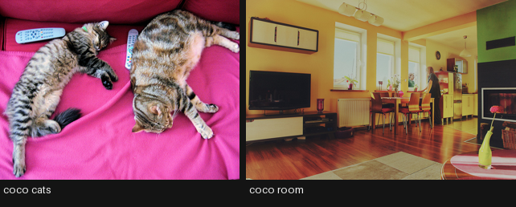
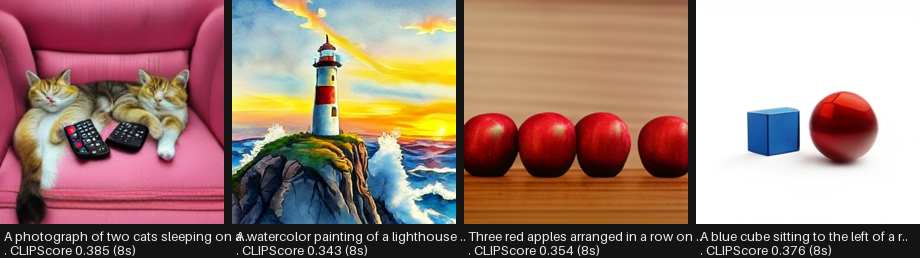
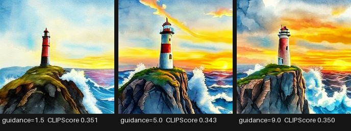
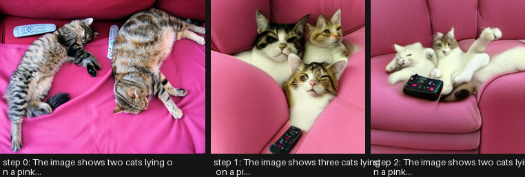
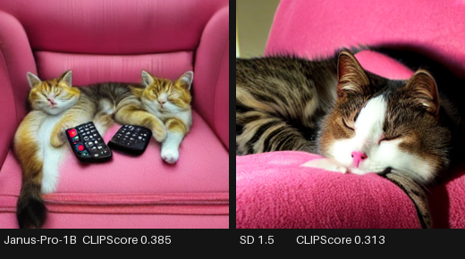
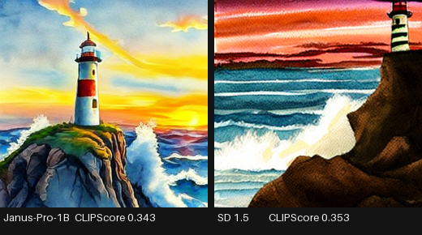
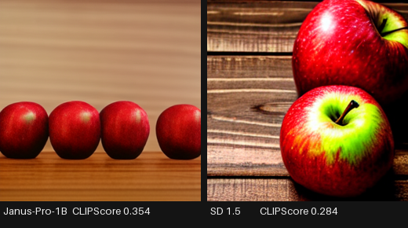
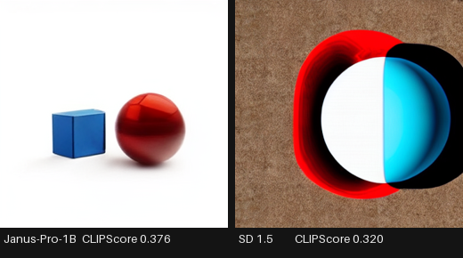
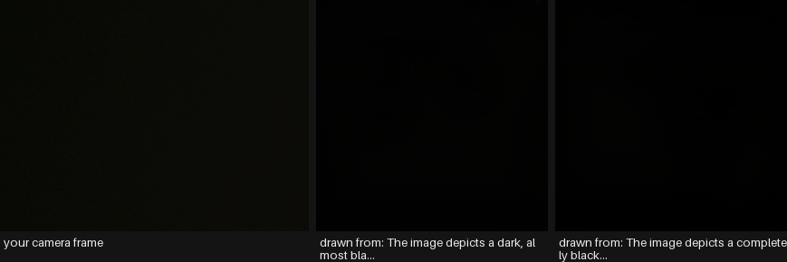

# Any-to-Any

Everything to know about unified multimodal models: what “one model for every modality” actually buys, why Janus decoupled its two image encoders, how to measure the unification tax, the mid-2026 landscape, and runnable code that understands and generates from one 1B model.

Author

Benedict Thekkel

## 1. What is Any-to-Any?

Any-to-any is the family where **one set of weights both understands and generates across modalities**. Text, images, audio and video go in; text, images and audio come out. The tag on the Hugging Face Hub covers models as different as Janus-Pro (image understanding + image generation), Qwen3-Omni (text/image/audio/video in, text and speech out) and Emu3 (everything as one token stream).

The defining property is **not** the number of input modalities - `Multimodal/01` already takes images and text. It is that **generation and understanding share the model**. A VLM can describe an image; an any-to-any model can describe it *and* draw one.

**Input.** Any interleaved combination of text, images, audio and video.

**Output.** Text, plus at least one non-text modality - images (Janus, Emu3, BAGEL), speech (Qwen-Omni, MiniCPM-o, Moshi), or both.

| Neighbouring task | Difference | Typical tools |
|----|----|----|
| Image-text-to-text (`Multimodal/01`) | Understanding only; text out | Qwen3-VL, InternVL3 |
| Text-to-image (`Computer_Vision/04`) | Generation only; no understanding | FLUX, SD3.5 |
| Audio-text-to-text (`Multimodal/00`) | Audio in, text out; cannot speak | Granite Speech, Qwen2-Audio |
| Image-text-to-image (`Multimodal/02`) | Editing; a diffusion model, not a unified one | InstructPix2Pix, FLUX Kontext |
| Video-text-to-text (`Multimodal/06`) | Video in, text out | Qwen3-VL, SmolVLM2 |

**Why anyone wants this.** Three arguments, of decreasing strength:

1.  **Interleaved reasoning.** A model that can generate an image mid-answer can sketch, revise and reason visually. Chain-of-thought with pictures is only possible if generation is inside the model.
2.  **Deployment simplicity.** One model, one server, one set of weights, instead of a router plus five specialists.
3.  **Transfer.** The hope that understanding and generation help each other - that learning to draw a cat teaches you what a cat is. Evidence for this is genuinely mixed, and section 12 measures it directly.

**The honest counter-argument.** A routed pipeline of specialists is usually **better and cheaper** in 2026. Whisper plus Qwen3-VL plus FLUX beats any single unified model at each individual task, and each part can be upgraded independently. Unified models win on latency for interleaved outputs, on conversational speech (where a cascade’s turn-taking is audibly wrong), and on the research bet that this is where the field ends up. This notebook runs both and says which is which.

------------------------------------------------------------------------

## 2. Real-World Use Cases

| Use case | Domain | Consumes / produces | Dominant constraint |
|----|----|----|----|
| Voice assistants with vision | Consumer devices, wearables | Speech + camera -\> spoken answer | **Full-duplex latency**; a cascade’s turn-taking feels broken |
| Creative co-pilots | Design, marketing | Reference images + instructions -\> images and copy together | Interleaved output; iteration speed over single-shot quality |
| Accessibility companions | Assistive tech | Camera + spoken question -\> spoken answer | End-to-end latency; on-device privacy |
| Interactive tutoring | EdTech | Student question -\> explanation **with generated diagrams** | Diagram correctness; generation inside the reasoning loop |
| Customer support agents | Any | Screenshot + voice -\> spoken fix, annotated image | One model to deploy and monitor; consistency of persona |
| Robotics and embodied agents | Robotics | Camera + audio + instruction -\> actions, speech | On-robot compute; real-time loop |
| Game NPCs and virtual characters | Games, entertainment | Player speech + scene -\> speech, expressions | Latency and personality consistency; cost per session |
| Content production pipelines | Media | Script -\> images, voice-over, video assets | Quality per asset (specialists usually win here) |
| Translation with voice preservation | Localisation | Speech in language A -\> speech in language B | Prosody and speaker identity across languages |
| Meeting agents | Productivity | Screen + audio -\> notes, spoken summary | Long context; audio and visual streams aligned in time |

**What the demos hide.** Four realities.

*Latency, not quality, is the reason to unify.* Where any-to-any genuinely beats a pipeline is conversational speech: Qwen3-Omni emits its first audio packet in roughly 234 ms, where an ASR-plus-LLM-plus-TTS cascade is well over a second and cannot be interrupted mid-sentence. If your product is not conversational, the pipeline is probably better.

*The unification tax is real but shrinking.* Early unified models (2023-24) were clearly worse at each task than same-size specialists. Janus’s decoupled encoders and Qwen-Omni’s Thinker-Talker split narrowed it a lot. It has not closed, and section 12 measures what remains at this size.

*Deployment is harder, not easier.* One model sounds simpler until you need to scale image generation and speech independently, or upgrade only the ASR. Serving frameworks handle a text LLM well; a model with a VQ image decoder and a streaming speech head is a bespoke deployment.

*Safety surface multiplies.* A model that generates images and speech inherits every risk of both, plus new ones (voice cloning, image generation from a spoken instruction with no text audit trail). Watermarking and provenance need to cover every output modality.

------------------------------------------------------------------------

## 3. How Any-to-Any Models Work

The central question is: **how do non-text modalities become tokens, and how do tokens become non-text outputs?** Four answers, all in production somewhere.

1.  **Discrete tokens for everything (Chameleon 2024, Emu3 2024).** Quantise images with a VQ-VAE and audio with a neural codec, so every modality is literally vocabulary. Then it is one transformer with one next-token objective, and interleaved generation falls out for free. Emu3 showed this scales to video. The costs: VQ quantisation discards detail (image quality lags diffusion), and long sequences (an image is 1,024+ tokens) make training expensive.

2.  **Decoupled encoders, shared decoder (Janus 2024, Janus-Pro 2025).** The key insight of the Janus line: **understanding and generation want different image representations**. Understanding wants high-level semantics (SigLIP features); generation wants low-level detail suitable for reconstruction (VQ tokens). Forcing one encoder to serve both was hurting *both*. Janus uses two separate vision encoders feeding one autoregressive transformer, and Janus-Pro (Jan 2025) scaled it to 1B/7B with a three-stage training recipe, beating DALL-E 3 and SD3-Medium on GenEval at 7B. This notebook runs the 1B.

3.  **Diffusion head on a language model (Transfusion 2024, BAGEL 2025, Show-o).** Keep the LLM autoregressive for text but attach a *diffusion* head for images, trained with a joint next-token + denoising objective. Better image quality than VQ, at the cost of a more complicated model and sampler.

4.  **Thinker-Talker for speech (Qwen2.5-Omni 2025, Qwen3-Omni 2025).** Split the model: a “Thinker” LLM reasons over all input modalities and produces text and hidden states; a “Talker” autoregressive speech decoder consumes those hidden states and streams codec tokens to a vocoder. Because the Talker reads the Thinker’s *hidden states* rather than its finished text, speech can start before the sentence is complete - which is where the sub-250 ms first-packet latency comes from. **TMRoPE** aligns audio and video positions in real time so a video’s soundtrack and pixels stay synchronised.

**Mid-2026 state.** Qwen3-Omni (30B-A3B MoE) is the strongest open omni model: 119 text languages, 19 speech-in, 10 speech-out, competitive with same-size specialists on audio and vision while also speaking. Janus-Pro remains the cleanest small demonstration of unified understanding-plus-image-generation. Emu3 and BAGEL are the research directions. Meanwhile, on any *individual* task, a specialist of the same size still usually wins - the interesting question is by how much, and section 12 answers it for this hardware.

------------------------------------------------------------------------

## 4. Evaluation Metrics

There is no single any-to-any metric, and any paper that reports one is hiding something. Evaluate each direction separately, then measure what unification cost.

**Understanding** - the standard VLM suite: MMMU, MMBench, MMStar, POPE for hallucination, DocVQA for text-in-image (`Multimodal/01`, `04`, `05`). Accuracy after normalisation.

**Image generation** - **GenEval** (compositional prompt following: counting, colours, position, two-object binding) and **DPG-Bench** (dense prompts) have replaced FID as the headline. FID measures distributional similarity to a reference set and correlates poorly with what anyone cares about. **CLIPScore** is the cheap proxy used in this notebook: cosine between the generated image and the prompt.

**Speech generation** - WER of an ASR model transcribing the output (does it say the words), speaker similarity, MOS or UTMOS for naturalness, and **first-packet latency** for conversational use.

**Cross-modal consistency** - the metric unique to this family, and the one worth building yourself: take an image, caption it, regenerate from the caption, and re-caption. If understanding and generation share a world model, the round trip should be stable. Section 10 implements exactly this.

**The unification tax** - the honest headline number. Take a unified model and a same-size specialist for each direction, evaluate both on the same task, and report the gap. It is the only number that answers “should I use this”.

The cell below sets up CLIPScore and the round-trip similarity used later.

------------------------------------------------------------------------

``` python
import numpy as np
import torch
from transformers import CLIPModel, CLIPProcessor

# CLIP is the measuring stick for this notebook: 150M params, small enough to keep
# resident while a 1B unified model runs, and the standard cheap proxy for both
# prompt-following (CLIPScore) and cross-modal round-trip stability.
_clip_id = "openai/clip-vit-base-patch32"


class ClipMetrics:
    "CLIPScore (image vs prompt) and embedding similarities for the round-trip test."

    def __init__(self, device, cache_dir=None):
        self.device = device
        self.model = CLIPModel.from_pretrained(_clip_id, cache_dir=cache_dir).to(device).eval()
        self.proc = CLIPProcessor.from_pretrained(_clip_id, cache_dir=cache_dir)

    def image_embedding(self, image):
        inputs = self.proc(images=image, return_tensors="pt").to(self.device)
        with torch.inference_mode():
            f = self.model.get_image_features(**inputs).pooler_output
        return torch.nn.functional.normalize(f.float(), dim=-1).cpu()

    def text_embedding(self, text):
        inputs = self.proc(text=[text], return_tensors="pt", padding=True,
                           truncation=True).to(self.device)
        with torch.inference_mode():
            f = self.model.get_text_features(**inputs).pooler_output
        return torch.nn.functional.normalize(f.float(), dim=-1).cpu()

    def clip_score(self, image, prompt):
        "Cosine between a generated image and the prompt it was generated from.\n\n        The cheap stand-in for GenEval. It rewards presence of the named concepts and is\n        largely blind to counting, spatial relations and attribute binding - which is\n        exactly why GenEval exists. Treat it as a smoke test, never as a ranking.\n        "
        return float((self.image_embedding(image) @ self.text_embedding(prompt).T).item())

    def image_similarity(self, a, b):
        "Cosine between two images - used for the round-trip stability check."
        return float((self.image_embedding(a) @ self.image_embedding(b).T).item())

    def text_similarity(self, a, b):
        "Cosine between two captions - the other half of the round trip."
        return float((self.text_embedding(a) @ self.text_embedding(b).T).item())


print("CLIPScore is a proxy. What it cannot see:")
for claim in ["'three red cubes' vs 'two red cubes'  (counting)",
              "'a cat left of a dog' vs 'a dog left of a cat'  (spatial relations)",
              "'a red cube and a blue sphere' with the colours swapped  (attribute binding)"]:
    print("  -", claim)
print("GenEval and DPG-Bench exist to measure precisely those. Use them for real numbers.")
```

    CLIPScore is a proxy. What it cannot see:
      - 'three red cubes' vs 'two red cubes'  (counting)
      - 'a cat left of a dog' vs 'a dog left of a cat'  (spatial relations)
      - 'a red cube and a blue sphere' with the colours swapped  (attribute binding)
    GenEval and DPG-Bench exist to measure precisely those. Use them for real numbers.

## 5. Datasets

| Dataset | Contents | Size | Scope | License | Typical use |
|----|----|----|----|----|----|
| [GenEval](https://github.com/djghosh13/geneval) | Compositional text-to-image prompts with an object-detector grader | 553 prompts | en | MIT | **The** generation benchmark: counting, colour, position, binding |
| [DPG-Bench](https://github.com/TencentQQGYLab/ELLA) | Dense, paragraph-length prompts | 1k prompts | en | Apache 2.0 | Long-prompt fidelity |
| [MJHQ-30K](https://huggingface.co/datasets/playgroundai/MJHQ-30K) | Curated high-quality images for FID | 30k | en | research | Aesthetic FID (use with caution) |
| [MMMU](https://huggingface.co/datasets/MMMU/MMMU) | College-level multi-discipline MCQs | 11.5k | en | Apache 2.0 | The understanding half |
| [POPE](https://huggingface.co/datasets/lmms-lab/POPE) | Object-existence yes/no, balanced | 9k | en | MIT | Hallucination on the understanding side |
| [COCO val2017](https://cocodataset.org/) | Everyday photos with 5 captions each | 5k | en | CC-BY 4.0 | **This notebook’s images**; the round-trip source |
| [AIR-Bench](https://github.com/OFA-Sys/AIR-Bench) | Audio instruction following, incl. judged chat | 21k | en, zh | Apache 2.0 | The audio half of omni models |
| [VoiceBench](https://huggingface.co/datasets/hlt-lab/voicebench) | Spoken instructions, adversarial and accented | 10 subsets | en | MIT | Voice-assistant behaviour |
| [OmniBench](https://huggingface.co/datasets/m-a-p/OmniBench) | Questions needing image **and** audio **and** text together | 1k | en | CC-BY-NC | True tri-modal reasoning |
| [Emu3 / Chameleon training mixes](https://huggingface.co/BAAI/Emu3-Gen) | Interleaved image-text-video sequences | large | en | Apache 2.0 | Unified pretraining |

This notebook uses a handful of **COCO val2017** photos plus hand-written prompts, and measures with the CLIP proxies above. That is a smoke test by construction: real generation numbers come from GenEval’s detector-based grader over 553 prompts, and real understanding numbers from the MMMU/MMBench harness.

------------------------------------------------------------------------

## 6. The Model Landscape (mid-2026)

No single leaderboard covers this family. Use **[GenEval](https://github.com/djghosh13/geneval)** and **[DPG-Bench](https://github.com/TencentQQGYLab/ELLA)** for generation, the **[OpenVLM Leaderboard](https://huggingface.co/spaces/opencompass/open_vlm_leaderboard)** for understanding, **[VoiceBench](https://github.com/MatthewCYM/VoiceBench)** and **[AIR-Bench](https://github.com/OFA-Sys/AIR-Bench)** for audio, and **[OmniBench](https://huggingface.co/datasets/m-a-p/OmniBench)** for genuinely tri-modal reasoning.

| Model | Params | License | In | Out | Download | Best for |
|----|----|----|----|----|----|----|
| **[Janus-Pro-1B](https://huggingface.co/deepseek-community/Janus-Pro-1B)** | 1.3B | MIT | text, image | text, **image** | ~4.2 GB | **this notebook’s model**; the clearest small unified demo |
| [Janus-Pro-7B](https://huggingface.co/deepseek-ai/Janus-Pro-7B) | 7B | MIT | text, image | text, image | ~14 GB | beats DALL-E 3 and SD3-Medium on GenEval |
| [Emu3](https://huggingface.co/BAAI/Emu3-Gen) | 8B | Apache 2.0 | text, image, video | text, image, video | ~17 GB | everything as one next-token stream |
| [Chameleon](https://huggingface.co/facebook/chameleon-7b) | 7-34B | research | text, image | text, image | ~14 GB | the early-fusion reference (image output withheld) |
| [BAGEL](https://huggingface.co/ByteDance-Seed/BAGEL-7B-MoT) | 14B MoT | Apache 2.0 | text, image | text, image | ~30 GB | diffusion head + LLM; strong editing |
| [Qwen2.5-Omni-3B/7B](https://huggingface.co/Qwen/Qwen2.5-Omni-3B) | 5.5B / 11B | Apache 2.0 | text, image, audio, video | text, **speech** | ~12 GB (3B) | Thinker-Talker; TMRoPE audio-video alignment |
| [Qwen3-Omni-30B-A3B](https://huggingface.co/Qwen/Qwen3-Omni-30B-A3B-Instruct) | 30B MoE (3B active) | Apache 2.0 | text, image, audio, video | text, speech | ~70 GB | the open frontier; ~234 ms first audio packet |
| [MiniCPM-o 2.6](https://huggingface.co/openbmb/MiniCPM-o-2_6) | 8B | Apache 2.0 (model) | text, image, audio, video | text, speech | ~17 GB | on-device omni; voice cloning |
| [Gemma 3n E2B/E4B](https://huggingface.co/google/gemma-3n-E2B-it) | 5.4B raw / 2B eff. | Gemma terms | text, image, audio | text | ~11 GB | phone-scale multimodal input (no non-text output) |
| [Moshi](https://huggingface.co/kyutai/moshiko-pytorch-bf16) | 7B | CC-BY | speech | speech | ~15 GB | full-duplex conversation, ~200 ms |
| GPT-5.x, Gemini 3 | closed | API | everything | text, image, audio | n/a | the frontier; native image generation in-conversation |

**Who wins what.** On **image generation quality**, dedicated diffusion models (FLUX, Qwen-Image, SD3.5) still beat every open unified model, though Janus-Pro-7B closed the gap on *prompt following*. On **understanding**, a same-size VLM specialist wins. On **speech conversation**, unified models win outright - a cascade cannot do full duplex. On **breadth per deployment**, Qwen3-Omni is unmatched in open weights.

**What fits this 12 GB box.** Janus-Pro-1B (4.2 GB, ~3 GB VRAM) runs both directions comfortably and is the notebook’s workhorse. Qwen2.5-Omni-3B is a 12 GB download and sits behind `RUN_HEAVY`. Janus-Pro-7B, Emu3, BAGEL and Qwen3-Omni are all out of reach on download size, VRAM or both. The specialists used as controls - Qwen3-VL-2B for understanding, Stable Diffusion 1.5 for generation - both fit alongside.

------------------------------------------------------------------------

## 7. Setup

Janus is **transformers-native** (`JanusForConditionalGeneration`, `JanusProcessor`), so no vendor package is needed; the diffusion control uses `diffusers`. Package roles:

- `transformers` (\>=5.13) + `torch` - Janus-Pro, Qwen3-VL (understanding control), CLIP (metrics), Qwen2.5-Omni behind `RUN_HEAVY`
- `diffusers` - Stable Diffusion 1.5 as the generation control
- `accelerate` - `device_map` placement
- `datasets` / `pillow` - COCO images
- `pyecharts` + `pandas` - benchmark chart and table

**The Janus generation API.** Understanding uses the ordinary chat template. Generation is different enough to be worth stating up front:

``` python
inputs = processor(text=[prompt], generation_mode="image", return_tensors="pt").to(model.device)
with torch.inference_mode():
    tokens = model.generate(**inputs, generation_mode="image", do_sample=True,
                            guidance_scale=5.0, max_new_tokens=576)
    decoded = model.decode_image_tokens(tokens)          # stays inside inference_mode
pixels = processor.postprocess(list(decoded.float()), return_tensors="pt")["pixel_values"]
images = [Image.fromarray(px.permute(1, 2, 0).cpu().numpy()) for px in pixels]
```

`generation_mode="image"` switches the model onto its VQ generation head; `decode_image_tokens` runs the VQ decoder; `postprocess` turns the tensor into uint8 pixels. 576 tokens is one 384x384 image at 24x24 latent patches.

**Three sharp edges, none of them obvious.** They are handled by `patch_janus` / `janus_to_pil` in the Setup cell and by the comments on `janus_understand` and `janus_generate`, but each costs real debugging time, so they are worth naming:

1.  **Do not use `apply_chat_template(..., tokenize=True)` on a single conversation.** `JanusProcessor.__call__` prepends this checkpoint’s default system prompt with `[f"{SYSTEM}{s}" for s in text]`, and a bare string iterates *character by character* - the prompt becomes a batch of single letters, the `<image_placeholder>` token vanishes, and `generate` dies with `Image features and image tokens do not match, tokens: 0`. Render with `tokenize=False`, then call the processor with explicit lists.
2.  **`generate(generation_mode="image")` is broken in transformers 5.13 and 5.14**: it calls `_prepare_static_cache` without the `prefill_chunk_size` argument that was added to that method’s signature. `patch_janus` binds a default, and its signature check makes it a no-op once upstream is fixed. The same function also crashes on `guidance_scale <= 1`: it doubles the batch for CFG but only appends the processor that folds it back when the scale is strictly greater than 1.
3.  **`postprocess(return_tensors="PIL.Image.Image")`** - the call the Janus docs give - now raises, because that string is forwarded into `TensorType`, which accepts only `pt`/`np`/`mlx`. Ask for `"pt"` and convert to PIL yourself, as above. Relatedly, `decode_image_tokens` must be called *inside* the `inference_mode` block that produced the tokens, or its codebook lookup raises `Inference tensors cannot be saved for backward`.

One more failure mode worth recognising: this checkpoint’s `model.safetensors` is 3.9 GB, and an interrupted download leaves a **sparse file of the correct size** that loads without any error and silently yields all-zero weights - every answer then comes back as `!!!!!!!!`. If you see that, compare `du -h` with `du -h --apparent-size` on the cached blob and re-download.

All downloads land in `DL_tasks/datasets/`, which is gitignored.

------------------------------------------------------------------------

``` python
# transformers for Janus and the understanding control, diffusers for the generation control.
# %pip install -q torch transformers diffusers accelerate datasets pillow pandas pyecharts
```

``` python
import ctypes
import ctypes.util
import functools
import gc
import inspect
import time
import urllib.request
from pathlib import Path

import torch
from dotenv import find_dotenv, load_dotenv
from PIL import Image
from transformers.generation.utils import GenerationMixin

# Knowledge/.env sets HF_TOKEN - authenticated HF Hub requests get higher rate limits
load_dotenv(find_dotenv(usecwd=True))

device = "cuda:0" if torch.cuda.is_available() else "cpu"
dtype = torch.float16 if device != "cpu" else torch.float32
if device != "cpu":
    print(torch.cuda.get_device_name(0))
print("device:", device, "| dtype:", dtype)

# Sections whose download is over ~8 GB sit behind this (Qwen2.5-Omni-3B is ~12 GB).
RUN_HEAVY = False

SEED = 1234


def generator(seed=SEED):
    "A fresh seeded torch generator on the compute device."
    return torch.Generator(device=device).manual_seed(seed)


def vram(tag=""):
    "Report current GPU memory (allocated / reserved). No-op on CPU."
    if torch.cuda.is_available():
        alloc = torch.cuda.memory_allocated() / 1e9
        reserved = torch.cuda.memory_reserved() / 1e9
        print(f"VRAM {tag:22s} {alloc:5.2f} GB allocated / {reserved:5.2f} GB reserved")


def free_memory():
    "Collect garbage and hand freed VRAM back to the CUDA allocator.\n\n    Call right after `del`-ing a model you are done with: `del model; free_memory()`.\n    `del` drops the Python reference; this reclaims the RAM and releases the VRAM.\n    "
    gc.collect()
    if torch.cuda.is_available():
        torch.cuda.empty_cache()
        torch.cuda.ipc_collect()
    # glibc keeps freed CPU allocations in its arenas instead of returning them to the
    # OS, so RSS compounds across model sections. malloc_trim(0) hands the freed arenas
    # back. See dl-visualization-and-memory.md - not optional on a 12 GB box.
    try:
        ctypes.CDLL(ctypes.util.find_library("c") or "libc.so.6").malloc_trim(0)
    except Exception:
        pass


# --- Janus image-generation workarounds (transformers 5.13 / 5.14) ------------------
# Janus is transformers-native, but two upstream bugs sit in its generation path. Both
# are still present in 5.14.1. They live here rather than inline because sections 8, 9,
# 12 and the live demo all load Janus and all need them.


def patch_janus(model):
    "Bug 1: `generate(generation_mode='image')` calls `_prepare_static_cache` without the\n    `prefill_chunk_size` argument that was added to that method's signature, so image\n    generation dies with a TypeError before producing a single token. Bind a default.\n\n    The signature check makes this a no-op the moment the upstream call site is fixed.\n    "
    params = inspect.signature(GenerationMixin._prepare_static_cache).parameters
    if "prefill_chunk_size" in params and params["prefill_chunk_size"].default is inspect.Parameter.empty:
        model._prepare_static_cache = functools.partial(
            model._prepare_static_cache, prefill_chunk_size=None)
    return model


def janus_to_pil(processor, decoded):
    "Bug 2: `postprocess(return_tensors='PIL.Image.Image')` - the call the Janus docs\n    give - forwards that string into `TensorType`, which now accepts only pt/np/mlx, so\n    it raises ValueError. Ask for 'pt' (uint8 CHW) and do the PIL conversion here.\n    "
    pixels = processor.postprocess(list(decoded.float()), return_tensors="pt")["pixel_values"]
    return [Image.fromarray(px.permute(1, 2, 0).cpu().numpy()) for px in pixels]


# All downloads go to DL_tasks/datasets/ (gitignored)
DATA_DIR = Path("../../datasets")
DATA_DIR.mkdir(exist_ok=True)
HF_CACHE = str(DATA_DIR / "hf_cache")

metrics = ClipMetrics(device, cache_dir=HF_CACHE)
vram("clip loaded")
```

    NVIDIA GeForce RTX 3060
    device: cuda:0 | dtype: torch.float16

    VRAM clip loaded             0.61 GB allocated /  0.66 GB reserved

``` python
from IPython.display import display
from PIL import Image, ImageDraw, ImageFont

SOURCES = {
    "cats": ("http://images.cocodataset.org/val2017/000000039769.jpg", "coco_cats.jpg"),
    "room": ("http://images.cocodataset.org/val2017/000000000139.jpg", "coco_room.jpg"),
}

images = {}
for key, (url, fname) in SOURCES.items():
    path = DATA_DIR / fname
    if not path.exists():
        urllib.request.urlretrieve(url, path)
    images[key] = Image.open(path).convert("RGB")

cats, room = images["cats"], images["room"]

# Prompts chosen so CLIPScore has something to say and GenEval-style weaknesses show up.
GEN_PROMPTS = [
    "A photograph of two cats sleeping on a pink couch, two remote controls beside them.",
    "A watercolor painting of a lighthouse on a cliff at sunset, waves crashing below.",
    "Three red apples arranged in a row on a wooden table, studio lighting.",
    "A blue cube sitting to the left of a red sphere on a white background.",
]


def gallery(imgs, labels, height=224):
    "Lay several PIL images side by side on one canvas with captions underneath."
    font = ImageFont.load_default(size=13)
    thumbs = [im.resize((int(height * im.width / im.height), height)) for im in imgs]
    gap, band = 8, 34
    canvas = Image.new("RGB", (sum(t.width for t in thumbs) + gap * (len(thumbs) - 1),
                               height + band), (20, 20, 20))
    d = ImageDraw.Draw(canvas)
    x = 0
    for t, label in zip(thumbs, labels):
        canvas.paste(t, (x, 0))
        for i, line in enumerate([label[:40], label[40:80]]):
            d.text((x + 4, height + 4 + 14 * i), line, fill=(235, 235, 235), font=font)
        x += t.width + gap
    return canvas


display(gallery([cats, room], ["coco cats", "coco room"]))
print("generation prompts:")
for p in GEN_PROMPTS:
    print(" -", p)
```



    generation prompts:
     - A photograph of two cats sleeping on a pink couch, two remote controls beside them.
     - A watercolor painting of a lighthouse on a cliff at sunset, waves crashing below.
     - Three red apples arranged in a row on a wooden table, studio lighting.
     - A blue cube sitting to the left of a red sphere on a white background.

## 8. Janus-Pro-1B - the understanding half

Janus-Pro (DeepSeek, January 2025) is the cleanest small demonstration of a unified model, and its central design decision is worth stating precisely.

Earlier unified models used **one** vision encoder for both jobs. That is a conflict: understanding wants high-level semantic features (what is this, what is it doing), while generation wants low-level detail that a decoder can reconstruct pixels from. Optimising one encoder for both degraded both. **Janus decouples them** - a SigLIP encoder for understanding, a VQ tokeniser for generation - while keeping a *single* autoregressive transformer that both paths feed into. The unification stays where it is useful (the reasoning core) and disappears where it was harmful (the input representation).

Janus-Pro added a three-stage training recipe, 72M synthetic aesthetic samples for generation, and scaled to 1B and 7B. This section uses the understanding path; section 9 uses the generation path; they are the *same weights*.

Expect the understanding to be decent-but-not-great at 1B - section 12 measures the gap against a same-size specialist.

------------------------------------------------------------------------

``` python
from transformers import JanusForConditionalGeneration, JanusProcessor

janus_id = "deepseek-community/Janus-Pro-1B"
janus_proc = JanusProcessor.from_pretrained(janus_id, cache_dir=HF_CACHE)
janus = patch_janus(JanusForConditionalGeneration.from_pretrained(
    janus_id, dtype=dtype, device_map=device, cache_dir=HF_CACHE
).eval())
vram("janus loaded")


def janus_understand(image, prompt, max_new_tokens=160):
    "The understanding path: SigLIP encoder -> shared transformer -> text."
    # Render the template and call the processor as two steps, both with explicit lists.
    # Do NOT use the one-shot apply_chat_template(..., tokenize=True): JanusProcessor
    # does `[f"{SYSTEM_PROMPT}{s}" for s in text]` and this checkpoint sets
    # use_default_system_prompt=True, so a bare string gets iterated CHARACTER by
    # character - a 48-char prompt becomes a 48-row batch of single letters, the
    # <image_placeholder> token never survives, and generate() dies with
    # "Image features and image tokens do not match, tokens: 0".
    text = janus_proc.apply_chat_template(
        [{"role": "user", "content": [{"type": "image", "image": image},
                                      {"type": "text", "text": prompt}]}],
        add_generation_prompt=True, tokenize=False,
    )
    inputs = janus_proc(text=[text], images=[image],
                        return_tensors="pt").to(janus.device, dtype)
    n = inputs["input_ids"].shape[1]
    with torch.inference_mode():
        out = janus.generate(**inputs, max_new_tokens=max_new_tokens, do_sample=False,
                             generation_mode="text")
    return janus_proc.batch_decode(out[:, n:], skip_special_tokens=True)[0].strip()


for prompt in ["Describe this image in one detailed sentence.",
               "How many cats are in this image? Answer with a number.",
               "Is there a dog in this image? Answer yes or no."]:
    t0 = time.perf_counter()
    answer = janus_understand(cats, prompt)
    print(f"> {prompt}\n  [{time.perf_counter() - t0:4.1f}s] {answer}\n")
```

    [transformers] The tied weights mapping and config for this model specifies to tie model.language_model.embed_tokens.weight to lm_head.weight, but both are present in the checkpoints with different values, so we will NOT tie them. You should update the config with `tie_word_embeddings=False` to silence this warning.
    [transformers] Passing `generation_config` together with generation-related arguments=({'guidance_scale'}) is deprecated and will be removed in future versions. Please pass either a `generation_config` object OR all generation parameters explicitly, but not both.
    [transformers] Both `max_new_tokens` (=160) and `max_length`(=20) seem to have been set. `max_new_tokens` will take precedence. Please refer to the documentation for more information. (https://huggingface.co/docs/transformers/main/en/main_classes/text_generation)

    VRAM janus loaded            4.77 GB allocated /  4.99 GB reserved

    [transformers] Both `max_new_tokens` (=160) and `max_length`(=20) seem to have been set. `max_new_tokens` will take precedence. Please refer to the documentation for more information. (https://huggingface.co/docs/transformers/main/en/main_classes/text_generation)

    > Describe this image in one detailed sentence.
      [ 0.9s] The image shows two cats lying on a pink couch, with a remote control placed between them.

    [transformers] Both `max_new_tokens` (=160) and `max_length`(=20) seem to have been set. `max_new_tokens` will take precedence. Please refer to the documentation for more information. (https://huggingface.co/docs/transformers/main/en/main_classes/text_generation)

    > How many cats are in this image? Answer with a number.
      [ 0.2s] 2.

    > Is there a dog in this image? Answer yes or no.
      [ 0.2s] No.

## 9. Janus-Pro-1B - the generation half

Same weights, different head. `generation_mode="image"` switches the model onto its VQ path: it autoregressively predicts **576 image tokens** (a 24x24 latent grid), then the VQ decoder turns them into a 384x384 image.

Three things worth knowing before reading the output:

- **`guidance_scale` is classifier-free guidance over token logits**, not diffusion guidance. 5.0 is the documented default; higher follows the prompt harder and reduces diversity.
- **It is autoregressive, so it is sequential.** 576 tokens one at a time, which at 1B is a few seconds per image on this card - slower per image than a distilled diffusion model, and with no step-count knob to trade quality for speed.
- **VQ quantisation caps the fidelity.** A 16k-entry codebook cannot represent fine texture the way a continuous latent diffusion VAE can. This is the main reason unified autoregressive models lag diffusion on image quality, and why the 2025 designs (BAGEL, Transfusion) bolt a diffusion head on instead.

Watch the last two prompts in particular: counting (“three red apples”) and spatial binding (“blue cube left of a red sphere”) are the classic compositional failures that GenEval was built to catch and that CLIPScore will happily forgive.

------------------------------------------------------------------------

``` python
def janus_generate(prompt, guidance_scale=5.0, seed=SEED, num_images=1):
    "The generation path: text -> 576 VQ tokens -> VQ decoder -> a 384x384 PIL image."
    inputs = janus_proc(text=[prompt] * num_images, generation_mode="image",
                        return_tensors="pt").to(janus.device)
    torch.manual_seed(seed)   # the VQ head samples token by token; this makes it repeatable
    with torch.inference_mode():
        tokens = janus.generate(**inputs, generation_mode="image", do_sample=True,
                                use_cache=True, guidance_scale=guidance_scale,
                                max_new_tokens=576)
        # decode_image_tokens stays INSIDE inference_mode: the VQ codebook lookup is an
        # embedding op, and feeding it an inference-mode tensor from outside the block
        # raises "Inference tensors cannot be saved for backward".
        decoded = janus.decode_image_tokens(tokens)
    return janus_to_pil(janus_proc, decoded)


generated, labels = [], []
for prompt in GEN_PROMPTS:
    t0 = time.perf_counter()
    img = janus_generate(prompt)[0]
    secs = time.perf_counter() - t0
    score = metrics.clip_score(img, prompt)
    generated.append(img)
    labels.append(f"CLIPScore {score:.3f} ({secs:.0f}s)")
    print(f"[{secs:5.1f}s] CLIPScore {score:.3f}  {prompt[:70]}")
display(gallery(generated, [f"{p[:38]}... {l}" for p, l in zip(GEN_PROMPTS, labels)]))
```

    [  8.5s] CLIPScore 0.385  A photograph of two cats sleeping on a pink couch, two remote controls
    [  8.4s] CLIPScore 0.343  A watercolor painting of a lighthouse on a cliff at sunset, waves cras
    [  8.4s] CLIPScore 0.354  Three red apples arranged in a row on a wooden table, studio lighting.
    [  8.3s] CLIPScore 0.376  A blue cube sitting to the left of a red sphere on a white background.



``` python
# guidance_scale, the one knob: prompt adherence against diversity.
#
# The sweep starts at 1.5, not 1.0, because of a third upstream bug: Janus always
# doubles the batch to compute conditional and unconditional logits, but only appends
# the CFG processor that folds them back together when `guidance_scale > 1`. Ask for
# exactly 1.0 and generation dies with "The expanded size of the tensor (1) must match
# the existing size (2)". No loss for the demo - CFG is logits = uncond + scale *
# (cond - uncond), so scale 1.0 is just plain conditional sampling with no guidance.
prompt = GEN_PROMPTS[1]
row, row_labels = [], []
for g in (1.5, 5.0, 9.0):
    img = janus_generate(prompt, guidance_scale=g)[0]
    row.append(img)
    row_labels.append(f"guidance={g}  CLIPScore {metrics.clip_score(img, prompt):.3f}")
display(gallery(row, row_labels))
print(f"prompt: {prompt}")
print("1.5 barely steers and drifts off the prompt; 9.0 is rigid and repetitive.\n"
      "5.0 is the documented default and the one used everywhere else in this notebook.")
```



    prompt: A watercolor painting of a lighthouse on a cliff at sunset, waves crashing below.
    1.5 barely steers and drifts off the prompt; 9.0 is rigid and repetitive.
    5.0 is the documented default and the one used everywhere else in this notebook.

## 10. The round trip: does the model agree with itself?

The measurement that only makes sense for a unified model, and the one worth adding to any evaluation of one.

Take a real photograph and go around the loop **inside a single model**:

    image -> (understanding) -> caption -> (generation) -> image' -> (understanding) -> caption'

If understanding and generation share a world model, `caption'` should be close to `caption` and `image'` should be recognisably the same scene. If they do not - if the model describes something it cannot draw, or draws something it then describes differently - the two halves are living in separate representations that happen to share parameters.

Two numbers come out:

- **caption similarity** (CLIP text-text between `caption` and `caption'`) - semantic stability of the loop.
- **image similarity** (CLIP image-image between the original and `image'`) - how much of the scene survived the trip through language.

Neither will be high. The point is not the absolute value, it is that you can compute it at all, and that it drops sharply when the two halves disagree. Run it on your own domain images before trusting a unified model with an interleaved reasoning task.

------------------------------------------------------------------------

``` python
def round_trip(image, steps=2):
    "image -> caption -> image -> caption ... inside one model. Returns the whole chain."
    chain = [{"image": image, "caption": None}]
    current = image
    for _ in range(steps):
        caption = janus_understand(
            current, "Describe this image in one detailed sentence.", max_new_tokens=80)
        chain[-1]["caption"] = caption
        current = janus_generate(caption)[0]
        chain.append({"image": current, "caption": None})
    chain[-1]["caption"] = janus_understand(
        current, "Describe this image in one detailed sentence.", max_new_tokens=80)
    return chain


chain = round_trip(cats, steps=2)
for i, step in enumerate(chain):
    print(f"[{i}] {step['caption']}")

display(gallery([s["image"] for s in chain],
                [f"step {i}: {s['caption'][:40]}..." for i, s in enumerate(chain)]))

print(f"\ncaption drift (CLIP text-text, step 0 vs step {len(chain) - 1}): "
      f"{metrics.text_similarity(chain[0]['caption'], chain[-1]['caption']):.3f}")
print(f"image drift  (CLIP image-image, original vs regenerated): "
      f"{metrics.image_similarity(chain[0]['image'], chain[1]['image']):.3f}")
print("\nA high caption similarity with a low image similarity is the interesting failure:\n"
      "the model can say the right words and cannot draw them.")
```

    [transformers] Both `max_new_tokens` (=80) and `max_length`(=20) seem to have been set. `max_new_tokens` will take precedence. Please refer to the documentation for more information. (https://huggingface.co/docs/transformers/main/en/main_classes/text_generation)
    [transformers] Both `max_new_tokens` (=80) and `max_length`(=20) seem to have been set. `max_new_tokens` will take precedence. Please refer to the documentation for more information. (https://huggingface.co/docs/transformers/main/en/main_classes/text_generation)
    [transformers] Both `max_new_tokens` (=80) and `max_length`(=20) seem to have been set. `max_new_tokens` will take precedence. Please refer to the documentation for more information. (https://huggingface.co/docs/transformers/main/en/main_classes/text_generation)

    [0] The image shows two cats lying on a pink couch, with a remote control placed between them.
    [1] The image shows three cats lying on a pink couch, with one of them resting a paw on a remote control.
    [2] The image shows two cats lying on a pink couch, with one cat appearing to be a mix of white and brown, and the other a pure white cat. They are both relaxed, with one cat's paw resting on a black remote control.



    caption drift (CLIP text-text, step 0 vs step 2): 0.895
    image drift  (CLIP image-image, original vs regenerated): 0.778

    A high caption similarity with a low image similarity is the interesting failure:
    the model can say the right words and cannot draw them.

## 11. Qwen2.5-Omni-3B - text, image, audio and video in; speech out

Janus unifies *image* understanding and generation. The other branch of this family unifies **modalities**, and Qwen2.5-Omni (Alibaba, 2025) is the accessible example.

Its architecture is the **Thinker-Talker** split:

- The **Thinker** is a full LLM that ingests text, images, audio and video and produces text plus hidden states.
- The **Talker** is a separate autoregressive speech decoder that consumes the Thinker’s **hidden states** - not its finished text - and streams codec tokens into a vocoder.

Reading hidden states rather than text is what makes speech start before the sentence is finished, which is where the sub-second first-packet latency comes from. **TMRoPE** (Time-aligned Multimodal RoPE) interleaves audio and video positional encodings on a shared time axis, so a video’s soundtrack and its pixels stay aligned - the thing a frame-sampling VLM plus a separate ASR cannot do.

At ~5.5B parameters the 3B checkpoint is a **12 GB download**, over this notebook’s cap, so the cell is behind `RUN_HEAVY`. Its bigger sibling **Qwen3-Omni-30B-A3B** (70 GB) is the open frontier and out of reach here entirely.

------------------------------------------------------------------------

``` python
if not RUN_HEAVY:
    print("skipped: Qwen2.5-Omni-3B is a ~12 GB download (over the ~8 GB cap).\n"
          "Set RUN_HEAVY = True in the Setup cell to fetch and run it.\n"
          "It needs ~11 GB of VRAM in bf16 - free Janus first, and expect it to be tight.")
else:
    del janus
    free_memory()
    vram("before omni")

    from transformers import Qwen2_5OmniForConditionalGeneration, Qwen2_5OmniProcessor

    omni_id = "Qwen/Qwen2.5-Omni-3B"
    omni_proc = Qwen2_5OmniProcessor.from_pretrained(omni_id, cache_dir=HF_CACHE)
    omni = Qwen2_5OmniForConditionalGeneration.from_pretrained(
        omni_id, dtype=torch.bfloat16, device_map=device, cache_dir=HF_CACHE
    ).eval()
    vram("omni loaded")

    # Text + image in, text out. `return_audio=False` skips the Talker, which halves the
    # memory and is what you want whenever you are not actually playing the speech.
    conversation = [
        {"role": "system", "content": [{"type": "text", "text":
            "You are Qwen, a virtual human developed by the Qwen Team, capable of "
            "perceiving auditory and visual inputs, as well as generating text and speech."}]},
        {"role": "user", "content": [{"type": "image", "image": cats},
                                     {"type": "text", "text": "Describe this image in one sentence."}]},
    ]
    inputs = omni_proc.apply_chat_template(
        conversation, add_generation_prompt=True, tokenize=True,
        return_dict=True, return_tensors="pt",
    ).to(omni.device)
    with torch.inference_mode():
        out = omni.generate(**inputs, max_new_tokens=96, return_audio=False)
    print("text out:", omni_proc.batch_decode(
        out[:, inputs["input_ids"].shape[1]:], skip_special_tokens=True)[0].strip())

    # Speech out: the Talker path. `spk` picks the voice; the second return value is a
    # 24 kHz waveform you can play with IPython.display.Audio.
    with torch.inference_mode():
        text_ids, audio = omni.generate(**inputs, max_new_tokens=96,
                                        return_audio=True, speaker="Chelsie")
    from IPython.display import Audio as AudioPlayer
    display(AudioPlayer(audio.reshape(-1).detach().cpu().numpy(), rate=24000))

    del omni, omni_proc
    free_memory()
    vram("after omni")
```

    skipped: Qwen2.5-Omni-3B is a ~12 GB download (over the ~8 GB cap).
    Set RUN_HEAVY = True in the Setup cell to fetch and run it.
    It needs ~11 GB of VRAM in bf16 - free Janus first, and expect it to be tight.

## 12. Head-to-head: the unification tax

The question this notebook exists to answer. Janus-Pro-1B does two jobs; how much worse is it at each than a same-size specialist?

| Direction | Unified | Specialist | Measured with |
|----|----|----|----|
| Understanding | Janus-Pro-1B | Qwen3-VL-2B | short-answer correctness on 6 probes |
| Generation | Janus-Pro-1B | Stable Diffusion 1.5 | CLIPScore on the 4 prompts, plus seconds per image |

Both specialists are in the same size and cost class as the unified model, both run on this card, and every model is loaded, measured and **freed before the next one loads**.

**Read this as a smoke test, not a leaderboard.** Six understanding probes and four generation prompts is far too small for a stable estimate, CLIPScore is blind to exactly the compositional failures that matter (section 4), and the published comparisons use GenEval, DPG-Bench and MMMU. What the sample *does* show honestly is the direction and rough size of the gap on this hardware - which is the practical input to “should I deploy one model or three”.

------------------------------------------------------------------------

``` python
# Six understanding probes with deterministic answers, scored by keyword containment.
PROBES = [
    {"image": cats, "q": "How many cats are in this image? Answer with a number.", "want": ["2", "two"]},
    {"image": cats, "q": "Is there a dog in this image? Answer yes or no.", "want": ["no"]},
    {"image": cats, "q": "Is there a cat in this image? Answer yes or no.", "want": ["yes"]},
    {"image": cats, "q": "What are the cats lying on? Answer in one or two words.", "want": ["couch", "sofa", "bed"]},
    {"image": room, "q": "Is this indoors or outdoors? Answer with one word.", "want": ["indoor"]},
    {"image": room, "q": "Is there an elephant in this image? Answer yes or no.", "want": ["no"]},
]


def score_probe(answer, want):
    "Keyword containment after lowercasing - blunt, deterministic, and stated openly."
    text = answer.lower()
    return float(any(w in text for w in want))


# Section 11 frees Janus when RUN_HEAVY is on (Omni and Janus do not fit together),
# so reload it here rather than failing on a name that a skipped branch left behind.
if "janus" not in globals():
    janus_proc = JanusProcessor.from_pretrained(janus_id, cache_dir=HF_CACHE)
    janus = patch_janus(JanusForConditionalGeneration.from_pretrained(
        janus_id, dtype=dtype, device_map=device, cache_dir=HF_CACHE
    ).eval())
    vram("janus reloaded")

# 1. Unified model, understanding path.
janus_answers = [janus_understand(p["image"], p["q"], max_new_tokens=32) for p in PROBES]
janus_understanding = float(np.mean([score_probe(a, p["want"]) for a, p in zip(janus_answers, PROBES)]))

# 2. Unified model, generation path (already measured in section 9, recomputed for timing).
gen_scores, gen_times = [], []
for prompt in GEN_PROMPTS:
    t0 = time.perf_counter()
    img = janus_generate(prompt)[0]
    gen_times.append(time.perf_counter() - t0)
    gen_scores.append(metrics.clip_score(img, prompt))
janus_gen = float(np.mean(gen_scores))
janus_gen_secs = float(np.mean(gen_times))
janus_images = generated

print(f"Janus-Pro-1B   understanding {janus_understanding:.3f}   "
      f"CLIPScore {janus_gen:.3f} ({janus_gen_secs:.1f}s per image)")
for a, p in zip(janus_answers, PROBES):
    print(f"  {p['q'][:52]:54s} {a[:40]!r}")

del janus, janus_proc
free_memory()
vram("after janus")
```

    [transformers] Both `max_new_tokens` (=32) and `max_length`(=20) seem to have been set. `max_new_tokens` will take precedence. Please refer to the documentation for more information. (https://huggingface.co/docs/transformers/main/en/main_classes/text_generation)
    [transformers] Both `max_new_tokens` (=32) and `max_length`(=20) seem to have been set. `max_new_tokens` will take precedence. Please refer to the documentation for more information. (https://huggingface.co/docs/transformers/main/en/main_classes/text_generation)
    [transformers] Both `max_new_tokens` (=32) and `max_length`(=20) seem to have been set. `max_new_tokens` will take precedence. Please refer to the documentation for more information. (https://huggingface.co/docs/transformers/main/en/main_classes/text_generation)
    [transformers] Both `max_new_tokens` (=32) and `max_length`(=20) seem to have been set. `max_new_tokens` will take precedence. Please refer to the documentation for more information. (https://huggingface.co/docs/transformers/main/en/main_classes/text_generation)
    [transformers] Both `max_new_tokens` (=32) and `max_length`(=20) seem to have been set. `max_new_tokens` will take precedence. Please refer to the documentation for more information. (https://huggingface.co/docs/transformers/main/en/main_classes/text_generation)
    [transformers] Both `max_new_tokens` (=32) and `max_length`(=20) seem to have been set. `max_new_tokens` will take precedence. Please refer to the documentation for more information. (https://huggingface.co/docs/transformers/main/en/main_classes/text_generation)

    Janus-Pro-1B   understanding 1.000   CLIPScore 0.364 (8.4s per image)
      How many cats are in this image? Answer with a numbe   '2.'
      Is there a dog in this image? Answer yes or no.        'No.'
      Is there a cat in this image? Answer yes or no.        'Yes.'
      What are the cats lying on? Answer in one or two wor   'Couch.'
      Is this indoors or outdoors? Answer with one word.     'Indoors.'
      Is there an elephant in this image? Answer yes or no   'No.'
    VRAM after janus             0.61 GB allocated /  0.87 GB reserved

``` python
# 3. The understanding specialist: a same-size VLM that cannot draw anything.
from transformers import AutoModelForImageTextToText, AutoProcessor

vlm_id = "Qwen/Qwen3-VL-2B-Instruct"
vlm_proc = AutoProcessor.from_pretrained(vlm_id, cache_dir=HF_CACHE)
vlm = AutoModelForImageTextToText.from_pretrained(
    vlm_id, dtype=dtype, device_map=device, low_cpu_mem_usage=True, cache_dir=HF_CACHE
).eval()
vram("vlm loaded")


def vlm_answer(image, question, max_new_tokens=32):
    inputs = vlm_proc.apply_chat_template(
        [{"role": "user", "content": [{"type": "image", "image": image},
                                      {"type": "text", "text": question}]}],
        add_generation_prompt=True, tokenize=True, return_dict=True, return_tensors="pt",
    ).to(vlm.device)
    n = inputs["input_ids"].shape[1]
    with torch.inference_mode():
        out = vlm.generate(**inputs, max_new_tokens=max_new_tokens, do_sample=False)
    return vlm_proc.batch_decode(out[:, n:], skip_special_tokens=True)[0].strip()


vlm_answers = [vlm_answer(p["image"], p["q"]) for p in PROBES]
vlm_understanding = float(np.mean([score_probe(a, p["want"]) for a, p in zip(vlm_answers, PROBES)]))
print(f"Qwen3-VL-2B    understanding {vlm_understanding:.3f}")
for a, p in zip(vlm_answers, PROBES):
    print(f"  {p['q'][:52]:54s} {a[:40]!r}")

del vlm, vlm_proc
free_memory()
vram("after vlm")
```

    VRAM vlm loaded              4.87 GB allocated /  4.89 GB reserved
    Qwen3-VL-2B    understanding 1.000
      How many cats are in this image? Answer with a numbe   '2'
      Is there a dog in this image? Answer yes or no.        'no'
      Is there a cat in this image? Answer yes or no.        'yes'
      What are the cats lying on? Answer in one or two wor   'couch'
      Is this indoors or outdoors? Answer with one word.     'indoors'
      Is there an elephant in this image? Answer yes or no   'no'
    VRAM after vlm               0.61 GB allocated /  0.87 GB reserved

``` python
# 4. The generation specialist: a diffusion model that cannot understand anything.
from diffusers import StableDiffusionPipeline

sd = StableDiffusionPipeline.from_pretrained(
    "sd-legacy/stable-diffusion-v1-5", torch_dtype=dtype, variant="fp16",
    safety_checker=None, cache_dir=HF_CACHE,
).to(device)
sd.enable_attention_slicing()
vram("sd1.5 loaded")

sd_images, sd_scores, sd_times = [], [], []
for prompt in GEN_PROMPTS:
    t0 = time.perf_counter()
    img = sd(prompt, num_inference_steps=30, guidance_scale=7.5,
             height=384, width=384, generator=generator()).images[0]
    sd_times.append(time.perf_counter() - t0)
    sd_images.append(img)
    sd_scores.append(metrics.clip_score(img, prompt))
    print(f"[{sd_times[-1]:5.1f}s] CLIPScore {sd_scores[-1]:.3f}  {prompt[:60]}")

sd_gen = float(np.mean(sd_scores))
sd_gen_secs = float(np.mean(sd_times))

del sd
free_memory()
vram("after sd1.5")
```

    You have disabled the safety checker for <class 'diffusers.pipelines.stable_diffusion.pipeline_stable_diffusion.StableDiffusionPipeline'> by passing `safety_checker=None`. Ensure that you abide to the conditions of the Stable Diffusion license and do not expose unfiltered results in services or applications open to the public. Both the diffusers team and Hugging Face strongly recommend to keep the safety filter enabled in all public facing circumstances, disabling it only for use-cases that involve analyzing network behavior or auditing its results. For more information, please have a look at https://github.com/huggingface/diffusers/pull/254 .

    VRAM sd1.5 loaded            2.78 GB allocated /  2.84 GB reserved

    [  3.0s] CLIPScore 0.313  A photograph of two cats sleeping on a pink couch, two remot

    [  3.0s] CLIPScore 0.353  A watercolor painting of a lighthouse on a cliff at sunset, 

    [  3.0s] CLIPScore 0.284  Three red apples arranged in a row on a wooden table, studio

    [  3.0s] CLIPScore 0.320  A blue cube sitting to the left of a red sphere on a white b
    VRAM after sd1.5             0.61 GB allocated /  0.87 GB reserved

``` python
import pandas as pd

rows = [
    {"model": "Janus-Pro-1B (unified)", "understanding": round(janus_understanding, 3),
     "clipscore": round(janus_gen, 3), "sec_per_image": round(janus_gen_secs, 1),
     "can_understand": True, "can_generate": True},
    {"model": "Qwen3-VL-2B (understanding specialist)", "understanding": round(vlm_understanding, 3),
     "clipscore": None, "sec_per_image": None,
     "can_understand": True, "can_generate": False},
    {"model": "SD 1.5 (generation specialist)", "understanding": None,
     "clipscore": round(sd_gen, 3), "sec_per_image": round(sd_gen_secs, 1),
     "can_understand": False, "can_generate": True},
]
df = pd.DataFrame(rows)
print(f"understanding tax: {vlm_understanding - janus_understanding:+.3f} "
      f"(specialist minus unified)")
print(f"generation tax   : {sd_gen - janus_gen:+.3f} CLIPScore")
df
```

    understanding tax: +0.000 (specialist minus unified)
    generation tax   : -0.046 CLIPScore

|  | model | understanding | clipscore | sec_per_image | can_understand | can_generate |
|----|----|----|----|----|----|----|
| 0 | Janus-Pro-1B (unified) | 1.0 | 0.364 | 8.4 | True | True |
| 1 | Qwen3-VL-2B (understanding specialist) | 1.0 | NaN | NaN | True | False |
| 2 | SD 1.5 (generation specialist) | NaN | 0.318 | 3.0 | False | True |

``` python
from pyecharts.globals import CurrentConfig

# assets.pyecharts.org serves an expired TLS certificate from most nodes (2026-11-11),
# so charts failed to load. jsDelivr mirrors the same assets, pinned to one commit.
CurrentConfig.ONLINE_HOST = "https://cdn.jsdelivr.net/gh/pyecharts/pyecharts-assets@f2328d558550046fc5449672a6850e848e141590/assets/v6/"

from pyecharts import options as opts
from pyecharts.charts import Bar

bar = (
    Bar()
    .add_xaxis(["understanding (probe accuracy)", "generation (CLIPScore x100)"])
    .add_yaxis("Janus-Pro-1B (unified)",
               [round(janus_understanding * 100, 1), round(janus_gen * 100, 1)])
    .add_yaxis("same-size specialist",
               [round(vlm_understanding * 100, 1), round(sd_gen * 100, 1)])
    .set_global_opts(
        title_opts=opts.TitleOpts(
            title="The unification tax",
            subtitle="Janus-Pro-1B vs Qwen3-VL-2B (understanding) and SD 1.5 (generation), "
                     "RTX 3060 12 GB - smoke test, not a leaderboard",
        ),
        xaxis_opts=opts.AxisOpts(name="direction"),
        yaxis_opts=opts.AxisOpts(name="score"),
        tooltip_opts=opts.TooltipOpts(trigger="axis"),
    )
)
bar.render_notebook()
```

``` python
# The numbers hide the interesting part: the same four prompts, both generators.
for i, prompt in enumerate(GEN_PROMPTS):
    print(f"{prompt}")
    display(gallery([janus_images[i], sd_images[i]],
                    [f"Janus-Pro-1B  CLIPScore {gen_scores[i]:.3f}",
                     f"SD 1.5        CLIPScore {sd_scores[i]:.3f}"], height=256))
print("Look at prompts 3 and 4 specifically: counting and left/right binding are where\n"
      "both models fail and where CLIPScore notices least. That gap is what GenEval measures.")
```

    A photograph of two cats sleeping on a pink couch, two remote controls beside them.



    A watercolor painting of a lighthouse on a cliff at sunset, waves crashing below.



    Three red apples arranged in a row on a wooden table, studio lighting.



    A blue cube sitting to the left of a red sphere on a white background.



    Look at prompts 3 and 4 specifically: counting and left/right binding are where
    both models fail and where CLIPScore notices least. That gap is what GenEval measures.

## 13. Live Demo: the imagination loop

Captures a frame from the webcam, has Janus-Pro describe it, then has the **same model** generate an image from its own description, and scores how much of the scene survived the round trip. It is section 10 on live input, and it is the most direct way to feel what a unified model is and is not.

Expect the regenerated image to be a *semantic* match rather than a visual one - the loop passes through a sentence, and a sentence is a very lossy encoding of a photograph. That is the honest character of unified models at this size, and watching it happen on your own face is more informative than any benchmark.

This is the cell people run on its own, so it opens with a `require(...)` guard naming what it needs from Setup instead of dying on a bare `NameError`. Capture notes, all measured on the knowledge-lab container: V4L2 backend with MJPEG and a warm-up read (auto-exposure needs frames to settle), never `CAP_PROP_BUFFERSIZE` (it halves the frame rate without making frames fresher), and no `cv2.imshow` because there is no GUI - the framing preview goes through `IPython.display` handles that update in place.

------------------------------------------------------------------------

``` python
def require(*names):
    "Fail early and clearly if the notebook's setup / helper cells have not been run."
    missing = [n for n in names if n not in globals()]
    if missing:
        raise NameError(
            f"this demo needs {', '.join(missing)} from earlier in the notebook. "
            "Run the setup and helper cells first (Run > Run All Above Selected Cell)."
        )


require("device", "dtype", "HF_CACHE", "free_memory", "vram", "janus_id", "metrics", "gallery",
        "patch_janus", "janus_to_pil")

import time
import torch

# opencv-python-headless is a project dependency; the headless build captures from
# V4L2 fine, it only drops the GUI windows.
import io

import cv2
from IPython.display import Image as IPyImage
from IPython.display import Pretty, display
from PIL import Image

from transformers import JanusForConditionalGeneration, JanusProcessor

CAM = 0             # /dev/video0
WARMUP = 10         # throwaway reads - auto-exposure and white balance need to settle
FRAME_SECONDS = 5   # how long the framing preview runs before the shot is taken
LOOPS = 2           # how many times to go image -> caption -> image


def open_camera(index=CAM, width=640, height=480, auto_exposure=True, exposure=150):
    "Open a V4L2 webcam in MJPEG mode, let it settle, and return the capture handle."
    cap = cv2.VideoCapture(index, cv2.CAP_V4L2)
    if not cap.isOpened():
        raise RuntimeError(
            f"/dev/video{index} did not open - no camera attached, "
            "or it is not passed through into this container"
        )
    cap.set(cv2.CAP_PROP_FOURCC, cv2.VideoWriter.fourcc(*"MJPG"))  # MJPEG unlocks the higher modes
    cap.set(cv2.CAP_PROP_FRAME_WIDTH, width)
    cap.set(cv2.CAP_PROP_FRAME_HEIGHT, height)
    # UVC exposure is DEVICE state and persists between processes: if anything left this
    # camera in manual mode every frame comes back dark and never adapts, so ask for the
    # mode explicitly. auto (3) = correct brightness but 15 FPS in a dim room;
    # manual (1) = locked 30 FPS at whatever `exposure` suits the lighting.
    cap.set(cv2.CAP_PROP_AUTO_EXPOSURE, 3 if auto_exposure else 1)
    if not auto_exposure:
        cap.set(cv2.CAP_PROP_EXPOSURE, exposure)
    # Deliberately no CAP_PROP_BUFFERSIZE: on the V4L2 backend it HALVES the delivered
    # frame rate and does not make frames any fresher.
    for _ in range(WARMUP):
        if not cap.read()[0]:
            cap.release()
            raise RuntimeError(f"/dev/video{index} opened but delivered no frames")
    return cap


def grab(cap):
    "Read one frame off an open camera as an RGB PIL image (OpenCV hands back BGR)."
    ok, frame = cap.read()
    if not ok:
        raise RuntimeError("failed to read a frame")
    return Image.fromarray(cv2.cvtColor(frame, cv2.COLOR_BGR2RGB))


def _jpeg(img, quality=80):
    "Encode a PIL image to JPEG bytes - what actually goes over the wire each frame."
    buf = io.BytesIO()
    img.convert("RGB").save(buf, format="JPEG", quality=quality)
    return buf.getvalue()


def preview(seconds=FRAME_SECONDS):
    "Stream the raw camera so you can frame the shot, then return the final frame."
    cap = open_camera()
    view = status = None  # created from the FIRST real frame, so no placeholder flashes up
    last, n, t0 = None, 0, time.perf_counter()
    try:
        while time.perf_counter() - t0 < seconds:
            last = grab(cap)
            n += 1
            img = IPyImage(data=_jpeg(last))
            line = Pretty(f"framing - {seconds - (time.perf_counter() - t0):4.1f}s left, "
                          f"{n} frames (the last one goes round the loop)")
            if view is None:
                view = display(img, display_id=True)
                status = display(line, display_id=True)
            else:
                view.update(img)
                status.update(line)
    except KeyboardInterrupt:
        pass
    finally:
        cap.release()  # always hand the device back
    if status is not None:
        status.update(Pretty(f"captured the last of {n} frames"))
    return last


# Re-runnable: this cell frees the model at the end, so guard the load or a second
# shift-enter raises NameError on `live_model`.
if "live_model" not in globals():
    live_proc = JanusProcessor.from_pretrained(janus_id, cache_dir=HF_CACHE)
    live_model = patch_janus(JanusForConditionalGeneration.from_pretrained(
        janus_id, dtype=dtype, device_map=device, cache_dir=HF_CACHE
    ).eval())
    vram("live model")


def live_describe(image, max_new_tokens=80):
    "Understanding path on the live frame."
    # Two steps on purpose, same as janus_understand in section 8: JanusProcessor
    # iterates `text` per sample, so handing it the bare string that
    # apply_chat_template(..., tokenize=True) produces splits the prompt into one row
    # per character and loses the <image_placeholder> token entirely.
    text = live_proc.apply_chat_template(
        [{"role": "user", "content": [{"type": "image", "image": image},
                                      {"type": "text", "text": "Describe this image in one detailed sentence."}]}],
        add_generation_prompt=True, tokenize=False,
    )
    inputs = live_proc(text=[text], images=[image],
                       return_tensors="pt").to(live_model.device, dtype)
    n = inputs["input_ids"].shape[1]
    with torch.inference_mode():
        out = live_model.generate(**inputs, max_new_tokens=max_new_tokens,
                                  do_sample=False, generation_mode="text")
    return live_proc.batch_decode(out[:, n:], skip_special_tokens=True)[0].strip()


def live_draw(prompt, seed=SEED):
    "Generation path: the same weights, drawing what they just described."
    inputs = live_proc(text=[prompt], generation_mode="image", return_tensors="pt").to(live_model.device)
    torch.manual_seed(seed)
    with torch.inference_mode():
        tokens = live_model.generate(**inputs, generation_mode="image", do_sample=True,
                                     use_cache=True, guidance_scale=5.0, max_new_tokens=576)
        # inside the block on purpose - see janus_generate in section 9
        decoded = live_model.decode_image_tokens(tokens)
    return janus_to_pil(live_proc, decoded)[0]


shot = preview()
frames, captions = [shot], []
for i in range(LOOPS):
    t0 = time.perf_counter()
    caption = live_describe(frames[-1])
    captions.append(caption)
    drawn = live_draw(caption)
    frames.append(drawn)
    print(f"loop {i + 1} [{time.perf_counter() - t0:.0f}s]: {caption}")

display(gallery(frames, ["your camera frame"] + [f"drawn from: {c[:36]}..." for c in captions],
                height=256))
print(f"\nscene survival (CLIP image-image, original vs first regeneration): "
      f"{metrics.image_similarity(frames[0], frames[1]):.3f}")
if len(captions) > 1:
    print(f"caption drift (CLIP text-text, loop 1 vs loop {len(captions)}): "
          f"{metrics.text_similarity(captions[0], captions[-1]):.3f}")

del live_model, live_proc
free_memory()
vram("final")
```

    [transformers] The tied weights mapping and config for this model specifies to tie model.language_model.embed_tokens.weight to lm_head.weight, but both are present in the checkpoints with different values, so we will NOT tie them. You should update the config with `tie_word_embeddings=False` to silence this warning.

    VRAM live model              4.77 GB allocated /  5.00 GB reserved


    captured the last of 75 frames

    [transformers] Both `max_new_tokens` (=80) and `max_length`(=20) seem to have been set. `max_new_tokens` will take precedence. Please refer to the documentation for more information. (https://huggingface.co/docs/transformers/main/en/main_classes/text_generation)
    [transformers] Both `max_new_tokens` (=80) and `max_length`(=20) seem to have been set. `max_new_tokens` will take precedence. Please refer to the documentation for more information. (https://huggingface.co/docs/transformers/main/en/main_classes/text_generation)

    loop 1 [9s]: The image depicts a dark, almost black background with no discernible objects or details visible.
    loop 2 [9s]: The image depicts a completely black background with no visible objects or details.



    scene survival (CLIP image-image, original vs first regeneration): 0.934
    caption drift (CLIP text-text, loop 1 vs loop 2): 0.972
    VRAM final                   0.61 GB allocated /  0.87 GB reserved

## 14. Common Frameworks

Any-to-any is the task where “one model” does not mean “one deployment”. The understanding path is an LLM and serves like one; the VQ image decoder and the streaming speech head usually need custom serving code that no general runtime provides. So the honest framework picture here is partly the unified stack and partly the routed alternative - because for most products, a router over specialists is still the better system, and section 12 measures why.

| Framework | Layer | What it gives you | License | Reach for it when |
|----|----|----|----|----|
| [transformers](https://github.com/huggingface/transformers) | modelling | Janus-Pro, Qwen2.5-Omni and Moshi under one API, including the generation heads that are not text | Apache 2.0 | Default, and the only place several of these models exist at all |
| The routed alternative: [diffusers](https://github.com/huggingface/diffusers) + an ASR/TTS pair + a VLM | modelling | Specialists that are each better than the unified model at their own job, upgradable independently | Apache 2.0 | Whenever the product is not conversational. This is the baseline unification has to beat, not a fallback |
| [peft](https://github.com/huggingface/peft) | modelling | LoRA on the shared transformer with both vision paths frozen - adapting the reasoning core without disturbing the VQ codebook | Apache 2.0 | Domain adaptation. Fine-tuning a diffusion model and routing to it beats trying to lift a VQ head |
| [datasets](https://github.com/huggingface/datasets) + interleaved-format tooling | data | Streaming corpora where a single example holds text, image and audio parts in order | Apache 2.0 | Training or evaluating on genuinely interleaved data, which is what distinguishes this task from a pipeline |
| [vLLM](https://github.com/vllm-project/vllm) / [SGLang](https://github.com/sgl-project/sglang) | inference runtime | Continuous batching for the text and understanding paths of these models | Apache 2.0 | Serving. Budget separately for the generation heads - these runtimes do not cover the VQ decoder or the speech stream |
| [C2PA](https://github.com/contentauth/c2pa-rs) + [AudioSeal](https://github.com/facebookresearch/audioseal) | serving | Signed provenance for images and an imperceptible watermark for generated speech | Apache 2.0 / MIT | Always. A model that emits images and speech inherits the provenance obligations of both, and voice cloning needs consent handling built in |
| [Pipecat](https://github.com/pipecat-ai/pipecat) / [LiveKit Agents](https://github.com/livekit/agents) | orchestration | Transport, turn detection and barge-in - the machinery a full-duplex model needs around it to be usable | BSD-2 / Apache 2.0 | Conversational products, which is the one case a cascade genuinely cannot serve. See `Frameworks/01_pipecat` |
| [LangGraph](https://github.com/langchain-ai/langgraph) / [LlamaIndex](https://github.com/run-llama/llama_index) | orchestration | The router: classify the request, dispatch to the right specialist, merge the results | MIT | Building the routed alternative. Most “multimodal assistant” products are this, and honestly so |
| [GenEval](https://github.com/djghosh13/geneval) + [lmms-eval](https://github.com/EvolvingLMMs-Lab/lmms-eval) (MMMU, OmniBench, VoiceBench) | evaluation | A detector-based grader for compositional generation, and the understanding and audio suites, each scored properly | MIT / Apache 2.0 | Always, per direction. CLIPScore as used above is a smoke test and will not catch counting or binding failures |

**The 2026 default stack** is, for most products, the routed one: a VLM, a diffusion model and an ASR/TTS pair behind a LangGraph router, each replaceable. Unification earns its place when latency is the requirement - full-duplex speech is the capability a cascade cannot provide - and then Pipecat around a native omni model is the shape.

The common wrong turn is buying unification for a workflow that never interleaves modalities. You pay the tax section 12 measures, in generation quality and in serving complexity, for a property you are not using. The second is assuming one model means one deployment: the VQ decoder and the speech head usually need serving code you will write yourself, and that belongs in the estimate.

------------------------------------------------------------------------

## 15. Going Further

- **Decide honestly whether you need unification.** If your product is not conversational and does not interleave generated media into its reasoning, a routed pipeline of specialists will be better, cheaper and easier to upgrade. Section 12 gives you the shape of the tax; measure it on your own tasks before committing.
- **If you do need it, the deciding feature is latency.** Full-duplex speech is the one capability a cascade genuinely cannot provide. Qwen3-Omni’s Talker and Moshi’s parallel-stream design are the two open architectures to study; both are well past this card’s budget, so plan for a real GPU.
- **Fine-tuning.** Janus-Pro fine-tunes with LoRA on the shared transformer while leaving both vision paths frozen - that adapts the reasoning core without disturbing the VQ codebook. For generation quality specifically, you will get more from fine-tuning a diffusion model and routing to it than from trying to lift a VQ head.
- **Evaluate each direction with the right benchmark.** GenEval (with its detector-based grader) for compositional generation, MMMU/MMBench for understanding, VoiceBench/AIR-Bench for audio, OmniBench for genuinely tri-modal questions. CLIPScore, as used above, is a smoke test and will not catch counting or binding failures.
- **Watermark every output modality.** A model that emits images and speech inherits the provenance obligations of both. C2PA credentials for images, an audio watermark for generated speech, and a clear disclosure path. Voice cloning in particular needs consent handling built into the product, not bolted on.
- **Related notebooks.** `Multimodal/01_Image_Text_to_Text` (the understanding specialist), `Computer_Vision/04_Text_to_Image` (the generation specialist), `Multimodal/00_Audio_Text_to_Text` (audio in, and the cascade-versus-native argument in its purest form), `Audio/00_Text_to_Speech` (the speech-out half), `Multimodal/02_Image_Text_to_Image` (editing, which unified models are starting to absorb), and `Multimodal/06_Video_Text_to_Text` (video in).

------------------------------------------------------------------------

Back to top
